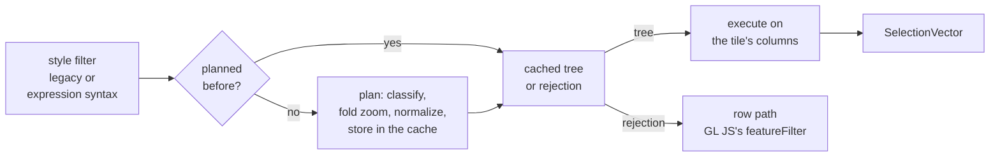
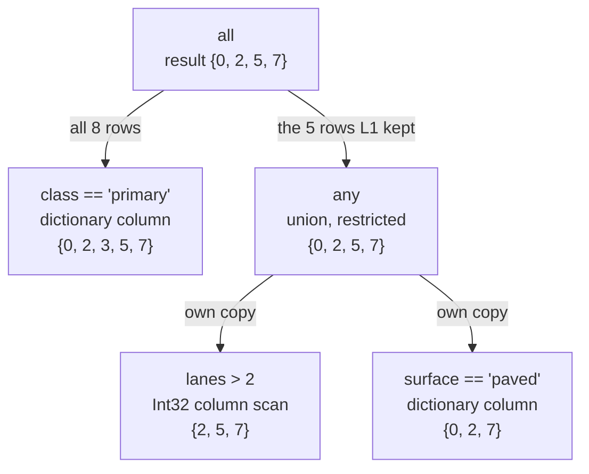

# 2. Filter engine

## The idea

A style layer's filter decides which features of a source layer it draws. On `main`, GL JS evaluates it the
same way for MLT as for MVT: per feature, as a generic expression, after building the feature object. The
filter engine evaluates it on the columns instead, and returns a [selection vector](01-selection-vectors.md).

Most of the work of a filter depends only on the filter, not on the tile: which syntax it is written in, what
each operator means, where `["zoom"]` appears. The engine therefore works in two tiers:

- **Planning** turns a style filter into a small typed tree, once per filter (and once per zoom level if
  the filter reads `["zoom"]`).
- **Execution** evaluates that tree against the columns of one tile, once per tile and style layer.

## Planning

**Classify.** The two filter syntaxes look alike but differ in places: the legacy `in` tests set membership,
the expression `in` tests substring containment. A classifier ported from the style spec decides per filter
which syntax it is.

**Normalize.** Both syntaxes become the same tree of four node kinds:

| Node | Holds | Comes from, for example |
|---|---|---|
| `constant` | `true` or `false` | a missing filter, `["all"]`, a folded zoom test |
| `leaf` | operator, target (property, geometry type or id), operands | `["==", "class", "primary"]`, `["in", ["get", "class"], ["literal", [...]]]`, `["has", "name"]` |
| `compound` | `all`, `any` or `none` over child nodes | `["all", ...]`, `["!", x]` |
| `type-check` | a target and a type name | `["==", ["typeof", ["get", "x"]], "number"]` |

A few rewrites keep the tree this small. A `match` whose outputs are booleans becomes one `in` or `!in`
leaf. A `case` becomes an `any` of `all` branches. The legacy `["==", "x", null]` becomes
`all(has x, x == null)`, because it is only true where the property exists and is null.

**Fold zoom.** At zoom 14, `["all", [">=", ["zoom"], 12], ["==", "class", "primary"]]` becomes
`["all", true, ["==", "class", "primary"]]` before it is normalized. The result is cached per zoom level.

**Reject or accept, whole.** A node that is none of the supported forms (an ordering operator on the geometry
type, a non-literal operand, a `match` with non-boolean outputs) rejects the whole filter. A filter is never
run in part, because a partly applied filter draws wrong features. The rejection is cached like a plan, and
`isColumnarBucketSupported()` logs one warning per filter that names the failing child, not the whole tree.

**Cache.** Plans are kept in a `WeakMap` keyed by the filter object. A style layer keeps the same filter object
for the life of the style, so a filter is planned once per worker, and the entry disappears when the style no
longer holds the filter.

Every filter in maptiler-basic, osm-bright and positron is supported.

## Execution

The tree is evaluated from the top, with the selection narrowing on the way down:

- `all` passes the rows its first child kept to the second, and so on, and stops once nothing is left.
- `any` gives each child its own copy of the incoming rows and unions the results.
- `none` is the complement of `any`, restricted to the incoming rows.

At a leaf, the cheapest way to test a column depends on how it is stored:

| Column | Strategy |
|---|---|
| dictionary-encoded string | test each distinct value once, then each row by a lookup of its code |
| plain string, `==` / `!=` / `in` | compare the UTF-8 bytes of the operand with the column's encoded bytes, without decoding a string |
| Int32, Int64, Float, Double | scan the raw typed array |
| anything else | read each value and compare |

Everything that depends on the operands (encoding them, building the matcher, testing the dictionary codes)
happens once per leaf, before the first row is read.

## Example

`["all", ["==", "class", "primary"], ["any", [">", "lanes", 2], ["==", "surface", "paved"]]]` against a
table of eight rows:

`class` is tested once per distinct value, not once per row. `lanes` and `surface` are only scanned on the
five rows `class` kept. Columns the filter does not name are never touched.

## Same answers as MVT

The acceptance criterion is that a columnar tile selects exactly the features the MVT path selects. The
engine follows the style spec's type rules, not JavaScript's: a string operand never equals a number, a
string column never satisfies `> 5`, and a row without a value answers each operator as the style spec does.
A 64-bit integer outside JavaScript's safe range is rounded with `Number()`, as `@mapbox/vector-tile` rounds a
64-bit varint, so both formats see the same value. The style spec's own filter test suites are ported and run
against the engine (`mvtParity.spec.ts`).

## What it is worth

The filter alone, on already decoded data, in the Node filter benchmark of the
[`@maplibre/mlt` RFC](https://github.com/maplibre/maplibre-tile-spec/issues/2010) (82 tiles per style):

| Style | MLT `main` ÷ MVT | MLT ÷ MVT |
|---|---|---|
| maptiler-basic | 1.08× | 0.34× |
| osm-bright | 1.17× | 0.23× |
| positron | 0.81× | 0.24× |

The gain depends on layer size. Planning and resolving the kernels is a fixed cost per filter, so on source
layers with 1 to 9 features the columnar filter takes 2.5-5.8× the time of MVT's row filter. From about 50
features on it is faster, and on layers with 1,000 or more features it takes 0.14-0.25× of MVT. Decoding and
filtering together stay below MVT at every zoom level, at worst 0.96× (positron, z2).

In the browser the filter is a small part of the worker's time. In a maptiler-basic session trace the
filtering itself is about equal to MVT's (86 against 89 ms per session), plus 69 ms of decoding the columns
the filters read first, which MVT spends in its own decoding
([page 5](05-decode-performance.md), [page 12](12-worker-performance.md)).

## In the code

Branch [`feat2-filter-engine`](https://github.com/Salkin975/maplibre-tile-spec/compare/feat1-vector-infrastructure...feat2-filter-engine),
in `ts/src/processing/filter/` of maplibre-tile-spec. All files are new:

- `normalizedFilter.ts`: the tree.
- `planning/filterClassification.ts`, `filterNormalization.ts`, `zoomResolution.ts`: planning.
- `filterCache.ts`: the `WeakMap` cache.
- `planning/bucketSupport.ts`: `isColumnarBucketSupported()`, the gate GL JS calls, with its warning.
- `execution/filterExecution.ts`, `filterKernel.ts`: the tree walk and the kernels.
- `execution/tableFilter.ts`: `filterFeatureTable()`, one call for planning and execution.
