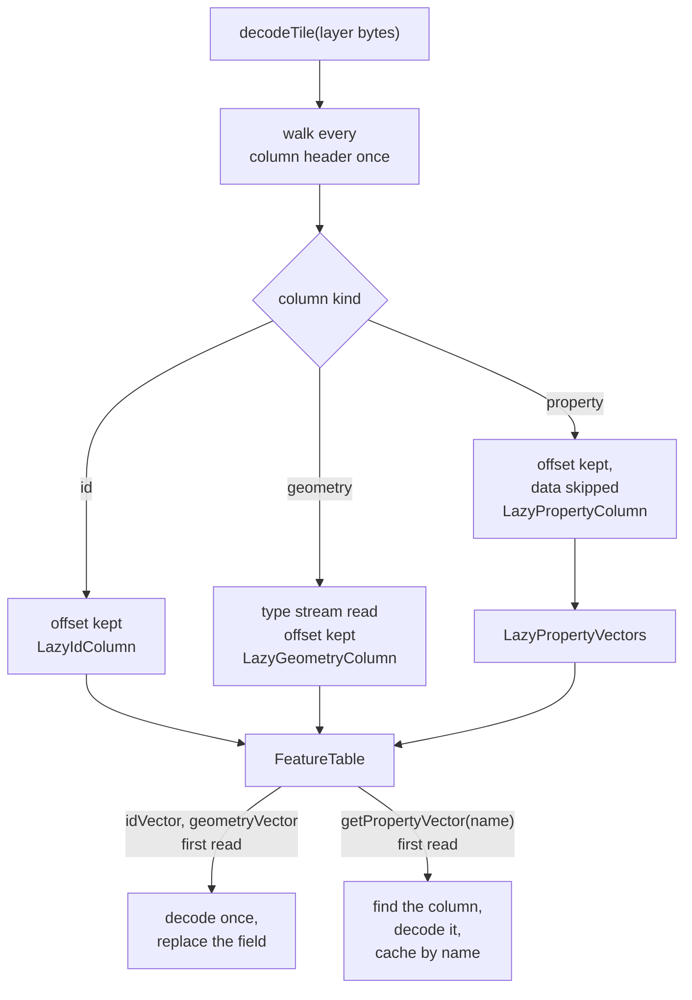

# 3. Lazy decoding

## The idea

`decodeTile()` used to decode every stream of every column of every layer in one pass, whatever the caller
then read. A style rarely reads everything: a filter reads two or three columns, a fill bucket reads the
geometry and the properties its paint expressions use, and many layers of a tile are not drawn at a given
zoom at all.

With lazy decoding a column's data is decoded the first time it is read, not when the tile is loaded. A
layer that reads three columns pays for three columns. A caller that reads everything, such as
`getFeatures()`, gets the same result as before.

## Headers now, data later

A column's position in the tile is only known by reading past every column before it, so the headers cannot
be deferred. `decodeTile()` therefore makes one pass over every column header of a layer, records where each
column's data starts, and skips the data:



- **Id and geometry** are held as small records (`LazyIdColumn`, `LazyGeometryColumn`) with the tile bytes
  and an offset. On first access the table decodes the column and replaces the record with the decoded
  vector, so every later access is an ordinary field read.
- **Property columns** are resolved by name. `getPropertyVector("class")` finds the column called `class`,
  decodes it and caches it. A name no column has is remembered as a miss, so it is searched for only once.
  A struct column with a shared dictionary (`name`, `name:en`, `name:de`) is decoded as one unit.
- The number of features comes from the header walk (the geometry's type stream, or the id column), so
  `numFeatures` never forces a geometry decode.

## Example

A `place` layer with the columns `id`, geometry, `class`, `rank`, `capital` and a `name` struct with ten
language children. A label layer filters on `class` and reads `name:en` for its text.

```
decodeTile()   all 6 headers walked, offsets kept    only the geometry types read
filter         getPropertyVector("class")      → class decoded             1 column
bucket         first feature read              → geometry and id decoded   3 columns
text           getPropertyVector("name:en")    → the whole name struct     4 columns
never read     rank, capital
```

Reading `name:en` decodes all eleven names of the struct at once, because they share one dictionary.

## What it costs

- **The tile buffer stays alive.** The lazy records point into the tile's bytes until each column is decoded.
  A caller must not reuse or transfer that buffer while a table built from it is in use. GL JS keeps the
  raw tile bytes anyway, so this costs it nothing extra.
- **Errors arrive later.** A corrupt column is only reported when it is first read. The header walk checks
  that it stayed inside its block, so a misaligned offset fails there, close to its cause.
- **MAP columns are not lazy.** Their layout has no length or end marker, so walking past one means decoding
  it. It is decoded and discarded whenever the walk passes over it.
- **A copy of the scaling.** The geometry scaling object is owned by the caller and rewritten per tile, so
  each lazy geometry column keeps a snapshot of it. Otherwise a deferred decode would use the values of
  whichever tile was decoded last.

## Giving the memory back

Laziness also makes the reverse possible. `FeatureTable.releaseDecodedColumns()` (added with
[page 5](05-decode-performance.md)) puts the lazy records back in place of the decoded vectors. The table
returns to the state `decodeTile()` left it in, and a later read decodes the column again from the bytes.
GL JS calls it at the end of every parse ([page 7](07-dispatch.md)).

## What it is worth

In the Node filter benchmark of the [`@maplibre/mlt` RFC](https://github.com/maplibre/maplibre-tile-spec/issues/2010), the tile decoding
part (the block scan, lazy `decodeTile()` for the layers the style reads, and the columns the filters and
buckets read) takes 0.17-0.19× the time of MLT on `main`, which decodes everything. In GL JS session traces,
tile decoding falls from 426 to 113 ms per maptiler-basic session (from 478 to 148 ms for pre-tessellated
tiles). Both numbers include the decoder speedups of [page 5](05-decode-performance.md) and, in GL JS, the
lazy layers of the [facade](06-mlt-facade.md).

The skeleton saves memory, not decode time: decoding all columns again after a release takes about 2.6 ms
per tile, the same as a fresh decode. Retained memory after a full decode is about 500 KB per tile, after a
release 29 KB.

## In the code

Branch [`feat3-lazy-decoding`](https://github.com/Salkin975/maplibre-tile-spec/compare/feat2-filter-engine...feat3-lazy-decoding),
in `ts/src/` of maplibre-tile-spec:

- `mltDecoder.ts`: the header walk, and how each column kind is skipped.
- `vector/featureTable.ts`: `LazyIdColumn`, `LazyGeometryColumn`, decoding on first access.
- `vector/lazyPropertyVectors.ts`: property columns resolved by name.
- `decoding/idColumnDecoder.ts`: the id column's decode, runnable from a recorded offset.
- `decoding/integerDecodingUtils.ts`: `readVarint()`, a single varint without an allocation.
