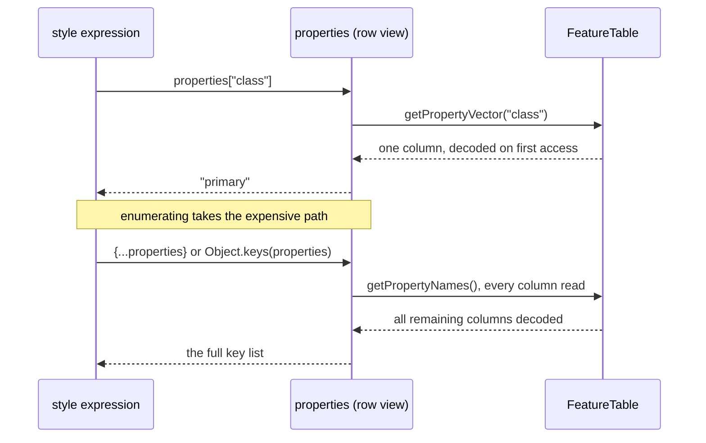

# 4. Adapter primitives

## The idea

To treat an MLT tile as a lazily decoded, row-shaped tile, the first version of the GL JS facade had to know
the MLT format from the outside: how to find a tile's layers without decoding them, how to turn a 64-bit
value into what MVT would report, and how to read one row's properties column by column. None of that is
GL JS knowledge. It moves into `@maplibre/mlt`, the package that owns the format, as three functions any
consumer can use: a tile inspector, a command-line diff tool or a second renderer as much as GL JS.

| Function | Does |
|---|---|
| `scanLayerBlocks(tile)` | finds each layer's name and bytes without decoding a column |
| `toMvtValue(value)` | converts a decoded value to what MVT reports for it |
| `createRowView(featureTable, row)` | a properties object that reads one column per property accessed |

## Finding the layers: `scanLayerBlocks()`

An MLT tile is a sequence of length-prefixed blocks, one per layer, and the layer's name is the first field
of each block. `decodeTile()` cannot stop after the name: its metadata decoder always continues into the
full column list.

```ts
// embeddedTilesetMetadataDecoder.ts
table.name = decodeString(bytes, offset);          // scanLayerBlocks() stops here
const extent = decodeVarintInt32(bytes, offset, 1)[0] >>> 0;
const columnCount = decodeVarintInt32(bytes, offset, 1)[0] >>> 0;
for (let j = 0; j < columnCount; j++) {
    table.columns[j] = decodeColumn(bytes, offset); // decodeTile() always goes on
}
```

`scanLayerBlocks()` reads each block's length and tag, reads the name, and jumps to the next block. It returns
`{name, bytes}` per layer, where `bytes` starts at the block's length prefix, so `decodeTile(block.bytes)`
reads one layer as if it were a whole tile. Its cost grows with the number of layers, not with the number of
columns or features. Both functions read a block's prefix through the same `readBlockPrefix()`, so a change
to the framing stays in one place.

## 64-bit values: `toMvtValue()`

MLT can store ids and integer properties as 64-bit values, which JavaScript can only hold exactly as
`bigint`. `@mapbox/vector-tile` reads a 64-bit varint into a JS number and rounds it. `toMvtValue()` does the
same, so a GL JS bucket sees the same ids and values for both formats:

```
toMvtValue(42n)              → 42
toMvtValue(2n ** 53n + 1n)   → 9007199254740992   rounded to 2 ** 53, as in MVT
toMvtValue("primary")        → "primary"          not a bigint: passed through
toMvtValue(null)             → undefined
```

An earlier version dropped unsafe values with a warning. Rounding is what MVT does, and a style's operands are
JS numbers anyway, so dropping a value only turned a possible false match into a certain miss.
`FeatureTable.getFeatures()` still returns exact `bigint`s; rounding is the consumer's choice.

## Properties: `createRowView()`

A style expression reads `feature.properties["class"]`. On `main` the facade copies every property of every
feature into an object first. The row view is a `Proxy` that looks up the column on each access instead:



- `get` and `in` read one column, through `toMvtValue()`. A `null` value counts as absent, as in MVT.
- `Object.keys()`, a spread and `hasOwnProperty` work, because the view also answers `ownKeys` and
  `getOwnPropertyDescriptor`. They decode every property column the layer has left.
- `FeatureTable.getPropertyNames()` lists each column name once. The decoder does not guarantee unique names,
  and a proxy must not report a key twice.

## What stays in GL JS

The three classes that implement GL JS's `VectorTileLike` interfaces, the lazy layer getter, the mapping of
MLT's six geometry types onto GL JS's four, and the `isMLTVectorTileLayer()` guard. They only make sense
inside GL JS ([page 6](06-mlt-facade.md)).

## What it is worth

This page moves code, it does not make anything faster. The facade in GL JS shrinks to the parts that are its
own, and other consumers get the same primitives with the format's tests behind them. The branch also renames
the code added on pages 1 to 3 to the package's naming convention.

## In the code

Branch [`feat4-adapter-primitives`](https://github.com/Salkin975/maplibre-tile-spec/compare/feat3-lazy-decoding...feat4-adapter-primitives),
in `ts/src/` of maplibre-tile-spec:

- `mltDecoder.ts`: `readBlockPrefix()`, `scanLayerBlocks()`.
- `decoding/mvtValue.ts`: `toMvtValue()`.
- `vector/rowView.ts`: `createRowView()`.
- `vector/featureTable.ts`: `getPropertyNames()`.
