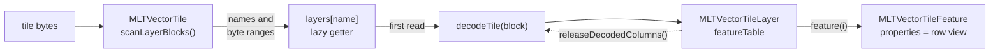
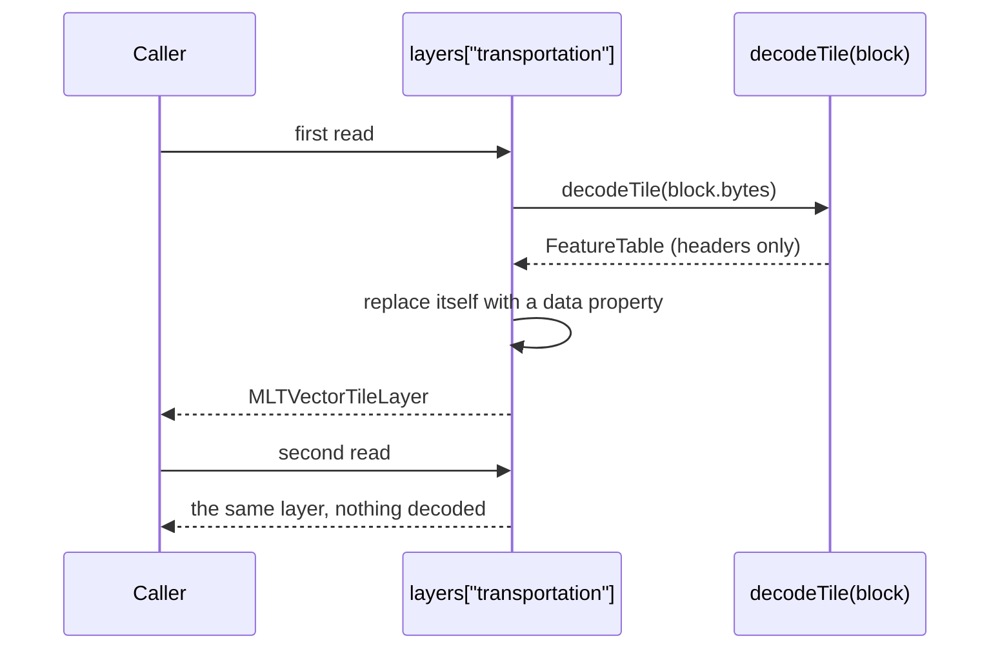

# 6. MLT facade

## The idea

GL JS is built around one interface for vector tiles, `VectorTileLike`: a tile has layers, a layer has
features, a feature has a type, an id, properties and `loadGeometry()`. Buckets, style expressions and
`queryRenderedFeatures` all program against it. An MLT tile has to work anywhere that interface is
expected, so nothing downstream has to change.

On `main`, `MLTVectorTile` meets the interface by decoding every layer in its constructor and calling
`getFeatures()` on each, which builds an object with copied properties for every feature. The facade now
meets it while decoding nothing up front: layers, columns and properties are decoded when something reads
them, and the owner of a tile can give the decoded columns back.

## Layers that decode themselves

The constructor runs the block scan of [page 4](04-adapter-primitives.md) and installs one getter per layer
on `tile.layers`. The first read of a layer calls `decodeTile()` on that layer's bytes and replaces the getter
with a plain data property, so the second read is an ordinary field access:

Listing the layers (`Object.keys(tile.layers)`) decodes nothing. A layer no style layer reads is never
decoded past its name.

`tile.layers` is created with `Object.create(null)`, not `{}`. Turning getters into data properties on a plain
object changed hidden classes that V8 shares with every object created from `{}`, and sent an unrelated
`for...in` loop in GL JS into thousands of deoptimizations per session in Chromium. The one-line fix and its
measurement are on [page 12](12-worker-performance.md).

## Features

- **Type and id** are read when the feature is created: both are single reads, and nearly every caller needs
  them right away. The id goes through `toMvtValue()`, so a 64-bit id is rounded as MVT rounds it.
- **Properties** are the row view of [page 4](04-adapter-primitives.md): reading one property decodes one
  column. A feature with thirty properties, of which a style reads two, costs two column reads instead of
  thirty copies.
- **Geometry** is read by `loadGeometry()` straight from the vertex buffer and the offsets, one GL JS `Point`
  per vertex. Morton-coded vertices go through the package's `getGeometry()`, which decodes them. A
  pre-tessellated layer without ring topology returns its triangles as closed rings, each wound like an MVT
  outer ring, so hit testing finds the same features ([page 9](09-fill-bucket.md)).

`loadGeometry()` returns new points on every call, because bucket code changes the rings it gets in place.

## Copies for queries

On the main thread, `queryRenderedFeatures` reads the raw tile again through its own `MLTVectorTile`. It sets
the option `copyProperties`, so the features it returns have plain property objects: the caller can write to
them, clone them and post them, and they do not keep the tile's columns alive. A query reads few features, so
copying is cheap there. The worker never copies.

## Giving the columns back

| Call | Effect |
|---|---|
| `MLTVectorTileLayer.releaseDecodedColumns()` | the layer's decoded id, geometry and property columns are dropped; their positions in the tile bytes stay |
| `MLTVectorTile.releaseDecodedColumns()` | releases every layer that has been read; an unread layer is still its getter and is left alone |

To find the layers that were read, the tile looks at each property's descriptor, not its value; reading the
value would run the getter and decode a layer just to release it. Features handed out earlier stay valid:
their next read decodes the column again. The facade never releases on its own; the worker decides when
([page 7](07-dispatch.md)).

## What it is worth

Reading geometry straight from the vertex buffer, instead of building a tuple and a point of the package's own
class per vertex and copying it into a GL JS `Point`, took MLT tile parsing in the NRW parse benchmark from
1,257 to 1,121 ms per round for osm-bright, and from 927 to 852 ms for positron. The lazy layers and the
release are part of the session-trace results on the [overview](index.md): tile decoding 426 → 113 ms and peak
worker heap 201 → 61 MB per maptiler-basic session.

## In the code

Branch [`gl1-mlt-facade`](https://github.com/Salkin975/maplibre-gl-js/compare/main...gl1-mlt-facade) in
maplibre-gl-js: `src/source/vector_tile_mlt.ts`, and one line in `src/data/feature_index.ts` for the copied
properties. The geometry reading and `Object.create(null)` came later, on
[`gl7-performance-optimization`](https://github.com/Salkin975/maplibre-gl-js/compare/gl6-symbol-bucket...gl7-performance-optimization),
the tessellated geometry with the [fill bucket](09-fill-bucket.md).
