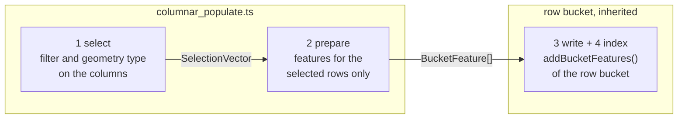

# 8. Shared populate pipeline

## The idea

Every row bucket in GL JS runs the same loop:

```ts
for (const {feature, id, index, sourceLayerIndex} of features) {
    const evaluationFeature = toEvaluationFeature(feature, needGeometry);
    if (!layer._featureFilter.filter(globalProperties, evaluationFeature, canonical)) continue;
    evaluationFeature.geometry = loadGeometry(feature);
    this.addFeature(...);
}
```

For a columnar tile three of its costs can be avoided: every feature is built, including the ones the filter
then drops; the filter walks a generic expression tree per feature instead of scanning a typed column; and
every feature's properties are copied, although the column already holds the values.

A columnar bucket splits this into four steps. The first two are the same for every bucket and exist once, in
a shared module. The last two stay in the row bucket the columnar bucket inherits from, so both paths write
with the same code.



## 1. Select

```ts
const filterSelection = filterFeatureTable(featureTable, layer.filter, zoom);
if (!renderableGeometryTypes) return filterSelection;
const geometrySelection = unionSelectionVectors(
    renderableGeometryTypes.map((t) => featureTable.geometryVector.filter(t)),
    featureTable.numFeatures,
);
return intersectSelectionVectors(filterSelection, geometrySelection);
```

- Only the line bucket narrows by geometry type (LineStrings and Polygons). `FillBucket` fills whatever the
  filter selects, lines included, and `SymbolBucket` takes every type, so their columnar versions do the same.
- The geometry-type selection is cached per geometry vector, so the other line layers of the same source
  layer reuse it. A pre-tessellated layer holds only polygons and skips it.
- If the filter cannot be planned here, `select` throws instead of falling back. `createBucket()` only chose a
  columnar bucket because the same question was answered with yes, so a failure means the two checks
  disagree, and that should be visible.

## 2. Prepare

For each selected row, and no other, the layer's `feature(i)` is read and turned into the `BucketFeature`
the style expressions run against.

- **Properties** stay a row view, so a paint expression pays for the columns it reads.
- **Id** comes from `featureIndex.getId()`, the call the row path makes. It applies the source's `promoteId`,
  so feature state finds a columnar feature under the same id as a row feature.
- **Sort key** is evaluated only when it is data-driven. With a constant sort key the tile's order is already
  the drawing order.
- **Geometry** is the decoded rings by default. A bucket can pass a cheaper resolver: the fill bucket, when it
  writes from the tile's own geometry, passes bounding boxes, because the spatial index only needs boxes
  ([page 9](09-fill-bucket.md)).
- If decoding a feature's rings fails, it gets an empty geometry and one warning. Only hit testing of that
  feature is affected.

## 3 and 4. Write and index, inherited

Each row bucket's `populate()` is split into its filter loop and a protected method,
`addBucketFeatures(bucketFeatures, featureAt, options, canonical)`, which holds the rest:

- sort by a data-driven sort key,
- park a feature whose pattern or dash image is not in the atlas yet, to be written in `addFeatures()`,
- write the vertices and indices of every other feature,
- insert each feature into the `FeatureIndex` for `queryRenderedFeatures`.

The row bucket calls it after its loop, the columnar bucket after step 2. Sorting, deferral, writing and
indexing exist once, and a change on `main` reaches both paths.

## Back to the main thread

Buckets are transferred from the worker to the main thread. The two fields only the worker reads,
`isColumnar` and `sourceLayerIndex`, are kept out of the transfer. The symbol bucket keeps `sourceLayerIndex`,
because symbol queries need it on the main thread.

## What it is worth

Measured in the NRW parse benchmark (twelve z12 tiles of Cologne, per round) for three later changes to
the pipeline and the line bucket: each line feature read once and the same object given to the spatial
index, the geometry-type selection cached per table, and the line clip columns looked up once per table
instead of once per feature. Columnar line `populate` went from 587 to 454 ms for osm-bright and from 538 to
350 ms for positron, and the geometry-type scans from 189 to 78 ms over the positron run. Writing and indexing
lines now cost what they cost for MVT.

## In the code

Branch [`gl3-populate-pipeline`](https://github.com/Salkin975/maplibre-gl-js/compare/gl2-dispatch...gl3-populate-pipeline)
in maplibre-gl-js: `src/data/bucket/columnar/columnar_populate.ts` and its test. Each row bucket's
`addBucketFeatures()` arrives with its columnar bucket (pages 9 to 11), the caching and the single read per
feature with [`gl7-performance-optimization`](https://github.com/Salkin975/maplibre-gl-js/compare/gl6-symbol-bucket...gl7-performance-optimization).
