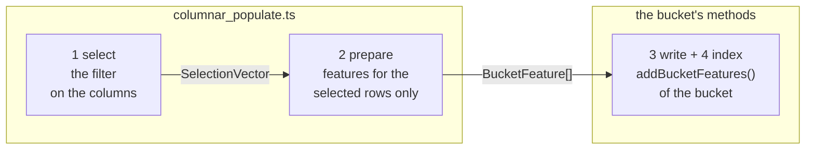

# 8. Shared populate pipeline

## The idea

Every row bucket in GL JS runs the same loop:

```ts
for (const {feature, id, index, sourceLayerIndex} of features) {
    const evaluationFeature = toEvaluationFeature(feature, needGeometry);
    if (!layer._featureFilter.filter(globalProperties, evaluationFeature, canonical)) continue;
    evaluationFeature.geometry = loadGeometry(feature);
    this.addFeature(...);
}
```

For a columnar tile three of its costs can be avoided: every feature is built, including the ones the filter
then drops; the filter walks a generic expression tree per feature instead of scanning a typed column; and
every feature's properties are copied, although the column already holds the values.

A columnar populate splits this into four steps. The first two are the same for every bucket and exist once,
in a shared module. The last two are the row bucket's own methods, so both paths write with the same code.



Each bucket's `populate()` takes either the row list or an MLT layer. A row list runs the row loop. A layer
goes to a standalone function, `populateColumnarFill()`, `populateColumnarLine()` or
`populateColumnarSymbol()`, which runs the four steps with the bucket as its first argument
([page 9](09-fill-bucket.md), [10](10-line-bucket.md), [11](11-symbol-bucket.md)).

## 1. Select

```ts
const selection = filterFeatureTable(featureTable, filter, zoom);
if (!selection) throw new Error('Columnar bucket filter could not be planned. …');
return selection;
```

`selectColumnarFeatures()` applies the layer's filter and nothing else.

- Only the line path narrows by geometry type, to LineStrings and Polygons, and caches that selection per
  geometry vector so the other line layers of the same source layer reuse it ([page 10](10-line-bucket.md)).
  `FillBucket` fills whatever the filter selects, lines included, and `SymbolBucket` takes every type.
- If the filter cannot be planned here, `select` throws instead of falling back. The bucket is columnar only
  because its constructor asked the same question and got yes ([page 7](07-dispatch.md)), so a failure means
  the two checks disagree, and that should be visible.

## 2. Prepare

For each selected row, and no other, the layer's `feature(i)` is read and turned into the `BucketFeature`
the style expressions run against.

- **Properties** stay a row view, so a paint expression pays for the columns it reads.
- **Id** comes from `featureIndex.getId()`, the call the row path makes. It applies the source's `promoteId`,
  so feature state finds a columnar feature under the same id as a row feature.
- **Sort key** is evaluated only when it is data-driven. With a constant sort key the tile's order is already
  the drawing order.
- **Geometry** is the decoded rings by default. A path can pass a cheaper resolver: the fill path, when it
  writes from the tile's own geometry, passes bounding boxes, because the spatial index only needs boxes
  ([page 9](09-fill-bucket.md)).
- **The source feature** of each row is kept, so the spatial index gets the object that was already read.
- If decoding a feature's rings fails, it gets an empty geometry and one warning. Only hit testing of that
  feature is affected.

## 3 and 4. Write and index

The fill and line buckets hold the rest in `addBucketFeatures(bucketFeatures, featureAt, options, canonical)`:

- sort by a data-driven sort key,
- park a feature whose pattern or dash image is not in the atlas yet, to be written in `addFeatures()`,
- write the vertices and indices of every other feature,
- insert each feature into the `FeatureIndex` for `queryRenderedFeatures`.

The row loop calls it after its filter, the columnar populate after step 2. Sorting, deferral, writing and
indexing exist once, and a change on `main` reaches both paths. The symbol bucket writes no vertices and
enters no feature into the index; both paths call its `addSymbolFeature()` and `finishSymbolFeatures()`
instead.

## Back to the main thread

Buckets are transferred from the worker to the main thread. The fields only the worker reads are kept out of
the transfer:

| Bucket | Left out |
|---|---|
| fill | `isColumnar`, `sourceLayerIndex`, `tileGeometry` |
| line | `isColumnar`, `sourceLayerIndex`, `hasLineClipColumns` |
| symbol | `isColumnar` |

The symbol bucket keeps `sourceLayerIndex`, because symbol queries need it on the main thread. A test per
bucket sends a populated bucket through the transfer and checks that these fields do not arrive.

## What it is worth

Measured in the NRW parse benchmark (twelve z12 tiles of Cologne, per round) for three later changes to
the pipeline and the line path: each line feature read once and the same object given to the spatial
index, the geometry-type selection cached per table, and the line clip columns looked up once per table
instead of once per feature. Columnar line `populate` went from 587 to 454 ms for osm-bright and from 538 to
350 ms for positron, and the geometry-type scans from 189 to 78 ms over the positron run. Writing and indexing
lines now cost what they cost for MVT.

## In the code

Branch [`gl8-review-feedback`](https://github.com/Salkin975/maplibre-gl-js/tree/gl8-review-feedback)
in maplibre-gl-js: `src/data/bucket/columnar/columnar_populate.ts` and its test. Each row bucket's
`addBucketFeatures()` is in `src/data/bucket/fill_bucket.ts` and `src/data/bucket/line_bucket.ts`
(pages 9 and 10); the transfer test is `src/util/web_worker_transfer.test.ts`.
