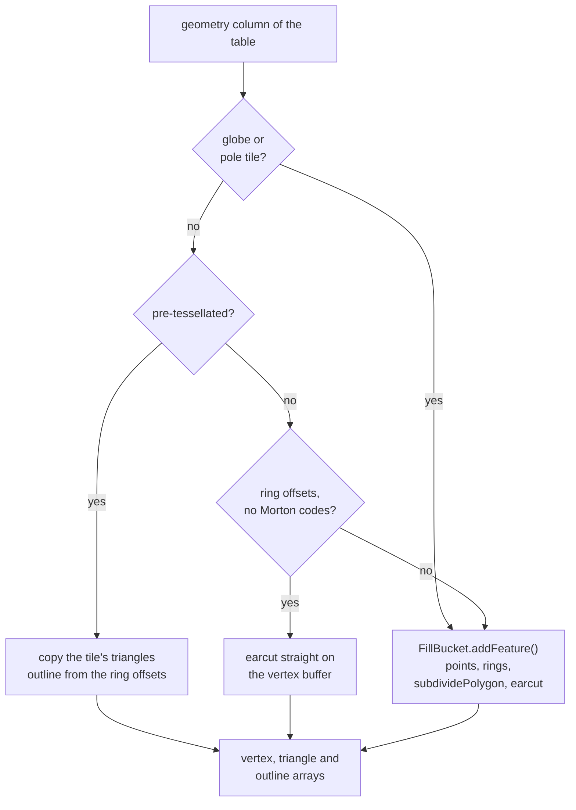

# 9. Fill bucket

## The idea

This is where the format's largest advantage lies. An MLT tile can carry its polygons **pre-tessellated**:
the triangles a GPU draws are computed once, when the tile is encoded. On `main` GL JS throws them away and
triangulates every polygon again with earcut, so a pre-tessellated tile costs as much as a plain one.

The row `FillBucket` does a lot per polygon: it makes a `Point` of every vertex, groups the rings into
polygons, and runs `subdividePolygon()` and earcut. In Mercator `subdividePolygon()` subdivides nothing, but
it still deduplicates every vertex through a `Map`, remaps the indices, fixes the winding and builds the
outline: about 330 ms per maptiler-basic session for plain MLT, on top of the points.

`ColumnarFillBucket` inherits from `FillBucket` and picks, per table, the cheapest way to write the same
fill:



## Pre-tessellated: copy the triangles

A feature's triangles index into the layer's shared vertex buffer, counted from the feature's first vertex.
The bucket appends the feature's vertices, offsets the triangle indices by the segment's vertex base, and
takes the outline edges from the ring offsets. Nothing is triangulated, deduplicated or matched by position.

```
feature       a square, one ring, pre-tessellated when the tile was encoded
              (tile extent 4096)
vertexBuffer  (0,0) (100,0) (100,100) (0,100)   the ring, without its closing point
indexBuffer   0 1 2   0 2 3                     two triangles, from the first vertex
ring offsets  vertices [0, 4)

vertices      scaled to GL JS's extent 8192: (0,0) (200,0) (200,200) (0,200)
triangles     + the segment's vertex base; winding checked by the cross product,
              a wrongly wound (a, b, c) written as (a, c, b)
outline       0-1  1-2  2-3, and the closing edge 3-0
earcut        not called
```

- **Scaling** rounds and clamps each coordinate as `loadGeometry()` does, so the vertices equal the row
  path's.
- **Winding** is checked per triangle, because a tessellator guarantees no orientation. The result is
  counter-clockwise, as `fixWindingOrder()` makes it.
- **Large features** that do not fit one segment go through `fillLargeMeshArrays()`, like in `FillBucket`.
- **The arrays are sized once per table** from the offsets before writing, so they do not grow and copy.

## Plain tiles: earcut on the vertex buffer

A ring-encoded polygon is still triangulated, but without making a point of each vertex:

1. **Read the rings** from the offsets and the vertex buffer as one flat coordinate list, scaled and clamped
   as `loadGeometry()` does it, including its warning when a coordinate had to be clamped.
2. **Group the rings into polygons** by their winding, as `classifyRings()` does: a ring that winds like the
   first starts a polygon, every other ring is a hole of the one before it, and a polygon keeps its 500
   largest rings, the limit `FillBucket` uses.
3. **Triangulate** each polygon with earcut on the flat coordinates, and fix the winding.
4. **Write** through `fillLargeMeshArrays()`, the function `FillBucket.addFeature()` ends in.

This skips the vertex deduplication of `subdividePolygon()`, its largest cost. A repeated position, such as
the vertex that closes a ring, is written twice. The triangles and outline edges drawn are the same, and the
bucket holds about 5 % more vertices: 515,805 instead of 489,485 on 53 tiles of North Rhine-Westphalia.

The path needs the ring offsets (the rings of a polygon cannot be found without them) and no Morton-coded
vertices (a Morton code has to be decoded per vertex).

## Globe and poles: the row path

`subdividePolygon()` changes a fill in two cases. On the globe it cuts triangles along a grid, so long edges
follow the sphere. In a tile at the north or south edge of the world it extends the polygons to the pole.
Neither direct path subdivides, so in such a tile the bucket takes neither: the tile's triangles are ignored,
and every feature goes through `FillBucket.addFeature()`, exactly as for MVT. The globe keeps the row path's
cost and its exact output; the direct paths are a Mercator optimization.

## Everything else

- **Lines and points in a fill layer.** `FillBucket` does not tell geometry types apart: it fills a line as
  the area it encloses. The columnar bucket must draw the same, so its selection is not narrowed to polygons,
  and a line or point the filter selects goes through `FillBucket.addFeature()`.
- **Spatial index.** When the bucket writes from the tile's geometry, `FeatureIndex.insert()` is the only
  reader of the feature's geometry, and it only computes a bounding box per ring. So the bucket gives it boxes:
  one per feature for pre-tessellated tables, one per ring for earcut. The grid cells are the same as the row
  path's.
- **Layers without ring topology.** Some pre-tessellated tiles omit the ring offsets to save bytes. Such a
  layer is drawn from its triangles but has no outline, so `fill-outline-color` has no effect, and the bucket
  warns once. Whether the encoder should be required to keep ring topology for drawn layers is an open
  question of the [GL JS RFC](https://github.com/maplibre/maplibre-gl-js/issues/8985).

## What it is worth

Building fill and line buckets, earcut included, per maptiler-basic session in the session traces of the
[overview](index.md):

| | MVT | MLT, `main` | MLT, changes | pre-tessellated MLT, `main` | pre-tessellated MLT, changes |
|---|---|---|---|---|---|
| fill and line buckets | 765 ms | 764 ms | 505 ms | 770 ms | **272 ms** |

- The earcut path alone, against `FillBucket` on the same tables in the NRW parse benchmark: fill `populate`
  plus `addFeatures` -21 % for osm-bright (92.5 → 73.4 ms per round) and positron (60.3 → 47.4 ms), which is
  3-4 % of the whole parse. `ColumnarFillBucket.populate()` alone took 0.49-0.74× its earlier time (median
  0.56×) in a Node A/B.
- In the browser the pre-tessellated tiles barely run earcut: 2 ms against 545 ms for MVT in a
  maptiler-basic session ([page 12](12-worker-performance.md)).

Correctness: on 53 NRW tiles (z5 to z14, 166 polygon layers, 442,779 triangles), the triangles, outline edges
and index boxes equal `FillBucket`'s in every layer. On the globe and in pole tiles the bucket writes byte for
byte what `FillBucket` writes.

## In the code

Branch [`gl4-fill-bucket`](https://github.com/Salkin975/maplibre-gl-js/compare/gl3-populate-pipeline...gl4-fill-bucket)
in maplibre-gl-js:

- `src/data/bucket/columnar/columnar_fill_bucket.ts`: the choice per table, the earcut path, the boxes.
- `src/data/bucket/columnar/columnar_mesh_arrays.ts`: writing pre-tessellated meshes.
- `src/data/bucket/fill_bucket.ts`: `addBucketFeatures()`, split out of `populate()`.
- `src/style/style_layer/fill_style_layer.ts`: `createBucket()`.
- `src/source/vector_tile_mlt.ts`: triangles as rings for layers without ring topology.
