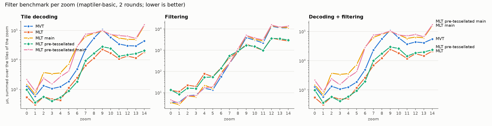
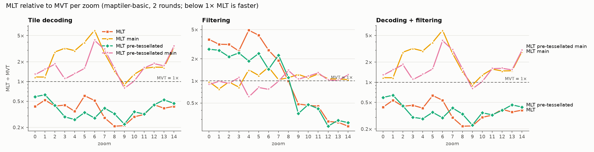
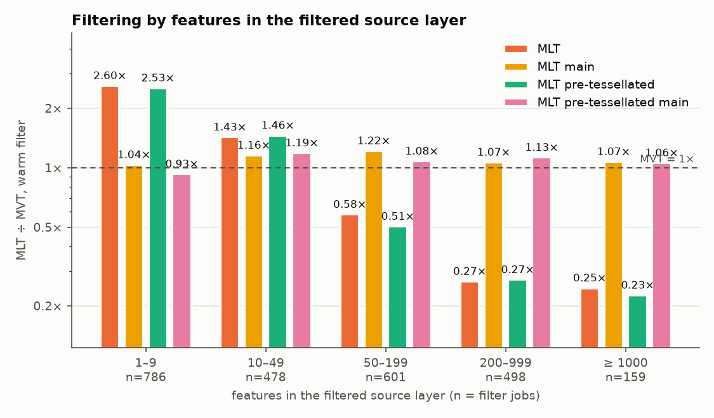
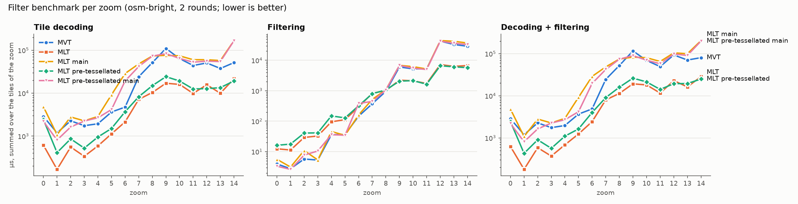
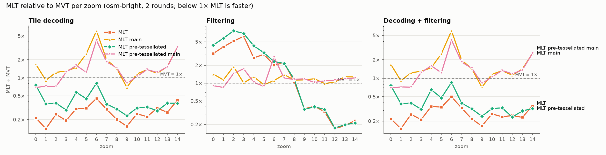
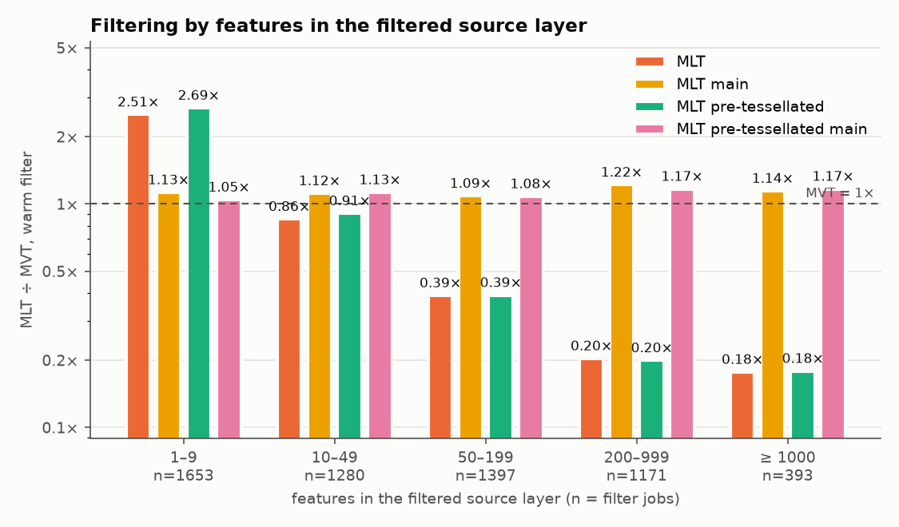
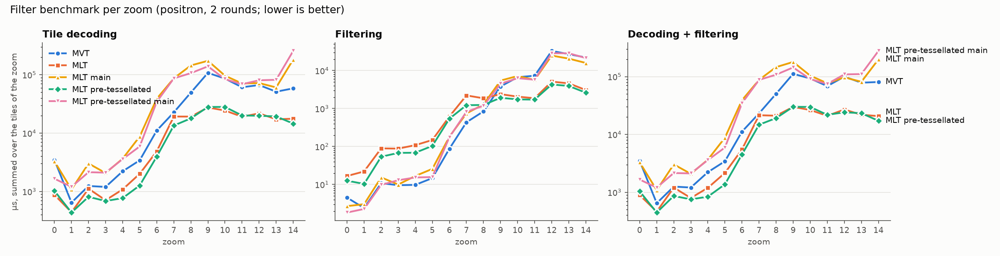
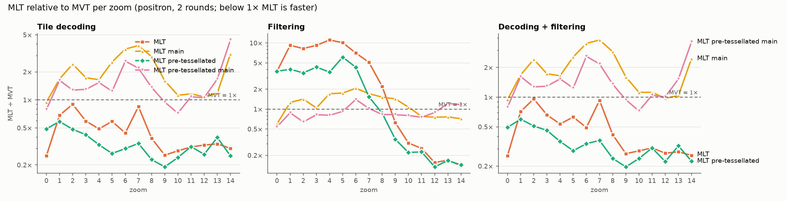
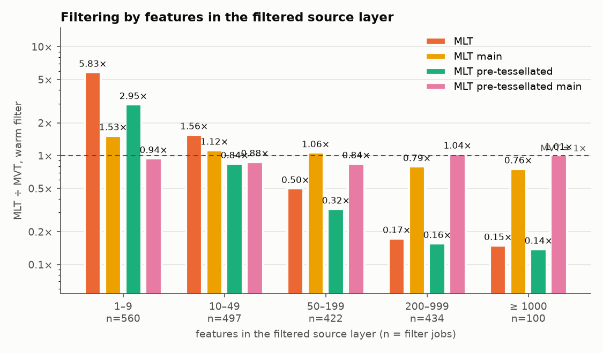

# Filter benchmark plots

Plots from the Node filter benchmark (`benchmarking/filter-bench`), the runs from 30 October 2026 behind the tables in the [tile-spec issue](https://github.com/maplibre/maplibre-tile-spec/issues/2010).

> **These numbers are noisy.** Each run had only 2 measured rounds. MVT on the same tiles varied by up to 1.20× between runs, and every ratio is divided by its own run's MVT time. Read the plots for trends, not for exact factors. The headline numbers are the GL JS session traces in the [GL JS issue](https://github.com/maplibre/maplibre-gl-js/issues/8985).

## Setup

- **What is timed:** one tile, from its unzipped bytes up to the point where GL JS would start writing vertices: decoding the tile, running every style-layer filter once, and reading the geometry and the properties the bucket uses for the kept features.
- **Three parts:**
  - **Decoding + filtering:** the whole pass
  - **Filtering:** the filter alone on already decoded data, the mean of 20 warm runs
  - **Tile decoding:** the difference between the two
- **Tiles:** around Cologne, z0–14, a 3×3 grid per zoom, 82 tiles per style
- **Rounds:** one warm-up round and two measured rounds, with the formats rotating
- **Runtime:** Node 26.6
- **Formats:**
  - **MVT:** `@mapbox/vector-tile` and the style spec's `featureFilter`
  - **MLT main:** tile spec `main` (`71f20ee8`) read through GL JS `main`'s `MLTVectorTile` (`bb38954083`), then the same row filter as MVT
  - **MLT:** the columnar changes
  - **Pre-tessellated** variants of both MLT formats

Colours: MVT blue, MLT orange, MLT main yellow, pre-tessellated MLT green, pre-tessellated MLT main pink.

## How to read them

- **Per-zoom plots:** time in µs summed over the tiles of each zoom level, on a log scale. Lower is better.
- **Ratio plots:** the same data as MLT ÷ MVT. Below the dashed 1× line, MLT is faster.
- **Layer-size plots:** the warm filter alone as MLT ÷ MVT, grouped by the number of features in the filtered source layer. *n* is the number of filter jobs in each group.

## maptiler-basic

## osm-bright

## positron

## What the plots show

- **Tile decoding:** MLT stays well below MVT at every zoom level, while MLT main is above it at almost every zoom. Lazy decoding means only the columns the style reads are decoded.
- **Filtering alone:** the columnar filter is slower than MVT at z0–8, where source layers are small, and much faster from about z9 on. The layer-size plots show the reason: on layers with 1–9 features the columnar filter alone is about 2.5× MVT on maptiler-basic, while on layers with 200 features or more it's about 0.25×. That's the fixed cost per filter of planning and resolving the kernels.
- **Decoding + filtering:** because decoding dominates, the whole pass stays below MVT at every zoom.
- **Pre-tessellated tiles:** they follow plain MLT closely.
  - **osm-bright:** decoding is higher at most zoom levels, because the triangle index stream is decoded too.
  - **positron:** decoding is lower at most zoom levels. That's mostly noise in the denominator: the pre-tessellated tiles ran in a separate run, and the MVT time of that run was about 1.20× higher.
  - **Filtering:** in no style is the filter itself slower on pre-tessellated tiles.
- **Noise:** with 2 rounds and 9 tiles per zoom, single spikes are likely noise, especially when they appear in only one style (plain MLT at z7 on positron). The peak of MLT main around z6 appears in all three styles, so it's a real effect.

## Not included

- **GL JS session-trace plots:** the batches behind the GL JS issue (7 November, Linux laptop, 10 rounds) aren't in this checkout. The session-trace results here (`benchmarking/session-trace-bench/results/20261106-*`) are 1-round runs on a different machine and an older code state, so they don't match the issue.
- **`Docs/figures/`:** those thesis figures are from 15 October and show an older state.
