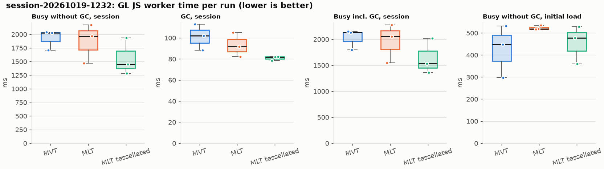
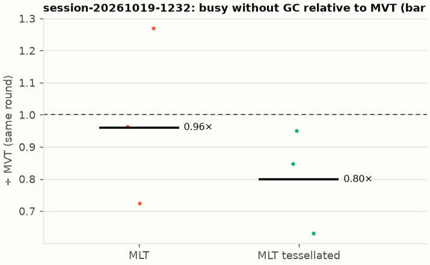
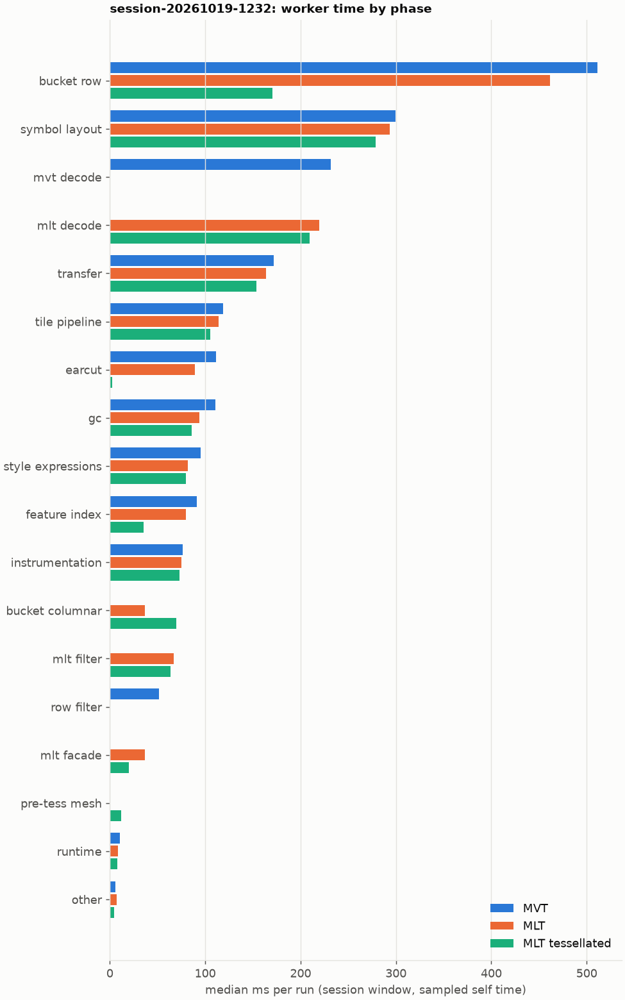
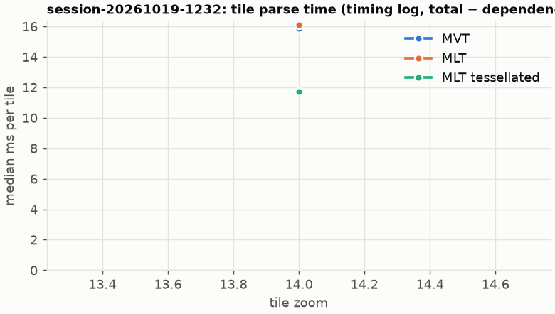

# Session trace benchmark — 20261019-124231

## Setup

- Created 2026-10-19T12:42:31+02:00; 3 repetitions + 1 warm-up round(s) (excluded); variants rotate per round (A B C, B C A, …); one cold browser context per run.
- Machine: 13th Gen Intel(R) Core(TM) i7-1365U, 12 logical cores, 31.3 GB RAM, Windows-11-10.0.26200-SP0; power: GUID des Energieschemas: 381b4222-f694-41f0-9685-ff5bb260df2e  (Ausbalanciert), AC True.
- GL JS gl7-performance-optimization @ f9bd50a8b5 (dirty); worker count 1; viewport {'width': 1280, 'height': 1024}; tracing preset devtools.
- Python 3.12.2, packages {'playwright': '1.64.0', 'numpy': '2.5.3', 'matplotlib': '3.11.2'}.

| variant | bundle | format | bundle sha256 |
|---|---|---|---|
| MVT | `dist/maplibre-gl-dev.mjs` | mvt | `b2691453151d` |
| MLT | `dist/maplibre-gl-dev.mjs` | mlt | `b2691453151d` |
| MLT tessellated | `dist/maplibre-gl-dev.mjs` | mlt-pre-tess | `b2691453151d` |

| session | style | duration | frames | sha256 |
|---|---|---:|---:|---|
| session-20261019-1232 | maptiler-basic | 17.6 s | 944 | `95077e4d2ed2` |

CPU sampling interval (median over runs): 611 µs.

## Definitions

- **busy** = wall time in which a GL JS worker thread runs a task (union of top-level task slices and GC slices on `DedicatedWorker thread`s), summed over workers. **GC** = union of `MinorGC`/`MajorGC`/`V8.GC*` slices on those threads. **busy without GC** = busy − GC (headline metric).
- **CPU** = thread time (`tdur`) of the same slices. Phase categories and functions come from the trace's CPU samples (self time), categorised by `config/categories.toml` (nearest matching frame, leaf to root).
- Windows: **load** = map creation → first idle; **session** = camera replay; **tail** = end of replay → idle; **total** = load + session + tail.
- Ratios are against **MVT**: ratio of medians with a bootstrap 95 % CI, the geometric mean of per-round ratios, and a two-sided Mann–Whitney U p-value (normal approximation, not corrected for multiple comparisons; rough below n = 8). Lower than 1× means less worker time.

## Session `session-20261019-1232`

### Worker busy without GC (session window)

| variant | n ok / failed | median ms | IQR | mean | ratio vs MVT | 95 % CI | geo-mean paired | MWU p |
|---|---:|---:|---:|---:|---:|---:|---:|---:|
| MVT | 3 / 0 | 2,030 | 1,871–2,035 | 1,927 | 1.00× | – | – | – |
| MLT | 3 / 0 | 1,966 | 1,717–2,069 | 1,869 | 0.97× | 0.72–1.27× | 0.96× | 1.000 |
| MLT tessellated | 3 / 0 | 1,452 | 1,368–1,694 | 1,557 | 0.72× | 0.63–1.13× | 0.80× | 0.190 |

### All worker metrics (median, ratio vs baseline)

| metric | MVT | MLT | MLT tessellated |
|---|---:|---:|---:|
| busy incl. GC | 2,132 | 2,057 (0.96×) | 1,534 (0.72×) |
| &nbsp;&nbsp;of which GC | 102.0 | 91.8 (0.90×) | 81.7 (0.80×) |
| &nbsp;&nbsp;of which busy without GC | 2,030 | 1,966 (0.97×) | 1,452 (0.72×) |
| &nbsp;&nbsp;&nbsp;&nbsp;of which filtering (sampled, incl. callees) | 51.6 | 66.7 (1.29×) | 63.9 (1.24×) |
| &nbsp;&nbsp;&nbsp;&nbsp;of which timing instrumentation (sampled) | 76.7 | 74.9 (0.98×) | 72.9 (0.95×) |
| busy without GC and instrumentation | 1,954 | 1,891 (0.97×) | 1,379 (0.71×) |
| CPU time without GC | 1,872 | 1,805 (0.96×) | 1,333 (0.71×) |
| tile: download end → sent to main thread, median per tile | 55.7 | 49.1 (0.88×) | 41.9 (0.75×) |
| tile: download end → sent to main thread, 90th percentile | 96.2 | 98.8 (1.03×) | 76.8 (0.80×) |
| &nbsp;&nbsp;parse part (timing log, incl. waiting for glyphs/icons), median per tile | 35.9 | 35.8 (1.00×) | 26.5 (0.74×) |
| &nbsp;&nbsp;queue + hand-off part, median per tile | 17.1 | 15.2 (0.89×) | 12.2 (0.71×) |
| minor GCs | 29.00 | 26.00 (0.90×) | 19.00 (0.66×) |
| major GCs | 5.00 | 3.00 (0.60×) | 5.00 (1.00×) |
| peak worker heap (MB) | 58.0 | 52.0 (0.90×) | 39.4 (0.68×) |
| load: busy without GC | 448.4 | 517.7 (1.15×) | 478.1 (1.07×) |
| load: GC | 28.4 | 31.8 (1.12×) | 21.6 (0.76×) |
| total: busy without GC | 2,487 | 2,482 (1.00×) | 1,813 (0.73×) |

Rows marked *of which* are parts of the row above, not additional time. Tile rows are per-tile latencies (medians over tiles, then over runs), not sums: tiles overlap in time, and the medians of the parse and queue parts do not add up exactly to the median latency.

### Filtering (session window)

Sampled worker time spent in feature filtering, including everything the filter calls (expression evaluation, property access, lazy column decoding): **row filter** = the style-spec feature filter that MVT runs per feature, **mlt filter** = the columnar MLT filter (incl. the geometry-type selection). Medians per run; rules in `config/categories.toml`.

| variant | mlt filter | row filter | filtering total | ratio vs MVT | 95 % CI | MWU p | share of sampled busy |
|---|---:|---:|---:|---:|---:|---:|---:|
| MVT | 0.0 | 51.6 | 51.6 | 1.00× | – | – | 3.0% |
| MLT | 66.7 | 0.0 | 66.7 | 1.29× | 0.78–1.86× | 0.383 | 3.6% |
| MLT tessellated | 63.9 | 0.0 | 63.9 | 1.24× | 0.98–1.82× | 0.190 | 4.7% |

Top 12 functions inside filtering (self time, mean ms per run):

| phase | function | source | MVT | MLT | MLT tessellated |
|---|---|---|---:|---:|---:|
| row filter | `evaluate` | node_modules/@maplibre/maplibre-gl-style-spec/dist/expression/index.mjs | 12.6 | 0.0 | 0.0 |
| row filter | `evaluate` | node_modules/@maplibre/maplibre-gl-style-spec/dist/expression/compound_expression.mjs | 11.7 | 0.0 | 0.0 |
| mlt filter | `filterByGeometryType` | maplibre-tile-spec/ts/dist/vector/geometry/geometryVector.js | 0.0 | 5.6 | 6.6 |
| row filter | `CompoundExpression.register.filter-==` | node_modules/@maplibre/maplibre-gl-style-spec/dist/expression/compound_expression.mjs | 5.4 | 0.0 | 0.0 |
| row filter | `filter` | node_modules/@maplibre/maplibre-gl-style-spec/dist/feature_filter/index.mjs | 4.8 | 0.0 | 0.0 |
| row filter | `CompoundExpression.register.filter-type-==` | node_modules/@maplibre/maplibre-gl-style-spec/dist/expression/compound_expression.mjs | 3.9 | 0.0 | 0.0 |
| row filter | `CompoundExpression.register.filter-in-small` | node_modules/@maplibre/maplibre-gl-style-spec/dist/expression/compound_expression.mjs | 3.9 | 0.0 | 0.0 |
| mlt filter | `resolveDictionaryExecutor` | maplibre-tile-spec/ts/dist/processing/filter/execution/filterKernel.js | 0.0 | 2.7 | 3.7 |
| mlt filter | `scanDictionaryCodes` | maplibre-tile-spec/ts/dist/processing/filter/execution/filterKernel.js | 0.0 | 1.7 | 3.6 |
| mlt filter | `unpackNullable` | maplibre-tile-spec/ts/dist/decoding/unpackNullableUtils.js | 0.0 | 1.4 | 3.1 |
| mlt filter | `decodeComponentwiseDeltaVec2` | maplibre-tile-spec/ts/dist/decoding/integerDecodingUtils.js | 0.0 | 3.0 | 1.7 |
| mlt filter | `executeLeaf` | maplibre-tile-spec/ts/dist/processing/filter/execution/filterExecution.js | 0.0 | 2.7 | 1.5 |

### Where the variants differ from MVT (session window, mean ms per run)

Open **[flame.html](flame.html)** to explore the call tree interactively: pick a variant, compare it with MVT (red = more time at the same call path, blue = less), click a frame to zoom in, and read the phase and function breakdown under it. `flame/*.txt` open in https://www.speedscope.app.

#### MLT vs MVT

**By phase** (sampled self time; the Δ column sums to the difference in sampled busy time):

| phase | MVT | MLT | Δ |
|---|---:|---:|---:|
| mlt decode | 0.0 | 202.5 | +202.5 |
| mlt filter | 0.2 | 65.1 | +64.9 |
| mlt facade | 0.0 | 38.0 | +38.0 |
| bucket columnar | 0.0 | 31.3 | +31.3 |
| other | 5.9 | 6.7 | +0.8 |
| style expressions | 90.6 | 89.2 | -1.4 |
| runtime | 10.5 | 8.9 | -1.5 |
| instrumentation | 75.2 | 72.9 | -2.3 |
| feature index | 86.0 | 78.8 | -7.2 |
| gc | 107.7 | 99.4 | -8.3 |
| tile pipeline | 120.8 | 109.4 | -11.4 |
| earcut | 105.4 | 82.0 | -23.3 |
| row filter | 51.2 | 0.0 | -51.2 |
| bucket row | 495.0 | 424.9 | -70.2 |
| mvt decode | 223.0 | 0.0 | -223.0 |

**By source layer** (timing log: createBucket + populate + addFeatures, summed over the style layers that use it; wall time, includes GC pauses; total Δ +11 ms):

| source layer | type | MVT | MLT | Δ |
|---|---|---:|---:|---:|
| poi | symbol | 118.4 | 159.4 | +41.0 |
| transportation_name | symbol | 211.0 | 236.8 | +25.8 |
| waterway | line | 15.6 | 25.4 | +9.8 |
| place | symbol | 37.5 | 47.2 | +9.8 |
| landuse | fill | 21.1 | 29.6 | +8.5 |
| boundary | line | 10.9 | 17.4 | +6.4 |
| water | fill | 12.5 | 18.7 | +6.2 |
| landcover | fill | 80.8 | 82.3 | +1.5 |
| transportation | fill | 10.7 | 11.4 | +0.7 |
| aeroway | fill | 0.7 | 1.3 | +0.6 |
| transportation | line | 260.3 | 258.1 | -2.2 |
| building | fill | 519.7 | 421.8 | -97.9 |

**Functions with the largest self-time difference** (by function name, summed over source files):

| function | MVT | MLT | Δ |
|---|---:|---:|---:|
| `decodeComponentwiseDeltaVec2` | 0.0 | 14.7 | +14.7 |
| `readVertices` | 0.0 | 14.4 | +14.4 |
| `decodeString$2` | 0.0 | 11.6 | +11.6 |
| `get` | 12.2 | 23.4 | +11.3 |
| `decodeString` | 0.0 | 10.8 | +10.8 |
| `decodeUnsignedRleInt32` | 0.0 | 10.6 | +10.6 |
| `decodeFastPforInt32` | 0.0 | 10.2 | +10.2 |
| `unpackNullable` | 0.0 | 9.6 | +9.6 |
| `decodeFsst` | 0.0 | 9.0 | +9.0 |
| `registerGlyphs` | 0.0 | 7.0 | +7.0 |
| `decodeBigEndianInt32sInto` | 0.0 | 6.7 | +6.7 |
| `addFeature` | 21.9 | 28.2 | +6.3 |
| `readSVarint` | 87.0 | 0.0 | -87.0 |
| `loadGeometry` | 53.6 | 20.6 | -33.0 |
| `readVarint` | 34.9 | 2.1 | -32.8 |
| `readString` | 25.3 | 0.0 | -25.3 |
| `populate` | 44.5 | 19.8 | -24.7 |

#### MLT tessellated vs MVT

**By phase** (sampled self time; the Δ column sums to the difference in sampled busy time):

| phase | MVT | MLT tessellated | Δ |
|---|---:|---:|---:|
| mlt decode | 0.0 | 211.0 | +211.0 |
| bucket columnar | 0.0 | 74.9 | +74.9 |
| mlt filter | 0.2 | 67.3 | +67.1 |
| mlt facade | 0.0 | 21.8 | +21.8 |
| pre-tess mesh | 0.0 | 12.7 | +12.7 |
| symbol layout | 284.3 | 290.5 | +6.2 |
| instrumentation | 75.2 | 77.1 | +1.9 |
| other | 5.9 | 4.9 | -1.0 |
| runtime | 10.5 | 8.1 | -2.4 |
| transfer | 166.1 | 157.7 | -8.4 |
| style expressions | 90.6 | 80.3 | -10.3 |
| tile pipeline | 120.8 | 108.6 | -12.3 |
| gc | 107.7 | 83.8 | -23.9 |
| row filter | 51.2 | 0.0 | -51.2 |
| feature index | 86.0 | 34.8 | -51.3 |
| earcut | 105.4 | 2.5 | -102.8 |
| mvt decode | 223.0 | 0.0 | -223.0 |
| bucket row | 495.0 | 185.9 | -309.1 |

**By source layer** (timing log: createBucket + populate + addFeatures, summed over the style layers that use it; wall time, includes GC pauses; total Δ -311 ms):

| source layer | type | MVT | MLT tessellated | Δ |
|---|---|---:|---:|---:|
| poi | symbol | 118.4 | 168.1 | +49.7 |
| transportation_name | symbol | 211.0 | 241.8 | +30.8 |
| transportation | line | 260.3 | 273.6 | +13.3 |
| place | symbol | 37.5 | 50.3 | +12.8 |
| waterway | line | 15.6 | 26.8 | +11.2 |
| transportation | fill | 10.7 | 19.3 | +8.6 |
| boundary | line | 10.9 | 15.2 | +4.3 |
| landuse | fill | 21.1 | 25.4 | +4.3 |
| water | fill | 12.5 | 13.3 | +0.8 |
| aeroway | line | 0.6 | 1.0 | +0.4 |
| landcover | fill | 80.8 | 45.0 | -35.8 |
| building | fill | 519.7 | 107.3 | -412.4 |

**Functions with the largest self-time difference** (by function name, summed over source files):

| function | MVT | MLT tessellated | Δ |
|---|---:|---:|---:|
| `unpackNullable` | 0.0 | 15.1 | +15.1 |
| `decodeComponentwiseDeltaVec2` | 0.0 | 12.7 | +12.7 |
| `buildTessellatedBoundingBox` | 0.0 | 12.7 | +12.7 |
| `decodeUnsignedZigZagDeltaInt32` | 0.0 | 11.3 | +11.3 |
| `decodeString$2` | 0.0 | 11.2 | +11.2 |
| `decodeFastPforInt32` | 0.0 | 10.5 | +10.5 |
| `get` | 12.2 | 22.3 | +10.1 |
| `writeTessellatedFill` | 0.0 | 9.5 | +9.5 |
| `decodeFsst` | 0.0 | 9.3 | +9.3 |
| `appendSymbolFeature` | 0.0 | 8.7 | +8.7 |
| `decodeUnsignedRleInt32` | 0.0 | 8.2 | +8.2 |
| `LazyPropertyVectors` | 0.0 | 6.7 | +6.7 |
| `readSVarint` | 87.0 | 0.0 | -87.0 |
| `_vertexToIndex` | 79.6 | 0.6 | -79.0 |
| `loadGeometry` | 53.6 | 5.2 | -48.4 |
| `isEar` | 35.8 | 0.4 | -35.4 |
| `readVarint` | 34.9 | 2.5 | -32.4 |

### Worker time by phase (session window, median ms of sampled self time)

| phase | MVT | MLT | MLT tessellated |
|---|---:|---:|---:|
| bucket row | 511.0 | 461.8 | 170.8 |
| symbol layout | 299.4 | 293.3 | 278.9 |
| mvt decode | 231.6 | 0.0 | 0.0 |
| mlt decode | 0.0 | 219.8 | 209.4 |
| transfer | 171.9 | 163.7 | 153.9 |
| tile pipeline | 118.8 | 114.2 | 105.2 |
| earcut | 111.4 | 89.3 | 2.2 |
| gc | 110.4 | 93.8 | 85.6 |
| style expressions | 95.0 | 81.6 | 79.6 |
| feature index | 91.4 | 79.5 | 35.3 |
| instrumentation | 76.7 | 74.9 | 72.9 |
| bucket columnar | 0.0 | 36.8 | 69.5 |
| mlt filter | 0.0 | 66.7 | 63.9 |
| row filter | 51.6 | 0.0 | 0.0 |
| mlt facade | 0.0 | 37.0 | 19.8 |
| pre-tess mesh | 0.0 | 0.0 | 12.0 |
| runtime | 10.7 | 8.5 | 7.6 |
| other | 6.0 | 7.0 | 4.4 |

### Top 20 worker functions by self time (session window, mean ms per run)

| function | source | phase | MVT | MLT | MLT tessellated |
|---|---|---|---:|---:|---:|
| `(garbage collector)` | (native) | gc | 107.7 | 99.4 | 83.8 |
| `readSVarint` | node_modules/pbf/index.js | mvt decode | 87.0 | 0.0 | 0.0 |
| `reserve` | src/util/struct_array.ts | bucket row | 79.8 | 68.1 | 60.1 |
| `_vertexToIndex` | src/render/subdivision.ts | bucket row | 79.6 | 64.3 | 0.6 |
| `postMessage` | (native) | transfer | 52.9 | 55.9 | 57.5 |
| `fetch` | (native) | tile pipeline | 41.0 | 43.1 | 41.1 |
| `insert` | src/data/feature_index.ts | feature index | 32.7 | 38.2 | 13.4 |
| `isEar` | node_modules/earcut/src/earcut.js | earcut | 35.8 | 25.5 | 0.4 |
| `readVarint` | node_modules/pbf/index.js | mvt decode | 34.9 | 0.0 | 0.0 |
| `serialize` | src/util/web_worker_transfer.ts | transfer | 34.2 | 31.2 | 29.3 |
| `emplace` | src/data/array_types.g.ts | bucket columnar | 31.0 | 32.4 | 29.5 |
| `_trim` | src/util/struct_array.ts | transfer | 31.5 | 27.8 | 21.4 |
| `populate` | src/data/bucket/line_bucket.ts | bucket row | 30.2 | 0.0 | 0.0 |
| `parse` | src/source/worker_tile.ts | tile pipeline | 28.7 | 19.7 | 22.1 |
| `loadGeometry` | node_modules/@mapbox/vector-tile/index.js | mvt decode | 28.4 | 0.0 | 0.0 |
| `ProgramConfiguration` | src/data/program_configuration.ts | bucket row | 23.6 | 24.9 | 25.9 |
| `readString` | node_modules/pbf/index.js | mvt decode | 25.3 | 0.0 | 0.0 |
| `loadGeometry` | src/data/load_geometry.ts | bucket row | 25.2 | 20.4 | 3.4 |
| `VectorTileFeature` | node_modules/@mapbox/vector-tile/index.js | mvt decode | 24.4 | 0.0 | 0.0 |
| `fillLargeMeshArrays` | src/render/fill_large_mesh_arrays.ts | bucket row | 21.0 | 19.5 | 0.4 |

### Top 20 worker functions by total time (incl. callees) (session window, mean ms per run)

| function | source | phase | MVT | MLT | MLT tessellated |
|---|---|---|---:|---:|---:|
| `parse` | src/source/worker_tile.ts | tile pipeline | 1,411 | 1,399 | 1,099 |
| `loadTile` | src/source/vector_tile_worker_source.ts |  | 1,204 | 1,172 | 856.6 |
| `_parseWorkerTile` | src/source/vector_tile_worker_source.ts | tile pipeline | 1,128 | 1,125 | 810.9 |
| `populate` | src/data/bucket/fill_bucket.ts | bucket row | 574.2 | 0.0 | 0.0 |
| `populate` | src/data/bucket/columnar/columnar_fill_bucket.ts | bucket columnar | 0.0 | 485.7 | 169.0 |
| `addBucketFeatures` | src/data/bucket/fill_bucket.ts | bucket row | 428.7 | 367.2 | 52.0 |
| `addFeature` | src/data/bucket/fill_bucket.ts | bucket row | 376.3 | 318.5 | 7.2 |
| `addFeature` | src/data/bucket/columnar/columnar_fill_bucket.ts | bucket columnar | 0.0 | 320.1 | 44.6 |
| `subdividePolygon` | src/render/subdivision.ts | bucket row | 280.7 | 227.1 | 5.2 |
| `subdividePolygonInternal` | src/render/subdivision.ts |  | 272.5 | 219.9 | 4.4 |
| `addFeatures` | src/data/bucket/symbol_bucket.ts | symbol layout | 245.2 | 241.1 | 249.6 |
| `performSymbolLayout` | src/symbol/symbol_layout.ts | symbol layout | 243.1 | 239.2 | 247.8 |
| `populate` | src/data/bucket/columnar/columnar_line_bucket.ts | bucket columnar | 0.0 | 247.3 | 246.3 |
| `populate` | src/data/bucket/line_bucket.ts | bucket row | 232.0 | 0.0 | 0.0 |
| `processTask` | src/util/actor.ts |  | 217.7 | 214.0 | 195.8 |
| `loadGeometry` | src/data/load_geometry.ts | bucket row | 168.3 | 55.7 | 16.8 |
| `populate` | src/data/bucket/columnar/columnar_symbol_bucket.ts | symbol layout | 0.0 | 166.2 | 166.8 |
| `completeTask` | src/util/actor.ts | transfer | 156.3 | 146.8 | 133.8 |
| `loadGeometry` | node_modules/@mapbox/vector-tile/index.js | mvt decode | 135.0 | 0.0 | 0.0 |
| `appendSymbolFeature` | src/data/bucket/columnar/columnar_symbol_bucket.ts | symbol layout | 0.0 | 116.7 | 119.7 |

### Tile parse time by zoom (timing log, median ms per tile, total − dependencies)

| zoom | MVT | MLT | MLT tessellated |
|---:|---:|---:|---:|
| 14 | 15.85 (n=288) | 16.10 (n=291) | 11.70 (n=291) |

### Tile latency by zoom: download end → result sent to the main thread (session window, median ms per tile)

Includes waiting in the worker's queue, the parse and posting the result; see `tile_latency.csv` for the per-tile split (`parse_ms`, `wait_ms`).

| zoom | MVT | MLT | MLT tessellated |
|---:|---:|---:|---:|
| 14 | 53.4 (n=261) | 49.1 (n=264) | 39.1 (n=264) |

## Runs

12 ok, 0 failed/aborted, 0 not run, 9 used in statistics.

## Validity checks

- Counted once: all 12 analysed runs pass (windows load + session + tail add up to total; phases add up to the sampled busy time; GC and sampled time lie within busy time; no timing-log line twice).
- 3 of 4 rounds parsed different tile sets across variants (e.g. session-20261019-1232 round 0: mvt 92 tiles, mlt 93 tiles, mlt-pre-tess 93 tiles; session-20261019-1232 round 1: mlt 93 tiles, mlt-pre-tess 93 tiles, mvt 92 tiles; session-20261019-1232 round 3: mvt 92 tiles, mlt 93 tiles, mlt-pre-tess 93 tiles)

## Files

- `runs.csv`: one row per run (incl. failed and warm-up runs), every scalar metric as `<window>.<metric>`.
- `summary.csv`: session × variant × metric statistics.
- `functions.csv`, `categories.csv`: CPU-sample self/total time per function and phase per run and window.
- `category_functions.csv`: self time per phase × function (e.g. what the filters spend their time on).
- `tiles.csv`, `tile_layers.csv`, `tile_phases.csv`: the per-tile worker timing log, long format.
- `flame.html`: interactive call tree per variant with a diff view; `flame/*.txt`: collapsed stacks for speedscope.
- `analysis/stacks.csv` (per run): sampled self time per full call stack.
- `tile_latency.csv`: per tile request, worker clock: received, download start/end, result sent, latency = sent − download end, parse_ms, wait_ms = latency − parse.
- `runs/<session>/<variant>/rep-NN/trace.json.gz`: the raw trace (opens in the DevTools Performance tab).
