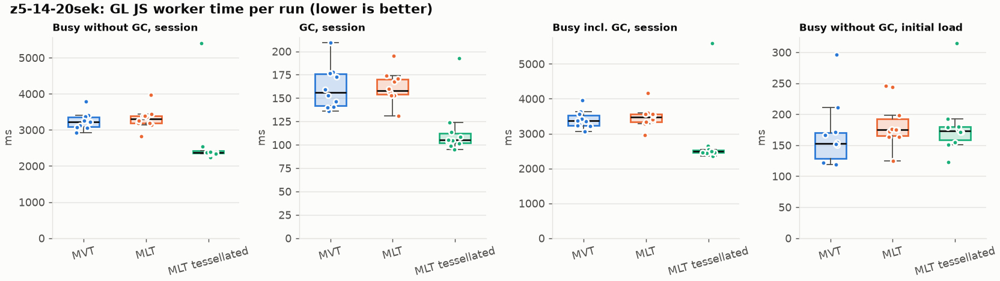
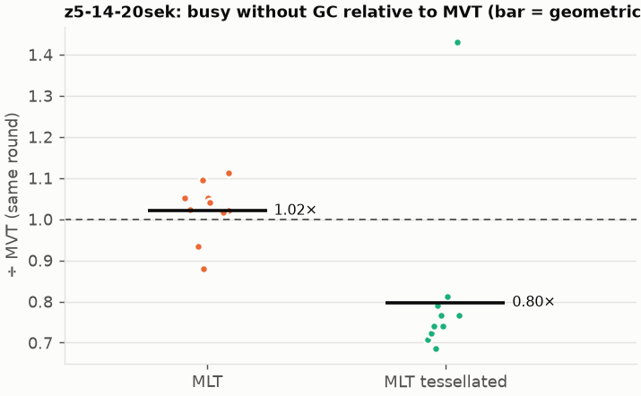
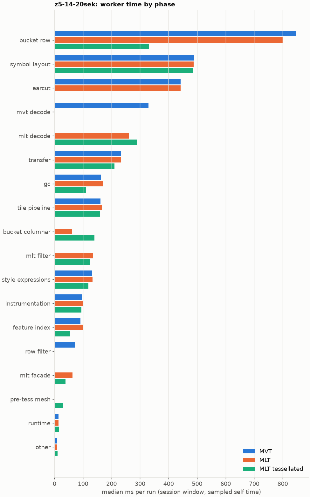
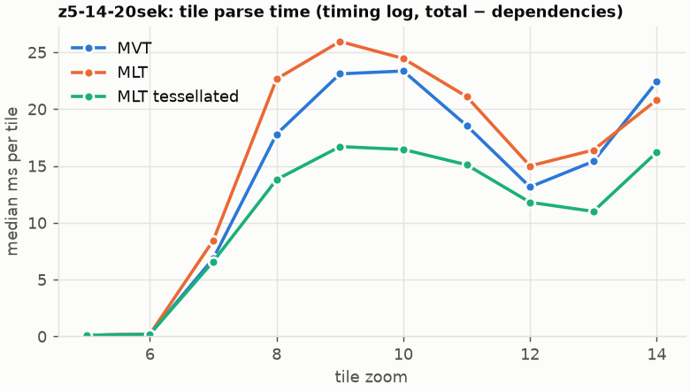

# Session trace benchmark — 20261019-142304

## Setup

- Created 2026-10-19T14:23:04+02:00; 10 repetitions + 1 warm-up round(s) (excluded); variants rotate per round (A B C, B C A, …); one cold browser context per run.
- Machine: 13th Gen Intel(R) Core(TM) i7-1365U, 12 logical cores, 31.3 GB RAM, Windows-11-10.0.26200-SP0; power: GUID des Energieschemas: 381b4222-f694-41f0-9685-ff5bb260df2e  (Ausbalanciert), AC True.
- GL JS gl7-performance-optimization @ f9bd50a8b5 (dirty); worker count 1; viewport {'width': 1280, 'height': 1024}; tracing preset devtools.
- Python 3.12.2, packages {'playwright': '1.64.0', 'numpy': '2.5.3', 'matplotlib': '3.11.2'}.

| variant | bundle | format | bundle sha256 |
|---|---|---|---|
| MVT | `dist/maplibre-gl-dev.mjs` | mvt | `b2691453151d` |
| MLT | `dist/maplibre-gl-dev.mjs` | mlt | `b2691453151d` |
| MLT tessellated | `dist/maplibre-gl-dev.mjs` | mlt-pre-tess | `b2691453151d` |

| session | style | duration | frames | sha256 |
|---|---|---:|---:|---|
| z5-14-20sek | maptiler-basic | 21.4 s | 829 | `5a376e5ede30` |

CPU sampling interval (median over runs): 607 µs.

## Definitions

- **busy** = wall time in which a GL JS worker thread runs a task (union of top-level task slices and GC slices on `DedicatedWorker thread`s), summed over workers. **GC** = union of `MinorGC`/`MajorGC`/`V8.GC*` slices on those threads. **busy without GC** = busy − GC (headline metric).
- **CPU** = thread time (`tdur`) of the same slices. Phase categories and functions come from the trace's CPU samples (self time), categorised by `config/categories.toml` (nearest matching frame, leaf to root).
- Windows: **load** = map creation → first idle; **session** = camera replay; **tail** = end of replay → idle; **total** = load + session + tail.
- Ratios are against **MVT**: ratio of medians with a bootstrap 95 % CI, the geometric mean of per-round ratios, and a two-sided Mann–Whitney U p-value (normal approximation, not corrected for multiple comparisons; rough below n = 8). Lower than 1× means less worker time.

## Session `z5-14-20sek`

### Worker busy without GC (session window)

| variant | n ok / failed | median ms | IQR | mean | ratio vs MVT | 95 % CI | geo-mean paired | MWU p |
|---|---:|---:|---:|---:|---:|---:|---:|---:|
| MVT | 10 / 0 | 3,216 | 3,084–3,348 | 3,244 | 1.00× | – | – | – |
| MLT | 10 / 0 | 3,304 | 3,188–3,388 | 3,313 | 1.03× | 0.96–1.09× | 1.02× | 0.427 |
| MLT tessellated | 10 / 0 | 2,379 | 2,350–2,418 | 2,681 | 0.74× | 0.70–0.78× | 0.80× | 0.003 |

### All worker metrics (median, ratio vs baseline)

| metric | MVT | MLT | MLT tessellated |
|---|---:|---:|---:|
| busy incl. GC | 3,363 | 3,466 (1.03×) | 2,486 (0.74×) |
| &nbsp;&nbsp;of which GC | 156.0 | 158.2 (1.01×) | 105.1 (0.67×) |
| &nbsp;&nbsp;of which busy without GC | 3,216 | 3,304 (1.03×) | 2,379 (0.74×) |
| &nbsp;&nbsp;&nbsp;&nbsp;of which filtering (sampled, incl. callees) | 71.7 | 134.7 (1.88×) | 123.4 (1.72×) |
| &nbsp;&nbsp;&nbsp;&nbsp;of which timing instrumentation (sampled) | 96.0 | 101.0 (1.05×) | 94.7 (0.99×) |
| busy without GC and instrumentation | 3,114 | 3,202 (1.03×) | 2,284 (0.73×) |
| CPU time without GC | 2,961 | 3,002 (1.01×) | 2,173 (0.73×) |
| tile: download end → sent to main thread, median per tile | 166.1 | 165.8 (1.00×) | 128.8 (0.78×) |
| tile: download end → sent to main thread, 90th percentile | 352.2 | 352.9 (1.00×) | 235.5 (0.67×) |
| &nbsp;&nbsp;parse part (timing log, incl. waiting for glyphs/icons), median per tile | 85.5 | 87.4 (1.02×) | 66.8 (0.78×) |
| &nbsp;&nbsp;queue + hand-off part, median per tile | 66.8 | 69.9 (1.05×) | 50.2 (0.75×) |
| minor GCs | 59.00 | 55.50 (0.94×) | 35.00 (0.59×) |
| major GCs | 4.50 | 4.00 (0.89×) | 5.00 (1.11×) |
| peak worker heap (MB) | 58.9 | 62.2 (1.06×) | 46.1 (0.78×) |
| load: busy without GC | 153.2 | 175.1 (1.14×) | 173.2 (1.13×) |
| load: GC | 5.3 | 5.5 (1.04×) | 4.3 (0.81×) |
| total: busy without GC | 3,379 | 3,485 (1.03×) | 2,528 (0.75×) |

Rows marked *of which* are parts of the row above, not additional time. Tile rows are per-tile latencies (medians over tiles, then over runs), not sums: tiles overlap in time, and the medians of the parse and queue parts do not add up exactly to the median latency.

### Filtering (session window)

Sampled worker time spent in feature filtering, including everything the filter calls (expression evaluation, property access, lazy column decoding): **row filter** = the style-spec feature filter that MVT runs per feature, **mlt filter** = the columnar MLT filter (incl. the geometry-type selection). Medians per run; rules in `config/categories.toml`.

| variant | mlt filter | row filter | filtering total | ratio vs MVT | 95 % CI | MWU p | share of sampled busy |
|---|---:|---:|---:|---:|---:|---:|---:|
| MVT | 0.0 | 71.7 | 71.7 | 1.00× | – | – | 2.4% |
| MLT | 134.7 | 0.0 | 134.7 | 1.88× | 1.63–2.00× | <0.001 | 4.2% |
| MLT tessellated | 123.4 | 0.0 | 123.4 | 1.72× | 1.55–1.84× | <0.001 | 5.6% |

Top 12 functions inside filtering (self time, mean ms per run):

| phase | function | source | MVT | MLT | MLT tessellated |
|---|---|---|---:|---:|---:|
| row filter | `evaluate` | node_modules/@maplibre/maplibre-gl-style-spec/dist/expression/compound_expression.mjs | 17.5 | 0.0 | 0.0 |
| row filter | `evaluate` | node_modules/@maplibre/maplibre-gl-style-spec/dist/expression/index.mjs | 16.5 | 0.0 | 0.0 |
| mlt filter | `unpackNullable` | maplibre-tile-spec/ts/dist/decoding/unpackNullableUtils.js | 0.0 | 11.0 | 11.3 |
| mlt filter | `filterByGeometryType` | maplibre-tile-spec/ts/dist/vector/geometry/geometryVector.js | 0.0 | 10.9 | 9.9 |
| mlt filter | `scanDictionaryCodes` | maplibre-tile-spec/ts/dist/processing/filter/execution/filterKernel.js | 0.0 | 8.8 | 8.3 |
| row filter | `CompoundExpression.register.filter-==` | node_modules/@maplibre/maplibre-gl-style-spec/dist/expression/compound_expression.mjs | 8.3 | 0.0 | 0.0 |
| row filter | `filter` | node_modules/@maplibre/maplibre-gl-style-spec/dist/feature_filter/index.mjs | 7.0 | 0.0 | 0.0 |
| row filter | `CompoundExpression.register.filter-in-small` | node_modules/@maplibre/maplibre-gl-style-spec/dist/expression/compound_expression.mjs | 7.0 | 0.0 | 0.0 |
| mlt filter | `decodeFsst` | maplibre-tile-spec/ts/dist/decoding/fsstDecoder.js | 0.0 | 5.6 | 5.7 |
| mlt filter | `resolveDictionaryExecutor` | maplibre-tile-spec/ts/dist/processing/filter/execution/filterKernel.js | 0.0 | 4.8 | 5.5 |
| row filter | `CompoundExpression.register.filter-type-==` | node_modules/@maplibre/maplibre-gl-style-spec/dist/expression/compound_expression.mjs | 5.5 | 0.0 | 0.0 |
| mlt filter | `dictionaryRowMatches` | maplibre-tile-spec/ts/dist/processing/filter/execution/filterKernel.js | 0.0 | 5.0 | 5.3 |

### Where the variants differ from MVT (session window, mean ms per run)

Open **[flame.html](flame.html)** to explore the call tree interactively: pick a variant, compare it with MVT (red = more time at the same call path, blue = less), click a frame to zoom in, and read the phase and function breakdown under it. `flame/*.txt` open in https://www.speedscope.app.

#### MLT vs MVT

**By phase** (sampled self time; the Δ column sums to the difference in sampled busy time):

| phase | MVT | MLT | Δ |
|---|---:|---:|---:|
| mlt decode | 0.0 | 260.2 | +260.2 |
| mlt filter | 0.2 | 132.4 | +132.1 |
| mlt facade | 0.1 | 61.7 | +61.5 |
| bucket columnar | 0.0 | 61.0 | +61.0 |
| tile pipeline | 162.0 | 168.3 | +6.3 |
| gc | 171.5 | 177.3 | +5.9 |
| instrumentation | 98.2 | 103.3 | +5.1 |
| style expressions | 133.4 | 138.3 | +5.0 |
| feature index | 94.1 | 95.7 | +1.6 |
| other | 8.2 | 9.3 | +1.1 |
| symbol layout | 492.6 | 493.7 | +1.0 |
| runtime | 14.1 | 14.6 | +0.6 |
| transfer | 237.3 | 232.8 | -4.5 |
| earcut | 450.8 | 442.7 | -8.1 |
| bucket row | 857.4 | 803.7 | -53.7 |
| row filter | 75.1 | 0.0 | -75.1 |
| mvt decode | 325.1 | 0.0 | -325.1 |

**By source layer** (timing log: createBucket + populate + addFeatures, summed over the style layers that use it; wall time, includes GC pauses; total Δ +110 ms):

| source layer | type | MVT | MLT | Δ |
|---|---|---:|---:|---:|
| place | symbol | 455.1 | 537.3 | +82.2 |
| waterway | line | 36.3 | 53.5 | +17.2 |
| poi | symbol | 36.1 | 52.7 | +16.6 |
| water | fill | 56.0 | 71.2 | +15.2 |
| landuse | fill | 375.0 | 388.5 | +13.5 |
| boundary | line | 32.7 | 44.7 | +12.0 |
| transportation | line | 467.2 | 477.2 | +10.0 |
| transportation_name | symbol | 114.9 | 122.7 | +7.8 |
| aeroway | fill | 1.3 | 3.4 | +2.1 |
| transportation | fill | 15.2 | 13.0 | -2.2 |
| landcover | fill | 559.3 | 553.2 | -6.2 |
| building | fill | 311.4 | 250.3 | -61.2 |

**Functions with the largest self-time difference** (by function name, summed over source files):

| function | MVT | MLT | Δ |
|---|---:|---:|---:|
| `decodeComponentwiseDeltaVec2` | 0.0 | 23.8 | +23.8 |
| `readVertices` | 0.0 | 23.7 | +23.7 |
| `get` | 17.9 | 40.9 | +23.1 |
| `unpackNullable` | 0.0 | 17.0 | +17.0 |
| `decodeString` | 0.0 | 16.1 | +16.1 |
| `appendSymbolFeature` | 0.0 | 12.9 | +12.9 |
| `decodeFastPforInt32` | 0.0 | 12.0 | +12.0 |
| `registerGlyphs` | 0.0 | 11.6 | +11.6 |
| `filterByGeometryType` | 0.0 | 10.9 | +10.9 |
| `decodeFsst` | 0.0 | 9.6 | +9.6 |
| `materializeSelectedFeatures` | 0.0 | 9.1 | +9.1 |
| `scanDictionaryCodes` | 0.0 | 8.8 | +8.8 |
| `readSVarint` | 152.6 | 0.0 | -152.6 |
| `readVarint` | 47.8 | 2.2 | -45.6 |
| `loadGeometry` | 78.4 | 35.3 | -43.1 |
| `populate` | 81.9 | 39.3 | -42.6 |
| `evaluate` | 44.2 | 12.6 | -31.5 |

#### MLT tessellated vs MVT

**By phase** (sampled self time; the Δ column sums to the difference in sampled busy time):

| phase | MVT | MLT tessellated | Δ |
|---|---:|---:|---:|
| mlt decode | 0.0 | 321.8 | +321.8 |
| bucket columnar | 0.0 | 155.2 | +155.2 |
| mlt filter | 0.2 | 136.1 | +135.8 |
| mlt facade | 0.1 | 40.8 | +40.7 |
| symbol layout | 492.6 | 525.6 | +32.9 |
| pre-tess mesh | 0.0 | 30.7 | +30.7 |
| tile pipeline | 162.0 | 173.3 | +11.3 |
| runtime | 14.1 | 17.6 | +3.6 |
| instrumentation | 98.2 | 101.7 | +3.5 |
| other | 8.2 | 10.6 | +2.3 |
| transfer | 237.3 | 233.2 | -4.1 |
| style expressions | 133.4 | 126.8 | -6.6 |
| feature index | 94.1 | 59.7 | -34.4 |
| gc | 171.5 | 119.5 | -52.0 |
| row filter | 75.1 | 0.0 | -75.1 |
| mvt decode | 325.1 | 0.0 | -325.1 |
| earcut | 450.8 | 3.1 | -447.7 |
| bucket row | 857.4 | 372.4 | -485.0 |

**By source layer** (timing log: createBucket + populate + addFeatures, summed over the style layers that use it; wall time, includes GC pauses; total Δ -638 ms):

| source layer | type | MVT | MLT tessellated | Δ |
|---|---|---:|---:|---:|
| place | symbol | 455.1 | 587.0 | +131.9 |
| transportation | line | 467.2 | 532.2 | +64.9 |
| waterway | line | 36.3 | 58.9 | +22.6 |
| transportation_name | symbol | 114.9 | 135.2 | +20.3 |
| poi | symbol | 36.1 | 54.8 | +18.8 |
| boundary | line | 32.7 | 45.8 | +13.1 |
| transportation | fill | 15.2 | 23.1 | +7.9 |
| aeroway | fill | 1.3 | 3.6 | +2.3 |
| water | fill | 56.0 | 36.2 | -19.8 |
| building | fill | 311.4 | 59.4 | -252.0 |
| landuse | fill | 375.0 | 121.2 | -253.9 |
| landcover | fill | 559.3 | 161.8 | -397.6 |

**Functions with the largest self-time difference** (by function name, summed over source files):

| function | MVT | MLT tessellated | Δ |
|---|---:|---:|---:|
| `buildTessellatedBoundingBox` | 0.0 | 29.9 | +29.9 |
| `decodeUnsignedZigZagDeltaInt32` | 0.0 | 26.7 | +26.7 |
| `decodeComponentwiseDeltaVec2` | 0.0 | 25.3 | +25.3 |
| `get` | 17.9 | 40.5 | +22.6 |
| `decodeFastPforInt32` | 0.0 | 18.0 | +18.0 |
| `unpackNullable` | 0.0 | 17.3 | +17.3 |
| `decodeString` | 0.0 | 14.4 | +14.4 |
| `writeTessellatedFill` | 0.0 | 13.8 | +13.8 |
| `decodeBigEndianInt32sInto` | 0.0 | 12.7 | +12.7 |
| `registerGlyphs` | 0.0 | 12.6 | +12.6 |
| `appendSymbolFeature` | 0.0 | 12.2 | +12.2 |
| `materializeSelectedFeatures` | 0.0 | 10.9 | +10.9 |
| `_vertexToIndex` | 153.4 | 0.6 | -152.8 |
| `readSVarint` | 152.6 | 0.0 | -152.6 |
| `isEar` | 142.1 | 0.2 | -142.0 |
| `isEarHashed` | 84.5 | 0.0 | -84.5 |
| `loadGeometry` | 78.4 | 10.9 | -67.5 |

### Worker time by phase (session window, median ms of sampled self time)

| phase | MVT | MLT | MLT tessellated |
|---|---:|---:|---:|
| bucket row | 847.4 | 800.2 | 331.0 |
| symbol layout | 490.2 | 487.6 | 484.7 |
| earcut | 441.9 | 441.7 | 2.7 |
| mvt decode | 329.0 | 0.0 | 0.0 |
| mlt decode | 0.0 | 261.3 | 289.6 |
| transfer | 232.7 | 233.2 | 210.4 |
| gc | 163.8 | 171.5 | 109.9 |
| tile pipeline | 161.6 | 166.4 | 159.9 |
| bucket columnar | 0.0 | 60.5 | 140.3 |
| mlt filter | 0.0 | 134.7 | 123.4 |
| style expressions | 131.2 | 133.8 | 118.5 |
| instrumentation | 96.0 | 101.0 | 94.7 |
| feature index | 91.0 | 99.5 | 55.0 |
| row filter | 71.7 | 0.0 | 0.0 |
| mlt facade | 0.0 | 63.2 | 38.7 |
| pre-tess mesh | 0.0 | 0.0 | 29.2 |
| runtime | 14.2 | 14.2 | 15.5 |
| other | 8.3 | 10.0 | 10.2 |

### Top 20 worker functions by self time (session window, mean ms per run)

| function | source | phase | MVT | MLT | MLT tessellated |
|---|---|---|---:|---:|---:|
| `(garbage collector)` | (native) | gc | 171.5 | 177.3 | 119.5 |
| `_vertexToIndex` | src/render/subdivision.ts | bucket row | 153.4 | 153.2 | 0.6 |
| `readSVarint` | node_modules/pbf/index.js | mvt decode | 152.6 | 0.0 | 0.0 |
| `isEar` | node_modules/earcut/src/earcut.js | earcut | 142.1 | 137.5 | 0.2 |
| `reserve` | src/util/struct_array.ts | bucket row | 123.8 | 127.4 | 108.8 |
| `postMessage` | (native) | transfer | 74.3 | 77.5 | 84.7 |
| `isEarHashed` | node_modules/earcut/src/earcut.js | earcut | 84.5 | 82.4 | 0.0 |
| `emplace` | src/data/array_types.g.ts | bucket row | 69.6 | 64.7 | 64.6 |
| `fetch` | (native) | tile pipeline | 59.0 | 61.4 | 67.3 |
| `_trim` | src/util/struct_array.ts | transfer | 52.8 | 49.8 | 30.7 |
| `populate` | src/data/bucket/line_bucket.ts | bucket row | 51.9 | 0.0 | 0.0 |
| `insert` | src/data/feature_index.ts | feature index | 49.8 | 47.6 | 18.8 |
| `addLine` | src/data/bucket/line_bucket.ts | bucket row | 41.0 | 45.0 | 47.9 |
| `readVarint` | node_modules/pbf/index.js | mvt decode | 47.8 | 0.0 | 0.0 |
| `serialize` | src/util/web_worker_transfer.ts | transfer | 41.1 | 41.2 | 46.2 |
| `addHalfVertex` | src/data/bucket/line_bucket.ts | bucket row | 38.8 | 40.2 | 44.2 |
| `earcutLinked` | node_modules/earcut/src/earcut.js | earcut | 42.3 | 39.2 | 0.4 |
| `loadGeometry` | node_modules/@mapbox/vector-tile/index.js | mvt decode | 42.1 | 0.0 | 0.0 |
| `getGlyphAdvance` | src/symbol/tagged_string.ts | symbol layout | 37.0 | 38.1 | 40.5 |
| `ProgramConfiguration` | src/data/program_configuration.ts | bucket row | 31.6 | 35.2 | 37.1 |

### Top 20 worker functions by total time (incl. callees) (session window, mean ms per run)

| function | source | phase | MVT | MLT | MLT tessellated |
|---|---|---|---:|---:|---:|
| `parse` | src/source/worker_tile.ts | tile pipeline | 2,543 | 2,650 | 1,936 |
| `loadTile` | src/source/vector_tile_worker_source.ts | tile pipeline | 2,168 | 2,241 | 1,495 |
| `_parseWorkerTile` | src/source/vector_tile_worker_source.ts | tile pipeline | 2,063 | 2,173 | 1,424 |
| `populate` | src/data/bucket/fill_bucket.ts | bucket row | 1,181 | 0.0 | 0.0 |
| `populate` | src/data/bucket/columnar/columnar_fill_bucket.ts | bucket columnar | 0.0 | 1,129 | 342.3 |
| `addBucketFeatures` | src/data/bucket/fill_bucket.ts | bucket row | 947.3 | 942.4 | 89.3 |
| `addFeature` | src/data/bucket/columnar/columnar_fill_bucket.ts | bucket columnar | 0.0 | 887.1 | 78.6 |
| `addFeature` | src/data/bucket/fill_bucket.ts | bucket row | 880.6 | 883.9 | 8.7 |
| `subdividePolygon` | src/render/subdivision.ts |  | 745.5 | 749.5 | 6.5 |
| `subdividePolygonInternal` | src/render/subdivision.ts | bucket row | 736.3 | 733.6 | 5.9 |
| `populate` | src/data/bucket/columnar/columnar_line_bucket.ts | bucket columnar | 0.0 | 476.2 | 513.4 |
| `addFeatures` | src/data/bucket/symbol_bucket.ts | symbol layout | 438.4 | 439.3 | 471.3 |
| `performSymbolLayout` | src/symbol/symbol_layout.ts | symbol layout | 432.6 | 434.2 | 465.3 |
| `earcut` | node_modules/earcut/src/earcut.js | earcut | 450.2 | 442.3 | 3.1 |
| `populate` | src/data/bucket/line_bucket.ts | bucket row | 445.1 | 0.0 | 0.0 |
| `earcutLinked` | node_modules/earcut/src/earcut.js | earcut | 359.9 | 349.9 | 0.9 |
| `processTask` | src/util/actor.ts | transfer | 297.5 | 294.7 | 296.9 |
| `loadGeometry` | src/data/load_geometry.ts | bucket row | 271.9 | 88.3 | 38.1 |
| `addFeature` | src/data/bucket/line_bucket.ts | bucket row | 232.5 | 238.0 | 260.6 |
| `shapeText` | src/symbol/shaping.ts | symbol layout | 231.2 | 231.0 | 248.8 |

### Tile parse time by zoom (timing log, median ms per tile, total − dependencies)

| zoom | MVT | MLT | MLT tessellated |
|---:|---:|---:|---:|
| 5 | 0.10 (n=90) | 0.10 (n=90) | 0.10 (n=90) |
| 6 | 0.20 (n=90) | 0.20 (n=90) | 0.20 (n=90) |
| 7 | 6.85 (n=60) | 8.45 (n=60) | 6.60 (n=60) |
| 8 | 17.80 (n=67) | 22.65 (n=74) | 13.80 (n=69) |
| 9 | 23.10 (n=160) | 25.95 (n=160) | 16.70 (n=160) |
| 10 | 23.35 (n=200) | 24.45 (n=200) | 16.45 (n=200) |
| 11 | 18.55 (n=152) | 21.10 (n=152) | 15.10 (n=143) |
| 12 | 13.15 (n=200) | 15.00 (n=200) | 11.80 (n=203) |
| 13 | 15.40 (n=210) | 16.40 (n=210) | 11.00 (n=213) |
| 14 | 22.40 (n=180) | 20.80 (n=180) | 16.20 (n=180) |

### Tile latency by zoom: download end → result sent to the main thread (session window, median ms per tile)

Includes waiting in the worker's queue, the parse and posting the result; see `tile_latency.csv` for the per-tile split (`parse_ms`, `wait_ms`).

| zoom | MVT | MLT | MLT tessellated |
|---:|---:|---:|---:|
| 6 | 40.7 (n=90) | 46.2 (n=90) | 44.2 (n=90) |
| 7 | 121.1 (n=60) | 111.7 (n=60) | 73.5 (n=60) |
| 8 | 230.4 (n=67) | 245.9 (n=74) | 144.0 (n=69) |
| 9 | 179.2 (n=160) | 246.1 (n=160) | 186.8 (n=160) |
| 10 | 323.5 (n=200) | 322.0 (n=200) | 231.4 (n=200) |
| 11 | 160.3 (n=152) | 193.8 (n=152) | 142.3 (n=143) |
| 12 | 75.3 (n=200) | 77.6 (n=200) | 110.6 (n=203) |
| 13 | 164.1 (n=210) | 164.1 (n=210) | 125.6 (n=213) |
| 14 | 246.1 (n=180) | 225.9 (n=180) | 180.3 (n=180) |

## Runs

33 ok, 0 failed/aborted, 0 not run, 30 used in statistics.

## Validity checks

- Counted once: all 33 analysed runs pass (windows load + session + tail add up to total; phases add up to the sampled busy time; GC and sampled time lie within busy time; no timing-log line twice).
- z5-14-20sek/mlt-pre-tess/rep-01: CPU samples cover only 80% of worker busy time
- 10 of 11 rounds parsed different tile sets across variants (e.g. z5-14-20sek round 0: mvt 127 tiles, mlt 130 tiles, mlt-pre-tess 130 tiles; z5-14-20sek round 1: mlt 129 tiles, mlt-pre-tess 123 tiles, mvt 127 tiles; z5-14-20sek round 2: mlt-pre-tess 126 tiles, mvt 130 tiles, mlt 130 tiles; z5-14-20sek round 3: mvt 126 tiles, mlt 130 tiles, mlt-pre-tess 130 tiles; z5-14-20sek round 4: mlt 130 tiles, mlt-pre-tess 126 tiles, mvt 130 tiles)

## Files

- `runs.csv`: one row per run (incl. failed and warm-up runs), every scalar metric as `<window>.<metric>`.
- `summary.csv`: session × variant × metric statistics.
- `functions.csv`, `categories.csv`: CPU-sample self/total time per function and phase per run and window.
- `category_functions.csv`: self time per phase × function (e.g. what the filters spend their time on).
- `tiles.csv`, `tile_layers.csv`, `tile_phases.csv`: the per-tile worker timing log, long format.
- `flame.html`: interactive call tree per variant with a diff view; `flame/*.txt`: collapsed stacks for speedscope.
- `analysis/stacks.csv` (per run): sampled self time per full call stack.
- `tile_latency.csv`: per tile request, worker clock: received, download start/end, result sent, latency = sent − download end, parse_ms, wait_ms = latency − parse.
- `runs/<session>/<variant>/rep-NN/trace.json.gz`: the raw trace (opens in the DevTools Performance tab).
