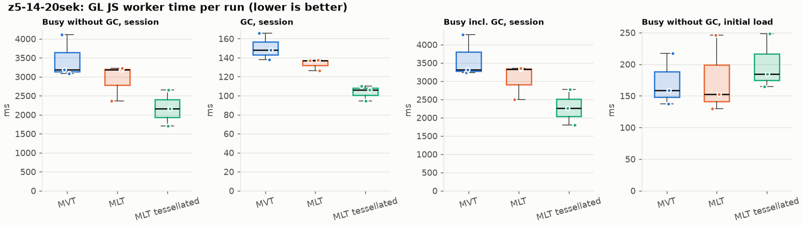
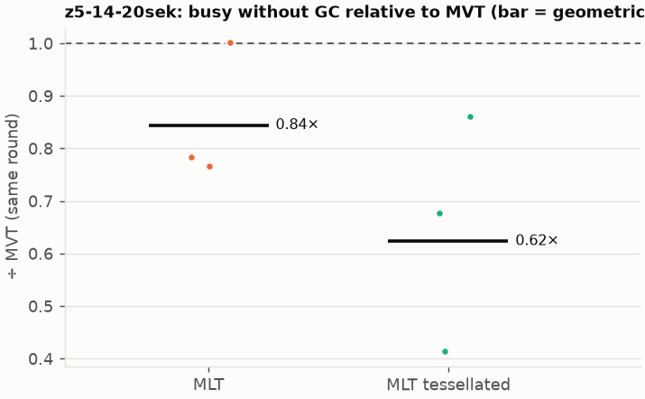
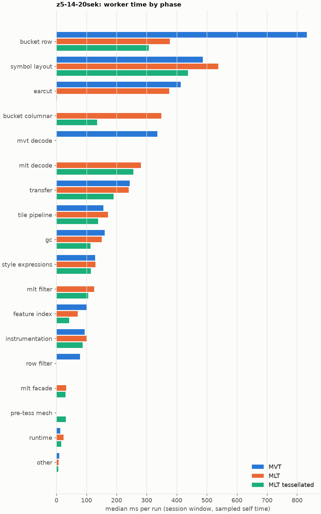
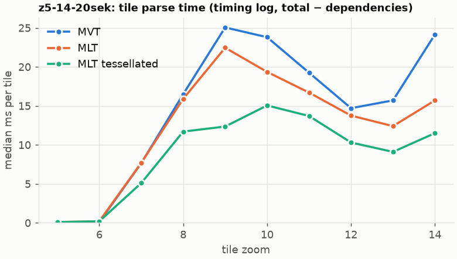

# Session trace benchmark — 20261019-153249

## Setup

- Created 2026-10-19T15:32:49+02:00; 3 repetitions + 1 warm-up round(s) (excluded); variants rotate per round (A B C, B C A, …); one cold browser context per run.
- Machine: 13th Gen Intel(R) Core(TM) i7-1365U, 12 logical cores, 31.3 GB RAM, Windows-11-10.0.26200-SP0; power: GUID des Energieschemas: 381b4222-f694-41f0-9685-ff5bb260df2e  (Ausbalanciert), AC True.
- GL JS gl7-performance-optimization @ f9bd50a8b5 (dirty); worker count 1; viewport {'width': 1280, 'height': 1024}; tracing preset devtools.
- Python 3.12.2, packages {'playwright': '1.64.0', 'numpy': '2.5.3', 'matplotlib': '3.11.2'}.

| variant | bundle | format | bundle sha256 |
|---|---|---|---|
| MVT | `dist/maplibre-gl-dev.mjs` | mvt | `b2691453151d` |
| MLT | `dist/maplibre-gl-dev.mjs` | mlt | `b2691453151d` |
| MLT tessellated | `dist/maplibre-gl-dev.mjs` | mlt-pre-tess | `b2691453151d` |

| session | style | duration | frames | sha256 |
|---|---|---:|---:|---|
| z5-14-20sek | maptiler-basic | 21.4 s | 829 | `5a376e5ede30` |

CPU sampling interval (median over runs): 604 µs.

## Definitions

- **busy** = wall time in which a GL JS worker thread runs a task (union of top-level task slices and GC slices on `DedicatedWorker thread`s), summed over workers. **GC** = union of `MinorGC`/`MajorGC`/`V8.GC*` slices on those threads. **busy without GC** = busy − GC (headline metric).
- **CPU** = thread time (`tdur`) of the same slices. Phase categories and functions come from the trace's CPU samples (self time), categorised by `config/categories.toml` (nearest matching frame, leaf to root).
- Windows: **load** = map creation → first idle; **session** = camera replay; **tail** = end of replay → idle; **total** = load + session + tail.
- Ratios are against **MVT**: ratio of medians with a bootstrap 95 % CI, the geometric mean of per-round ratios, and a two-sided Mann–Whitney U p-value (normal approximation, not corrected for multiple comparisons; rough below n = 8). Lower than 1× means less worker time.

## Session `z5-14-20sek`

### Worker busy without GC (session window)

| variant | n ok / failed | median ms | IQR | mean | ratio vs MVT | 95 % CI | geo-mean paired | MWU p |
|---|---:|---:|---:|---:|---:|---:|---:|---:|
| MVT | 3 / 0 | 3,181 | 3,134–3,647 | 3,460 | 1.00× | – | – | – |
| MLT | 3 / 0 | 3,184 | 2,775–3,202 | 2,924 | 1.00× | 0.58–1.04× | 0.84× | 1.000 |
| MLT tessellated | 3 / 0 | 2,155 | 1,931–2,407 | 2,173 | 0.68× | 0.41–0.86× | 0.62× | 0.081 |

### All worker metrics (median, ratio vs baseline)

| metric | MVT | MLT | MLT tessellated |
|---|---:|---:|---:|
| busy incl. GC | 3,319 | 3,321 (1.00×) | 2,261 (0.68×) |
| &nbsp;&nbsp;of which GC | 148.0 | 137.0 (0.93×) | 106.2 (0.72×) |
| &nbsp;&nbsp;of which busy without GC | 3,181 | 3,184 (1.00×) | 2,155 (0.68×) |
| &nbsp;&nbsp;&nbsp;&nbsp;of which filtering (sampled, incl. callees) | 78.6 | 125.3 (1.59×) | 106.0 (1.35×) |
| &nbsp;&nbsp;&nbsp;&nbsp;of which timing instrumentation (sampled) | 93.2 | 100.9 (1.08×) | 87.3 (0.94×) |
| busy without GC and instrumentation | 3,096 | 3,084 (1.00×) | 2,068 (0.67×) |
| CPU time without GC | 2,895 | 2,884 (1.00×) | 1,981 (0.68×) |
| tile: download end → sent to main thread, median per tile | 167.3 | 120.9 (0.72×) | 116.5 (0.70×) |
| tile: download end → sent to main thread, 90th percentile | 338.0 | 374.8 (1.11×) | 218.0 (0.65×) |
| &nbsp;&nbsp;parse part (timing log, incl. waiting for glyphs/icons), median per tile | 79.2 | 76.4 (0.97×) | 61.0 (0.77×) |
| &nbsp;&nbsp;queue + hand-off part, median per tile | 71.8 | 61.2 (0.85×) | 41.6 (0.58×) |
| minor GCs | 60.00 | 51.00 (0.85×) | 34.00 (0.57×) |
| major GCs | 4.00 | 5.00 (1.25×) | 6.00 (1.50×) |
| peak worker heap (MB) | 61.2 | 49.7 (0.81×) | 43.1 (0.70×) |
| load: busy without GC | 158.7 | 152.8 (0.96×) | 184.4 (1.16×) |
| load: GC | 5.5 | 5.0 (0.91×) | 4.7 (0.86×) |
| total: busy without GC | 3,340 | 3,350 (1.00×) | 2,340 (0.70×) |

Rows marked *of which* are parts of the row above, not additional time. Tile rows are per-tile latencies (medians over tiles, then over runs), not sums: tiles overlap in time, and the medians of the parse and queue parts do not add up exactly to the median latency.

### Filtering (session window)

Sampled worker time spent in feature filtering, including everything the filter calls (expression evaluation, property access, lazy column decoding): **row filter** = the style-spec feature filter that MVT runs per feature, **mlt filter** = the columnar MLT filter (incl. the geometry-type selection). Medians per run; rules in `config/categories.toml`.

| variant | mlt filter | row filter | filtering total | ratio vs MVT | 95 % CI | MWU p | share of sampled busy |
|---|---:|---:|---:|---:|---:|---:|---:|
| MVT | 0.7 | 78.6 | 78.6 | 1.00× | – | – | 2.6% |
| MLT | 125.3 | 0.0 | 125.3 | 1.59× | 1.03–1.84× | 0.081 | 4.5% |
| MLT tessellated | 106.0 | 0.0 | 106.0 | 1.35× | 0.83–2.01× | 0.190 | 5.3% |

Top 12 functions inside filtering (self time, mean ms per run):

| phase | function | source | MVT | MLT | MLT tessellated |
|---|---|---|---:|---:|---:|
| row filter | `evaluate` | node_modules/@maplibre/maplibre-gl-style-spec/dist/expression/index.mjs | 22.3 | 0.0 | 0.0 |
| row filter | `evaluate` | node_modules/@maplibre/maplibre-gl-style-spec/dist/expression/compound_expression.mjs | 20.2 | 0.0 | 0.0 |
| mlt filter | `unpackNullable` | maplibre-tile-spec/ts/dist/decoding/unpackNullableUtils.js | 0.0 | 14.1 | 8.4 |
| row filter | `filter` | node_modules/@maplibre/maplibre-gl-style-spec/dist/feature_filter/index.mjs | 8.9 | 0.0 | 0.0 |
| row filter | `CompoundExpression.register.filter-==` | node_modules/@maplibre/maplibre-gl-style-spec/dist/expression/compound_expression.mjs | 8.7 | 0.0 | 0.0 |
| mlt filter | `filterByGeometryType` | maplibre-tile-spec/ts/dist/vector/geometry/geometryVector.js | 0.0 | 8.5 | 8.5 |
| mlt filter | `scanDictionaryCodes` | maplibre-tile-spec/ts/dist/processing/filter/execution/filterKernel.js | 0.0 | 7.5 | 6.7 |
| row filter | `CompoundExpression.register.filter-in-small` | node_modules/@maplibre/maplibre-gl-style-spec/dist/expression/compound_expression.mjs | 6.9 | 0.0 | 0.0 |
| mlt filter | `resolveDictionaryExecutor` | maplibre-tile-spec/ts/dist/processing/filter/execution/filterKernel.js | 0.0 | 6.2 | 3.9 |
| mlt filter | `decodeFsst` | maplibre-tile-spec/ts/dist/decoding/fsstDecoder.js | 0.0 | 4.8 | 6.1 |
| mlt filter | `dictionaryRowMatches` | maplibre-tile-spec/ts/dist/processing/filter/execution/filterKernel.js | 0.0 | 4.5 | 4.6 |
| row filter | `CompoundExpression.register.filter-type-==` | node_modules/@maplibre/maplibre-gl-style-spec/dist/expression/compound_expression.mjs | 4.5 | 0.0 | 0.0 |

### Where the variants differ from MVT (session window, mean ms per run)

Open **[flame.html](flame.html)** to explore the call tree interactively: pick a variant, compare it with MVT (red = more time at the same call path, blue = less), click a frame to zoom in, and read the phase and function breakdown under it. `flame/*.txt` open in https://www.speedscope.app.

#### MLT vs MVT

**By phase** (sampled self time; the Δ column sums to the difference in sampled busy time):

| phase | MVT | MLT | Δ |
|---|---:|---:|---:|
| bucket columnar | 0.0 | 326.0 | +326.0 |
| mlt decode | 0.0 | 257.9 | +257.9 |
| mlt filter | 0.5 | 121.9 | +121.4 |
| mlt facade | 0.3 | 34.7 | +34.4 |
| runtime | 16.2 | 19.7 | +3.5 |
| other | 9.2 | 7.9 | -1.3 |
| tile pipeline | 171.1 | 165.7 | -5.4 |
| instrumentation | 106.6 | 99.2 | -7.4 |
| transfer | 246.7 | 227.4 | -19.2 |
| gc | 164.8 | 144.0 | -20.8 |
| style expressions | 141.5 | 120.2 | -21.3 |
| feature index | 104.2 | 64.9 | -39.2 |
| symbol layout | 539.8 | 489.3 | -50.5 |
| row filter | 84.3 | 0.0 | -84.3 |
| earcut | 470.4 | 357.7 | -112.6 |
| mvt decode | 359.1 | 0.0 | -359.1 |
| bucket row | 890.3 | 345.5 | -544.8 |

**By source layer** (timing log: createBucket + populate + addFeatures, summed over the style layers that use it; wall time, includes GC pauses; total Δ -484 ms):

| source layer | type | MVT | MLT | Δ |
|---|---|---:|---:|---:|
| place | symbol | 496.7 | 529.9 | +33.2 |
| poi | symbol | 37.6 | 52.9 | +15.3 |
| boundary | line | 33.5 | 43.1 | +9.6 |
| waterway | line | 39.9 | 48.0 | +8.1 |
| aeroway | fill | 1.4 | 3.9 | +2.5 |
| water | fill | 58.8 | 53.6 | -5.2 |
| transportation | fill | 17.7 | 11.8 | -5.9 |
| transportation_name | symbol | 129.4 | 119.7 | -9.7 |
| transportation | line | 503.4 | 477.3 | -26.1 |
| landuse | fill | 394.7 | 263.1 | -131.6 |
| building | fill | 318.9 | 151.1 | -167.8 |
| landcover | fill | 602.5 | 394.1 | -208.5 |

**Functions with the largest self-time difference** (by function name, summed over source files):

| function | MVT | MLT | Δ |
|---|---:|---:|---:|
| `writeEarcutFill` | 0.0 | 32.4 | +32.4 |
| `buildEarcutMesh` | 0.0 | 27.4 | +27.4 |
| `decodeComponentwiseDeltaVec2` | 0.0 | 25.6 | +25.6 |
| `buildRingBoundingBoxes` | 0.0 | 24.8 | +24.8 |
| `unpackNullable` | 0.0 | 20.7 | +20.7 |
| `pushVertex` | 0.0 | 20.0 | +20.0 |
| `get` | 21.0 | 39.7 | +18.6 |
| `decodeFastPforInt32` | 0.0 | 13.0 | +13.0 |
| `decodeString` | 0.0 | 12.6 | +12.6 |
| `appendSymbolFeature` | 0.0 | 11.6 | +11.6 |
| `decodeString$2` | 0.0 | 10.7 | +10.7 |
| `registerGlyphs` | 0.0 | 9.6 | +9.6 |
| `readSVarint` | 172.6 | 0.0 | -172.6 |
| `_vertexToIndex` | 156.1 | 0.0 | -156.1 |
| `loadGeometry` | 83.8 | 11.8 | -72.0 |
| `isEar` | 146.7 | 87.4 | -59.4 |
| `readVarint` | 51.2 | 2.9 | -48.3 |

#### MLT tessellated vs MVT

**By phase** (sampled self time; the Δ column sums to the difference in sampled busy time):

| phase | MVT | MLT tessellated | Δ |
|---|---:|---:|---:|
| mlt decode | 0.0 | 263.1 | +263.1 |
| bucket columnar | 0.0 | 132.6 | +132.6 |
| mlt filter | 0.5 | 113.1 | +112.6 |
| mlt facade | 0.3 | 33.3 | +32.9 |
| pre-tess mesh | 0.0 | 28.0 | +28.0 |
| runtime | 16.2 | 17.0 | +0.8 |
| other | 9.2 | 7.6 | -1.6 |
| instrumentation | 106.6 | 82.3 | -24.3 |
| tile pipeline | 171.1 | 146.4 | -24.8 |
| style expressions | 141.5 | 101.0 | -40.5 |
| gc | 164.8 | 111.0 | -53.7 |
| feature index | 104.2 | 45.2 | -59.0 |
| transfer | 246.7 | 187.3 | -59.4 |
| row filter | 84.3 | 0.0 | -84.3 |
| symbol layout | 539.8 | 442.1 | -97.7 |
| mvt decode | 359.1 | 0.0 | -359.1 |
| earcut | 470.4 | 1.7 | -468.6 |
| bucket row | 890.3 | 308.0 | -582.3 |

**By source layer** (timing log: createBucket + populate + addFeatures, summed over the style layers that use it; wall time, includes GC pauses; total Δ -1156 ms):

| source layer | type | MVT | MLT tessellated | Δ |
|---|---|---:|---:|---:|
| poi | symbol | 37.6 | 44.6 | +7.0 |
| waterway | line | 39.9 | 45.4 | +5.5 |
| boundary | line | 33.5 | 37.8 | +4.3 |
| aeroway | fill | 1.4 | 3.0 | +1.7 |
| aeroway | line | 2.1 | 3.3 | +1.2 |
| place | symbol | 496.7 | 484.3 | -12.4 |
| transportation_name | symbol | 129.4 | 108.9 | -20.4 |
| water | fill | 58.8 | 30.5 | -28.3 |
| transportation | line | 503.4 | 425.4 | -77.9 |
| building | fill | 318.9 | 47.5 | -271.3 |
| landuse | fill | 394.7 | 93.6 | -301.1 |
| landcover | fill | 602.5 | 138.9 | -463.6 |

**Functions with the largest self-time difference** (by function name, summed over source files):

| function | MVT | MLT tessellated | Δ |
|---|---:|---:|---:|
| `buildTessellatedBoundingBox` | 0.0 | 26.1 | +26.1 |
| `decodeComponentwiseDeltaVec2` | 0.0 | 22.6 | +22.6 |
| `decodeUnsignedZigZagDeltaInt32` | 0.0 | 21.2 | +21.2 |
| `unpackNullable` | 0.0 | 14.6 | +14.6 |
| `decodeFastPforInt32` | 0.0 | 13.1 | +13.1 |
| `writeTessellatedFill` | 0.0 | 13.1 | +13.1 |
| `decodeString` | 0.0 | 11.9 | +11.9 |
| `get` | 21.0 | 32.1 | +11.0 |
| `decodeBigEndianInt32sInto` | 0.0 | 10.5 | +10.5 |
| `decodeFsst` | 0.0 | 9.3 | +9.3 |
| `decodeString$2` | 0.0 | 9.3 | +9.3 |
| `registerGlyphs` | 0.0 | 9.3 | +9.3 |
| `readSVarint` | 172.6 | 0.0 | -172.6 |
| `_vertexToIndex` | 156.1 | 0.0 | -156.1 |
| `isEar` | 146.7 | 0.6 | -146.1 |
| `isEarHashed` | 86.9 | 0.0 | -86.9 |
| `loadGeometry` | 83.8 | 12.4 | -71.4 |

### Worker time by phase (session window, median ms of sampled self time)

| phase | MVT | MLT | MLT tessellated |
|---|---:|---:|---:|
| bucket row | 832.0 | 377.4 | 307.3 |
| symbol layout | 486.8 | 537.9 | 437.4 |
| earcut | 413.1 | 375.1 | 2.3 |
| bucket columnar | 0.0 | 348.3 | 135.5 |
| mvt decode | 335.2 | 0.0 | 0.0 |
| mlt decode | 0.0 | 281.0 | 256.0 |
| transfer | 243.9 | 240.5 | 189.7 |
| tile pipeline | 156.1 | 171.5 | 138.1 |
| gc | 160.2 | 150.2 | 113.2 |
| style expressions | 128.9 | 130.0 | 114.7 |
| mlt filter | 0.7 | 125.3 | 106.0 |
| feature index | 101.6 | 71.1 | 42.1 |
| instrumentation | 93.2 | 100.9 | 87.3 |
| row filter | 78.6 | 0.0 | 0.0 |
| mlt facade | 0.5 | 32.0 | 29.8 |
| pre-tess mesh | 0.0 | 0.0 | 31.3 |
| runtime | 12.8 | 23.3 | 16.1 |
| other | 9.4 | 7.2 | 6.7 |

### Top 20 worker functions by self time (session window, mean ms per run)

| function | source | phase | MVT | MLT | MLT tessellated |
|---|---|---|---:|---:|---:|
| `readSVarint` | node_modules/pbf/index.js | mvt decode | 172.6 | 0.0 | 0.0 |
| `(garbage collector)` | (native) | gc | 164.8 | 144.0 | 111.0 |
| `_vertexToIndex` | src/render/subdivision.ts | bucket row | 156.1 | 0.0 | 0.0 |
| `isEar` | node_modules/earcut/src/earcut.js | earcut | 146.7 | 87.4 | 0.6 |
| `reserve` | src/util/struct_array.ts | bucket row | 138.8 | 125.2 | 97.2 |
| `isEarHashed` | node_modules/earcut/src/earcut.js | earcut | 86.9 | 65.5 | 0.0 |
| `postMessage` | (native) | transfer | 81.3 | 69.3 | 68.2 |
| `emplace` | src/data/array_types.g.ts | bucket row | 78.0 | 60.0 | 52.7 |
| `fetch` | (native) | tile pipeline | 59.0 | 67.4 | 57.2 |
| `_trim` | src/util/struct_array.ts | transfer | 58.2 | 49.9 | 28.1 |
| `insert` | src/data/feature_index.ts | feature index | 53.4 | 19.7 | 15.3 |
| `populate` | src/data/bucket/line_bucket.ts | bucket row | 52.4 | 0.0 | 0.0 |
| `readVarint` | node_modules/pbf/index.js | mvt decode | 51.2 | 0.0 | 0.0 |
| `addLine` | src/data/bucket/line_bucket.ts | bucket row | 41.3 | 47.8 | 40.3 |
| `loadGeometry` | node_modules/@mapbox/vector-tile/index.js | mvt decode | 46.2 | 0.0 | 0.0 |
| `addHalfVertex` | src/data/bucket/line_bucket.ts | bucket row | 42.0 | 43.0 | 39.2 |
| `serialize` | src/util/web_worker_transfer.ts | transfer | 36.5 | 42.1 | 35.0 |
| `earcutLinked` | node_modules/earcut/src/earcut.js |  | 41.4 | 33.3 | 0.4 |
| `parse` | src/source/worker_tile.ts | tile pipeline | 41.3 | 33.7 | 26.9 |
| `getGlyphAdvance` | src/symbol/tagged_string.ts | symbol layout | 38.0 | 37.8 | 31.8 |

### Top 20 worker functions by total time (incl. callees) (session window, mean ms per run)

| function | source | phase | MVT | MLT | MLT tessellated |
|---|---|---|---:|---:|---:|
| `parse` | src/source/worker_tile.ts | tile pipeline | 2,712 | 2,270 | 1,598 |
| `loadTile` | src/source/vector_tile_worker_source.ts | tile pipeline | 2,296 | 1,864 | 1,230 |
| `_parseWorkerTile` | src/source/vector_tile_worker_source.ts | tile pipeline | 2,194 | 1,794 | 1,169 |
| `populate` | src/data/bucket/fill_bucket.ts | bucket row | 1,247 | 0.0 | 0.0 |
| `addBucketFeatures` | src/data/bucket/fill_bucket.ts | bucket row | 992.9 | 612.6 | 76.6 |
| `addFeature` | src/data/bucket/fill_bucket.ts | bucket row | 923.0 | 0.0 | 0.0 |
| `populate` | src/data/bucket/columnar/columnar_fill_bucket.ts |  | 0.0 | 771.2 | 283.3 |
| `subdividePolygon` | src/render/subdivision.ts |  | 771.0 | 0.0 | 0.0 |
| `subdividePolygonInternal` | src/render/subdivision.ts | bucket row | 767.3 | 0.0 | 0.0 |
| `addFeature` | src/data/bucket/columnar/columnar_fill_bucket.ts | bucket columnar | 0.0 | 593.2 | 68.3 |
| `writeEarcutFill` | src/data/bucket/columnar/columnar_mesh_arrays.ts | bucket columnar | 0.0 | 586.6 | 6.4 |
| `addFeatures` | src/data/bucket/symbol_bucket.ts | symbol layout | 485.5 | 434.1 | 400.7 |
| `populate` | src/data/bucket/columnar/columnar_line_bucket.ts | bucket columnar | 0.0 | 478.9 | 415.6 |
| `performSymbolLayout` | src/symbol/symbol_layout.ts | symbol layout | 477.2 | 429.0 | 394.9 |
| `populate` | src/data/bucket/line_bucket.ts | bucket row | 473.2 | 0.0 | 0.0 |
| `earcut` | node_modules/earcut/src/earcut.js |  | 469.7 | 356.5 | 1.7 |
| `buildEarcutMesh` | src/data/bucket/columnar/columnar_mesh_arrays.ts | bucket columnar | 0.0 | 402.3 | 2.7 |
| `earcutLinked` | node_modules/earcut/src/earcut.js |  | 372.7 | 275.8 | 1.0 |
| `processTask` | src/util/actor.ts | transfer | 307.1 | 298.3 | 244.3 |
| `loadGeometry` | src/data/load_geometry.ts | bucket row | 299.6 | 36.9 | 34.9 |

### Tile parse time by zoom (timing log, median ms per tile, total − dependencies)

| zoom | MVT | MLT | MLT tessellated |
|---:|---:|---:|---:|
| 5 | 0.10 (n=27) | 0.10 (n=27) | 0.10 (n=27) |
| 6 | 0.10 (n=27) | 0.20 (n=27) | 0.20 (n=27) |
| 7 | 7.65 (n=18) | 7.70 (n=18) | 5.10 (n=18) |
| 8 | 16.50 (n=24) | 15.90 (n=23) | 11.70 (n=23) |
| 9 | 25.05 (n=48) | 22.45 (n=48) | 12.35 (n=48) |
| 10 | 23.80 (n=60) | 19.35 (n=60) | 15.05 (n=60) |
| 11 | 19.25 (n=48) | 16.70 (n=43) | 13.70 (n=45) |
| 12 | 14.70 (n=62) | 13.75 (n=60) | 10.30 (n=60) |
| 13 | 15.70 (n=63) | 12.40 (n=63) | 9.10 (n=63) |
| 14 | 24.15 (n=54) | 15.70 (n=54) | 11.50 (n=54) |

### Tile latency by zoom: download end → result sent to the main thread (session window, median ms per tile)

Includes waiting in the worker's queue, the parse and posting the result; see `tile_latency.csv` for the per-tile split (`parse_ms`, `wait_ms`).

| zoom | MVT | MLT | MLT tessellated |
|---:|---:|---:|---:|
| 6 | 30.2 (n=27) | 46.5 (n=27) | 38.1 (n=27) |
| 7 | 101.4 (n=18) | 97.6 (n=18) | 46.9 (n=18) |
| 8 | 213.2 (n=24) | 193.6 (n=23) | 126.8 (n=23) |
| 9 | 265.1 (n=48) | 212.6 (n=48) | 105.3 (n=48) |
| 10 | 312.1 (n=60) | 239.9 (n=60) | 192.6 (n=60) |
| 11 | 168.1 (n=48) | 141.0 (n=43) | 120.2 (n=45) |
| 12 | 71.7 (n=62) | 67.6 (n=60) | 57.4 (n=60) |
| 13 | 161.5 (n=63) | 144.0 (n=63) | 107.7 (n=63) |
| 14 | 239.7 (n=54) | 171.8 (n=54) | 120.2 (n=54) |

## Runs

12 ok, 0 failed/aborted, 0 not run, 9 used in statistics.

## Validity checks

- Counted once: all 12 analysed runs pass (windows load + session + tail add up to total; phases add up to the sampled busy time; GC and sampled time lie within busy time; no timing-log line twice).
- 3 of 4 rounds parsed different tile sets across variants (e.g. z5-14-20sek round 1: mlt 130 tiles, mlt-pre-tess 128 tiles, mvt 130 tiles; z5-14-20sek round 2: mlt-pre-tess 130 tiles, mvt 130 tiles, mlt 129 tiles; z5-14-20sek round 3: mvt 130 tiles, mlt 127 tiles, mlt-pre-tess 130 tiles)

## Files

- `runs.csv`: one row per run (incl. failed and warm-up runs), every scalar metric as `<window>.<metric>`.
- `summary.csv`: session × variant × metric statistics.
- `functions.csv`, `categories.csv`: CPU-sample self/total time per function and phase per run and window.
- `category_functions.csv`: self time per phase × function (e.g. what the filters spend their time on).
- `tiles.csv`, `tile_layers.csv`, `tile_phases.csv`: the per-tile worker timing log, long format.
- `flame.html`: interactive call tree per variant with a diff view; `flame/*.txt`: collapsed stacks for speedscope.
- `analysis/stacks.csv` (per run): sampled self time per full call stack.
- `tile_latency.csv`: per tile request, worker clock: received, download start/end, result sent, latency = sent − download end, parse_ms, wait_ms = latency − parse.
- `runs/<session>/<variant>/rep-NN/trace.json.gz`: the raw trace (opens in the DevTools Performance tab).
