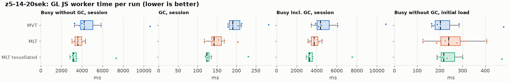
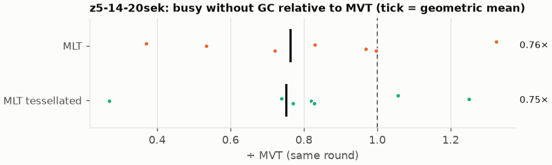
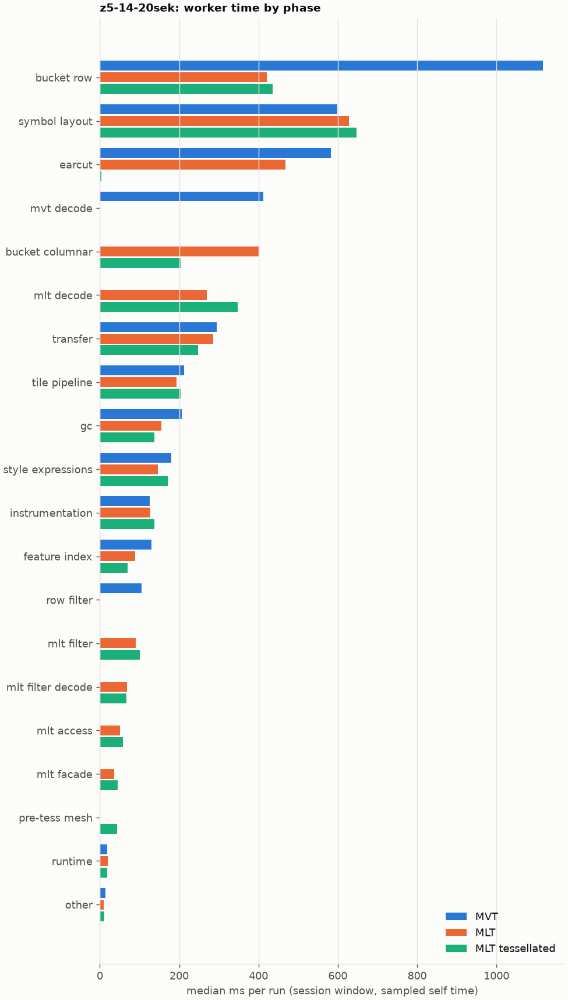
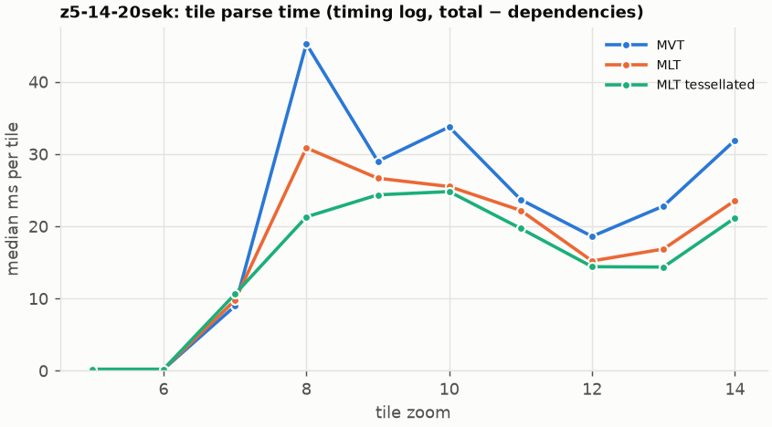
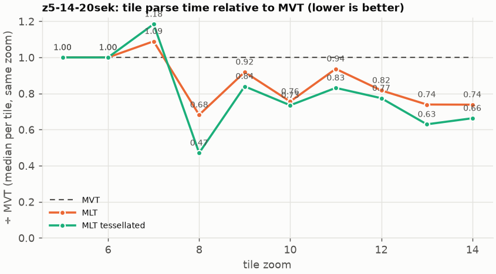

# Session trace benchmark — 20261019-155038

## Setup

- Created 2026-10-19T15:50:38+02:00; 7 repetitions + 1 warm-up round(s) (excluded); variants rotate per round (A B C, B C A, …); one cold browser context per run.
- Machine: 13th Gen Intel(R) Core(TM) i7-1365U, 12 logical cores, 31.3 GB RAM, Windows-11-10.0.26200-SP0; power: GUID des Energieschemas: 381b4222-f694-41f0-9685-ff5bb260df2e  (Ausbalanciert), AC True.
- GL JS gl7-performance-optimization @ f9bd50a8b5 (dirty); worker count 1; viewport {'width': 1280, 'height': 1024}.
- Python 3.12.2, packages {'playwright': '1.64.0', 'numpy': '2.5.3', 'matplotlib': '3.11.2'}.

| variant | bundle | format | bundle sha256 | branch build |
|---|---|---|---|---|
| MVT | `dist/maplibre-gl-dev.mjs` | mvt | `b2691453151d` | – |
| MLT | `dist/maplibre-gl-dev.mjs` | mlt | `b2691453151d` | – |
| MLT tessellated | `dist/maplibre-gl-dev.mjs` | mlt-pre-tess | `b2691453151d` | – |

| session | style | duration | frames | sha256 |
|---|---|---:|---:|---|
| z5-14-20sek | maptiler-basic | 21.4 s | 829 | `5a376e5ede30` |

CPU sampling interval (median over runs): 614 µs.

## Definitions

- **busy** = wall time in which a GL JS worker thread runs a task (union of top-level task slices and GC slices on `DedicatedWorker thread`s), summed over workers. **GC** = union of `MinorGC`/`MajorGC`/`V8.GC*` slices on those threads. **busy without GC** = busy − GC (headline metric).
- **CPU** = thread time (`tdur`) of the same slices. Phase categories and functions come from the trace's CPU samples (self time), categorised by `config/categories.toml` (nearest matching frame, leaf to root).
- Windows: **load** = map creation → first idle; **session** = camera replay; **tail** = end of replay → idle; **total** = load + session + tail.
- Ratios are against **MVT**: ratio of medians with a bootstrap 95 % CI, the geometric mean of per-round ratios, and a two-sided Mann–Whitney U p-value (normal approximation, not corrected for multiple comparisons; rough below n = 8). Lower than 1× means less worker time.

## Session `z5-14-20sek`

### Worker busy without GC (session window)

| variant | n ok / failed | median ms | IQR | mean | ratio vs MVT | 95 % CI | geo-mean paired | MWU p |
|---|---:|---:|---:|---:|---:|---:|---:|---:|
| MVT | 7 / 0 | 4,201 | 3,857–5,064 | 5,130 | 1.00× | – | – | – |
| MLT | 7 / 0 | 3,601 | 3,338–3,958 | 3,651 | 0.86× | 0.61–1.06× | 0.76× | 0.097 |
| MLT tessellated | 7 / 0 | 3,159 | 3,078–3,450 | 3,768 | 0.75× | 0.53–0.93× | 0.75× | 0.041 |

### All worker metrics (median, ratio vs baseline)

| metric | MVT | MLT | MLT tessellated |
|---|---:|---:|---:|
| busy incl. GC | 4,384 | 3,739 (0.85×) | 3,284 (0.75×) |
| &nbsp;&nbsp;of which GC | 190.7 | 142.3 (0.75×) | 124.3 (0.65×) |
| &nbsp;&nbsp;of which busy without GC | 4,201 | 3,601 (0.86×) | 3,159 (0.75×) |
| &nbsp;&nbsp;&nbsp;&nbsp;of which filtering (sampled, incl. callees) | 104.8 | 90.1 (0.86×) | 100.4 (0.96×) |
| &nbsp;&nbsp;&nbsp;&nbsp;of which column decoding inside the MLT filter (sampled) | 0.0 | 68.1 | 67.7 |
| &nbsp;&nbsp;&nbsp;&nbsp;of which timing instrumentation (sampled) | 126.4 | 126.9 (1.00×) | 138.0 (1.09×) |
| busy without GC and instrumentation | 4,075 | 3,474 (0.85×) | 3,021 (0.74×) |
| CPU time without GC | 3,629 | 3,228 (0.89×) | 2,797 (0.77×) |
| tile: download end → sent to main thread, median per tile | 216.7 | 177.6 (0.82×) | 158.3 (0.73×) |
| tile: download end → sent to main thread, 90th percentile | 444.1 | 407.1 (0.92×) | 359.9 (0.81×) |
| tile: download end → sent to main thread, 95th percentile | 494.0 | 427.9 (0.87×) | 401.5 (0.81×) |
| tile: download end → sent to main thread, 99th percentile | 521.8 | 463.4 (0.89×) | 452.1 (0.87×) |
| &nbsp;&nbsp;parse part (timing log, incl. waiting for glyphs/icons), median per tile | 121.5 | 100.0 (0.82×) | 84.2 (0.69×) |
| &nbsp;&nbsp;queue + hand-off part, median per tile | 87.7 | 73.5 (0.84×) | 66.0 (0.75×) |
| minor GCs | 58.00 | 51.00 (0.88×) | 36.00 (0.62×) |
| major GCs | 5.00 | 5.00 (1.00×) | 4.00 (0.80×) |
| peak worker heap (MB) | 53.1 | 54.0 (1.02×) | 45.1 (0.85×) |
| load: busy without GC | 202.5 | 239.3 (1.18×) | 217.3 (1.07×) |
| load: GC | 6.9 | 7.7 (1.11×) | 6.2 (0.89×) |
| total: busy without GC | 4,391 | 3,840 (0.87×) | 3,377 (0.77×) |

Rows marked *of which* are parts of the row above, not additional time. Tile rows are per-tile latencies (medians over tiles, then over runs), not sums: tiles overlap in time, and the medians of the parse and queue parts do not add up exactly to the median latency.

### Filtering (session window)

Sampled worker time spent in feature filtering, including everything the filter calls (expression evaluation, property access): **row filter** = the style-spec feature filter that MVT runs per feature, **mlt filter** = the columnar MLT filter (incl. the geometry-type selection), without the columns it decodes (see the next table). Medians per run; rules in `config/categories.toml`.

| variant | mlt filter | row filter | filtering | ratio vs MVT | 95 % CI | MWU p | share of sampled busy |
|---|---:|---:|---:|---:|---:|---:|---:|
| MVT | 0.0 | 104.8 | 104.8 | 1.00× | – | – | 2.3% |
| MLT | 90.1 | 0.0 | 90.1 | 0.86× | 0.71–1.18× | 0.523 | 2.7% |
| MLT tessellated | 100.4 | 0.0 | 100.4 | 0.96× | 0.74–1.19× | 0.701 | 3.2% |

**Filtering together with tile decoding.** The MLT decoder leaves columns encoded until something reads them, and the filter is usually the first reader: the columns it decodes (properties, and the geometry for `$type`) are **of which inside the filter** (phase *mlt filter decode*), the rest is *mlt decode* (geometry and columns read later, e.g. by paint properties and symbols). MVT decodes every feature's properties and geometry while it reads the tile (*mvt decode*), whether the filter keeps the feature or not. So **filtering** above compares the filters, and **decoding + filtering** compares all that the formats spend on decoding the tile and selecting features. **tile decoding** = *mvt decode* or *mlt decode* + *mlt filter decode*; the MLT facade (GL JS's feature-by-feature access to MLT data, phase *mlt facade*) is not counted.

| variant | tile decoding | of which inside the filter | filtering | decoding + filtering | ratio vs MVT | 95 % CI | MWU p |
|---|---:|---:|---:|---:|---:|---:|---:|
| MVT | 412.7 | 0.0 | 104.8 | 509.0 | 1.00× | – | – |
| MLT | 337.4 | 68.1 | 90.1 | 428.5 | 0.84× | 0.60–0.98× | 0.041 |
| MLT tessellated | 408.9 | 67.7 | 100.4 | 501.7 | 0.99× | 0.71–1.18× | 0.898 |

Top 12 functions inside filtering and its column decoding (self time, mean ms per run):

| phase | function | source | MVT | MLT | MLT tessellated |
|---|---|---|---:|---:|---:|
| row filter | `evaluate` | node_modules/@maplibre/maplibre-gl-style-spec/dist/expression/compound_expression.mjs | 29.1 | 0.0 | 0.0 |
| row filter | `evaluate` | node_modules/@maplibre/maplibre-gl-style-spec/dist/expression/index.mjs | 23.0 | 0.0 | 0.0 |
| mlt filter decode | `unpackNullable` | maplibre-tile-spec/ts/dist/decoding/unpackNullableUtils.js | 0.0 | 14.8 | 16.7 |
| mlt filter | `filterByGeometryType` | maplibre-tile-spec/ts/dist/vector/geometry/geometryVector.js | 0.0 | 12.5 | 14.7 |
| mlt filter | `scanDictionaryCodes` | maplibre-tile-spec/ts/dist/processing/filter/execution/filterKernel.js | 0.0 | 10.9 | 12.0 |
| row filter | `CompoundExpression.register.filter-==` | node_modules/@maplibre/maplibre-gl-style-spec/dist/expression/compound_expression.mjs | 11.6 | 0.0 | 0.0 |
| row filter | `CompoundExpression.register.filter-in-small` | node_modules/@maplibre/maplibre-gl-style-spec/dist/expression/compound_expression.mjs | 11.5 | 0.0 | 0.0 |
| row filter | `filter` | node_modules/@maplibre/maplibre-gl-style-spec/dist/feature_filter/index.mjs | 11.1 | 0.0 | 0.0 |
| row filter | `CompoundExpression.register.filter-type-==` | node_modules/@maplibre/maplibre-gl-style-spec/dist/expression/compound_expression.mjs | 8.3 | 0.0 | 0.0 |
| mlt filter | `dictionaryRowMatches` | maplibre-tile-spec/ts/dist/processing/filter/execution/filterKernel.js | 0.0 | 7.7 | 8.2 |
| mlt filter decode | `decodeFsst` | maplibre-tile-spec/ts/dist/decoding/fsstDecoder.js | 0.0 | 7.5 | 7.2 |
| mlt filter | `resolveDictionaryExecutor` | maplibre-tile-spec/ts/dist/processing/filter/execution/filterKernel.js | 0.0 | 5.4 | 7.4 |

### Where the variants differ from MVT (session window, mean ms per run)

Open **[flame.html](flame.html)** to explore the call tree interactively: pick a variant, compare it with MVT (red = more time at the same call path, blue = less), click a frame to zoom in, and read the phase and function breakdown under it. Without a comparison, frames are coloured by phase: filtering is green in both formats, and the columns the MLT filter decodes on first access (*mlt filter decode*) are MLT blue frames under the green filter. `flame/*.txt` open in https://www.speedscope.app.

#### MLT vs MVT

**By phase** (sampled self time; the Δ column sums to the difference in sampled busy time):

| phase | MVT | MLT | Δ |
|---|---:|---:|---:|
| bucket columnar | 0.0 | 411.6 | +411.6 |
| mlt decode | 0.0 | 263.7 | +263.7 |
| mlt filter | 0.1 | 96.7 | +96.5 |
| mlt filter decode | 0.0 | 67.4 | +67.4 |
| mlt access | 0.0 | 53.3 | +53.3 |
| mlt facade | 0.4 | 39.6 | +39.2 |
| runtime | 19.4 | 20.4 | +1.0 |
| other | 14.7 | 10.8 | -3.9 |
| instrumentation | 178.3 | 138.5 | -39.8 |
| gc | 221.1 | 168.0 | -53.1 |
| tile pipeline | 249.3 | 195.4 | -53.9 |
| style expressions | 215.3 | 156.3 | -59.0 |
| transfer | 341.5 | 279.3 | -62.2 |
| feature index | 162.7 | 82.1 | -80.6 |
| symbol layout | 732.0 | 625.9 | -106.1 |
| row filter | 111.2 | 0.0 | -111.2 |
| earcut | 649.2 | 451.6 | -197.6 |
| mvt decode | 474.9 | 0.0 | -474.9 |
| bucket row | 1,286 | 421.2 | -865.0 |

**By source layer** (timing log: createBucket + populate + addFeatures, summed over the style layers that use it; wall time, includes GC pauses; total Δ -1159 ms):

| source layer | type | MVT | MLT | Δ |
|---|---|---:|---:|---:|
| poi | symbol | 59.3 | 68.9 | +9.6 |
| aeroway | fill | 1.9 | 4.0 | +2.2 |
| aeroway | line | 2.3 | 4.4 | +2.0 |
| water | fill | 86.1 | 68.8 | -17.3 |
| transportation | fill | 32.9 | 15.1 | -17.7 |
| transportation_name | symbol | 176.2 | 157.2 | -19.1 |
| waterway | line | 86.5 | 64.9 | -21.5 |
| place | symbol | 741.1 | 684.4 | -56.7 |
| transportation | line | 717.9 | 593.0 | -124.9 |
| landuse | fill | 583.8 | 320.6 | -263.1 |
| building | fill | 475.1 | 200.1 | -275.0 |
| landcover | fill | 869.2 | 488.2 | -380.9 |

**Functions with the largest self-time difference** (by function name, summed over source files):

| function | MVT | MLT | Δ |
|---|---:|---:|---:|
| `writeEarcutFill` | 0.0 | 38.9 | +38.9 |
| `buildRingBoundingBoxes` | 0.0 | 35.9 | +35.9 |
| `buildEarcutMesh` | 0.0 | 34.7 | +34.7 |
| `decodeComponentwiseDeltaVec2` | 0.0 | 31.3 | +31.3 |
| `pushVertex` | 0.0 | 26.3 | +26.3 |
| `get` | 27.6 | 49.3 | +21.7 |
| `unpackNullable` | 0.0 | 21.0 | +21.0 |
| `decodeString` | 0.0 | 17.2 | +17.2 |
| `decodeFastPforInt32` | 0.0 | 15.6 | +15.6 |
| `appendSymbolFeature` | 0.0 | 14.8 | +14.8 |
| `registerGlyphs` | 0.0 | 13.7 | +13.7 |
| `filterByGeometryType` | 0.0 | 12.5 | +12.5 |
| `_vertexToIndex` | 230.1 | 0.0 | -230.1 |
| `readSVarint` | 218.4 | 0.0 | -218.4 |
| `loadGeometry` | 130.9 | 13.8 | -117.0 |
| `isEar` | 203.1 | 108.6 | -94.5 |
| `populate` | 124.0 | 45.4 | -78.6 |

#### MLT tessellated vs MVT

**By phase** (sampled self time; the Δ column sums to the difference in sampled busy time):

| phase | MVT | MLT tessellated | Δ |
|---|---:|---:|---:|
| mlt decode | 0.0 | 396.9 | +396.9 |
| bucket columnar | 0.0 | 239.0 | +239.0 |
| mlt filter | 0.1 | 112.4 | +112.3 |
| mlt filter decode | 0.0 | 73.8 | +73.8 |
| mlt access | 0.0 | 68.2 | +68.2 |
| mlt facade | 0.4 | 49.6 | +49.1 |
| pre-tess mesh | 0.0 | 42.5 | +42.5 |
| symbol layout | 732.0 | 746.3 | +14.3 |
| runtime | 19.4 | 23.5 | +4.0 |
| other | 14.7 | 12.6 | -2.1 |
| tile pipeline | 249.3 | 240.8 | -8.5 |
| instrumentation | 178.3 | 159.7 | -18.6 |
| style expressions | 215.3 | 190.1 | -25.2 |
| transfer | 341.5 | 291.8 | -49.7 |
| gc | 221.1 | 149.4 | -71.8 |
| feature index | 162.7 | 80.4 | -82.3 |
| row filter | 111.2 | 0.0 | -111.2 |
| mvt decode | 474.9 | 0.0 | -474.9 |
| earcut | 649.2 | 4.0 | -645.3 |
| bucket row | 1,286 | 517.2 | -769.0 |

**By source layer** (timing log: createBucket + populate + addFeatures, summed over the style layers that use it; wall time, includes GC pauses; total Δ -1256 ms):

| source layer | type | MVT | MLT tessellated | Δ |
|---|---|---:|---:|---:|
| place | symbol | 741.1 | 840.4 | +99.3 |
| transportation | line | 717.9 | 772.4 | +54.6 |
| transportation_name | symbol | 176.2 | 194.2 | +18.0 |
| poi | symbol | 59.3 | 76.8 | +17.5 |
| boundary | line | 50.7 | 65.1 | +14.4 |
| aerodrome_label | symbol | 8.0 | 18.6 | +10.6 |
| aeroway | line | 2.3 | 6.3 | +4.0 |
| waterway | line | 86.5 | 80.7 | -5.7 |
| water | fill | 86.1 | 54.2 | -31.9 |
| building | fill | 475.1 | 78.2 | -397.0 |
| landuse | fill | 583.8 | 167.1 | -416.6 |
| landcover | fill | 869.2 | 243.1 | -626.0 |

**Functions with the largest self-time difference** (by function name, summed over source files):

| function | MVT | MLT tessellated | Δ |
|---|---:|---:|---:|
| `buildTessellatedBoundingBox` | 0.0 | 40.5 | +40.5 |
| `decodeUnsignedZigZagDeltaInt32` | 0.0 | 37.8 | +37.8 |
| `decodeComponentwiseDeltaVec2` | 0.0 | 33.0 | +33.0 |
| `get` | 27.6 | 58.2 | +30.6 |
| `unpackNullable` | 0.0 | 25.8 | +25.8 |
| `writeTessellatedFill` | 0.0 | 21.1 | +21.1 |
| `appendSymbolFeature` | 0.0 | 20.9 | +20.9 |
| `decodeString` | 0.0 | 20.7 | +20.7 |
| `decodeFastPforInt32` | 0.0 | 20.6 | +20.6 |
| `decodeBigEndianInt32sInto` | 0.0 | 17.0 | +17.0 |
| `appendScaledVertices` | 0.0 | 16.2 | +16.2 |
| `registerGlyphs` | 0.0 | 15.8 | +15.8 |
| `_vertexToIndex` | 230.1 | 0.0 | -230.1 |
| `readSVarint` | 218.4 | 0.0 | -218.4 |
| `isEar` | 203.1 | 0.4 | -202.7 |
| `isEarHashed` | 118.3 | 0.0 | -118.3 |
| `loadGeometry` | 130.9 | 16.0 | -114.9 |

### Worker time by phase (session window, median ms of sampled self time)

| phase | MVT | MLT | MLT tessellated |
|---|---:|---:|---:|
| bucket row | 1,117 | 420.6 | 435.3 |
| symbol layout | 599.1 | 628.2 | 647.0 |
| earcut | 583.3 | 468.7 | 3.7 |
| mvt decode | 412.7 | 0.0 | 0.0 |
| bucket columnar | 0.0 | 400.4 | 203.4 |
| mlt decode | 0.0 | 269.3 | 347.2 |
| transfer | 294.5 | 285.7 | 247.1 |
| tile pipeline | 212.8 | 193.6 | 204.0 |
| gc | 206.2 | 154.9 | 137.0 |
| style expressions | 180.5 | 146.3 | 171.1 |
| instrumentation | 126.4 | 126.9 | 138.0 |
| feature index | 129.8 | 89.5 | 69.4 |
| row filter | 104.8 | 0.0 | 0.0 |
| mlt filter | 0.0 | 90.1 | 100.4 |
| mlt filter decode | 0.0 | 68.1 | 67.7 |
| mlt access | 0.0 | 51.5 | 57.9 |
| mlt facade | 0.0 | 36.3 | 44.7 |
| pre-tess mesh | 0.0 | 0.0 | 43.0 |
| runtime | 18.9 | 19.4 | 18.5 |
| other | 13.7 | 10.4 | 11.6 |

### Top 20 worker functions by self time (session window, mean ms per run)

| function | source | phase | MVT | MLT | MLT tessellated |
|---|---|---|---:|---:|---:|
| `_vertexToIndex` | src/render/subdivision.ts | bucket row | 230.1 | 0.0 | 0.0 |
| `(garbage collector)` | (native) | gc | 221.1 | 168.0 | 149.4 |
| `readSVarint` | node_modules/pbf/index.js | mvt decode | 218.4 | 0.0 | 0.0 |
| `isEar` | node_modules/earcut/src/earcut.js | earcut | 203.1 | 108.6 | 0.4 |
| `reserve` | src/util/struct_array.ts | feature index | 181.9 | 148.0 | 155.6 |
| `isEarHashed` | node_modules/earcut/src/earcut.js | earcut | 118.3 | 78.5 | 0.0 |
| `emplace` | src/data/array_types.g.ts | bucket row | 101.3 | 85.3 | 91.6 |
| `postMessage` | (native) | transfer | 100.3 | 82.9 | 96.3 |
| `fetch` | (native) | tile pipeline | 89.7 | 71.4 | 87.3 |
| `insert` | src/data/feature_index.ts | feature index | 79.9 | 23.4 | 24.8 |
| `populate` | src/data/bucket/line_bucket.ts | bucket row | 78.5 | 0.0 | 0.0 |
| `_trim` | src/util/struct_array.ts | transfer | 77.2 | 59.2 | 43.7 |
| `readVarint` | node_modules/pbf/index.js | mvt decode | 71.5 | 0.0 | 0.0 |
| `loadGeometry` | node_modules/@mapbox/vector-tile/index.js | mvt decode | 68.2 | 0.0 | 0.0 |
| `addLine` | src/data/bucket/line_bucket.ts | bucket row | 62.7 | 54.0 | 65.8 |
| `addHalfVertex` | src/data/bucket/line_bucket.ts | bucket row | 57.9 | 47.4 | 63.1 |
| `loadGeometry` | src/data/load_geometry.ts | bucket row | 62.7 | 12.3 | 13.5 |
| `serialize` | src/util/web_worker_transfer.ts | transfer | 60.7 | 51.9 | 59.8 |
| `parse` | src/source/worker_tile.ts | tile pipeline | 59.6 | 39.3 | 51.2 |
| `earcutLinked` | node_modules/earcut/src/earcut.js | earcut | 59.5 | 49.5 | 0.6 |

### Top 20 worker functions by total time (incl. callees) (session window, mean ms per run)

| function | source | phase | MVT | MLT | MLT tessellated |
|---|---|---|---:|---:|---:|
| `parse` | src/source/worker_tile.ts | tile pipeline | 3,797 | 2,860 | 2,752 |
| `loadTile` | src/source/vector_tile_worker_source.ts | tile pipeline | 3,229 | 2,330 | 2,132 |
| `_parseWorkerTile` | src/source/vector_tile_worker_source.ts | tile pipeline | 3,077 | 2,252 | 2,039 |
| `populate` | src/data/bucket/fill_bucket.ts | bucket row | 1,741 | 0.0 | 0.0 |
| `addBucketFeatures` | src/data/bucket/fill_bucket.ts | bucket row | 1,379 | 782.1 | 132.3 |
| `addFeature` | src/data/bucket/fill_bucket.ts | bucket row | 1,282 | 0.0 | 0.0 |
| `subdividePolygon` | src/render/subdivision.ts |  | 1,076 | 0.0 | 0.0 |
| `subdividePolygonInternal` | src/render/subdivision.ts | bucket row | 1,066 | 0.0 | 0.0 |
| `populate` | src/data/bucket/columnar/columnar_fill_bucket.ts | bucket columnar | 0.0 | 981.5 | 487.2 |
| `addFeature` | src/data/bucket/columnar/columnar_fill_bucket.ts | bucket columnar | 0.0 | 754.3 | 120.5 |
| `writeEarcutFill` | src/data/bucket/columnar/columnar_mesh_arrays.ts | bucket columnar | 0.0 | 742.4 | 10.3 |
| `populate` | src/data/bucket/columnar/columnar_line_bucket.ts | bucket columnar | 0.0 | 590.4 | 723.9 |
| `addFeatures` | src/data/bucket/symbol_bucket.ts | symbol layout | 668.3 | 559.8 | 657.7 |
| `populate` | src/data/bucket/line_bucket.ts | bucket row | 662.2 | 0.0 | 0.0 |
| `performSymbolLayout` | src/symbol/symbol_layout.ts | symbol layout | 658.7 | 549.1 | 647.6 |
| `earcut` | node_modules/earcut/src/earcut.js | earcut | 648.4 | 449.7 | 4.0 |
| `earcutLinked` | node_modules/earcut/src/earcut.js | earcut | 513.6 | 348.0 | 1.1 |
| `buildEarcutMesh` | src/data/bucket/columnar/columnar_mesh_arrays.ts | bucket columnar | 0.0 | 510.1 | 5.5 |
| `processTask` | src/util/actor.ts | transfer | 475.4 | 361.7 | 390.2 |
| `loadGeometry` | src/data/load_geometry.ts | bucket row | 413.4 | 37.3 | 47.8 |

### Tile parse time by zoom (timing log, median ms per tile, total − dependencies)

| zoom | MVT | MLT | MLT tessellated |
|---:|---:|---:|---:|
| 5 | 0.20 (n=63) | 0.20 (n=63) | 0.20 (n=63) |
| 6 | 0.20 (n=63) | 0.20 (n=63) | 0.20 (n=63) |
| 7 | 8.95 (n=42) | 9.75 (n=42) | 10.60 (n=42) |
| 8 | 45.25 (n=32) | 30.85 (n=38) | 21.30 (n=39) |
| 9 | 29.00 (n=109) | 26.65 (n=112) | 24.35 (n=112) |
| 10 | 33.75 (n=140) | 25.50 (n=140) | 24.80 (n=141) |
| 11 | 23.70 (n=97) | 22.20 (n=108) | 19.70 (n=99) |
| 12 | 18.60 (n=150) | 15.20 (n=143) | 14.40 (n=143) |
| 13 | 22.80 (n=157) | 16.85 (n=150) | 14.35 (n=152) |
| 14 | 31.90 (n=126) | 23.55 (n=126) | 21.15 (n=126) |

### Tile latency by zoom: download end → result sent to the main thread (session window, ms per tile: median / p95 / p99)

Includes waiting in the worker's queue, the parse and posting the result; see `tile_latency.csv` for the per-tile split (`parse_ms`, `wait_ms`). Percentiles over the tiles of all runs; with few tiles (n) p99 is close to the maximum.

| zoom | MVT | MLT | MLT tessellated |
|---:|---:|---:|---:|
| 6 | 63.2 / 106.3 / 112.5 (n=63) | 66.2 / 120.2 / 130.8 (n=63) | 54.9 / 154.3 / 163.5 (n=63) |
| 7 | 191.0 / 418.1 / 441.1 (n=42) | 128.9 / 207.8 / 348.9 (n=42) | 99.1 / 274.3 / 545.1 (n=42) |
| 8 | 249.9 / 382.8 / 405.9 (n=32) | 225.1 / 274.9 / 296.4 (n=38) | 181.7 / 323.8 / 370.3 (n=39) |
| 9 | 364.5 / 629.0 / 667.6 (n=109) | 186.6 / 498.6 / 527.4 (n=112) | 273.1 / 664.3 / 740.8 (n=112) |
| 10 | 417.5 / 790.0 / 828.3 (n=140) | 329.1 / 577.0 / 638.6 (n=140) | 285.9 / 881.3 / 980.2 (n=141) |
| 11 | 204.7 / 361.9 / 1,281 (n=97) | 172.1 / 301.7 / 332.6 (n=108) | 178.0 / 562.5 / 621.4 (n=99) |
| 12 | 175.1 / 319.3 / 447.1 (n=150) | 86.3 / 315.4 / 348.9 (n=143) | 115.5 / 490.7 / 524.7 (n=143) |
| 13 | 228.5 / 524.7 / 611.9 (n=157) | 182.8 / 325.0 / 344.2 (n=150) | 159.1 / 650.5 / 708.8 (n=152) |
| 14 | 357.1 / 734.1 / 761.0 (n=126) | 240.2 / 382.4 / 418.5 (n=126) | 222.2 / 590.0 / 695.6 (n=126) |

## Runs

24 ok, 0 failed/aborted, 0 not run, 21 used in statistics.

## Validity checks

- Counted once: all 24 analysed runs pass (windows load + session + tail add up to total; phases add up to the sampled busy time; GC and sampled time lie within busy time; no timing-log line twice).
- z5-14-20sek/mvt/rep-05: CPU samples cover only 77% of worker busy time
- 8 of 8 rounds parsed different tile sets across variants (e.g. z5-14-20sek round 0: mvt 130 tiles, mlt 129 tiles, mlt-pre-tess 130 tiles; z5-14-20sek round 1: mlt 130 tiles, mlt-pre-tess 123 tiles, mvt 123 tiles; z5-14-20sek round 2: mlt-pre-tess 123 tiles, mvt 123 tiles, mlt 126 tiles; z5-14-20sek round 3: mvt 127 tiles, mlt 126 tiles, mlt-pre-tess 126 tiles; z5-14-20sek round 4: mlt 129 tiles, mlt-pre-tess 123 tiles, mvt 126 tiles); expected where a session zooms past the last MVT level (MVT overzooms, MLT loads deeper tiles)

## Files

- `runs.csv`: one row per run (incl. failed and warm-up runs), every scalar metric as `<window>.<metric>`.
- `summary.csv`: session × variant × metric statistics.
- `functions.csv`, `categories.csv`: CPU-sample self/total time per function and phase per run and window.
- `category_functions.csv`: self time per phase × function (e.g. what the filters spend their time on).
- `tiles.csv`, `tile_layers.csv`, `tile_phases.csv`: the per-tile worker timing log, long format.
- `flame.html`: interactive call tree per variant with a diff view; `flame/*.txt`: collapsed stacks for speedscope.
- `analysis/stacks.csv` (per run): sampled self time per full call stack.
- `tile_latency.csv`: per tile request, worker clock: received, download start/end, result sent, latency = sent − download end, parse_ms, wait_ms = latency − parse.
- `runs/<session>/<variant>/rep-NN/trace.json.gz`: the raw trace (opens in the DevTools Performance tab).
