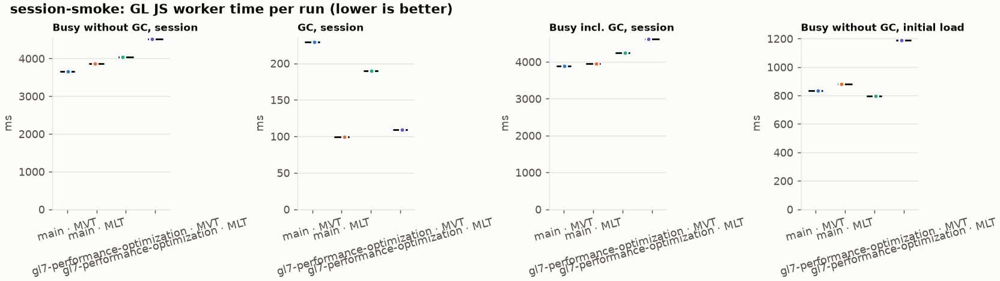
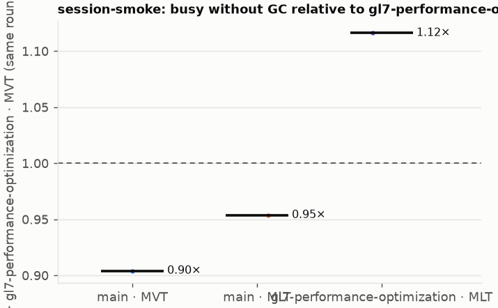
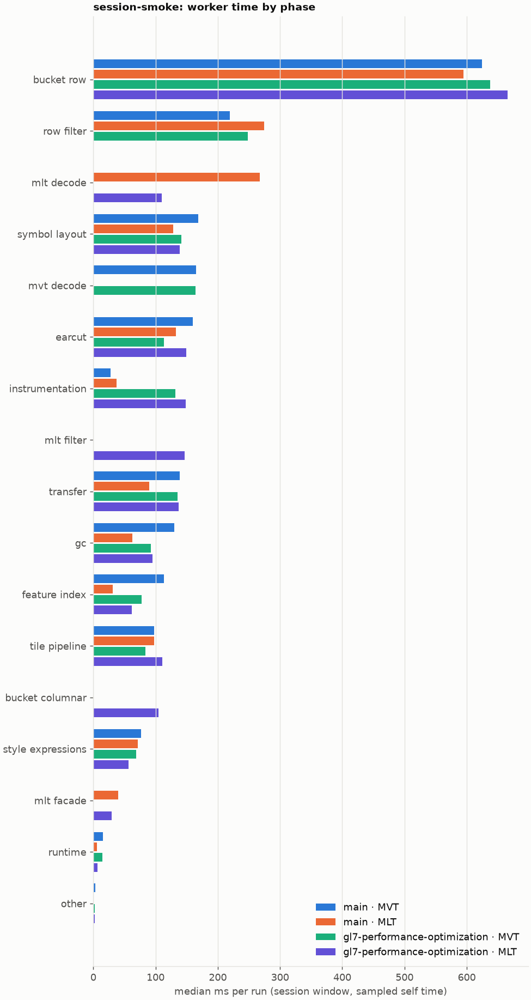
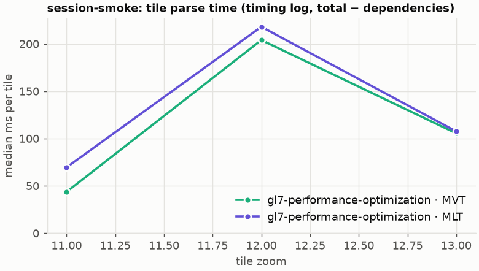
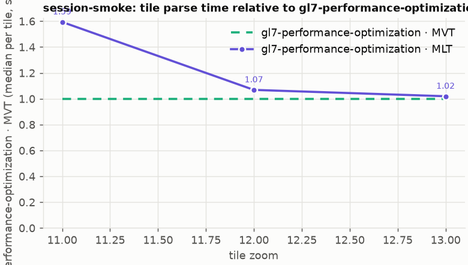

# Session trace benchmark — 20261021-144539-builds-check

## Setup

- Created 2026-10-21T14:45:40+02:00; 1 repetitions + 0 warm-up round(s) (excluded); variants rotate per round (A B C, B C A, …); one cold browser context per run.
- Machine: 13th Gen Intel(R) Core(TM) i7-1365U, 12 logical cores, 31.3 GB RAM, Windows-11-10.0.26200-SP0; power: GUID des Energieschemas: 381b4222-f694-41f0-9685-ff5bb260df2e  (Ausbalanciert), AC True.
- GL JS gl7-performance-optimization @ f9bd50a8b5 (dirty); worker count 1; viewport {'width': 1280, 'height': 1024}; tracing preset devtools.
- Python 3.12.2, packages {'playwright': '1.64.0', 'numpy': '2.5.3', 'matplotlib': '3.11.2'}.

| variant | bundle | format | bundle sha256 | branch build |
|---|---|---|---|---|
| main · MVT | `bench-builds/branches/main/maplibre-gl-dev.mjs` | mvt | `ced4373133d3` | main @ 8470a6193d (2026-09-18), MLT @ 9bf846d053 |
| main · MLT | `bench-builds/branches/main/maplibre-gl-dev.mjs` | mlt | `ced4373133d3` | main @ 8470a6193d (2026-09-18), MLT @ 9bf846d053 |
| gl7-performance-optimization · MVT | `bench-builds/branches/gl7-performance-optimization/maplibre-gl-dev.mjs` | mvt | `e74f9d5a3da7` | gl7-performance-optimization @ f9bd50a8b5 (2026-10-19), MLT @ 9bf846d053 |
| gl7-performance-optimization · MLT | `bench-builds/branches/gl7-performance-optimization/maplibre-gl-dev.mjs` | mlt | `e74f9d5a3da7` | gl7-performance-optimization @ f9bd50a8b5 (2026-10-19), MLT @ 9bf846d053 |

| session | style | duration | frames | sha256 |
|---|---|---:|---:|---|
| session-smoke | osm-bright | 8.0 s | 360 | `31a0e49d65a0` |

CPU sampling interval (median over runs): 625 µs.

## Definitions

- **busy** = wall time in which a GL JS worker thread runs a task (union of top-level task slices and GC slices on `DedicatedWorker thread`s), summed over workers. **GC** = union of `MinorGC`/`MajorGC`/`V8.GC*` slices on those threads. **busy without GC** = busy − GC (headline metric).
- **CPU** = thread time (`tdur`) of the same slices. Phase categories and functions come from the trace's CPU samples (self time), categorised by `config/categories.toml` (nearest matching frame, leaf to root).
- Windows: **load** = map creation → first idle; **session** = camera replay; **tail** = end of replay → idle; **total** = load + session + tail.
- Ratios are against **gl7-performance-optimization · MVT**: ratio of medians with a bootstrap 95 % CI, the geometric mean of per-round ratios, and a two-sided Mann–Whitney U p-value (normal approximation, not corrected for multiple comparisons; rough below n = 8). Lower than 1× means less worker time.

## Session `session-smoke`

### Worker busy without GC (session window)

| variant | n ok / failed | median ms | IQR | mean | ratio vs gl7-performance-optimization · MVT | 95 % CI | geo-mean paired | MWU p |
|---|---:|---:|---:|---:|---:|---:|---:|---:|
| main · MVT | 1 / 0 | 3,659 | 3,659–3,659 | 3,659 | 0.90× | – | 0.90× | 1.000 |
| main · MLT | 1 / 0 | 3,860 | 3,860–3,860 | 3,860 | 0.95× | – | 0.95× | 1.000 |
| gl7-performance-optimization · MVT | 1 / 0 | 4,047 | 4,047–4,047 | 4,047 | 1.00× | – | – | – |
| gl7-performance-optimization · MLT | 1 / 0 | 4,517 | 4,517–4,517 | 4,517 | 1.12× | – | 1.12× | 1.000 |

### All worker metrics (median, ratio vs baseline)

| metric | main · MVT | main · MLT | gl7-performance-optimization · MVT | gl7-performance-optimization · MLT |
|---|---:|---:|---:|---:|
| busy incl. GC | 3,888 (0.92×) | 3,959 (0.93×) | 4,236 | 4,626 (1.09×) |
| &nbsp;&nbsp;of which GC | 229.1 (1.21×) | 99.2 (0.52×) | 189.4 | 108.8 (0.57×) |
| &nbsp;&nbsp;of which busy without GC | 3,659 (0.90×) | 3,860 (0.95×) | 4,047 | 4,517 (1.12×) |
| &nbsp;&nbsp;&nbsp;&nbsp;of which filtering (sampled, incl. callees) | 219.2 (0.88×) | 274.8 (1.11×) | 247.8 | 147.0 (0.59×) |
| &nbsp;&nbsp;&nbsp;&nbsp;of which timing instrumentation (sampled) | 27.7 (0.21×) | 37.3 (0.28×) | 132.2 | 148.1 (1.12×) |
| busy without GC and instrumentation | 3,631 (0.93×) | 3,822 (0.98×) | 3,915 | 4,369 (1.12×) |
| CPU time without GC | 1,294 (1.03×) | 1,120 (0.89×) | 1,258 | 1,021 (0.81×) |
| tile: download end → sent to main thread, median per tile | 2,176 (0.61×) | 2,314 (0.65×) | 3,578 | 3,651 (1.02×) |
| tile: download end → sent to main thread, 90th percentile | 3,237 (0.80×) | 3,635 (0.90×) | 4,033 | 4,179 (1.04×) |
| &nbsp;&nbsp;parse part (timing log, incl. waiting for glyphs/icons), median per tile | – | – | 1,172 | 754.8 (0.64×) |
| &nbsp;&nbsp;queue + hand-off part, median per tile | – | – | 1,286 | 486.0 (0.38×) |
| minor GCs | 13.00 (1.18×) | 8.00 (0.73×) | 11.00 | 8.00 (0.73×) |
| major GCs | 2.00 (1.00×) | 1.00 (0.50×) | 2.00 | 2.00 (1.00×) |
| peak worker heap (MB) | 45.7 (1.03×) | 68.1 (1.53×) | 44.4 | 44.3 (1.00×) |
| load: busy without GC | 833.1 (1.04×) | 879.2 (1.10×) | 797.9 | 1,189 (1.49×) |
| load: GC | 31.4 (1.00×) | 45.9 (1.46×) | 31.5 | 41.3 (1.31×) |
| total: busy without GC | 4,492 (0.93×) | 4,739 (0.98×) | 4,845 | 5,706 (1.18×) |

Rows marked *of which* are parts of the row above, not additional time. Tile rows are per-tile latencies (medians over tiles, then over runs), not sums: tiles overlap in time, and the medians of the parse and queue parts do not add up exactly to the median latency.

### Filtering (session window)

Sampled worker time spent in feature filtering, including everything the filter calls (expression evaluation, property access, lazy column decoding): **row filter** = the style-spec feature filter that MVT runs per feature, **mlt filter** = the columnar MLT filter (incl. the geometry-type selection). Medians per run; rules in `config/categories.toml`.

| variant | mlt filter | row filter | filtering total | ratio vs gl7-performance-optimization · MVT | 95 % CI | MWU p | share of sampled busy |
|---|---:|---:|---:|---:|---:|---:|---:|
| main · MVT | 0.0 | 219.2 | 219.2 | 0.88× | – | 1.000 | 11.3% |
| main · MLT | 0.0 | 274.8 | 274.8 | 1.11× | – | 1.000 | 15.0% |
| gl7-performance-optimization · MVT | 0.0 | 247.8 | 247.8 | 1.00× | – | – | 13.0% |
| gl7-performance-optimization · MLT | 147.0 | 0.0 | 147.0 | 0.59× | – | 1.000 | 7.5% |

Top 12 functions inside filtering (self time, mean ms per run):

| phase | function | source | main · MVT | main · MLT | gl7-performance-optimization · MVT | gl7-performance-optimization · MLT |
|---|---|---|---:|---:|---:|---:|
| row filter | `evaluate` | node_modules/@maplibre/maplibre-gl-style-spec/dist/expression/compound_expression.mjs | 54.0 | 95.0 | 56.3 | 0.0 |
| row filter | `evaluate` | node_modules/@maplibre/maplibre-gl-style-spec/dist/expression/index.mjs | 40.7 | 27.3 | 33.7 | 0.0 |
| row filter | `CompoundExpression.register.all.overloads` | node_modules/@maplibre/maplibre-gl-style-spec/dist/expression/compound_expression.mjs | 30.5 | 39.0 | 37.6 | 0.0 |
| row filter | `CompoundExpression.register.filter-==` | node_modules/@maplibre/maplibre-gl-style-spec/dist/expression/compound_expression.mjs | 20.1 | 21.1 | 33.9 | 0.0 |
| row filter | `CompoundExpression.register.filter-in-small` | node_modules/@maplibre/maplibre-gl-style-spec/dist/expression/compound_expression.mjs | 24.6 | 32.7 | 16.4 | 0.0 |
| mlt filter | `scanDictionaryCodes` | maplibre-tile-spec/ts/dist/processing/filter/execution/filterKernel.js | 0.0 | 0.0 | 0.0 | 29.6 |
| row filter | `properties` | node_modules/@maplibre/maplibre-gl-style-spec/dist/expression/evaluation_context.mjs | 7.0 | 4.4 | 19.8 | 0.0 |
| mlt filter | `filterByGeometryType` | maplibre-tile-spec/ts/dist/vector/geometry/geometryVector.js | 0.0 | 0.0 | 0.0 | 18.7 |
| mlt filter | `matches` | maplibre-tile-spec/ts/dist/processing/filter/execution/filterKernel.js | 0.0 | 0.0 | 0.0 | 18.7 |
| row filter | `filter` | node_modules/@maplibre/maplibre-gl-style-spec/dist/feature_filter/index.mjs | 7.8 | 11.0 | 16.7 | 0.0 |
| row filter | `CompoundExpression.register.filter-has` | node_modules/@maplibre/maplibre-gl-style-spec/dist/expression/compound_expression.mjs | 3.1 | 15.5 | 0.4 | 0.0 |
| mlt filter | `dictionaryRowMatches` | maplibre-tile-spec/ts/dist/processing/filter/execution/filterKernel.js | 0.0 | 0.0 | 0.0 | 12.8 |

### Where the variants differ from gl7-performance-optimization · MVT (session window, mean ms per run)

Open **[flame.html](flame.html)** to explore the call tree interactively: pick a variant, compare it with gl7-performance-optimization · MVT (red = more time at the same call path, blue = less), click a frame to zoom in, and read the phase and function breakdown under it. `flame/*.txt` open in https://www.speedscope.app.

#### main · MVT vs gl7-performance-optimization · MVT

**By phase** (sampled self time; the Δ column sums to the difference in sampled busy time):

| phase | gl7-performance-optimization · MVT | main · MVT | Δ |
|---|---:|---:|---:|
| earcut | 113.6 | 160.1 | +46.4 |
| gc | 92.9 | 130.0 | +37.1 |
| feature index | 77.6 | 113.8 | +36.2 |
| symbol layout | 141.7 | 168.2 | +26.5 |
| tile pipeline | 84.1 | 97.6 | +13.5 |
| style expressions | 68.4 | 77.0 | +8.6 |
| transfer | 135.7 | 139.2 | +3.5 |
| mvt decode | 163.8 | 165.2 | +1.4 |
| runtime | 14.6 | 15.3 | +0.7 |
| other | 2.2 | 2.8 | +0.6 |
| bucket row | 637.9 | 624.0 | -13.8 |
| row filter | 247.8 | 219.2 | -28.5 |
| instrumentation | 132.2 | 27.7 | -104.4 |

**By source layer** (timing log: createBucket + populate + addFeatures, summed over the style layers that use it; wall time, includes GC pauses; total Δ -3348 ms):

| source layer | type | gl7-performance-optimization · MVT | main · MVT | Δ |
|---|---|---:|---:|---:|
| poi | symbol | 3.1 | 0.0 | -3.1 |
| waterway | symbol | 3.7 | 0.0 | -3.7 |
| waterway | line | 6.4 | 0.0 | -6.4 |
| transportation | fill | 13.9 | 0.0 | -13.9 |
| boundary | line | 25.2 | 0.0 | -25.2 |
| water | fill | 36.6 | 0.0 | -36.6 |
| place | symbol | 124.8 | 0.0 | -124.8 |
| landuse | fill | 126.0 | 0.0 | -126.0 |
| transportation_name | symbol | 126.8 | 0.0 | -126.8 |
| building | fill | 183.1 | 0.0 | -183.1 |
| landcover | fill | 248.2 | 0.0 | -248.2 |
| transportation | line | 2,447 | 0.0 | -2447.1 |

**Functions with the largest self-time difference** (by function name, summed over source files):

| function | gl7-performance-optimization · MVT | main · MVT | Δ |
|---|---:|---:|---:|
| `hasLineDasharray` | 0.6 | 39.6 | +39.0 |
| `(garbage collector)` | 92.9 | 130.0 | +37.1 |
| `insert` | 35.0 | 69.9 | +34.9 |
| `isEar` | 36.6 | 69.7 | +33.1 |
| `reserve` | 92.9 | 123.3 | +30.4 |
| `readSVarint` | 68.1 | 89.2 | +21.0 |
| `addCurrentVertex` | 13.1 | 30.4 | +17.3 |
| `addHalfVertex` | 15.6 | 32.6 | +17.1 |
| `serialize` | 37.0 | 51.5 | +14.6 |
| `add` | 2.2 | 15.7 | +13.5 |
| `_vertexToIndex` | 38.1 | 50.4 | +12.2 |
| `ProgramConfigurationSet` | 4.3 | 15.0 | +10.7 |
| `populate` | 173.8 | 66.6 | -107.2 |
| `addPhase` | 62.8 | 0.0 | -62.8 |
| `emplace` | 51.8 | 33.3 | -18.5 |
| `toEvaluationFeature` | 29.9 | 14.6 | -15.4 |
| `CompoundExpression.register.filter-==` | 33.9 | 20.7 | -13.1 |

#### main · MLT vs gl7-performance-optimization · MVT

**By phase** (sampled self time; the Δ column sums to the difference in sampled busy time):

| phase | gl7-performance-optimization · MVT | main · MLT | Δ |
|---|---:|---:|---:|
| mlt decode | 0.0 | 267.5 | +267.5 |
| mlt facade | 0.0 | 39.9 | +39.9 |
| row filter | 247.8 | 274.8 | +27.0 |
| earcut | 113.6 | 133.0 | +19.4 |
| tile pipeline | 84.1 | 98.0 | +13.9 |
| style expressions | 68.4 | 71.7 | +3.3 |
| other | 2.2 | 0.0 | -2.2 |
| runtime | 14.6 | 6.1 | -8.5 |
| symbol layout | 141.7 | 128.7 | -13.0 |
| gc | 92.9 | 62.8 | -30.1 |
| bucket row | 637.9 | 594.6 | -43.2 |
| transfer | 135.7 | 89.7 | -45.9 |
| feature index | 77.6 | 30.8 | -46.7 |
| instrumentation | 132.2 | 37.3 | -94.9 |
| mvt decode | 163.8 | 0.0 | -163.8 |

**By source layer** (timing log: createBucket + populate + addFeatures, summed over the style layers that use it; wall time, includes GC pauses; total Δ -3348 ms):

| source layer | type | gl7-performance-optimization · MVT | main · MLT | Δ |
|---|---|---:|---:|---:|
| poi | symbol | 3.1 | 0.0 | -3.1 |
| waterway | symbol | 3.7 | 0.0 | -3.7 |
| waterway | line | 6.4 | 0.0 | -6.4 |
| transportation | fill | 13.9 | 0.0 | -13.9 |
| boundary | line | 25.2 | 0.0 | -25.2 |
| water | fill | 36.6 | 0.0 | -36.6 |
| place | symbol | 124.8 | 0.0 | -124.8 |
| landuse | fill | 126.0 | 0.0 | -126.0 |
| transportation_name | symbol | 126.8 | 0.0 | -126.8 |
| building | fill | 183.1 | 0.0 | -183.1 |
| landcover | fill | 248.2 | 0.0 | -248.2 |
| transportation | line | 2,447 | 0.0 | -2447.1 |

**Functions with the largest self-time difference** (by function name, summed over source files):

| function | gl7-performance-optimization · MVT | main · MLT | Δ |
|---|---:|---:|---:|
| `hasLineDasharray` | 0.6 | 52.4 | +51.8 |
| `fastUnpack32` | 0.0 | 37.6 | +37.6 |
| `evaluate` | 94.3 | 128.2 | +33.8 |
| `fetch` | 12.2 | 43.5 | +31.3 |
| `applyBlockExceptions` | 0.0 | 24.0 | +24.0 |
| `toEvaluationFeature` | 29.9 | 52.6 | +22.6 |
| `addHalfVertex` | 15.6 | 35.3 | +19.7 |
| `updateDistance` | 0.0 | 18.4 | +18.4 |
| `MLTVectorTileLayer` | 0.0 | 18.2 | +18.2 |
| `getFeatures` | 0.0 | 18.1 | +18.1 |
| `recalculate` | 2.3 | 19.9 | +17.7 |
| `Point` | 0.0 | 17.6 | +17.6 |
| `populate` | 173.8 | 66.6 | -107.2 |
| `readSVarint` | 68.1 | 0.0 | -68.1 |
| `addPhase` | 62.8 | 0.0 | -62.8 |
| `(garbage collector)` | 92.9 | 62.8 | -30.1 |
| `readVarint` | 26.6 | 1.4 | -25.2 |

#### gl7-performance-optimization · MLT vs gl7-performance-optimization · MVT

**By phase** (sampled self time; the Δ column sums to the difference in sampled busy time):

| phase | gl7-performance-optimization · MVT | gl7-performance-optimization · MLT | Δ |
|---|---:|---:|---:|
| mlt filter | 0.0 | 147.0 | +147.0 |
| mlt decode | 0.0 | 110.2 | +110.2 |
| bucket columnar | 0.0 | 104.8 | +104.8 |
| earcut | 113.6 | 149.6 | +36.0 |
| mlt facade | 0.0 | 29.6 | +29.6 |
| bucket row | 637.9 | 665.2 | +27.4 |
| tile pipeline | 84.1 | 110.8 | +26.7 |
| instrumentation | 132.2 | 148.1 | +15.9 |
| gc | 92.9 | 95.1 | +2.2 |
| transfer | 135.7 | 137.1 | +1.4 |
| symbol layout | 141.7 | 138.9 | -2.8 |
| runtime | 14.6 | 6.4 | -8.2 |
| style expressions | 68.4 | 56.8 | -11.6 |
| feature index | 77.6 | 61.8 | -15.8 |
| mvt decode | 163.8 | 0.0 | -163.8 |
| row filter | 247.8 | 0.0 | -247.8 |

**By source layer** (timing log: createBucket + populate + addFeatures, summed over the style layers that use it; wall time, includes GC pauses; total Δ +417 ms):

| source layer | type | gl7-performance-optimization · MVT | gl7-performance-optimization · MLT | Δ |
|---|---|---:|---:|---:|
| transportation | line | 2,447 | 2,672 | +224.9 |
| landuse | fill | 126.0 | 274.8 | +148.8 |
| building | fill | 183.1 | 225.9 | +42.8 |
| place | symbol | 124.8 | 166.0 | +41.2 |
| transportation_name | symbol | 126.8 | 137.8 | +11.0 |
| waterway | line | 6.4 | 10.5 | +4.1 |
| poi | symbol | 3.1 | 5.5 | +2.4 |
| park | fill | 0.6 | 1.8 | +1.2 |
| transportation | fill | 13.9 | 7.7 | -6.2 |
| water | fill | 36.6 | 26.7 | -9.9 |
| boundary | line | 25.2 | 5.9 | -19.3 |
| landcover | fill | 248.2 | 225.7 | -22.5 |

**Functions with the largest self-time difference** (by function name, summed over source files):

| function | gl7-performance-optimization · MVT | gl7-performance-optimization · MLT | Δ |
|---|---:|---:|---:|
| `addFeature` | 15.8 | 242.4 | +226.6 |
| `scanDictionaryCodes` | 0.0 | 29.6 | +29.6 |
| `addHalfVertex` | 15.6 | 39.2 | +23.7 |
| `serialize` | 37.0 | 59.6 | +22.7 |
| `populatePaintArrays` | 27.8 | 47.6 | +19.8 |
| `addPhase` | 62.8 | 82.1 | +19.2 |
| `filterByGeometryType` | 0.0 | 18.7 | +18.7 |
| `matches` | 0.0 | 18.7 | +18.7 |
| `isEar` | 36.6 | 53.9 | +17.4 |
| `selectGeometryTypes` | 0.0 | 15.2 | +15.2 |
| `linkedList` | 2.2 | 17.3 | +15.1 |
| `earcutLinked` | 11.8 | 26.7 | +14.9 |
| `populate` | 173.8 | 71.0 | -102.8 |
| `evaluate` | 94.3 | 6.0 | -88.4 |
| `readSVarint` | 68.1 | 0.0 | -68.1 |
| `CompoundExpression.register.all.overloads` | 40.7 | 0.0 | -40.7 |
| `loadGeometry` | 54.5 | 18.8 | -35.7 |

### Worker time by phase (session window, median ms of sampled self time)

| phase | main · MVT | main · MLT | gl7-performance-optimization · MVT | gl7-performance-optimization · MLT |
|---|---:|---:|---:|---:|
| bucket row | 624.0 | 594.6 | 637.9 | 665.2 |
| row filter | 219.2 | 274.8 | 247.8 | 0.0 |
| mlt decode | 0.0 | 267.5 | 0.0 | 110.2 |
| symbol layout | 168.2 | 128.7 | 141.7 | 138.9 |
| mvt decode | 165.2 | 0.0 | 163.8 | 0.0 |
| earcut | 160.1 | 133.0 | 113.6 | 149.6 |
| instrumentation | 27.7 | 37.3 | 132.2 | 148.1 |
| mlt filter | 0.0 | 0.0 | 0.0 | 147.0 |
| transfer | 139.2 | 89.7 | 135.7 | 137.1 |
| gc | 130.0 | 62.8 | 92.9 | 95.1 |
| feature index | 113.8 | 30.8 | 77.6 | 61.8 |
| tile pipeline | 97.6 | 98.0 | 84.1 | 110.8 |
| bucket columnar | 0.0 | 0.0 | 0.0 | 104.8 |
| style expressions | 77.0 | 71.7 | 68.4 | 56.8 |
| mlt facade | 0.0 | 39.9 | 0.0 | 29.6 |
| runtime | 15.3 | 6.1 | 14.6 | 6.4 |
| other | 2.8 | 0.0 | 2.2 | 2.6 |
| pre-tess mesh | 0.0 | 0.0 | 0.0 | 0.0 |

### Top 20 worker functions by self time (session window, mean ms per run)

| function | source | phase | main · MVT | main · MLT | gl7-performance-optimization · MVT | gl7-performance-optimization · MLT |
|---|---|---|---:|---:|---:|---:|
| `addFeature` | src/data/bucket/line_bucket.ts | bucket row | 5.7 | 17.8 | 11.4 | 237.6 |
| `populate` | src/data/bucket/line_bucket.ts | bucket row | 47.6 | 54.1 | 163.0 | 0.0 |
| `(garbage collector)` | (native) | gc | 130.0 | 62.8 | 92.9 | 95.1 |
| `reserve` | src/util/struct_array.ts | tile pipeline | 123.3 | 88.3 | 92.9 | 81.7 |
| `evaluate` | node_modules/@maplibre/maplibre-gl-style-spec/dist/expression/compound_expression.mjs | row filter | 54.0 | 95.0 | 56.3 | 0.0 |
| `readSVarint` | node_modules/pbf/index.js | mvt decode | 89.2 | 0.0 | 68.1 | 0.0 |
| `addPhase` | src/source/worker_timing.ts | instrumentation | 0.0 | 0.0 | 62.8 | 82.1 |
| `isEar` | node_modules/earcut/src/earcut.js | earcut | 69.7 | 48.5 | 36.6 | 53.9 |
| `populate` | src/data/bucket/columnar/columnar_line_bucket.ts | bucket columnar | 0.0 | 0.0 | 0.0 | 68.9 |
| `insert` | src/data/feature_index.ts | feature index | 66.6 | 14.4 | 30.6 | 37.4 |
| `serialize` | src/util/web_worker_transfer.ts | transfer | 44.4 | 27.1 | 27.5 | 53.9 |
| `toEvaluationFeature` | src/data/evaluation_feature.ts | bucket row | 14.6 | 52.6 | 29.9 | 0.0 |
| `hasLineDasharray` | src/data/bucket/line_bucket.ts | bucket row | 39.6 | 52.4 | 0.6 | 0.0 |
| `emplace` | src/data/array_types.g.ts | bucket row | 33.3 | 28.1 | 51.8 | 19.3 |
| `_vertexToIndex` | src/render/subdivision.ts | bucket row | 50.4 | 49.7 | 38.1 | 45.8 |
| `parse` | src/source/worker_tile.ts | tile pipeline | 38.2 | 25.6 | 40.8 | 49.5 |
| `populatePaintArrays` | src/data/program_configuration.ts | bucket row | 19.5 | 14.7 | 27.8 | 47.6 |
| `fetch` | (native) | tile pipeline | 19.1 | 43.5 | 12.2 | 25.0 |
| `evaluate` | node_modules/@maplibre/maplibre-gl-style-spec/dist/expression/index.mjs | style expressions | 41.4 | 31.2 | 34.3 | 0.9 |
| `CompoundExpression.register.all.overloads` | node_modules/@maplibre/maplibre-gl-style-spec/dist/expression/compound_expression.mjs | row filter | 33.0 | 39.0 | 40.7 | 0.0 |

### Top 20 worker functions by total time (incl. callees) (session window, mean ms per run)

| function | source | phase | main · MVT | main · MLT | gl7-performance-optimization · MVT | gl7-performance-optimization · MLT |
|---|---|---|---:|---:|---:|---:|
| `parse` | src/source/worker_tile.ts | tile pipeline | 1,580 | 1,293 | 1,596 | 1,656 |
| `loadTile` | src/source/vector_tile_worker_source.ts |  | 1,442 | 1,508 | 1,469 | 1,543 |
| `_parseWorkerTile` | src/source/vector_tile_worker_source.ts | tile pipeline | 1,415 | 1,174 | 1,446 | 1,515 |
| `populate` | src/data/bucket/line_bucket.ts | bucket row | 656.9 | 634.8 | 829.0 | 0.0 |
| `populate` | src/data/bucket/columnar/columnar_line_bucket.ts | bucket columnar | 0.0 | 0.0 | 0.0 | 799.2 |
| `populate` | src/data/bucket/fill_bucket.ts | bucket row | 465.6 | 331.3 | 330.6 | 0.0 |
| `addFeature` | src/data/bucket/line_bucket.ts | bucket row | 224.5 | 187.2 | 199.0 | 445.3 |
| `populate` | src/data/bucket/columnar/columnar_fill_bucket.ts | bucket columnar | 0.0 | 0.0 | 0.0 | 405.8 |
| `addFeature` | src/data/bucket/fill_bucket.ts | bucket row | 330.2 | 281.2 | 250.9 | 290.4 |
| `addBucketFeatures` | src/data/bucket/fill_bucket.ts | bucket row | 0.0 | 0.0 | 266.2 | 302.1 |
| `addFeature` | src/data/bucket/columnar/columnar_fill_bucket.ts | bucket columnar | 0.0 | 0.0 | 0.0 | 292.6 |
| `loadVectorTile` | src/source/vector_tile_worker_source.ts | tile pipeline | 7.1 | 287.6 | 12.3 | 0.0 |
| `MLTVectorTile` | src/source/vector_tile_mlt.ts |  | 0.0 | 287.6 | 0.0 | 0.0 |
| `(anonymous)` | src/source/vector_tile_mlt.ts | mlt facade | 0.0 | 277.5 | 0.0 | 0.0 |
| `subdividePolygon` | src/render/subdivision.ts | bucket row | 277.5 | 227.4 | 203.7 | 248.8 |
| `MLTVectorTileLayer` | src/source/vector_tile_mlt.ts | mlt facade | 0.0 | 275.6 | 0.0 | 0.0 |
| `filter` | node_modules/@maplibre/maplibre-gl-style-spec/dist/feature_filter/index.mjs | row filter | 219.2 | 274.8 | 247.8 | 0.0 |
| `subdividePolygonInternal` | src/render/subdivision.ts | bucket row | 274.4 | 221.6 | 198.4 | 245.1 |
| `evaluate` | node_modules/@maplibre/maplibre-gl-style-spec/dist/expression/index.mjs | style expressions | 216.5 | 272.8 | 234.8 | 7.7 |
| `getFeatures` | maplibre-tile-spec/ts/dist/vector/featureTable.js | mlt decode | 0.0 | 256.6 | 0.0 | 0.0 |

### Tile parse time by zoom (timing log, median ms per tile, total − dependencies)

| zoom | main · MVT | main · MLT | gl7-performance-optimization · MVT | gl7-performance-optimization · MLT |
|---:|---:|---:|---:|---:|
| 11 | – | – | 43.60 (n=9) | 69.50 (n=9) |
| 12 | – | – | 204.00 (n=9) | 218.00 (n=7) |
| 13 | – | – | 105.50 (n=4) | 107.55 (n=4) |

### Tile latency by zoom: download end → result sent to the main thread (session window, median ms per tile)

Includes waiting in the worker's queue, the parse and posting the result; see `tile_latency.csv` for the per-tile split (`parse_ms`, `wait_ms`).

| zoom | main · MVT | main · MLT | gl7-performance-optimization · MVT | gl7-performance-optimization · MLT |
|---:|---:|---:|---:|---:|
| 12 | 2,336 (n=9) | 2,741 (n=7) | 4,009 (n=9) | 4,130 (n=7) |
| 13 | 1,352 (n=6) | 1,038 (n=4) | 628.2 (n=4) | 766.1 (n=4) |

## Runs

4 ok, 0 failed/aborted, 0 not run, 4 used in statistics.

## Validity checks

- Counted once: all 4 analysed runs pass (windows load + session + tail add up to total; phases add up to the sampled busy time; GC and sampled time lie within busy time; no timing-log line twice).
- session-smoke/main.mvt/rep-00: CPU samples cover only 50% of worker busy time
- session-smoke/main.mlt/rep-00: CPU samples cover only 46% of worker busy time
- session-smoke/gl7-performance-optimization.mvt/rep-00: CPU samples cover only 45% of worker busy time
- session-smoke/gl7-performance-optimization.mlt/rep-00: CPU samples cover only 42% of worker busy time
- runs were headless: the page renders in software on the CPU next to the worker, which inflates worker time and skips frames; do not compare with headed batches
- 1 of 1 rounds parsed different tile sets across variants (e.g. session-smoke round 0: gl7-performance-optimization.mvt 22 tiles, gl7-performance-optimization.mlt 20 tiles)

## Files

- `runs.csv`: one row per run (incl. failed and warm-up runs), every scalar metric as `<window>.<metric>`.
- `summary.csv`: session × variant × metric statistics.
- `functions.csv`, `categories.csv`: CPU-sample self/total time per function and phase per run and window.
- `category_functions.csv`: self time per phase × function (e.g. what the filters spend their time on).
- `tiles.csv`, `tile_layers.csv`, `tile_phases.csv`: the per-tile worker timing log, long format.
- `flame.html`: interactive call tree per variant with a diff view; `flame/*.txt`: collapsed stacks for speedscope.
- `analysis/stacks.csv` (per run): sampled self time per full call stack.
- `tile_latency.csv`: per tile request, worker clock: received, download start/end, result sent, latency = sent − download end, parse_ms, wait_ms = latency − parse.
- `runs/<session>/<variant>/rep-NN/trace.json.gz`: the raw trace (opens in the DevTools Performance tab).
