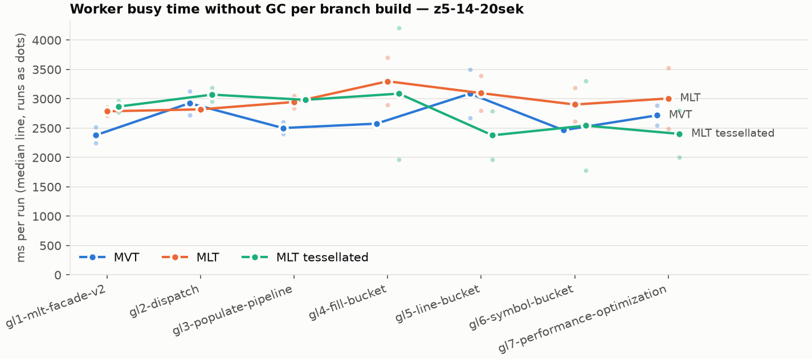
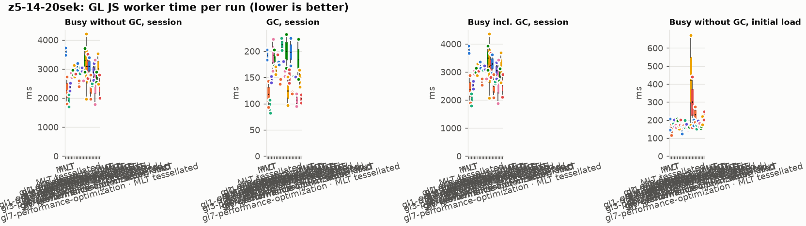
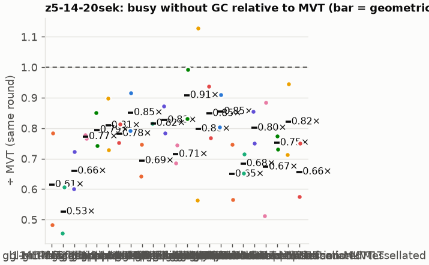
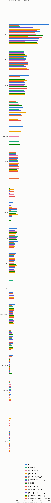
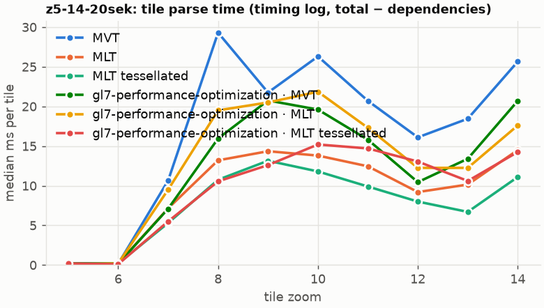
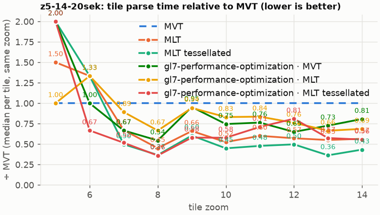

# Session trace benchmark — 20261021-153607

## Setup

- Created 2026-10-21T15:36:09+02:00; 2 repetitions + 1 warm-up round(s) (excluded); variants rotate per round (A B C, B C A, …); one cold browser context per run.
- Machine: 13th Gen Intel(R) Core(TM) i7-1365U, 12 logical cores, 31.3 GB RAM, Windows-11-10.0.26200-SP0; power: GUID des Energieschemas: 381b4222-f694-41f0-9685-ff5bb260df2e  (Ausbalanciert), AC True.
- GL JS gl7-performance-optimization @ f9bd50a8b5 (dirty); worker count 1; viewport {'width': 1280, 'height': 1024}; tracing preset devtools.
- Python 3.12.2, packages {'playwright': '1.64.0', 'numpy': '2.5.3', 'matplotlib': '3.11.2'}.

| variant | bundle | format | bundle sha256 | branch build |
|---|---|---|---|---|
| MVT | `dist/maplibre-gl-dev.mjs` | mvt | `b2691453151d` | – |
| MLT | `dist/maplibre-gl-dev.mjs` | mlt | `b2691453151d` | – |
| MLT tessellated | `dist/maplibre-gl-dev.mjs` | mlt-pre-tess | `b2691453151d` | – |
| gl1-mlt-facade-v2 · MVT | `bench-builds/branches/gl1-mlt-facade-v2/maplibre-gl-dev.mjs` | mvt | `ced4373133d3` | gl1-mlt-facade-v2 @ d7b5276422 (2026-10-06), MLT @ 9bf846d053 |
| gl1-mlt-facade-v2 · MLT | `bench-builds/branches/gl1-mlt-facade-v2/maplibre-gl-dev.mjs` | mlt | `ced4373133d3` | gl1-mlt-facade-v2 @ d7b5276422 (2026-10-06), MLT @ 9bf846d053 |
| gl1-mlt-facade-v2 · MLT tessellated | `bench-builds/branches/gl1-mlt-facade-v2/maplibre-gl-dev.mjs` | mlt-pre-tess | `ced4373133d3` | gl1-mlt-facade-v2 @ d7b5276422 (2026-10-06), MLT @ 9bf846d053 |
| gl2-dispatch · MVT | `bench-builds/branches/gl2-dispatch/maplibre-gl-dev.mjs` | mvt | `b73e5cbe0eb6` | gl2-dispatch @ 8b2cf0b4ff (2026-10-07), MLT @ 9bf846d053 |
| gl2-dispatch · MLT | `bench-builds/branches/gl2-dispatch/maplibre-gl-dev.mjs` | mlt | `b73e5cbe0eb6` | gl2-dispatch @ 8b2cf0b4ff (2026-10-07), MLT @ 9bf846d053 |
| gl2-dispatch · MLT tessellated | `bench-builds/branches/gl2-dispatch/maplibre-gl-dev.mjs` | mlt-pre-tess | `b73e5cbe0eb6` | gl2-dispatch @ 8b2cf0b4ff (2026-10-07), MLT @ 9bf846d053 |
| gl3-populate-pipeline · MVT | `bench-builds/branches/gl3-populate-pipeline/maplibre-gl-dev.mjs` | mvt | `b73e5cbe0eb6` | gl3-populate-pipeline @ a9a7824b99 (2026-10-07), MLT @ 9bf846d053 |
| gl3-populate-pipeline · MLT | `bench-builds/branches/gl3-populate-pipeline/maplibre-gl-dev.mjs` | mlt | `b73e5cbe0eb6` | gl3-populate-pipeline @ a9a7824b99 (2026-10-07), MLT @ 9bf846d053 |
| gl3-populate-pipeline · MLT tessellated | `bench-builds/branches/gl3-populate-pipeline/maplibre-gl-dev.mjs` | mlt-pre-tess | `b73e5cbe0eb6` | gl3-populate-pipeline @ a9a7824b99 (2026-10-07), MLT @ 9bf846d053 |
| gl4-fill-bucket · MVT | `bench-builds/branches/gl4-fill-bucket/maplibre-gl-dev.mjs` | mvt | `1e1932eb11bc` | gl4-fill-bucket @ 9d419af4cf (2026-10-14), MLT @ 9bf846d053 |
| gl4-fill-bucket · MLT | `bench-builds/branches/gl4-fill-bucket/maplibre-gl-dev.mjs` | mlt | `1e1932eb11bc` | gl4-fill-bucket @ 9d419af4cf (2026-10-14), MLT @ 9bf846d053 |
| gl4-fill-bucket · MLT tessellated | `bench-builds/branches/gl4-fill-bucket/maplibre-gl-dev.mjs` | mlt-pre-tess | `1e1932eb11bc` | gl4-fill-bucket @ 9d419af4cf (2026-10-14), MLT @ 9bf846d053 |
| gl5-line-bucket · MVT | `bench-builds/branches/gl5-line-bucket/maplibre-gl-dev.mjs` | mvt | `1e1932eb11bc` | gl5-line-bucket @ 77a77065d2 (2026-10-14), MLT @ 9bf846d053 |
| gl5-line-bucket · MLT | `bench-builds/branches/gl5-line-bucket/maplibre-gl-dev.mjs` | mlt | `1e1932eb11bc` | gl5-line-bucket @ 77a77065d2 (2026-10-14), MLT @ 9bf846d053 |
| gl5-line-bucket · MLT tessellated | `bench-builds/branches/gl5-line-bucket/maplibre-gl-dev.mjs` | mlt-pre-tess | `1e1932eb11bc` | gl5-line-bucket @ 77a77065d2 (2026-10-14), MLT @ 9bf846d053 |
| gl6-symbol-bucket · MVT | `bench-builds/branches/gl6-symbol-bucket/maplibre-gl-dev.mjs` | mvt | `1e1932eb11bc` | gl6-symbol-bucket @ ae4e7fbf8c (2026-10-14), MLT @ 9bf846d053 |
| gl6-symbol-bucket · MLT | `bench-builds/branches/gl6-symbol-bucket/maplibre-gl-dev.mjs` | mlt | `1e1932eb11bc` | gl6-symbol-bucket @ ae4e7fbf8c (2026-10-14), MLT @ 9bf846d053 |
| gl6-symbol-bucket · MLT tessellated | `bench-builds/branches/gl6-symbol-bucket/maplibre-gl-dev.mjs` | mlt-pre-tess | `1e1932eb11bc` | gl6-symbol-bucket @ ae4e7fbf8c (2026-10-14), MLT @ 9bf846d053 |
| gl7-performance-optimization · MVT | `bench-builds/branches/gl7-performance-optimization/maplibre-gl-dev.mjs` | mvt | `e74f9d5a3da7` | gl7-performance-optimization @ f9bd50a8b5 (2026-10-19), MLT @ 9bf846d053 |
| gl7-performance-optimization · MLT | `bench-builds/branches/gl7-performance-optimization/maplibre-gl-dev.mjs` | mlt | `e74f9d5a3da7` | gl7-performance-optimization @ f9bd50a8b5 (2026-10-19), MLT @ 9bf846d053 |
| gl7-performance-optimization · MLT tessellated | `bench-builds/branches/gl7-performance-optimization/maplibre-gl-dev.mjs` | mlt-pre-tess | `e74f9d5a3da7` | gl7-performance-optimization @ f9bd50a8b5 (2026-10-19), MLT @ 9bf846d053 |

| session | style | duration | frames | sha256 |
|---|---|---:|---:|---|
| z5-14-20sek | maptiler-basic | 21.4 s | 829 | `5a376e5ede30` |

CPU sampling interval (median over runs): 596 µs.

## Definitions

- **busy** = wall time in which a GL JS worker thread runs a task (union of top-level task slices and GC slices on `DedicatedWorker thread`s), summed over workers. **GC** = union of `MinorGC`/`MajorGC`/`V8.GC*` slices on those threads. **busy without GC** = busy − GC (headline metric).
- **CPU** = thread time (`tdur`) of the same slices. Phase categories and functions come from the trace's CPU samples (self time), categorised by `config/categories.toml` (nearest matching frame, leaf to root).
- Windows: **load** = map creation → first idle; **session** = camera replay; **tail** = end of replay → idle; **total** = load + session + tail.
- Ratios are against **MVT**: ratio of medians with a bootstrap 95 % CI, the geometric mean of per-round ratios, and a two-sided Mann–Whitney U p-value (normal approximation, not corrected for multiple comparisons; rough below n = 8). Lower than 1× means less worker time.

## Session `z5-14-20sek`

### Worker busy without GC (session window)

| variant | n ok / failed | median ms | IQR | mean | ratio vs MVT | 95 % CI | geo-mean paired | MWU p |
|---|---:|---:|---:|---:|---:|---:|---:|---:|
| MVT | 2 / 0 | 3,609 | 3,546–3,672 | 3,609 | 1.00× | – | – | – |
| MLT | 2 / 0 | 2,266 | 2,034–2,498 | 2,266 | 0.63× | 0.48–0.78× | 0.61× | 0.245 |
| MLT tessellated | 2 / 0 | 1,907 | 1,805–2,009 | 1,907 | 0.53× | 0.46–0.61× | 0.53× | 0.245 |
| gl1-mlt-facade-v2 · MVT | 2 / 0 | 2,382 | 2,315–2,449 | 2,382 | 0.66× | 0.60–0.72× | 0.66× | 0.245 |
| gl1-mlt-facade-v2 · MLT | 2 / 0 | 2,787 | 2,749–2,825 | 2,787 | 0.77× | 0.73–0.82× | 0.77× | 0.245 |
| gl1-mlt-facade-v2 · MLT tessellated | 2 / 0 | 2,867 | 2,821–2,914 | 2,867 | 0.79× | 0.74–0.85× | 0.79× | 0.245 |
| gl2-dispatch · MVT | 2 / 0 | 2,926 | 2,824–3,027 | 2,926 | 0.81× | 0.73–0.90× | 0.81× | 0.245 |
| gl2-dispatch · MLT | 2 / 0 | 2,821 | 2,816–2,826 | 2,821 | 0.78× | 0.75–0.81× | 0.78× | 0.245 |
| gl2-dispatch · MLT tessellated | 2 / 0 | 3,071 | 3,013–3,130 | 3,071 | 0.85× | 0.79–0.92× | 0.85× | 0.245 |
| gl3-populate-pipeline · MVT | 2 / 0 | 2,502 | 2,451–2,552 | 2,502 | 0.69× | 0.64–0.75× | 0.69× | 0.245 |
| gl3-populate-pipeline · MLT | 2 / 0 | 2,946 | 2,894–2,998 | 2,946 | 0.82× | 0.76–0.88× | 0.82× | 0.245 |
| gl3-populate-pipeline · MLT tessellated | 2 / 0 | 2,982 | 2,953–3,011 | 2,982 | 0.83× | 0.78–0.87× | 0.83× | 0.245 |
| gl4-fill-bucket · MVT | 2 / 0 | 2,577 | 2,567–2,587 | 2,577 | 0.71× | 0.68–0.75× | 0.71× | 0.245 |
| gl4-fill-bucket · MLT | 2 / 0 | 3,299 | 3,096–3,502 | 3,299 | 0.91× | 0.77–1.06× | 0.91× | 0.699 |
| gl4-fill-bucket · MLT tessellated | 2 / 0 | 3,088 | 2,527–3,650 | 3,088 | 0.86× | 0.53–1.21× | 0.80× | 1.000 |
| gl5-line-bucket · MVT | 2 / 0 | 3,088 | 2,880–3,296 | 3,088 | 0.86× | 0.72–1.01× | 0.85× | 0.699 |
| gl5-line-bucket · MLT | 2 / 0 | 3,097 | 2,947–3,246 | 3,097 | 0.86× | 0.75–0.97× | 0.85× | 0.245 |
| gl5-line-bucket · MLT tessellated | 2 / 0 | 2,378 | 2,173–2,584 | 2,378 | 0.66× | 0.53–0.80× | 0.65× | 0.245 |
| gl6-symbol-bucket · MVT | 2 / 0 | 2,466 | 2,452–2,480 | 2,466 | 0.68× | 0.65–0.72× | 0.68× | 0.245 |
| gl6-symbol-bucket · MLT | 2 / 0 | 2,902 | 2,757–3,048 | 2,902 | 0.80× | 0.70–0.92× | 0.80× | 0.245 |
| gl6-symbol-bucket · MLT tessellated | 2 / 0 | 2,543 | 2,164–2,923 | 2,543 | 0.70× | 0.48–0.95× | 0.67× | 0.245 |
| gl7-performance-optimization · MVT | 2 / 0 | 2,718 | 2,632–2,804 | 2,718 | 0.75× | 0.68–0.83× | 0.75× | 0.245 |
| gl7-performance-optimization · MLT | 2 / 0 | 3,006 | 2,746–3,267 | 3,006 | 0.83× | 0.67–1.01× | 0.82× | 0.699 |
| gl7-performance-optimization · MLT tessellated | 2 / 0 | 2,402 | 2,202–2,603 | 2,402 | 0.67× | 0.54–0.80× | 0.66× | 0.245 |

### All worker metrics (median, ratio vs baseline)

| metric | MVT | MLT | MLT tessellated | gl1-mlt-facade-v2 · MVT | gl1-mlt-facade-v2 · MLT | gl1-mlt-facade-v2 · MLT tessellated | gl2-dispatch · MVT | gl2-dispatch · MLT | gl2-dispatch · MLT tessellated | gl3-populate-pipeline · MVT | gl3-populate-pipeline · MLT | gl3-populate-pipeline · MLT tessellated | gl4-fill-bucket · MVT | gl4-fill-bucket · MLT | gl4-fill-bucket · MLT tessellated | gl5-line-bucket · MVT | gl5-line-bucket · MLT | gl5-line-bucket · MLT tessellated | gl6-symbol-bucket · MVT | gl6-symbol-bucket · MLT | gl6-symbol-bucket · MLT tessellated | gl7-performance-optimization · MVT | gl7-performance-optimization · MLT | gl7-performance-optimization · MLT tessellated |
|---|---:|---:|---:|---:|---:|---:|---:|---:|---:|---:|---:|---:|---:|---:|---:|---:|---:|---:|---:|---:|---:|---:|---:|---:|
| busy incl. GC | 3,802 | 2,384 (0.63×) | 2,001 (0.53×) | 2,528 (0.66×) | 2,980 (0.78×) | 3,055 (0.80×) | 3,088 (0.81×) | 3,015 (0.79×) | 3,249 (0.85×) | 2,644 (0.70×) | 3,159 (0.83×) | 3,163 (0.83×) | 2,734 (0.72×) | 3,499 (0.92×) | 3,213 (0.85×) | 3,240 (0.85×) | 3,295 (0.87×) | 2,499 (0.66×) | 2,618 (0.69×) | 3,053 (0.80×) | 2,650 (0.70×) | 2,902 (0.76×) | 3,154 (0.83×) | 2,512 (0.66×) |
| &nbsp;&nbsp;of which GC | 192.7 | 117.9 (0.61×) | 94.5 (0.49×) | 146.0 (0.76×) | 192.8 (1.00×) | 187.8 (0.97×) | 163.0 (0.85×) | 194.1 (1.01×) | 177.1 (0.92×) | 142.0 (0.74×) | 213.3 (1.11×) | 181.1 (0.94×) | 156.9 (0.81×) | 200.4 (1.04×) | 124.3 (0.64×) | 152.0 (0.79×) | 198.6 (1.03×) | 120.7 (0.63×) | 152.0 (0.79×) | 150.9 (0.78×) | 106.8 (0.55×) | 184.7 (0.96×) | 147.8 (0.77×) | 109.3 (0.57×) |
| &nbsp;&nbsp;of which busy without GC | 3,609 | 2,266 (0.63×) | 1,907 (0.53×) | 2,382 (0.66×) | 2,787 (0.77×) | 2,867 (0.79×) | 2,926 (0.81×) | 2,821 (0.78×) | 3,071 (0.85×) | 2,502 (0.69×) | 2,946 (0.82×) | 2,982 (0.83×) | 2,577 (0.71×) | 3,299 (0.91×) | 3,088 (0.86×) | 3,088 (0.86×) | 3,097 (0.86×) | 2,378 (0.66×) | 2,466 (0.68×) | 2,902 (0.80×) | 2,543 (0.70×) | 2,718 (0.75×) | 3,006 (0.83×) | 2,402 (0.67×) |
| &nbsp;&nbsp;&nbsp;&nbsp;of which filtering (sampled, incl. callees) | 98.0 | 96.8 (0.99×) | 98.1 (1.00×) | 53.5 (0.55×) | 193.5 (1.97×) | 178.5 (1.82×) | 64.2 (0.65×) | 190.5 (1.94×) | 189.0 (1.93×) | 51.8 (0.53×) | 192.5 (1.96×) | 193.2 (1.97×) | 50.1 (0.51×) | 202.0 (2.06×) | 274.4 (2.80×) | 70.2 (0.72×) | 158.1 (1.61×) | 155.4 (1.58×) | 50.9 (0.52×) | 136.8 (1.40×) | 155.8 (1.59×) | 62.0 (0.63×) | 116.0 (1.18×) | 120.1 (1.22×) |
| &nbsp;&nbsp;&nbsp;&nbsp;of which timing instrumentation (sampled) | 101.0 | 74.3 (0.74×) | 67.2 (0.67×) | 17.6 (0.17×) | 19.9 (0.20×) | 22.2 (0.22×) | 26.7 (0.26×) | 21.7 (0.21×) | 21.7 (0.22×) | 20.3 (0.20×) | 22.2 (0.22×) | 22.9 (0.23×) | 20.6 (0.20×) | 25.9 (0.26×) | 34.6 (0.34×) | 21.7 (0.22×) | 24.5 (0.24×) | 24.7 (0.24×) | 20.0 (0.20×) | 24.8 (0.25×) | 30.0 (0.30×) | 71.0 (0.70×) | 86.9 (0.86×) | 98.4 (0.97×) |
| busy without GC and instrumentation | 3,508 | 2,192 (0.62×) | 1,840 (0.52×) | 2,364 (0.67×) | 2,767 (0.79×) | 2,845 (0.81×) | 2,899 (0.83×) | 2,799 (0.80×) | 3,050 (0.87×) | 2,482 (0.71×) | 2,924 (0.83×) | 2,959 (0.84×) | 2,556 (0.73×) | 3,273 (0.93×) | 3,054 (0.87×) | 3,066 (0.87×) | 3,072 (0.88×) | 2,354 (0.67×) | 2,446 (0.70×) | 2,878 (0.82×) | 2,513 (0.72×) | 2,647 (0.75×) | 2,919 (0.83×) | 2,304 (0.66×) |
| CPU time without GC | 3,302 | 2,087 (0.63×) | 1,738 (0.53×) | 2,200 (0.67×) | 2,559 (0.78×) | 2,659 (0.81×) | 2,691 (0.82×) | 2,610 (0.79×) | 2,841 (0.86×) | 2,317 (0.70×) | 2,736 (0.83×) | 2,745 (0.83×) | 2,384 (0.72×) | 3,037 (0.92×) | 2,744 (0.83×) | 2,865 (0.87×) | 2,844 (0.86×) | 2,162 (0.65×) | 2,295 (0.69×) | 2,656 (0.80×) | 2,213 (0.67×) | 2,511 (0.76×) | 2,720 (0.82×) | 2,183 (0.66×) |
| tile: download end → sent to main thread, median per tile | 195.7 | 102.2 (0.52×) | 93.9 (0.48×) | 125.5 (0.64×) | 141.8 (0.72×) | 154.1 (0.79×) | 153.1 (0.78×) | 156.1 (0.80×) | 149.1 (0.76×) | 132.0 (0.67×) | 164.3 (0.84×) | 146.4 (0.75×) | 134.9 (0.69×) | 160.2 (0.82×) | 137.2 (0.70×) | 157.3 (0.80×) | 140.8 (0.72×) | 115.0 (0.59×) | 122.8 (0.63×) | 156.7 (0.80×) | 127.9 (0.65×) | 133.8 (0.68×) | 145.7 (0.74×) | 118.6 (0.61×) |
| tile: download end → sent to main thread, 90th percentile | 407.9 | 249.5 (0.61×) | 198.8 (0.49×) | 249.3 (0.61×) | 294.7 (0.72×) | 316.9 (0.78×) | 288.8 (0.71×) | 307.5 (0.75×) | 362.7 (0.89×) | 269.9 (0.66×) | 315.0 (0.77×) | 329.7 (0.81×) | 277.5 (0.68×) | 357.1 (0.88×) | 347.4 (0.85×) | 357.0 (0.88×) | 324.5 (0.80×) | 233.2 (0.57×) | 268.2 (0.66×) | 294.5 (0.72×) | 280.8 (0.69×) | 292.8 (0.72×) | 335.6 (0.82×) | 231.6 (0.57×) |
| &nbsp;&nbsp;parse part (timing log, incl. waiting for glyphs/icons), median per tile | 98.1 | 58.0 (0.59×) | 49.8 (0.51×) | – | – | – | – | – | – | – | – | – | – | – | – | – | – | – | – | – | – | 76.0 (0.78×) | 83.4 (0.85×) | 64.7 (0.66×) |
| &nbsp;&nbsp;queue + hand-off part, median per tile | 79.1 | 41.8 (0.53×) | 37.2 (0.47×) | – | – | – | – | – | – | – | – | – | – | – | – | – | – | – | – | – | – | 57.7 (0.73×) | 59.2 (0.75×) | 47.2 (0.60×) |
| minor GCs | 60.00 | 49.00 (0.82×) | 36.50 (0.61×) | 59.00 (0.98×) | 63.00 (1.05×) | 66.50 (1.11×) | 60.00 (1.00×) | 63.00 (1.05×) | 64.50 (1.07×) | 60.50 (1.01×) | 62.50 (1.04×) | 66.00 (1.10×) | 58.50 (0.97×) | 61.50 (1.02×) | 39.50 (0.66×) | 60.00 (1.00×) | 61.00 (1.02×) | 38.50 (0.64×) | 58.50 (0.97×) | 59.50 (0.99×) | 36.50 (0.61×) | 57.50 (0.96×) | 55.50 (0.93×) | 35.50 (0.59×) |
| major GCs | 4.50 | 5.00 (1.11×) | 3.00 (0.67×) | 5.50 (1.22×) | 5.50 (1.22×) | 6.00 (1.33×) | 5.00 (1.11×) | 5.50 (1.22×) | 6.50 (1.44×) | 4.00 (0.89×) | 6.50 (1.44×) | 5.00 (1.11×) | 5.50 (1.22×) | 5.50 (1.22×) | 4.00 (0.89×) | 4.00 (0.89×) | 5.50 (1.22×) | 4.50 (1.00×) | 4.50 (1.00×) | 4.50 (1.00×) | 4.50 (1.00×) | 5.00 (1.11×) | 3.50 (0.78×) | 5.00 (1.11×) |
| peak worker heap (MB) | 55.5 | 52.5 (0.95×) | 54.9 (0.99×) | 49.1 (0.88×) | 71.7 (1.29×) | 61.5 (1.11×) | 52.3 (0.94×) | 70.6 (1.27×) | 55.2 (0.99×) | 58.3 (1.05×) | 71.3 (1.28×) | 68.2 (1.23×) | 61.9 (1.12×) | 74.7 (1.35×) | 50.6 (0.91×) | 50.4 (0.91×) | 67.1 (1.21×) | 50.3 (0.91×) | 66.7 (1.20×) | 55.7 (1.00×) | 44.5 (0.80×) | 71.0 (1.28×) | 60.3 (1.09×) | 46.2 (0.83×) |
| load: busy without GC | 175.8 | 146.8 (0.83×) | 182.3 (1.04×) | 183.9 (1.05×) | 165.1 (0.94×) | 201.9 (1.15×) | 158.7 (0.90×) | 186.9 (1.06×) | 145.3 (0.83×) | 162.9 (0.93×) | 179.9 (1.02×) | 172.8 (0.98×) | 150.3 (0.85×) | 157.7 (0.90×) | 421.3 (2.40×) | 299.5 (1.70×) | 184.8 (1.05×) | 231.7 (1.32×) | 161.7 (0.92×) | 189.4 (1.08×) | 172.8 (0.98×) | 157.8 (0.90×) | 198.2 (1.13×) | 224.0 (1.27×) |
| load: GC | 5.7 | 5.1 (0.91×) | 4.2 (0.74×) | 5.8 (1.03×) | 4.6 (0.82×) | 5.5 (0.97×) | 5.6 (0.99×) | 5.7 (1.00×) | 5.4 (0.95×) | 5.3 (0.93×) | 6.0 (1.06×) | 5.6 (0.98×) | 5.3 (0.94×) | 4.7 (0.84×) | 7.3 (1.29×) | 6.8 (1.21×) | 5.9 (1.05×) | 7.3 (1.29×) | 5.5 (0.98×) | 5.0 (0.88×) | 5.4 (0.96×) | 5.7 (1.01×) | 5.9 (1.04×) | 5.7 (1.02×) |
| total: busy without GC | 3,785 | 2,413 (0.64×) | 2,089 (0.55×) | 2,566 (0.68×) | 2,952 (0.78×) | 3,069 (0.81×) | 3,084 (0.81×) | 3,007 (0.79×) | 3,217 (0.85×) | 2,665 (0.70×) | 3,126 (0.83×) | 3,155 (0.83×) | 2,727 (0.72×) | 3,457 (0.91×) | 3,510 (0.93×) | 3,387 (0.89×) | 3,282 (0.87×) | 2,610 (0.69×) | 2,627 (0.69×) | 3,092 (0.82×) | 2,716 (0.72×) | 2,876 (0.76×) | 3,204 (0.85×) | 2,626 (0.69×) |

Rows marked *of which* are parts of the row above, not additional time. Tile rows are per-tile latencies (medians over tiles, then over runs), not sums: tiles overlap in time, and the medians of the parse and queue parts do not add up exactly to the median latency.

### Filtering (session window)

Sampled worker time spent in feature filtering, including everything the filter calls (expression evaluation, property access, lazy column decoding): **row filter** = the style-spec feature filter that MVT runs per feature, **mlt filter** = the columnar MLT filter (incl. the geometry-type selection). Medians per run; rules in `config/categories.toml`.

| variant | mlt filter | row filter | filtering total | ratio vs MVT | 95 % CI | MWU p | share of sampled busy |
|---|---:|---:|---:|---:|---:|---:|---:|
| MVT | 0.0 | 98.0 | 98.0 | 1.00× | – | – | 2.8% |
| MLT | 96.8 | 0.0 | 96.8 | 0.99× | 0.74–1.26× | 1.000 | 4.5% |
| MLT tessellated | 98.1 | 0.0 | 98.1 | 1.00× | 0.86–1.15× | 1.000 | 5.6% |
| gl1-mlt-facade-v2 · MVT | 0.0 | 53.5 | 53.5 | 0.55× | 0.45–0.65× | 0.245 | 2.3% |
| gl1-mlt-facade-v2 · MLT | 0.0 | 193.5 | 193.5 | 1.97× | 1.87–2.09× | 0.245 | 7.0% |
| gl1-mlt-facade-v2 · MLT tessellated | 0.0 | 178.5 | 178.5 | 1.82× | 1.63–2.02× | 0.245 | 6.3% |
| gl2-dispatch · MVT | 0.0 | 64.2 | 64.2 | 0.65× | 0.56–0.75× | 0.245 | 2.3% |
| gl2-dispatch · MLT | 0.0 | 190.5 | 190.5 | 1.94× | 1.82–2.08× | 0.245 | 6.9% |
| gl2-dispatch · MLT tessellated | 0.0 | 189.0 | 189.0 | 1.93× | 1.80–2.06× | 0.245 | 6.4% |
| gl3-populate-pipeline · MVT | 0.0 | 51.8 | 51.8 | 0.53× | 0.50–0.56× | 0.245 | 2.2% |
| gl3-populate-pipeline · MLT | 0.0 | 192.5 | 192.5 | 1.96× | 1.89–2.05× | 0.245 | 6.6% |
| gl3-populate-pipeline · MLT tessellated | 0.0 | 193.2 | 193.2 | 1.97× | 1.80–2.15× | 0.245 | 6.6% |
| gl4-fill-bucket · MVT | 0.0 | 50.1 | 50.1 | 0.51× | 0.44–0.59× | 0.245 | 2.0% |
| gl4-fill-bucket · MLT | 39.7 | 162.3 | 202.0 | 2.06× | 1.83–2.31× | 0.245 | 6.4% |
| gl4-fill-bucket · MLT tessellated | 42.8 | 231.7 | 274.4 | 2.80× | 1.58–4.11× | 0.245 | 9.4% |
| gl5-line-bucket · MVT | 0.3 | 69.9 | 70.2 | 0.72× | 0.56–0.89× | 0.245 | 2.4% |
| gl5-line-bucket · MLT | 95.0 | 63.1 | 158.1 | 1.61× | 1.38–1.87× | 0.245 | 5.2% |
| gl5-line-bucket · MLT tessellated | 91.8 | 63.6 | 155.4 | 1.58× | 1.24–1.96× | 0.245 | 7.0% |
| gl6-symbol-bucket · MVT | 0.3 | 50.6 | 50.9 | 0.52× | 0.46–0.58× | 0.245 | 2.1% |
| gl6-symbol-bucket · MLT | 136.8 | 0.0 | 136.8 | 1.40× | 1.17–1.64× | 0.245 | 4.9% |
| gl6-symbol-bucket · MLT tessellated | 155.8 | 0.0 | 155.8 | 1.59× | 1.04–2.19× | 0.245 | 6.6% |
| gl7-performance-optimization · MVT | 1.0 | 61.0 | 62.0 | 0.63× | 0.57–0.70× | 0.245 | 2.3% |
| gl7-performance-optimization · MLT | 116.0 | 0.0 | 116.0 | 1.18× | 0.94–1.45× | 0.699 | 4.0% |
| gl7-performance-optimization · MLT tessellated | 120.1 | 0.0 | 120.1 | 1.22× | 1.02–1.45× | 0.245 | 5.4% |

Top 12 functions inside filtering (self time, mean ms per run):

| phase | function | source | MVT | MLT | MLT tessellated | gl1-mlt-facade-v2 · MVT | gl1-mlt-facade-v2 · MLT | gl1-mlt-facade-v2 · MLT tessellated | gl2-dispatch · MVT | gl2-dispatch · MLT | gl2-dispatch · MLT tessellated | gl3-populate-pipeline · MVT | gl3-populate-pipeline · MLT | gl3-populate-pipeline · MLT tessellated | gl4-fill-bucket · MVT | gl4-fill-bucket · MLT | gl4-fill-bucket · MLT tessellated | gl5-line-bucket · MVT | gl5-line-bucket · MLT | gl5-line-bucket · MLT tessellated | gl6-symbol-bucket · MVT | gl6-symbol-bucket · MLT | gl6-symbol-bucket · MLT tessellated | gl7-performance-optimization · MVT | gl7-performance-optimization · MLT | gl7-performance-optimization · MLT tessellated |
|---|---|---|---:|---:|---:|---:|---:|---:|---:|---:|---:|---:|---:|---:|---:|---:|---:|---:|---:|---:|---:|---:|---:|---:|---:|---:|
| row filter | `evaluate` | node_modules/@maplibre/maplibre-gl-style-spec/dist/expression/index.mjs | 27.4 | 0.0 | 0.0 | 12.4 | 23.4 | 14.7 | 18.0 | 16.8 | 17.5 | 12.4 | 14.8 | 20.0 | 14.6 | 13.4 | 14.9 | 14.2 | 5.2 | 4.6 | 15.3 | 0.0 | 0.0 | 15.5 | 0.0 | 0.0 |
| row filter | `CompoundExpression.register.filter-==` | node_modules/@maplibre/maplibre-gl-style-spec/dist/expression/compound_expression.mjs | 7.4 | 0.0 | 0.0 | 5.4 | 22.7 | 23.1 | 7.5 | 18.5 | 20.2 | 6.9 | 22.3 | 19.5 | 6.2 | 14.4 | 23.6 | 7.1 | 4.0 | 4.5 | 5.5 | 0.0 | 0.0 | 6.8 | 0.0 | 0.0 |
| row filter | `evaluate` | node_modules/@maplibre/maplibre-gl-style-spec/dist/expression/compound_expression.mjs | 23.2 | 0.0 | 0.0 | 13.8 | 14.9 | 15.3 | 18.7 | 20.0 | 18.0 | 13.0 | 14.7 | 13.9 | 8.8 | 14.1 | 20.1 | 17.4 | 3.7 | 4.9 | 7.4 | 0.0 | 0.0 | 15.6 | 0.0 | 0.0 |
| mlt filter | `filterByGeometryType` | maplibre-tile-spec/ts/dist/vector/geometry/geometryVector.js | 0.0 | 7.6 | 5.1 | 0.0 | 0.0 | 0.0 | 0.0 | 0.0 | 0.0 | 0.0 | 0.0 | 0.0 | 0.0 | 3.1 | 2.0 | 0.0 | 17.3 | 20.4 | 0.0 | 19.4 | 19.3 | 0.0 | 8.1 | 9.1 |
| row filter | `CompoundExpression.register.filter-in-small` | node_modules/@maplibre/maplibre-gl-style-spec/dist/expression/compound_expression.mjs | 9.7 | 0.0 | 0.0 | 4.2 | 10.3 | 11.9 | 4.5 | 11.1 | 10.7 | 4.3 | 15.0 | 12.2 | 3.8 | 13.4 | 20.0 | 7.7 | 1.8 | 2.3 | 5.0 | 0.0 | 0.0 | 6.7 | 0.0 | 0.0 |
| row filter | `readProperty` | maplibre-tile-spec/ts/dist/vector/rowView.js | 0.0 | 0.0 | 0.0 | 0.0 | 11.8 | 12.8 | 0.0 | 18.1 | 15.8 | 0.0 | 14.6 | 17.3 | 0.0 | 11.9 | 17.5 | 0.0 | 2.1 | 1.6 | 0.0 | 0.0 | 0.0 | 0.0 | 0.0 | 0.0 |
| mlt filter | `unpackNullable` | maplibre-tile-spec/ts/dist/decoding/unpackNullableUtils.js | 0.0 | 9.6 | 10.7 | 0.0 | 0.0 | 0.0 | 0.0 | 0.0 | 0.0 | 0.0 | 0.0 | 0.0 | 0.0 | 0.9 | 0.6 | 0.0 | 4.2 | 4.3 | 0.0 | 9.9 | 15.8 | 0.0 | 13.3 | 10.8 |
| row filter | `unpackNullable` | maplibre-tile-spec/ts/dist/decoding/unpackNullableUtils.js | 0.0 | 0.0 | 0.0 | 0.0 | 13.2 | 11.5 | 0.0 | 10.4 | 14.4 | 0.0 | 10.0 | 12.7 | 0.0 | 12.2 | 14.2 | 0.0 | 9.0 | 6.9 | 0.0 | 0.0 | 0.0 | 0.0 | 0.0 | 0.0 |
| mlt filter | `dictionaryRowMatches` | maplibre-tile-spec/ts/dist/processing/filter/execution/filterKernel.js | 0.0 | 5.9 | 5.0 | 0.0 | 0.0 | 0.0 | 0.0 | 0.0 | 0.0 | 0.0 | 0.0 | 0.0 | 0.0 | 1.7 | 0.9 | 0.0 | 3.4 | 4.7 | 0.0 | 4.7 | 13.5 | 0.0 | 2.7 | 6.1 |
| row filter | `get` | maplibre-tile-spec/ts/dist/vector/lazyPropertyVectors.js | 0.0 | 0.0 | 0.0 | 0.0 | 9.1 | 8.5 | 0.0 | 6.2 | 8.3 | 0.0 | 10.0 | 12.1 | 0.0 | 6.5 | 13.4 | 0.0 | 1.8 | 1.3 | 0.0 | 0.0 | 0.0 | 0.0 | 0.0 | 0.0 |
| row filter | `filter` | node_modules/@maplibre/maplibre-gl-style-spec/dist/feature_filter/index.mjs | 8.2 | 0.0 | 0.0 | 8.4 | 7.7 | 6.5 | 5.6 | 8.1 | 9.6 | 4.8 | 7.6 | 7.0 | 4.7 | 4.7 | 7.8 | 4.3 | 0.8 | 0.9 | 5.0 | 0.0 | 0.0 | 7.8 | 0.0 | 0.0 |
| mlt filter | `scanDictionaryCodes` | maplibre-tile-spec/ts/dist/processing/filter/execution/filterKernel.js | 0.0 | 5.8 | 5.3 | 0.0 | 0.0 | 0.0 | 0.0 | 0.0 | 0.0 | 0.0 | 0.0 | 0.0 | 0.0 | 3.1 | 2.5 | 0.0 | 6.8 | 5.5 | 0.0 | 8.6 | 6.7 | 0.0 | 6.7 | 8.8 |

### Where the variants differ from MVT (session window, mean ms per run)

Open **[flame.html](flame.html)** to explore the call tree interactively: pick a variant, compare it with MVT (red = more time at the same call path, blue = less), click a frame to zoom in, and read the phase and function breakdown under it. `flame/*.txt` open in https://www.speedscope.app.

#### MLT vs MVT

**By phase** (sampled self time; the Δ column sums to the difference in sampled busy time):

| phase | MVT | MLT | Δ |
|---|---:|---:|---:|
| bucket columnar | 0.0 | 242.8 | +242.8 |
| mlt decode | 0.0 | 185.2 | +185.2 |
| mlt filter | 0.0 | 96.8 | +96.8 |
| mlt facade | 0.3 | 29.0 | +28.7 |
| runtime | 17.8 | 18.6 | +0.8 |
| instrumentation | 101.0 | 74.3 | -26.7 |
| tile pipeline | 172.7 | 140.8 | -31.9 |
| style expressions | 148.9 | 85.5 | -63.3 |
| feature index | 115.7 | 52.0 | -63.7 |
| transfer | 252.5 | 186.4 | -66.1 |
| gc | 207.7 | 125.8 | -81.8 |
| row filter | 98.0 | 0.0 | -98.0 |
| symbol layout | 518.3 | 376.7 | -141.6 |
| earcut | 486.1 | 281.8 | -204.3 |
| mvt decode | 341.3 | 0.0 | -341.3 |
| bucket row | 984.2 | 241.1 | -743.1 |

**By source layer** (timing log: createBucket + populate + addFeatures, summed over the style layers that use it; wall time, includes GC pauses; total Δ -1108 ms):

| source layer | type | MVT | MLT | Δ |
|---|---|---:|---:|---:|
| poi | symbol | 43.5 | 50.0 | +6.4 |
| aeroway | fill | 1.6 | 2.3 | +0.7 |
| boundary | line | 35.3 | 30.2 | -5.1 |
| waterway | line | 42.1 | 36.1 | -6.0 |
| transportation | fill | 17.2 | 10.4 | -6.9 |
| transportation_name | symbol | 130.0 | 111.0 | -19.0 |
| water | fill | 59.0 | 37.6 | -21.4 |
| place | symbol | 476.0 | 380.0 | -96.0 |
| transportation | line | 561.2 | 368.9 | -192.3 |
| building | fill | 365.2 | 148.3 | -216.9 |
| landuse | fill | 416.0 | 193.4 | -222.6 |
| landcover | fill | 605.7 | 277.0 | -328.8 |

**Functions with the largest self-time difference** (by function name, summed over source files):

| function | MVT | MLT | Δ |
|---|---:|---:|---:|
| `writeEarcutFill` | 0.0 | 25.7 | +25.7 |
| `buildRingBoundingBoxes` | 0.0 | 24.0 | +24.0 |
| `buildEarcutMesh` | 0.0 | 19.0 | +19.0 |
| `pushVertex` | 0.0 | 16.0 | +16.0 |
| `unpackNullable` | 0.0 | 14.0 | +14.0 |
| `decodeComponentwiseDeltaVec2` | 0.0 | 13.8 | +13.8 |
| `decodeString` | 0.0 | 11.6 | +11.6 |
| `decodeString$2` | 0.0 | 9.8 | +9.8 |
| `registerGlyphs` | 0.0 | 9.7 | +9.7 |
| `decodeFastPforInt32` | 0.0 | 9.3 | +9.3 |
| `fastUnpack256_6` | 0.0 | 8.6 | +8.6 |
| `get` | 17.8 | 26.2 | +8.4 |
| `_vertexToIndex` | 177.8 | 0.0 | -177.8 |
| `readSVarint` | 147.4 | 0.0 | -147.4 |
| `(garbage collector)` | 207.7 | 125.8 | -81.8 |
| `loadGeometry` | 89.4 | 7.8 | -81.6 |
| `isEar` | 152.6 | 75.1 | -77.5 |

#### MLT tessellated vs MVT

**By phase** (sampled self time; the Δ column sums to the difference in sampled busy time):

| phase | MVT | MLT tessellated | Δ |
|---|---:|---:|---:|
| mlt decode | 0.0 | 230.2 | +230.2 |
| bucket columnar | 0.0 | 112.7 | +112.7 |
| mlt filter | 0.0 | 98.1 | +98.1 |
| mlt facade | 0.3 | 20.4 | +20.2 |
| pre-tess mesh | 0.0 | 19.7 | +19.7 |
| runtime | 17.8 | 16.2 | -1.6 |
| other | 9.1 | 6.9 | -2.1 |
| instrumentation | 101.0 | 67.2 | -33.8 |
| tile pipeline | 172.7 | 136.6 | -36.1 |
| style expressions | 148.9 | 93.3 | -55.5 |
| feature index | 115.7 | 45.7 | -70.0 |
| transfer | 252.5 | 168.4 | -84.1 |
| row filter | 98.0 | 0.0 | -98.0 |
| gc | 207.7 | 100.3 | -107.4 |
| symbol layout | 518.3 | 374.5 | -143.9 |
| mvt decode | 341.3 | 0.0 | -341.3 |
| earcut | 486.1 | 2.0 | -484.1 |
| bucket row | 984.2 | 268.4 | -715.7 |

**By source layer** (timing log: createBucket + populate + addFeatures, summed over the style layers that use it; wall time, includes GC pauses; total Δ -1477 ms):

| source layer | type | MVT | MLT tessellated | Δ |
|---|---|---:|---:|---:|
| aeroway | line | 1.8 | 2.6 | +0.9 |
| transportation | fill | 17.2 | 15.2 | -2.0 |
| boundary | line | 35.3 | 32.1 | -3.2 |
| waterway | line | 42.1 | 38.6 | -3.5 |
| poi | symbol | 43.5 | 35.3 | -8.2 |
| water | fill | 59.0 | 25.0 | -34.0 |
| transportation_name | symbol | 130.0 | 85.1 | -44.9 |
| place | symbol | 476.0 | 426.0 | -50.0 |
| transportation | line | 561.2 | 367.1 | -194.2 |
| landuse | fill | 416.0 | 89.5 | -326.5 |
| building | fill | 365.2 | 38.5 | -326.6 |
| landcover | fill | 605.7 | 119.9 | -485.8 |

**Functions with the largest self-time difference** (by function name, summed over source files):

| function | MVT | MLT tessellated | Δ |
|---|---:|---:|---:|
| `buildTessellatedBoundingBox` | 0.0 | 19.5 | +19.5 |
| `decodeUnsignedZigZagDeltaInt32` | 0.0 | 19.3 | +19.3 |
| `decodeComponentwiseDeltaVec2` | 0.0 | 18.5 | +18.5 |
| `unpackNullable` | 0.0 | 15.5 | +15.5 |
| `decodeFastPforInt32` | 0.0 | 12.9 | +12.9 |
| `get` | 17.8 | 28.2 | +10.4 |
| `writeTessellatedFill` | 0.0 | 10.1 | +10.1 |
| `decodeBigEndianInt32sInto` | 0.0 | 9.1 | +9.1 |
| `fastUnpack256_6` | 0.0 | 9.0 | +9.0 |
| `decodeString$2` | 0.0 | 8.8 | +8.8 |
| `appendSymbolFeature` | 0.0 | 8.4 | +8.4 |
| `fastUnpack256_4` | 0.0 | 8.2 | +8.2 |
| `_vertexToIndex` | 177.8 | 0.0 | -177.8 |
| `isEar` | 152.6 | 0.0 | -152.6 |
| `readSVarint` | 147.4 | 0.0 | -147.4 |
| `(garbage collector)` | 207.7 | 100.3 | -107.4 |
| `isEarHashed` | 87.0 | 0.0 | -87.0 |

#### gl1-mlt-facade-v2 · MVT vs MVT

**By phase** (sampled self time; the Δ column sums to the difference in sampled busy time):

| phase | MVT | gl1-mlt-facade-v2 · MVT | Δ |
|---|---:|---:|---:|
| other | 9.1 | 9.7 | +0.6 |
| runtime | 17.8 | 14.5 | -3.4 |
| feature index | 115.7 | 76.1 | -39.5 |
| tile pipeline | 172.7 | 130.2 | -42.5 |
| row filter | 98.0 | 53.5 | -44.5 |
| gc | 207.7 | 156.4 | -51.3 |
| style expressions | 148.9 | 93.0 | -55.9 |
| transfer | 252.5 | 186.5 | -66.0 |
| instrumentation | 101.0 | 17.6 | -83.5 |
| mvt decode | 341.3 | 242.2 | -99.0 |
| earcut | 486.1 | 350.4 | -135.7 |
| symbol layout | 518.3 | 366.9 | -151.4 |
| bucket row | 984.2 | 593.4 | -390.8 |

**By source layer** (timing log: createBucket + populate + addFeatures, summed over the style layers that use it; wall time, includes GC pauses; total Δ -2761 ms):

| source layer | type | MVT | gl1-mlt-facade-v2 · MVT | Δ |
|---|---|---:|---:|---:|
| aerodrome_label | symbol | 6.2 | 0.0 | -6.2 |
| transportation | fill | 17.2 | 0.0 | -17.2 |
| boundary | line | 35.3 | 0.0 | -35.3 |
| waterway | line | 42.1 | 0.0 | -42.1 |
| poi | symbol | 43.5 | 0.0 | -43.5 |
| water | fill | 59.0 | 0.0 | -59.0 |
| transportation_name | symbol | 130.0 | 0.0 | -130.0 |
| building | fill | 365.2 | 0.0 | -365.2 |
| landuse | fill | 416.0 | 0.0 | -416.0 |
| place | symbol | 476.0 | 0.0 | -476.0 |
| transportation | line | 561.2 | 0.0 | -561.2 |
| landcover | fill | 605.7 | 0.0 | -605.7 |

**Functions with the largest self-time difference** (by function name, summed over source files):

| function | MVT | gl1-mlt-facade-v2 · MVT | Δ |
|---|---:|---:|---:|
| `hasLineDasharray` | 1.0 | 10.7 | +9.7 |
| `signedArea$1` | 0.0 | 5.4 | +5.4 |
| `createNode` | 10.9 | 13.9 | +3.0 |
| `readUtf8$1` | 0.0 | 2.6 | +2.6 |
| `readVarintRemainder$1` | 0.0 | 2.0 | +2.0 |
| `_add` | 0.7 | 2.2 | +1.5 |
| `transformText` | 0.0 | 1.4 | +1.4 |
| `addSymbols` | 5.3 | 6.6 | +1.3 |
| `DictionaryCoder` | 0.3 | 1.5 | +1.2 |
| `ringIsOpen` | 0.6 | 1.8 | +1.2 |
| `codePointIsInCursiveScript` | 10.1 | 11.2 | +1.2 |
| `calculateSignedArea` | 11.1 | 12.3 | +1.2 |
| `_vertexToIndex` | 177.8 | 108.2 | -69.6 |
| `populate` | 91.9 | 39.6 | -52.2 |
| `reserve` | 131.7 | 79.8 | -51.9 |
| `(garbage collector)` | 207.7 | 156.4 | -51.3 |
| `isEar` | 152.6 | 111.8 | -40.8 |

#### gl1-mlt-facade-v2 · MLT vs MVT

**By phase** (sampled self time; the Δ column sums to the difference in sampled busy time):

| phase | MVT | gl1-mlt-facade-v2 · MLT | Δ |
|---|---:|---:|---:|
| mlt decode | 0.0 | 241.6 | +241.6 |
| row filter | 98.0 | 193.5 | +95.5 |
| mlt facade | 0.3 | 44.4 | +44.1 |
| other | 9.1 | 8.4 | -0.7 |
| gc | 207.7 | 205.4 | -2.2 |
| runtime | 17.8 | 13.9 | -3.9 |
| tile pipeline | 172.7 | 153.0 | -19.8 |
| transfer | 252.5 | 223.2 | -29.3 |
| feature index | 115.7 | 83.0 | -32.7 |
| style expressions | 148.9 | 106.9 | -42.0 |
| instrumentation | 101.0 | 19.9 | -81.1 |
| earcut | 486.1 | 380.0 | -106.1 |
| symbol layout | 518.3 | 382.9 | -135.4 |
| bucket row | 984.2 | 697.7 | -286.5 |
| mvt decode | 341.3 | 0.0 | -341.3 |

**By source layer** (timing log: createBucket + populate + addFeatures, summed over the style layers that use it; wall time, includes GC pauses; total Δ -2761 ms):

| source layer | type | MVT | gl1-mlt-facade-v2 · MLT | Δ |
|---|---|---:|---:|---:|
| aerodrome_label | symbol | 6.2 | 0.0 | -6.2 |
| transportation | fill | 17.2 | 0.0 | -17.2 |
| boundary | line | 35.3 | 0.0 | -35.3 |
| waterway | line | 42.1 | 0.0 | -42.1 |
| poi | symbol | 43.5 | 0.0 | -43.5 |
| water | fill | 59.0 | 0.0 | -59.0 |
| transportation_name | symbol | 130.0 | 0.0 | -130.0 |
| building | fill | 365.2 | 0.0 | -365.2 |
| landuse | fill | 416.0 | 0.0 | -416.0 |
| place | symbol | 476.0 | 0.0 | -476.0 |
| transportation | line | 561.2 | 0.0 | -561.2 |
| landcover | fill | 605.7 | 0.0 | -605.7 |

**Functions with the largest self-time difference** (by function name, summed over source files):

| function | MVT | gl1-mlt-facade-v2 · MLT | Δ |
|---|---:|---:|---:|
| `get` | 17.8 | 39.0 | +21.2 |
| `decodeComponentwiseDeltaVec2` | 0.0 | 16.2 | +16.2 |
| `unpackNullable` | 0.0 | 15.2 | +15.2 |
| `CompoundExpression.register.filter-==` | 7.7 | 22.7 | +15.1 |
| `subdividePolygon` | 1.3 | 15.0 | +13.7 |
| `readVertices` | 0.0 | 13.6 | +13.6 |
| `getVertex` | 0.0 | 12.9 | +12.9 |
| `readProperty` | 0.0 | 12.5 | +12.5 |
| `decodeString` | 0.0 | 11.7 | +11.7 |
| `getValue` | 0.0 | 10.3 | +10.3 |
| `hasLineDasharray` | 1.0 | 11.0 | +10.0 |
| `__classPrivateFieldGet` | 0.0 | 8.8 | +8.8 |
| `readSVarint` | 147.4 | 0.0 | -147.4 |
| `loadGeometry` | 89.4 | 33.6 | -55.9 |
| `_vertexToIndex` | 177.8 | 126.4 | -51.4 |
| `populate` | 91.9 | 41.5 | -50.3 |
| `readVarint` | 54.8 | 5.3 | -49.5 |

#### gl1-mlt-facade-v2 · MLT tessellated vs MVT

**By phase** (sampled self time; the Δ column sums to the difference in sampled busy time):

| phase | MVT | gl1-mlt-facade-v2 · MLT tessellated | Δ |
|---|---:|---:|---:|
| mlt decode | 0.0 | 318.9 | +318.9 |
| row filter | 98.0 | 178.5 | +80.4 |
| mlt facade | 0.3 | 40.2 | +39.9 |
| other | 9.1 | 7.3 | -1.7 |
| runtime | 17.8 | 10.7 | -7.1 |
| gc | 207.7 | 199.3 | -8.3 |
| feature index | 115.7 | 90.8 | -24.8 |
| tile pipeline | 172.7 | 141.8 | -30.9 |
| transfer | 252.5 | 220.9 | -31.6 |
| style expressions | 148.9 | 114.1 | -34.8 |
| instrumentation | 101.0 | 22.2 | -78.8 |
| earcut | 486.1 | 391.3 | -94.9 |
| symbol layout | 518.3 | 398.5 | -119.8 |
| bucket row | 984.2 | 675.5 | -308.7 |
| mvt decode | 341.3 | 0.0 | -341.3 |

**By source layer** (timing log: createBucket + populate + addFeatures, summed over the style layers that use it; wall time, includes GC pauses; total Δ -2761 ms):

| source layer | type | MVT | gl1-mlt-facade-v2 · MLT tessellated | Δ |
|---|---|---:|---:|---:|
| aerodrome_label | symbol | 6.2 | 0.0 | -6.2 |
| transportation | fill | 17.2 | 0.0 | -17.2 |
| boundary | line | 35.3 | 0.0 | -35.3 |
| waterway | line | 42.1 | 0.0 | -42.1 |
| poi | symbol | 43.5 | 0.0 | -43.5 |
| water | fill | 59.0 | 0.0 | -59.0 |
| transportation_name | symbol | 130.0 | 0.0 | -130.0 |
| building | fill | 365.2 | 0.0 | -365.2 |
| landuse | fill | 416.0 | 0.0 | -416.0 |
| place | symbol | 476.0 | 0.0 | -476.0 |
| transportation | line | 561.2 | 0.0 | -561.2 |
| landcover | fill | 605.7 | 0.0 | -605.7 |

**Functions with the largest self-time difference** (by function name, summed over source files):

| function | MVT | gl1-mlt-facade-v2 · MLT tessellated | Δ |
|---|---:|---:|---:|
| `readVertices` | 0.0 | 29.2 | +29.2 |
| `get` | 17.8 | 43.9 | +26.1 |
| `decodeUnsignedZigZagDeltaInt32` | 0.0 | 23.1 | +23.1 |
| `getVertex` | 0.0 | 21.3 | +21.3 |
| `CompoundExpression.register.filter-==` | 7.7 | 23.1 | +15.4 |
| `decodeFastPforInt32` | 0.0 | 15.0 | +15.0 |
| `decodeComponentwiseDeltaVec2` | 0.0 | 15.0 | +15.0 |
| `unpackNullable` | 0.0 | 14.4 | +14.4 |
| `readProperty` | 0.0 | 14.2 | +14.2 |
| `decodeString` | 0.0 | 13.0 | +13.0 |
| `subdividePolygon` | 1.3 | 12.3 | +11.0 |
| `readPolygonRings` | 0.0 | 10.7 | +10.7 |
| `readSVarint` | 147.4 | 0.0 | -147.4 |
| `_vertexToIndex` | 177.8 | 114.8 | -63.0 |
| `readVarint` | 54.8 | 0.9 | -53.9 |
| `loadGeometry` | 89.4 | 36.4 | -53.0 |
| `populate` | 91.9 | 43.0 | -48.9 |

#### gl2-dispatch · MVT vs MVT

**By phase** (sampled self time; the Δ column sums to the difference in sampled busy time):

| phase | MVT | gl2-dispatch · MVT | Δ |
|---|---:|---:|---:|
| runtime | 17.8 | 10.3 | -7.5 |
| tile pipeline | 172.7 | 157.5 | -15.2 |
| feature index | 115.7 | 92.4 | -23.2 |
| transfer | 252.5 | 220.5 | -32.0 |
| style expressions | 148.9 | 115.2 | -33.6 |
| row filter | 98.0 | 64.2 | -33.9 |
| gc | 207.7 | 165.8 | -41.9 |
| earcut | 486.1 | 440.7 | -45.4 |
| mvt decode | 341.3 | 289.4 | -51.8 |
| instrumentation | 101.0 | 26.7 | -74.3 |
| symbol layout | 518.3 | 439.4 | -78.9 |
| bucket row | 984.2 | 765.9 | -218.3 |

**By source layer** (timing log: createBucket + populate + addFeatures, summed over the style layers that use it; wall time, includes GC pauses; total Δ -2761 ms):

| source layer | type | MVT | gl2-dispatch · MVT | Δ |
|---|---|---:|---:|---:|
| aerodrome_label | symbol | 6.2 | 0.0 | -6.2 |
| transportation | fill | 17.2 | 0.0 | -17.2 |
| boundary | line | 35.3 | 0.0 | -35.3 |
| waterway | line | 42.1 | 0.0 | -42.1 |
| poi | symbol | 43.5 | 0.0 | -43.5 |
| water | fill | 59.0 | 0.0 | -59.0 |
| transportation_name | symbol | 130.0 | 0.0 | -130.0 |
| building | fill | 365.2 | 0.0 | -365.2 |
| landuse | fill | 416.0 | 0.0 | -416.0 |
| place | symbol | 476.0 | 0.0 | -476.0 |
| transportation | line | 561.2 | 0.0 | -561.2 |
| landcover | fill | 605.7 | 0.0 | -605.7 |

**Functions with the largest self-time difference** (by function name, summed over source files):

| function | MVT | gl2-dispatch · MVT | Δ |
|---|---:|---:|---:|
| `hasLineDasharray` | 1.0 | 9.3 | +8.3 |
| `signedArea$1` | 0.0 | 5.7 | +5.7 |
| `readUtf8$1` | 0.0 | 3.6 | +3.6 |
| `sortNodes` | 2.6 | 6.2 | +3.6 |
| `zOrder` | 14.8 | 18.0 | +3.2 |
| `allowsVerticalWritingMode` | 2.8 | 5.9 | +3.0 |
| `leastBadBreaks` | 9.4 | 12.1 | +2.7 |
| `copyImage` | 10.4 | 12.9 | +2.5 |
| `calculateSignedArea` | 11.1 | 13.6 | +2.4 |
| `readVarintRemainder$1` | 0.0 | 2.2 | +2.2 |
| `isSerializeHandledByBuiltin` | 3.0 | 5.2 | +2.2 |
| `addSymbols` | 5.3 | 7.4 | +2.2 |
| `(garbage collector)` | 207.7 | 165.8 | -41.9 |
| `populate` | 91.9 | 50.1 | -41.8 |
| `addPhase` | 30.5 | 0.0 | -30.5 |
| `loadGeometry` | 89.4 | 63.5 | -25.9 |
| `_vertexToIndex` | 177.8 | 157.2 | -20.6 |

#### gl2-dispatch · MLT vs MVT

**By phase** (sampled self time; the Δ column sums to the difference in sampled busy time):

| phase | MVT | gl2-dispatch · MLT | Δ |
|---|---:|---:|---:|
| mlt decode | 0.0 | 243.5 | +243.5 |
| row filter | 98.0 | 190.5 | +92.5 |
| mlt facade | 0.3 | 42.6 | +42.4 |
| other | 9.1 | 10.5 | +1.5 |
| gc | 207.7 | 208.5 | +0.8 |
| runtime | 17.8 | 16.9 | -0.9 |
| feature index | 115.7 | 90.0 | -25.7 |
| style expressions | 148.9 | 116.1 | -32.7 |
| tile pipeline | 172.7 | 139.6 | -33.1 |
| transfer | 252.5 | 215.4 | -37.1 |
| instrumentation | 101.0 | 21.7 | -79.4 |
| symbol layout | 518.3 | 417.1 | -101.3 |
| earcut | 486.1 | 382.0 | -104.2 |
| bucket row | 984.2 | 686.6 | -297.5 |
| mvt decode | 341.3 | 0.0 | -341.3 |

**By source layer** (timing log: createBucket + populate + addFeatures, summed over the style layers that use it; wall time, includes GC pauses; total Δ -2761 ms):

| source layer | type | MVT | gl2-dispatch · MLT | Δ |
|---|---|---:|---:|---:|
| aerodrome_label | symbol | 6.2 | 0.0 | -6.2 |
| transportation | fill | 17.2 | 0.0 | -17.2 |
| boundary | line | 35.3 | 0.0 | -35.3 |
| waterway | line | 42.1 | 0.0 | -42.1 |
| poi | symbol | 43.5 | 0.0 | -43.5 |
| water | fill | 59.0 | 0.0 | -59.0 |
| transportation_name | symbol | 130.0 | 0.0 | -130.0 |
| building | fill | 365.2 | 0.0 | -365.2 |
| landuse | fill | 416.0 | 0.0 | -416.0 |
| place | symbol | 476.0 | 0.0 | -476.0 |
| transportation | line | 561.2 | 0.0 | -561.2 |
| landcover | fill | 605.7 | 0.0 | -605.7 |

**Functions with the largest self-time difference** (by function name, summed over source files):

| function | MVT | gl2-dispatch · MLT | Δ |
|---|---:|---:|---:|
| `get` | 17.8 | 43.4 | +25.6 |
| `decodeComponentwiseDeltaVec2` | 0.0 | 21.3 | +21.3 |
| `readVertices` | 0.0 | 21.3 | +21.3 |
| `readProperty` | 0.0 | 19.6 | +19.6 |
| `unpackNullable` | 0.0 | 12.7 | +12.7 |
| `decodeString` | 0.0 | 12.6 | +12.6 |
| `CompoundExpression.register.filter-==` | 7.7 | 18.8 | +11.1 |
| `subdividePolygon` | 1.3 | 12.3 | +11.0 |
| `__classPrivateFieldGet` | 0.0 | 10.5 | +10.5 |
| `hasLineDasharray` | 1.0 | 10.8 | +9.8 |
| `decodeString$2` | 0.0 | 9.8 | +9.8 |
| `decodeFastPforInt32` | 0.0 | 9.2 | +9.2 |
| `readSVarint` | 147.4 | 0.0 | -147.4 |
| `loadGeometry` | 89.4 | 32.3 | -57.1 |
| `readVarint` | 54.8 | 1.5 | -53.3 |
| `populate` | 91.9 | 39.9 | -51.9 |
| `_vertexToIndex` | 177.8 | 133.2 | -44.6 |

#### gl2-dispatch · MLT tessellated vs MVT

**By phase** (sampled self time; the Δ column sums to the difference in sampled busy time):

| phase | MVT | gl2-dispatch · MLT tessellated | Δ |
|---|---:|---:|---:|
| mlt decode | 0.0 | 342.6 | +342.6 |
| row filter | 98.0 | 189.0 | +90.9 |
| mlt facade | 0.3 | 49.3 | +49.1 |
| other | 9.1 | 9.7 | +0.7 |
| runtime | 17.8 | 14.8 | -3.0 |
| feature index | 115.7 | 104.1 | -11.6 |
| gc | 207.7 | 190.7 | -16.9 |
| tile pipeline | 172.7 | 143.5 | -29.2 |
| transfer | 252.5 | 218.8 | -33.7 |
| style expressions | 148.9 | 107.5 | -41.4 |
| instrumentation | 101.0 | 21.7 | -79.3 |
| symbol layout | 518.3 | 437.7 | -80.6 |
| earcut | 486.1 | 393.0 | -93.1 |
| bucket row | 984.2 | 757.2 | -227.0 |
| mvt decode | 341.3 | 0.0 | -341.3 |

**By source layer** (timing log: createBucket + populate + addFeatures, summed over the style layers that use it; wall time, includes GC pauses; total Δ -2761 ms):

| source layer | type | MVT | gl2-dispatch · MLT tessellated | Δ |
|---|---|---:|---:|---:|
| aerodrome_label | symbol | 6.2 | 0.0 | -6.2 |
| transportation | fill | 17.2 | 0.0 | -17.2 |
| boundary | line | 35.3 | 0.0 | -35.3 |
| waterway | line | 42.1 | 0.0 | -42.1 |
| poi | symbol | 43.5 | 0.0 | -43.5 |
| water | fill | 59.0 | 0.0 | -59.0 |
| transportation_name | symbol | 130.0 | 0.0 | -130.0 |
| building | fill | 365.2 | 0.0 | -365.2 |
| landuse | fill | 416.0 | 0.0 | -416.0 |
| place | symbol | 476.0 | 0.0 | -476.0 |
| transportation | line | 561.2 | 0.0 | -561.2 |
| landcover | fill | 605.7 | 0.0 | -605.7 |

**Functions with the largest self-time difference** (by function name, summed over source files):

| function | MVT | gl2-dispatch · MLT tessellated | Δ |
|---|---:|---:|---:|
| `readVertices` | 0.0 | 26.4 | +26.4 |
| `getVertex` | 0.0 | 25.2 | +25.2 |
| `decodeUnsignedZigZagDeltaInt32` | 0.0 | 22.8 | +22.8 |
| `get` | 17.8 | 40.2 | +22.4 |
| `readProperty` | 0.0 | 17.9 | +17.9 |
| `unpackNullable` | 0.0 | 16.8 | +16.8 |
| `decodeFastPforInt32` | 0.0 | 14.3 | +14.3 |
| `decodeComponentwiseDeltaVec2` | 0.0 | 13.8 | +13.8 |
| `readPolygonRings` | 0.0 | 13.6 | +13.6 |
| `add` | 1.8 | 14.5 | +12.7 |
| `CompoundExpression.register.filter-==` | 7.7 | 20.2 | +12.5 |
| `convertGeometryAtIndex` | 0.0 | 9.6 | +9.6 |
| `readSVarint` | 147.4 | 0.0 | -147.4 |
| `readVarint` | 54.8 | 1.8 | -53.0 |
| `loadGeometry` | 89.4 | 41.0 | -48.4 |
| `populate` | 91.9 | 47.2 | -44.7 |
| `_vertexToIndex` | 177.8 | 139.4 | -38.5 |

#### gl3-populate-pipeline · MVT vs MVT

**By phase** (sampled self time; the Δ column sums to the difference in sampled busy time):

| phase | MVT | gl3-populate-pipeline · MVT | Δ |
|---|---:|---:|---:|
| other | 9.1 | 5.9 | -3.2 |
| runtime | 17.8 | 9.8 | -8.0 |
| tile pipeline | 172.7 | 137.3 | -35.4 |
| feature index | 115.7 | 77.6 | -38.0 |
| row filter | 98.0 | 51.8 | -46.3 |
| transfer | 252.5 | 196.4 | -56.1 |
| gc | 207.7 | 149.8 | -57.9 |
| style expressions | 148.9 | 87.4 | -61.5 |
| instrumentation | 101.0 | 20.3 | -80.7 |
| mvt decode | 341.3 | 259.6 | -81.7 |
| earcut | 486.1 | 377.5 | -108.7 |
| symbol layout | 518.3 | 378.4 | -139.9 |
| bucket row | 984.2 | 647.1 | -337.0 |

**By source layer** (timing log: createBucket + populate + addFeatures, summed over the style layers that use it; wall time, includes GC pauses; total Δ -2761 ms):

| source layer | type | MVT | gl3-populate-pipeline · MVT | Δ |
|---|---|---:|---:|---:|
| aerodrome_label | symbol | 6.2 | 0.0 | -6.2 |
| transportation | fill | 17.2 | 0.0 | -17.2 |
| boundary | line | 35.3 | 0.0 | -35.3 |
| waterway | line | 42.1 | 0.0 | -42.1 |
| poi | symbol | 43.5 | 0.0 | -43.5 |
| water | fill | 59.0 | 0.0 | -59.0 |
| transportation_name | symbol | 130.0 | 0.0 | -130.0 |
| building | fill | 365.2 | 0.0 | -365.2 |
| landuse | fill | 416.0 | 0.0 | -416.0 |
| place | symbol | 476.0 | 0.0 | -476.0 |
| transportation | line | 561.2 | 0.0 | -561.2 |
| landcover | fill | 605.7 | 0.0 | -605.7 |

**Functions with the largest self-time difference** (by function name, summed over source files):

| function | MVT | gl3-populate-pipeline · MVT | Δ |
|---|---:|---:|---:|
| `hasLineDasharray` | 1.0 | 8.1 | +7.1 |
| `createNode` | 10.9 | 15.8 | +4.9 |
| `signedArea$1` | 0.0 | 4.4 | +4.4 |
| `readUtf8$1` | 0.0 | 4.2 | +4.2 |
| `performSymbolLayout` | 21.0 | 24.6 | +3.5 |
| `_ringPathIndices` | 6.0 | 8.9 | +2.9 |
| `justifyLine` | 1.2 | 3.7 | +2.5 |
| `_div` | 5.5 | 7.9 | +2.4 |
| `potpack` | 3.0 | 4.7 | +1.7 |
| `getLeftmost` | 0.0 | 1.6 | +1.6 |
| `readVarintRemainder$1` | 0.0 | 1.6 | +1.6 |
| `getGlyphQuads` | 5.4 | 6.8 | +1.4 |
| `(garbage collector)` | 207.7 | 149.8 | -57.9 |
| `_vertexToIndex` | 177.8 | 127.3 | -50.6 |
| `reserve` | 131.7 | 88.7 | -43.0 |
| `populate` | 91.9 | 49.5 | -42.4 |
| `isEar` | 152.6 | 115.8 | -36.8 |

#### gl3-populate-pipeline · MLT vs MVT

**By phase** (sampled self time; the Δ column sums to the difference in sampled busy time):

| phase | MVT | gl3-populate-pipeline · MLT | Δ |
|---|---:|---:|---:|
| mlt decode | 0.0 | 260.1 | +260.1 |
| row filter | 98.0 | 192.5 | +94.4 |
| mlt facade | 0.3 | 53.4 | +53.1 |
| gc | 207.7 | 223.1 | +15.5 |
| other | 9.1 | 10.4 | +1.3 |
| runtime | 17.8 | 13.5 | -4.3 |
| tile pipeline | 172.7 | 147.8 | -24.9 |
| transfer | 252.5 | 227.2 | -25.3 |
| style expressions | 148.9 | 115.4 | -33.5 |
| feature index | 115.7 | 79.9 | -35.8 |
| instrumentation | 101.0 | 22.2 | -78.9 |
| earcut | 486.1 | 396.2 | -89.9 |
| symbol layout | 518.3 | 427.4 | -90.9 |
| bucket row | 984.2 | 737.4 | -246.8 |
| mvt decode | 341.3 | 0.0 | -341.3 |

**By source layer** (timing log: createBucket + populate + addFeatures, summed over the style layers that use it; wall time, includes GC pauses; total Δ -2761 ms):

| source layer | type | MVT | gl3-populate-pipeline · MLT | Δ |
|---|---|---:|---:|---:|
| aerodrome_label | symbol | 6.2 | 0.0 | -6.2 |
| transportation | fill | 17.2 | 0.0 | -17.2 |
| boundary | line | 35.3 | 0.0 | -35.3 |
| waterway | line | 42.1 | 0.0 | -42.1 |
| poi | symbol | 43.5 | 0.0 | -43.5 |
| water | fill | 59.0 | 0.0 | -59.0 |
| transportation_name | symbol | 130.0 | 0.0 | -130.0 |
| building | fill | 365.2 | 0.0 | -365.2 |
| landuse | fill | 416.0 | 0.0 | -416.0 |
| place | symbol | 476.0 | 0.0 | -476.0 |
| transportation | line | 561.2 | 0.0 | -561.2 |
| landcover | fill | 605.7 | 0.0 | -605.7 |

**Functions with the largest self-time difference** (by function name, summed over source files):

| function | MVT | gl3-populate-pipeline · MLT | Δ |
|---|---:|---:|---:|
| `get` | 17.8 | 48.4 | +30.6 |
| `decodeComponentwiseDeltaVec2` | 0.0 | 20.4 | +20.4 |
| `readVertices` | 0.0 | 20.4 | +20.4 |
| `readProperty` | 0.0 | 16.4 | +16.4 |
| `(garbage collector)` | 207.7 | 223.1 | +15.5 |
| `CompoundExpression.register.filter-==` | 7.7 | 22.6 | +14.9 |
| `unpackNullable` | 0.0 | 13.6 | +13.6 |
| `hasLineDasharray` | 1.0 | 14.4 | +13.4 |
| `MLTVectorTileFeature` | 0.0 | 11.3 | +11.3 |
| `decodeFastPforInt32` | 0.0 | 11.2 | +11.2 |
| `getVertex` | 0.0 | 10.8 | +10.8 |
| `decodeString` | 0.0 | 9.5 | +9.5 |
| `readSVarint` | 147.4 | 0.0 | -147.4 |
| `loadGeometry` | 89.4 | 32.8 | -56.7 |
| `readVarint` | 54.8 | 3.0 | -51.9 |
| `populate` | 91.9 | 48.5 | -43.4 |
| `_vertexToIndex` | 177.8 | 139.1 | -38.7 |

#### gl3-populate-pipeline · MLT tessellated vs MVT

**By phase** (sampled self time; the Δ column sums to the difference in sampled busy time):

| phase | MVT | gl3-populate-pipeline · MLT tessellated | Δ |
|---|---:|---:|---:|
| mlt decode | 0.0 | 309.3 | +309.3 |
| row filter | 98.0 | 193.2 | +95.2 |
| mlt facade | 0.3 | 47.8 | +47.5 |
| runtime | 17.8 | 16.2 | -1.7 |
| other | 9.1 | 5.2 | -3.9 |
| feature index | 115.7 | 98.5 | -17.2 |
| gc | 207.7 | 189.3 | -18.4 |
| transfer | 252.5 | 228.8 | -23.7 |
| tile pipeline | 172.7 | 146.5 | -26.2 |
| style expressions | 148.9 | 109.0 | -39.9 |
| instrumentation | 101.0 | 22.9 | -78.2 |
| earcut | 486.1 | 391.7 | -94.4 |
| symbol layout | 518.3 | 418.9 | -99.4 |
| bucket row | 984.2 | 731.8 | -252.4 |
| mvt decode | 341.3 | 0.0 | -341.3 |

**By source layer** (timing log: createBucket + populate + addFeatures, summed over the style layers that use it; wall time, includes GC pauses; total Δ -2761 ms):

| source layer | type | MVT | gl3-populate-pipeline · MLT tessellated | Δ |
|---|---|---:|---:|---:|
| aerodrome_label | symbol | 6.2 | 0.0 | -6.2 |
| transportation | fill | 17.2 | 0.0 | -17.2 |
| boundary | line | 35.3 | 0.0 | -35.3 |
| waterway | line | 42.1 | 0.0 | -42.1 |
| poi | symbol | 43.5 | 0.0 | -43.5 |
| water | fill | 59.0 | 0.0 | -59.0 |
| transportation_name | symbol | 130.0 | 0.0 | -130.0 |
| building | fill | 365.2 | 0.0 | -365.2 |
| landuse | fill | 416.0 | 0.0 | -416.0 |
| place | symbol | 476.0 | 0.0 | -476.0 |
| transportation | line | 561.2 | 0.0 | -561.2 |
| landcover | fill | 605.7 | 0.0 | -605.7 |

**Functions with the largest self-time difference** (by function name, summed over source files):

| function | MVT | gl3-populate-pipeline · MLT tessellated | Δ |
|---|---:|---:|---:|
| `get` | 17.8 | 46.9 | +29.1 |
| `decodeUnsignedZigZagDeltaInt32` | 0.0 | 24.2 | +24.2 |
| `getVertex` | 0.0 | 22.9 | +22.9 |
| `readVertices` | 0.0 | 22.2 | +22.2 |
| `readProperty` | 0.0 | 18.7 | +18.7 |
| `decodeComponentwiseDeltaVec2` | 0.0 | 18.1 | +18.1 |
| `unpackNullable` | 0.0 | 14.4 | +14.4 |
| `add` | 1.8 | 15.7 | +13.9 |
| `hasLineDasharray` | 1.0 | 13.6 | +12.6 |
| `CompoundExpression.register.filter-==` | 7.7 | 19.5 | +11.8 |
| `decodeString` | 0.0 | 11.7 | +11.7 |
| `decodeFastPforInt32` | 0.0 | 11.3 | +11.3 |
| `readSVarint` | 147.4 | 0.0 | -147.4 |
| `loadGeometry` | 89.4 | 33.1 | -56.4 |
| `readVarint` | 54.8 | 1.1 | -53.7 |
| `populate` | 91.9 | 45.5 | -46.4 |
| `_vertexToIndex` | 177.8 | 131.7 | -46.1 |

#### gl4-fill-bucket · MVT vs MVT

**By phase** (sampled self time; the Δ column sums to the difference in sampled busy time):

| phase | MVT | gl4-fill-bucket · MVT | Δ |
|---|---:|---:|---:|
| other | 9.1 | 12.6 | +3.5 |
| runtime | 17.8 | 9.9 | -7.9 |
| feature index | 115.7 | 85.1 | -30.6 |
| tile pipeline | 172.7 | 132.8 | -39.9 |
| gc | 207.7 | 166.9 | -40.8 |
| style expressions | 148.9 | 107.9 | -41.0 |
| row filter | 98.0 | 50.1 | -47.9 |
| transfer | 252.5 | 188.8 | -63.7 |
| instrumentation | 101.0 | 20.6 | -80.4 |
| mvt decode | 341.3 | 249.6 | -91.7 |
| earcut | 486.1 | 384.3 | -101.8 |
| symbol layout | 518.3 | 403.9 | -114.5 |
| bucket row | 984.2 | 670.7 | -313.5 |

**By source layer** (timing log: createBucket + populate + addFeatures, summed over the style layers that use it; wall time, includes GC pauses; total Δ -2761 ms):

| source layer | type | MVT | gl4-fill-bucket · MVT | Δ |
|---|---|---:|---:|---:|
| aerodrome_label | symbol | 6.2 | 0.0 | -6.2 |
| transportation | fill | 17.2 | 0.0 | -17.2 |
| boundary | line | 35.3 | 0.0 | -35.3 |
| waterway | line | 42.1 | 0.0 | -42.1 |
| poi | symbol | 43.5 | 0.0 | -43.5 |
| water | fill | 59.0 | 0.0 | -59.0 |
| transportation_name | symbol | 130.0 | 0.0 | -130.0 |
| building | fill | 365.2 | 0.0 | -365.2 |
| landuse | fill | 416.0 | 0.0 | -416.0 |
| place | symbol | 476.0 | 0.0 | -476.0 |
| transportation | line | 561.2 | 0.0 | -561.2 |
| landcover | fill | 605.7 | 0.0 | -605.7 |

**Functions with the largest self-time difference** (by function name, summed over source files):

| function | MVT | gl4-fill-bucket · MVT | Δ |
|---|---:|---:|---:|
| `hasLineDasharray` | 1.0 | 6.2 | +5.2 |
| `signedArea$1` | 0.0 | 3.9 | +3.9 |
| `clamp$2` | 10.7 | 13.7 | +3.0 |
| `calculateSignedArea` | 11.1 | 14.0 | +2.9 |
| `textCanContainGraphemeClusters` | 2.4 | 5.0 | +2.5 |
| `ThrottledInvoker._channel.port2.onmessage` | 2.6 | 5.0 | +2.4 |
| `addVertex` | 2.1 | 4.4 | +2.3 |
| `zOrder` | 14.8 | 16.7 | +1.9 |
| `stringContainsRTLText` | 3.9 | 5.5 | +1.6 |
| `getAnchorAlignment` | 0.7 | 2.1 | +1.4 |
| `addSymbols` | 5.3 | 6.7 | +1.4 |
| `isSerializeHandledByBuiltin` | 3.0 | 4.4 | +1.4 |
| `populate` | 91.9 | 36.0 | -55.8 |
| `_vertexToIndex` | 177.8 | 130.0 | -47.8 |
| `isEar` | 152.6 | 111.1 | -41.5 |
| `(garbage collector)` | 207.7 | 166.9 | -40.8 |
| `readSVarint` | 147.4 | 111.3 | -36.1 |

#### gl4-fill-bucket · MLT vs MVT

**By phase** (sampled self time; the Δ column sums to the difference in sampled busy time):

| phase | MVT | gl4-fill-bucket · MLT | Δ |
|---|---:|---:|---:|
| mlt decode | 0.0 | 275.5 | +275.5 |
| row filter | 98.0 | 162.3 | +64.2 |
| mlt facade | 0.3 | 50.5 | +50.3 |
| mlt filter | 0.0 | 39.7 | +39.7 |
| bucket columnar | 0.0 | 16.3 | +16.3 |
| gc | 207.7 | 209.9 | +2.2 |
| other | 9.1 | 11.2 | +2.1 |
| transfer | 252.5 | 248.1 | -4.4 |
| runtime | 17.8 | 13.0 | -4.9 |
| tile pipeline | 172.7 | 166.1 | -6.6 |
| feature index | 115.7 | 97.1 | -18.6 |
| style expressions | 148.9 | 122.2 | -26.7 |
| symbol layout | 518.3 | 484.2 | -34.1 |
| earcut | 486.1 | 434.9 | -51.2 |
| instrumentation | 101.0 | 25.9 | -75.1 |
| bucket row | 984.2 | 830.3 | -153.9 |
| mvt decode | 341.3 | 0.0 | -341.3 |

**By source layer** (timing log: createBucket + populate + addFeatures, summed over the style layers that use it; wall time, includes GC pauses; total Δ -2761 ms):

| source layer | type | MVT | gl4-fill-bucket · MLT | Δ |
|---|---|---:|---:|---:|
| aerodrome_label | symbol | 6.2 | 0.0 | -6.2 |
| transportation | fill | 17.2 | 0.0 | -17.2 |
| boundary | line | 35.3 | 0.0 | -35.3 |
| waterway | line | 42.1 | 0.0 | -42.1 |
| poi | symbol | 43.5 | 0.0 | -43.5 |
| water | fill | 59.0 | 0.0 | -59.0 |
| transportation_name | symbol | 130.0 | 0.0 | -130.0 |
| building | fill | 365.2 | 0.0 | -365.2 |
| landuse | fill | 416.0 | 0.0 | -416.0 |
| place | symbol | 476.0 | 0.0 | -476.0 |
| transportation | line | 561.2 | 0.0 | -561.2 |
| landcover | fill | 605.7 | 0.0 | -605.7 |

**Functions with the largest self-time difference** (by function name, summed over source files):

| function | MVT | gl4-fill-bucket · MLT | Δ |
|---|---:|---:|---:|
| `get` | 17.8 | 42.4 | +24.6 |
| `decodeComponentwiseDeltaVec2` | 0.0 | 22.1 | +22.1 |
| `readVertices` | 0.0 | 16.7 | +16.7 |
| `unpackNullable` | 0.0 | 15.4 | +15.4 |
| `readProperty` | 0.0 | 14.5 | +14.5 |
| `hasLineDasharray` | 1.0 | 14.5 | +13.5 |
| `decodeFastPforInt32` | 0.0 | 13.4 | +13.4 |
| `subdividePolygon` | 1.3 | 14.2 | +12.9 |
| `getVertex` | 0.0 | 12.7 | +12.7 |
| `decodeString` | 0.0 | 12.7 | +12.7 |
| `__classPrivateFieldGet` | 0.0 | 9.8 | +9.8 |
| `decodeBigEndianInt32sInto` | 0.0 | 9.2 | +9.2 |
| `readSVarint` | 147.4 | 0.0 | -147.4 |
| `populate` | 91.9 | 35.4 | -56.4 |
| `readVarint` | 54.8 | 1.7 | -53.1 |
| `loadGeometry` | 89.4 | 51.2 | -38.2 |
| `readString` | 33.9 | 0.0 | -33.9 |

#### gl4-fill-bucket · MLT tessellated vs MVT

**By phase** (sampled self time; the Δ column sums to the difference in sampled busy time):

| phase | MVT | gl4-fill-bucket · MLT tessellated | Δ |
|---|---:|---:|---:|
| mlt decode | 0.0 | 420.0 | +420.0 |
| bucket columnar | 0.0 | 135.3 | +135.3 |
| row filter | 98.0 | 231.7 | +133.6 |
| symbol layout | 518.3 | 601.2 | +82.9 |
| mlt filter | 0.0 | 42.8 | +42.8 |
| pre-tess mesh | 0.0 | 41.8 | +41.8 |
| tile pipeline | 172.7 | 206.3 | +33.6 |
| mlt facade | 0.3 | 27.1 | +26.9 |
| other | 9.1 | 13.5 | +4.4 |
| transfer | 252.5 | 254.3 | +1.8 |
| runtime | 17.8 | 14.6 | -3.2 |
| style expressions | 148.9 | 136.8 | -12.1 |
| feature index | 115.7 | 66.1 | -49.5 |
| instrumentation | 101.0 | 34.6 | -66.5 |
| gc | 207.7 | 135.7 | -71.9 |
| mvt decode | 341.3 | 0.0 | -341.3 |
| earcut | 486.1 | 3.4 | -482.7 |
| bucket row | 984.2 | 477.4 | -506.8 |

**By source layer** (timing log: createBucket + populate + addFeatures, summed over the style layers that use it; wall time, includes GC pauses; total Δ -2761 ms):

| source layer | type | MVT | gl4-fill-bucket · MLT tessellated | Δ |
|---|---|---:|---:|---:|
| aerodrome_label | symbol | 6.2 | 0.0 | -6.2 |
| transportation | fill | 17.2 | 0.0 | -17.2 |
| boundary | line | 35.3 | 0.0 | -35.3 |
| waterway | line | 42.1 | 0.0 | -42.1 |
| poi | symbol | 43.5 | 0.0 | -43.5 |
| water | fill | 59.0 | 0.0 | -59.0 |
| transportation_name | symbol | 130.0 | 0.0 | -130.0 |
| building | fill | 365.2 | 0.0 | -365.2 |
| landuse | fill | 416.0 | 0.0 | -416.0 |
| place | symbol | 476.0 | 0.0 | -476.0 |
| transportation | line | 561.2 | 0.0 | -561.2 |
| landcover | fill | 605.7 | 0.0 | -605.7 |

**Functions with the largest self-time difference** (by function name, summed over source files):

| function | MVT | gl4-fill-bucket · MLT tessellated | Δ |
|---|---:|---:|---:|
| `get` | 17.8 | 66.3 | +48.5 |
| `buildTessellatedBoundingBox` | 0.0 | 38.1 | +38.1 |
| `decodeUnsignedZigZagDeltaInt32` | 0.0 | 37.9 | +37.9 |
| `decodeComponentwiseDeltaVec2` | 0.0 | 26.0 | +26.0 |
| `fetch` | 61.6 | 82.7 | +21.0 |
| `decodeString` | 0.0 | 19.2 | +19.2 |
| `readProperty` | 0.0 | 18.1 | +18.1 |
| `decodeFastPforInt32` | 0.0 | 18.0 | +18.0 |
| `unpackNullable` | 0.0 | 17.8 | +17.8 |
| `writeTessellatedFill` | 0.0 | 17.2 | +17.2 |
| `CompoundExpression.register.filter-==` | 7.7 | 23.6 | +15.9 |
| `hasLineDasharray` | 1.0 | 16.4 | +15.4 |
| `_vertexToIndex` | 177.8 | 0.8 | -177.0 |
| `isEar` | 152.6 | 0.3 | -152.3 |
| `readSVarint` | 147.4 | 0.0 | -147.4 |
| `isEarHashed` | 87.0 | 0.0 | -87.0 |
| `loadGeometry` | 89.4 | 14.6 | -74.8 |

#### gl5-line-bucket · MVT vs MVT

**By phase** (sampled self time; the Δ column sums to the difference in sampled busy time):

| phase | MVT | gl5-line-bucket · MVT | Δ |
|---|---:|---:|---:|
| runtime | 17.8 | 13.9 | -3.9 |
| tile pipeline | 172.7 | 159.7 | -13.0 |
| feature index | 115.7 | 97.7 | -18.0 |
| transfer | 252.5 | 231.2 | -21.3 |
| style expressions | 148.9 | 121.5 | -27.3 |
| row filter | 98.0 | 69.9 | -28.1 |
| mvt decode | 341.3 | 306.0 | -35.2 |
| earcut | 486.1 | 450.7 | -35.5 |
| symbol layout | 518.3 | 479.2 | -39.2 |
| gc | 207.7 | 164.6 | -43.1 |
| instrumentation | 101.0 | 21.7 | -79.3 |
| bucket row | 984.2 | 811.7 | -172.5 |

**By source layer** (timing log: createBucket + populate + addFeatures, summed over the style layers that use it; wall time, includes GC pauses; total Δ -2761 ms):

| source layer | type | MVT | gl5-line-bucket · MVT | Δ |
|---|---|---:|---:|---:|
| aerodrome_label | symbol | 6.2 | 0.0 | -6.2 |
| transportation | fill | 17.2 | 0.0 | -17.2 |
| boundary | line | 35.3 | 0.0 | -35.3 |
| waterway | line | 42.1 | 0.0 | -42.1 |
| poi | symbol | 43.5 | 0.0 | -43.5 |
| water | fill | 59.0 | 0.0 | -59.0 |
| transportation_name | symbol | 130.0 | 0.0 | -130.0 |
| building | fill | 365.2 | 0.0 | -365.2 |
| landuse | fill | 416.0 | 0.0 | -416.0 |
| place | symbol | 476.0 | 0.0 | -476.0 |
| transportation | line | 561.2 | 0.0 | -561.2 |
| landcover | fill | 605.7 | 0.0 | -605.7 |

**Functions with the largest self-time difference** (by function name, summed over source files):

| function | MVT | gl5-line-bucket · MVT | Δ |
|---|---:|---:|---:|
| `hasLineDasharray` | 1.0 | 12.3 | +11.3 |
| `signedArea$1` | 0.0 | 5.0 | +5.0 |
| `subdividePolygon` | 1.3 | 6.0 | +4.8 |
| `codePointIsInCursiveScript` | 10.1 | 14.3 | +4.2 |
| `getGlyphQuads` | 5.4 | 9.4 | +4.1 |
| `isArrayBuffer` | 9.6 | 12.8 | +3.2 |
| `deserialize` | 12.4 | 15.4 | +3.0 |
| `leastBadBreaks` | 9.4 | 12.2 | +2.8 |
| `sortNodes` | 2.6 | 4.9 | +2.3 |
| `ThrottledInvoker._channel.port2.onmessage` | 2.6 | 4.8 | +2.2 |
| `addGlobalState` | 0.9 | 2.9 | +2.0 |
| `linkedList` | 10.5 | 12.4 | +2.0 |
| `populate` | 91.9 | 44.3 | -47.6 |
| `(garbage collector)` | 207.7 | 164.6 | -43.1 |
| `addPhase` | 30.5 | 0.0 | -30.5 |
| `evaluate` | 66.4 | 43.4 | -23.0 |
| `loadGeometry` | 89.4 | 70.8 | -18.6 |

#### gl5-line-bucket · MLT vs MVT

**By phase** (sampled self time; the Δ column sums to the difference in sampled busy time):

| phase | MVT | gl5-line-bucket · MLT | Δ |
|---|---:|---:|---:|
| mlt decode | 0.0 | 285.3 | +285.3 |
| mlt filter | 0.0 | 95.0 | +95.0 |
| mlt facade | 0.3 | 49.7 | +49.4 |
| bucket columnar | 0.0 | 33.7 | +33.7 |
| gc | 207.7 | 213.6 | +6.0 |
| other | 9.1 | 7.9 | -1.2 |
| runtime | 17.8 | 15.9 | -1.9 |
| tile pipeline | 172.7 | 156.7 | -16.0 |
| transfer | 252.5 | 228.0 | -24.5 |
| feature index | 115.7 | 88.7 | -26.9 |
| style expressions | 148.9 | 119.6 | -29.2 |
| row filter | 98.0 | 63.1 | -34.9 |
| symbol layout | 518.3 | 478.5 | -39.8 |
| earcut | 486.1 | 421.3 | -64.9 |
| instrumentation | 101.0 | 24.5 | -76.6 |
| bucket row | 984.2 | 744.2 | -240.0 |
| mvt decode | 341.3 | 0.0 | -341.3 |

**By source layer** (timing log: createBucket + populate + addFeatures, summed over the style layers that use it; wall time, includes GC pauses; total Δ -2761 ms):

| source layer | type | MVT | gl5-line-bucket · MLT | Δ |
|---|---|---:|---:|---:|
| aerodrome_label | symbol | 6.2 | 0.0 | -6.2 |
| transportation | fill | 17.2 | 0.0 | -17.2 |
| boundary | line | 35.3 | 0.0 | -35.3 |
| waterway | line | 42.1 | 0.0 | -42.1 |
| poi | symbol | 43.5 | 0.0 | -43.5 |
| water | fill | 59.0 | 0.0 | -59.0 |
| transportation_name | symbol | 130.0 | 0.0 | -130.0 |
| building | fill | 365.2 | 0.0 | -365.2 |
| landuse | fill | 416.0 | 0.0 | -416.0 |
| place | symbol | 476.0 | 0.0 | -476.0 |
| transportation | line | 561.2 | 0.0 | -561.2 |
| landcover | fill | 605.7 | 0.0 | -605.7 |

**Functions with the largest self-time difference** (by function name, summed over source files):

| function | MVT | gl5-line-bucket · MLT | Δ |
|---|---:|---:|---:|
| `get` | 17.8 | 44.9 | +27.1 |
| `decodeComponentwiseDeltaVec2` | 0.0 | 19.7 | +19.7 |
| `readVertices` | 0.0 | 18.4 | +18.4 |
| `filterByGeometryType` | 0.0 | 17.3 | +17.3 |
| `unpackNullable` | 0.0 | 15.6 | +15.6 |
| `decodeString` | 0.0 | 14.2 | +14.2 |
| `getVertex` | 0.0 | 11.0 | +11.0 |
| `decodeString$2` | 0.0 | 9.5 | +9.5 |
| `decodeFastPforInt32` | 0.0 | 9.3 | +9.3 |
| `fastUnpack256_6` | 0.0 | 8.9 | +8.9 |
| `decodeBigEndianInt32sInto` | 0.0 | 8.4 | +8.4 |
| `materializeSelectedFeatures` | 0.0 | 8.3 | +8.3 |
| `readSVarint` | 147.4 | 0.0 | -147.4 |
| `populate` | 91.9 | 31.0 | -60.8 |
| `readVarint` | 54.8 | 2.8 | -52.0 |
| `evaluate` | 66.4 | 16.8 | -49.6 |
| `loadGeometry` | 89.4 | 45.1 | -44.4 |

#### gl5-line-bucket · MLT tessellated vs MVT

**By phase** (sampled self time; the Δ column sums to the difference in sampled busy time):

| phase | MVT | gl5-line-bucket · MLT tessellated | Δ |
|---|---:|---:|---:|
| mlt decode | 0.0 | 332.2 | +332.2 |
| bucket columnar | 0.0 | 116.4 | +116.4 |
| mlt filter | 0.0 | 91.8 | +91.8 |
| pre-tess mesh | 0.0 | 35.8 | +35.8 |
| mlt facade | 0.3 | 23.4 | +23.2 |
| runtime | 17.8 | 13.2 | -4.6 |
| tile pipeline | 172.7 | 162.6 | -10.2 |
| transfer | 252.5 | 238.4 | -14.1 |
| row filter | 98.0 | 63.6 | -34.4 |
| symbol layout | 518.3 | 477.9 | -40.4 |
| style expressions | 148.9 | 100.6 | -48.3 |
| feature index | 115.7 | 52.9 | -62.7 |
| instrumentation | 101.0 | 24.7 | -76.4 |
| gc | 207.7 | 128.9 | -78.8 |
| mvt decode | 341.3 | 0.0 | -341.3 |
| earcut | 486.1 | 3.1 | -483.0 |
| bucket row | 984.2 | 346.7 | -637.5 |

**By source layer** (timing log: createBucket + populate + addFeatures, summed over the style layers that use it; wall time, includes GC pauses; total Δ -2761 ms):

| source layer | type | MVT | gl5-line-bucket · MLT tessellated | Δ |
|---|---|---:|---:|---:|
| aerodrome_label | symbol | 6.2 | 0.0 | -6.2 |
| transportation | fill | 17.2 | 0.0 | -17.2 |
| boundary | line | 35.3 | 0.0 | -35.3 |
| waterway | line | 42.1 | 0.0 | -42.1 |
| poi | symbol | 43.5 | 0.0 | -43.5 |
| water | fill | 59.0 | 0.0 | -59.0 |
| transportation_name | symbol | 130.0 | 0.0 | -130.0 |
| building | fill | 365.2 | 0.0 | -365.2 |
| landuse | fill | 416.0 | 0.0 | -416.0 |
| place | symbol | 476.0 | 0.0 | -476.0 |
| transportation | line | 561.2 | 0.0 | -561.2 |
| landcover | fill | 605.7 | 0.0 | -605.7 |

**Functions with the largest self-time difference** (by function name, summed over source files):

| function | MVT | gl5-line-bucket · MLT tessellated | Δ |
|---|---:|---:|---:|
| `buildTessellatedBoundingBox` | 0.0 | 33.0 | +33.0 |
| `decodeUnsignedZigZagDeltaInt32` | 0.0 | 25.0 | +25.0 |
| `decodeComponentwiseDeltaVec2` | 0.0 | 22.5 | +22.5 |
| `filterByGeometryType` | 0.0 | 20.4 | +20.4 |
| `get` | 17.8 | 35.2 | +17.4 |
| `decodeString` | 0.0 | 15.0 | +15.0 |
| `unpackNullable` | 0.0 | 14.2 | +14.2 |
| `writeTessellatedFill` | 0.0 | 14.2 | +14.2 |
| `decodeFastPforInt32` | 0.0 | 12.8 | +12.8 |
| `decodeFsst` | 0.0 | 11.0 | +11.0 |
| `decodeBigEndianInt32sInto` | 0.0 | 10.6 | +10.6 |
| `fastUnpack256_4` | 0.0 | 10.4 | +10.4 |
| `_vertexToIndex` | 177.8 | 0.3 | -177.5 |
| `isEar` | 152.6 | 0.4 | -152.2 |
| `readSVarint` | 147.4 | 0.0 | -147.4 |
| `isEarHashed` | 87.0 | 0.0 | -87.0 |
| `loadGeometry` | 89.4 | 7.1 | -82.3 |

#### gl6-symbol-bucket · MVT vs MVT

**By phase** (sampled self time; the Δ column sums to the difference in sampled busy time):

| phase | MVT | gl6-symbol-bucket · MVT | Δ |
|---|---:|---:|---:|
| other | 9.1 | 7.9 | -1.2 |
| runtime | 17.8 | 10.8 | -7.0 |
| tile pipeline | 172.7 | 135.7 | -37.1 |
| feature index | 115.7 | 77.4 | -38.2 |
| row filter | 98.0 | 50.6 | -47.4 |
| gc | 207.7 | 159.4 | -48.2 |
| style expressions | 148.9 | 91.5 | -57.4 |
| transfer | 252.5 | 192.3 | -60.3 |
| instrumentation | 101.0 | 20.0 | -81.0 |
| mvt decode | 341.3 | 245.2 | -96.1 |
| earcut | 486.1 | 366.1 | -120.1 |
| symbol layout | 518.3 | 377.7 | -140.6 |
| bucket row | 984.2 | 642.4 | -341.8 |

**By source layer** (timing log: createBucket + populate + addFeatures, summed over the style layers that use it; wall time, includes GC pauses; total Δ -2761 ms):

| source layer | type | MVT | gl6-symbol-bucket · MVT | Δ |
|---|---|---:|---:|---:|
| aerodrome_label | symbol | 6.2 | 0.0 | -6.2 |
| transportation | fill | 17.2 | 0.0 | -17.2 |
| boundary | line | 35.3 | 0.0 | -35.3 |
| waterway | line | 42.1 | 0.0 | -42.1 |
| poi | symbol | 43.5 | 0.0 | -43.5 |
| water | fill | 59.0 | 0.0 | -59.0 |
| transportation_name | symbol | 130.0 | 0.0 | -130.0 |
| building | fill | 365.2 | 0.0 | -365.2 |
| landuse | fill | 416.0 | 0.0 | -416.0 |
| place | symbol | 476.0 | 0.0 | -476.0 |
| transportation | line | 561.2 | 0.0 | -561.2 |
| landcover | fill | 605.7 | 0.0 | -605.7 |

**Functions with the largest self-time difference** (by function name, summed over source files):

| function | MVT | gl6-symbol-bucket · MVT | Δ |
|---|---:|---:|---:|
| `hasLineDasharray` | 1.0 | 10.6 | +9.6 |
| `signedArea$1` | 0.0 | 3.2 | +3.2 |
| `_add` | 0.7 | 2.9 | +2.1 |
| `getDefaultHorizontalShaping` | 0.0 | 1.3 | +1.3 |
| `receive` | 2.2 | 3.5 | +1.2 |
| `toNum` | 0.3 | 1.4 | +1.1 |
| `_div` | 5.5 | 6.6 | +1.1 |
| `readUtf8` | 3.0 | 4.1 | +1.1 |
| `getAnchorAlignment` | 0.7 | 1.7 | +1.0 |
| `getLeftmost` | 0.0 | 1.0 | +1.0 |
| `eliminateHoles` | 2.0 | 2.9 | +0.9 |
| `allowsVerticalWritingMode` | 2.8 | 3.6 | +0.8 |
| `populate` | 91.9 | 36.1 | -55.7 |
| `_vertexToIndex` | 177.8 | 128.8 | -49.0 |
| `(garbage collector)` | 207.7 | 159.4 | -48.2 |
| `evaluate` | 66.4 | 31.3 | -35.1 |
| `reserve` | 131.7 | 99.4 | -32.3 |

#### gl6-symbol-bucket · MLT vs MVT

**By phase** (sampled self time; the Δ column sums to the difference in sampled busy time):

| phase | MVT | gl6-symbol-bucket · MLT | Δ |
|---|---:|---:|---:|
| mlt decode | 0.0 | 264.6 | +264.6 |
| mlt filter | 0.0 | 136.8 | +136.8 |
| mlt facade | 0.3 | 43.2 | +42.9 |
| bucket columnar | 0.0 | 24.4 | +24.4 |
| other | 9.1 | 6.2 | -2.9 |
| runtime | 17.8 | 11.4 | -6.4 |
| transfer | 252.5 | 236.3 | -16.2 |
| feature index | 115.7 | 87.5 | -28.1 |
| style expressions | 148.9 | 118.3 | -30.5 |
| tile pipeline | 172.7 | 137.3 | -35.4 |
| gc | 207.7 | 161.4 | -46.3 |
| instrumentation | 101.0 | 24.8 | -76.3 |
| earcut | 486.1 | 405.4 | -80.7 |
| symbol layout | 518.3 | 431.4 | -87.0 |
| row filter | 98.0 | 0.0 | -98.0 |
| bucket row | 984.2 | 709.2 | -275.0 |
| mvt decode | 341.3 | 0.0 | -341.3 |

**By source layer** (timing log: createBucket + populate + addFeatures, summed over the style layers that use it; wall time, includes GC pauses; total Δ -2761 ms):

| source layer | type | MVT | gl6-symbol-bucket · MLT | Δ |
|---|---|---:|---:|---:|
| aerodrome_label | symbol | 6.2 | 0.0 | -6.2 |
| transportation | fill | 17.2 | 0.0 | -17.2 |
| boundary | line | 35.3 | 0.0 | -35.3 |
| waterway | line | 42.1 | 0.0 | -42.1 |
| poi | symbol | 43.5 | 0.0 | -43.5 |
| water | fill | 59.0 | 0.0 | -59.0 |
| transportation_name | symbol | 130.0 | 0.0 | -130.0 |
| building | fill | 365.2 | 0.0 | -365.2 |
| landuse | fill | 416.0 | 0.0 | -416.0 |
| place | symbol | 476.0 | 0.0 | -476.0 |
| transportation | line | 561.2 | 0.0 | -561.2 |
| landcover | fill | 605.7 | 0.0 | -605.7 |

**Functions with the largest self-time difference** (by function name, summed over source files):

| function | MVT | gl6-symbol-bucket · MLT | Δ |
|---|---:|---:|---:|
| `decodeComponentwiseDeltaVec2` | 0.0 | 22.1 | +22.1 |
| `filterByGeometryType` | 0.0 | 19.4 | +19.4 |
| `readVertices` | 0.0 | 19.0 | +19.0 |
| `get` | 17.8 | 33.0 | +15.2 |
| `decodeString` | 0.0 | 12.6 | +12.6 |
| `unpackNullable` | 0.0 | 11.2 | +11.2 |
| `decodeString$2` | 0.0 | 10.7 | +10.7 |
| `appendSymbolFeature` | 0.0 | 10.2 | +10.2 |
| `decodeFastPforInt32` | 0.0 | 9.6 | +9.6 |
| `registerGlyphs` | 0.0 | 9.5 | +9.5 |
| `decodeFsst` | 0.0 | 9.2 | +9.2 |
| `fastUnpack256_6` | 0.0 | 8.9 | +8.9 |
| `readSVarint` | 147.4 | 0.0 | -147.4 |
| `populate` | 91.9 | 15.1 | -76.8 |
| `evaluate` | 66.4 | 9.8 | -56.6 |
| `readVarint` | 54.8 | 1.5 | -53.3 |
| `loadGeometry` | 89.4 | 40.9 | -48.6 |

#### gl6-symbol-bucket · MLT tessellated vs MVT

**By phase** (sampled self time; the Δ column sums to the difference in sampled busy time):

| phase | MVT | gl6-symbol-bucket · MLT tessellated | Δ |
|---|---:|---:|---:|
| mlt decode | 0.0 | 353.5 | +353.5 |
| mlt filter | 0.0 | 155.8 | +155.8 |
| bucket columnar | 0.0 | 130.2 | +130.2 |
| pre-tess mesh | 0.0 | 31.6 | +31.6 |
| mlt facade | 0.3 | 29.5 | +29.2 |
| other | 9.1 | 10.6 | +1.5 |
| symbol layout | 518.3 | 517.2 | -1.1 |
| transfer | 252.5 | 250.2 | -2.3 |
| runtime | 17.8 | 15.1 | -2.7 |
| tile pipeline | 172.7 | 149.4 | -23.3 |
| style expressions | 148.9 | 124.8 | -24.0 |
| feature index | 115.7 | 47.8 | -67.8 |
| instrumentation | 101.0 | 30.0 | -71.0 |
| gc | 207.7 | 117.1 | -90.5 |
| row filter | 98.0 | 0.0 | -98.0 |
| mvt decode | 341.3 | 0.0 | -341.3 |
| earcut | 486.1 | 2.8 | -483.3 |
| bucket row | 984.2 | 384.8 | -599.4 |

**By source layer** (timing log: createBucket + populate + addFeatures, summed over the style layers that use it; wall time, includes GC pauses; total Δ -2761 ms):

| source layer | type | MVT | gl6-symbol-bucket · MLT tessellated | Δ |
|---|---|---:|---:|---:|
| aerodrome_label | symbol | 6.2 | 0.0 | -6.2 |
| transportation | fill | 17.2 | 0.0 | -17.2 |
| boundary | line | 35.3 | 0.0 | -35.3 |
| waterway | line | 42.1 | 0.0 | -42.1 |
| poi | symbol | 43.5 | 0.0 | -43.5 |
| water | fill | 59.0 | 0.0 | -59.0 |
| transportation_name | symbol | 130.0 | 0.0 | -130.0 |
| building | fill | 365.2 | 0.0 | -365.2 |
| landuse | fill | 416.0 | 0.0 | -416.0 |
| place | symbol | 476.0 | 0.0 | -476.0 |
| transportation | line | 561.2 | 0.0 | -561.2 |
| landcover | fill | 605.7 | 0.0 | -605.7 |

**Functions with the largest self-time difference** (by function name, summed over source files):

| function | MVT | gl6-symbol-bucket · MLT tessellated | Δ |
|---|---:|---:|---:|
| `buildTessellatedBoundingBox` | 0.0 | 30.3 | +30.3 |
| `decodeComponentwiseDeltaVec2` | 0.0 | 23.5 | +23.5 |
| `decodeUnsignedZigZagDeltaInt32` | 0.0 | 21.4 | +21.4 |
| `unpackNullable` | 0.0 | 20.1 | +20.1 |
| `filterByGeometryType` | 0.0 | 19.3 | +19.3 |
| `writeTessellatedFill` | 0.0 | 17.3 | +17.3 |
| `decodeFastPforInt32` | 0.0 | 16.5 | +16.5 |
| `get` | 17.8 | 33.5 | +15.6 |
| `dictionaryRowMatches` | 0.0 | 13.5 | +13.5 |
| `fastUnpack256_4` | 0.0 | 13.3 | +13.3 |
| `decodeString` | 0.0 | 13.1 | +13.1 |
| `decodeBigEndianInt32sInto` | 0.0 | 12.6 | +12.6 |
| `_vertexToIndex` | 177.8 | 0.0 | -177.8 |
| `isEar` | 152.6 | 0.6 | -152.0 |
| `readSVarint` | 147.4 | 0.0 | -147.4 |
| `(garbage collector)` | 207.7 | 117.1 | -90.5 |
| `isEarHashed` | 87.0 | 0.0 | -87.0 |

#### gl7-performance-optimization · MVT vs MVT

**By phase** (sampled self time; the Δ column sums to the difference in sampled busy time):

| phase | MVT | gl7-performance-optimization · MVT | Δ |
|---|---:|---:|---:|
| mlt filter | 0.0 | 1.0 | +1.0 |
| other | 9.1 | 9.6 | +0.6 |
| runtime | 17.8 | 12.9 | -4.9 |
| gc | 207.7 | 195.7 | -11.9 |
| feature index | 115.7 | 93.4 | -22.3 |
| tile pipeline | 172.7 | 144.7 | -28.0 |
| instrumentation | 101.0 | 71.0 | -30.0 |
| row filter | 98.0 | 61.0 | -37.0 |
| style expressions | 148.9 | 111.1 | -37.7 |
| transfer | 252.5 | 202.7 | -49.8 |
| mvt decode | 341.3 | 261.8 | -79.4 |
| earcut | 486.1 | 396.4 | -89.7 |
| symbol layout | 518.3 | 388.1 | -130.2 |
| bucket row | 984.2 | 698.4 | -285.8 |

**By source layer** (timing log: createBucket + populate + addFeatures, summed over the style layers that use it; wall time, includes GC pauses; total Δ -683 ms):

| source layer | type | MVT | gl7-performance-optimization · MVT | Δ |
|---|---|---:|---:|---:|
| aeroway | line | 1.8 | 1.1 | -0.7 |
| transportation | fill | 17.2 | 14.1 | -3.2 |
| water | fill | 59.0 | 49.8 | -9.2 |
| boundary | line | 35.3 | 25.1 | -10.1 |
| waterway | line | 42.1 | 28.5 | -13.6 |
| poi | symbol | 43.5 | 29.9 | -13.7 |
| transportation_name | symbol | 130.0 | 88.2 | -41.8 |
| landuse | fill | 416.0 | 328.5 | -87.5 |
| building | fill | 365.2 | 266.3 | -98.9 |
| place | symbol | 476.0 | 371.8 | -104.2 |
| landcover | fill | 605.7 | 491.3 | -114.5 |
| transportation | line | 561.2 | 376.0 | -185.2 |

**Functions with the largest self-time difference** (by function name, summed over source files):

| function | MVT | gl7-performance-optimization · MVT | Δ |
|---|---:|---:|---:|
| `signedArea$1` | 0.0 | 4.5 | +4.5 |
| `_div` | 5.5 | 7.4 | +1.9 |
| `removeNode` | 9.0 | 10.8 | +1.8 |
| `zOrder` | 14.8 | 16.5 | +1.7 |
| `log` | 2.9 | 4.6 | +1.7 |
| `deserialize` | 12.4 | 14.1 | +1.7 |
| `getLeftmost` | 0.0 | 1.7 | +1.7 |
| `readUtf8` | 3.0 | 4.1 | +1.2 |
| `createImage` | 2.1 | 3.2 | +1.2 |
| `potpack` | 3.0 | 4.1 | +1.1 |
| `sort$1` | 3.0 | 4.0 | +1.1 |
| `isColumnarBucketSupported` | 0.0 | 1.0 | +1.0 |
| `_vertexToIndex` | 177.8 | 132.1 | -45.8 |
| `reserve` | 131.7 | 98.9 | -32.8 |
| `populate` | 91.9 | 63.0 | -28.8 |
| `readSVarint` | 147.4 | 118.7 | -28.8 |
| `isEar` | 152.6 | 124.6 | -28.0 |

#### gl7-performance-optimization · MLT vs MVT

**By phase** (sampled self time; the Δ column sums to the difference in sampled busy time):

| phase | MVT | gl7-performance-optimization · MLT | Δ |
|---|---:|---:|---:|
| mlt decode | 0.0 | 226.4 | +226.4 |
| mlt filter | 0.0 | 116.0 | +116.0 |
| bucket columnar | 0.0 | 56.8 | +56.8 |
| mlt facade | 0.3 | 52.4 | +52.1 |
| other | 9.1 | 6.0 | -3.1 |
| tile pipeline | 172.7 | 159.1 | -13.6 |
| instrumentation | 101.0 | 86.9 | -14.1 |
| feature index | 115.7 | 88.6 | -27.1 |
| style expressions | 148.9 | 117.6 | -31.2 |
| transfer | 252.5 | 212.2 | -40.3 |
| gc | 207.7 | 156.9 | -50.7 |
| symbol layout | 518.3 | 443.4 | -74.9 |
| earcut | 486.1 | 408.4 | -77.7 |
| row filter | 98.0 | 0.0 | -98.0 |
| bucket row | 984.2 | 729.2 | -255.0 |
| mvt decode | 341.3 | 0.0 | -341.3 |

**By source layer** (timing log: createBucket + populate + addFeatures, summed over the style layers that use it; wall time, includes GC pauses; total Δ -421 ms):

| source layer | type | MVT | gl7-performance-optimization · MLT | Δ |
|---|---|---:|---:|---:|
| poi | symbol | 43.5 | 56.2 | +12.6 |
| water | fill | 59.0 | 65.5 | +6.5 |
| boundary | line | 35.3 | 40.7 | +5.4 |
| aeroway | line | 1.8 | 4.2 | +2.4 |
| aeroway | fill | 1.6 | 3.5 | +2.0 |
| transportation_name | symbol | 130.0 | 123.8 | -6.2 |
| transportation | fill | 17.2 | 10.9 | -6.3 |
| place | symbol | 476.0 | 453.0 | -23.0 |
| landuse | fill | 416.0 | 360.1 | -55.9 |
| landcover | fill | 605.7 | 493.8 | -111.9 |
| building | fill | 365.2 | 243.9 | -121.3 |
| transportation | line | 561.2 | 434.6 | -126.7 |

**Functions with the largest self-time difference** (by function name, summed over source files):

| function | MVT | gl7-performance-optimization · MLT | Δ |
|---|---:|---:|---:|
| `decodeComponentwiseDeltaVec2` | 0.0 | 20.6 | +20.6 |
| `unpackNullable` | 0.0 | 19.1 | +19.1 |
| `readVertices` | 0.0 | 16.6 | +16.6 |
| `get` | 17.8 | 30.1 | +12.3 |
| `appendSymbolFeature` | 0.0 | 11.6 | +11.6 |
| `decodeString` | 0.0 | 11.5 | +11.5 |
| `registerGlyphs` | 0.0 | 10.9 | +10.9 |
| `decodeString$2` | 0.0 | 10.7 | +10.7 |
| `fastUnpack256_6` | 0.0 | 10.1 | +10.1 |
| `decodeFastPforInt32` | 0.0 | 9.1 | +9.1 |
| `decodeFsst` | 0.0 | 8.5 | +8.5 |
| `decodeTile` | 0.0 | 8.4 | +8.4 |
| `readSVarint` | 147.4 | 0.0 | -147.4 |
| `loadGeometry` | 89.4 | 33.3 | -56.1 |
| `evaluate` | 66.4 | 10.8 | -55.6 |
| `populate` | 91.9 | 36.7 | -55.1 |
| `readVarint` | 54.8 | 4.1 | -50.8 |

#### gl7-performance-optimization · MLT tessellated vs MVT

**By phase** (sampled self time; the Δ column sums to the difference in sampled busy time):

| phase | MVT | gl7-performance-optimization · MLT tessellated | Δ |
|---|---:|---:|---:|
| mlt decode | 0.0 | 287.5 | +287.5 |
| bucket columnar | 0.0 | 139.3 | +139.3 |
| mlt filter | 0.0 | 120.1 | +120.1 |
| mlt facade | 0.3 | 43.5 | +43.3 |
| pre-tess mesh | 0.0 | 34.8 | +34.8 |
| runtime | 17.8 | 19.6 | +1.7 |
| other | 9.1 | 7.8 | -1.2 |
| instrumentation | 101.0 | 98.4 | -2.7 |
| tile pipeline | 172.7 | 163.3 | -9.4 |
| style expressions | 148.9 | 118.9 | -29.9 |
| symbol layout | 518.3 | 485.1 | -33.2 |
| transfer | 252.5 | 215.5 | -37.0 |
| feature index | 115.7 | 49.6 | -66.0 |
| gc | 207.7 | 113.9 | -93.8 |
| row filter | 98.0 | 0.0 | -98.0 |
| mvt decode | 341.3 | 0.0 | -341.3 |
| earcut | 486.1 | 2.7 | -483.5 |
| bucket row | 984.2 | 333.8 | -650.4 |

**By source layer** (timing log: createBucket + populate + addFeatures, summed over the style layers that use it; wall time, includes GC pauses; total Δ -1129 ms):

| source layer | type | MVT | gl7-performance-optimization · MLT tessellated | Δ |
|---|---|---:|---:|---:|
| place | symbol | 476.0 | 517.4 | +41.3 |
| poi | symbol | 43.5 | 52.8 | +9.2 |
| waterway | line | 42.1 | 50.7 | +8.6 |
| transportation | fill | 17.2 | 20.8 | +3.6 |
| boundary | line | 35.3 | 38.2 | +2.9 |
| aeroway | line | 1.8 | 3.3 | +1.6 |
| transportation_name | symbol | 130.0 | 122.6 | -7.4 |
| water | fill | 59.0 | 33.4 | -25.6 |
| transportation | line | 561.2 | 487.6 | -73.6 |
| building | fill | 365.2 | 55.5 | -309.7 |
| landuse | fill | 416.0 | 100.1 | -315.9 |
| landcover | fill | 605.7 | 139.2 | -466.5 |

**Functions with the largest self-time difference** (by function name, summed over source files):

| function | MVT | gl7-performance-optimization · MLT tessellated | Δ |
|---|---:|---:|---:|
| `buildTessellatedBoundingBox` | 0.0 | 31.9 | +31.9 |
| `get` | 17.8 | 39.6 | +21.8 |
| `decodeComponentwiseDeltaVec2` | 0.0 | 20.1 | +20.1 |
| `decodeUnsignedZigZagDeltaInt32` | 0.0 | 19.0 | +19.0 |
| `unpackNullable` | 0.0 | 18.0 | +18.0 |
| `readVertices` | 0.0 | 13.7 | +13.7 |
| `writeTessellatedFill` | 0.0 | 12.7 | +12.7 |
| `appendSymbolFeature` | 0.0 | 12.5 | +12.5 |
| `registerGlyphs` | 0.0 | 12.1 | +12.1 |
| `fastUnpack256_4` | 0.0 | 11.9 | +11.9 |
| `decodeBigEndianInt32sInto` | 0.0 | 11.3 | +11.3 |
| `materializeSelectedFeatures` | 0.0 | 10.2 | +10.2 |
| `_vertexToIndex` | 177.8 | 0.7 | -177.1 |
| `isEar` | 152.6 | 0.0 | -152.6 |
| `readSVarint` | 147.4 | 0.0 | -147.4 |
| `(garbage collector)` | 207.7 | 113.9 | -93.8 |
| `isEarHashed` | 87.0 | 0.0 | -87.0 |

### Worker time by phase (session window, median ms of sampled self time)

| phase | MVT | MLT | MLT tessellated | gl1-mlt-facade-v2 · MVT | gl1-mlt-facade-v2 · MLT | gl1-mlt-facade-v2 · MLT tessellated | gl2-dispatch · MVT | gl2-dispatch · MLT | gl2-dispatch · MLT tessellated | gl3-populate-pipeline · MVT | gl3-populate-pipeline · MLT | gl3-populate-pipeline · MLT tessellated | gl4-fill-bucket · MVT | gl4-fill-bucket · MLT | gl4-fill-bucket · MLT tessellated | gl5-line-bucket · MVT | gl5-line-bucket · MLT | gl5-line-bucket · MLT tessellated | gl6-symbol-bucket · MVT | gl6-symbol-bucket · MLT | gl6-symbol-bucket · MLT tessellated | gl7-performance-optimization · MVT | gl7-performance-optimization · MLT | gl7-performance-optimization · MLT tessellated |
|---|---:|---:|---:|---:|---:|---:|---:|---:|---:|---:|---:|---:|---:|---:|---:|---:|---:|---:|---:|---:|---:|---:|---:|---:|
| bucket row | 984.2 | 241.1 | 268.4 | 593.4 | 697.7 | 675.5 | 765.9 | 686.6 | 757.2 | 647.1 | 737.4 | 731.8 | 670.7 | 830.3 | 477.4 | 811.7 | 744.2 | 346.7 | 642.4 | 709.2 | 384.8 | 698.4 | 729.2 | 333.8 |
| symbol layout | 518.3 | 376.7 | 374.5 | 366.9 | 382.9 | 398.5 | 439.4 | 417.1 | 437.7 | 378.4 | 427.4 | 418.9 | 403.9 | 484.2 | 601.2 | 479.2 | 478.5 | 477.9 | 377.7 | 431.4 | 517.2 | 388.1 | 443.4 | 485.1 |
| earcut | 486.1 | 281.8 | 2.0 | 350.4 | 380.0 | 391.3 | 440.7 | 382.0 | 393.0 | 377.5 | 396.2 | 391.7 | 384.3 | 434.9 | 3.4 | 450.7 | 421.3 | 3.1 | 366.1 | 405.4 | 2.8 | 396.4 | 408.4 | 2.7 |
| mlt decode | 0.0 | 185.2 | 230.2 | 0.0 | 241.6 | 318.9 | 0.0 | 243.5 | 342.6 | 0.0 | 260.1 | 309.3 | 0.0 | 275.5 | 420.0 | 0.0 | 285.3 | 332.2 | 0.0 | 264.6 | 353.5 | 0.0 | 226.4 | 287.5 |
| mvt decode | 341.3 | 0.0 | 0.0 | 242.2 | 0.0 | 0.0 | 289.4 | 0.0 | 0.0 | 259.6 | 0.0 | 0.0 | 249.6 | 0.0 | 0.0 | 306.0 | 0.0 | 0.0 | 245.2 | 0.0 | 0.0 | 261.8 | 0.0 | 0.0 |
| transfer | 252.5 | 186.4 | 168.4 | 186.5 | 223.2 | 220.9 | 220.5 | 215.4 | 218.8 | 196.4 | 227.2 | 228.8 | 188.8 | 248.1 | 254.3 | 231.2 | 228.0 | 238.4 | 192.3 | 236.3 | 250.2 | 202.7 | 212.2 | 215.5 |
| bucket columnar | 0.0 | 242.8 | 112.7 | 0.0 | 0.0 | 0.0 | 0.0 | 0.0 | 0.0 | 0.0 | 0.0 | 0.0 | 0.0 | 16.3 | 135.3 | 0.0 | 33.7 | 116.4 | 0.0 | 24.4 | 130.2 | 0.0 | 56.8 | 139.3 |
| row filter | 98.0 | 0.0 | 0.0 | 53.5 | 193.5 | 178.5 | 64.2 | 190.5 | 189.0 | 51.8 | 192.5 | 193.2 | 50.1 | 162.3 | 231.7 | 69.9 | 63.1 | 63.6 | 50.6 | 0.0 | 0.0 | 61.0 | 0.0 | 0.0 |
| gc | 207.7 | 125.8 | 100.3 | 156.4 | 205.4 | 199.3 | 165.8 | 208.5 | 190.7 | 149.8 | 223.1 | 189.3 | 166.9 | 209.9 | 135.7 | 164.6 | 213.6 | 128.9 | 159.4 | 161.4 | 117.1 | 195.7 | 156.9 | 113.9 |
| tile pipeline | 172.7 | 140.8 | 136.6 | 130.2 | 153.0 | 141.8 | 157.5 | 139.6 | 143.5 | 137.3 | 147.8 | 146.5 | 132.8 | 166.1 | 206.3 | 159.7 | 156.7 | 162.6 | 135.7 | 137.3 | 149.4 | 144.7 | 159.1 | 163.3 |
| mlt filter | 0.0 | 96.8 | 98.1 | 0.0 | 0.0 | 0.0 | 0.0 | 0.0 | 0.0 | 0.0 | 0.0 | 0.0 | 0.0 | 39.7 | 42.8 | 0.3 | 95.0 | 91.8 | 0.3 | 136.8 | 155.8 | 1.0 | 116.0 | 120.1 |
| style expressions | 148.9 | 85.5 | 93.3 | 93.0 | 106.9 | 114.1 | 115.2 | 116.1 | 107.5 | 87.4 | 115.4 | 109.0 | 107.9 | 122.2 | 136.8 | 121.5 | 119.6 | 100.6 | 91.5 | 118.3 | 124.8 | 111.1 | 117.6 | 118.9 |
| feature index | 115.7 | 52.0 | 45.7 | 76.1 | 83.0 | 90.8 | 92.4 | 90.0 | 104.1 | 77.6 | 79.9 | 98.5 | 85.1 | 97.1 | 66.1 | 97.7 | 88.7 | 52.9 | 77.4 | 87.5 | 47.8 | 93.4 | 88.6 | 49.6 |
| instrumentation | 101.0 | 74.3 | 67.2 | 17.6 | 19.9 | 22.2 | 26.7 | 21.7 | 21.7 | 20.3 | 22.2 | 22.9 | 20.6 | 25.9 | 34.6 | 21.7 | 24.5 | 24.7 | 20.0 | 24.8 | 30.0 | 71.0 | 86.9 | 98.4 |
| mlt facade | 0.3 | 29.0 | 20.4 | 0.0 | 44.4 | 40.2 | 0.0 | 42.6 | 49.3 | 0.1 | 53.4 | 47.8 | 0.0 | 50.5 | 27.1 | 0.1 | 49.7 | 23.4 | 0.0 | 43.2 | 29.5 | 0.0 | 52.4 | 43.5 |
| pre-tess mesh | 0.0 | 0.0 | 19.7 | 0.0 | 0.0 | 0.0 | 0.0 | 0.0 | 0.0 | 0.0 | 0.0 | 0.0 | 0.0 | 0.0 | 41.8 | 0.0 | 0.0 | 35.8 | 0.0 | 0.0 | 31.6 | 0.0 | 0.0 | 34.8 |
| runtime | 17.8 | 18.6 | 16.2 | 14.5 | 13.9 | 10.7 | 10.3 | 16.9 | 14.8 | 9.8 | 13.5 | 16.2 | 9.9 | 13.0 | 14.6 | 13.9 | 15.9 | 13.2 | 10.8 | 11.4 | 15.1 | 12.9 | 17.7 | 19.6 |
| other | 9.1 | 8.9 | 6.9 | 9.7 | 8.4 | 7.3 | 9.5 | 10.5 | 9.7 | 5.9 | 10.4 | 5.2 | 12.6 | 11.2 | 13.5 | 8.7 | 7.9 | 8.7 | 7.9 | 6.2 | 10.6 | 9.6 | 6.0 | 7.8 |

### Top 20 worker functions by self time (session window, mean ms per run)

| function | source | phase | MVT | MLT | MLT tessellated | gl1-mlt-facade-v2 · MVT | gl1-mlt-facade-v2 · MLT | gl1-mlt-facade-v2 · MLT tessellated | gl2-dispatch · MVT | gl2-dispatch · MLT | gl2-dispatch · MLT tessellated | gl3-populate-pipeline · MVT | gl3-populate-pipeline · MLT | gl3-populate-pipeline · MLT tessellated | gl4-fill-bucket · MVT | gl4-fill-bucket · MLT | gl4-fill-bucket · MLT tessellated | gl5-line-bucket · MVT | gl5-line-bucket · MLT | gl5-line-bucket · MLT tessellated | gl6-symbol-bucket · MVT | gl6-symbol-bucket · MLT | gl6-symbol-bucket · MLT tessellated | gl7-performance-optimization · MVT | gl7-performance-optimization · MLT | gl7-performance-optimization · MLT tessellated |
|---|---|---|---:|---:|---:|---:|---:|---:|---:|---:|---:|---:|---:|---:|---:|---:|---:|---:|---:|---:|---:|---:|---:|---:|---:|---:|
| `(garbage collector)` | (native) | gc | 207.7 | 125.8 | 100.3 | 156.4 | 205.4 | 199.3 | 165.8 | 208.5 | 190.7 | 149.8 | 223.1 | 189.3 | 166.9 | 209.9 | 135.7 | 164.6 | 213.6 | 128.9 | 159.4 | 161.4 | 117.1 | 195.7 | 156.9 | 113.9 |
| `_vertexToIndex` | src/render/subdivision.ts | bucket row | 177.8 | 0.0 | 0.0 | 108.2 | 126.4 | 114.8 | 157.2 | 133.2 | 139.4 | 127.3 | 139.1 | 131.7 | 130.0 | 160.3 | 0.8 | 162.2 | 144.2 | 0.3 | 128.8 | 137.9 | 0.0 | 132.1 | 150.3 | 0.7 |
| `isEar` | node_modules/earcut/src/earcut.js | earcut | 152.6 | 75.1 | 0.0 | 111.8 | 115.2 | 124.7 | 139.6 | 118.6 | 116.8 | 115.8 | 120.3 | 121.6 | 111.1 | 135.8 | 0.3 | 139.3 | 141.3 | 0.4 | 122.7 | 120.9 | 0.6 | 124.6 | 131.3 | 0.0 |
| `readSVarint` | node_modules/pbf/index.js | mvt decode | 147.4 | 0.0 | 0.0 | 110.9 | 0.0 | 0.0 | 137.7 | 0.0 | 0.0 | 112.8 | 0.0 | 0.0 | 111.3 | 0.0 | 0.0 | 133.7 | 0.0 | 0.0 | 115.6 | 0.0 | 0.0 | 118.7 | 0.0 | 0.0 |
| `reserve` | src/util/struct_array.ts | bucket row | 131.7 | 88.3 | 76.3 | 79.8 | 105.5 | 102.1 | 127.4 | 110.0 | 103.8 | 88.7 | 103.0 | 108.4 | 101.7 | 110.8 | 113.7 | 121.2 | 115.1 | 100.7 | 99.4 | 109.3 | 103.1 | 98.9 | 104.3 | 104.6 |
| `isEarHashed` | node_modules/earcut/src/earcut.js | earcut | 87.0 | 48.1 | 0.0 | 63.0 | 79.8 | 75.0 | 77.7 | 72.4 | 79.5 | 72.9 | 75.1 | 76.7 | 75.8 | 85.4 | 0.0 | 86.6 | 77.1 | 0.0 | 64.4 | 79.6 | 0.0 | 69.3 | 77.8 | 0.0 |
| `postMessage` | (native) | transfer | 74.7 | 64.5 | 59.8 | 62.6 | 67.3 | 70.0 | 75.2 | 64.1 | 67.1 | 61.6 | 70.9 | 67.5 | 62.5 | 83.5 | 78.5 | 75.6 | 70.0 | 79.4 | 64.6 | 66.0 | 83.3 | 68.8 | 72.8 | 75.7 |
| `fetch` | (native) | tile pipeline | 61.6 | 56.9 | 57.6 | 57.3 | 60.8 | 55.9 | 62.8 | 55.4 | 58.3 | 55.8 | 58.5 | 56.9 | 57.9 | 63.3 | 82.7 | 62.1 | 61.9 | 69.4 | 55.1 | 60.5 | 67.2 | 61.9 | 62.0 | 64.2 |
| `emplace` | src/data/array_types.g.ts | bucket row | 74.2 | 52.9 | 50.9 | 48.6 | 56.9 | 47.8 | 61.9 | 54.6 | 61.2 | 52.7 | 49.2 | 54.8 | 60.6 | 73.2 | 76.6 | 64.7 | 60.6 | 60.4 | 45.5 | 56.5 | 58.1 | 55.2 | 62.4 | 60.1 |
| `populate` | src/data/bucket/line_bucket.ts | bucket row | 64.0 | 0.0 | 0.0 | 9.8 | 13.1 | 14.1 | 12.4 | 13.9 | 14.3 | 15.1 | 15.7 | 18.1 | 15.1 | 16.4 | 28.2 | 13.9 | 0.0 | 0.0 | 13.8 | 0.0 | 0.0 | 42.2 | 0.0 | 0.0 |
| `serialize` | src/util/web_worker_transfer.ts | transfer | 50.6 | 33.3 | 31.5 | 26.9 | 53.5 | 56.9 | 37.7 | 52.7 | 49.4 | 33.4 | 51.3 | 59.4 | 29.0 | 56.3 | 61.3 | 34.4 | 52.5 | 62.8 | 28.6 | 57.9 | 57.8 | 31.9 | 34.9 | 36.1 |
| `addLine` | src/data/bucket/line_bucket.ts | bucket row | 46.6 | 23.3 | 38.5 | 29.6 | 34.5 | 35.8 | 39.2 | 32.3 | 40.0 | 31.4 | 36.4 | 34.6 | 32.7 | 41.3 | 59.3 | 44.6 | 33.8 | 47.9 | 29.0 | 40.6 | 47.0 | 32.5 | 43.9 | 39.1 |
| `_trim` | src/util/struct_array.ts | transfer | 58.1 | 37.6 | 20.8 | 42.4 | 39.5 | 42.1 | 49.2 | 41.7 | 46.0 | 45.5 | 43.3 | 39.6 | 44.8 | 45.9 | 32.7 | 48.8 | 47.2 | 30.9 | 45.5 | 46.7 | 34.9 | 42.7 | 47.7 | 29.0 |
| `insert` | src/data/feature_index.ts | feature index | 57.8 | 15.5 | 13.4 | 38.7 | 43.1 | 40.8 | 47.1 | 50.1 | 44.8 | 42.3 | 43.9 | 44.8 | 43.3 | 49.8 | 23.6 | 50.0 | 45.6 | 17.8 | 40.1 | 44.3 | 14.7 | 45.0 | 47.3 | 15.7 |
| `readVarint` | node_modules/pbf/index.js | mvt decode | 54.8 | 0.0 | 0.0 | 36.4 | 0.0 | 0.0 | 49.8 | 0.0 | 0.0 | 41.2 | 0.0 | 0.0 | 37.7 | 0.0 | 0.0 | 55.4 | 0.0 | 0.0 | 40.4 | 0.0 | 0.0 | 36.0 | 0.0 | 0.0 |
| `addHalfVertex` | src/data/bucket/line_bucket.ts | bucket row | 40.5 | 33.2 | 32.0 | 28.1 | 35.0 | 22.2 | 29.2 | 31.6 | 30.6 | 28.0 | 35.6 | 32.4 | 31.4 | 42.1 | 48.1 | 38.4 | 36.5 | 39.5 | 28.0 | 36.2 | 49.0 | 25.0 | 37.9 | 36.7 |
| `earcutLinked` | node_modules/earcut/src/earcut.js | earcut | 48.0 | 29.2 | 0.3 | 32.8 | 33.8 | 35.3 | 35.7 | 35.1 | 34.6 | 40.0 | 35.3 | 40.0 | 37.2 | 38.6 | 0.6 | 42.1 | 36.8 | 0.7 | 32.5 | 37.2 | 0.3 | 37.5 | 40.6 | 0.0 |
| `loadGeometry` | src/data/load_geometry.ts | bucket row | 47.2 | 6.7 | 8.0 | 25.3 | 30.2 | 34.4 | 33.4 | 30.5 | 37.9 | 26.7 | 31.2 | 30.6 | 30.6 | 45.2 | 12.8 | 35.2 | 40.7 | 6.0 | 28.4 | 38.1 | 13.3 | 30.7 | 30.8 | 6.3 |
| `getGlyphAdvance` | src/symbol/tagged_string.ts | symbol layout | 40.9 | 27.3 | 29.3 | 37.0 | 38.1 | 31.3 | 40.5 | 30.2 | 39.0 | 30.4 | 30.3 | 34.9 | 33.6 | 46.0 | 40.1 | 37.8 | 46.0 | 37.6 | 36.9 | 38.8 | 46.7 | 37.6 | 40.3 | 43.7 |
| `loadGeometry` | node_modules/@mapbox/vector-tile/index.js | mvt decode | 42.2 | 0.0 | 0.0 | 28.7 | 0.0 | 0.0 | 30.1 | 0.0 | 0.0 | 31.0 | 0.0 | 0.0 | 33.3 | 0.0 | 0.0 | 35.6 | 0.0 | 0.0 | 32.8 | 0.0 | 0.0 | 31.4 | 0.0 | 0.0 |

### Top 20 worker functions by total time (incl. callees) (session window, mean ms per run)

| function | source | phase | MVT | MLT | MLT tessellated | gl1-mlt-facade-v2 · MVT | gl1-mlt-facade-v2 · MLT | gl1-mlt-facade-v2 · MLT tessellated | gl2-dispatch · MVT | gl2-dispatch · MLT | gl2-dispatch · MLT tessellated | gl3-populate-pipeline · MVT | gl3-populate-pipeline · MLT | gl3-populate-pipeline · MLT tessellated | gl4-fill-bucket · MVT | gl4-fill-bucket · MLT | gl4-fill-bucket · MLT tessellated | gl5-line-bucket · MVT | gl5-line-bucket · MLT | gl5-line-bucket · MLT tessellated | gl6-symbol-bucket · MVT | gl6-symbol-bucket · MLT | gl6-symbol-bucket · MLT tessellated | gl7-performance-optimization · MVT | gl7-performance-optimization · MLT | gl7-performance-optimization · MLT tessellated |
|---|---|---|---:|---:|---:|---:|---:|---:|---:|---:|---:|---:|---:|---:|---:|---:|---:|---:|---:|---:|---:|---:|---:|---:|---:|---:|
| `parse` | src/source/worker_tile.ts | tile pipeline | 2,808 | 1,717 | 1,371 | 1,800 | 2,209 | 2,286 | 2,243 | 2,240 | 2,451 | 1,919 | 2,346 | 2,383 | 1,976 | 2,600 | 2,282 | 2,371 | 2,455 | 1,727 | 1,892 | 2,279 | 1,846 | 2,083 | 2,376 | 1,770 |
| `loadTile` | src/source/vector_tile_worker_source.ts | tile pipeline | 2,410 | 1,404 | 1,061 | 1,539 | 1,908 | 1,951 | 1,926 | 1,889 | 2,097 | 1,645 | 1,993 | 2,033 | 1,686 | 2,212 | 1,808 | 2,025 | 2,058 | 1,343 | 1,613 | 1,938 | 1,431 | 1,797 | 2,012 | 1,361 |
| `_parseWorkerTile` | src/source/vector_tile_worker_source.ts | tile pipeline | 2,304 | 1,344 | 998.3 | 1,445 | 1,841 | 1,893 | 1,818 | 1,828 | 2,032 | 1,547 | 1,930 | 1,972 | 1,591 | 2,144 | 1,718 | 1,915 | 1,993 | 1,269 | 1,528 | 1,871 | 1,355 | 1,693 | 1,947 | 1,291 |
| `populate` | src/data/bucket/fill_bucket.ts | bucket row | 1,299 | 0.0 | 0.0 | 883.6 | 920.9 | 951.8 | 1,122 | 934.8 | 1,023 | 952.4 | 964.4 | 979.1 | 992.9 | 0.0 | 0.0 | 1,167 | 0.0 | 0.0 | 944.8 | 0.0 | 0.0 | 1,008 | 0.0 | 0.0 |
| `populate` | src/data/bucket/columnar/columnar_fill_bucket.ts | bucket columnar | 0.0 | 590.1 | 250.8 | 0.0 | 0.0 | 0.0 | 0.0 | 0.0 | 0.0 | 0.0 | 0.0 | 0.0 | 0.0 | 1,162 | 424.8 | 0.0 | 1,105 | 331.9 | 0.0 | 1,046 | 340.7 | 0.0 | 1,024 | 303.6 |
| `addBucketFeatures` | src/data/bucket/fill_bucket.ts | bucket row | 1,052 | 474.1 | 64.4 | 0.0 | 0.0 | 0.0 | 0.0 | 0.0 | 0.0 | 0.0 | 0.0 | 0.0 | 806.4 | 939.5 | 112.1 | 948.9 | 894.5 | 87.0 | 758.7 | 845.7 | 94.7 | 822.7 | 854.9 | 81.2 |
| `addFeature` | src/data/bucket/fill_bucket.ts | bucket row | 977.2 | 0.0 | 0.0 | 665.5 | 739.9 | 749.8 | 846.9 | 750.2 | 809.6 | 713.0 | 780.5 | 780.4 | 748.7 | 883.1 | 9.6 | 886.1 | 835.9 | 9.5 | 703.2 | 791.2 | 10.2 | 766.1 | 803.8 | 7.9 |
| `addFeature` | src/data/bucket/columnar/columnar_fill_bucket.ts | bucket columnar | 0.0 | 457.5 | 58.3 | 0.0 | 0.0 | 0.0 | 0.0 | 0.0 | 0.0 | 0.0 | 0.0 | 0.0 | 0.0 | 885.0 | 101.5 | 0.0 | 840.5 | 78.6 | 0.0 | 792.3 | 87.8 | 0.0 | 806.0 | 69.9 |
| `subdividePolygon` | src/render/subdivision.ts | bucket row | 820.9 | 0.0 | 0.0 | 564.9 | 631.1 | 625.5 | 720.6 | 639.2 | 668.1 | 613.9 | 666.3 | 653.9 | 630.3 | 747.3 | 7.9 | 747.4 | 712.5 | 5.7 | 605.8 | 668.6 | 8.3 | 650.4 | 690.5 | 6.0 |
| `subdividePolygonInternal` | src/render/subdivision.ts | bucket row | 811.2 | 0.0 | 0.0 | 561.0 | 613.1 | 607.8 | 717.1 | 620.3 | 653.1 | 610.5 | 655.1 | 637.1 | 626.5 | 722.8 | 7.1 | 737.6 | 702.5 | 5.1 | 601.0 | 653.3 | 6.9 | 644.3 | 677.6 | 5.2 |
| `populate` | src/data/bucket/line_bucket.ts | bucket row | 516.2 | 0.0 | 0.0 | 286.3 | 375.9 | 373.2 | 347.0 | 368.4 | 400.6 | 299.3 | 398.1 | 403.8 | 298.9 | 435.1 | 629.4 | 376.0 | 0.0 | 0.0 | 290.0 | 0.0 | 0.0 | 353.3 | 0.0 | 0.0 |
| `addFeatures` | src/data/bucket/symbol_bucket.ts | symbol layout | 469.3 | 338.5 | 338.9 | 332.6 | 345.6 | 367.9 | 400.8 | 383.8 | 388.0 | 342.4 | 381.5 | 378.6 | 364.5 | 425.1 | 524.9 | 428.8 | 434.1 | 427.7 | 343.7 | 385.4 | 462.3 | 357.1 | 392.9 | 432.3 |
| `performSymbolLayout` | src/symbol/symbol_layout.ts | symbol layout | 463.8 | 335.2 | 333.4 | 328.1 | 339.9 | 361.6 | 396.5 | 377.7 | 382.0 | 335.7 | 376.7 | 375.0 | 358.1 | 417.6 | 516.2 | 425.2 | 429.3 | 420.3 | 339.2 | 380.1 | 457.7 | 351.5 | 388.0 | 424.8 |
| `populate` | src/data/bucket/columnar/columnar_line_bucket.ts | bucket columnar | 0.0 | 352.7 | 352.3 | 0.0 | 0.0 | 0.0 | 0.0 | 0.0 | 0.0 | 0.0 | 0.0 | 0.0 | 0.0 | 0.0 | 0.0 | 0.0 | 405.1 | 458.1 | 0.0 | 393.0 | 516.1 | 0.0 | 434.9 | 476.6 |
| `earcut` | node_modules/earcut/src/earcut.js | earcut | 486.1 | 281.8 | 2.0 | 350.1 | 379.7 | 391.0 | 440.4 | 382.0 | 391.8 | 376.4 | 395.6 | 390.6 | 383.8 | 434.6 | 3.4 | 449.4 | 421.2 | 3.1 | 365.5 | 404.8 | 2.8 | 396.1 | 408.1 | 2.7 |
| `writeEarcutFill` | src/data/bucket/columnar/columnar_mesh_arrays.ts | bucket columnar | 0.0 | 453.2 | 4.5 | 0.0 | 0.0 | 0.0 | 0.0 | 0.0 | 0.0 | 0.0 | 0.0 | 0.0 | 0.0 | 0.0 | 0.0 | 0.0 | 0.0 | 0.0 | 0.0 | 0.0 | 0.0 | 0.0 | 0.0 | 0.0 |
| `earcutLinked` | node_modules/earcut/src/earcut.js | earcut | 382.6 | 222.3 | 0.3 | 273.9 | 303.7 | 313.9 | 346.6 | 306.3 | 311.7 | 299.1 | 310.7 | 310.0 | 312.0 | 351.4 | 0.9 | 356.1 | 338.1 | 1.5 | 297.7 | 318.9 | 0.9 | 320.8 | 326.4 | 0.0 |
| `processTask` | src/util/actor.ts | transfer | 317.3 | 239.6 | 229.1 | 238.2 | 281.1 | 269.6 | 287.7 | 270.8 | 276.7 | 243.6 | 280.0 | 278.3 | 248.4 | 304.6 | 346.1 | 293.3 | 290.3 | 302.7 | 240.2 | 298.0 | 319.0 | 269.6 | 270.4 | 276.5 |
| `addFeature` | src/data/bucket/line_bucket.ts | bucket row | 258.4 | 170.2 | 195.3 | 166.9 | 208.9 | 196.2 | 210.6 | 196.7 | 211.8 | 179.8 | 211.7 | 215.7 | 181.2 | 236.6 | 327.0 | 222.6 | 225.3 | 253.1 | 166.2 | 214.6 | 287.0 | 177.8 | 228.8 | 243.4 |
| `buildEarcutMesh` | src/data/bucket/columnar/columnar_mesh_arrays.ts | bucket columnar | 0.0 | 312.6 | 2.3 | 0.0 | 0.0 | 0.0 | 0.0 | 0.0 | 0.0 | 0.0 | 0.0 | 0.0 | 0.0 | 0.0 | 0.0 | 0.0 | 0.0 | 0.0 | 0.0 | 0.0 | 0.0 | 0.0 | 0.0 | 0.0 |

### Tile parse time by zoom (timing log, median ms per tile, total − dependencies)

| zoom | MVT | MLT | MLT tessellated | gl1-mlt-facade-v2 · MVT | gl1-mlt-facade-v2 · MLT | gl1-mlt-facade-v2 · MLT tessellated | gl2-dispatch · MVT | gl2-dispatch · MLT | gl2-dispatch · MLT tessellated | gl3-populate-pipeline · MVT | gl3-populate-pipeline · MLT | gl3-populate-pipeline · MLT tessellated | gl4-fill-bucket · MVT | gl4-fill-bucket · MLT | gl4-fill-bucket · MLT tessellated | gl5-line-bucket · MVT | gl5-line-bucket · MLT | gl5-line-bucket · MLT tessellated | gl6-symbol-bucket · MVT | gl6-symbol-bucket · MLT | gl6-symbol-bucket · MLT tessellated | gl7-performance-optimization · MVT | gl7-performance-optimization · MLT | gl7-performance-optimization · MLT tessellated |
|---:|---:|---:|---:|---:|---:|---:|---:|---:|---:|---:|---:|---:|---:|---:|---:|---:|---:|---:|---:|---:|---:|---:|---:|---:|
| 5 | 0.10 (n=18) | 0.15 (n=18) | 0.20 (n=18) | – | – | – | – | – | – | – | – | – | – | – | – | – | – | – | – | – | – | 0.20 (n=18) | 0.10 (n=18) | 0.20 (n=18) |
| 6 | 0.15 (n=18) | 0.20 (n=18) | 0.20 (n=18) | – | – | – | – | – | – | – | – | – | – | – | – | – | – | – | – | – | – | 0.15 (n=18) | 0.20 (n=18) | 0.10 (n=18) |
| 7 | 10.65 (n=12) | 7.15 (n=12) | 5.30 (n=12) | – | – | – | – | – | – | – | – | – | – | – | – | – | – | – | – | – | – | 7.10 (n=12) | 9.50 (n=12) | 5.50 (n=12) |
| 8 | 29.30 (n=11) | 13.20 (n=16) | 10.75 (n=16) | – | – | – | – | – | – | – | – | – | – | – | – | – | – | – | – | – | – | 15.95 (n=16) | 19.50 (n=15) | 10.55 (n=16) |
| 9 | 21.75 (n=32) | 14.35 (n=32) | 13.15 (n=32) | – | – | – | – | – | – | – | – | – | – | – | – | – | – | – | – | – | – | 20.75 (n=32) | 20.50 (n=32) | 12.60 (n=32) |
| 10 | 26.30 (n=40) | 13.80 (n=40) | 11.80 (n=40) | – | – | – | – | – | – | – | – | – | – | – | – | – | – | – | – | – | – | 19.60 (n=40) | 21.85 (n=40) | 15.20 (n=40) |
| 11 | 20.70 (n=29) | 12.45 (n=30) | 9.90 (n=27) | – | – | – | – | – | – | – | – | – | – | – | – | – | – | – | – | – | – | 15.80 (n=31) | 17.30 (n=31) | 14.70 (n=30) |
| 12 | 16.10 (n=41) | 9.20 (n=40) | 8.00 (n=40) | – | – | – | – | – | – | – | – | – | – | – | – | – | – | – | – | – | – | 10.45 (n=40) | 12.25 (n=40) | 13.05 (n=40) |
| 13 | 18.45 (n=42) | 10.15 (n=42) | 6.70 (n=42) | – | – | – | – | – | – | – | – | – | – | – | – | – | – | – | – | – | – | 13.40 (n=42) | 12.25 (n=42) | 10.60 (n=42) |
| 14 | 25.65 (n=36) | 14.50 (n=36) | 11.10 (n=36) | – | – | – | – | – | – | – | – | – | – | – | – | – | – | – | – | – | – | 20.70 (n=36) | 17.60 (n=36) | 14.25 (n=36) |

### Tile latency by zoom: download end → result sent to the main thread (session window, median ms per tile)

Includes waiting in the worker's queue, the parse and posting the result; see `tile_latency.csv` for the per-tile split (`parse_ms`, `wait_ms`).

| zoom | MVT | MLT | MLT tessellated | gl1-mlt-facade-v2 · MVT | gl1-mlt-facade-v2 · MLT | gl1-mlt-facade-v2 · MLT tessellated | gl2-dispatch · MVT | gl2-dispatch · MLT | gl2-dispatch · MLT tessellated | gl3-populate-pipeline · MVT | gl3-populate-pipeline · MLT | gl3-populate-pipeline · MLT tessellated | gl4-fill-bucket · MVT | gl4-fill-bucket · MLT | gl4-fill-bucket · MLT tessellated | gl5-line-bucket · MVT | gl5-line-bucket · MLT | gl5-line-bucket · MLT tessellated | gl6-symbol-bucket · MVT | gl6-symbol-bucket · MLT | gl6-symbol-bucket · MLT tessellated | gl7-performance-optimization · MVT | gl7-performance-optimization · MLT | gl7-performance-optimization · MLT tessellated |
|---:|---:|---:|---:|---:|---:|---:|---:|---:|---:|---:|---:|---:|---:|---:|---:|---:|---:|---:|---:|---:|---:|---:|---:|---:|
| 6 | 51.4 (n=18) | 37.2 (n=18) | 32.5 (n=18) | 32.4 (n=18) | 47.1 (n=18) | 42.8 (n=18) | 37.3 (n=18) | 38.5 (n=18) | 72.5 (n=18) | 34.8 (n=18) | 51.2 (n=18) | 42.7 (n=18) | 45.8 (n=18) | 41.5 (n=18) | 64.1 (n=18) | 52.0 (n=18) | 49.5 (n=18) | 52.1 (n=18) | 37.0 (n=18) | 49.3 (n=18) | 44.8 (n=18) | 32.8 (n=18) | 45.2 (n=18) | 30.9 (n=18) |
| 7 | 171.2 (n=12) | 76.3 (n=12) | 68.6 (n=12) | 107.9 (n=12) | 120.7 (n=12) | 125.7 (n=12) | 132.8 (n=12) | 104.6 (n=12) | 145.5 (n=12) | 110.4 (n=12) | 113.0 (n=12) | 130.4 (n=12) | 129.0 (n=12) | 119.3 (n=12) | 113.9 (n=12) | 119.8 (n=12) | 131.4 (n=12) | 90.4 (n=12) | 107.7 (n=12) | 127.1 (n=12) | 85.0 (n=12) | 115.8 (n=12) | 126.5 (n=12) | 55.5 (n=12) |
| 8 | 231.4 (n=11) | 152.2 (n=16) | 147.9 (n=16) | 189.2 (n=16) | 217.4 (n=16) | 210.2 (n=16) | 192.8 (n=14) | 217.9 (n=16) | 212.8 (n=11) | 191.8 (n=16) | 215.4 (n=12) | 218.3 (n=12) | 190.8 (n=14) | 212.2 (n=16) | 126.0 (n=11) | 203.8 (n=12) | 229.4 (n=16) | 154.1 (n=8) | 181.8 (n=16) | 203.4 (n=12) | 142.6 (n=11) | 208.2 (n=16) | 203.1 (n=15) | 114.6 (n=16) |
| 9 | 291.1 (n=32) | 129.7 (n=32) | 133.9 (n=32) | 205.1 (n=32) | 237.2 (n=32) | 197.4 (n=32) | 268.3 (n=32) | 236.0 (n=32) | 237.2 (n=32) | 204.9 (n=32) | 192.9 (n=32) | 220.4 (n=32) | 198.0 (n=32) | 275.4 (n=32) | 172.9 (n=32) | 233.1 (n=32) | 171.2 (n=32) | 150.8 (n=32) | 188.2 (n=32) | 285.4 (n=32) | 160.1 (n=32) | 204.2 (n=32) | 203.6 (n=32) | 143.3 (n=32) |
| 10 | 326.9 (n=40) | 166.8 (n=40) | 165.1 (n=40) | 218.8 (n=40) | 229.1 (n=40) | 303.2 (n=40) | 282.2 (n=40) | 315.8 (n=40) | 331.0 (n=40) | 231.8 (n=40) | 279.1 (n=40) | 351.1 (n=40) | 273.3 (n=40) | 325.6 (n=40) | 211.4 (n=40) | 331.4 (n=40) | 334.8 (n=40) | 246.2 (n=40) | 282.1 (n=40) | 268.8 (n=40) | 174.7 (n=40) | 261.9 (n=40) | 295.6 (n=40) | 195.7 (n=40) |
| 11 | 145.7 (n=29) | 101.0 (n=30) | 96.0 (n=27) | 106.6 (n=30) | 139.6 (n=30) | 145.9 (n=31) | 145.5 (n=31) | 141.2 (n=32) | 160.0 (n=31) | 126.2 (n=30) | 169.8 (n=32) | 175.6 (n=27) | 127.3 (n=31) | 202.8 (n=31) | 148.0 (n=27) | 163.9 (n=28) | 154.1 (n=32) | 130.7 (n=27) | 116.0 (n=31) | 149.8 (n=28) | 102.7 (n=27) | 147.3 (n=31) | 176.2 (n=31) | 122.6 (n=30) |
| 12 | 70.3 (n=41) | 46.8 (n=40) | 42.2 (n=40) | 56.2 (n=40) | 52.2 (n=40) | 61.1 (n=40) | 83.0 (n=40) | 73.3 (n=40) | 64.6 (n=40) | 46.0 (n=40) | 76.2 (n=40) | 58.4 (n=40) | 47.4 (n=40) | 97.2 (n=40) | 69.7 (n=43) | 84.0 (n=40) | 69.3 (n=40) | 67.1 (n=40) | 43.5 (n=40) | 88.8 (n=40) | 79.0 (n=40) | 49.5 (n=40) | 52.2 (n=40) | 76.3 (n=40) |
| 13 | 186.9 (n=42) | 122.3 (n=42) | 74.3 (n=42) | 106.4 (n=42) | 118.6 (n=42) | 146.4 (n=42) | 172.1 (n=42) | 145.0 (n=42) | 131.5 (n=42) | 106.7 (n=42) | 139.1 (n=42) | 133.6 (n=42) | 108.7 (n=42) | 134.5 (n=39) | 111.8 (n=42) | 165.4 (n=42) | 127.8 (n=42) | 116.4 (n=42) | 129.3 (n=42) | 172.1 (n=42) | 120.3 (n=42) | 133.9 (n=42) | 130.6 (n=42) | 117.9 (n=42) |
| 14 | 256.9 (n=36) | 116.9 (n=36) | 101.0 (n=36) | 190.9 (n=36) | 201.9 (n=36) | 214.7 (n=36) | 190.9 (n=36) | 205.9 (n=36) | 174.6 (n=36) | 163.2 (n=36) | 227.2 (n=36) | 162.6 (n=36) | 187.0 (n=36) | 217.1 (n=36) | 144.1 (n=36) | 214.9 (n=36) | 182.9 (n=36) | 124.5 (n=36) | 169.9 (n=36) | 209.3 (n=36) | 150.9 (n=36) | 237.0 (n=36) | 184.3 (n=36) | 164.4 (n=36) |

## Runs

72 ok, 0 failed/aborted, 0 not run, 48 used in statistics.

## Validity checks

- Counted once: all 72 analysed runs pass (windows load + session + tail add up to total; phases add up to the sampled busy time; GC and sampled time lie within busy time; no timing-log line twice).
- no calibration probe in this batch (recorded before the probe existed): no load-adjusted values
- 3 of 3 rounds parsed different tile sets across variants (e.g. z5-14-20sek round 0: mvt 129 tiles, mlt 130 tiles, mlt-pre-tess 130 tiles, gl7-performance-optimization.mvt 130 tiles, gl7-performance-optimization.mlt 130 tiles, gl7-performance-optimization.mlt-pre-tess 130 tiles; z5-14-20sek round 1: mlt 130 tiles, mlt-pre-tess 130 tiles, gl7-performance-optimization.mvt 130 tiles, gl7-performance-optimization.mlt 129 tiles, gl7-performance-optimization.mlt-pre-tess 129 tiles, mvt 126 tiles; z5-14-20sek round 2: mlt-pre-tess 127 tiles, gl7-performance-optimization.mvt 130 tiles, gl7-performance-optimization.mlt 130 tiles, gl7-performance-optimization.mlt-pre-tess 130 tiles, mvt 126 tiles, mlt 130 tiles)

## Files

- `runs.csv`: one row per run (incl. failed and warm-up runs), every scalar metric as `<window>.<metric>`.
- `summary.csv`: session × variant × metric statistics.
- `functions.csv`, `categories.csv`: CPU-sample self/total time per function and phase per run and window.
- `category_functions.csv`: self time per phase × function (e.g. what the filters spend their time on).
- `tiles.csv`, `tile_layers.csv`, `tile_phases.csv`: the per-tile worker timing log, long format.
- `flame.html`: interactive call tree per variant with a diff view; `flame/*.txt`: collapsed stacks for speedscope.
- `analysis/stacks.csv` (per run): sampled self time per full call stack.
- `tile_latency.csv`: per tile request, worker clock: received, download start/end, result sent, latency = sent − download end, parse_ms, wait_ms = latency − parse.
- `runs/<session>/<variant>/rep-NN/trace.json.gz`: the raw trace (opens in the DevTools Performance tab).
