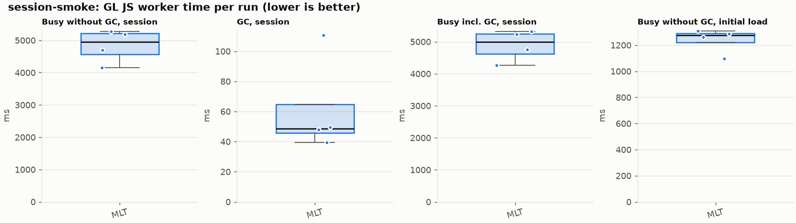
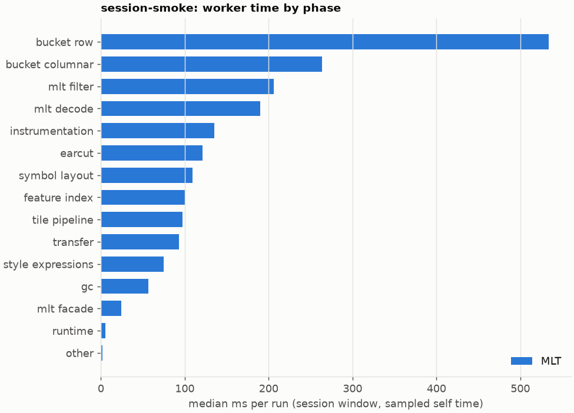
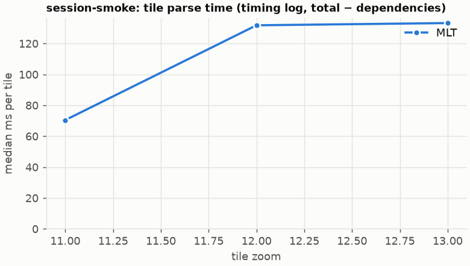

# Session trace benchmark — 20261021-164359-probe-loaded

## Setup

- Created 2026-10-21T16:43:59+02:00; 4 repetitions + 1 warm-up round(s) (excluded); variants rotate per round (A B C, B C A, …); one cold browser context per run.
- Machine: 13th Gen Intel(R) Core(TM) i7-1365U, 12 logical cores, 31.3 GB RAM, Windows-11-10.0.26200-SP0; power: GUID des Energieschemas: 381b4222-f694-41f0-9685-ff5bb260df2e  (Ausbalanciert), AC True.
- GL JS gl7-performance-optimization @ f9bd50a8b5 (dirty); worker count 1; viewport {'width': 1280, 'height': 1024}; tracing preset devtools.
- Python 3.12.2, packages {'playwright': '1.64.0', 'numpy': '2.5.3', 'matplotlib': '3.11.2'}.

| variant | bundle | format | bundle sha256 | branch build |
|---|---|---|---|---|
| MLT | `dist/maplibre-gl-dev.mjs` | mlt | `b2691453151d` | – |

| session | style | duration | frames | sha256 |
|---|---|---:|---:|---|
| session-smoke | osm-bright | 8.0 s | 360 | `31a0e49d65a0` |

CPU sampling interval (median over runs): 615 µs.

## Definitions

- **busy** = wall time in which a GL JS worker thread runs a task (union of top-level task slices and GC slices on `DedicatedWorker thread`s), summed over workers. **GC** = union of `MinorGC`/`MajorGC`/`V8.GC*` slices on those threads. **busy without GC** = busy − GC (headline metric).
- **CPU** = thread time (`tdur`) of the same slices. Phase categories and functions come from the trace's CPU samples (self time), categorised by `config/categories.toml` (nearest matching frame, leaf to root).
- Windows: **load** = map creation → first idle; **session** = camera replay; **tail** = end of replay → idle; **total** = load + session + tail.
- Ratios are against **MLT**: ratio of medians with a bootstrap 95 % CI, the geometric mean of per-round ratios, and a two-sided Mann–Whitney U p-value (normal approximation, not corrected for multiple comparisons; rough below n = 8). Lower than 1× means less worker time.

## Session `session-smoke`

### Worker busy without GC (session window)

| variant | n ok / failed | median ms | IQR | mean | ratio vs MLT | 95 % CI | geo-mean paired | MWU p |
|---|---:|---:|---:|---:|---:|---:|---:|---:|
| MLT | 4 / 0 | 4,947 | 4,564–5,212 | 4,829 | 1.00× | – | – | – |

### All worker metrics (median, ratio vs baseline)

| metric | MLT |
|---|---:|
| busy incl. GC | 4,991 |
| &nbsp;&nbsp;of which GC | 48.7 |
| &nbsp;&nbsp;of which busy without GC | 4,947 |
| &nbsp;&nbsp;&nbsp;&nbsp;of which filtering (sampled, incl. callees) | 206.4 |
| &nbsp;&nbsp;&nbsp;&nbsp;of which timing instrumentation (sampled) | 135.4 |
| busy without GC and instrumentation | 4,812 |
| CPU time without GC | 1,003 |
| tile: download end → sent to main thread, median per tile | 4,377 |
| tile: download end → sent to main thread, 90th percentile | 4,766 |
| &nbsp;&nbsp;parse part (timing log, incl. waiting for glyphs/icons), median per tile | 881.1 |
| &nbsp;&nbsp;queue + hand-off part, median per tile | 697.7 |
| minor GCs | 7.00 |
| major GCs | 2.00 |
| peak worker heap (MB) | 32.5 |
| load: busy without GC | 1,274 |
| load: GC | 37.2 |
| total: busy without GC | 6,190 |

Rows marked *of which* are parts of the row above, not additional time. Tile rows are per-tile latencies (medians over tiles, then over runs), not sums: tiles overlap in time, and the medians of the parse and queue parts do not add up exactly to the median latency.

### Filtering (session window)

Sampled worker time spent in feature filtering, including everything the filter calls (expression evaluation, property access, lazy column decoding): **row filter** = the style-spec feature filter that MVT runs per feature, **mlt filter** = the columnar MLT filter (incl. the geometry-type selection). Medians per run; rules in `config/categories.toml`.

| variant | mlt filter | row filter | filtering total | ratio vs MLT | 95 % CI | MWU p | share of sampled busy |
|---|---:|---:|---:|---:|---:|---:|---:|
| MLT | 206.4 | 0.0 | 206.4 | 1.00× | – | – | 10.6% |

Top 12 functions inside filtering (self time, mean ms per run):

| phase | function | source | MLT |
|---|---|---|---:|
| mlt filter | `StringDictionaryVector` | maplibre-tile-spec/ts/dist/vector/dictionary/stringDictionaryVector.js | 24.7 |
| mlt filter | `set` | maplibre-tile-spec/ts/dist/decoding/intWrapper.js | 20.6 |
| mlt filter | `scanDictionaryCodes` | maplibre-tile-spec/ts/dist/processing/filter/execution/filterKernel.js | 20.3 |
| mlt filter | `matchesAnyOperand` | maplibre-tile-spec/ts/dist/processing/filter/execution/filterKernel.js | 16.7 |
| mlt filter | `filterByGeometryType` | maplibre-tile-spec/ts/dist/vector/geometry/geometryVector.js | 16.6 |
| mlt filter | `dictionaryRowMatches` | maplibre-tile-spec/ts/dist/processing/filter/execution/filterKernel.js | 13.5 |
| mlt filter | `executeNode` | maplibre-tile-spec/ts/dist/processing/filter/execution/filterExecution.js | 11.6 |
| mlt filter | `executeLeaf` | maplibre-tile-spec/ts/dist/processing/filter/execution/filterExecution.js | 7.5 |
| mlt filter | `getNormalizedFilter` | maplibre-tile-spec/ts/dist/processing/filter/filterCache.js | 7.0 |
| mlt filter | `unpackNullable` | maplibre-tile-spec/ts/dist/decoding/unpackNullableUtils.js | 5.9 |
| mlt filter | `resolveDictionaryExecutor` | maplibre-tile-spec/ts/dist/processing/filter/execution/filterKernel.js | 4.7 |
| mlt filter | `geometryType` | maplibre-tile-spec/ts/dist/vector/geometry/flatGeometryVector.js | 4.6 |

### Where the variants differ from MLT (session window, mean ms per run)

Open **[flame.html](flame.html)** to explore the call tree interactively: pick a variant, compare it with MLT (red = more time at the same call path, blue = less), click a frame to zoom in, and read the phase and function breakdown under it. `flame/*.txt` open in https://www.speedscope.app.

### Worker time by phase (session window, median ms of sampled self time)

| phase | MLT |
|---|---:|
| bucket row | 533.5 |
| bucket columnar | 263.5 |
| mlt filter | 206.4 |
| mlt decode | 190.0 |
| instrumentation | 135.4 |
| earcut | 120.9 |
| symbol layout | 109.1 |
| feature index | 99.9 |
| tile pipeline | 97.1 |
| transfer | 93.1 |
| style expressions | 74.5 |
| gc | 56.6 |
| mlt facade | 24.0 |
| runtime | 5.0 |
| other | 2.0 |
| row filter | 0.0 |
| pre-tess mesh | 0.0 |
| mvt decode | 0.0 |

### Top 20 worker functions by self time (session window, mean ms per run)

| function | source | phase | MLT |
|---|---|---|---:|
| `reserve` | src/util/struct_array.ts | bucket row | 83.9 |
| `populate` | src/data/bucket/columnar/columnar_line_bucket.ts | bucket columnar | 82.1 |
| `addPhase` | src/source/worker_timing.ts | instrumentation | 80.7 |
| `populatePaintArrays` | src/data/program_configuration.ts | bucket columnar | 54.3 |
| `addHalfVertex` | src/data/bucket/line_bucket.ts | bucket row | 53.9 |
| `(garbage collector)` | (native) | gc | 53.5 |
| `addFeature` | src/data/bucket/line_bucket.ts | bucket row | 53.2 |
| `emplace` | src/data/array_types.g.ts | bucket columnar | 50.0 |
| `addLine` | src/data/bucket/line_bucket.ts | bucket row | 47.1 |
| `insert` | src/data/feature_index.ts | feature index | 45.8 |
| `_refreshViews` | src/data/array_types.g.ts | bucket row | 42.7 |
| `ProgramConfiguration` | src/data/program_configuration.ts | bucket row | 41.9 |
| `parse` | src/source/worker_tile.ts | tile pipeline | 30.5 |
| `now` | src/source/worker_timing.ts | instrumentation | 29.6 |
| `fetch` | (native) | tile pipeline | 28.0 |
| `isEar` | node_modules/earcut/src/earcut.js | earcut | 26.0 |
| `LineBucket` | src/data/bucket/line_bucket.ts |  | 24.7 |
| `StringDictionaryVector` | maplibre-tile-spec/ts/dist/vector/dictionary/stringDictionaryVector.js | mlt filter | 24.7 |
| `postMessage` | (native) | transfer | 24.5 |
| `linkedList` | node_modules/earcut/src/earcut.js | earcut | 24.1 |

### Top 20 worker functions by total time (incl. callees) (session window, mean ms per run)

| function | source | phase | MLT |
|---|---|---|---:|
| `parse` | src/source/worker_tile.ts | tile pipeline | 1,812 |
| `loadTile` | src/source/vector_tile_worker_source.ts |  | 1,740 |
| `_parseWorkerTile` | src/source/vector_tile_worker_source.ts | tile pipeline | 1,704 |
| `populate` | src/data/bucket/columnar/columnar_line_bucket.ts | bucket columnar | 865.6 |
| `populate` | src/data/bucket/columnar/columnar_fill_bucket.ts | bucket columnar | 385.2 |
| `addFeature` | src/data/bucket/line_bucket.ts | bucket row | 367.0 |
| `addLine` | src/data/bucket/line_bucket.ts | bucket row | 248.9 |
| `addBucketFeatures` | src/data/bucket/fill_bucket.ts | bucket row | 244.9 |
| `addFeature` | src/data/bucket/columnar/columnar_fill_bucket.ts |  | 222.9 |
| `writeEarcutFill` | src/data/bucket/columnar/columnar_mesh_arrays.ts | bucket columnar | 220.9 |
| `selectColumnarFeatures` | src/data/bucket/columnar/columnar_populate.ts |  | 210.8 |
| `filterFeatureTable` | maplibre-tile-spec/ts/dist/processing/filter/execution/tableFilter.js | mlt filter | 193.2 |
| `executeNode` | maplibre-tile-spec/ts/dist/processing/filter/execution/filterExecution.js | mlt filter | 190.7 |
| `executeLeaf` | maplibre-tile-spec/ts/dist/processing/filter/execution/filterExecution.js | mlt filter | 177.2 |
| `executeAll` | maplibre-tile-spec/ts/dist/processing/filter/execution/filterExecution.js | mlt filter | 166.3 |
| `resize` | src/util/struct_array.ts | bucket row | 141.9 |
| `addCurrentVertex` | src/data/bucket/line_bucket.ts | bucket row | 141.1 |
| `buildEarcutMesh` | src/data/bucket/columnar/columnar_mesh_arrays.ts | bucket columnar | 135.6 |
| `addHalfVertex` | src/data/bucket/line_bucket.ts | bucket row | 128.6 |
| `processTask` | src/util/actor.ts |  | 126.3 |

### Tile parse time by zoom (timing log, median ms per tile, total − dependencies)

| zoom | MLT |
|---:|---:|
| 11 | 70.45 (n=36) |
| 12 | 131.80 (n=28) |
| 13 | 133.25 (n=16) |

### Tile latency by zoom: download end → result sent to the main thread (session window, median ms per tile)

Includes waiting in the worker's queue, the parse and posting the result; see `tile_latency.csv` for the per-tile split (`parse_ms`, `wait_ms`).

| zoom | MLT |
|---:|---:|
| 12 | 4,531 (n=28) |
| 13 | 722.5 (n=16) |

## Runs

5 ok, 0 failed/aborted, 0 not run, 4 used in statistics.

## Validity checks

- Counted once: all 5 analysed runs pass (windows load + session + tail add up to total; phases add up to the sampled busy time; GC and sampled time lie within busy time; no timing-log line twice).
- session-smoke/mlt/rep-00: CPU samples cover only 52% of worker busy time
- session-smoke/mlt/rep-01: CPU samples cover only 41% of worker busy time
- session-smoke/mlt/rep-02: CPU samples cover only 43% of worker busy time
- session-smoke/mlt/rep-03: CPU samples cover only 37% of worker busy time
- session-smoke/mlt/rep-04: CPU samples cover only 44% of worker busy time
- runs were headless: the page renders in software on the CPU next to the worker, which inflates worker time and skips frames; do not compare with headed batches
- machine speed (calibration probe, rolling median over neighbouring runs) varied between 1.00× and 1.00× of the batch median (10th–90th percentile 1.00–1.00×)
- 4 run(s) where the probe changed by more than 15% between before and after the replay, so the adjustment is uncertain: session-smoke/mlt/rep-01 (0.74×), session-smoke/mlt/rep-02 (0.85×), session-smoke/mlt/rep-03 (0.70×), session-smoke/mlt/rep-04 (0.73×)
- spread within a variant (median IQR / median of busy without GC): raw 13.1%, load-adjusted 13.2% — the adjustment does not reduce the noise here

## Files

- `runs.csv`: one row per run (incl. failed and warm-up runs), every scalar metric as `<window>.<metric>`.
- `summary.csv`: session × variant × metric statistics.
- `functions.csv`, `categories.csv`: CPU-sample self/total time per function and phase per run and window.
- `category_functions.csv`: self time per phase × function (e.g. what the filters spend their time on).
- `tiles.csv`, `tile_layers.csv`, `tile_phases.csv`: the per-tile worker timing log, long format.
- `flame.html`: interactive call tree per variant with a diff view; `flame/*.txt`: collapsed stacks for speedscope.
- `analysis/stacks.csv` (per run): sampled self time per full call stack.
- `tile_latency.csv`: per tile request, worker clock: received, download start/end, result sent, latency = sent − download end, parse_ms, wait_ms = latency − parse.
- `runs/<session>/<variant>/rep-NN/trace.json.gz`: the raw trace (opens in the DevTools Performance tab).
