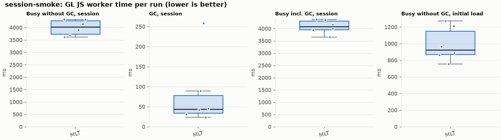
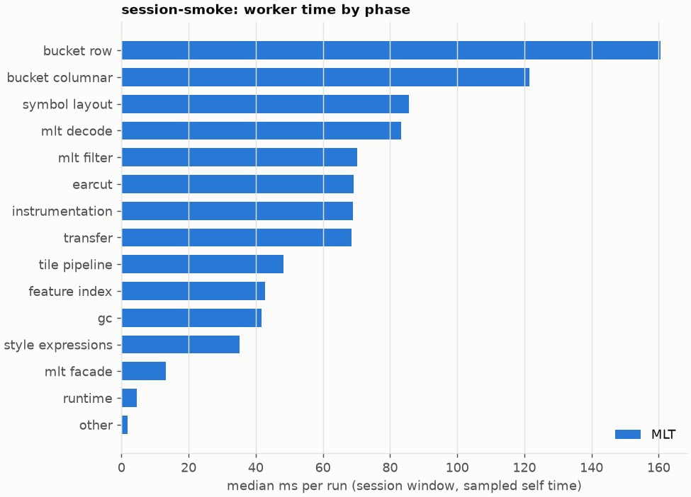
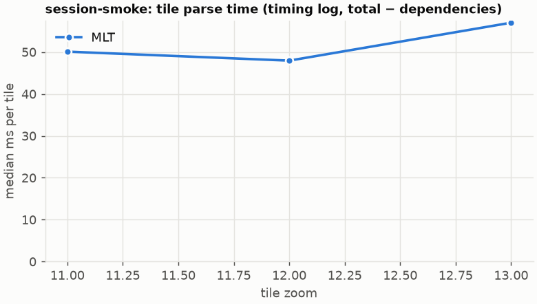

# Session trace benchmark — 20261021-164917-probe-idle-pcores

## Setup

- Created 2026-10-21T16:49:17+02:00; 6 repetitions + 1 warm-up round(s) (excluded); variants rotate per round (A B C, B C A, …); one cold browser context per run.
- Machine: 13th Gen Intel(R) Core(TM) i7-1365U, 12 logical cores, 31.3 GB RAM, Windows-11-10.0.26200-SP0; power: GUID des Energieschemas: 381b4222-f694-41f0-9685-ff5bb260df2e  (Ausbalanciert), AC True.
- GL JS gl7-performance-optimization @ f9bd50a8b5 (dirty); worker count 1; viewport {'width': 1280, 'height': 1024}; tracing preset devtools.
- Python 3.12.2, packages {'playwright': '1.64.0', 'numpy': '2.5.3', 'matplotlib': '3.11.2'}.

| variant | bundle | format | bundle sha256 | branch build |
|---|---|---|---|---|
| MLT | `dist/maplibre-gl-dev.mjs` | mlt | `b2691453151d` | – |

| session | style | duration | frames | sha256 |
|---|---|---:|---:|---|
| session-smoke | osm-bright | 8.0 s | 360 | `31a0e49d65a0` |

CPU sampling interval (median over runs): 602 µs.

## Definitions

- **busy** = wall time in which a GL JS worker thread runs a task (union of top-level task slices and GC slices on `DedicatedWorker thread`s), summed over workers. **GC** = union of `MinorGC`/`MajorGC`/`V8.GC*` slices on those threads. **busy without GC** = busy − GC (headline metric).
- **CPU** = thread time (`tdur`) of the same slices. Phase categories and functions come from the trace's CPU samples (self time), categorised by `config/categories.toml` (nearest matching frame, leaf to root).
- Windows: **load** = map creation → first idle; **session** = camera replay; **tail** = end of replay → idle; **total** = load + session + tail.
- Ratios are against **MLT**: ratio of medians with a bootstrap 95 % CI, the geometric mean of per-round ratios, and a two-sided Mann–Whitney U p-value (normal approximation, not corrected for multiple comparisons; rough below n = 8). Lower than 1× means less worker time.

## Session `session-smoke`

### Worker busy without GC (session window)

| variant | n ok / failed | median ms | IQR | mean | ratio vs MLT | 95 % CI | geo-mean paired | MWU p |
|---|---:|---:|---:|---:|---:|---:|---:|---:|
| MLT | 6 / 0 | 4,026 | 3,741–4,279 | 3,999 | 1.00× | – | – | – |

### All worker metrics (median, ratio vs baseline)

| metric | MLT |
|---|---:|
| busy incl. GC | 4,082 |
| &nbsp;&nbsp;of which GC | 43.5 |
| &nbsp;&nbsp;of which busy without GC | 4,026 |
| &nbsp;&nbsp;&nbsp;&nbsp;of which filtering (sampled, incl. callees) | 70.2 |
| &nbsp;&nbsp;&nbsp;&nbsp;of which timing instrumentation (sampled) | 69.0 |
| busy without GC and instrumentation | 3,956 |
| CPU time without GC | 652.3 |
| tile: download end → sent to main thread, median per tile | 3,566 |
| tile: download end → sent to main thread, 90th percentile | 3,838 |
| &nbsp;&nbsp;parse part (timing log, incl. waiting for glyphs/icons), median per tile | 421.7 |
| &nbsp;&nbsp;queue + hand-off part, median per tile | 1,914 |
| minor GCs | 7.00 |
| major GCs | 2.00 |
| peak worker heap (MB) | 33.0 |
| load: busy without GC | 925.5 |
| load: GC | 38.8 |
| total: busy without GC | 5,108 |

Rows marked *of which* are parts of the row above, not additional time. Tile rows are per-tile latencies (medians over tiles, then over runs), not sums: tiles overlap in time, and the medians of the parse and queue parts do not add up exactly to the median latency.

### Filtering (session window)

Sampled worker time spent in feature filtering, including everything the filter calls (expression evaluation, property access, lazy column decoding): **row filter** = the style-spec feature filter that MVT runs per feature, **mlt filter** = the columnar MLT filter (incl. the geometry-type selection). Medians per run; rules in `config/categories.toml`.

| variant | mlt filter | row filter | filtering total | ratio vs MLT | 95 % CI | MWU p | share of sampled busy |
|---|---:|---:|---:|---:|---:|---:|---:|
| MLT | 70.2 | 0.0 | 70.2 | 1.00× | – | – | 7.6% |

Top 12 functions inside filtering (self time, mean ms per run):

| phase | function | source | MLT |
|---|---|---|---:|
| mlt filter | `dictionaryRowMatches` | maplibre-tile-spec/ts/dist/processing/filter/execution/filterKernel.js | 10.1 |
| mlt filter | `scanDictionaryCodes` | maplibre-tile-spec/ts/dist/processing/filter/execution/filterKernel.js | 9.7 |
| mlt filter | `filterByGeometryType` | maplibre-tile-spec/ts/dist/vector/geometry/geometryVector.js | 7.2 |
| mlt filter | `get numGeometries` | maplibre-tile-spec/ts/dist/vector/geometry/flatGeometryVector.js | 3.6 |
| mlt filter | `executeNode` | maplibre-tile-spec/ts/dist/processing/filter/execution/filterExecution.js | 2.8 |
| mlt filter | `resolveDictionaryExecutor` | maplibre-tile-spec/ts/dist/processing/filter/execution/filterKernel.js | 2.5 |
| mlt filter | `bytesEqual` | maplibre-tile-spec/ts/dist/processing/filter/execution/filterKernel.js | 2.1 |
| mlt filter | `executeLeaf` | maplibre-tile-spec/ts/dist/processing/filter/execution/filterExecution.js | 2.0 |
| mlt filter | `(anonymous)` | maplibre-tile-spec/ts/dist/processing/filter/execution/filterKernel.js | 1.8 |
| mlt filter | `get` | maplibre-tile-spec/ts/dist/vector/lazyPropertyVectors.js | 1.7 |
| mlt filter | `unpackNullable` | maplibre-tile-spec/ts/dist/decoding/unpackNullableUtils.js | 1.6 |
| mlt filter | `getIndex` | maplibre-tile-spec/ts/dist/vector/filter/flatSelectionVector.js | 1.6 |

### Where the variants differ from MLT (session window, mean ms per run)

Open **[flame.html](flame.html)** to explore the call tree interactively: pick a variant, compare it with MLT (red = more time at the same call path, blue = less), click a frame to zoom in, and read the phase and function breakdown under it. `flame/*.txt` open in https://www.speedscope.app.

### Worker time by phase (session window, median ms of sampled self time)

| phase | MLT |
|---|---:|
| bucket row | 160.5 |
| bucket columnar | 121.4 |
| symbol layout | 85.6 |
| mlt decode | 83.4 |
| mlt filter | 70.2 |
| earcut | 69.1 |
| instrumentation | 69.0 |
| transfer | 68.6 |
| tile pipeline | 48.3 |
| feature index | 42.7 |
| gc | 41.7 |
| style expressions | 35.1 |
| mlt facade | 13.2 |
| runtime | 4.6 |
| other | 1.8 |
| row filter | 0.0 |
| pre-tess mesh | 0.0 |
| mvt decode | 0.0 |

### Top 20 worker functions by self time (session window, mean ms per run)

| function | source | phase | MLT |
|---|---|---|---:|
| `(garbage collector)` | (native) | gc | 66.2 |
| `reserve` | src/util/struct_array.ts | bucket columnar | 44.2 |
| `populate` | src/data/bucket/columnar/columnar_line_bucket.ts | bucket columnar | 37.6 |
| `addPhase` | src/source/worker_timing.ts | instrumentation | 36.0 |
| `serialize` | src/util/web_worker_transfer.ts | transfer | 22.7 |
| `isEar` | node_modules/earcut/src/earcut.js | earcut | 20.2 |
| `fetch` | (native) | tile pipeline | 19.2 |
| `postMessage` | (native) | transfer | 18.9 |
| `addLine` | src/data/bucket/line_bucket.ts | bucket row | 18.8 |
| `insert` | src/data/feature_index.ts | feature index | 18.0 |
| `addHalfVertex` | src/data/bucket/line_bucket.ts | bucket row | 16.3 |
| `emplace` | src/data/array_types.g.ts | bucket row | 16.0 |
| `ProgramConfiguration` | src/data/program_configuration.ts | bucket row | 15.3 |
| `populatePaintArrays` | src/data/program_configuration.ts | bucket row | 14.5 |
| `materializeSelectedFeatures` | src/data/bucket/columnar/columnar_populate.ts | bucket columnar | 14.5 |
| `_trim` | src/util/struct_array.ts | transfer | 13.8 |
| `addFeature` | src/data/bucket/line_bucket.ts | bucket row | 12.4 |
| `addCurrentVertex` | src/data/bucket/line_bucket.ts | bucket row | 11.8 |
| `parse` | src/source/worker_tile.ts | tile pipeline | 11.6 |
| `self.postMessage` | worker_hook.js | instrumentation | 11.4 |

### Top 20 worker functions by total time (incl. callees) (session window, mean ms per run)

| function | source | phase | MLT |
|---|---|---|---:|
| `parse` | src/source/worker_tile.ts | tile pipeline | 761.8 |
| `loadTile` | src/source/vector_tile_worker_source.ts |  | 693.8 |
| `_parseWorkerTile` | src/source/vector_tile_worker_source.ts | tile pipeline | 672.9 |
| `populate` | src/data/bucket/columnar/columnar_line_bucket.ts | bucket columnar | 335.7 |
| `populate` | src/data/bucket/columnar/columnar_fill_bucket.ts | bucket columnar | 182.9 |
| `addBucketFeatures` | src/data/bucket/fill_bucket.ts | bucket row | 130.6 |
| `addFeature` | src/data/bucket/columnar/columnar_fill_bucket.ts | bucket columnar | 123.9 |
| `writeEarcutFill` | src/data/bucket/columnar/columnar_mesh_arrays.ts | bucket columnar | 120.8 |
| `addFeature` | src/data/bucket/line_bucket.ts | bucket row | 118.8 |
| `processTask` | src/util/actor.ts | transfer | 102.4 |
| `addLine` | src/data/bucket/line_bucket.ts | bucket row | 87.0 |
| `buildEarcutMesh` | src/data/bucket/columnar/columnar_mesh_arrays.ts | bucket columnar | 79.7 |
| `completeTask` | src/util/actor.ts | transfer | 76.5 |
| `addFeatures` | src/data/bucket/symbol_bucket.ts | symbol layout | 73.3 |
| `selectColumnarFeatures` | src/data/bucket/columnar/columnar_populate.ts |  | 72.7 |
| `earcut` | node_modules/earcut/src/earcut.js | earcut | 72.4 |
| `performSymbolLayout` | src/symbol/symbol_layout.ts | symbol layout | 71.5 |
| `(garbage collector)` | (native) | gc | 66.2 |
| `filterFeatureTable` | maplibre-tile-spec/ts/dist/processing/filter/execution/tableFilter.js |  | 65.7 |
| `executeNode` | maplibre-tile-spec/ts/dist/processing/filter/execution/filterExecution.js | mlt filter | 65.5 |

### Tile parse time by zoom (timing log, median ms per tile, total − dependencies)

| zoom | MLT |
|---:|---:|
| 11 | 50.10 (n=54) |
| 12 | 47.95 (n=40) |
| 13 | 57.00 (n=24) |

### Tile latency by zoom: download end → result sent to the main thread (session window, median ms per tile)

Includes waiting in the worker's queue, the parse and posting the result; see `tile_latency.csv` for the per-tile split (`parse_ms`, `wait_ms`).

| zoom | MLT |
|---:|---:|
| 12 | 3,717 (n=40) |
| 13 | 450.6 (n=24) |

## Runs

7 ok, 0 failed/aborted, 0 not run, 6 used in statistics.

## Validity checks

- Counted once: all 7 analysed runs pass (windows load + session + tail add up to total; phases add up to the sampled busy time; GC and sampled time lie within busy time; no timing-log line twice).
- session-smoke/mlt/rep-00: CPU samples cover only 25% of worker busy time
- session-smoke/mlt/rep-01: CPU samples cover only 27% of worker busy time
- session-smoke/mlt/rep-02: CPU samples cover only 25% of worker busy time
- session-smoke/mlt/rep-03: CPU samples cover only 24% of worker busy time
- session-smoke/mlt/rep-04: CPU samples cover only 21% of worker busy time
- session-smoke/mlt/rep-05: CPU samples cover only 24% of worker busy time
- session-smoke/mlt/rep-06: CPU samples cover only 20% of worker busy time
- runs were headless: the page renders in software on the CPU next to the worker, which inflates worker time and skips frames; do not compare with headed batches
- machine speed (calibration probe, rolling median over neighbouring runs) varied between 1.00× and 1.02× of the batch median (10th–90th percentile 1.00–1.02×)
- 5 run(s) where the probe changed by more than 15% between before and after the replay, so the adjustment is uncertain: session-smoke/mlt/rep-02 (0.59×), session-smoke/mlt/rep-03 (0.54×), session-smoke/mlt/rep-04 (0.63×), session-smoke/mlt/rep-05 (0.84×), session-smoke/mlt/rep-06 (0.74×)
- spread within a variant (median IQR / median of busy without GC): raw 13.3%, load-adjusted 12.9%

## Files

- `runs.csv`: one row per run (incl. failed and warm-up runs), every scalar metric as `<window>.<metric>`.
- `summary.csv`: session × variant × metric statistics.
- `functions.csv`, `categories.csv`: CPU-sample self/total time per function and phase per run and window.
- `category_functions.csv`: self time per phase × function (e.g. what the filters spend their time on).
- `tiles.csv`, `tile_layers.csv`, `tile_phases.csv`: the per-tile worker timing log, long format.
- `flame.html`: interactive call tree per variant with a diff view; `flame/*.txt`: collapsed stacks for speedscope.
- `analysis/stacks.csv` (per run): sampled self time per full call stack.
- `tile_latency.csv`: per tile request, worker clock: received, download start/end, result sent, latency = sent − download end, parse_ms, wait_ms = latency − parse.
- `runs/<session>/<variant>/rep-NN/trace.json.gz`: the raw trace (opens in the DevTools Performance tab).
