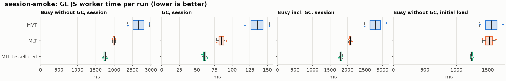
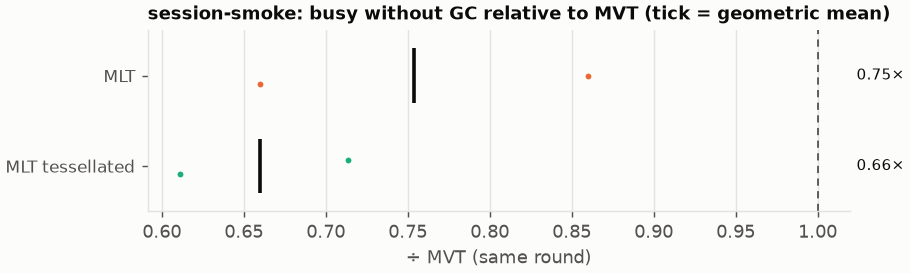
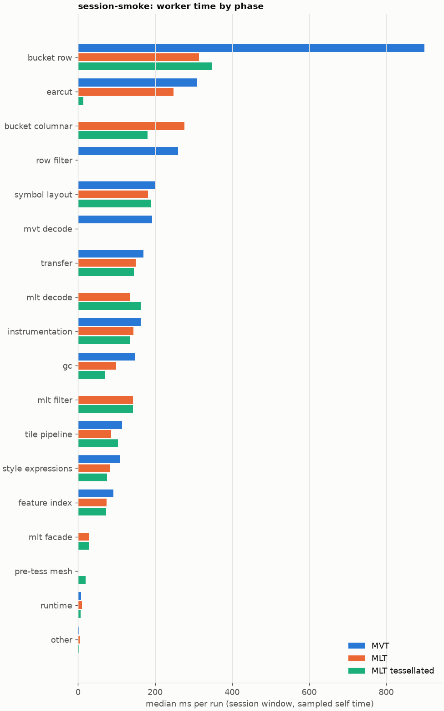
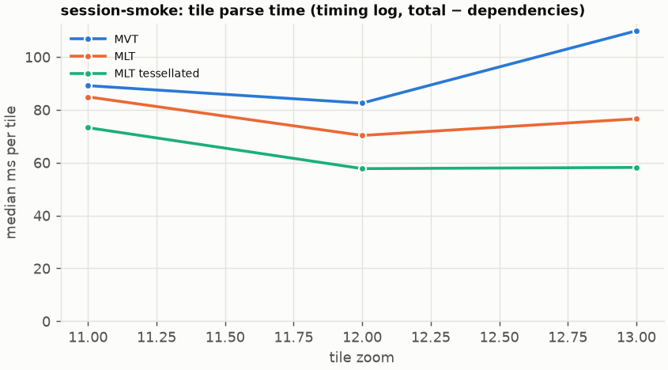
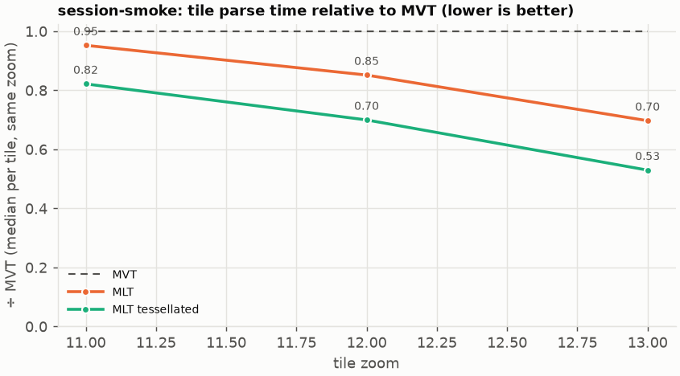

# Session trace benchmark — 20261022-072145-e2e

## Setup

- Created 2026-10-22T07:21:46+02:00; 2 repetitions + 1 warm-up round(s) (excluded); variants rotate per round (A B C, B C A, …); one cold browser context per run.
- Machine: 13th Gen Intel(R) Core(TM) i7-1365U, 12 logical cores, 31.3 GB RAM, Windows-11-10.0.26200-SP0; power: GUID des Energieschemas: 381b4222-f694-41f0-9685-ff5bb260df2e  (Ausbalanciert), AC True.
- GL JS gl7-performance-optimization @ f9bd50a8b5 (dirty); worker count 1; viewport {'width': 1280, 'height': 1024}; tracing preset devtools.
- Python 3.12.2, packages {'playwright': '1.64.0', 'numpy': '2.5.3', 'matplotlib': '3.11.2'}.

| variant | bundle | format | bundle sha256 | branch build |
|---|---|---|---|---|
| MVT | `dist/maplibre-gl-dev.mjs` | mvt | `b2691453151d` | – |
| MLT | `dist/maplibre-gl-dev.mjs` | mlt | `b2691453151d` | – |
| MLT tessellated | `dist/maplibre-gl-dev.mjs` | mlt-pre-tess | `b2691453151d` | – |

| session | style | duration | frames | sha256 |
|---|---|---:|---:|---|
| session-smoke | osm-bright | 8.0 s | 360 | `31a0e49d65a0` |

CPU sampling interval (median over runs): 618 µs.

## Definitions

- **busy** = wall time in which a GL JS worker thread runs a task (union of top-level task slices and GC slices on `DedicatedWorker thread`s), summed over workers. **GC** = union of `MinorGC`/`MajorGC`/`V8.GC*` slices on those threads. **busy without GC** = busy − GC (headline metric).
- **CPU** = thread time (`tdur`) of the same slices. Phase categories and functions come from the trace's CPU samples (self time), categorised by `config/categories.toml` (nearest matching frame, leaf to root).
- Windows: **load** = map creation → first idle; **session** = camera replay; **tail** = end of replay → idle; **total** = load + session + tail.
- Ratios are against **MVT**: ratio of medians with a bootstrap 95 % CI, the geometric mean of per-round ratios, and a two-sided Mann–Whitney U p-value (normal approximation, not corrected for multiple comparisons; rough below n = 8). Lower than 1× means less worker time.

## Session `session-smoke`

### Worker busy without GC (session window)

| variant | n ok / failed | median ms | IQR | mean | ratio vs MVT | 95 % CI | geo-mean paired | MWU p |
|---|---:|---:|---:|---:|---:|---:|---:|---:|
| MVT | 2 / 0 | 2,667 | 2,521–2,813 | 2,667 | 1.00× | – | – | – |
| MLT | 2 / 0 | 1,998 | 1,976–2,020 | 1,998 | 0.75× | 0.66–0.86× | 0.75× | 0.245 |
| MLT tessellated | 2 / 0 | 1,751 | 1,722–1,779 | 1,751 | 0.66× | 0.57–0.76× | 0.66× | 0.245 |

### All worker metrics (median, ratio vs baseline)

| metric | MVT | MLT | MLT tessellated |
|---|---:|---:|---:|
| busy incl. GC | 2,802 | 2,083 (0.74×) | 1,812 (0.65×) |
| &nbsp;&nbsp;of which GC | 135.4 | 84.9 (0.63×) | 61.1 (0.45×) |
| &nbsp;&nbsp;of which busy without GC | 2,667 | 1,998 (0.75×) | 1,751 (0.66×) |
| &nbsp;&nbsp;&nbsp;&nbsp;of which filtering (sampled, incl. callees) | 259.9 | 142.8 (0.55×) | 143.1 (0.55×) |
| &nbsp;&nbsp;&nbsp;&nbsp;of which timing instrumentation (sampled) | 163.0 | 143.3 (0.88×) | 134.7 (0.83×) |
| busy without GC and instrumentation | 2,504 | 1,855 (0.74×) | 1,616 (0.65×) |
| CPU time without GC | 2,291 | 1,795 (0.78×) | 1,563 (0.68×) |
| tile: download end → sent to main thread, median per tile | 1,419 | 956.7 (0.67×) | 801.9 (0.57×) |
| tile: download end → sent to main thread, 90th percentile | 1,484 | 1,062 (0.72×) | 867.2 (0.58×) |
| &nbsp;&nbsp;parse part (timing log, incl. waiting for glyphs/icons), median per tile | 585.1 | 464.6 (0.79×) | 393.1 (0.67×) |
| &nbsp;&nbsp;queue + hand-off part, median per tile | 540.1 | 414.0 (0.77×) | 375.7 (0.70×) |
| minor GCs | 17.00 | 10.00 (0.59×) | 6.50 (0.38×) |
| major GCs | 3.00 | 2.50 (0.83×) | 2.00 (0.67×) |
| peak worker heap (MB) | 50.1 | 46.7 (0.93×) | 43.7 (0.87×) |
| load: busy without GC | 1,554 | 1,521 (0.98×) | 1,245 (0.80×) |
| load: GC | 70.5 | 67.1 (0.95×) | 55.5 (0.79×) |
| total: busy without GC | 4,221 | 3,519 (0.83×) | 2,995 (0.71×) |

Rows marked *of which* are parts of the row above, not additional time. Tile rows are per-tile latencies (medians over tiles, then over runs), not sums: tiles overlap in time, and the medians of the parse and queue parts do not add up exactly to the median latency.

### Filtering (session window)

Sampled worker time spent in feature filtering, including everything the filter calls (expression evaluation, property access, lazy column decoding): **row filter** = the style-spec feature filter that MVT runs per feature, **mlt filter** = the columnar MLT filter (incl. the geometry-type selection). Medians per run; rules in `config/categories.toml`.

| variant | mlt filter | row filter | filtering total | ratio vs MVT | 95 % CI | MWU p | share of sampled busy |
|---|---:|---:|---:|---:|---:|---:|---:|
| MVT | 0.0 | 259.9 | 259.9 | 1.00× | – | – | 9.8% |
| MLT | 142.8 | 0.0 | 142.8 | 0.55× | 0.47–0.64× | 0.245 | 7.2% |
| MLT tessellated | 143.1 | 0.0 | 143.1 | 0.55× | 0.50–0.61× | 0.245 | 8.4% |

Top 12 functions inside filtering (self time, mean ms per run):

| phase | function | source | MVT | MLT | MLT tessellated |
|---|---|---|---:|---:|---:|
| row filter | `evaluate` | node_modules/@maplibre/maplibre-gl-style-spec/dist/expression/compound_expression.mjs | 68.3 | 0.0 | 0.0 |
| row filter | `CompoundExpression.register.filter-in-small` | node_modules/@maplibre/maplibre-gl-style-spec/dist/expression/compound_expression.mjs | 43.2 | 0.0 | 0.0 |
| row filter | `evaluate` | node_modules/@maplibre/maplibre-gl-style-spec/dist/expression/index.mjs | 32.8 | 0.0 | 0.0 |
| row filter | `CompoundExpression.register.filter-==` | node_modules/@maplibre/maplibre-gl-style-spec/dist/expression/compound_expression.mjs | 31.4 | 0.0 | 0.0 |
| row filter | `CompoundExpression.register.all.overloads` | node_modules/@maplibre/maplibre-gl-style-spec/dist/expression/compound_expression.mjs | 22.8 | 0.0 | 0.0 |
| mlt filter | `scanDictionaryCodes` | maplibre-tile-spec/ts/dist/processing/filter/execution/filterKernel.js | 0.0 | 20.0 | 14.3 |
| mlt filter | `filterByGeometryType` | maplibre-tile-spec/ts/dist/vector/geometry/geometryVector.js | 0.0 | 19.9 | 15.6 |
| mlt filter | `dictionaryRowMatches` | maplibre-tile-spec/ts/dist/processing/filter/execution/filterKernel.js | 0.0 | 15.2 | 19.0 |
| row filter | `filter` | node_modules/@maplibre/maplibre-gl-style-spec/dist/feature_filter/index.mjs | 17.4 | 0.0 | 0.0 |
| row filter | `CompoundExpression.register.filter-type-==` | node_modules/@maplibre/maplibre-gl-style-spec/dist/expression/compound_expression.mjs | 9.2 | 0.0 | 0.0 |
| row filter | `geometryType` | node_modules/@maplibre/maplibre-gl-style-spec/dist/expression/evaluation_context.mjs | 8.4 | 0.0 | 0.0 |
| row filter | `properties` | node_modules/@maplibre/maplibre-gl-style-spec/dist/expression/evaluation_context.mjs | 8.4 | 0.0 | 0.0 |

### Where the variants differ from MVT (session window, mean ms per run)

Open **[flame.html](flame.html)** to explore the call tree interactively: pick a variant, compare it with MVT (red = more time at the same call path, blue = less), click a frame to zoom in, and read the phase and function breakdown under it. `flame/*.txt` open in https://www.speedscope.app.

#### MLT vs MVT

**By phase** (sampled self time; the Δ column sums to the difference in sampled busy time):

| phase | MVT | MLT | Δ |
|---|---:|---:|---:|
| bucket columnar | 0.0 | 276.1 | +276.1 |
| mlt filter | 0.0 | 142.8 | +142.8 |
| mlt decode | 0.0 | 134.5 | +134.5 |
| mlt facade | 0.0 | 27.7 | +27.7 |
| runtime | 8.1 | 10.2 | +2.1 |
| other | 2.6 | 3.8 | +1.2 |
| feature index | 91.5 | 74.1 | -17.4 |
| symbol layout | 200.8 | 181.3 | -19.5 |
| instrumentation | 163.0 | 143.3 | -19.8 |
| transfer | 170.0 | 149.2 | -20.9 |
| style expressions | 108.7 | 82.6 | -26.1 |
| tile pipeline | 113.8 | 86.4 | -27.4 |
| gc | 149.0 | 99.1 | -49.9 |
| earcut | 308.0 | 248.3 | -59.7 |
| mvt decode | 192.7 | 0.0 | -192.7 |
| row filter | 259.9 | 0.0 | -259.9 |
| bucket row | 898.8 | 314.2 | -584.6 |

**By source layer** (timing log: createBucket + populate + addFeatures, summed over the style layers that use it; wall time, includes GC pauses; total Δ -631 ms):

| source layer | type | MVT | MLT | Δ |
|---|---|---:|---:|---:|
| waterway | line | 10.8 | 25.0 | +14.2 |
| boundary | line | 7.4 | 14.8 | +7.4 |
| park | fill | 1.5 | 4.0 | +2.5 |
| water_name | symbol | 1.2 | 3.6 | +2.4 |
| transportation_name | symbol | 91.3 | 90.1 | -1.2 |
| place | symbol | 144.8 | 136.8 | -8.0 |
| landuse | fill | 100.3 | 92.0 | -8.4 |
| landcover | fill | 97.1 | 85.6 | -11.5 |
| water | fill | 50.3 | 36.5 | -13.9 |
| transportation | fill | 32.6 | 12.5 | -20.0 |
| building | fill | 632.5 | 375.6 | -256.9 |
| transportation | line | 1,020 | 680.4 | -339.3 |

**Functions with the largest self-time difference** (by function name, summed over source files):

| function | MVT | MLT | Δ |
|---|---:|---:|---:|
| `scanDictionaryCodes` | 0.0 | 20.0 | +20.0 |
| `filterByGeometryType` | 0.0 | 19.9 | +19.9 |
| `writeEarcutFill` | 0.0 | 19.2 | +19.2 |
| `pushVertex` | 0.0 | 18.9 | +18.9 |
| `materializeSelectedFeatures` | 0.0 | 17.8 | +17.8 |
| `buildEarcutMesh` | 0.0 | 17.4 | +17.4 |
| `buildRingBoundingBoxes` | 0.0 | 15.9 | +15.9 |
| `dictionaryRowMatches` | 0.0 | 15.2 | +15.2 |
| `unpackNullable` | 0.0 | 11.5 | +11.5 |
| `decodeComponentwiseDeltaVec2` | 0.0 | 10.8 | +10.8 |
| `get numGeometries` | 0.0 | 7.6 | +7.6 |
| `get` | 18.9 | 26.1 | +7.2 |
| `_vertexToIndex` | 110.6 | 0.0 | -110.6 |
| `populate` | 164.5 | 59.5 | -105.1 |
| `evaluate` | 108.8 | 9.5 | -99.2 |
| `readSVarint` | 87.2 | 0.0 | -87.2 |
| `loadGeometry` | 76.8 | 9.6 | -67.1 |

#### MLT tessellated vs MVT

**By phase** (sampled self time; the Δ column sums to the difference in sampled busy time):

| phase | MVT | MLT tessellated | Δ |
|---|---:|---:|---:|
| bucket columnar | 0.0 | 180.8 | +180.8 |
| mlt decode | 0.0 | 163.1 | +163.1 |
| mlt filter | 0.0 | 143.1 | +143.1 |
| mlt facade | 0.0 | 27.8 | +27.8 |
| pre-tess mesh | 0.0 | 20.0 | +20.0 |
| other | 2.6 | 3.1 | +0.5 |
| runtime | 8.1 | 6.8 | -1.3 |
| tile pipeline | 113.8 | 104.0 | -9.9 |
| symbol layout | 200.8 | 189.9 | -10.9 |
| feature index | 91.5 | 72.8 | -18.7 |
| transfer | 170.0 | 144.9 | -25.1 |
| instrumentation | 163.0 | 134.7 | -28.4 |
| style expressions | 108.7 | 75.3 | -33.5 |
| gc | 149.0 | 70.8 | -78.1 |
| mvt decode | 192.7 | 0.0 | -192.7 |
| row filter | 259.9 | 0.0 | -259.9 |
| earcut | 308.0 | 13.9 | -294.1 |
| bucket row | 898.8 | 348.2 | -550.6 |

**By source layer** (timing log: createBucket + populate + addFeatures, summed over the style layers that use it; wall time, includes GC pauses; total Δ -920 ms):

| source layer | type | MVT | MLT tessellated | Δ |
|---|---|---:|---:|---:|
| waterway | line | 10.8 | 23.3 | +12.5 |
| transportation_name | symbol | 91.3 | 102.7 | +11.4 |
| boundary | line | 7.4 | 16.9 | +9.4 |
| poi | symbol | 8.9 | 17.9 | +9.0 |
| waterway | symbol | 9.4 | 12.6 | +3.2 |
| park | fill | 1.5 | 4.4 | +2.9 |
| place | symbol | 144.8 | 139.0 | -5.7 |
| water | fill | 50.3 | 28.1 | -22.3 |
| landuse | fill | 100.3 | 55.9 | -44.4 |
| landcover | fill | 97.1 | 48.0 | -49.1 |
| transportation | line | 1,020 | 705.1 | -314.5 |
| building | fill | 632.5 | 95.1 | -537.4 |

**Functions with the largest self-time difference** (by function name, summed over source files):

| function | MVT | MLT tessellated | Δ |
|---|---:|---:|---:|
| `buildTessellatedBoundingBox` | 0.0 | 20.0 | +20.0 |
| `dictionaryRowMatches` | 0.0 | 19.0 | +19.0 |
| `materializeSelectedFeatures` | 0.0 | 17.0 | +17.0 |
| `filterByGeometryType` | 0.0 | 15.6 | +15.6 |
| `scanDictionaryCodes` | 0.0 | 14.3 | +14.3 |
| `writeTessellatedFill` | 0.0 | 11.4 | +11.4 |
| `decodeUnsignedZigZagDeltaInt32` | 0.0 | 10.6 | +10.6 |
| `unpackNullable` | 0.0 | 9.1 | +9.1 |
| `decodeFastPforInt32` | 0.0 | 8.8 | +8.8 |
| `applyBlockExceptions` | 0.0 | 8.5 | +8.5 |
| `get numGeometries` | 0.0 | 7.5 | +7.5 |
| `appendScaledVertices` | 0.0 | 7.1 | +7.1 |
| `isEar` | 113.4 | 1.7 | -111.7 |
| `_vertexToIndex` | 110.6 | 0.0 | -110.6 |
| `evaluate` | 108.8 | 6.0 | -102.8 |
| `populate` | 164.5 | 66.6 | -97.9 |
| `readSVarint` | 87.2 | 0.0 | -87.2 |

### Worker time by phase (session window, median ms of sampled self time)

| phase | MVT | MLT | MLT tessellated |
|---|---:|---:|---:|
| bucket row | 898.8 | 314.2 | 348.2 |
| earcut | 308.0 | 248.3 | 13.9 |
| bucket columnar | 0.0 | 276.1 | 180.8 |
| row filter | 259.9 | 0.0 | 0.0 |
| symbol layout | 200.8 | 181.3 | 189.9 |
| mvt decode | 192.7 | 0.0 | 0.0 |
| transfer | 170.0 | 149.2 | 144.9 |
| mlt decode | 0.0 | 134.5 | 163.1 |
| instrumentation | 163.0 | 143.3 | 134.7 |
| gc | 149.0 | 99.1 | 70.8 |
| mlt filter | 0.0 | 142.8 | 143.1 |
| tile pipeline | 113.8 | 86.4 | 104.0 |
| style expressions | 108.7 | 82.6 | 75.3 |
| feature index | 91.5 | 74.1 | 72.8 |
| mlt facade | 0.0 | 27.7 | 27.8 |
| pre-tess mesh | 0.0 | 0.0 | 20.0 |
| runtime | 8.1 | 10.2 | 6.8 |
| other | 2.6 | 3.8 | 3.1 |

### Top 20 worker functions by self time (session window, mean ms per run)

| function | source | phase | MVT | MLT | MLT tessellated |
|---|---|---|---:|---:|---:|
| `(garbage collector)` | (native) | gc | 149.0 | 99.1 | 70.8 |
| `populate` | src/data/bucket/line_bucket.ts | bucket row | 148.2 | 0.0 | 0.0 |
| `reserve` | src/util/struct_array.ts | bucket row | 139.1 | 105.2 | 103.4 |
| `isEar` | node_modules/earcut/src/earcut.js | earcut | 113.4 | 82.2 | 1.7 |
| `_vertexToIndex` | src/render/subdivision.ts | bucket row | 110.6 | 0.0 | 0.0 |
| `readSVarint` | node_modules/pbf/index.js | mvt decode | 87.2 | 0.0 | 0.0 |
| `addPhase` | src/source/worker_timing.ts | instrumentation | 71.7 | 69.1 | 53.6 |
| `evaluate` | node_modules/@maplibre/maplibre-gl-style-spec/dist/expression/compound_expression.mjs | row filter | 68.3 | 0.0 | 0.0 |
| `populate` | src/data/bucket/columnar/columnar_line_bucket.ts | bucket columnar | 0.0 | 57.4 | 63.6 |
| `emplace` | src/data/array_types.g.ts | bucket columnar | 53.7 | 50.9 | 50.7 |
| `serialize` | src/util/web_worker_transfer.ts | transfer | 50.7 | 46.0 | 44.6 |
| `ProgramConfiguration` | src/data/program_configuration.ts | bucket row | 44.7 | 30.3 | 35.1 |
| `CompoundExpression.register.filter-in-small` | node_modules/@maplibre/maplibre-gl-style-spec/dist/expression/compound_expression.mjs | row filter | 43.2 | 0.0 | 0.0 |
| `loadGeometry` | node_modules/@mapbox/vector-tile/index.js | mvt decode | 42.0 | 0.0 | 0.0 |
| `addHalfVertex` | src/data/bucket/line_bucket.ts | bucket row | 39.5 | 34.4 | 41.6 |
| `parse` | src/source/worker_tile.ts | tile pipeline | 40.5 | 31.6 | 34.4 |
| `_trim` | src/util/struct_array.ts | transfer | 39.2 | 32.2 | 24.3 |
| `self.postMessage` | worker_hook.js | instrumentation | 37.1 | 33.1 | 36.7 |
| `addLine` | src/data/bucket/line_bucket.ts | bucket row | 37.1 | 34.6 | 31.7 |
| `evaluate` | node_modules/@maplibre/maplibre-gl-style-spec/dist/expression/index.mjs | style expressions | 35.5 | 2.6 | 1.4 |

### Top 20 worker functions by total time (incl. callees) (session window, mean ms per run)

| function | source | phase | MVT | MLT | MLT tessellated |
|---|---|---|---:|---:|---:|
| `parse` | src/source/worker_tile.ts | tile pipeline | 2,232 | 1,633 | 1,385 |
| `loadTile` | src/source/vector_tile_worker_source.ts |  | 2,048 | 1,454 | 1,209 |
| `_parseWorkerTile` | src/source/vector_tile_worker_source.ts | tile pipeline | 2,016 | 1,433 | 1,190 |
| `populate` | src/data/bucket/line_bucket.ts | bucket row | 837.3 | 0.0 | 0.0 |
| `populate` | src/data/bucket/fill_bucket.ts | bucket row | 812.3 | 0.0 | 0.0 |
| `addBucketFeatures` | src/data/bucket/fill_bucket.ts | bucket row | 657.4 | 426.1 | 87.1 |
| `addFeature` | src/data/bucket/fill_bucket.ts | bucket row | 632.4 | 0.0 | 0.0 |
| `populate` | src/data/bucket/columnar/columnar_line_bucket.ts | bucket columnar | 0.0 | 593.0 | 607.5 |
| `subdividePolygon` | src/render/subdivision.ts | bucket row | 530.9 | 0.0 | 0.0 |
| `subdividePolygonInternal` | src/render/subdivision.ts | bucket row | 523.8 | 0.0 | 0.0 |
| `populate` | src/data/bucket/columnar/columnar_fill_bucket.ts | bucket columnar | 0.0 | 516.3 | 222.7 |
| `addFeature` | src/data/bucket/columnar/columnar_fill_bucket.ts | bucket columnar | 0.0 | 421.1 | 80.8 |
| `writeEarcutFill` | src/data/bucket/columnar/columnar_mesh_arrays.ts | bucket columnar | 0.0 | 415.6 | 22.6 |
| `earcut` | node_modules/earcut/src/earcut.js | earcut | 308.0 | 248.0 | 13.6 |
| `buildEarcutMesh` | src/data/bucket/columnar/columnar_mesh_arrays.ts | bucket columnar | 0.0 | 276.5 | 16.0 |
| `filter` | node_modules/@maplibre/maplibre-gl-style-spec/dist/feature_filter/index.mjs | row filter | 259.9 | 0.0 | 0.0 |
| `evaluate` | node_modules/@maplibre/maplibre-gl-style-spec/dist/expression/index.mjs | style expressions | 256.8 | 13.7 | 12.5 |
| `addFeature` | src/data/bucket/line_bucket.ts | bucket row | 252.0 | 223.0 | 238.5 |
| `earcutLinked` | node_modules/earcut/src/earcut.js | earcut | 233.4 | 189.2 | 6.6 |
| `processTask` | src/util/actor.ts | transfer | 228.6 | 202.1 | 198.7 |

### Tile parse time by zoom (timing log, median ms per tile, total − dependencies)

| zoom | MVT | MLT | MLT tessellated |
|---:|---:|---:|---:|
| 11 | 89.15 (n=18) | 84.90 (n=18) | 73.25 (n=18) |
| 12 | 82.55 (n=18) | 70.30 (n=18) | 57.75 (n=18) |
| 13 | 109.90 (n=24) | 76.60 (n=24) | 58.20 (n=24) |

### Tile latency by zoom: download end → result sent to the main thread (session window, median ms per tile)

Includes waiting in the worker's queue, the parse and posting the result; see `tile_latency.csv` for the per-tile split (`parse_ms`, `wait_ms`).

| zoom | MVT | MLT | MLT tessellated |
|---:|---:|---:|---:|
| 12 | 976.6 (n=18) | 798.1 (n=18) | 719.0 (n=18) |
| 13 | 1,462 (n=24) | 1,008 (n=24) | 840.2 (n=24) |

## Runs

9 ok, 0 failed/aborted, 0 not run, 6 used in statistics.

## Validity checks

- Counted once: all 9 analysed runs pass (windows load + session + tail add up to total; phases add up to the sampled busy time; GC and sampled time lie within busy time; no timing-log line twice).
- session-smoke/mvt/rep-02: replay frame gap of 690 ms (main thread blocked)
- machine speed (calibration probe, rolling median over neighbouring runs) varied between 0.98× and 1.10× of the batch median (10th–90th percentile 0.98–1.10×)
- 6 run(s) where the probe changed by more than 15% between before and after the replay, so the adjustment is uncertain: session-smoke/mlt/rep-01 (0.66×), session-smoke/mlt-pre-tess/rep-01 (0.80×), session-smoke/mvt/rep-01 (0.58×), session-smoke/mlt-pre-tess/rep-02 (0.60×), session-smoke/mvt/rep-02 (0.69×), session-smoke/mlt/rep-02 (0.64×)
- spread within a variant (median IQR / median of busy without GC): raw 3.3%, load-adjusted 7.0% — the adjustment does not reduce the noise here
- other programs used 8.43–9.26 logical processors during the replays (median 8.89)
- 6 run(s) with more than 0.5 cores of background load: session-smoke/mlt/rep-01 (9.13), session-smoke/mlt-pre-tess/rep-01 (8.69), session-smoke/mvt/rep-01 (8.89), session-smoke/mlt-pre-tess/rep-02 (8.78), session-smoke/mvt/rep-02 (9.26), session-smoke/mlt/rep-02 (8.43)

## Files

- `runs.csv`: one row per run (incl. failed and warm-up runs), every scalar metric as `<window>.<metric>`.
- `summary.csv`: session × variant × metric statistics.
- `functions.csv`, `categories.csv`: CPU-sample self/total time per function and phase per run and window.
- `category_functions.csv`: self time per phase × function (e.g. what the filters spend their time on).
- `tiles.csv`, `tile_layers.csv`, `tile_phases.csv`: the per-tile worker timing log, long format.
- `flame.html`: interactive call tree per variant with a diff view; `flame/*.txt`: collapsed stacks for speedscope.
- `analysis/stacks.csv` (per run): sampled self time per full call stack.
- `tile_latency.csv`: per tile request, worker clock: received, download start/end, result sent, latency = sent − download end, parse_ms, wait_ms = latency − parse.
- `runs/<session>/<variant>/rep-NN/trace.json.gz`: the raw trace (opens in the DevTools Performance tab).
