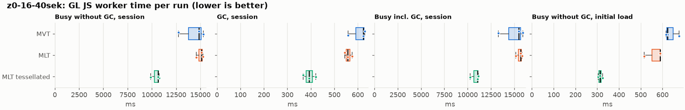
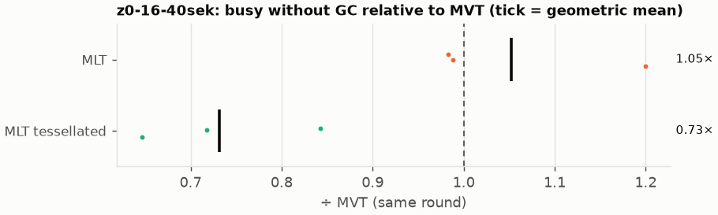
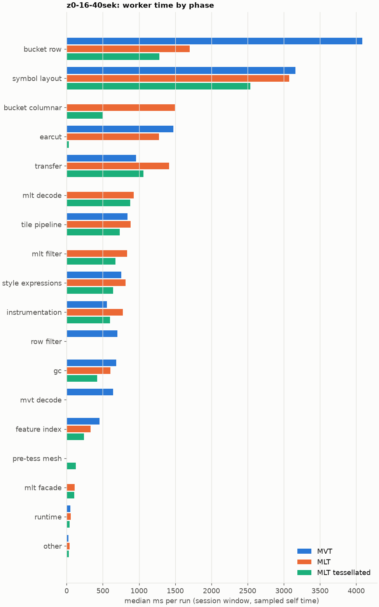
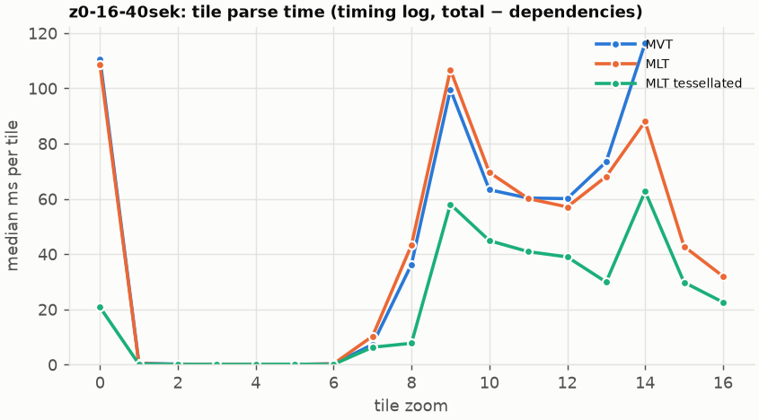
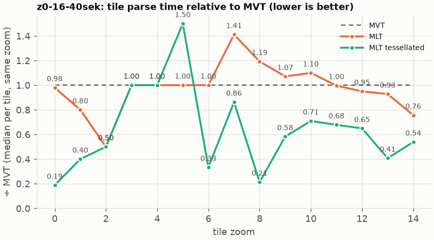

# Session trace benchmark — 20261022-083025

## Setup

- Created 2026-10-22T08:30:30+02:00; 3 repetitions + 1 warm-up round(s) (excluded); variants rotate per round (A B C, B C A, …); one cold browser context per run.
- Machine: 13th Gen Intel(R) Core(TM) i7-1365U, 12 logical cores, 31.3 GB RAM, Windows-11-10.0.26200-SP0; power: GUID des Energieschemas: 381b4222-f694-41f0-9685-ff5bb260df2e  (Ausbalanciert), AC True.
- GL JS gl7-performance-optimization @ f9bd50a8b5 (dirty); worker count 1; viewport {'width': 1280, 'height': 1024}.
- Python 3.12.2, packages {'playwright': '1.64.0', 'numpy': '2.5.3', 'matplotlib': '3.11.2'}.

| variant | bundle | format | bundle sha256 | branch build |
|---|---|---|---|---|
| MVT | `dist/maplibre-gl-dev.mjs` | mvt | `b2691453151d` | – |
| MLT | `dist/maplibre-gl-dev.mjs` | mlt | `b2691453151d` | – |
| MLT tessellated | `dist/maplibre-gl-dev.mjs` | mlt-pre-tess | `b2691453151d` | – |

| session | style | duration | frames | sha256 |
|---|---|---:|---:|---|
| z0-16-40sek | osm-bright | 42.1 s | 1739 | `55a2b8f22fe2` |

CPU sampling interval (median over runs): 630 µs.

## Definitions

- **busy** = wall time in which a GL JS worker thread runs a task (union of top-level task slices and GC slices on `DedicatedWorker thread`s), summed over workers. **GC** = union of `MinorGC`/`MajorGC`/`V8.GC*` slices on those threads. **busy without GC** = busy − GC (headline metric).
- **CPU** = thread time (`tdur`) of the same slices. Phase categories and functions come from the trace's CPU samples (self time), categorised by `config/categories.toml` (nearest matching frame, leaf to root).
- Windows: **load** = map creation → first idle; **session** = camera replay; **tail** = end of replay → idle; **total** = load + session + tail.
- Ratios are against **MVT**: ratio of medians with a bootstrap 95 % CI, the geometric mean of per-round ratios, and a two-sided Mann–Whitney U p-value (normal approximation, not corrected for multiple comparisons; rough below n = 8). Lower than 1× means less worker time.

## Session `z0-16-40sek`

### Worker busy without GC (session window)

| variant | n ok / failed | median ms | IQR | mean | ratio vs MVT | 95 % CI | geo-mean paired | MWU p |
|---|---:|---:|---:|---:|---:|---:|---:|---:|
| MVT | 3 / 0 | 14,847 | 13,799–15,076 | 14,301 | 1.00× | – | – | – |
| MLT | 3 / 0 | 15,125 | 14,862–15,208 | 15,005 | 1.02× | 0.95–1.20× | 1.05× | 1.000 |
| MLT tessellated | 3 / 0 | 10,656 | 10,274–10,700 | 10,430 | 0.72× | 0.65–0.84× | 0.73× | 0.081 |

### All worker metrics (median, ratio vs baseline)

| metric | MVT | MLT | MLT tessellated |
|---|---:|---:|---:|
| busy incl. GC | 15,477 | 15,682 (1.01×) | 11,077 (0.72×) |
| &nbsp;&nbsp;of which GC | 623.1 | 557.1 (0.89×) | 393.3 (0.63×) |
| &nbsp;&nbsp;of which busy without GC | 14,847 | 15,125 (1.02×) | 10,656 (0.72×) |
| &nbsp;&nbsp;&nbsp;&nbsp;of which filtering (sampled, incl. callees) | 701.9 | 833.5 (1.19×) | 673.9 (0.96×) |
| &nbsp;&nbsp;&nbsp;&nbsp;of which timing instrumentation (sampled) | 557.4 | 775.4 (1.39×) | 600.6 (1.08×) |
| busy without GC and instrumentation | 14,290 | 14,321 (1.00×) | 10,031 (0.70×) |
| CPU time without GC | 12,797 | 12,653 (0.99×) | 9,152 (0.72×) |
| tile: download end → sent to main thread, median per tile | 418.1 | 303.3 (0.73×) | 223.8 (0.54×) |
| tile: download end → sent to main thread, 90th percentile | 994.8 | 785.7 (0.79×) | 611.2 (0.61×) |
| tile: download end → sent to main thread, 95th percentile | 1,348 | 999.0 (0.74×) | 738.4 (0.55×) |
| tile: download end → sent to main thread, 99th percentile | 1,497 | 1,365 (0.91×) | 861.0 (0.58×) |
| &nbsp;&nbsp;parse part (timing log, incl. waiting for glyphs/icons), median per tile | 237.4 | 184.8 (0.78×) | 131.6 (0.55×) |
| &nbsp;&nbsp;queue + hand-off part, median per tile | 103.4 | 91.2 (0.88×) | 67.2 (0.65×) |
| minor GCs | 99.00 | 75.00 (0.76×) | 58.00 (0.59×) |
| major GCs | 7.00 | 7.00 (1.00×) | 6.00 (0.86×) |
| peak worker heap (MB) | 69.8 | 67.3 (0.96×) | 61.7 (0.88×) |
| load: busy without GC | 622.7 | 588.9 (0.95×) | 312.6 (0.50×) |
| load: GC | 28.3 | 27.2 (0.96×) | 8.1 (0.29×) |
| total: busy without GC | 15,463 | 15,641 (1.01×) | 10,969 (0.71×) |

Rows marked *of which* are parts of the row above, not additional time. Tile rows are per-tile latencies (medians over tiles, then over runs), not sums: tiles overlap in time, and the medians of the parse and queue parts do not add up exactly to the median latency.

### Filtering (session window)

Sampled worker time spent in feature filtering, including everything the filter calls (expression evaluation, property access, lazy column decoding): **row filter** = the style-spec feature filter that MVT runs per feature, **mlt filter** = the columnar MLT filter (incl. the geometry-type selection). Medians per run; rules in `config/categories.toml`.

| variant | mlt filter | row filter | filtering total | ratio vs MVT | 95 % CI | MWU p | share of sampled busy |
|---|---:|---:|---:|---:|---:|---:|---:|
| MVT | 1.3 | 700.2 | 701.9 | 1.00× | – | – | 4.8% |
| MLT | 833.5 | 0.0 | 833.5 | 1.19× | 1.14–1.48× | 0.081 | 5.9% |
| MLT tessellated | 673.9 | 0.0 | 673.9 | 0.96× | 0.84–1.17× | 0.663 | 6.7% |

Top 12 functions inside filtering (self time, mean ms per run):

| phase | function | source | MVT | MLT | MLT tessellated |
|---|---|---|---:|---:|---:|
| row filter | `evaluate` | node_modules/@maplibre/maplibre-gl-style-spec/dist/expression/compound_expression.mjs | 210.0 | 0.0 | 0.0 |
| row filter | `evaluate` | node_modules/@maplibre/maplibre-gl-style-spec/dist/expression/index.mjs | 95.2 | 0.0 | 0.0 |
| row filter | `CompoundExpression.register.filter-in-small` | node_modules/@maplibre/maplibre-gl-style-spec/dist/expression/compound_expression.mjs | 78.7 | 0.0 | 0.0 |
| row filter | `CompoundExpression.register.filter-==` | node_modules/@maplibre/maplibre-gl-style-spec/dist/expression/compound_expression.mjs | 76.2 | 0.0 | 0.0 |
| mlt filter | `scanDictionaryCodes` | maplibre-tile-spec/ts/dist/processing/filter/execution/filterKernel.js | 0.0 | 63.9 | 49.7 |
| mlt filter | `dictionaryRowMatches` | maplibre-tile-spec/ts/dist/processing/filter/execution/filterKernel.js | 0.0 | 53.1 | 47.5 |
| mlt filter | `filterByGeometryType` | maplibre-tile-spec/ts/dist/vector/geometry/geometryVector.js | 0.0 | 50.5 | 46.5 |
| row filter | `CompoundExpression.register.all.overloads` | node_modules/@maplibre/maplibre-gl-style-spec/dist/expression/compound_expression.mjs | 49.5 | 0.0 | 0.0 |
| row filter | `filter` | node_modules/@maplibre/maplibre-gl-style-spec/dist/feature_filter/index.mjs | 47.8 | 0.0 | 0.0 |
| mlt filter | `unpackNullable` | maplibre-tile-spec/ts/dist/decoding/unpackNullableUtils.js | 0.0 | 42.4 | 38.9 |
| mlt filter | `resolveDictionaryExecutor` | maplibre-tile-spec/ts/dist/processing/filter/execution/filterKernel.js | 0.0 | 38.6 | 31.8 |
| row filter | `CompoundExpression.register.filter-type-==` | node_modules/@maplibre/maplibre-gl-style-spec/dist/expression/compound_expression.mjs | 30.7 | 0.0 | 0.0 |

### Where the variants differ from MVT (session window, mean ms per run)

Open **[flame.html](flame.html)** to explore the call tree interactively: pick a variant, compare it with MVT (red = more time at the same call path, blue = less), click a frame to zoom in, and read the phase and function breakdown under it. `flame/*.txt` open in https://www.speedscope.app.

#### MLT vs MVT

**By phase** (sampled self time; the Δ column sums to the difference in sampled busy time):

| phase | MVT | MLT | Δ |
|---|---:|---:|---:|
| bucket columnar | 0.0 | 1,497 | +1497.1 |
| mlt decode | 0.0 | 942.1 | +942.1 |
| mlt filter | 1.0 | 838.8 | +837.8 |
| transfer | 967.9 | 1,390 | +421.7 |
| instrumentation | 544.3 | 776.2 | +231.9 |
| mlt facade | 1.1 | 111.4 | +110.2 |
| style expressions | 725.0 | 814.4 | +89.4 |
| tile pipeline | 822.8 | 889.9 | +67.0 |
| runtime | 45.7 | 60.8 | +15.2 |
| other | 24.6 | 37.4 | +12.8 |
| symbol layout | 3,086 | 3,035 | -51.1 |
| gc | 663.0 | 601.4 | -61.7 |
| feature index | 429.7 | 322.4 | -107.3 |
| earcut | 1,421 | 1,290 | -130.8 |
| mvt decode | 641.1 | 0.0 | -641.1 |
| row filter | 668.5 | 0.0 | -668.5 |
| bucket row | 3,900 | 1,686 | -2213.6 |

**By source layer** (timing log: createBucket + populate + addFeatures, summed over the style layers that use it; wall time, includes GC pauses; total Δ -546 ms):

| source layer | type | MVT | MLT | Δ |
|---|---|---:|---:|---:|
| place | symbol | 946.8 | 1,283 | +336.2 |
| transportation_name | symbol | 586.6 | 878.4 | +291.8 |
| park | fill | 5.6 | 58.2 | +52.6 |
| boundary | line | 133.6 | 181.2 | +47.6 |
| waterway | line | 44.1 | 82.9 | +38.8 |
| transportation | symbol | 205.4 | 240.8 | +35.4 |
| water | fill | 314.2 | 298.3 | -15.9 |
| transportation | line | 2,681 | 2,655 | -26.8 |
| landuse | fill | 764.7 | 657.6 | -107.1 |
| poi | symbol | 1,954 | 1,843 | -110.6 |
| landcover | fill | 927.5 | 814.8 | -112.6 |
| building | fill | 2,469 | 1,500 | -968.9 |

**Functions with the largest self-time difference** (by function name, summed over source files):

| function | MVT | MLT | Δ |
|---|---:|---:|---:|
| `reserve` | 667.0 | 828.4 | +161.4 |
| `writeEarcutFill` | 0.0 | 154.5 | +154.5 |
| `serialize` | 274.4 | 428.6 | +154.2 |
| `postMessage` | 213.7 | 349.4 | +135.7 |
| `buildEarcutMesh` | 0.0 | 128.2 | +128.2 |
| `get` | 105.6 | 223.6 | +118.0 |
| `buildRingBoundingBoxes` | 0.0 | 112.7 | +112.7 |
| `ProgramConfiguration` | 186.3 | 293.0 | +106.6 |
| `appendSymbolFeature` | 0.0 | 105.9 | +105.9 |
| `self.postMessage` | 168.6 | 269.0 | +100.4 |
| `pushVertex` | 0.0 | 78.3 | +78.3 |
| `fetch` | 163.3 | 234.5 | +71.2 |
| `_vertexToIndex` | 636.6 | 2.4 | -634.2 |
| `populate` | 605.3 | 210.8 | -394.5 |
| `evaluate` | 362.4 | 64.5 | -297.9 |
| `readVarint` | 234.5 | 7.6 | -226.9 |
| `loadGeometry` | 279.4 | 59.7 | -219.8 |

#### MLT tessellated vs MVT

**By phase** (sampled self time; the Δ column sums to the difference in sampled busy time):

| phase | MVT | MLT tessellated | Δ |
|---|---:|---:|---:|
| mlt decode | 0.0 | 857.4 | +857.4 |
| mlt filter | 1.0 | 654.5 | +653.5 |
| bucket columnar | 0.0 | 502.7 | +502.7 |
| pre-tess mesh | 0.0 | 129.0 | +129.0 |
| transfer | 967.9 | 1,082 | +114.3 |
| mlt facade | 1.1 | 104.6 | +103.4 |
| instrumentation | 544.3 | 599.9 | +55.7 |
| other | 24.6 | 30.0 | +5.4 |
| runtime | 45.7 | 42.2 | -3.4 |
| style expressions | 725.0 | 644.8 | -80.2 |
| tile pipeline | 822.8 | 717.9 | -105.0 |
| feature index | 429.7 | 237.0 | -192.7 |
| gc | 663.0 | 417.8 | -245.2 |
| symbol layout | 3,086 | 2,530 | -556.7 |
| mvt decode | 641.1 | 0.0 | -641.1 |
| row filter | 668.5 | 0.0 | -668.5 |
| earcut | 1,421 | 26.6 | -1394.2 |
| bucket row | 3,900 | 1,268 | -2631.6 |

**By source layer** (timing log: createBucket + populate + addFeatures, summed over the style layers that use it; wall time, includes GC pauses; total Δ -4328 ms):

| source layer | type | MVT | MLT tessellated | Δ |
|---|---|---:|---:|---:|
| transportation_name | symbol | 586.6 | 683.5 | +96.9 |
| place | symbol | 946.8 | 1,022 | +75.4 |
| park | fill | 5.6 | 45.1 | +39.5 |
| waterway | line | 44.1 | 68.0 | +23.9 |
| water_name | symbol | 80.7 | 63.6 | -17.1 |
| transportation | symbol | 205.4 | 187.5 | -17.9 |
| water | fill | 314.2 | 108.3 | -205.8 |
| poi | symbol | 1,954 | 1,528 | -425.8 |
| landuse | fill | 764.7 | 221.9 | -542.8 |
| transportation | line | 2,681 | 2,086 | -595.5 |
| landcover | fill | 927.5 | 290.2 | -637.2 |
| building | fill | 2,469 | 328.4 | -2140.5 |

**Functions with the largest self-time difference** (by function name, summed over source files):

| function | MVT | MLT tessellated | Δ |
|---|---:|---:|---:|
| `postMessage` | 213.7 | 301.0 | +87.3 |
| `buildTessellatedBoundingBox` | 0.0 | 82.8 | +82.8 |
| `appendSymbolFeature` | 0.0 | 82.5 | +82.5 |
| `get` | 105.6 | 181.9 | +76.4 |
| `registerGlyphs` | 0.0 | 64.0 | +64.0 |
| `serialize` | 274.4 | 335.9 | +61.5 |
| `unpackNullable` | 0.0 | 55.9 | +55.9 |
| `decodeComponentwiseDeltaVec2` | 0.0 | 55.2 | +55.2 |
| `self.postMessage` | 168.6 | 220.0 | +51.4 |
| `decodeString$2` | 0.0 | 51.0 | +51.0 |
| `decodeUnsignedZigZagDeltaInt32` | 0.0 | 50.1 | +50.1 |
| `decodeFastPforInt32` | 0.0 | 49.7 | +49.7 |
| `_vertexToIndex` | 636.6 | 0.0 | -636.6 |
| `populate` | 605.3 | 150.1 | -455.2 |
| `isEar` | 454.1 | 5.2 | -448.9 |
| `evaluate` | 362.4 | 57.3 | -305.1 |
| `(garbage collector)` | 663.0 | 417.8 | -245.2 |

### Worker time by phase (session window, median ms of sampled self time)

| phase | MVT | MLT | MLT tessellated |
|---|---:|---:|---:|
| bucket row | 4,082 | 1,700 | 1,283 |
| symbol layout | 3,159 | 3,072 | 2,538 |
| bucket columnar | 0.0 | 1,497 | 498.2 |
| earcut | 1,473 | 1,274 | 27.9 |
| transfer | 958.9 | 1,414 | 1,064 |
| mlt decode | 0.0 | 925.4 | 878.1 |
| tile pipeline | 841.8 | 883.7 | 732.0 |
| mlt filter | 1.3 | 833.5 | 673.9 |
| style expressions | 755.3 | 813.2 | 640.5 |
| instrumentation | 557.4 | 775.4 | 600.6 |
| row filter | 700.2 | 0.0 | 0.0 |
| gc | 687.6 | 604.5 | 420.0 |
| mvt decode | 640.3 | 0.0 | 0.0 |
| feature index | 454.0 | 329.4 | 238.5 |
| pre-tess mesh | 0.0 | 0.0 | 127.7 |
| mlt facade | 1.4 | 110.6 | 103.0 |
| runtime | 49.6 | 56.1 | 42.2 |
| other | 24.6 | 40.0 | 30.0 |

### Top 20 worker functions by self time (session window, mean ms per run)

| function | source | phase | MVT | MLT | MLT tessellated |
|---|---|---|---:|---:|---:|
| `reserve` | src/util/struct_array.ts | tile pipeline | 667.0 | 828.4 | 596.4 |
| `(garbage collector)` | (native) | gc | 663.0 | 601.4 | 417.8 |
| `_vertexToIndex` | src/render/subdivision.ts | bucket row | 636.6 | 2.4 | 0.0 |
| `isEar` | node_modules/earcut/src/earcut.js | earcut | 454.1 | 403.6 | 5.2 |
| `emplace` | src/data/array_types.g.ts | bucket columnar | 405.3 | 338.6 | 264.8 |
| `populate` | src/data/bucket/line_bucket.ts | bucket row | 389.2 | 0.0 | 0.0 |
| `serialize` | src/util/web_worker_transfer.ts | transfer | 229.3 | 370.3 | 286.2 |
| `postMessage` | (native) | transfer | 213.7 | 349.4 | 301.0 |
| `ProgramConfiguration` | src/data/program_configuration.ts | bucket row | 186.3 | 293.0 | 225.9 |
| `self.postMessage` | worker_hook.js | instrumentation | 168.6 | 269.0 | 220.0 |
| `_trim` | src/util/struct_array.ts | transfer | 244.9 | 261.5 | 170.4 |
| `fetch` | (native) | tile pipeline | 163.3 | 234.5 | 194.4 |
| `readVarint` | node_modules/pbf/index.js | mvt decode | 234.5 | 0.0 | 0.0 |
| `getGlyphAdvance` | src/symbol/tagged_string.ts | symbol layout | 214.2 | 187.7 | 161.9 |
| `evaluate` | node_modules/@maplibre/maplibre-gl-style-spec/dist/expression/compound_expression.mjs | row filter | 210.0 | 0.0 | 0.0 |
| `isEarHashed` | node_modules/earcut/src/earcut.js |  | 208.9 | 179.3 | 0.3 |
| `insert` | src/data/feature_index.ts | feature index | 199.7 | 70.4 | 47.4 |
| `populate` | src/data/bucket/columnar/columnar_line_bucket.ts | bucket columnar | 0.0 | 176.3 | 130.1 |
| `parse` | src/source/worker_tile.ts | tile pipeline | 165.2 | 175.3 | 130.9 |
| `addPhase` | src/source/worker_timing.ts | instrumentation | 145.2 | 175.0 | 135.7 |

### Top 20 worker functions by total time (incl. callees) (session window, mean ms per run)

| function | source | phase | MVT | MLT | MLT tessellated |
|---|---|---|---:|---:|---:|
| `parse` | src/source/worker_tile.ts | tile pipeline | 11,561 | 11,539 | 7,727 |
| `loadTile` | src/source/vector_tile_worker_source.ts | tile pipeline | 8,839 | 8,657 | 5,350 |
| `_parseWorkerTile` | src/source/vector_tile_worker_source.ts | tile pipeline | 8,531 | 8,374 | 5,134 |
| `populate` | src/data/bucket/fill_bucket.ts | bucket row | 4,031 | 0.0 | 0.0 |
| `addBucketFeatures` | src/data/bucket/fill_bucket.ts | bucket row | 3,480 | 2,410 | 300.5 |
| `addFeature` | src/data/bucket/fill_bucket.ts |  | 3,322 | 32.4 | 0.0 |
| `populate` | src/data/bucket/columnar/columnar_fill_bucket.ts | bucket columnar | 0.0 | 2,950 | 902.9 |
| `addFeatures` | src/data/bucket/symbol_bucket.ts | symbol layout | 2,730 | 2,681 | 2,260 |
| `subdividePolygon` | src/render/subdivision.ts |  | 2,707 | 28.9 | 0.0 |
| `performSymbolLayout` | src/symbol/symbol_layout.ts | symbol layout | 2,688 | 2,643 | 2,228 |
| `subdividePolygonInternal` | src/render/subdivision.ts | bucket row | 2,644 | 28.8 | 0.0 |
| `addFeature` | src/data/bucket/columnar/columnar_fill_bucket.ts | bucket columnar | 0.0 | 2,372 | 273.2 |
| `writeEarcutFill` | maplibre-gl-shared-dev.mjs | bucket columnar | 0.0 | 2,308 | 44.1 |
| `populate` | src/data/bucket/line_bucket.ts | bucket row | 2,266 | 0.0 | 0.0 |
| `populate` | src/data/bucket/columnar/columnar_line_bucket.ts | bucket columnar | 0.0 | 2,168 | 1,718 |
| `processTask` | src/util/actor.ts | transfer | 1,301 | 1,824 | 1,435 |
| `buildEarcutMesh` | src/data/bucket/columnar/columnar_mesh_arrays.ts | bucket columnar | 0.0 | 1,469 | 29.7 |
| `completeTask` | src/util/actor.ts | transfer | 1,042 | 1,446 | 1,140 |
| `earcut` | node_modules/earcut/src/earcut.js | earcut | 1,418 | 1,287 | 26.3 |
| `populate` | src/data/bucket/columnar/columnar_symbol_bucket.ts | symbol layout | 0.0 | 1,344 | 1,050 |

### Tile parse time by zoom (timing log, median ms per tile, total − dependencies)

| zoom | MVT | MLT | MLT tessellated |
|---:|---:|---:|---:|
| 0 | 110.70 (n=9) | 108.50 (n=9) | 20.80 (n=9) |
| 1 | 0.50 (n=24) | 0.40 (n=24) | 0.20 (n=24) |
| 2 | 0.20 (n=32) | 0.10 (n=36) | 0.10 (n=36) |
| 3 | 0.10 (n=24) | 0.10 (n=29) | 0.10 (n=32) |
| 4 | 0.10 (n=27) | 0.10 (n=27) | 0.10 (n=27) |
| 5 | 0.10 (n=18) | 0.10 (n=18) | 0.15 (n=18) |
| 6 | 0.30 (n=27) | 0.30 (n=27) | 0.10 (n=27) |
| 7 | 7.30 (n=27) | 10.30 (n=27) | 6.30 (n=27) |
| 8 | 36.30 (n=28) | 43.30 (n=28) | 7.75 (n=36) |
| 9 | 99.60 (n=36) | 106.70 (n=36) | 58.05 (n=36) |
| 10 | 63.30 (n=27) | 69.60 (n=27) | 44.90 (n=36) |
| 11 | 60.30 (n=27) | 60.10 (n=27) | 40.90 (n=27) |
| 12 | 60.10 (n=33) | 57.10 (n=27) | 39.00 (n=33) |
| 13 | 73.40 (n=59) | 68.10 (n=52) | 29.90 (n=56) |
| 14 | 116.35 (n=130) | 88.00 (n=71) | 62.70 (n=73) |
| 15 | – | 42.80 (n=103) | 29.80 (n=102) |
| 16 | – | 32.00 (n=200) | 22.60 (n=198) |

### Tile latency by zoom: download end → result sent to the main thread (session window, ms per tile: median / p95 / p99)

Includes waiting in the worker's queue, the parse and posting the result; see `tile_latency.csv` for the per-tile split (`parse_ms`, `wait_ms`). Percentiles over the tiles of all runs; with few tiles (n) p99 is close to the maximum.

| zoom | MVT | MLT | MLT tessellated |
|---:|---:|---:|---:|
| 1 | 61.5 / 127.9 / 131.3 (n=24) | 44.5 / 115.9 / 121.2 (n=24) | 22.8 / 48.5 / 49.1 (n=24) |
| 2 | 77.2 / 199.1 / 208.8 (n=32) | 84.4 / 161.1 / 193.0 (n=36) | 42.0 / 104.4 / 112.9 (n=36) |
| 3 | 70.1 / 105.7 / 111.6 (n=24) | 39.9 / 87.7 / 106.3 (n=29) | 30.8 / 56.2 / 58.3 (n=32) |
| 4 | 36.5 / 76.3 / 81.1 (n=27) | 63.3 / 90.8 / 99.9 (n=27) | 38.9 / 54.8 / 70.8 (n=27) |
| 5 | 36.9 / 120.9 / 133.9 (n=18) | 40.4 / 127.3 / 129.4 (n=18) | 31.8 / 75.5 / 102.0 (n=18) |
| 6 | 96.1 / 125.6 / 129.4 (n=27) | 78.7 / 138.6 / 144.6 (n=27) | 51.2 / 78.7 / 88.2 (n=27) |
| 7 | 296.7 / 362.9 / 367.6 (n=27) | 259.8 / 396.8 / 407.5 (n=27) | 138.3 / 234.1 / 238.8 (n=27) |
| 8 | 559.5 / 644.8 / 647.9 (n=28) | 528.9 / 604.7 / 607.5 (n=28) | 250.4 / 441.9 / 448.8 (n=36) |
| 9 | 1,371 / 2,097 / 2,152 (n=36) | 1,349 / 1,510 / 1,918 (n=36) | 787.3 / 928.5 / 936.4 (n=36) |
| 10 | 776.3 / 874.0 / 906.0 (n=27) | 764.7 / 855.0 / 865.1 (n=27) | 603.6 / 685.2 / 706.9 (n=36) |
| 11 | 547.0 / 699.1 / 718.3 (n=27) | 634.0 / 690.6 / 705.8 (n=27) | 396.1 / 502.8 / 513.4 (n=27) |
| 12 | 715.5 / 942.1 / 951.8 (n=33) | 658.0 / 716.5 / 726.8 (n=27) | 463.6 / 600.1 / 611.6 (n=33) |
| 13 | 662.9 / 1,018 / 1,038 (n=59) | 690.7 / 853.5 / 883.8 (n=52) | 233.9 / 583.2 / 599.8 (n=56) |
| 14 | 412.1 / 1,019 / 1,117 (n=130) | 467.9 / 1,207 / 1,341 (n=71) | 531.2 / 882.2 / 1,016 (n=73) |
| 15 | – | 324.5 / 721.1 / 943.5 (n=103) | 237.1 / 562.3 / 609.4 (n=102) |
| 16 | – | 212.4 / 735.7 / 827.6 (n=200) | 209.4 / 542.9 / 604.1 (n=198) |

## Runs

12 ok, 0 failed/aborted, 0 not run, 9 used in statistics.

## Validity checks

- z0-16-40sek/mvt/rep-00: counted-once check failed: 1 timing-log lines appear twice
- z0-16-40sek/mlt-pre-tess/rep-00: counted-once check failed: 1 timing-log lines appear twice
- z0-16-40sek/mlt-pre-tess/rep-01: counted-once check failed: 1 timing-log lines appear twice
- z0-16-40sek/mvt/rep-01: counted-once check failed: 1 timing-log lines appear twice
- z0-16-40sek/mvt/rep-02: counted-once check failed: 1 timing-log lines appear twice
- z0-16-40sek/mlt/rep-02: counted-once check failed: 1 timing-log lines appear twice
- other programs used 5.65–9.32 logical processors during the replays (median 8.45)
- 9 run(s) with more than 0.5 cores of background load: z0-16-40sek/mlt/rep-01 (8.07), z0-16-40sek/mlt-pre-tess/rep-01 (5.65), z0-16-40sek/mvt/rep-01 (8.64), z0-16-40sek/mlt-pre-tess/rep-02 (5.94), z0-16-40sek/mvt/rep-02 (8.45), z0-16-40sek/mlt/rep-02 (8.69)
- 4 of 4 rounds parsed different tile sets across variants (e.g. z0-16-40sek round 0: mvt 141 tiles, mlt 219 tiles, mlt-pre-tess 226 tiles; z0-16-40sek round 1: mlt 222 tiles, mlt-pre-tess 230 tiles, mvt 133 tiles; z0-16-40sek round 2: mlt-pre-tess 233 tiles, mvt 137 tiles, mlt 223 tiles; z0-16-40sek round 3: mvt 135 tiles, mlt 218 tiles, mlt-pre-tess 231 tiles); expected where a session zooms past the last MVT level (MVT overzooms, MLT loads deeper tiles)

## Files

- `runs.csv`: one row per run (incl. failed and warm-up runs), every scalar metric as `<window>.<metric>`.
- `summary.csv`: session × variant × metric statistics.
- `functions.csv`, `categories.csv`: CPU-sample self/total time per function and phase per run and window.
- `category_functions.csv`: self time per phase × function (e.g. what the filters spend their time on).
- `tiles.csv`, `tile_layers.csv`, `tile_phases.csv`: the per-tile worker timing log, long format.
- `flame.html`: interactive call tree per variant with a diff view; `flame/*.txt`: collapsed stacks for speedscope.
- `analysis/stacks.csv` (per run): sampled self time per full call stack.
- `tile_latency.csv`: per tile request, worker clock: received, download start/end, result sent, latency = sent − download end, parse_ms, wait_ms = latency − parse.
- `runs/<session>/<variant>/rep-NN/trace.json.gz`: the raw trace (opens in the DevTools Performance tab).
