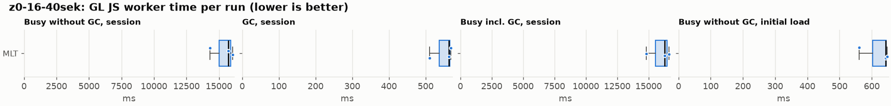
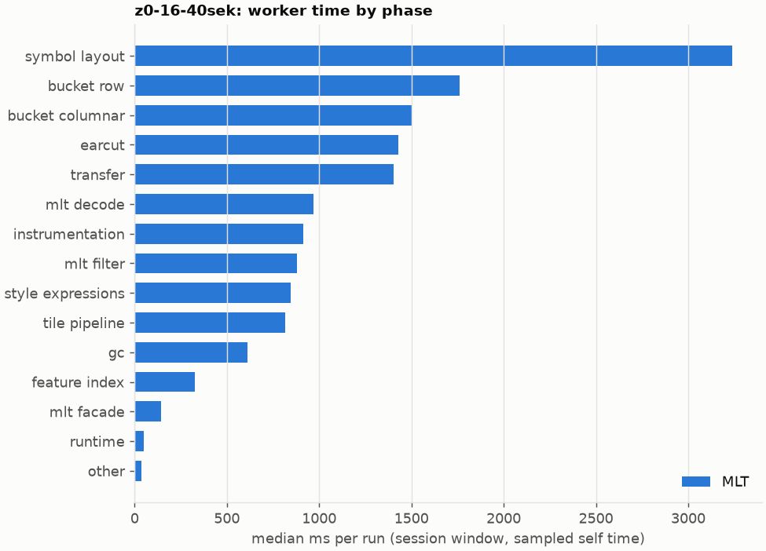
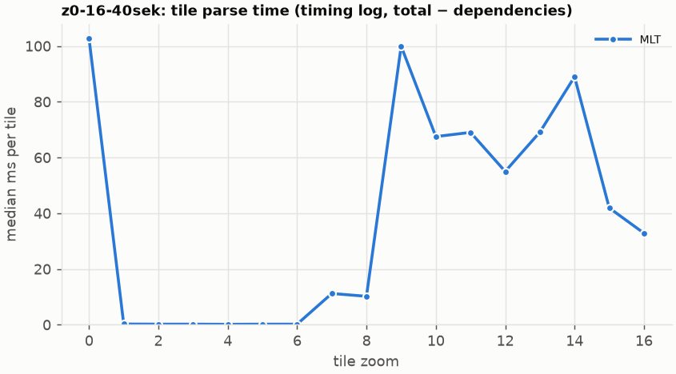

# Session trace benchmark — 20261022-095301-earcut-path

## Setup

- Created 2026-10-22T09:53:06+02:00; 3 repetitions + 1 warm-up round(s) (excluded); variants rotate per round (A B C, B C A, …); one cold browser context per run.
- Machine: 13th Gen Intel(R) Core(TM) i7-1365U, 12 logical cores, 31.3 GB RAM, Windows-11-10.0.26200-SP0; power: GUID des Energieschemas: 381b4222-f694-41f0-9685-ff5bb260df2e  (Ausbalanciert), AC True.
- GL JS gl7-performance-optimization @ f9bd50a8b5 (dirty); worker count 1; viewport {'width': 1280, 'height': 1024}; tracing preset devtools.
- Python 3.12.2, packages {'playwright': '1.64.0', 'numpy': '2.5.3', 'matplotlib': '3.11.2'}.

| variant | bundle | format | bundle sha256 | branch build |
|---|---|---|---|---|
| MLT | `dist/maplibre-gl-dev.mjs` | mlt | `b2691453151d` | – |

| session | style | duration | frames | sha256 |
|---|---|---:|---:|---|
| z0-16-40sek | osm-bright | 42.1 s | 1739 | `55a2b8f22fe2` |

CPU sampling interval (median over runs): 673 µs.

## Definitions

- **busy** = wall time in which a GL JS worker thread runs a task (union of top-level task slices and GC slices on `DedicatedWorker thread`s), summed over workers. **GC** = union of `MinorGC`/`MajorGC`/`V8.GC*` slices on those threads. **busy without GC** = busy − GC (headline metric).
- **CPU** = thread time (`tdur`) of the same slices. Phase categories and functions come from the trace's CPU samples (self time), categorised by `config/categories.toml` (nearest matching frame, leaf to root).
- Windows: **load** = map creation → first idle; **session** = camera replay; **tail** = end of replay → idle; **total** = load + session + tail.
- Ratios are against **MLT**: ratio of medians with a bootstrap 95 % CI, the geometric mean of per-round ratios, and a two-sided Mann–Whitney U p-value (normal approximation, not corrected for multiple comparisons; rough below n = 8). Lower than 1× means less worker time.

## Session `z0-16-40sek`

### Worker busy without GC (session window)

| variant | n ok / failed | median ms | IQR | mean | ratio vs MLT | 95 % CI | geo-mean paired | MWU p |
|---|---:|---:|---:|---:|---:|---:|---:|---:|
| MLT | 3 / 0 | 15,721 | 15,019–15,893 | 15,368 | 1.00× | – | – | – |

### All worker metrics (median, ratio vs baseline)

| metric | MLT |
|---|---:|
| busy incl. GC | 16,284 |
| &nbsp;&nbsp;of which GC | 562.9 |
| &nbsp;&nbsp;of which busy without GC | 15,721 |
| &nbsp;&nbsp;&nbsp;&nbsp;of which filtering (sampled, incl. callees) | 878.5 |
| &nbsp;&nbsp;&nbsp;&nbsp;of which timing instrumentation (sampled) | 913.8 |
| busy without GC and instrumentation | 14,808 |
| CPU time without GC | 13,148 |
| tile: download end → sent to main thread, median per tile | 337.0 |
| tile: download end → sent to main thread, 90th percentile | 826.8 |
| &nbsp;&nbsp;parse part (timing log, incl. waiting for glyphs/icons), median per tile | 203.0 |
| &nbsp;&nbsp;queue + hand-off part, median per tile | 86.8 |
| minor GCs | 79.00 |
| major GCs | 6.00 |
| peak worker heap (MB) | 75.1 |
| load: busy without GC | 642.9 |
| load: GC | 28.7 |
| total: busy without GC | 16,369 |

Rows marked *of which* are parts of the row above, not additional time. Tile rows are per-tile latencies (medians over tiles, then over runs), not sums: tiles overlap in time, and the medians of the parse and queue parts do not add up exactly to the median latency.

### Filtering (session window)

Sampled worker time spent in feature filtering, including everything the filter calls (expression evaluation, property access, lazy column decoding): **row filter** = the style-spec feature filter that MVT runs per feature, **mlt filter** = the columnar MLT filter (incl. the geometry-type selection). Medians per run; rules in `config/categories.toml`.

| variant | mlt filter | row filter | filtering total | ratio vs MLT | 95 % CI | MWU p | share of sampled busy |
|---|---:|---:|---:|---:|---:|---:|---:|
| MLT | 878.5 | 0.0 | 878.5 | 1.00× | – | – | 5.7% |

Top 12 functions inside filtering (self time, mean ms per run):

| phase | function | source | MLT |
|---|---|---|---:|
| mlt filter | `scanDictionaryCodes` | maplibre-tile-spec/ts/dist/processing/filter/execution/filterKernel.js | 57.1 |
| mlt filter | `filterByGeometryType` | maplibre-tile-spec/ts/dist/vector/geometry/geometryVector.js | 54.4 |
| mlt filter | `dictionaryRowMatches` | maplibre-tile-spec/ts/dist/processing/filter/execution/filterKernel.js | 53.8 |
| mlt filter | `unpackNullable` | maplibre-tile-spec/ts/dist/decoding/unpackNullableUtils.js | 47.4 |
| mlt filter | `resolveDictionaryExecutor` | maplibre-tile-spec/ts/dist/processing/filter/execution/filterKernel.js | 44.9 |
| mlt filter | `bytesEqual` | maplibre-tile-spec/ts/dist/processing/filter/execution/filterKernel.js | 28.2 |
| mlt filter | `scanSelection` | maplibre-tile-spec/ts/dist/vector/filter/selectionVectorUtils.js | 25.2 |
| mlt filter | `getNormalizedFilter` | maplibre-tile-spec/ts/dist/processing/filter/filterCache.js | 25.1 |
| mlt filter | `resolveVectorExecutor` | maplibre-tile-spec/ts/dist/processing/filter/execution/filterKernel.js | 22.5 |
| mlt filter | `(anonymous)` | maplibre-tile-spec/ts/dist/processing/filter/execution/filterKernel.js | 19.4 |
| mlt filter | `decodeFsst` | maplibre-tile-spec/ts/dist/decoding/fsstDecoder.js | 19.4 |
| mlt filter | `executeNode` | maplibre-tile-spec/ts/dist/processing/filter/execution/filterExecution.js | 18.7 |

### Where the variants differ from MLT (session window, mean ms per run)

Open **[flame.html](flame.html)** to explore the call tree interactively: pick a variant, compare it with MLT (red = more time at the same call path, blue = less), click a frame to zoom in, and read the phase and function breakdown under it. `flame/*.txt` open in https://www.speedscope.app.

### Worker time by phase (session window, median ms of sampled self time)

| phase | MLT |
|---|---:|
| symbol layout | 3,237 |
| bucket row | 1,763 |
| bucket columnar | 1,500 |
| earcut | 1,430 |
| transfer | 1,403 |
| mlt decode | 967.7 |
| instrumentation | 913.8 |
| mlt filter | 878.5 |
| style expressions | 844.5 |
| tile pipeline | 815.4 |
| gc | 611.8 |
| feature index | 324.4 |
| mlt facade | 142.4 |
| runtime | 50.3 |
| other | 37.1 |
| row filter | 0.0 |
| pre-tess mesh | 0.0 |
| mvt decode | 0.0 |

### Top 20 worker functions by self time (session window, mean ms per run)

| function | source | phase | MLT |
|---|---|---|---:|
| `reserve` | src/util/struct_array.ts | tile pipeline | 814.3 |
| `(garbage collector)` | (native) | gc | 598.8 |
| `isEar` | node_modules/earcut/src/earcut.js | earcut | 407.5 |
| `emplace` | src/data/array_types.g.ts | bucket row | 369.1 |
| `serialize` | src/util/web_worker_transfer.ts | transfer | 364.6 |
| `postMessage` | (native) | transfer | 352.6 |
| `ProgramConfiguration` | src/data/program_configuration.ts | bucket row | 299.8 |
| `self.postMessage` | worker_hook.js | instrumentation | 274.7 |
| `fetch` | (native) | tile pipeline | 240.5 |
| `_trim` | src/util/struct_array.ts | transfer | 237.4 |
| `getGlyphAdvance` | src/symbol/tagged_string.ts | symbol layout | 195.9 |
| `isEarHashed` | node_modules/earcut/src/earcut.js | earcut | 190.6 |
| `addPhase` | src/source/worker_timing.ts | instrumentation | 185.6 |
| `fillLargeMeshArrays` | src/render/fill_large_mesh_arrays.ts | bucket columnar | 175.2 |
| `addHalfVertex` | src/data/bucket/line_bucket.ts | bucket row | 173.9 |
| `parse` | src/source/worker_tile.ts | tile pipeline | 173.8 |
| `populate` | src/data/bucket/columnar/columnar_line_bucket.ts | bucket columnar | 171.8 |
| `addLine` | src/data/bucket/line_bucket.ts | bucket row | 163.4 |
| `performSymbolLayout` | src/symbol/symbol_layout.ts | symbol layout | 159.0 |
| `get` | src/style/properties.ts | style expressions | 157.3 |

### Top 20 worker functions by total time (incl. callees) (session window, mean ms per run)

| function | source | phase | MLT |
|---|---|---|---:|
| `parse` | src/source/worker_tile.ts | tile pipeline | 11,916 |
| `loadTile` | src/source/vector_tile_worker_source.ts | tile pipeline | 8,889 |
| `_parseWorkerTile` | src/source/vector_tile_worker_source.ts | tile pipeline | 8,607 |
| `populate` | src/data/bucket/columnar/columnar_fill_bucket.ts | bucket columnar | 3,016 |
| `addFeatures` | src/data/bucket/symbol_bucket.ts | symbol layout | 2,815 |
| `performSymbolLayout` | src/symbol/symbol_layout.ts | symbol layout | 2,776 |
| `addBucketFeatures` | src/data/bucket/fill_bucket.ts | bucket row | 2,529 |
| `addFeature` | src/data/bucket/columnar/columnar_fill_bucket.ts | bucket columnar | 2,502 |
| `writeEarcutFill` | src/data/bucket/columnar/columnar_mesh_arrays.ts | bucket columnar | 2,392 |
| `populate` | src/data/bucket/columnar/columnar_line_bucket.ts | bucket columnar | 2,224 |
| `processTask` | src/util/actor.ts | transfer | 1,840 |
| `buildEarcutMesh` | src/data/bucket/columnar/columnar_mesh_arrays.ts | bucket columnar | 1,578 |
| `completeTask` | src/util/actor.ts | transfer | 1,450 |
| `earcut` | node_modules/earcut/src/earcut.js | earcut | 1,386 |
| `populate` | src/data/bucket/columnar/columnar_symbol_bucket.ts | symbol layout | 1,383 |
| `shapeText` | src/symbol/shaping.ts | symbol layout | 1,041 |
| `earcutLinked` | node_modules/earcut/src/earcut.js | earcut | 992.5 |
| `addFeature` | src/data/bucket/line_bucket.ts | bucket row | 970.4 |
| `serialize` | src/util/web_worker_transfer.ts | transfer | 958.0 |
| `resize` | src/util/struct_array.ts | tile pipeline | 918.7 |

### Tile parse time by zoom (timing log, median ms per tile, total − dependencies)

| zoom | MLT |
|---:|---:|
| 0 | 102.70 (n=9) |
| 1 | 0.25 (n=24) |
| 2 | 0.20 (n=31) |
| 3 | 0.20 (n=26) |
| 4 | 0.15 (n=26) |
| 5 | 0.20 (n=18) |
| 6 | 0.20 (n=27) |
| 7 | 11.20 (n=24) |
| 8 | 10.20 (n=36) |
| 9 | 99.95 (n=36) |
| 10 | 67.50 (n=27) |
| 11 | 69.00 (n=27) |
| 12 | 55.00 (n=34) |
| 13 | 69.10 (n=48) |
| 14 | 88.95 (n=80) |
| 15 | 41.90 (n=97) |
| 16 | 32.85 (n=198) |

### Tile latency by zoom: download end → result sent to the main thread (session window, median ms per tile)

Includes waiting in the worker's queue, the parse and posting the result; see `tile_latency.csv` for the per-tile split (`parse_ms`, `wait_ms`).

| zoom | MLT |
|---:|---:|
| 1 | 35.5 (n=24) |
| 2 | 89.3 (n=31) |
| 3 | 46.1 (n=26) |
| 4 | 50.3 (n=26) |
| 5 | 22.6 (n=18) |
| 6 | 72.4 (n=27) |
| 7 | 232.8 (n=24) |
| 8 | 429.6 (n=36) |
| 9 | 1,234 (n=36) |
| 10 | 706.4 (n=27) |
| 11 | 639.0 (n=27) |
| 12 | 590.2 (n=34) |
| 13 | 623.1 (n=48) |
| 14 | 440.8 (n=80) |
| 15 | 291.2 (n=97) |
| 16 | 180.1 (n=198) |

## Runs

4 ok, 0 failed/aborted, 0 not run, 3 used in statistics.

## Validity checks

- z0-16-40sek/mlt/rep-00: counted-once check failed: 1 timing-log lines appear twice
- z0-16-40sek/mlt/rep-01: counted-once check failed: 1 timing-log lines appear twice
- z0-16-40sek/mlt/rep-02: counted-once check failed: 1 timing-log lines appear twice
- machine speed (calibration probe, rolling median over neighbouring runs) varied between 1.00× and 1.00× of the batch median (10th–90th percentile 1.00–1.00×)
- 3 run(s) where the probe changed by more than 15% between before and after the replay, so the adjustment is uncertain: z0-16-40sek/mlt/rep-01 (0.63×), z0-16-40sek/mlt/rep-02 (0.60×), z0-16-40sek/mlt/rep-03 (0.47×)
- spread within a variant (median IQR / median of busy without GC): raw 5.6%, load-adjusted 5.6% — the adjustment does not reduce the noise here
- other programs used 7.97–9.25 logical processors during the replays (median 8.97)
- 3 run(s) with more than 0.5 cores of background load: z0-16-40sek/mlt/rep-01 (9.25), z0-16-40sek/mlt/rep-02 (8.97), z0-16-40sek/mlt/rep-03 (7.97)

## Files

- `runs.csv`: one row per run (incl. failed and warm-up runs), every scalar metric as `<window>.<metric>`.
- `summary.csv`: session × variant × metric statistics.
- `functions.csv`, `categories.csv`: CPU-sample self/total time per function and phase per run and window.
- `category_functions.csv`: self time per phase × function (e.g. what the filters spend their time on).
- `tiles.csv`, `tile_layers.csv`, `tile_phases.csv`: the per-tile worker timing log, long format.
- `flame.html`: interactive call tree per variant with a diff view; `flame/*.txt`: collapsed stacks for speedscope.
- `analysis/stacks.csv` (per run): sampled self time per full call stack.
- `tile_latency.csv`: per tile request, worker clock: received, download start/end, result sent, latency = sent − download end, parse_ms, wait_ms = latency − parse.
- `runs/<session>/<variant>/rep-NN/trace.json.gz`: the raw trace (opens in the DevTools Performance tab).
