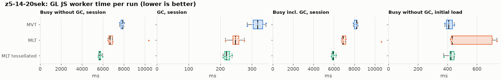
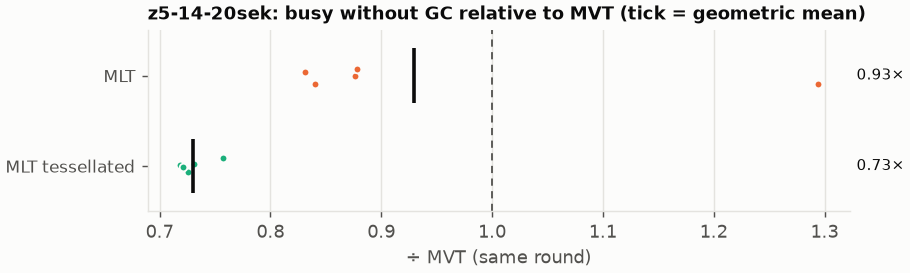
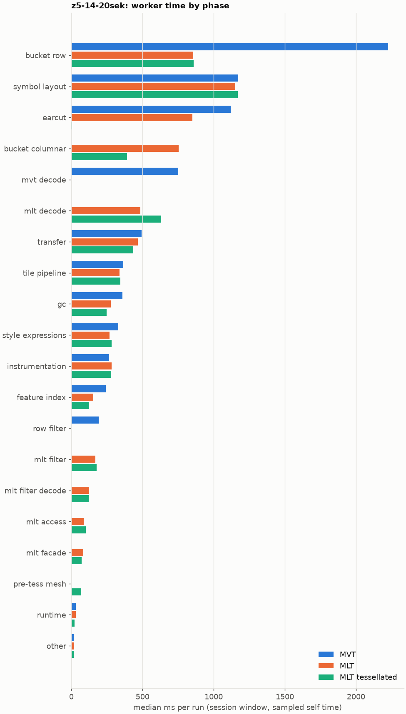
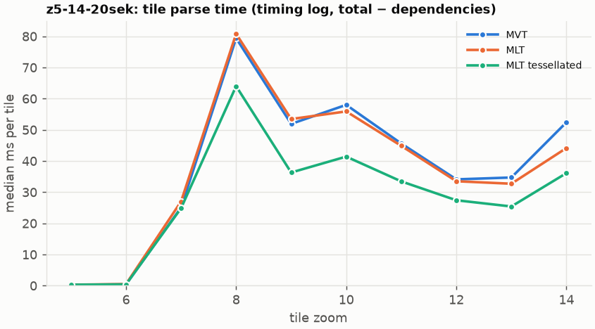
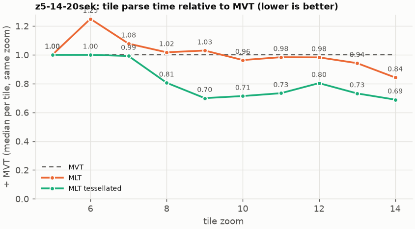

# Session trace benchmark — 20261022-101613

## Setup

- Created 2026-10-22T10:16:18+02:00; 5 repetitions + 1 warm-up round(s) (excluded); variants rotate per round (A B C, B C A, …); one cold browser context per run.
- Machine: 13th Gen Intel(R) Core(TM) i7-1365U, 12 logical cores, 31.3 GB RAM, Windows-11-10.0.26200-SP0; power: GUID des Energieschemas: 381b4222-f694-41f0-9685-ff5bb260df2e  (Ausbalanciert), AC True.
- GL JS gl7-performance-optimization @ f9bd50a8b5 (dirty); worker count 1; viewport {'width': 1280, 'height': 1024}.
- Python 3.12.2, packages {'playwright': '1.64.0', 'numpy': '2.5.3', 'matplotlib': '3.11.2'}.

| variant | bundle | format | bundle sha256 | branch build |
|---|---|---|---|---|
| MVT | `dist/maplibre-gl-dev.mjs` | mvt | `b2691453151d` | – |
| MLT | `dist/maplibre-gl-dev.mjs` | mlt | `b2691453151d` | – |
| MLT tessellated | `dist/maplibre-gl-dev.mjs` | mlt-pre-tess | `b2691453151d` | – |

| session | style | duration | frames | sha256 |
|---|---|---:|---:|---|
| z5-14-20sek | maptiler-basic | 21.4 s | 829 | `5a376e5ede30` |

CPU sampling interval (median over runs): 629 µs.

## Definitions

- **busy** = wall time in which a GL JS worker thread runs a task (union of top-level task slices and GC slices on `DedicatedWorker thread`s), summed over workers. **GC** = union of `MinorGC`/`MajorGC`/`V8.GC*` slices on those threads. **busy without GC** = busy − GC (headline metric).
- **CPU** = thread time (`tdur`) of the same slices. Phase categories and functions come from the trace's CPU samples (self time), categorised by `config/categories.toml` (nearest matching frame, leaf to root).
- Windows: **load** = map creation → first idle; **session** = camera replay; **tail** = end of replay → idle; **total** = load + session + tail.
- Ratios are against **MVT**: ratio of medians with a bootstrap 95 % CI, the geometric mean of per-round ratios, and a two-sided Mann–Whitney U p-value (normal approximation, not corrected for multiple comparisons; rough below n = 8). Lower than 1× means less worker time.

## Session `z5-14-20sek`

### Worker busy without GC (session window)

| variant | n ok / failed | median ms | IQR | mean | ratio vs MVT | 95 % CI | geo-mean paired | MWU p |
|---|---:|---:|---:|---:|---:|---:|---:|---:|
| MVT | 5 / 0 | 7,892 | 7,727–7,906 | 7,826 | 1.00× | – | – | – |
| MLT | 5 / 0 | 6,669 | 6,558–6,924 | 7,402 | 0.85× | 0.82–1.31× | 0.93× | 0.144 |
| MLT tessellated | 5 / 0 | 5,676 | 5,609–5,776 | 5,717 | 0.72× | 0.70–0.76× | 0.73× | 0.012 |

### All worker metrics (median, ratio vs baseline)

| metric | MVT | MLT | MLT tessellated |
|---|---:|---:|---:|
| busy incl. GC | 8,226 | 6,885 (0.84×) | 5,913 (0.72×) |
| &nbsp;&nbsp;of which GC | 317.3 | 247.0 (0.78×) | 218.9 (0.69×) |
| &nbsp;&nbsp;of which busy without GC | 7,892 | 6,669 (0.85×) | 5,676 (0.72×) |
| &nbsp;&nbsp;&nbsp;&nbsp;of which filtering (sampled, incl. callees) | 193.8 | 167.8 (0.87×) | 177.7 (0.92×) |
| &nbsp;&nbsp;&nbsp;&nbsp;of which column decoding inside the MLT filter (sampled) | 0.0 | 124.4 | 123.2 |
| &nbsp;&nbsp;&nbsp;&nbsp;of which timing instrumentation (sampled) | 263.8 | 283.7 (1.08×) | 281.3 (1.07×) |
| busy without GC and instrumentation | 7,636 | 6,401 (0.84×) | 5,395 (0.71×) |
| CPU time without GC | 7,026 | 5,967 (0.85×) | 5,050 (0.72×) |
| tile: download end → sent to main thread, median per tile | 387.6 | 313.0 (0.81×) | 261.4 (0.67×) |
| tile: download end → sent to main thread, 90th percentile | 766.2 | 666.4 (0.87×) | 561.7 (0.73×) |
| tile: download end → sent to main thread, 95th percentile | 830.1 | 746.4 (0.90×) | 614.9 (0.74×) |
| tile: download end → sent to main thread, 99th percentile | 876.4 | 828.1 (0.94×) | 701.3 (0.80×) |
| &nbsp;&nbsp;parse part (timing log, incl. waiting for glyphs/icons), median per tile | 172.2 | 180.9 (1.05×) | 149.5 (0.87×) |
| &nbsp;&nbsp;queue + hand-off part, median per tile | 122.8 | 123.0 (1.00×) | 112.2 (0.91×) |
| minor GCs | 61.00 | 51.00 (0.84×) | 36.00 (0.59×) |
| major GCs | 5.00 | 3.00 (0.60×) | 4.00 (0.80×) |
| peak worker heap (MB) | 50.0 | 54.4 (1.09×) | 43.6 (0.87×) |
| load: busy without GC | 408.3 | 431.6 (1.06×) | 423.3 (1.04×) |
| load: GC | 12.8 | 13.2 (1.03×) | 10.2 (0.80×) |
| total: busy without GC | 8,299 | 7,095 (0.85×) | 6,121 (0.74×) |

Rows marked *of which* are parts of the row above, not additional time. Tile rows are per-tile latencies (medians over tiles, then over runs), not sums: tiles overlap in time, and the medians of the parse and queue parts do not add up exactly to the median latency.

### Filtering (session window)

Sampled worker time spent in feature filtering, including everything the filter calls (expression evaluation, property access): **row filter** = the style-spec feature filter that MVT runs per feature, **mlt filter** = the columnar MLT filter (incl. the geometry-type selection), without the columns it decodes (see the next table). Medians per run; rules in `config/categories.toml`.

| variant | mlt filter | row filter | filtering | ratio vs MVT | 95 % CI | MWU p | share of sampled busy |
|---|---:|---:|---:|---:|---:|---:|---:|
| MVT | 0.6 | 193.1 | 193.8 | 1.00× | – | – | 2.6% |
| MLT | 167.8 | 0.0 | 167.8 | 0.87× | 0.74–1.42× | 0.144 | 2.6% |
| MLT tessellated | 177.7 | 0.0 | 177.7 | 0.92× | 0.77–1.01× | 0.095 | 3.3% |

**Filtering together with tile decoding.** The MLT decoder leaves columns encoded until something reads them, and the filter is usually the first reader: the columns it decodes (properties, and the geometry for `$type`) are **of which inside the filter** (phase *mlt filter decode*), the rest is *mlt decode* (geometry and columns read later, e.g. by paint properties and symbols). MVT decodes every feature's properties and geometry while it reads the tile (*mvt decode*), whether the filter keeps the feature or not. So **filtering** above compares the filters, and **decoding + filtering** compares all that the formats spend on decoding the tile and selecting features. **tile decoding** = *mvt decode* or *mlt decode* + *mlt filter decode*: work inside a call into a decoder. Reading data that is already decoded is not counted, as for MVT's feature objects: *mlt access* (row views, value getters, looking a column up by name) and the MLT facade (*mlt facade*). MVT decodes geometry only for the features its filter keeps, MLT decodes a layer's whole geometry column.

| variant | tile decoding | of which inside the filter | filtering | decoding + filtering | ratio vs MVT | 95 % CI | MWU p |
|---|---:|---:|---:|---:|---:|---:|---:|
| MVT | 751.6 | 0.0 | 193.8 | 949.3 | 1.00× | – | – |
| MLT | 608.4 | 124.4 | 167.8 | 769.7 | 0.81× | 0.79–1.27× | 0.144 |
| MLT tessellated | 753.5 | 123.2 | 177.7 | 920.3 | 0.97× | 0.94–1.06× | 0.835 |

Top 12 functions inside filtering and its column decoding (self time, mean ms per run):

| phase | function | source | MVT | MLT | MLT tessellated |
|---|---|---|---:|---:|---:|
| row filter | `evaluate` | node_modules/@maplibre/maplibre-gl-style-spec/dist/expression/compound_expression.mjs | 48.7 | 0.0 | 0.0 |
| row filter | `evaluate` | node_modules/@maplibre/maplibre-gl-style-spec/dist/expression/index.mjs | 46.7 | 0.0 | 0.0 |
| mlt filter decode | `unpackNullable` | maplibre-tile-spec/ts/dist/decoding/unpackNullableUtils.js | 0.0 | 31.9 | 29.4 |
| mlt filter | `filterByGeometryType` | maplibre-tile-spec/ts/dist/vector/geometry/geometryVector.js | 0.0 | 23.7 | 23.0 |
| row filter | `CompoundExpression.register.filter-==` | node_modules/@maplibre/maplibre-gl-style-spec/dist/expression/compound_expression.mjs | 21.8 | 0.0 | 0.0 |
| row filter | `CompoundExpression.register.filter-in-small` | node_modules/@maplibre/maplibre-gl-style-spec/dist/expression/compound_expression.mjs | 19.3 | 0.0 | 0.0 |
| mlt filter | `scanDictionaryCodes` | maplibre-tile-spec/ts/dist/processing/filter/execution/filterKernel.js | 0.0 | 19.1 | 18.5 |
| row filter | `filter` | node_modules/@maplibre/maplibre-gl-style-spec/dist/feature_filter/index.mjs | 17.2 | 0.0 | 0.0 |
| mlt filter decode | `decodeFsst` | maplibre-tile-spec/ts/dist/decoding/fsstDecoder.js | 0.0 | 16.8 | 13.9 |
| mlt filter | `dictionaryRowMatches` | maplibre-tile-spec/ts/dist/processing/filter/execution/filterKernel.js | 0.0 | 14.8 | 15.1 |
| mlt filter | `resolveDictionaryExecutor` | maplibre-tile-spec/ts/dist/processing/filter/execution/filterKernel.js | 0.0 | 10.5 | 13.0 |
| row filter | `CompoundExpression.register.filter-type-==` | node_modules/@maplibre/maplibre-gl-style-spec/dist/expression/compound_expression.mjs | 12.8 | 0.0 | 0.0 |

### Where the variants differ from MVT (session window, mean ms per run)

Open **[flame.html](flame.html)** to explore the call tree interactively: pick a variant, compare it with MVT (red = more time at the same call path, blue = less), click a frame to zoom in, and read the phase and function breakdown under it. Without a comparison, frames are coloured by phase: filtering is green in both formats, and the columns the MLT filter decodes on first access (*mlt filter decode*) are MLT blue frames under the green filter. `flame/*.txt` open in https://www.speedscope.app.

#### MLT vs MVT

**By phase** (sampled self time; the Δ column sums to the difference in sampled busy time):

| phase | MVT | MLT | Δ |
|---|---:|---:|---:|
| bucket columnar | 0.0 | 795.4 | +795.4 |
| mlt decode | 0.0 | 534.3 | +534.3 |
| mlt filter | 0.4 | 185.3 | +184.9 |
| symbol layout | 1,157 | 1,318 | +160.9 |
| mlt filter decode | 0.0 | 135.9 | +135.9 |
| mlt access | 0.0 | 100.7 | +100.7 |
| mlt facade | 0.1 | 86.1 | +86.0 |
| instrumentation | 265.4 | 320.6 | +55.1 |
| tile pipeline | 362.0 | 384.8 | +22.8 |
| transfer | 489.3 | 504.9 | +15.6 |
| style expressions | 324.3 | 302.5 | -21.8 |
| feature index | 247.0 | 170.2 | -76.8 |
| gc | 356.1 | 278.9 | -77.2 |
| row filter | 198.3 | 0.0 | -198.3 |
| earcut | 1,108 | 893.4 | -215.1 |
| mvt decode | 739.4 | 0.0 | -739.4 |
| bucket row | 2,226 | 960.5 | -1265.6 |

**By source layer** (timing log: createBucket + populate + addFeatures, summed over the style layers that use it; wall time, includes GC pauses; total Δ -440 ms):

| source layer | type | MVT | MLT | Δ |
|---|---|---:|---:|---:|
| place | symbol | 1,063 | 1,398 | +335.3 |
| transportation | line | 1,247 | 1,310 | +62.7 |
| poi | symbol | 80.0 | 138.7 | +58.7 |
| transportation_name | symbol | 272.8 | 330.6 | +57.8 |
| waterway | line | 95.0 | 138.9 | +43.9 |
| boundary | line | 76.3 | 109.7 | +33.4 |
| aeroway | fill | 2.3 | 8.8 | +6.5 |
| aeroway | line | 5.8 | 10.0 | +4.2 |
| transportation | fill | 37.8 | 34.1 | -3.7 |
| landuse | fill | 937.6 | 635.7 | -301.9 |
| building | fill | 753.0 | 398.2 | -354.8 |
| landcover | fill | 1,319 | 934.8 | -384.3 |

**Functions with the largest self-time difference** (by function name, summed over source files):

| function | MVT | MLT | Δ |
|---|---:|---:|---:|
| `readScaledRings` | 0.0 | 106.2 | +106.2 |
| `writeEarcutFill` | 0.0 | 79.8 | +79.8 |
| `buildEarcutMesh` | 0.0 | 77.8 | +77.8 |
| `decodeComponentwiseDeltaVec2` | 0.0 | 58.9 | +58.9 |
| `get` | 47.6 | 98.1 | +50.5 |
| `unpackNullable` | 0.0 | 49.3 | +49.3 |
| `decodeString` | 0.0 | 37.2 | +37.2 |
| `appendSymbolFeature` | 0.0 | 36.1 | +36.1 |
| `registerGlyphs` | 0.0 | 32.6 | +32.6 |
| `decodeFastPforInt32` | 0.0 | 31.1 | +31.1 |
| `decodeString$2` | 0.0 | 27.9 | +27.9 |
| `materializeSelectedFeatures` | 0.0 | 26.9 | +26.9 |
| `_vertexToIndex` | 403.1 | 0.0 | -403.1 |
| `readSVarint` | 302.5 | 0.0 | -302.5 |
| `loadGeometry` | 202.5 | 31.0 | -171.5 |
| `isEar` | 344.8 | 232.6 | -112.2 |
| `readVarint` | 114.6 | 6.3 | -108.3 |

#### MLT tessellated vs MVT

**By phase** (sampled self time; the Δ column sums to the difference in sampled busy time):

| phase | MVT | MLT tessellated | Δ |
|---|---:|---:|---:|
| mlt decode | 0.0 | 638.9 | +638.9 |
| bucket columnar | 0.0 | 379.4 | +379.4 |
| mlt filter | 0.4 | 175.8 | +175.5 |
| mlt filter decode | 0.0 | 120.6 | +120.6 |
| mlt access | 0.0 | 97.8 | +97.8 |
| mlt facade | 0.1 | 73.4 | +73.3 |
| pre-tess mesh | 0.0 | 68.7 | +68.7 |
| symbol layout | 1,157 | 1,182 | +24.2 |
| instrumentation | 265.4 | 281.0 | +15.6 |
| other | 20.3 | 17.9 | -2.4 |
| runtime | 31.1 | 26.3 | -4.8 |
| tile pipeline | 362.0 | 343.0 | -19.0 |
| style expressions | 324.3 | 278.7 | -45.6 |
| transfer | 489.3 | 431.6 | -57.7 |
| gc | 356.1 | 245.8 | -110.4 |
| feature index | 247.0 | 129.4 | -117.6 |
| row filter | 198.3 | 0.0 | -198.3 |
| mvt decode | 739.4 | 0.0 | -739.4 |
| earcut | 1,108 | 6.6 | -1101.9 |
| bucket row | 2,226 | 865.4 | -1360.7 |

**By source layer** (timing log: createBucket + populate + addFeatures, summed over the style layers that use it; wall time, includes GC pauses; total Δ -1958 ms):

| source layer | type | MVT | MLT tessellated | Δ |
|---|---|---:|---:|---:|
| place | symbol | 1,063 | 1,267 | +204.2 |
| poi | symbol | 80.0 | 119.2 | +39.1 |
| waterway | line | 95.0 | 133.1 | +38.1 |
| transportation_name | symbol | 272.8 | 296.7 | +23.9 |
| boundary | line | 76.3 | 99.8 | +23.5 |
| transportation | fill | 37.8 | 48.6 | +10.7 |
| aeroway | fill | 2.3 | 9.5 | +7.2 |
| transportation | line | 1,247 | 1,238 | -8.6 |
| water | fill | 141.1 | 82.9 | -58.2 |
| building | fill | 753.0 | 130.7 | -622.3 |
| landuse | fill | 937.6 | 265.5 | -672.1 |
| landcover | fill | 1,319 | 369.7 | -949.5 |

**Functions with the largest self-time difference** (by function name, summed over source files):

| function | MVT | MLT tessellated | Δ |
|---|---:|---:|---:|
| `buildTessellatedBoundingBox` | 0.0 | 66.0 | +66.0 |
| `decodeUnsignedZigZagDeltaInt32` | 0.0 | 59.1 | +59.1 |
| `decodeComponentwiseDeltaVec2` | 0.0 | 56.9 | +56.9 |
| `unpackNullable` | 0.0 | 46.9 | +46.9 |
| `get` | 47.6 | 91.0 | +43.4 |
| `decodeFastPforInt32` | 0.0 | 37.3 | +37.3 |
| `writeTessellatedFill` | 0.0 | 31.7 | +31.7 |
| `decodeString` | 0.0 | 30.3 | +30.3 |
| `appendSymbolFeature` | 0.0 | 29.2 | +29.2 |
| `appendScaledVertices` | 0.0 | 28.4 | +28.4 |
| `registerGlyphs` | 0.0 | 27.5 | +27.5 |
| `materializeSelectedFeatures` | 0.0 | 26.3 | +26.3 |
| `_vertexToIndex` | 403.1 | 0.0 | -403.1 |
| `isEar` | 344.8 | 1.1 | -343.7 |
| `readSVarint` | 302.5 | 0.0 | -302.5 |
| `isEarHashed` | 199.1 | 0.0 | -199.1 |
| `loadGeometry` | 202.5 | 29.5 | -173.0 |

### Worker time by phase (session window, median ms of sampled self time)

| phase | MVT | MLT | MLT tessellated |
|---|---:|---:|---:|
| bucket row | 2,224 | 856.7 | 859.7 |
| symbol layout | 1,172 | 1,150 | 1,170 |
| earcut | 1,120 | 851.1 | 6.3 |
| bucket columnar | 0.0 | 754.6 | 391.5 |
| mvt decode | 751.6 | 0.0 | 0.0 |
| mlt decode | 0.0 | 485.7 | 630.3 |
| transfer | 492.6 | 468.1 | 435.7 |
| tile pipeline | 364.5 | 338.7 | 342.8 |
| gc | 358.7 | 276.7 | 248.2 |
| style expressions | 328.3 | 268.3 | 282.9 |
| instrumentation | 263.8 | 283.7 | 281.3 |
| feature index | 241.8 | 154.0 | 124.9 |
| row filter | 193.1 | 0.0 | 0.0 |
| mlt filter | 0.6 | 167.8 | 177.7 |
| mlt filter decode | 0.0 | 124.4 | 123.2 |
| mlt access | 0.0 | 87.4 | 100.4 |
| mlt facade | 0.0 | 85.1 | 72.3 |
| pre-tess mesh | 0.0 | 0.0 | 68.6 |
| runtime | 32.4 | 32.0 | 23.3 |
| other | 16.5 | 18.4 | 17.4 |

### Top 20 worker functions by self time (session window, mean ms per run)

| function | source | phase | MVT | MLT | MLT tessellated |
|---|---|---|---:|---:|---:|
| `_vertexToIndex` | src/render/subdivision.ts | bucket row | 403.1 | 0.0 | 0.0 |
| `(garbage collector)` | (native) | gc | 356.1 | 278.9 | 245.8 |
| `isEar` | node_modules/earcut/src/earcut.js | earcut | 344.8 | 232.6 | 1.1 |
| `reserve` | src/util/struct_array.ts | feature index | 309.3 | 279.7 | 248.6 |
| `readSVarint` | node_modules/pbf/index.js | mvt decode | 302.5 | 0.0 | 0.0 |
| `isEarHashed` | node_modules/earcut/src/earcut.js | earcut | 199.1 | 150.5 | 0.0 |
| `emplace` | src/data/array_types.g.ts | bucket row | 183.0 | 188.4 | 154.3 |
| `populate` | src/data/bucket/line_bucket.ts | bucket row | 138.2 | 0.0 | 0.0 |
| `fetch` | (native) | tile pipeline | 117.9 | 129.0 | 115.5 |
| `postMessage` | (native) | transfer | 124.1 | 126.2 | 118.4 |
| `addHalfVertex` | src/data/bucket/line_bucket.ts | bucket row | 105.2 | 117.9 | 116.4 |
| `insert` | src/data/feature_index.ts | feature index | 116.7 | 47.9 | 41.9 |
| `readVarint` | node_modules/pbf/index.js | mvt decode | 114.6 | 0.0 | 0.0 |
| `earcutLinked` | node_modules/earcut/src/earcut.js | earcut | 109.8 | 88.7 | 0.9 |
| `addLine` | src/data/bucket/line_bucket.ts | bucket row | 109.5 | 109.7 | 103.2 |
| `_trim` | src/util/struct_array.ts | transfer | 109.0 | 99.3 | 70.6 |
| `loadGeometry` | node_modules/@mapbox/vector-tile/index.js | mvt decode | 106.6 | 0.0 | 0.0 |
| `readScaledRings` | src/data/bucket/columnar/columnar_mesh_arrays.ts | bucket columnar | 0.0 | 106.2 | 0.8 |
| `getGlyphAdvance` | src/symbol/tagged_string.ts | symbol layout | 90.5 | 103.0 | 89.9 |
| `serialize` | src/util/web_worker_transfer.ts | transfer | 97.3 | 102.8 | 95.5 |

### Top 20 worker functions by total time (incl. callees) (session window, mean ms per run)

| function | source | phase | MVT | MLT | MLT tessellated |
|---|---|---|---:|---:|---:|
| `parse` | src/source/worker_tile.ts | tile pipeline | 6,233 | 5,856 | 4,368 |
| `loadTile` | src/source/vector_tile_worker_source.ts | tile pipeline | 5,362 | 4,776 | 3,376 |
| `_parseWorkerTile` | src/source/vector_tile_worker_source.ts | tile pipeline | 5,138 | 4,630 | 3,252 |
| `populate` | src/data/bucket/fill_bucket.ts | bucket row | 2,909 | 0.0 | 0.0 |
| `addBucketFeatures` | src/data/bucket/fill_bucket.ts | bucket row | 2,371 | 1,552 | 203.4 |
| `addFeature` | src/data/bucket/fill_bucket.ts | bucket row | 2,209 | 0.0 | 0.0 |
| `populate` | src/data/bucket/columnar/columnar_fill_bucket.ts | bucket columnar | 0.0 | 1,892 | 785.2 |
| `subdividePolygon` | src/render/subdivision.ts | bucket row | 1,855 | 0.0 | 0.0 |
| `subdividePolygonInternal` | src/render/subdivision.ts | bucket row | 1,841 | 0.0 | 0.0 |
| `addFeature` | src/data/bucket/columnar/columnar_fill_bucket.ts | bucket columnar | 0.0 | 1,501 | 182.5 |
| `writeEarcutFill` | src/data/bucket/columnar/columnar_mesh_arrays.ts | bucket columnar | 0.0 | 1,479 | 14.1 |
| `populate` | src/data/bucket/columnar/columnar_line_bucket.ts | bucket columnar | 0.0 | 1,298 | 1,203 |
| `populate` | src/data/bucket/line_bucket.ts | bucket row | 1,170 | 0.0 | 0.0 |
| `addFeatures` | src/data/bucket/symbol_bucket.ts | symbol layout | 1,020 | 1,151 | 1,040 |
| `performSymbolLayout` | src/symbol/symbol_layout.ts | symbol layout | 1,005 | 1,135 | 1,027 |
| `earcut` | node_modules/earcut/src/earcut.js | earcut | 1,107 | 890.7 | 6.6 |
| `buildEarcutMesh` | src/data/bucket/columnar/columnar_mesh_arrays.ts | bucket columnar | 0.0 | 1,014 | 7.8 |
| `earcutLinked` | node_modules/earcut/src/earcut.js | earcut | 874.6 | 698.2 | 2.4 |
| `processTask` | src/util/actor.ts | transfer | 672.8 | 697.0 | 587.2 |
| `addFeature` | src/data/bucket/line_bucket.ts | bucket row | 615.8 | 669.4 | 621.7 |

### Tile parse time by zoom (timing log, median ms per tile, total − dependencies)

| zoom | MVT | MLT | MLT tessellated |
|---:|---:|---:|---:|
| 5 | 0.30 (n=45) | 0.30 (n=45) | 0.30 (n=45) |
| 6 | 0.40 (n=45) | 0.50 (n=45) | 0.40 (n=45) |
| 7 | 25.05 (n=30) | 27.00 (n=30) | 24.85 (n=30) |
| 8 | 79.40 (n=20) | 80.80 (n=16) | 64.00 (n=20) |
| 9 | 51.90 (n=80) | 53.45 (n=80) | 36.30 (n=80) |
| 10 | 58.00 (n=103) | 55.90 (n=99) | 41.40 (n=100) |
| 11 | 45.60 (n=64) | 44.85 (n=64) | 33.45 (n=66) |
| 12 | 34.10 (n=115) | 33.50 (n=117) | 27.40 (n=115) |
| 13 | 34.70 (n=131) | 32.70 (n=114) | 25.40 (n=106) |
| 14 | 52.40 (n=90) | 44.15 (n=90) | 36.10 (n=90) |

### Tile latency by zoom: download end → result sent to the main thread (session window, ms per tile: median / p95 / p99)

Includes waiting in the worker's queue, the parse and posting the result; see `tile_latency.csv` for the per-tile split (`parse_ms`, `wait_ms`). Percentiles over the tiles of all runs; with few tiles (n) p99 is close to the maximum.

| zoom | MVT | MLT | MLT tessellated |
|---:|---:|---:|---:|
| 6 | 116.8 / 156.5 / 159.8 (n=45) | 145.8 / 310.6 / 463.2 (n=45) | 126.5 / 178.7 / 186.0 (n=45) |
| 7 | 360.4 / 713.5 / 717.0 (n=30) | 287.6 / 603.8 / 613.2 (n=30) | 191.2 / 409.4 / 437.7 (n=30) |
| 8 | 432.4 / 466.2 / 469.5 (n=20) | 399.9 / 423.0 / 424.4 (n=16) | 239.4 / 307.4 / 309.4 (n=20) |
| 9 | 487.2 / 807.7 / 824.4 (n=80) | 478.6 / 1,056 / 1,123 (n=80) | 365.1 / 523.9 / 541.8 (n=80) |
| 10 | 689.5 / 907.2 / 932.1 (n=103) | 646.8 / 899.0 / 988.8 (n=99) | 570.5 / 735.3 / 777.6 (n=100) |
| 11 | 369.1 / 441.0 / 451.2 (n=64) | 380.7 / 749.4 / 820.4 (n=64) | 319.3 / 381.6 / 396.2 (n=66) |
| 12 | 193.5 / 415.5 / 423.2 (n=115) | 187.5 / 572.6 / 628.0 (n=117) | 159.5 / 410.8 / 421.6 (n=115) |
| 13 | 311.9 / 641.2 / 664.2 (n=131) | 304.1 / 735.8 / 811.4 (n=114) | 259.3 / 483.4 / 499.3 (n=106) |
| 14 | 502.1 / 829.5 / 848.4 (n=90) | 445.0 / 855.6 / 987.1 (n=90) | 301.0 / 613.8 / 653.9 (n=90) |

## Runs

18 ok, 0 failed/aborted, 0 not run, 15 used in statistics.

## Validity checks

- Counted once: all 18 analysed runs pass (windows load + session + tail add up to total; phases add up to the sampled busy time; GC and sampled time lie within busy time; no timing-log line twice).
- other programs used 9.37–9.78 logical processors during the replays (median 9.53)
- 15 run(s) with more than 0.5 cores of background load: z5-14-20sek/mlt/rep-01 (9.71), z5-14-20sek/mlt-pre-tess/rep-01 (9.49), z5-14-20sek/mvt/rep-01 (9.38), z5-14-20sek/mlt-pre-tess/rep-02 (9.65), z5-14-20sek/mvt/rep-02 (9.55), z5-14-20sek/mlt/rep-02 (9.78)
- 5 of 6 rounds parsed different tile sets across variants (e.g. z5-14-20sek round 0: mvt 123 tiles, mlt 120 tiles, mlt-pre-tess 116 tiles; z5-14-20sek round 1: mlt 120 tiles, mlt-pre-tess 120 tiles, mvt 123 tiles; z5-14-20sek round 2: mlt-pre-tess 120 tiles, mvt 123 tiles, mlt 122 tiles; z5-14-20sek round 3: mvt 123 tiles, mlt 123 tiles, mlt-pre-tess 120 tiles; z5-14-20sek round 4: mlt 118 tiles, mlt-pre-tess 123 tiles, mvt 122 tiles); expected where a session zooms past the last MVT level (MVT overzooms, MLT loads deeper tiles)

## Files

- `runs.csv`: one row per run (incl. failed and warm-up runs), every scalar metric as `<window>.<metric>`.
- `summary.csv`: session × variant × metric statistics.
- `functions.csv`, `categories.csv`: CPU-sample self/total time per function and phase per run and window.
- `category_functions.csv`: self time per phase × function (e.g. what the filters spend their time on).
- `tiles.csv`, `tile_layers.csv`, `tile_phases.csv`: the per-tile worker timing log, long format.
- `flame.html`: interactive call tree per variant with a diff view; `flame/*.txt`: collapsed stacks for speedscope.
- `analysis/stacks.csv` (per run): sampled self time per full call stack.
- `tile_latency.csv`: per tile request, worker clock: received, download start/end, result sent, latency = sent − download end, parse_ms, wait_ms = latency − parse.
- `runs/<session>/<variant>/rep-NN/trace.json.gz`: the raw trace (opens in the DevTools Performance tab).
