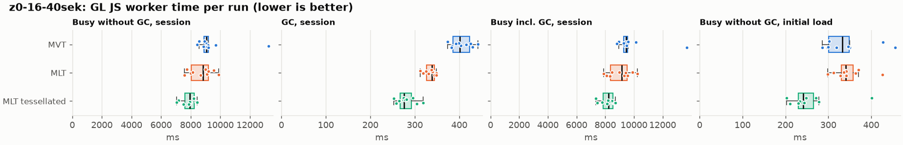
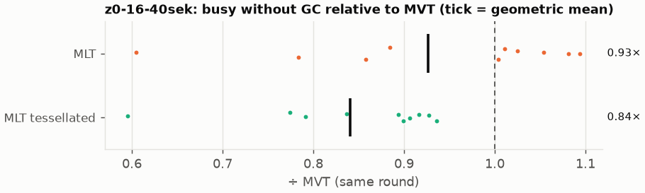
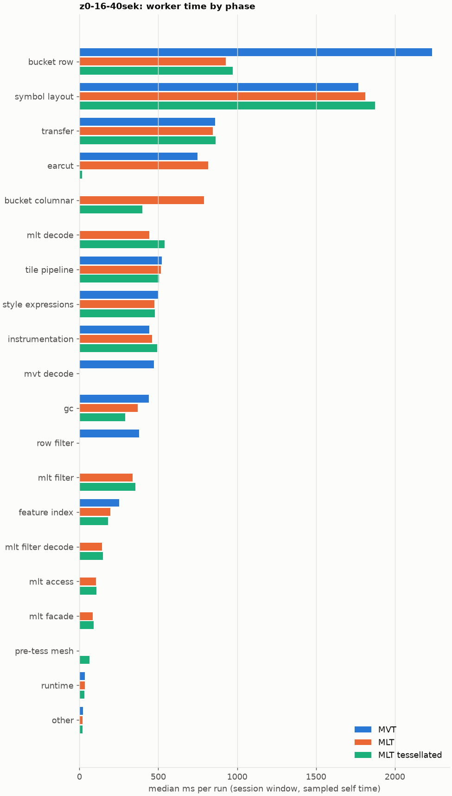
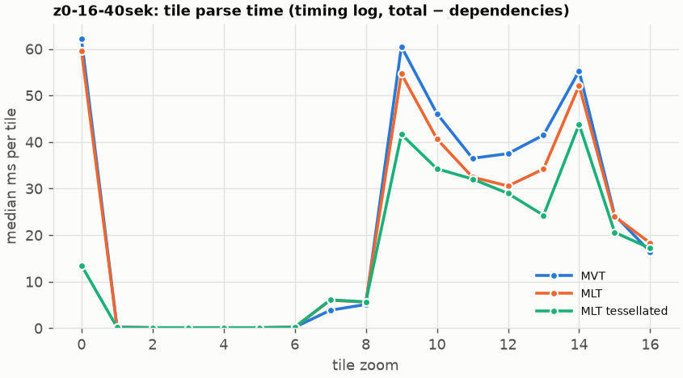
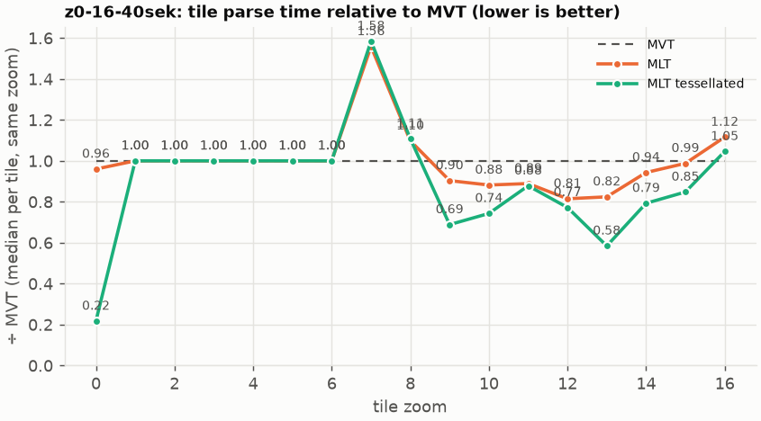

# Session trace benchmark — 20261022-120230

## Setup

- Created 2026-10-22T12:02:30+02:00; 10 repetitions + 1 warm-up round(s) (excluded); variants rotate per round (A B C, B C A, …); one cold browser context per run.
- Machine: 13th Gen Intel(R) Core(TM) i7-1365U, 12 logical cores, 31.3 GB RAM, Windows-11-10.0.26200-SP0; power: GUID des Energieschemas: 381b4222-f694-41f0-9685-ff5bb260df2e  (Ausbalanciert), AC True.
- GL JS gl7-performance-optimization @ f9bd50a8b5 (dirty); worker count 1; viewport {'width': 1280, 'height': 1024}.
- Python 3.12.2, packages {'playwright': '1.64.0', 'numpy': '2.5.3', 'matplotlib': '3.11.2'}.

| variant | bundle | format | bundle sha256 | branch build |
|---|---|---|---|---|
| MVT | `dist/maplibre-gl-dev.mjs` | mvt | `b2691453151d` | – |
| MLT | `dist/maplibre-gl-dev.mjs` | mlt | `b2691453151d` | – |
| MLT tessellated | `dist/maplibre-gl-dev.mjs` | mlt-pre-tess | `b2691453151d` | – |

| session | style | duration | frames | sha256 |
|---|---|---:|---:|---|
| z0-16-40sek | osm-bright | 42.1 s | 1739 | `55a2b8f22fe2` |

CPU sampling interval (median over runs): 620 µs.

## Definitions

- **busy** = wall time in which a GL JS worker thread runs a task (union of top-level task slices and GC slices on `DedicatedWorker thread`s), summed over workers. **GC** = union of `MinorGC`/`MajorGC`/`V8.GC*` slices on those threads. **busy without GC** = busy − GC (headline metric).
- **CPU** = thread time (`tdur`) of the same slices. Phase categories and functions come from the trace's CPU samples (self time), categorised by `config/categories.toml` (nearest matching frame, leaf to root).
- Windows: **load** = map creation → first idle; **session** = camera replay; **tail** = end of replay → idle; **total** = load + session + tail.
- Ratios are against **MVT**: ratio of medians with a bootstrap 95 % CI, the geometric mean of per-round ratios, and a two-sided Mann–Whitney U p-value (normal approximation, not corrected for multiple comparisons; rough below n = 8). Lower than 1× means less worker time.

## Session `z0-16-40sek`

### Worker busy without GC (session window)

| variant | n ok / failed | median ms | IQR | mean | ratio vs MVT | 95 % CI | geo-mean paired | MWU p |
|---|---:|---:|---:|---:|---:|---:|---:|---:|
| MVT | 10 / 0 | 9,060 | 8,886–9,179 | 9,422 | 1.00× | – | – | – |
| MLT | 10 / 0 | 8,828 | 8,038–9,179 | 8,690 | 0.97× | 0.87–1.03× | 0.93× | 0.345 |
| MLT tessellated | 10 / 0 | 7,941 | 7,598–8,224 | 7,872 | 0.88× | 0.82–0.92× | 0.84× | <0.001 |

### All worker metrics (median, ratio vs baseline)

| metric | MVT | MLT | MLT tessellated |
|---|---:|---:|---:|
| busy incl. GC | 9,473 | 9,158 (0.97×) | 8,232 (0.87×) |
| &nbsp;&nbsp;of which GC | 401.2 | 338.6 (0.84×) | 276.1 (0.69×) |
| &nbsp;&nbsp;of which busy without GC | 9,060 | 8,828 (0.97×) | 7,941 (0.88×) |
| &nbsp;&nbsp;&nbsp;&nbsp;of which filtering (sampled, incl. callees) | 378.4 | 335.6 (0.89×) | 355.5 (0.94×) |
| &nbsp;&nbsp;&nbsp;&nbsp;of which column decoding inside the MLT filter (sampled) | 0.0 | 142.7 | 148.4 |
| &nbsp;&nbsp;&nbsp;&nbsp;of which timing instrumentation (sampled) | 442.4 | 461.9 (1.04×) | 491.6 (1.11×) |
| busy without GC and instrumentation | 8,619 | 8,366 (0.97×) | 7,451 (0.86×) |
| CPU time without GC | 8,105 | 7,730 (0.95×) | 7,085 (0.87×) |
| tile: download end → sent to main thread, median per tile | 206.8 | 215.6 (1.04×) | 177.1 (0.86×) |
| tile: download end → sent to main thread, 90th percentile | 582.4 | 537.4 (0.92×) | 456.8 (0.78×) |
| tile: download end → sent to main thread, 95th percentile | 755.9 | 624.4 (0.83×) | 536.7 (0.71×) |
| tile: download end → sent to main thread, 99th percentile | 854.1 | 732.2 (0.86×) | 632.9 (0.74×) |
| &nbsp;&nbsp;parse part (timing log, incl. waiting for glyphs/icons), median per tile | 119.5 | 126.2 (1.06×) | 111.7 (0.93×) |
| &nbsp;&nbsp;queue + hand-off part, median per tile | 59.0 | 54.9 (0.93×) | 50.1 (0.85×) |
| minor GCs | 96.00 | 77.50 (0.81×) | 59.00 (0.61×) |
| major GCs | 8.00 | 6.00 (0.75×) | 5.50 (0.69×) |
| peak worker heap (MB) | 68.2 | 72.7 (1.07×) | 61.5 (0.90×) |
| load: busy without GC | 332.8 | 340.4 (1.02×) | 241.7 (0.73×) |
| load: GC | 16.4 | 17.3 (1.05×) | 6.3 (0.38×) |
| total: busy without GC | 9,352 | 9,205 (0.98×) | 8,182 (0.87×) |

Rows marked *of which* are parts of the row above, not additional time. Tile rows are per-tile latencies (medians over tiles, then over runs), not sums: tiles overlap in time, and the medians of the parse and queue parts do not add up exactly to the median latency.

### Filtering (session window)

Sampled worker time spent in feature filtering, including everything the filter calls (expression evaluation, property access): **row filter** = the style-spec feature filter that MVT runs per feature, **mlt filter** = the columnar MLT filter (incl. the geometry-type selection), without the columns it decodes (see the next table). Medians per run; rules in `config/categories.toml`.

| variant | mlt filter | row filter | filtering | ratio vs MVT | 95 % CI | MWU p | share of sampled busy |
|---|---:|---:|---:|---:|---:|---:|---:|
| MVT | 0.2 | 377.6 | 378.4 | 1.00× | – | – | 4.3% |
| MLT | 335.6 | 0.0 | 335.6 | 0.89× | 0.80–1.00× | 0.026 | 4.1% |
| MLT tessellated | 355.5 | 0.0 | 355.5 | 0.94× | 0.85–1.02× | 0.089 | 4.8% |

**Filtering together with tile decoding.** The MLT decoder leaves columns encoded until something reads them, and the filter is usually the first reader: the columns it decodes (properties, and the geometry for `$type`) are **of which inside the filter** (phase *mlt filter decode*), the rest is *mlt decode* (geometry and columns read later, e.g. by paint properties and symbols). MVT decodes every feature's properties and geometry while it reads the tile (*mvt decode*), whether the filter keeps the feature or not. So **filtering** above compares the filters, and **decoding + filtering** compares all that the formats spend on decoding the tile and selecting features. **tile decoding** = *mvt decode* or *mlt decode* + *mlt filter decode*: work inside a call into a decoder. Reading data that is already decoded is not counted, as for MVT's feature objects: *mlt access* (row views, value getters, looking a column up by name) and the MLT facade (*mlt facade*). MVT decodes geometry only for the features its filter keeps, MLT decodes a layer's whole geometry column.

| variant | tile decoding | of which inside the filter | filtering | decoding + filtering | ratio vs MVT | 95 % CI | MWU p |
|---|---:|---:|---:|---:|---:|---:|---:|
| MVT | 472.4 | 0.0 | 378.4 | 859.4 | 1.00× | – | – |
| MLT | 585.6 | 142.7 | 335.6 | 927.6 | 1.08× | 0.98–1.19× | 0.212 |
| MLT tessellated | 690.3 | 148.4 | 355.5 | 1,049 | 1.22× | 1.10–1.30× | 0.003 |

Top 12 functions inside filtering and its column decoding (self time, mean ms per run):

| phase | function | source | MVT | MLT | MLT tessellated |
|---|---|---|---:|---:|---:|
| row filter | `evaluate` | node_modules/@maplibre/maplibre-gl-style-spec/dist/expression/compound_expression.mjs | 118.3 | 0.0 | 0.0 |
| row filter | `evaluate` | node_modules/@maplibre/maplibre-gl-style-spec/dist/expression/index.mjs | 52.2 | 0.0 | 0.0 |
| row filter | `CompoundExpression.register.filter-in-small` | node_modules/@maplibre/maplibre-gl-style-spec/dist/expression/compound_expression.mjs | 49.3 | 0.0 | 0.0 |
| row filter | `CompoundExpression.register.filter-==` | node_modules/@maplibre/maplibre-gl-style-spec/dist/expression/compound_expression.mjs | 43.7 | 0.0 | 0.0 |
| mlt filter | `scanDictionaryCodes` | maplibre-tile-spec/ts/dist/processing/filter/execution/filterKernel.js | 0.0 | 34.5 | 37.3 |
| mlt filter | `filterByGeometryType` | maplibre-tile-spec/ts/dist/vector/geometry/geometryVector.js | 0.0 | 31.5 | 34.5 |
| row filter | `CompoundExpression.register.all.overloads` | node_modules/@maplibre/maplibre-gl-style-spec/dist/expression/compound_expression.mjs | 31.8 | 0.0 | 0.0 |
| mlt filter | `dictionaryRowMatches` | maplibre-tile-spec/ts/dist/processing/filter/execution/filterKernel.js | 0.0 | 30.3 | 31.6 |
| mlt filter decode | `unpackNullable` | maplibre-tile-spec/ts/dist/decoding/unpackNullableUtils.js | 0.0 | 25.8 | 29.0 |
| row filter | `filter` | node_modules/@maplibre/maplibre-gl-style-spec/dist/feature_filter/index.mjs | 25.9 | 0.0 | 0.0 |
| mlt filter | `resolveDictionaryExecutor` | maplibre-tile-spec/ts/dist/processing/filter/execution/filterKernel.js | 0.0 | 21.4 | 22.0 |
| row filter | `CompoundExpression.register.filter-type-==` | node_modules/@maplibre/maplibre-gl-style-spec/dist/expression/compound_expression.mjs | 19.2 | 0.0 | 0.0 |

### Where the variants differ from MVT (session window, mean ms per run)

Open **[flame.html](flame.html)** to explore the call tree interactively: pick a variant, compare it with MVT (red = more time at the same call path, blue = less), click a frame to zoom in, and read the phase and function breakdown under it. Without a comparison, frames are coloured by phase: filtering is green in both formats, and the columns the MLT filter decodes on first access (*mlt filter decode*) are MLT blue frames under the green filter. `flame/*.txt` open in https://www.speedscope.app.

#### MLT vs MVT

**By phase** (sampled self time; the Δ column sums to the difference in sampled busy time):

| phase | MVT | MLT | Δ |
|---|---:|---:|---:|
| bucket columnar | 0.0 | 766.3 | +766.3 |
| mlt decode | 0.0 | 442.5 | +442.5 |
| mlt filter | 0.5 | 336.2 | +335.7 |
| mlt filter decode | 0.0 | 141.0 | +141.0 |
| mlt access | 0.0 | 107.3 | +107.3 |
| mlt facade | 0.3 | 82.9 | +82.6 |
| earcut | 763.3 | 799.9 | +36.6 |
| instrumentation | 440.7 | 456.8 | +16.1 |
| other | 22.9 | 21.8 | -1.1 |
| runtime | 37.1 | 35.8 | -1.3 |
| symbol layout | 1,791 | 1,787 | -3.8 |
| tile pipeline | 526.4 | 500.3 | -26.1 |
| transfer | 865.5 | 837.0 | -28.5 |
| style expressions | 505.4 | 468.9 | -36.5 |
| feature index | 252.8 | 198.0 | -54.9 |
| gc | 435.9 | 362.9 | -73.1 |
| row filter | 389.5 | 0.0 | -389.5 |
| mvt decode | 687.1 | 0.0 | -687.1 |
| bucket row | 2,297 | 934.6 | -1362.4 |

**By source layer** (timing log: createBucket + populate + addFeatures, summed over the style layers that use it; wall time, includes GC pauses; total Δ -594 ms):

| source layer | type | MVT | MLT | Δ |
|---|---|---:|---:|---:|
| poi | symbol | 923.2 | 1,044 | +120.6 |
| place | symbol | 656.1 | 737.3 | +81.2 |
| transportation_name | symbol | 426.9 | 492.3 | +65.4 |
| park | fill | 5.2 | 34.8 | +29.6 |
| boundary | line | 85.6 | 110.1 | +24.5 |
| waterway | line | 30.0 | 48.5 | +18.5 |
| transportation | fill | 54.2 | 39.0 | -15.2 |
| water | fill | 206.1 | 182.8 | -23.3 |
| landuse | fill | 494.3 | 383.0 | -111.3 |
| landcover | fill | 610.6 | 487.6 | -122.9 |
| transportation | line | 1,680 | 1,471 | -209.4 |
| building | fill | 1,310 | 843.2 | -466.5 |

**Functions with the largest self-time difference** (by function name, summed over source files):

| function | MVT | MLT | Δ |
|---|---:|---:|---:|
| `readScaledRings` | 0.0 | 81.4 | +81.4 |
| `buildEarcutMesh` | 0.0 | 65.8 | +65.8 |
| `writeEarcutFill` | 0.0 | 60.3 | +60.3 |
| `get` | 79.7 | 138.1 | +58.4 |
| `appendSymbolFeature` | 0.0 | 58.0 | +58.0 |
| `signedArea$2` | 14.3 | 67.3 | +53.0 |
| `registerGlyphs` | 0.0 | 38.1 | +38.1 |
| `decodeString$2` | 0.0 | 36.1 | +36.1 |
| `decodeComponentwiseDeltaVec2` | 0.0 | 35.5 | +35.5 |
| `unpackNullable` | 0.0 | 35.2 | +35.2 |
| `scanDictionaryCodes` | 0.0 | 34.5 | +34.5 |
| `decodeString` | 0.0 | 32.1 | +32.1 |
| `_vertexToIndex` | 344.7 | 1.3 | -343.3 |
| `loadGeometry` | 259.5 | 31.5 | -228.0 |
| `populate` | 316.5 | 109.5 | -207.0 |
| `readSVarint` | 184.2 | 0.0 | -184.2 |
| `evaluate` | 215.2 | 41.2 | -174.0 |

#### MLT tessellated vs MVT

**By phase** (sampled self time; the Δ column sums to the difference in sampled busy time):

| phase | MVT | MLT tessellated | Δ |
|---|---:|---:|---:|
| mlt decode | 0.0 | 526.5 | +526.5 |
| bucket columnar | 0.0 | 399.6 | +399.6 |
| mlt filter | 0.5 | 352.6 | +352.1 |
| mlt filter decode | 0.0 | 146.1 | +146.1 |
| mlt access | 0.0 | 109.7 | +109.7 |
| mlt facade | 0.3 | 88.4 | +88.1 |
| pre-tess mesh | 0.0 | 64.8 | +64.8 |
| symbol layout | 1,791 | 1,846 | +55.0 |
| instrumentation | 440.7 | 477.9 | +37.2 |
| other | 22.9 | 19.3 | -3.6 |
| runtime | 37.1 | 31.9 | -5.2 |
| tile pipeline | 526.4 | 510.8 | -15.5 |
| transfer | 865.5 | 846.0 | -19.5 |
| style expressions | 505.4 | 483.3 | -22.1 |
| feature index | 252.8 | 178.5 | -74.3 |
| gc | 435.9 | 297.8 | -138.2 |
| row filter | 389.5 | 0.0 | -389.5 |
| mvt decode | 687.1 | 0.0 | -687.1 |
| earcut | 763.3 | 15.8 | -747.5 |
| bucket row | 2,297 | 972.8 | -1324.2 |

**By source layer** (timing log: createBucket + populate + addFeatures, summed over the style layers that use it; wall time, includes GC pauses; total Δ -1546 ms):

| source layer | type | MVT | MLT tessellated | Δ |
|---|---|---:|---:|---:|
| poi | symbol | 923.2 | 1,083 | +159.7 |
| place | symbol | 656.1 | 768.0 | +111.9 |
| transportation_name | symbol | 426.9 | 506.3 | +79.4 |
| park | fill | 5.2 | 35.5 | +30.3 |
| boundary | line | 85.6 | 109.9 | +24.3 |
| waterway | line | 30.0 | 51.8 | +21.8 |
| transportation | fill | 54.2 | 61.7 | +7.5 |
| transportation | line | 1,680 | 1,587 | -92.9 |
| water | fill | 206.1 | 83.4 | -122.7 |
| landuse | fill | 494.3 | 172.0 | -322.2 |
| landcover | fill | 610.6 | 214.4 | -396.2 |
| building | fill | 1,310 | 242.7 | -1066.9 |

**Functions with the largest self-time difference** (by function name, summed over source files):

| function | MVT | MLT tessellated | Δ |
|---|---:|---:|---:|
| `buildTessellatedBoundingBox` | 0.0 | 62.4 | +62.4 |
| `get` | 79.7 | 139.9 | +60.1 |
| `appendSymbolFeature` | 0.0 | 59.2 | +59.2 |
| `registerGlyphs` | 0.0 | 42.3 | +42.3 |
| `unpackNullable` | 0.0 | 39.8 | +39.8 |
| `decodeComponentwiseDeltaVec2` | 0.0 | 38.0 | +38.0 |
| `decodeString$2` | 0.0 | 37.4 | +37.4 |
| `scanDictionaryCodes` | 0.0 | 37.3 | +37.3 |
| `decodeUnsignedZigZagDeltaInt32` | 0.0 | 35.3 | +35.3 |
| `filterByGeometryType` | 0.0 | 34.5 | +34.5 |
| `decodeFastPforInt32` | 0.0 | 32.7 | +32.7 |
| `decodeString` | 0.0 | 32.5 | +32.5 |
| `_vertexToIndex` | 344.7 | 0.0 | -344.7 |
| `isEar` | 233.1 | 3.0 | -230.1 |
| `loadGeometry` | 259.5 | 31.5 | -228.0 |
| `populate` | 316.5 | 118.9 | -197.6 |
| `readSVarint` | 184.2 | 0.0 | -184.2 |

### Worker time by phase (session window, median ms of sampled self time)

| phase | MVT | MLT | MLT tessellated |
|---|---:|---:|---:|
| bucket row | 2,235 | 927.1 | 972.9 |
| symbol layout | 1,769 | 1,813 | 1,876 |
| transfer | 858.8 | 844.5 | 863.9 |
| earcut | 749.7 | 816.8 | 15.4 |
| bucket columnar | 0.0 | 789.6 | 397.5 |
| mlt decode | 0.0 | 442.6 | 540.4 |
| tile pipeline | 523.0 | 516.7 | 505.8 |
| style expressions | 501.7 | 475.6 | 477.2 |
| instrumentation | 442.4 | 461.9 | 491.6 |
| mvt decode | 472.4 | 0.0 | 0.0 |
| gc | 440.3 | 368.7 | 291.2 |
| row filter | 377.6 | 0.0 | 0.0 |
| mlt filter | 0.2 | 335.6 | 355.5 |
| feature index | 250.9 | 196.3 | 180.3 |
| mlt filter decode | 0.0 | 142.7 | 148.4 |
| mlt access | 0.0 | 105.2 | 108.1 |
| mlt facade | 0.0 | 83.1 | 91.0 |
| pre-tess mesh | 0.0 | 0.0 | 63.4 |
| runtime | 33.7 | 35.4 | 30.9 |
| other | 23.8 | 20.5 | 19.7 |

### Top 20 worker functions by self time (session window, mean ms per run)

| function | source | phase | MVT | MLT | MLT tessellated |
|---|---|---|---:|---:|---:|
| `reserve` | src/util/struct_array.ts | bucket row | 498.0 | 463.0 | 459.3 |
| `(garbage collector)` | (native) | gc | 435.9 | 362.9 | 297.8 |
| `_vertexToIndex` | src/render/subdivision.ts | bucket row | 344.7 | 1.3 | 0.0 |
| `postMessage` | (native) | transfer | 254.4 | 255.8 | 265.1 |
| `isEar` | node_modules/earcut/src/earcut.js | earcut | 233.1 | 237.0 | 3.0 |
| `serialize` | src/util/web_worker_transfer.ts | transfer | 209.0 | 207.0 | 219.3 |
| `populate` | src/data/bucket/line_bucket.ts | bucket row | 206.3 | 0.0 | 0.0 |
| `emplace` | src/data/array_types.g.ts | feature index | 183.5 | 195.8 | 188.3 |
| `readSVarint` | node_modules/pbf/index.js | mvt decode | 184.2 | 0.0 | 0.0 |
| `ProgramConfiguration` | src/data/program_configuration.ts | bucket row | 168.2 | 169.0 | 166.4 |
| `_trim` | src/util/struct_array.ts | transfer | 168.7 | 146.1 | 130.5 |
| `fetch` | (native) | tile pipeline | 150.7 | 151.4 | 153.7 |
| `loadGeometry` | node_modules/@mapbox/vector-tile/index.js | mvt decode | 150.5 | 0.0 | 0.0 |
| `self.postMessage` | worker_hook.js | instrumentation | 142.2 | 143.8 | 150.4 |
| `readVarint` | node_modules/pbf/index.js | mvt decode | 147.0 | 0.0 | 0.0 |
| `parse` | src/source/worker_tile.ts | tile pipeline | 126.2 | 100.9 | 102.4 |
| `evaluate` | node_modules/@maplibre/maplibre-gl-style-spec/dist/expression/compound_expression.mjs | row filter | 118.3 | 0.0 | 0.0 |
| `getGlyphAdvance` | src/symbol/tagged_string.ts | symbol layout | 110.2 | 105.7 | 113.7 |
| `isEarHashed` | node_modules/earcut/src/earcut.js | earcut | 113.3 | 111.3 | 0.7 |
| `loadGeometry` | src/data/load_geometry.ts | bucket row | 109.0 | 27.0 | 28.4 |

### Top 20 worker functions by total time (incl. callees) (session window, mean ms per run)

| function | source | phase | MVT | MLT | MLT tessellated |
|---|---|---|---:|---:|---:|
| `parse` | src/source/worker_tile.ts | tile pipeline | 7,185 | 6,648 | 5,787 |
| `loadTile` | src/source/vector_tile_worker_source.ts | tile pipeline | 5,552 | 4,931 | 4,060 |
| `_parseWorkerTile` | src/source/vector_tile_worker_source.ts | tile pipeline | 5,291 | 4,758 | 3,887 |
| `populate` | src/data/bucket/fill_bucket.ts | bucket row | 2,333 | 0.0 | 0.0 |
| `addBucketFeatures` | src/data/bucket/fill_bucket.ts | bucket row | 1,876 | 1,401 | 222.0 |
| `addFeature` | src/data/bucket/fill_bucket.ts | bucket row | 1,801 | 17.5 | 0.0 |
| `populate` | src/data/bucket/columnar/columnar_fill_bucket.ts | bucket columnar | 0.0 | 1,678 | 662.2 |
| `addFeatures` | src/data/bucket/symbol_bucket.ts | symbol layout | 1,605 | 1,598 | 1,648 |
| `performSymbolLayout` | src/symbol/symbol_layout.ts | symbol layout | 1,583 | 1,577 | 1,626 |
| `subdividePolygon` | src/render/subdivision.ts | bucket row | 1,463 | 15.4 | 0.0 |
| `subdividePolygonInternal` | src/render/subdivision.ts | bucket row | 1,434 | 15.3 | 0.0 |
| `addFeature` | src/data/bucket/columnar/columnar_fill_bucket.ts | bucket columnar | 0.0 | 1,385 | 192.7 |
| `populate` | src/data/bucket/line_bucket.ts | bucket row | 1,355 | 0.0 | 0.0 |
| `writeEarcutFill` | src/data/bucket/columnar/columnar_mesh_arrays.ts | bucket columnar | 0.0 | 1,330 | 32.4 |
| `populate` | src/data/bucket/columnar/columnar_line_bucket.ts | bucket columnar | 0.0 | 1,197 | 1,292 |
| `processTask` | src/util/actor.ts | transfer | 1,108 | 1,080 | 1,091 |
| `buildEarcutMesh` | src/data/bucket/columnar/columnar_mesh_arrays.ts | bucket columnar | 0.0 | 898.5 | 20.0 |
| `completeTask` | src/util/actor.ts | transfer | 886.9 | 859.0 | 867.4 |
| `earcut` | node_modules/earcut/src/earcut.js | earcut | 761.2 | 798.7 | 15.8 |
| `populate` | src/data/bucket/columnar/columnar_symbol_bucket.ts | symbol layout | 0.0 | 748.2 | 774.1 |

### Tile parse time by zoom (timing log, median ms per tile, total − dependencies)

| zoom | MVT | MLT | MLT tessellated |
|---:|---:|---:|---:|
| 0 | 62.15 (n=30) | 59.65 (n=30) | 13.50 (n=30) |
| 1 | 0.20 (n=80) | 0.20 (n=80) | 0.20 (n=80) |
| 2 | 0.10 (n=120) | 0.10 (n=120) | 0.10 (n=120) |
| 3 | 0.10 (n=101) | 0.10 (n=100) | 0.10 (n=115) |
| 4 | 0.10 (n=90) | 0.10 (n=90) | 0.10 (n=90) |
| 5 | 0.10 (n=60) | 0.10 (n=61) | 0.10 (n=60) |
| 6 | 0.20 (n=90) | 0.20 (n=90) | 0.20 (n=90) |
| 7 | 3.85 (n=90) | 6.00 (n=90) | 6.10 (n=90) |
| 8 | 5.10 (n=120) | 5.60 (n=120) | 5.65 (n=120) |
| 9 | 60.50 (n=120) | 54.65 (n=120) | 41.65 (n=120) |
| 10 | 46.10 (n=117) | 40.65 (n=120) | 34.25 (n=120) |
| 11 | 36.50 (n=90) | 32.45 (n=90) | 32.05 (n=90) |
| 12 | 37.50 (n=110) | 30.55 (n=128) | 28.95 (n=124) |
| 13 | 41.50 (n=179) | 34.20 (n=186) | 24.25 (n=188) |
| 14 | 55.25 (n=248) | 52.10 (n=237) | 43.80 (n=241) |
| 15 | 24.30 (n=355) | 24.00 (n=357) | 20.60 (n=360) |
| 16 | 16.40 (n=660) | 18.30 (n=660) | 17.15 (n=660) |

### Tile latency by zoom: download end → result sent to the main thread (session window, ms per tile: median / p95 / p99)

Includes waiting in the worker's queue, the parse and posting the result; see `tile_latency.csv` for the per-tile split (`parse_ms`, `wait_ms`). Percentiles over the tiles of all runs; with few tiles (n) p99 is close to the maximum.

| zoom | MVT | MLT | MLT tessellated |
|---:|---:|---:|---:|
| 1 | 27.2 / 73.5 / 79.0 (n=80) | 27.9 / 65.4 / 81.3 (n=80) | 18.1 / 46.7 / 50.9 (n=80) |
| 2 | 47.0 / 94.3 / 118.2 (n=120) | 48.7 / 89.5 / 121.7 (n=120) | 38.8 / 99.4 / 110.9 (n=120) |
| 3 | 37.6 / 64.2 / 79.8 (n=101) | 30.2 / 57.8 / 69.7 (n=100) | 24.6 / 50.3 / 53.9 (n=115) |
| 4 | 30.7 / 50.9 / 58.0 (n=90) | 28.7 / 51.1 / 59.4 (n=90) | 29.9 / 56.1 / 62.1 (n=90) |
| 5 | 16.4 / 68.6 / 85.8 (n=60) | 17.1 / 79.5 / 92.2 (n=61) | 17.7 / 76.7 / 81.5 (n=60) |
| 6 | 51.0 / 89.0 / 96.3 (n=90) | 52.7 / 84.1 / 87.0 (n=90) | 44.7 / 78.3 / 82.4 (n=90) |
| 7 | 160.0 / 232.5 / 244.5 (n=90) | 182.8 / 240.1 / 251.6 (n=90) | 132.4 / 172.9 / 179.3 (n=90) |
| 8 | 305.0 / 466.1 / 504.1 (n=120) | 275.4 / 344.9 / 366.2 (n=120) | 204.9 / 306.4 / 309.9 (n=120) |
| 9 | 796.9 / 1,334 / 1,382 (n=120) | 700.3 / 904.0 / 940.9 (n=120) | 555.8 / 671.1 / 684.1 (n=120) |
| 10 | 575.7 / 734.3 / 781.0 (n=117) | 532.3 / 628.6 / 655.1 (n=120) | 455.4 / 552.1 / 577.0 (n=120) |
| 11 | 343.1 / 569.4 / 621.7 (n=90) | 314.0 / 414.2 / 434.5 (n=90) | 310.7 / 398.1 / 419.2 (n=90) |
| 12 | 486.6 / 667.5 / 707.9 (n=110) | 411.4 / 496.6 / 516.5 (n=128) | 396.1 / 514.4 / 565.3 (n=124) |
| 13 | 450.9 / 650.7 / 852.7 (n=179) | 303.6 / 525.4 / 560.5 (n=186) | 189.8 / 419.9 / 444.3 (n=188) |
| 14 | 429.4 / 893.6 / 988.6 (n=248) | 441.3 / 695.0 / 771.9 (n=237) | 365.0 / 656.9 / 739.2 (n=241) |
| 15 | 233.2 / 437.0 / 518.6 (n=355) | 225.4 / 392.4 / 432.8 (n=357) | 201.6 / 373.2 / 405.0 (n=360) |
| 16 | 147.7 / 429.1 / 478.2 (n=660) | 128.7 / 430.6 / 489.4 (n=660) | 142.6 / 411.9 / 461.0 (n=660) |

## Runs

33 ok, 0 failed/aborted, 0 not run, 30 used in statistics.

## Validity checks

- z0-16-40sek/mlt/rep-00: counted-once check failed: 1 timing-log lines appear twice
- z0-16-40sek/mlt-pre-tess/rep-00: counted-once check failed: 1 timing-log lines appear twice
- z0-16-40sek/mlt-pre-tess/rep-01: counted-once check failed: 1 timing-log lines appear twice
- z0-16-40sek/mvt/rep-01: counted-once check failed: 1 timing-log lines appear twice
- z0-16-40sek/mvt/rep-02: counted-once check failed: 1 timing-log lines appear twice
- z0-16-40sek/mvt/rep-03: counted-once check failed: 2 timing-log lines appear twice
- z0-16-40sek/mlt/rep-03: counted-once check failed: 2 timing-log lines appear twice
- z0-16-40sek/mlt-pre-tess/rep-03: counted-once check failed: 1 timing-log lines appear twice
- z0-16-40sek/mlt/rep-04: counted-once check failed: 1 timing-log lines appear twice
- z0-16-40sek/mvt/rep-04: counted-once check failed: 1 timing-log lines appear twice
- z0-16-40sek/mvt/rep-05: counted-once check failed: 1 timing-log lines appear twice
- z0-16-40sek/mlt/rep-05: counted-once check failed: 1 timing-log lines appear twice
- z0-16-40sek/mlt/rep-06: counted-once check failed: 1 timing-log lines appear twice
- z0-16-40sek/mvt/rep-08: counted-once check failed: 1 timing-log lines appear twice
- z0-16-40sek/mvt/rep-09: counted-once check failed: 1 timing-log lines appear twice
- z0-16-40sek/mlt/rep-10: counted-once check failed: 1 timing-log lines appear twice
- z0-16-40sek/mlt-pre-tess/rep-10: counted-once check failed: 1 timing-log lines appear twice
- other programs used 6.36–9.10 logical processors during the replays (median 8.35)
- 30 run(s) with more than 0.5 cores of background load: z0-16-40sek/mlt/rep-01 (8.85), z0-16-40sek/mlt-pre-tess/rep-01 (8.68), z0-16-40sek/mvt/rep-01 (8.37), z0-16-40sek/mlt-pre-tess/rep-02 (8.80), z0-16-40sek/mvt/rep-02 (8.01), z0-16-40sek/mlt/rep-02 (6.36)
- 11 of 11 rounds parsed different tile sets across variants (e.g. z0-16-40sek round 0: mvt 231 tiles, mlt 233 tiles, mlt-pre-tess 230 tiles; z0-16-40sek round 1: mlt 233 tiles, mlt-pre-tess 234 tiles, mvt 232 tiles; z0-16-40sek round 2: mlt-pre-tess 235 tiles, mvt 235 tiles, mlt 233 tiles; z0-16-40sek round 3: mvt 232 tiles, mlt 229 tiles, mlt-pre-tess 236 tiles; z0-16-40sek round 4: mlt 234 tiles, mlt-pre-tess 232 tiles, mvt 231 tiles); expected where a session zooms past the last MVT level (MVT overzooms, MLT loads deeper tiles)

## Files

- `runs.csv`: one row per run (incl. failed and warm-up runs), every scalar metric as `<window>.<metric>`.
- `summary.csv`: session × variant × metric statistics.
- `functions.csv`, `categories.csv`: CPU-sample self/total time per function and phase per run and window.
- `category_functions.csv`: self time per phase × function (e.g. what the filters spend their time on).
- `tiles.csv`, `tile_layers.csv`, `tile_phases.csv`: the per-tile worker timing log, long format.
- `flame.html`: interactive call tree per variant with a diff view; `flame/*.txt`: collapsed stacks for speedscope.
- `analysis/stacks.csv` (per run): sampled self time per full call stack.
- `tile_latency.csv`: per tile request, worker clock: received, download start/end, result sent, latency = sent − download end, parse_ms, wait_ms = latency − parse.
- `runs/<session>/<variant>/rep-NN/trace.json.gz`: the raw trace (opens in the DevTools Performance tab).
