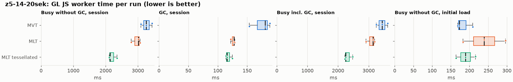
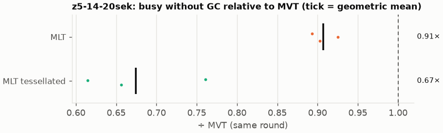
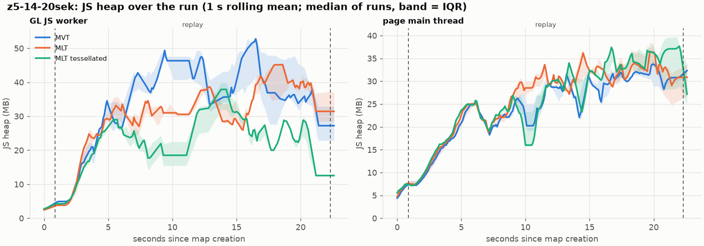
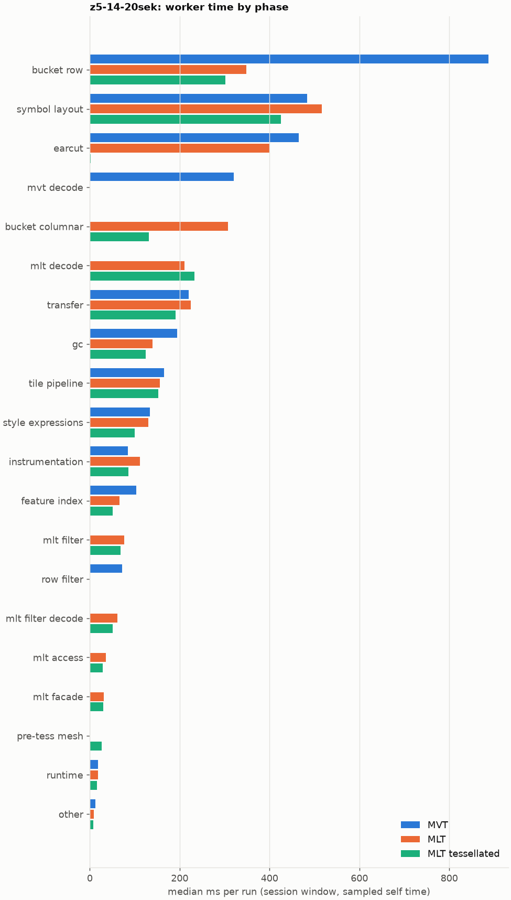
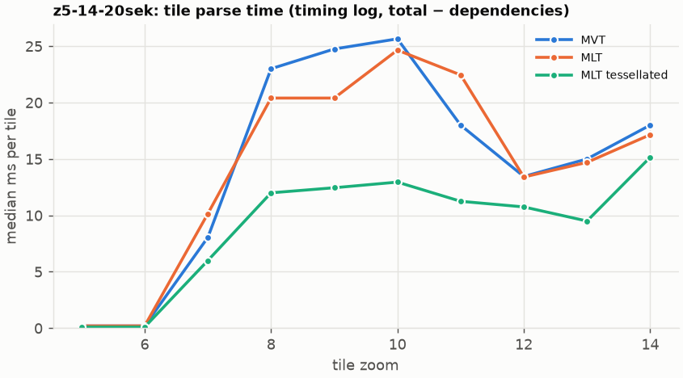
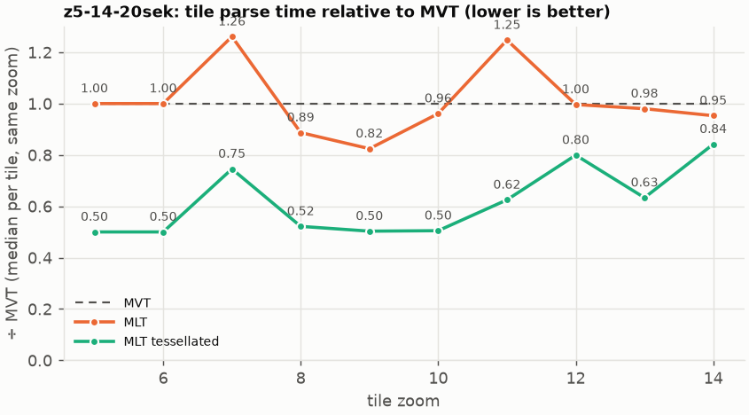

# Session trace benchmark — 20261022-135340

## Setup

- Created 2026-10-22T13:53:40+02:00; 3 repetitions + 1 warm-up round(s) (excluded); variants rotate per round (A B C, B C A, …); one cold browser context per run.
- Machine: 13th Gen Intel(R) Core(TM) i7-1365U, 12 logical cores, 31.3 GB RAM, Windows-11-10.0.26200-SP0; power: GUID des Energieschemas: 381b4222-f694-41f0-9685-ff5bb260df2e  (Ausbalanciert), AC True.
- GL JS gl7-performance-optimization @ f9bd50a8b5 (dirty); worker count 1; viewport {'width': 1280, 'height': 1024}.
- Python 3.12.2, packages {'playwright': '1.64.0', 'numpy': '2.5.3', 'matplotlib': '3.11.2'}.

| variant | bundle | format | bundle sha256 | branch build |
|---|---|---|---|---|
| MVT | `dist/maplibre-gl-dev.mjs` | mvt | `b2691453151d` | – |
| MLT | `dist/maplibre-gl-dev.mjs` | mlt | `b2691453151d` | – |
| MLT tessellated | `dist/maplibre-gl-dev.mjs` | mlt-pre-tess | `b2691453151d` | – |

| session | style | duration | frames | sha256 |
|---|---|---:|---:|---|
| z5-14-20sek | maptiler-basic | 21.4 s | 829 | `5a376e5ede30` |

CPU sampling interval (median over runs): 602 µs.

## Definitions

- **busy** = wall time in which a GL JS worker thread runs a task (union of top-level task slices and GC slices on `DedicatedWorker thread`s), summed over workers. **GC** = union of `MinorGC`/`MajorGC`/`V8.GC*` slices on those threads. **busy without GC** = busy − GC (headline metric).
- **CPU** = thread time (`tdur`) of the same slices. Phase categories and functions come from the trace's CPU samples (self time), categorised by `config/categories.toml` (nearest matching frame, leaf to root).
- Windows: **load** = map creation → first idle; **session** = camera replay; **tail** = end of replay → idle; **total** = load + session + tail.
- Ratios are against **MVT**: ratio of medians with a bootstrap 95 % CI, the geometric mean of per-round ratios, and a two-sided Mann–Whitney U p-value (normal approximation, not corrected for multiple comparisons; rough below n = 8). Lower than 1× means less worker time.

## Session `z5-14-20sek`

### Worker busy without GC (session window)

| variant | n ok / failed | median ms | IQR | mean | ratio vs MVT | 95 % CI | geo-mean paired | MWU p |
|---|---:|---:|---:|---:|---:|---:|---:|---:|
| MVT | 3 / 0 | 3,258 | 3,175–3,347 | 3,262 | 1.00× | – | – | – |
| MLT | 3 / 0 | 3,015 | 2,903–3,042 | 2,958 | 0.93× | 0.81–0.99× | 0.91× | 0.081 |
| MLT tessellated | 3 / 0 | 2,139 | 2,125–2,245 | 2,201 | 0.66× | 0.61–0.76× | 0.67× | 0.081 |

### All worker metrics (median, ratio vs baseline)

| metric | MVT | MLT | MLT tessellated |
|---|---:|---:|---:|
| busy incl. GC | 3,438 | 3,144 (0.91×) | 2,253 (0.66×) |
| &nbsp;&nbsp;of which GC | 180.5 | 127.6 (0.71×) | 115.8 (0.64×) |
| &nbsp;&nbsp;of which busy without GC | 3,258 | 3,015 (0.93×) | 2,139 (0.66×) |
| &nbsp;&nbsp;&nbsp;&nbsp;of which filtering (sampled, incl. callees) | 73.0 | 76.4 (1.05×) | 68.3 (0.93×) |
| &nbsp;&nbsp;&nbsp;&nbsp;of which column decoding inside the MLT filter (sampled) | 0.0 | 61.2 | 50.4 |
| &nbsp;&nbsp;&nbsp;&nbsp;of which timing instrumentation (sampled) | 84.9 | 111.5 (1.31×) | 85.4 (1.01×) |
| busy without GC and instrumentation | 3,173 | 2,899 (0.91×) | 2,058 (0.65×) |
| CPU time without GC | 3,029 | 2,799 (0.92×) | 1,949 (0.64×) |
| tile: download end → sent to main thread, median per tile | 163.2 | 158.8 (0.97×) | 104.5 (0.64×) |
| tile: download end → sent to main thread, 90th percentile | 406.5 | 317.1 (0.78×) | 199.3 (0.49×) |
| tile: download end → sent to main thread, 95th percentile | 431.9 | 373.1 (0.86×) | 250.1 (0.58×) |
| tile: download end → sent to main thread, 99th percentile | 457.7 | 404.4 (0.88×) | 282.0 (0.62×) |
| &nbsp;&nbsp;parse part (timing log, incl. waiting for glyphs/icons), median per tile | 88.0 | 80.9 (0.92×) | 56.0 (0.64×) |
| &nbsp;&nbsp;queue + hand-off part, median per tile | 68.3 | 61.1 (0.89×) | 39.6 (0.58×) |
| minor GCs | 59.00 | 49.00 (0.83×) | 34.00 (0.58×) |
| major GCs | 4.00 | 3.00 (0.75×) | 6.00 (1.50×) |
| peak worker heap (MB) | 67.8 | 56.7 (0.84×) | 41.9 (0.62×) |
| load: busy without GC | 173.1 | 239.3 (1.38×) | 189.5 (1.09×) |
| load: GC | 6.6 | 6.6 (1.01×) | 4.6 (0.70×) |
| total: busy without GC | 3,466 | 3,197 (0.92×) | 2,328 (0.67×) |

Rows marked *of which* are parts of the row above, not additional time. Tile rows are per-tile latencies (medians over tiles, then over runs), not sums: tiles overlap in time, and the medians of the parse and queue parts do not add up exactly to the median latency.

### Filtering (session window)

Sampled worker time spent in feature filtering, including everything the filter calls (expression evaluation, property access): **row filter** = the style-spec feature filter that MVT runs per feature, **mlt filter** = the columnar MLT filter (incl. the geometry-type selection), without the columns it decodes (see the next table). Medians per run; rules in `config/categories.toml`.

| variant | mlt filter | row filter | filtering | ratio vs MVT | 95 % CI | MWU p | share of sampled busy |
|---|---:|---:|---:|---:|---:|---:|---:|
| MVT | 0.6 | 72.4 | 73.0 | 1.00× | – | – | 2.4% |
| MLT | 76.4 | 0.0 | 76.4 | 1.05× | 0.77–1.24× | 1.000 | 2.6% |
| MLT tessellated | 68.3 | 0.0 | 68.3 | 0.93× | 0.70–1.09× | 0.383 | 3.3% |

**Filtering together with tile decoding.** The MLT decoder leaves columns encoded until something reads them, and the filter is usually the first reader: the columns it decodes (properties, and the geometry for `$type`) are **of which inside the filter** (phase *mlt filter decode*), the rest is *mlt decode* (geometry and columns read later, e.g. by paint properties and symbols). MVT decodes every feature's properties and geometry while it reads the tile (*mvt decode*), whether the filter keeps the feature or not. So **filtering** above compares the filters, and **decoding + filtering** compares all that the formats spend on decoding the tile and selecting features. **tile decoding** = *mvt decode* or *mlt decode* + *mlt filter decode*: work inside a call into a decoder. Reading data that is already decoded is not counted, as for MVT's feature objects: *mlt access* (row views, value getters, looking a column up by name) and the MLT facade (*mlt facade*). MVT decodes geometry only for the features its filter keeps, MLT decodes a layer's whole geometry column.

| variant | tile decoding | of which inside the filter | filtering | decoding + filtering | ratio vs MVT | 95 % CI | MWU p |
|---|---:|---:|---:|---:|---:|---:|---:|
| MVT | 320.4 | 0.0 | 73.0 | 386.1 | 1.00× | – | – |
| MLT | 271.7 | 61.2 | 76.4 | 350.4 | 0.91× | 0.70–0.93× | 0.081 |
| MLT tessellated | 282.6 | 50.4 | 68.3 | 340.6 | 0.88× | 0.82–0.99× | 0.081 |

Top 12 functions inside filtering and its column decoding (self time, mean ms per run):

| phase | function | source | MVT | MLT | MLT tessellated |
|---|---|---|---:|---:|---:|
| row filter | `evaluate` | node_modules/@maplibre/maplibre-gl-style-spec/dist/expression/compound_expression.mjs | 18.0 | 0.0 | 0.0 |
| row filter | `evaluate` | node_modules/@maplibre/maplibre-gl-style-spec/dist/expression/index.mjs | 17.3 | 0.0 | 0.0 |
| mlt filter decode | `unpackNullable` | maplibre-tile-spec/ts/dist/decoding/unpackNullableUtils.js | 0.0 | 13.7 | 9.1 |
| row filter | `CompoundExpression.register.filter-==` | node_modules/@maplibre/maplibre-gl-style-spec/dist/expression/compound_expression.mjs | 9.2 | 0.0 | 0.0 |
| mlt filter | `filterByGeometryType` | maplibre-tile-spec/ts/dist/vector/geometry/geometryVector.js | 0.0 | 9.1 | 7.7 |
| mlt filter | `scanDictionaryCodes` | maplibre-tile-spec/ts/dist/processing/filter/execution/filterKernel.js | 0.0 | 8.2 | 6.3 |
| mlt filter decode | `_LazyPropertyVectors_decode` | maplibre-tile-spec/ts/dist/vector/lazyPropertyVectors.js | 0.0 | 3.9 | 6.4 |
| row filter | `CompoundExpression.register.filter-in-small` | node_modules/@maplibre/maplibre-gl-style-spec/dist/expression/compound_expression.mjs | 6.0 | 0.0 | 0.0 |
| row filter | `filter` | node_modules/@maplibre/maplibre-gl-style-spec/dist/feature_filter/index.mjs | 5.7 | 0.0 | 0.0 |
| mlt filter decode | `decodeFsst` | maplibre-tile-spec/ts/dist/decoding/fsstDecoder.js | 0.0 | 5.6 | 5.2 |
| mlt filter | `dictionaryRowMatches` | maplibre-tile-spec/ts/dist/processing/filter/execution/filterKernel.js | 0.0 | 4.2 | 5.5 |
| row filter | `CompoundExpression.register.filter-type-==` | node_modules/@maplibre/maplibre-gl-style-spec/dist/expression/compound_expression.mjs | 5.1 | 0.0 | 0.0 |

### Where the variants differ from MVT (session window, mean ms per run)

Open **[flame.html](flame.html)** to explore the call tree interactively: pick a variant, compare it with MVT (red = more time at the same call path, blue = less), click a frame to zoom in, and read the phase and function breakdown under it. Without a comparison, frames are coloured by phase: filtering is green in both formats, and the columns the MLT filter decodes on first access (*mlt filter decode*) are MLT blue frames under the green filter. `flame/*.txt` open in https://www.speedscope.app.

#### MLT vs MVT

**By phase** (sampled self time; the Δ column sums to the difference in sampled busy time):

| phase | MVT | MLT | Δ |
|---|---:|---:|---:|
| bucket columnar | 0.0 | 306.5 | +306.5 |
| mlt decode | 0.0 | 198.2 | +198.2 |
| mlt filter | 0.4 | 73.3 | +72.9 |
| mlt filter decode | 0.0 | 59.8 | +59.8 |
| mlt access | 0.0 | 36.4 | +36.4 |
| symbol layout | 476.2 | 507.8 | +31.6 |
| mlt facade | 0.3 | 31.6 | +31.3 |
| instrumentation | 89.0 | 105.8 | +16.8 |
| transfer | 225.0 | 228.0 | +3.0 |
| other | 13.1 | 10.7 | -2.4 |
| style expressions | 130.3 | 123.4 | -6.9 |
| tile pipeline | 171.0 | 163.1 | -7.9 |
| feature index | 103.0 | 65.6 | -37.4 |
| gc | 188.3 | 137.9 | -50.5 |
| earcut | 466.7 | 395.9 | -70.9 |
| row filter | 72.7 | 0.0 | -72.7 |
| mvt decode | 319.8 | 0.0 | -319.8 |
| bucket row | 875.1 | 346.3 | -528.8 |

**By source layer** (timing log: createBucket + populate + addFeatures, summed over the style layers that use it; wall time, includes GC pauses; total Δ -287 ms):

| source layer | type | MVT | MLT | Δ |
|---|---|---:|---:|---:|
| place | symbol | 446.6 | 557.6 | +110.9 |
| waterway | line | 36.0 | 55.0 | +19.0 |
| poi | symbol | 29.9 | 47.7 | +17.8 |
| transportation_name | symbol | 102.4 | 115.1 | +12.7 |
| boundary | line | 33.2 | 42.4 | +9.2 |
| aeroway | line | 1.7 | 4.0 | +2.3 |
| aeroway | fill | 1.2 | 3.4 | +2.3 |
| transportation | fill | 14.6 | 12.6 | -2.0 |
| transportation | line | 481.0 | 471.4 | -9.6 |
| building | fill | 264.4 | 150.0 | -114.4 |
| landuse | fill | 422.7 | 274.4 | -148.3 |
| landcover | fill | 600.2 | 413.1 | -187.0 |

**Functions with the largest self-time difference** (by function name, summed over source files):

| function | MVT | MLT | Δ |
|---|---:|---:|---:|
| `readScaledRings` | 0.0 | 49.7 | +49.7 |
| `writeEarcutFill` | 0.0 | 28.6 | +28.6 |
| `buildEarcutMesh` | 0.0 | 26.5 | +26.5 |
| `decodeComponentwiseDeltaVec2` | 0.0 | 21.1 | +21.1 |
| `unpackNullable` | 0.0 | 18.1 | +18.1 |
| `decodeString$2` | 0.0 | 15.5 | +15.5 |
| `get` | 16.6 | 31.2 | +14.6 |
| `appendSymbolFeature` | 0.0 | 12.0 | +12.0 |
| `decodeFastPforInt32` | 0.0 | 11.7 | +11.7 |
| `registerGlyphs` | 0.0 | 10.4 | +10.4 |
| `addPhase` | 23.1 | 32.5 | +9.4 |
| `filterByGeometryType` | 0.0 | 9.1 | +9.1 |
| `_vertexToIndex` | 160.0 | 0.0 | -160.0 |
| `readSVarint` | 132.7 | 0.0 | -132.7 |
| `loadGeometry` | 82.0 | 12.3 | -69.7 |
| `readVarint` | 57.8 | 2.2 | -55.6 |
| `(garbage collector)` | 188.3 | 137.9 | -50.5 |

#### MLT tessellated vs MVT

**By phase** (sampled self time; the Δ column sums to the difference in sampled busy time):

| phase | MVT | MLT tessellated | Δ |
|---|---:|---:|---:|
| mlt decode | 0.0 | 235.7 | +235.7 |
| bucket columnar | 0.0 | 139.1 | +139.1 |
| mlt filter | 0.4 | 65.5 | +65.1 |
| mlt filter decode | 0.0 | 50.3 | +50.3 |
| mlt access | 0.0 | 30.6 | +30.6 |
| mlt facade | 0.3 | 30.5 | +30.2 |
| pre-tess mesh | 0.0 | 27.5 | +27.5 |
| instrumentation | 89.0 | 90.5 | +1.5 |
| runtime | 18.6 | 15.2 | -3.4 |
| other | 13.1 | 8.0 | -5.1 |
| tile pipeline | 171.0 | 148.0 | -23.1 |
| style expressions | 130.3 | 100.7 | -29.7 |
| transfer | 225.0 | 194.9 | -30.1 |
| symbol layout | 476.2 | 427.8 | -48.4 |
| feature index | 103.0 | 50.6 | -52.4 |
| gc | 188.3 | 126.4 | -61.9 |
| row filter | 72.7 | 0.0 | -72.7 |
| mvt decode | 319.8 | 0.0 | -319.8 |
| earcut | 466.7 | 2.3 | -464.4 |
| bucket row | 875.1 | 308.4 | -566.6 |

**By source layer** (timing log: createBucket + populate + addFeatures, summed over the style layers that use it; wall time, includes GC pauses; total Δ -998 ms):

| source layer | type | MVT | MLT tessellated | Δ |
|---|---|---:|---:|---:|
| poi | symbol | 29.9 | 54.2 | +24.3 |
| transportation_name | symbol | 102.4 | 115.8 | +13.4 |
| waterway | line | 36.0 | 47.0 | +11.0 |
| place | symbol | 446.6 | 451.6 | +5.0 |
| transportation | fill | 14.6 | 18.1 | +3.6 |
| boundary | line | 33.2 | 36.2 | +3.1 |
| aeroway | fill | 1.2 | 3.0 | +1.8 |
| transportation | line | 481.0 | 454.8 | -26.2 |
| water | fill | 58.3 | 30.7 | -27.6 |
| building | fill | 264.4 | 52.0 | -212.4 |
| landuse | fill | 422.7 | 93.6 | -329.0 |
| landcover | fill | 600.2 | 134.2 | -466.0 |

**Functions with the largest self-time difference** (by function name, summed over source files):

| function | MVT | MLT tessellated | Δ |
|---|---:|---:|---:|
| `buildTessellatedBoundingBox` | 0.0 | 26.2 | +26.2 |
| `decodeUnsignedZigZagDeltaInt32` | 0.0 | 20.9 | +20.9 |
| `decodeComponentwiseDeltaVec2` | 0.0 | 19.3 | +19.3 |
| `decodeString$2` | 0.0 | 16.5 | +16.5 |
| `unpackNullable` | 0.0 | 14.5 | +14.5 |
| `decodeFastPforInt32` | 0.0 | 13.2 | +13.2 |
| `appendSymbolFeature` | 0.0 | 10.8 | +10.8 |
| `appendScaledVertices` | 0.0 | 10.7 | +10.7 |
| `get` | 16.6 | 25.9 | +9.3 |
| `materializeSelectedFeatures` | 0.0 | 9.1 | +9.1 |
| `decodeUnsignedRleInt32` | 0.0 | 9.1 | +9.1 |
| `writeTessellatedFill` | 0.0 | 9.1 | +9.1 |
| `_vertexToIndex` | 160.0 | 0.0 | -160.0 |
| `isEar` | 140.8 | 0.4 | -140.4 |
| `readSVarint` | 132.7 | 0.0 | -132.7 |
| `isEarHashed` | 83.4 | 0.0 | -83.4 |
| `loadGeometry` | 82.0 | 11.6 | -70.4 |

### Memory (session window)

**JS heap** = V8's used heap of the thread (`jsHeapSizeUsed` from the trace's `UpdateCounters`, about every 20 ms; the mean is time-weighted). It does not include ArrayBuffer contents, so the tile data itself (vertex, index and feature-index arrays) is not in it: **tile data sent to the main thread** is the size of the ArrayBuffers each tile result transfers (`web/worker_hook.js`), which then live on the main thread and are uploaded to the GPU. **garbage collected** = heap freed by the worker's GCs, a measure of how much it allocates. Medians per run; ratio of medians with a bootstrap 95 % CI.

| metric | MVT | MLT | MLT tessellated |
|---|---:|---:|---:|
| worker JS heap, mean (MB) | 32.2 | 27.8 (0.86×, 0.78–0.97×) | 17.8 (0.55×, 0.46–0.63×) |
| worker JS heap, peak (MB) | 67.8 | 56.7 (0.84×, 0.80–0.91×) | 41.9 (0.62×, 0.57–0.68×) |
| worker JS heap after the last GC (MB) | 17.5 | 25.9 (1.48×, 0.97–1.65×) | 10.4 (0.60×, 0.38–0.66×) |
| garbage collected in the worker (MB) | 1,281 | 846.3 (0.66×, 0.66–0.67×) | 511.6 (0.40×, 0.39–0.40×) |
| main thread JS heap, mean (MB) | 22.7 | 24.5 (1.08×, 0.99–1.14×) | 24.0 (1.05×, 0.97–1.14×) |
| main thread JS heap, peak (MB) | 44.6 | 45.4 (1.02×, 0.92–1.18×) | 45.4 (1.02×, 0.97–1.18×) |
| main thread JS heap at the end of the replay (MB) | 31.1 | 31.2 (1.00×, 0.66–1.19×) | 37.4 (1.20×, 0.64–1.47×) |

### Worker time by phase (session window, median ms of sampled self time)

| phase | MVT | MLT | MLT tessellated |
|---|---:|---:|---:|
| bucket row | 886.8 | 348.2 | 301.8 |
| symbol layout | 483.4 | 516.9 | 425.6 |
| earcut | 464.7 | 400.3 | 2.3 |
| mvt decode | 320.4 | 0.0 | 0.0 |
| bucket columnar | 0.0 | 307.3 | 131.2 |
| mlt decode | 0.0 | 210.5 | 232.8 |
| transfer | 220.5 | 224.8 | 190.5 |
| gc | 194.9 | 139.7 | 124.5 |
| tile pipeline | 165.4 | 155.8 | 152.2 |
| style expressions | 134.3 | 129.7 | 100.0 |
| instrumentation | 84.9 | 111.5 | 85.4 |
| feature index | 103.9 | 65.8 | 50.5 |
| mlt filter | 0.6 | 76.4 | 68.3 |
| row filter | 72.4 | 0.0 | 0.0 |
| mlt filter decode | 0.0 | 61.2 | 50.4 |
| mlt access | 0.0 | 35.6 | 28.7 |
| mlt facade | 0.5 | 30.8 | 29.9 |
| pre-tess mesh | 0.0 | 0.0 | 26.8 |
| runtime | 18.7 | 18.7 | 16.2 |
| other | 12.4 | 9.4 | 8.2 |

### Top 20 worker functions by self time (session window, mean ms per run)

| function | source | phase | MVT | MLT | MLT tessellated |
|---|---|---|---:|---:|---:|
| `(garbage collector)` | (native) | gc | 188.3 | 137.9 | 126.4 |
| `_vertexToIndex` | src/render/subdivision.ts | bucket row | 160.0 | 0.0 | 0.0 |
| `isEar` | node_modules/earcut/src/earcut.js | earcut | 140.8 | 100.2 | 0.4 |
| `readSVarint` | node_modules/pbf/index.js | mvt decode | 132.7 | 0.0 | 0.0 |
| `reserve` | src/util/struct_array.ts | bucket columnar | 130.2 | 107.9 | 93.3 |
| `isEarHashed` | node_modules/earcut/src/earcut.js | earcut | 83.4 | 70.9 | 0.0 |
| `postMessage` | (native) | transfer | 71.4 | 76.9 | 72.0 |
| `emplace` | src/data/array_types.g.ts | bucket row | 69.4 | 73.8 | 55.5 |
| `fetch` | (native) | tile pipeline | 58.6 | 61.5 | 55.4 |
| `readVarint` | node_modules/pbf/index.js | mvt decode | 57.8 | 0.0 | 0.0 |
| `populate` | src/data/bucket/line_bucket.ts | bucket row | 52.2 | 0.0 | 0.0 |
| `_trim` | src/util/struct_array.ts | transfer | 50.3 | 40.5 | 30.9 |
| `readScaledRings` | src/data/bucket/columnar/columnar_mesh_arrays.ts | bucket columnar | 0.0 | 49.7 | 0.2 |
| `insert` | src/data/feature_index.ts | feature index | 49.1 | 20.8 | 14.4 |
| `earcutLinked` | node_modules/earcut/src/earcut.js | earcut | 48.4 | 36.0 | 0.4 |
| `loadGeometry` | node_modules/@mapbox/vector-tile/index.js | mvt decode | 45.4 | 0.0 | 0.0 |
| `addLine` | src/data/bucket/line_bucket.ts | bucket row | 40.2 | 43.3 | 44.0 |
| `getGlyphAdvance` | src/symbol/tagged_string.ts | symbol layout | 39.0 | 43.5 | 43.2 |
| `parse` | src/source/worker_tile.ts | tile pipeline | 42.7 | 31.3 | 30.7 |
| `serialize` | src/util/web_worker_transfer.ts | transfer | 39.0 | 42.3 | 33.8 |

### Top 20 worker functions by total time (incl. callees) (session window, mean ms per run)

| function | source | phase | MVT | MLT | MLT tessellated |
|---|---|---|---:|---:|---:|
| `parse` | src/source/worker_tile.ts | tile pipeline | 2,554 | 2,304 | 1,609 |
| `loadTile` | src/source/vector_tile_worker_source.ts | tile pipeline | 2,191 | 1,873 | 1,245 |
| `_parseWorkerTile` | src/source/vector_tile_worker_source.ts | tile pipeline | 2,088 | 1,804 | 1,188 |
| `populate` | src/data/bucket/fill_bucket.ts | bucket row | 1,198 | 0.0 | 0.0 |
| `addBucketFeatures` | src/data/bucket/fill_bucket.ts | bucket row | 974.2 | 661.3 | 71.6 |
| `addFeature` | src/data/bucket/fill_bucket.ts | bucket row | 913.6 | 0.0 | 0.0 |
| `populate` | src/data/bucket/columnar/columnar_fill_bucket.ts | bucket columnar | 0.0 | 798.6 | 280.2 |
| `subdividePolygon` | src/render/subdivision.ts |  | 771.3 | 0.0 | 0.0 |
| `subdividePolygonInternal` | src/render/subdivision.ts | bucket row | 759.5 | 0.0 | 0.0 |
| `addFeature` | src/data/bucket/columnar/columnar_fill_bucket.ts | bucket columnar | 0.0 | 637.7 | 65.2 |
| `writeEarcutFill` | src/data/bucket/columnar/columnar_mesh_arrays.ts | bucket columnar | 0.0 | 627.6 | 5.4 |
| `populate` | src/data/bucket/columnar/columnar_line_bucket.ts | bucket columnar | 0.0 | 474.1 | 442.5 |
| `earcut` | node_modules/earcut/src/earcut.js | earcut | 466.1 | 394.9 | 2.3 |
| `populate` | src/data/bucket/line_bucket.ts | bucket row | 453.8 | 0.0 | 0.0 |
| `addFeatures` | src/data/bucket/symbol_bucket.ts | symbol layout | 423.6 | 452.4 | 380.7 |
| `performSymbolLayout` | src/symbol/symbol_layout.ts | symbol layout | 419.8 | 447.2 | 375.9 |
| `buildEarcutMesh` | src/data/bucket/columnar/columnar_mesh_arrays.ts |  | 0.0 | 440.6 | 2.6 |
| `earcutLinked` | node_modules/earcut/src/earcut.js | earcut | 372.8 | 304.3 | 1.0 |
| `processTask` | src/util/actor.ts | transfer | 286.9 | 291.7 | 251.6 |
| `loadGeometry` | src/data/load_geometry.ts | bucket row | 262.4 | 32.3 | 29.7 |

### Tile parse time by zoom (timing log, median ms per tile, total − dependencies)

| zoom | MVT | MLT | MLT tessellated |
|---:|---:|---:|---:|
| 5 | 0.20 (n=27) | 0.20 (n=27) | 0.10 (n=27) |
| 6 | 0.20 (n=27) | 0.20 (n=27) | 0.10 (n=27) |
| 7 | 8.05 (n=18) | 10.15 (n=18) | 6.00 (n=18) |
| 8 | 23.00 (n=20) | 20.40 (n=23) | 12.00 (n=23) |
| 9 | 24.75 (n=48) | 20.40 (n=48) | 12.45 (n=48) |
| 10 | 25.65 (n=60) | 24.65 (n=60) | 12.95 (n=60) |
| 11 | 18.00 (n=43) | 22.45 (n=38) | 11.25 (n=42) |
| 12 | 13.45 (n=60) | 13.40 (n=59) | 10.75 (n=62) |
| 13 | 15.00 (n=63) | 14.70 (n=60) | 9.50 (n=63) |
| 14 | 18.00 (n=54) | 17.15 (n=54) | 15.15 (n=54) |

### Tile latency by zoom: download end → result sent to the main thread (session window, ms per tile: median / p95 / p99)

Includes waiting in the worker's queue, the parse and posting the result; see `tile_latency.csv` for the per-tile split (`parse_ms`, `wait_ms`). Percentiles over the tiles of all runs; with few tiles (n) p99 is close to the maximum.

| zoom | MVT | MLT | MLT tessellated |
|---:|---:|---:|---:|
| 6 | 45.0 / 86.7 / 89.4 (n=27) | 53.3 / 76.0 / 76.8 (n=27) | 35.3 / 51.9 / 52.8 (n=27) |
| 7 | 132.2 / 432.4 / 435.8 (n=18) | 105.9 / 112.2 / 113.2 (n=18) | 61.5 / 65.3 / 66.9 (n=18) |
| 8 | 217.4 / 272.5 / 277.9 (n=20) | 214.5 / 224.1 / 225.2 (n=23) | 128.2 / 136.7 / 142.5 (n=23) |
| 9 | 280.8 / 482.9 / 492.2 (n=48) | 230.9 / 328.8 / 335.2 (n=48) | 130.7 / 200.0 / 205.4 (n=48) |
| 10 | 379.4 / 452.0 / 459.7 (n=60) | 341.9 / 433.4 / 452.8 (n=60) | 197.4 / 277.7 / 283.1 (n=60) |
| 11 | 197.8 / 229.7 / 236.2 (n=43) | 172.8 / 221.2 / 231.5 (n=38) | 98.2 / 179.0 / 191.2 (n=42) |
| 12 | 69.8 / 255.6 / 262.9 (n=60) | 89.4 / 181.2 / 186.1 (n=59) | 42.0 / 149.1 / 152.7 (n=62) |
| 13 | 146.2 / 362.7 / 374.7 (n=63) | 175.0 / 277.0 / 287.8 (n=60) | 116.2 / 206.3 / 207.5 (n=63) |
| 14 | 210.6 / 280.0 / 295.0 (n=54) | 178.6 / 278.2 / 289.5 (n=54) | 165.3 / 321.4 / 333.5 (n=54) |

## Runs

12 ok, 0 failed/aborted, 0 not run, 9 used in statistics.

## Validity checks

- Counted once: all 12 analysed runs pass (windows load + session + tail add up to total; phases add up to the sampled busy time; GC and sampled time lie within busy time; no timing-log line twice).
- other programs used 3.95–7.04 logical processors during the replays (median 5.76)
- 9 run(s) with more than 0.5 cores of background load: z5-14-20sek/mlt/rep-01 (5.76), z5-14-20sek/mlt-pre-tess/rep-01 (5.13), z5-14-20sek/mvt/rep-01 (5.77), z5-14-20sek/mlt-pre-tess/rep-02 (6.90), z5-14-20sek/mvt/rep-02 (6.73), z5-14-20sek/mlt/rep-02 (5.30)
- 3 of 4 rounds parsed different tile sets across variants (e.g. z5-14-20sek round 0: mvt 126 tiles, mlt 130 tiles, mlt-pre-tess 125 tiles; z5-14-20sek round 1: mlt 126 tiles, mlt-pre-tess 130 tiles, mvt 126 tiles; z5-14-20sek round 3: mvt 130 tiles, mlt 123 tiles, mlt-pre-tess 129 tiles); expected where a session zooms past the last MVT level (MVT overzooms, MLT loads deeper tiles)

## Files

- `runs.csv`: one row per run (incl. failed and warm-up runs), every scalar metric as `<window>.<metric>`.
- `summary.csv`: session × variant × metric statistics.
- `functions.csv`, `categories.csv`: CPU-sample self/total time per function and phase per run and window.
- `category_functions.csv`: self time per phase × function (e.g. what the filters spend their time on).
- `tiles.csv`, `tile_layers.csv`, `tile_phases.csv`: the per-tile worker timing log, long format.
- `flame.html`: interactive call tree per variant with a diff view; `flame/*.txt`: collapsed stacks for speedscope.
- `analysis/stacks.csv` (per run): sampled self time per full call stack.
- `tile_latency.csv`: per tile request, worker clock: received, download start/end, result sent, latency = sent − download end, parse_ms, wait_ms = latency − parse.
- `runs/<session>/<variant>/rep-NN/trace.json.gz`: the raw trace (opens in the DevTools Performance tab).
