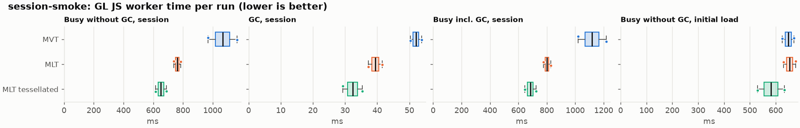
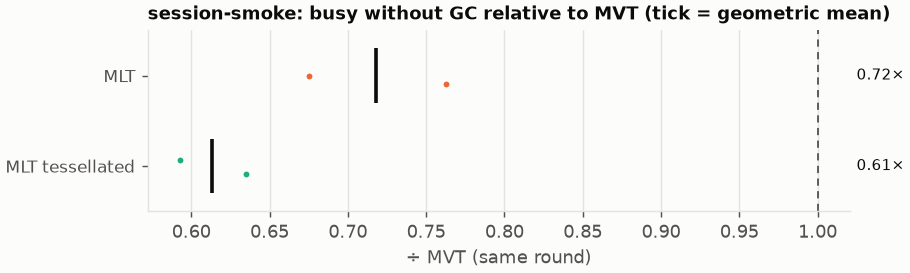
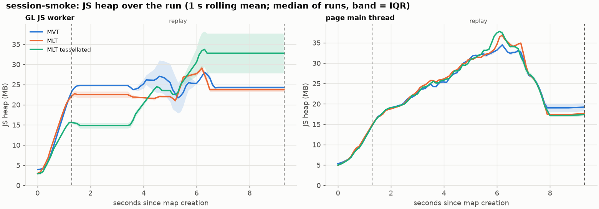
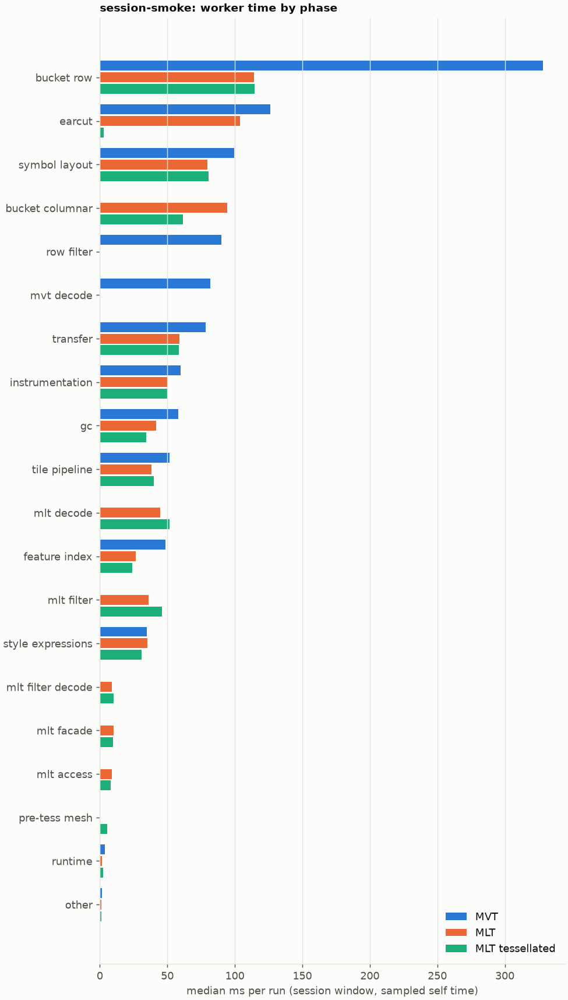
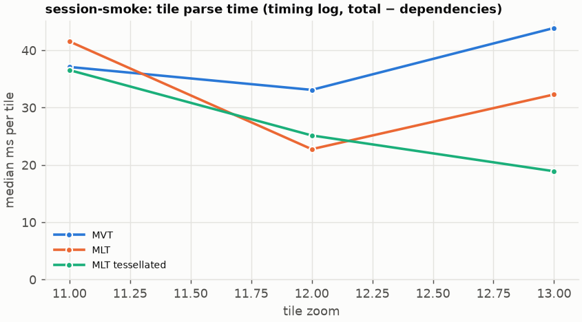
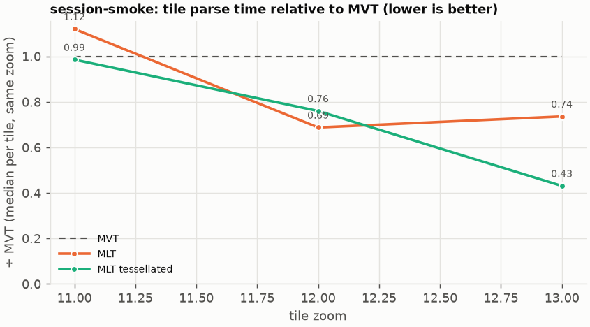

# Session trace benchmark — 20261022-141122-e2e

## Setup

- Created 2026-10-22T14:11:22+02:00; 2 repetitions + 1 warm-up round(s) (excluded); variants rotate per round (A B C, B C A, …); one cold browser context per run.
- Machine: 13th Gen Intel(R) Core(TM) i7-1365U, 12 logical cores, 31.3 GB RAM, Windows-11-10.0.26200-SP0; power: GUID des Energieschemas: 381b4222-f694-41f0-9685-ff5bb260df2e  (Ausbalanciert), AC True.
- GL JS gl7-performance-optimization @ f9bd50a8b5 (dirty); worker count 1; viewport {'width': 1280, 'height': 1024}.
- Python 3.12.2, packages {'playwright': '1.64.0', 'numpy': '2.5.3', 'matplotlib': '3.11.2'}.

| variant | bundle | format | bundle sha256 | branch build |
|---|---|---|---|---|
| MVT | `dist/maplibre-gl-dev.mjs` | mvt | `b2691453151d` | – |
| MLT | `dist/maplibre-gl-dev.mjs` | mlt | `b2691453151d` | – |
| MLT tessellated | `dist/maplibre-gl-dev.mjs` | mlt-pre-tess | `b2691453151d` | – |

| session | style | duration | frames | sha256 |
|---|---|---:|---:|---|
| session-smoke | osm-bright | 8.0 s | 360 | `31a0e49d65a0` |

CPU sampling interval (median over runs): 604 µs.

## Definitions

- **busy** = wall time in which a GL JS worker thread runs a task (union of top-level task slices and GC slices on `DedicatedWorker thread`s), summed over workers. **GC** = union of `MinorGC`/`MajorGC`/`V8.GC*` slices on those threads. **busy without GC** = busy − GC (headline metric).
- **CPU** = thread time (`tdur`) of the same slices. Phase categories and functions come from the trace's CPU samples (self time), categorised by `config/categories.toml` (nearest matching frame, leaf to root).
- Windows: **load** = map creation → first idle; **session** = camera replay; **tail** = end of replay → idle; **total** = load + session + tail.
- Ratios are against **MVT**: ratio of medians with a bootstrap 95 % CI, the geometric mean of per-round ratios, and a two-sided Mann–Whitney U p-value (normal approximation, not corrected for multiple comparisons; rough below n = 8). Lower than 1× means less worker time.

## Session `session-smoke`

### Worker busy without GC (session window)

| variant | n ok / failed | median ms | IQR | mean | ratio vs MVT | 95 % CI | geo-mean paired | MWU p |
|---|---:|---:|---:|---:|---:|---:|---:|---:|
| MVT | 2 / 0 | 1,066 | 1,018–1,115 | 1,066 | 1.00× | – | – | – |
| MLT | 2 / 0 | 762.5 | 750.9–774.1 | 762.5 | 0.72× | 0.64–0.81× | 0.72× | 0.245 |
| MLT tessellated | 2 / 0 | 652.4 | 633.7–671.0 | 652.4 | 0.61× | 0.53–0.71× | 0.61× | 0.245 |

### All worker metrics (median, ratio vs baseline)

| metric | MVT | MLT | MLT tessellated |
|---|---:|---:|---:|
| busy incl. GC | 1,118 | 801.9 (0.72×) | 684.7 (0.61×) |
| &nbsp;&nbsp;of which GC | 52.1 | 39.5 (0.76×) | 32.3 (0.62×) |
| &nbsp;&nbsp;of which busy without GC | 1,066 | 762.5 (0.72×) | 652.4 (0.61×) |
| &nbsp;&nbsp;&nbsp;&nbsp;of which filtering (sampled, incl. callees) | 89.9 | 36.3 (0.40×) | 45.8 (0.51×) |
| &nbsp;&nbsp;&nbsp;&nbsp;of which column decoding inside the MLT filter (sampled) | 0.0 | 9.0 | 10.1 |
| &nbsp;&nbsp;&nbsp;&nbsp;of which timing instrumentation (sampled) | 60.0 | 49.9 (0.83×) | 49.9 (0.83×) |
| busy without GC and instrumentation | 1,006 | 712.6 (0.71×) | 602.4 (0.60×) |
| CPU time without GC | 979.0 | 701.4 (0.72×) | 599.6 (0.61×) |
| tile: download end → sent to main thread, median per tile | 559.3 | 413.1 (0.74×) | 298.2 (0.53×) |
| tile: download end → sent to main thread, 90th percentile | 624.6 | 457.6 (0.73×) | 328.3 (0.53×) |
| tile: download end → sent to main thread, 95th percentile | 628.6 | 461.8 (0.73×) | 332.9 (0.53×) |
| tile: download end → sent to main thread, 99th percentile | 633.4 | 464.3 (0.73×) | 344.3 (0.54×) |
| &nbsp;&nbsp;parse part (timing log, incl. waiting for glyphs/icons), median per tile | 242.0 | 173.9 (0.72×) | 151.9 (0.63×) |
| &nbsp;&nbsp;queue + hand-off part, median per tile | 242.8 | 170.7 (0.70×) | 146.0 (0.60×) |
| minor GCs | 17.00 | 10.50 (0.62×) | 6.50 (0.38×) |
| major GCs | 2.00 | 2.00 (1.00×) | 2.00 (1.00×) |
| peak worker heap (MB) | 48.5 | 47.6 (0.98×) | 44.1 (0.91×) |
| load: busy without GC | 648.2 | 653.5 (1.01×) | 581.8 (0.90×) |
| load: GC | 36.5 | 34.2 (0.94×) | 32.6 (0.89×) |
| total: busy without GC | 1,715 | 1,416 (0.83×) | 1,234 (0.72×) |

Rows marked *of which* are parts of the row above, not additional time. Tile rows are per-tile latencies (medians over tiles, then over runs), not sums: tiles overlap in time, and the medians of the parse and queue parts do not add up exactly to the median latency.

### Filtering (session window)

Sampled worker time spent in feature filtering, including everything the filter calls (expression evaluation, property access): **row filter** = the style-spec feature filter that MVT runs per feature, **mlt filter** = the columnar MLT filter (incl. the geometry-type selection), without the columns it decodes (see the next table). Medians per run; rules in `config/categories.toml`.

| variant | mlt filter | row filter | filtering | ratio vs MVT | 95 % CI | MWU p | share of sampled busy |
|---|---:|---:|---:|---:|---:|---:|---:|
| MVT | 0.0 | 89.9 | 89.9 | 1.00× | – | – | 8.5% |
| MLT | 36.3 | 0.0 | 36.3 | 0.40× | 0.38–0.43× | 0.245 | 4.8% |
| MLT tessellated | 45.8 | 0.0 | 45.8 | 0.51× | 0.45–0.57× | 0.245 | 7.2% |

**Filtering together with tile decoding.** The MLT decoder leaves columns encoded until something reads them, and the filter is usually the first reader: the columns it decodes (properties, and the geometry for `$type`) are **of which inside the filter** (phase *mlt filter decode*), the rest is *mlt decode* (geometry and columns read later, e.g. by paint properties and symbols). MVT decodes every feature's properties and geometry while it reads the tile (*mvt decode*), whether the filter keeps the feature or not. So **filtering** above compares the filters, and **decoding + filtering** compares all that the formats spend on decoding the tile and selecting features. **tile decoding** = *mvt decode* or *mlt decode* + *mlt filter decode*: work inside a call into a decoder. Reading data that is already decoded is not counted, as for MVT's feature objects: *mlt access* (row views, value getters, looking a column up by name) and the MLT facade (*mlt facade*). MVT decodes geometry only for the features its filter keeps, MLT decodes a layer's whole geometry column.

| variant | tile decoding | of which inside the filter | filtering | decoding + filtering | ratio vs MVT | 95 % CI | MWU p |
|---|---:|---:|---:|---:|---:|---:|---:|
| MVT | 81.8 | 0.0 | 89.9 | 171.7 | 1.00× | – | – |
| MLT | 53.9 | 9.0 | 36.3 | 90.2 | 0.53× | 0.47–0.59× | 0.245 |
| MLT tessellated | 61.7 | 10.1 | 45.8 | 107.5 | 0.63× | 0.57–0.69× | 0.245 |

Top 12 functions inside filtering and its column decoding (self time, mean ms per run):

| phase | function | source | MVT | MLT | MLT tessellated |
|---|---|---|---:|---:|---:|
| row filter | `evaluate` | node_modules/@maplibre/maplibre-gl-style-spec/dist/expression/compound_expression.mjs | 21.4 | 0.0 | 0.0 |
| row filter | `CompoundExpression.register.filter-==` | node_modules/@maplibre/maplibre-gl-style-spec/dist/expression/compound_expression.mjs | 12.9 | 0.0 | 0.0 |
| row filter | `evaluate` | node_modules/@maplibre/maplibre-gl-style-spec/dist/expression/index.mjs | 12.8 | 0.0 | 0.0 |
| row filter | `CompoundExpression.register.filter-in-small` | node_modules/@maplibre/maplibre-gl-style-spec/dist/expression/compound_expression.mjs | 11.1 | 0.0 | 0.0 |
| row filter | `CompoundExpression.register.all.overloads` | node_modules/@maplibre/maplibre-gl-style-spec/dist/expression/compound_expression.mjs | 9.8 | 0.0 | 0.0 |
| mlt filter | `scanDictionaryCodes` | maplibre-tile-spec/ts/dist/processing/filter/execution/filterKernel.js | 0.0 | 3.9 | 7.5 |
| mlt filter | `dictionaryRowMatches` | maplibre-tile-spec/ts/dist/processing/filter/execution/filterKernel.js | 0.0 | 6.8 | 6.4 |
| row filter | `CompoundExpression.register.filter-type-==` | node_modules/@maplibre/maplibre-gl-style-spec/dist/expression/compound_expression.mjs | 5.9 | 0.0 | 0.0 |
| mlt filter | `filterByGeometryType` | maplibre-tile-spec/ts/dist/vector/geometry/geometryVector.js | 0.0 | 5.2 | 5.7 |
| row filter | `filter` | node_modules/@maplibre/maplibre-gl-style-spec/dist/feature_filter/index.mjs | 5.4 | 0.0 | 0.0 |
| row filter | `geometryType` | node_modules/@maplibre/maplibre-gl-style-spec/dist/expression/evaluation_context.mjs | 2.4 | 0.0 | 0.0 |
| mlt filter | `executeNode` | maplibre-tile-spec/ts/dist/processing/filter/execution/filterExecution.js | 0.0 | 1.0 | 2.3 |

### Where the variants differ from MVT (session window, mean ms per run)

Open **[flame.html](flame.html)** to explore the call tree interactively: pick a variant, compare it with MVT (red = more time at the same call path, blue = less), click a frame to zoom in, and read the phase and function breakdown under it. Without a comparison, frames are coloured by phase: filtering is green in both formats, and the columns the MLT filter decodes on first access (*mlt filter decode*) are MLT blue frames under the green filter. `flame/*.txt` open in https://www.speedscope.app.

#### MLT vs MVT

**By phase** (sampled self time; the Δ column sums to the difference in sampled busy time):

| phase | MVT | MLT | Δ |
|---|---:|---:|---:|
| bucket columnar | 0.0 | 94.2 | +94.2 |
| mlt decode | 0.0 | 44.9 | +44.9 |
| mlt filter | 0.0 | 36.3 | +36.3 |
| mlt facade | 0.0 | 10.0 | +10.0 |
| mlt filter decode | 0.0 | 9.0 | +9.0 |
| mlt access | 0.0 | 8.8 | +8.8 |
| style expressions | 34.9 | 35.4 | +0.5 |
| other | 1.6 | 1.0 | -0.6 |
| runtime | 3.6 | 1.6 | -2.0 |
| instrumentation | 60.0 | 49.9 | -10.1 |
| tile pipeline | 51.8 | 38.4 | -13.5 |
| gc | 58.0 | 41.7 | -16.2 |
| transfer | 78.5 | 58.8 | -19.6 |
| symbol layout | 99.7 | 79.5 | -20.2 |
| feature index | 48.8 | 26.6 | -22.2 |
| earcut | 126.5 | 103.9 | -22.6 |
| mvt decode | 81.8 | 0.0 | -81.8 |
| row filter | 89.9 | 0.0 | -89.9 |
| bucket row | 328.1 | 114.3 | -213.8 |

**By source layer** (timing log: createBucket + populate + addFeatures, summed over the style layers that use it; wall time, includes GC pauses; total Δ -263 ms):

| source layer | type | MVT | MLT | Δ |
|---|---|---:|---:|---:|
| waterway | line | 4.3 | 7.5 | +3.2 |
| boundary | line | 2.9 | 5.5 | +2.6 |
| park | fill | 0.4 | 1.5 | +1.1 |
| transportation_name | symbol | 42.6 | 40.5 | -2.1 |
| waterway | symbol | 7.9 | 5.4 | -2.5 |
| place | symbol | 62.1 | 58.0 | -4.1 |
| water | fill | 20.0 | 15.1 | -4.9 |
| transportation | fill | 10.6 | 4.1 | -6.5 |
| landuse | fill | 42.9 | 29.8 | -13.1 |
| landcover | fill | 48.9 | 31.6 | -17.3 |
| building | fill | 250.9 | 144.3 | -106.6 |
| transportation | line | 350.8 | 237.8 | -113.0 |

**Functions with the largest self-time difference** (by function name, summed over source files):

| function | MVT | MLT | Δ |
|---|---:|---:|---:|
| `readScaledRings` | 0.0 | 11.2 | +11.2 |
| `writeEarcutFill` | 0.0 | 8.6 | +8.6 |
| `get` | 4.2 | 11.7 | +7.4 |
| `materializeSelectedFeatures` | 0.0 | 7.1 | +7.1 |
| `dictionaryRowMatches` | 0.0 | 6.8 | +6.8 |
| `filterByGeometryType` | 0.0 | 5.2 | +5.2 |
| `buildEarcutMesh` | 0.0 | 4.3 | +4.3 |
| `decodeFastPforInt32` | 0.0 | 4.1 | +4.1 |
| `scanDictionaryCodes` | 0.0 | 3.9 | +3.9 |
| `applyBlockExceptions` | 0.0 | 3.5 | +3.5 |
| `classifyRingRanges` | 0.0 | 3.3 | +3.3 |
| `registerGlyphs` | 0.0 | 3.3 | +3.3 |
| `readSVarint` | 46.2 | 0.0 | -46.2 |
| `_vertexToIndex` | 44.7 | 0.0 | -44.7 |
| `populate` | 57.2 | 19.5 | -37.7 |
| `evaluate` | 38.6 | 3.5 | -35.2 |
| `loadGeometry` | 26.1 | 3.7 | -22.4 |

#### MLT tessellated vs MVT

**By phase** (sampled self time; the Δ column sums to the difference in sampled busy time):

| phase | MVT | MLT tessellated | Δ |
|---|---:|---:|---:|
| bucket columnar | 0.0 | 61.7 | +61.7 |
| mlt decode | 0.0 | 51.6 | +51.6 |
| mlt filter | 0.0 | 45.8 | +45.8 |
| mlt filter decode | 0.0 | 10.1 | +10.1 |
| mlt facade | 0.0 | 9.8 | +9.8 |
| mlt access | 0.0 | 8.0 | +8.0 |
| pre-tess mesh | 0.0 | 5.6 | +5.6 |
| other | 1.6 | 1.1 | -0.5 |
| runtime | 3.6 | 2.6 | -1.0 |
| style expressions | 34.9 | 30.8 | -4.1 |
| instrumentation | 60.0 | 49.9 | -10.1 |
| tile pipeline | 51.8 | 39.8 | -12.1 |
| symbol layout | 99.7 | 80.7 | -19.0 |
| transfer | 78.5 | 58.4 | -20.1 |
| gc | 58.0 | 34.4 | -23.6 |
| feature index | 48.8 | 24.1 | -24.7 |
| mvt decode | 81.8 | 0.0 | -81.8 |
| row filter | 89.9 | 0.0 | -89.9 |
| earcut | 126.5 | 2.9 | -123.6 |
| bucket row | 328.1 | 114.8 | -213.3 |

**By source layer** (timing log: createBucket + populate + addFeatures, summed over the style layers that use it; wall time, includes GC pauses; total Δ -387 ms):

| source layer | type | MVT | MLT tessellated | Δ |
|---|---|---:|---:|---:|
| boundary | line | 2.9 | 6.4 | +3.5 |
| waterway | line | 4.3 | 7.2 | +2.9 |
| park | fill | 0.4 | 3.1 | +2.7 |
| aeroway | line | 0.3 | 1.0 | +0.7 |
| transportation | fill | 10.6 | 11.2 | +0.6 |
| place | symbol | 62.1 | 61.6 | -0.5 |
| waterway | symbol | 7.9 | 4.7 | -3.2 |
| water | fill | 20.0 | 10.0 | -10.0 |
| landuse | fill | 42.9 | 19.1 | -23.8 |
| landcover | fill | 48.9 | 20.8 | -28.1 |
| transportation | line | 350.8 | 240.1 | -110.7 |
| building | fill | 250.9 | 30.9 | -220.0 |

**Functions with the largest self-time difference** (by function name, summed over source files):

| function | MVT | MLT tessellated | Δ |
|---|---:|---:|---:|
| `scanDictionaryCodes` | 0.0 | 7.5 | +7.5 |
| `materializeSelectedFeatures` | 0.0 | 6.6 | +6.6 |
| `dictionaryRowMatches` | 0.0 | 6.4 | +6.4 |
| `filterByGeometryType` | 0.0 | 5.7 | +5.7 |
| `buildTessellatedBoundingBox` | 0.0 | 5.6 | +5.6 |
| `writeTessellatedFill` | 0.0 | 4.4 | +4.4 |
| `decodeUnsignedZigZagDeltaInt32` | 0.0 | 4.2 | +4.2 |
| `get` | 4.2 | 8.4 | +4.2 |
| `decodeComponentwiseDeltaVec2` | 0.0 | 3.4 | +3.4 |
| `addHalfVertex` | 11.4 | 14.7 | +3.3 |
| `decodeFastPforInt32` | 0.0 | 3.1 | +3.1 |
| `registerGlyphs` | 0.0 | 2.8 | +2.8 |
| `isEar` | 54.3 | 0.0 | -54.3 |
| `readSVarint` | 46.2 | 0.0 | -46.2 |
| `_vertexToIndex` | 44.7 | 0.0 | -44.7 |
| `populate` | 57.2 | 19.2 | -38.0 |
| `evaluate` | 38.6 | 3.0 | -35.6 |

### Memory (session window)

**JS heap** = V8's used heap of the thread (`jsHeapSizeUsed` from the trace's `UpdateCounters`, about every 20 ms; the mean is time-weighted). It does not include ArrayBuffer contents, so the tile data itself (vertex, index and feature-index arrays) is not in it: **tile data sent to the main thread** is the size of the ArrayBuffers each tile result transfers (`web/worker_hook.js`), which then live on the main thread and are uploaded to the GPU. **garbage collected** = heap freed by the worker's GCs, a measure of how much it allocates. Medians per run; ratio of medians with a bootstrap 95 % CI.

| metric | MVT | MLT | MLT tessellated |
|---|---:|---:|---:|
| worker JS heap, mean (MB) | 19.2 | 20.0 (1.04×, 0.96–1.12×) | 18.3 (0.95×, 0.92–0.99×) |
| worker JS heap, peak (MB) | 48.5 | 47.6 (0.98×, 0.88–1.09×) | 44.1 (0.91×, 0.88–0.94×) |
| worker JS heap after the last GC (MB) | 12.5 | 13.9 (1.11×, 1.04–1.19×) | 13.1 (1.05×, 1.02–1.08×) |
| garbage collected in the worker (MB) | 428.6 | 236.6 (0.55×, 0.54–0.56×) | 135.6 (0.32×, 0.31–0.33×) |
| main thread JS heap, mean (MB) | 22.7 | 22.5 (0.99×, 0.97–1.02×) | 22.4 (0.99×, 0.96–1.01×) |
| main thread JS heap, peak (MB) | 41.1 | 48.6 (1.18×, 1.12–1.25×) | 49.1 (1.19×, 1.15–1.24×) |
| main thread JS heap at the end of the replay (MB) | 19.2 | 17.5 (0.92×, 0.83–1.03×) | 17.3 (0.90×, 0.78–1.05×) |
| tile data sent to the main thread, total (MB) | 19.1 | 18.6 (0.97×, 0.97–0.97×) | 18.7 (0.98×, 0.98–0.98×) |
| tile data sent to the main thread, median per tile (KB) | 957.7 | 944.2 (0.99×, 0.99–0.99×) | 942.0 (0.98×, 0.98–0.98×) |

### Worker time by phase (session window, median ms of sampled self time)

| phase | MVT | MLT | MLT tessellated |
|---|---:|---:|---:|
| bucket row | 328.1 | 114.3 | 114.8 |
| earcut | 126.5 | 103.9 | 2.9 |
| symbol layout | 99.7 | 79.5 | 80.7 |
| bucket columnar | 0.0 | 94.2 | 61.7 |
| row filter | 89.9 | 0.0 | 0.0 |
| mvt decode | 81.8 | 0.0 | 0.0 |
| transfer | 78.5 | 58.8 | 58.4 |
| instrumentation | 60.0 | 49.9 | 49.9 |
| gc | 58.0 | 41.7 | 34.4 |
| tile pipeline | 51.8 | 38.4 | 39.8 |
| mlt decode | 0.0 | 44.9 | 51.6 |
| feature index | 48.8 | 26.6 | 24.1 |
| mlt filter | 0.0 | 36.3 | 45.8 |
| style expressions | 34.9 | 35.4 | 30.8 |
| mlt filter decode | 0.0 | 9.0 | 10.1 |
| mlt facade | 0.0 | 10.0 | 9.8 |
| mlt access | 0.0 | 8.8 | 8.0 |
| pre-tess mesh | 0.0 | 0.0 | 5.6 |
| runtime | 3.6 | 1.6 | 2.6 |
| other | 1.6 | 1.0 | 1.1 |

### Top 20 worker functions by self time (session window, mean ms per run)

| function | source | phase | MVT | MLT | MLT tessellated |
|---|---|---|---:|---:|---:|
| `reserve` | src/util/struct_array.ts | bucket row | 59.1 | 40.8 | 40.8 |
| `(garbage collector)` | (native) | gc | 58.0 | 41.7 | 34.4 |
| `isEar` | node_modules/earcut/src/earcut.js | earcut | 54.3 | 38.7 | 0.0 |
| `populate` | src/data/bucket/line_bucket.ts | bucket row | 49.1 | 0.0 | 0.0 |
| `readSVarint` | node_modules/pbf/index.js | mvt decode | 46.2 | 0.0 | 0.0 |
| `_vertexToIndex` | src/render/subdivision.ts | bucket row | 44.7 | 0.0 | 0.0 |
| `addPhase` | src/source/worker_timing.ts | instrumentation | 25.2 | 24.6 | 19.8 |
| `_trim` | src/util/struct_array.ts | transfer | 21.9 | 11.6 | 10.1 |
| `insert` | src/data/feature_index.ts | feature index | 21.8 | 7.2 | 8.6 |
| `evaluate` | node_modules/@maplibre/maplibre-gl-style-spec/dist/expression/compound_expression.mjs | row filter | 21.4 | 0.0 | 0.0 |
| `serialize` | src/util/web_worker_transfer.ts | transfer | 20.9 | 18.2 | 19.3 |
| `populate` | src/data/bucket/columnar/columnar_line_bucket.ts | bucket columnar | 0.0 | 16.9 | 17.7 |
| `emplace` | src/data/array_types.g.ts | bucket row | 17.6 | 16.5 | 17.0 |
| `parse` | src/source/worker_tile.ts | tile pipeline | 17.5 | 10.1 | 11.5 |
| `postMessage` | (native) | transfer | 16.0 | 15.9 | 14.9 |
| `self.postMessage` | worker_hook.js | instrumentation | 15.9 | 10.9 | 12.0 |
| `ProgramConfiguration` | src/data/program_configuration.ts | bucket row | 15.2 | 12.8 | 11.0 |
| `isEarHashed` | node_modules/earcut/src/earcut.js | earcut | 14.8 | 10.7 | 0.6 |
| `addHalfVertex` | src/data/bucket/line_bucket.ts | bucket row | 11.4 | 11.5 | 14.7 |
| `addLine` | src/data/bucket/line_bucket.ts | bucket row | 14.7 | 10.6 | 12.8 |

### Top 20 worker functions by total time (incl. callees) (session window, mean ms per run)

| function | source | phase | MVT | MLT | MLT tessellated |
|---|---|---|---:|---:|---:|
| `parse` | src/source/worker_tile.ts | tile pipeline | 868.3 | 619.3 | 506.5 |
| `loadTile` | src/source/vector_tile_worker_source.ts | tile pipeline | 772.7 | 541.6 | 427.0 |
| `_parseWorkerTile` | src/source/vector_tile_worker_source.ts | tile pipeline | 754.3 | 534.0 | 417.6 |
| `populate` | src/data/bucket/fill_bucket.ts | bucket row | 328.7 | 0.0 | 0.0 |
| `populate` | src/data/bucket/line_bucket.ts | bucket row | 298.7 | 0.0 | 0.0 |
| `addBucketFeatures` | src/data/bucket/fill_bucket.ts |  | 266.7 | 166.3 | 28.6 |
| `addFeature` | src/data/bucket/fill_bucket.ts | bucket row | 253.1 | 0.0 | 0.0 |
| `subdividePolygon` | src/render/subdivision.ts | bucket row | 215.5 | 0.0 | 0.0 |
| `subdividePolygonInternal` | src/render/subdivision.ts | bucket row | 212.9 | 0.0 | 0.0 |
| `populate` | src/data/bucket/columnar/columnar_line_bucket.ts | bucket columnar | 0.0 | 208.7 | 210.4 |
| `populate` | src/data/bucket/columnar/columnar_fill_bucket.ts | bucket columnar | 0.0 | 197.1 | 80.4 |
| `addFeature` | src/data/bucket/columnar/columnar_fill_bucket.ts |  | 0.0 | 166.1 | 25.5 |
| `writeEarcutFill` | src/data/bucket/columnar/columnar_mesh_arrays.ts | bucket columnar | 0.0 | 164.6 | 6.2 |
| `earcut` | node_modules/earcut/src/earcut.js | earcut | 126.2 | 103.6 | 2.9 |
| `buildEarcutMesh` | src/data/bucket/columnar/columnar_mesh_arrays.ts | bucket columnar | 0.0 | 112.2 | 3.8 |
| `processTask` | src/util/actor.ts |  | 111.7 | 78.5 | 77.8 |
| `earcutLinked` | node_modules/earcut/src/earcut.js | earcut | 98.9 | 81.6 | 2.0 |
| `completeTask` | src/util/actor.ts |  | 95.2 | 67.1 | 65.8 |
| `addFeatures` | src/data/bucket/symbol_bucket.ts | symbol layout | 92.7 | 68.7 | 70.9 |
| `filter` | node_modules/@maplibre/maplibre-gl-style-spec/dist/feature_filter/index.mjs | row filter | 89.9 | 0.0 | 0.0 |

### Tile parse time by zoom (timing log, median ms per tile, total − dependencies)

| zoom | MVT | MLT | MLT tessellated |
|---:|---:|---:|---:|
| 11 | 37.10 (n=18) | 41.55 (n=18) | 36.55 (n=18) |
| 12 | 33.10 (n=18) | 22.75 (n=18) | 25.15 (n=18) |
| 13 | 43.90 (n=24) | 32.30 (n=24) | 18.90 (n=24) |

### Tile latency by zoom: download end → result sent to the main thread (session window, ms per tile: median / p95 / p99)

Includes waiting in the worker's queue, the parse and posting the result; see `tile_latency.csv` for the per-tile split (`parse_ms`, `wait_ms`). Percentiles over the tiles of all runs; with few tiles (n) p99 is close to the maximum.

| zoom | MVT | MLT | MLT tessellated |
|---:|---:|---:|---:|
| 12 | 383.1 / 542.3 / 551.1 (n=18) | 280.1 / 313.1 / 318.1 (n=18) | 309.4 / 360.9 / 370.3 (n=18) |
| 13 | 599.8 / 634.4 / 640.9 (n=24) | 438.3 / 480.9 / 482.3 (n=24) | 292.1 / 312.5 / 325.9 (n=24) |

## Runs

9 ok, 0 failed/aborted, 0 not run, 6 used in statistics.

## Validity checks

- Counted once: all 9 analysed runs pass (windows load + session + tail add up to total; phases add up to the sampled busy time; GC and sampled time lie within busy time; no timing-log line twice).
- other programs used 3.73–4.88 logical processors during the replays (median 4.31)
- 6 run(s) with more than 0.5 cores of background load: session-smoke/mlt/rep-01 (4.60), session-smoke/mlt-pre-tess/rep-01 (4.12), session-smoke/mvt/rep-01 (4.88), session-smoke/mlt-pre-tess/rep-02 (3.90), session-smoke/mvt/rep-02 (4.31), session-smoke/mlt/rep-02 (3.73)

## Files

- `runs.csv`: one row per run (incl. failed and warm-up runs), every scalar metric as `<window>.<metric>`.
- `summary.csv`: session × variant × metric statistics.
- `functions.csv`, `categories.csv`: CPU-sample self/total time per function and phase per run and window.
- `category_functions.csv`: self time per phase × function (e.g. what the filters spend their time on).
- `tiles.csv`, `tile_layers.csv`, `tile_phases.csv`: the per-tile worker timing log, long format.
- `flame.html`: interactive call tree per variant with a diff view; `flame/*.txt`: collapsed stacks for speedscope.
- `analysis/stacks.csv` (per run): sampled self time per full call stack.
- `tile_latency.csv`: per tile request, worker clock: received, download start/end, result sent, latency = sent − download end, parse_ms, wait_ms = latency − parse.
- `runs/<session>/<variant>/rep-NN/trace.json.gz`: the raw trace (opens in the DevTools Performance tab).
