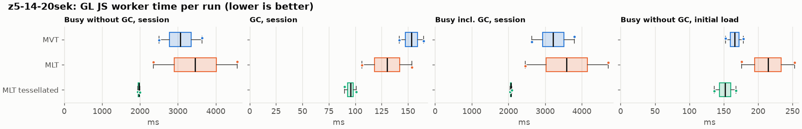
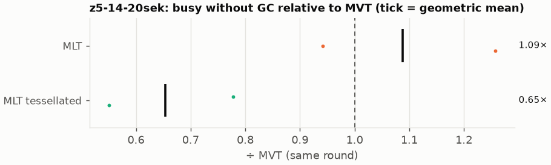
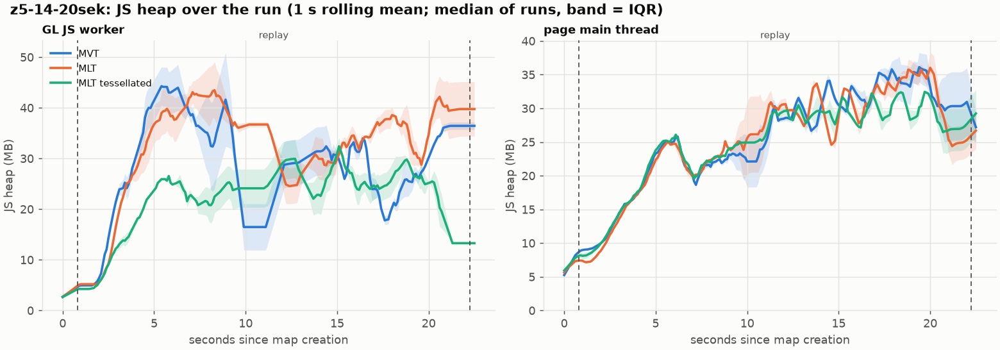
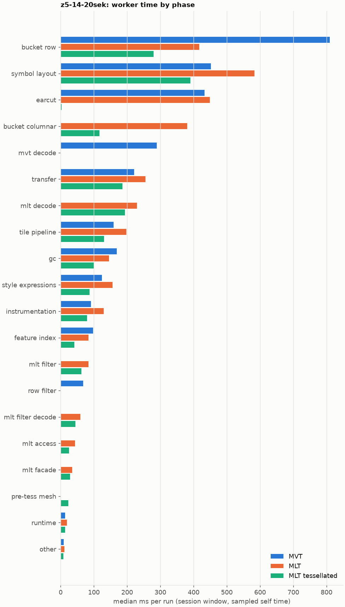
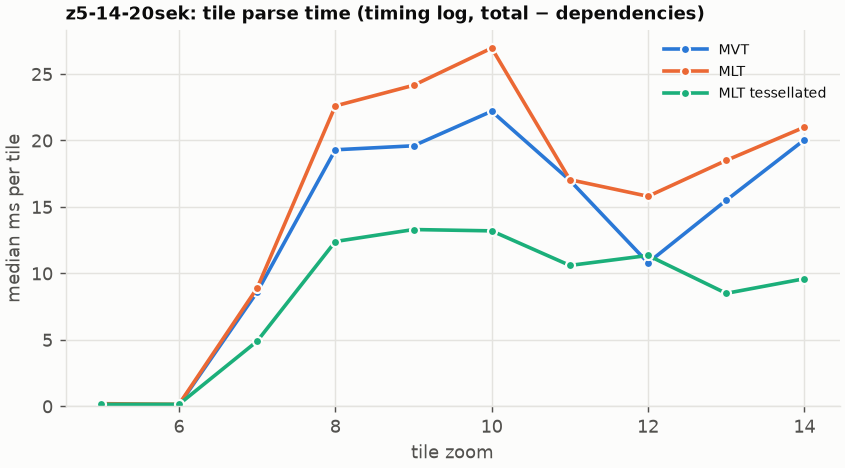
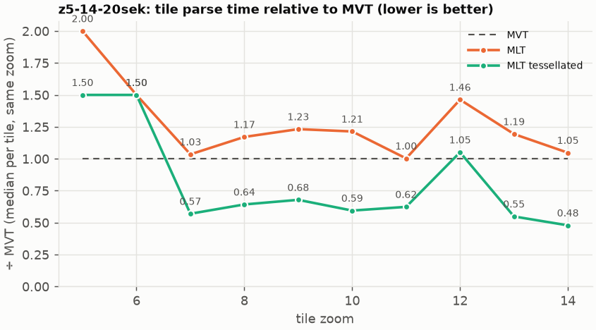

# Session trace benchmark — 20261022-144000

## Setup

- Created 2026-10-22T14:40:00+02:00; 2 repetitions + 1 warm-up round(s) (excluded); variants rotate per round (A B C, B C A, …); one cold browser context per run.
- Machine: 13th Gen Intel(R) Core(TM) i7-1365U, 12 logical cores, 31.3 GB RAM, Windows-11-10.0.26200-SP0; power: GUID des Energieschemas: 381b4222-f694-41f0-9685-ff5bb260df2e  (Ausbalanciert), AC True.
- GL JS gl7-performance-optimization @ f9bd50a8b5 (dirty); worker count 1; viewport {'width': 1280, 'height': 1024}.
- Python 3.12.2, packages {'playwright': '1.64.0', 'numpy': '2.5.3', 'matplotlib': '3.11.2'}.

| variant | bundle | format | bundle sha256 | branch build |
|---|---|---|---|---|
| MVT | `dist/maplibre-gl-dev.mjs` | mvt | `b2691453151d` | – |
| MLT | `dist/maplibre-gl-dev.mjs` | mlt | `b2691453151d` | – |
| MLT tessellated | `dist/maplibre-gl-dev.mjs` | mlt-pre-tess | `b2691453151d` | – |

| session | style | duration | frames | sha256 |
|---|---|---:|---:|---|
| z5-14-20sek | maptiler-basic | 21.4 s | 829 | `5a376e5ede30` |

CPU sampling interval (median over runs): 586 µs.

## Definitions

- **busy** = wall time in which a GL JS worker thread runs a task (union of top-level task slices and GC slices on `DedicatedWorker thread`s), summed over workers. **GC** = union of `MinorGC`/`MajorGC`/`V8.GC*` slices on those threads. **busy without GC** = busy − GC (headline metric).
- **CPU** = thread time (`tdur`) of the same slices. Phase categories and functions come from the trace's CPU samples (self time), categorised by `config/categories.toml` (nearest matching frame, leaf to root).
- Windows: **load** = map creation → first idle; **session** = camera replay; **tail** = end of replay → idle; **total** = load + session + tail.
- Ratios are against **MVT**: ratio of medians with a bootstrap 95 % CI, the geometric mean of per-round ratios, and a two-sided Mann–Whitney U p-value (normal approximation, not corrected for multiple comparisons; rough below n = 8). Lower than 1× means less worker time.

## Session `z5-14-20sek`

### Worker busy without GC (session window)

| variant | n ok / failed | median ms | IQR | mean | ratio vs MVT | 95 % CI | geo-mean paired | MWU p |
|---|---:|---:|---:|---:|---:|---:|---:|---:|
| MVT | 2 / 0 | 3,064 | 2,781–3,348 | 3,064 | 1.00× | – | – | – |
| MLT | 2 / 0 | 3,459 | 2,905–4,012 | 3,459 | 1.13× | 0.65–1.83× | 1.09× | 1.000 |
| MLT tessellated | 2 / 0 | 1,970 | 1,956–1,984 | 1,970 | 0.64× | 0.53–0.80× | 0.65× | 0.245 |

### All worker metrics (median, ratio vs baseline)

| metric | MVT | MLT | MLT tessellated |
|---|---:|---:|---:|
| busy incl. GC | 3,218 | 3,589 (1.12×) | 2,065 (0.64×) |
| &nbsp;&nbsp;of which GC | 153.3 | 130.2 (0.85×) | 95.5 (0.62×) |
| &nbsp;&nbsp;of which busy without GC | 3,064 | 3,459 (1.13×) | 1,970 (0.64×) |
| &nbsp;&nbsp;&nbsp;&nbsp;of which filtering (sampled, incl. callees) | 68.1 | 83.4 (1.22×) | 62.5 (0.92×) |
| &nbsp;&nbsp;&nbsp;&nbsp;of which column decoding inside the MLT filter (sampled) | 0.0 | 59.7 | 43.9 |
| &nbsp;&nbsp;&nbsp;&nbsp;of which timing instrumentation (sampled) | 91.1 | 129.1 (1.42×) | 79.8 (0.88×) |
| busy without GC and instrumentation | 2,973 | 3,330 (1.12×) | 1,890 (0.64×) |
| CPU time without GC | 2,815 | 3,140 (1.12×) | 1,814 (0.64×) |
| tile: download end → sent to main thread, median per tile | 160.1 | 176.2 (1.10×) | 93.8 (0.59×) |
| tile: download end → sent to main thread, 90th percentile | 315.9 | 336.8 (1.07×) | 182.5 (0.58×) |
| tile: download end → sent to main thread, 95th percentile | 333.8 | 383.9 (1.15×) | 227.7 (0.68×) |
| tile: download end → sent to main thread, 99th percentile | 358.9 | 420.1 (1.17×) | 244.0 (0.68×) |
| &nbsp;&nbsp;parse part (timing log, incl. waiting for glyphs/icons), median per tile | 80.7 | 86.5 (1.07×) | 48.1 (0.60×) |
| &nbsp;&nbsp;queue + hand-off part, median per tile | 66.1 | 74.2 (1.12×) | 41.4 (0.63×) |
| minor GCs | 58.00 | 50.00 (0.86×) | 35.00 (0.60×) |
| major GCs | 4.50 | 2.50 (0.56×) | 5.50 (1.22×) |
| peak worker heap (MB) | 59.0 | 60.3 (1.02×) | 44.2 (0.75×) |
| load: busy without GC | 165.8 | 214.5 (1.29×) | 152.0 (0.92×) |
| load: GC | 5.2 | 6.6 (1.29×) | 4.2 (0.81×) |
| total: busy without GC | 3,230 | 3,673 (1.14×) | 2,122 (0.66×) |

Rows marked *of which* are parts of the row above, not additional time. Tile rows are per-tile latencies (medians over tiles, then over runs), not sums: tiles overlap in time, and the medians of the parse and queue parts do not add up exactly to the median latency.

### Filtering (session window)

Sampled worker time spent in feature filtering, including everything the filter calls (expression evaluation, property access): **row filter** = the style-spec feature filter that MVT runs per feature, **mlt filter** = the columnar MLT filter (incl. the geometry-type selection), without the columns it decodes (see the next table). Medians per run; rules in `config/categories.toml`.

| variant | mlt filter | row filter | filtering | ratio vs MVT | 95 % CI | MWU p | share of sampled busy |
|---|---:|---:|---:|---:|---:|---:|---:|
| MVT | 0.3 | 67.8 | 68.1 | 1.00× | – | – | 2.3% |
| MLT | 83.4 | 0.0 | 83.4 | 1.22× | 0.63–2.10× | 1.000 | 2.5% |
| MLT tessellated | 62.5 | 0.0 | 62.5 | 0.92× | 0.72–1.20× | 1.000 | 3.4% |

**Filtering together with tile decoding.** The MLT decoder leaves columns encoded until something reads them, and the filter is usually the first reader: the columns it decodes (properties, and the geometry for `$type`) are **of which inside the filter** (phase *mlt filter decode*), the rest is *mlt decode* (geometry and columns read later, e.g. by paint properties and symbols). MVT decodes every feature's properties and geometry while it reads the tile (*mvt decode*), whether the filter keeps the feature or not. So **filtering** above compares the filters, and **decoding + filtering** compares all that the formats spend on decoding the tile and selecting features. **tile decoding** = *mvt decode* or *mlt decode* + *mlt filter decode*: work inside a call into a decoder. Reading data that is already decoded is not counted, as for MVT's feature objects: *mlt access* (row views, value getters, looking a column up by name) and the MLT facade (*mlt facade*). MVT decodes geometry only for the features its filter keeps, MLT decodes a layer's whole geometry column.

| variant | tile decoding | of which inside the filter | filtering | decoding + filtering | ratio vs MVT | 95 % CI | MWU p |
|---|---:|---:|---:|---:|---:|---:|---:|
| MVT | 288.9 | 0.0 | 68.1 | 357.0 | 1.00× | – | – |
| MLT | 289.3 | 59.7 | 83.4 | 372.7 | 1.04× | 0.58–1.73× | 1.000 |
| MLT tessellated | 237.0 | 43.9 | 62.5 | 299.5 | 0.84× | 0.68–1.08× | 1.000 |

Top 12 functions inside filtering and its column decoding (self time, mean ms per run):

| phase | function | source | MVT | MLT | MLT tessellated |
|---|---|---|---:|---:|---:|
| row filter | `evaluate` | node_modules/@maplibre/maplibre-gl-style-spec/dist/expression/index.mjs | 16.3 | 0.0 | 0.0 |
| row filter | `evaluate` | node_modules/@maplibre/maplibre-gl-style-spec/dist/expression/compound_expression.mjs | 13.6 | 0.0 | 0.0 |
| mlt filter | `filterByGeometryType` | maplibre-tile-spec/ts/dist/vector/geometry/geometryVector.js | 0.0 | 11.5 | 6.6 |
| mlt filter decode | `unpackNullable` | maplibre-tile-spec/ts/dist/decoding/unpackNullableUtils.js | 0.0 | 10.7 | 8.8 |
| mlt filter decode | `decodeFsst` | maplibre-tile-spec/ts/dist/decoding/fsstDecoder.js | 0.0 | 8.9 | 5.6 |
| row filter | `CompoundExpression.register.filter-in-small` | node_modules/@maplibre/maplibre-gl-style-spec/dist/expression/compound_expression.mjs | 8.9 | 0.0 | 0.0 |
| mlt filter | `scanDictionaryCodes` | maplibre-tile-spec/ts/dist/processing/filter/execution/filterKernel.js | 0.0 | 8.5 | 6.8 |
| row filter | `CompoundExpression.register.filter-==` | node_modules/@maplibre/maplibre-gl-style-spec/dist/expression/compound_expression.mjs | 6.8 | 0.0 | 0.0 |
| row filter | `filter` | node_modules/@maplibre/maplibre-gl-style-spec/dist/feature_filter/index.mjs | 6.6 | 0.0 | 0.0 |
| mlt filter | `dictionaryRowMatches` | maplibre-tile-spec/ts/dist/processing/filter/execution/filterKernel.js | 0.0 | 6.2 | 5.2 |
| mlt filter | `resolveDictionaryExecutor` | maplibre-tile-spec/ts/dist/processing/filter/execution/filterKernel.js | 0.0 | 2.6 | 4.6 |
| mlt filter | `executeGeometryTypeLeaf` | maplibre-tile-spec/ts/dist/processing/filter/execution/filterExecution.js | 0.0 | 4.3 | 1.6 |

### Where the variants differ from MVT (session window, mean ms per run)

Open **[flame.html](flame.html)** to explore the call tree interactively: pick a variant, compare it with MVT (red = more time at the same call path, blue = less), click a frame to zoom in, and read the phase and function breakdown under it. Without a comparison, frames are coloured by phase: filtering is green in both formats, and the columns the MLT filter decodes on first access (*mlt filter decode*) are MLT blue frames under the green filter. `flame/*.txt` open in https://www.speedscope.app.

#### MLT vs MVT

**By phase** (sampled self time; the Δ column sums to the difference in sampled busy time):

| phase | MVT | MLT | Δ |
|---|---:|---:|---:|
| bucket columnar | 0.0 | 380.5 | +380.5 |
| mlt decode | 0.0 | 229.5 | +229.5 |
| symbol layout | 451.9 | 583.2 | +131.3 |
| mlt filter | 0.3 | 83.4 | +83.1 |
| mlt filter decode | 0.0 | 59.7 | +59.7 |
| mlt access | 0.0 | 43.3 | +43.3 |
| instrumentation | 91.1 | 129.1 | +38.0 |
| tile pipeline | 159.8 | 197.6 | +37.8 |
| mlt facade | 0.3 | 35.1 | +34.8 |
| transfer | 221.2 | 254.9 | +33.6 |
| style expressions | 124.1 | 156.4 | +32.2 |
| earcut | 432.6 | 449.4 | +16.8 |
| runtime | 13.6 | 19.2 | +5.6 |
| other | 8.8 | 11.1 | +2.3 |
| feature index | 97.4 | 84.1 | -13.2 |
| gc | 168.5 | 145.2 | -23.3 |
| row filter | 67.8 | 0.0 | -67.8 |
| mvt decode | 288.9 | 0.0 | -288.9 |
| bucket row | 809.4 | 416.7 | -392.6 |

**By source layer** (timing log: createBucket + populate + addFeatures, summed over the style layers that use it; wall time, includes GC pauses; total Δ +295 ms):

| source layer | type | MVT | MLT | Δ |
|---|---|---:|---:|---:|
| place | symbol | 422.0 | 636.7 | +214.7 |
| transportation | line | 414.3 | 583.3 | +169.0 |
| transportation_name | symbol | 104.6 | 133.5 | +28.9 |
| waterway | line | 39.1 | 68.0 | +28.9 |
| poi | symbol | 32.3 | 59.0 | +26.7 |
| boundary | line | 28.9 | 53.2 | +24.4 |
| water | fill | 55.0 | 64.6 | +9.6 |
| aeroway | fill | 1.0 | 3.6 | +2.6 |
| aerodrome_label | symbol | 6.3 | 8.6 | +2.3 |
| landuse | fill | 374.8 | 313.0 | -61.8 |
| building | fill | 253.4 | 183.7 | -69.7 |
| landcover | fill | 551.8 | 468.7 | -83.0 |

**Functions with the largest self-time difference** (by function name, summed over source files):

| function | MVT | MLT | Δ |
|---|---:|---:|---:|
| `readScaledRings` | 0.0 | 53.2 | +53.2 |
| `buildEarcutMesh` | 0.0 | 35.0 | +35.0 |
| `writeEarcutFill` | 0.0 | 30.8 | +30.8 |
| `get` | 18.4 | 48.1 | +29.7 |
| `emplace` | 60.8 | 89.1 | +28.3 |
| `decodeComponentwiseDeltaVec2` | 0.0 | 25.9 | +25.9 |
| `(anonymous)` | 33.6 | 55.6 | +22.0 |
| `unpackNullable` | 0.0 | 19.9 | +19.9 |
| `addPhase` | 22.3 | 42.1 | +19.8 |
| `serialize` | 41.8 | 60.0 | +18.2 |
| `addHalfVertex` | 32.3 | 50.4 | +18.2 |
| `fetch` | 58.4 | 75.8 | +17.3 |
| `_vertexToIndex` | 151.1 | 0.0 | -151.1 |
| `readSVarint` | 118.9 | 0.0 | -118.9 |
| `loadGeometry` | 75.0 | 12.0 | -62.9 |
| `readVarint` | 45.0 | 2.9 | -42.2 |
| `readString` | 32.4 | 0.0 | -32.4 |

#### MLT tessellated vs MVT

**By phase** (sampled self time; the Δ column sums to the difference in sampled busy time):

| phase | MVT | MLT tessellated | Δ |
|---|---:|---:|---:|
| mlt decode | 0.0 | 193.1 | +193.1 |
| bucket columnar | 0.0 | 116.3 | +116.3 |
| mlt filter | 0.3 | 62.5 | +62.2 |
| mlt filter decode | 0.0 | 43.9 | +43.9 |
| mlt facade | 0.3 | 28.1 | +27.8 |
| mlt access | 0.0 | 25.5 | +25.5 |
| pre-tess mesh | 0.0 | 23.0 | +23.0 |
| other | 8.8 | 7.9 | -0.9 |
| instrumentation | 91.1 | 79.8 | -11.3 |
| tile pipeline | 159.8 | 130.9 | -28.9 |
| transfer | 221.2 | 185.7 | -35.6 |
| style expressions | 124.1 | 87.2 | -36.9 |
| feature index | 97.4 | 40.9 | -56.5 |
| symbol layout | 451.9 | 390.6 | -61.3 |
| row filter | 67.8 | 0.0 | -67.8 |
| gc | 168.5 | 99.7 | -68.8 |
| mvt decode | 288.9 | 0.0 | -288.9 |
| earcut | 432.6 | 2.7 | -429.9 |
| bucket row | 809.4 | 280.1 | -529.2 |

**By source layer** (timing log: createBucket + populate + addFeatures, summed over the style layers that use it; wall time, includes GC pauses; total Δ -977 ms):

| source layer | type | MVT | MLT tessellated | Δ |
|---|---|---:|---:|---:|
| place | symbol | 422.0 | 432.9 | +11.0 |
| boundary | line | 28.9 | 32.5 | +3.6 |
| waterway | line | 39.1 | 42.0 | +2.9 |
| aeroway | line | 1.7 | 3.9 | +2.2 |
| aeroway | fill | 1.0 | 2.7 | +1.7 |
| transportation | fill | 13.9 | 15.0 | +1.1 |
| transportation_name | symbol | 104.6 | 81.5 | -23.1 |
| water | fill | 55.0 | 30.7 | -24.3 |
| transportation | line | 414.3 | 389.6 | -24.7 |
| building | fill | 253.4 | 38.9 | -214.5 |
| landuse | fill | 374.8 | 89.2 | -285.6 |
| landcover | fill | 551.8 | 123.4 | -428.3 |

**Functions with the largest self-time difference** (by function name, summed over source files):

| function | MVT | MLT tessellated | Δ |
|---|---:|---:|---:|
| `buildTessellatedBoundingBox` | 0.0 | 22.2 | +22.2 |
| `decodeUnsignedZigZagDeltaInt32` | 0.0 | 19.9 | +19.9 |
| `decodeComponentwiseDeltaVec2` | 0.0 | 18.9 | +18.9 |
| `unpackNullable` | 0.0 | 13.0 | +13.0 |
| `appendSymbolFeature` | 0.0 | 11.4 | +11.4 |
| `registerGlyphs` | 0.0 | 10.0 | +10.0 |
| `decodeString$2` | 0.0 | 9.9 | +9.9 |
| `decodeFastPforInt32` | 0.0 | 9.9 | +9.9 |
| `appendScaledVertices` | 0.0 | 9.5 | +9.5 |
| `decodeBigEndianInt32sInto` | 0.0 | 9.5 | +9.5 |
| `writeTessellatedFill` | 0.0 | 7.7 | +7.7 |
| `materializeSelectedFeatures` | 0.0 | 7.3 | +7.3 |
| `_vertexToIndex` | 151.1 | 0.0 | -151.1 |
| `isEar` | 128.1 | 0.3 | -127.8 |
| `readSVarint` | 118.9 | 0.0 | -118.9 |
| `isEarHashed` | 81.4 | 0.0 | -81.4 |
| `(garbage collector)` | 168.5 | 99.7 | -68.8 |

### Memory (session window)

**JS heap** = V8's used heap of the thread (`jsHeapSizeUsed` from the trace's `UpdateCounters`, about every 20 ms; the mean is time-weighted). It does not include ArrayBuffer contents, so the tile data itself (vertex, index and feature-index arrays) is not in it: **tile data sent to the main thread** is the size of the ArrayBuffers each tile result transfers (`web/worker_hook.js`), which then live on the main thread and are uploaded to the GPU. **garbage collected** = heap freed by the worker's GCs, a measure of how much it allocates. Medians per run; ratio of medians with a bootstrap 95 % CI.

| metric | MVT | MLT | MLT tessellated |
|---|---:|---:|---:|
| worker JS heap, mean (MB) | 22.2 | 27.9 (1.26×, 1.15–1.38×) | 18.7 (0.84×, 0.69–1.01×) |
| worker JS heap, peak (MB) | 59.0 | 60.3 (1.02×, 0.84–1.26×) | 44.2 (0.75×, 0.66–0.87×) |
| worker JS heap after the last GC (MB) | 15.6 | 25.8 (1.65×, 1.51–1.80×) | 9.7 (0.62×, 0.58–0.68×) |
| garbage collected in the worker (MB) | 1,272 | 859.5 (0.68×, 0.67–0.68×) | 509.5 (0.40×, 0.40–0.40×) |
| main thread JS heap, mean (MB) | 23.8 | 23.6 (0.99×, 0.93–1.06×) | 22.8 (0.96×, 0.90–1.02×) |
| main thread JS heap, peak (MB) | 46.0 | 46.5 (1.01×, 0.86–1.19×) | 42.8 (0.93×, 0.84–1.04×) |
| main thread JS heap at the end of the replay (MB) | 30.6 | 25.2 (0.82×, 0.50–1.47×) | 27.2 (0.89×, 0.51–1.64×) |
| tile data sent to the main thread, total (MB) | 72.5 | 68.3 (0.94×, 0.93–0.95×) | 69.6 (0.96×, 0.96–0.96×) |
| tile data sent to the main thread, median per tile (KB) | 501.7 | 467.6 (0.93×, 0.90–0.96×) | 471.1 (0.94×, 0.94–0.94×) |

### Worker time by phase (session window, median ms of sampled self time)

| phase | MVT | MLT | MLT tessellated |
|---|---:|---:|---:|
| bucket row | 809.4 | 416.7 | 280.1 |
| symbol layout | 451.9 | 583.2 | 390.6 |
| earcut | 432.6 | 449.4 | 2.7 |
| bucket columnar | 0.0 | 380.5 | 116.3 |
| mvt decode | 288.9 | 0.0 | 0.0 |
| transfer | 221.2 | 254.9 | 185.7 |
| mlt decode | 0.0 | 229.5 | 193.1 |
| tile pipeline | 159.8 | 197.6 | 130.9 |
| gc | 168.5 | 145.2 | 99.7 |
| style expressions | 124.1 | 156.4 | 87.2 |
| instrumentation | 91.1 | 129.1 | 79.8 |
| feature index | 97.4 | 84.1 | 40.9 |
| mlt filter | 0.3 | 83.4 | 62.5 |
| row filter | 67.8 | 0.0 | 0.0 |
| mlt filter decode | 0.0 | 59.7 | 43.9 |
| mlt access | 0.0 | 43.3 | 25.5 |
| mlt facade | 0.3 | 35.1 | 28.1 |
| pre-tess mesh | 0.0 | 0.0 | 23.0 |
| runtime | 13.6 | 19.2 | 13.8 |
| other | 8.8 | 11.1 | 7.9 |

### Top 20 worker functions by self time (session window, mean ms per run)

| function | source | phase | MVT | MLT | MLT tessellated |
|---|---|---|---:|---:|---:|
| `(garbage collector)` | (native) | gc | 168.5 | 145.2 | 99.7 |
| `_vertexToIndex` | src/render/subdivision.ts | bucket row | 151.1 | 0.0 | 0.0 |
| `isEar` | node_modules/earcut/src/earcut.js | earcut | 128.1 | 110.1 | 0.3 |
| `reserve` | src/util/struct_array.ts | bucket row | 118.6 | 126.7 | 90.6 |
| `readSVarint` | node_modules/pbf/index.js | mvt decode | 118.9 | 0.0 | 0.0 |
| `emplace` | src/data/array_types.g.ts | bucket row | 60.8 | 89.1 | 50.2 |
| `postMessage` | (native) | transfer | 72.5 | 81.9 | 70.4 |
| `isEarHashed` | node_modules/earcut/src/earcut.js | earcut | 81.4 | 80.8 | 0.0 |
| `fetch` | (native) | tile pipeline | 58.4 | 75.8 | 51.7 |
| `readScaledRings` | src/data/bucket/columnar/columnar_mesh_arrays.ts | bucket columnar | 0.0 | 53.2 | 0.6 |
| `addLine` | src/data/bucket/line_bucket.ts | bucket row | 36.3 | 51.2 | 37.0 |
| `insert` | src/data/feature_index.ts | feature index | 50.5 | 26.6 | 14.6 |
| `addHalfVertex` | src/data/bucket/line_bucket.ts | bucket row | 32.3 | 50.4 | 37.0 |
| `_trim` | src/util/struct_array.ts | transfer | 50.2 | 48.3 | 26.5 |
| `getGlyphAdvance` | src/symbol/tagged_string.ts | symbol layout | 39.8 | 48.3 | 31.5 |
| `serialize` | src/util/web_worker_transfer.ts | transfer | 32.4 | 47.6 | 30.7 |
| `earcutLinked` | node_modules/earcut/src/earcut.js | earcut | 40.6 | 46.7 | 0.6 |
| `ProgramConfiguration` | src/data/program_configuration.ts | bucket row | 33.3 | 45.3 | 24.2 |
| `readVarint` | node_modules/pbf/index.js | mvt decode | 45.0 | 0.0 | 0.0 |
| `loadGeometry` | node_modules/@mapbox/vector-tile/index.js | mvt decode | 43.2 | 0.0 | 0.0 |

### Top 20 worker functions by total time (incl. callees) (session window, mean ms per run)

| function | source | phase | MVT | MLT | MLT tessellated |
|---|---|---|---:|---:|---:|
| `parse` | src/source/worker_tile.ts | tile pipeline | 2,369 | 2,703 | 1,430 |
| `loadTile` | src/source/vector_tile_worker_source.ts | tile pipeline | 2,028 | 2,223 | 1,097 |
| `_parseWorkerTile` | src/source/vector_tile_worker_source.ts | tile pipeline | 1,921 | 2,139 | 1,042 |
| `populate` | src/data/bucket/fill_bucket.ts | bucket row | 1,124 | 0.0 | 0.0 |
| `populate` | src/data/bucket/columnar/columnar_fill_bucket.ts | bucket columnar | 0.0 | 932.3 | 253.6 |
| `addBucketFeatures` | src/data/bucket/fill_bucket.ts | bucket row | 918.9 | 770.7 | 66.2 |
| `addFeature` | src/data/bucket/fill_bucket.ts | bucket row | 850.1 | 0.0 | 0.0 |
| `addFeature` | src/data/bucket/columnar/columnar_fill_bucket.ts | bucket columnar | 0.0 | 744.8 | 58.4 |
| `writeEarcutFill` | src/data/bucket/columnar/columnar_mesh_arrays.ts | bucket columnar | 0.0 | 736.9 | 6.1 |
| `subdividePolygon` | src/render/subdivision.ts | bucket row | 715.2 | 0.0 | 0.0 |
| `subdividePolygonInternal` | src/render/subdivision.ts | bucket row | 712.1 | 0.0 | 0.0 |
| `populate` | src/data/bucket/columnar/columnar_line_bucket.ts | bucket columnar | 0.0 | 589.7 | 387.2 |
| `addFeatures` | src/data/bucket/symbol_bucket.ts | symbol layout | 410.3 | 517.4 | 344.2 |
| `performSymbolLayout` | src/symbol/symbol_layout.ts | symbol layout | 403.7 | 510.9 | 341.9 |
| `buildEarcutMesh` | src/data/bucket/columnar/columnar_mesh_arrays.ts | bucket columnar | 0.0 | 510.0 | 3.6 |
| `earcut` | node_modules/earcut/src/earcut.js | earcut | 431.3 | 449.2 | 2.7 |
| `populate` | src/data/bucket/line_bucket.ts | bucket row | 396.4 | 0.0 | 0.0 |
| `earcutLinked` | node_modules/earcut/src/earcut.js | earcut | 335.0 | 348.1 | 0.9 |
| `processTask` | src/util/actor.ts | transfer | 282.8 | 342.2 | 228.5 |
| `addFeature` | src/data/bucket/line_bucket.ts | bucket row | 217.6 | 293.3 | 206.2 |

### Tile parse time by zoom (timing log, median ms per tile, total − dependencies)

| zoom | MVT | MLT | MLT tessellated |
|---:|---:|---:|---:|
| 5 | 0.10 (n=18) | 0.20 (n=18) | 0.15 (n=18) |
| 6 | 0.10 (n=18) | 0.15 (n=18) | 0.15 (n=18) |
| 7 | 8.60 (n=12) | 8.90 (n=12) | 4.90 (n=12) |
| 8 | 19.30 (n=15) | 22.60 (n=15) | 12.40 (n=15) |
| 9 | 19.60 (n=32) | 24.15 (n=32) | 13.30 (n=32) |
| 10 | 22.20 (n=40) | 26.95 (n=40) | 13.20 (n=40) |
| 11 | 17.00 (n=31) | 17.05 (n=28) | 10.60 (n=30) |
| 12 | 10.80 (n=40) | 15.80 (n=43) | 11.35 (n=40) |
| 13 | 15.50 (n=42) | 18.50 (n=41) | 8.50 (n=42) |
| 14 | 20.05 (n=36) | 21.00 (n=36) | 9.60 (n=36) |

### Tile latency by zoom: download end → result sent to the main thread (session window, ms per tile: median / p95 / p99)

Includes waiting in the worker's queue, the parse and posting the result; see `tile_latency.csv` for the per-tile split (`parse_ms`, `wait_ms`). Percentiles over the tiles of all runs; with few tiles (n) p99 is close to the maximum.

| zoom | MVT | MLT | MLT tessellated |
|---:|---:|---:|---:|
| 6 | 44.7 / 66.9 / 68.1 (n=18) | 48.2 / 72.5 / 73.2 (n=18) | 42.5 / 61.9 / 62.4 (n=18) |
| 7 | 114.7 / 159.6 / 163.7 (n=12) | 100.2 / 106.8 / 107.2 (n=12) | 62.0 / 66.7 / 66.9 (n=12) |
| 8 | 199.7 / 220.0 / 220.8 (n=15) | 238.3 / 251.8 / 254.1 (n=15) | 120.6 / 127.5 / 130.2 (n=15) |
| 9 | 235.7 / 348.4 / 353.6 (n=32) | 256.6 / 363.6 / 363.9 (n=32) | 122.9 / 190.6 / 191.2 (n=32) |
| 10 | 294.0 / 383.8 / 389.1 (n=40) | 268.0 / 500.2 / 515.6 (n=40) | 169.0 / 278.0 / 282.1 (n=40) |
| 11 | 142.8 / 175.6 / 180.8 (n=31) | 121.8 / 326.7 / 337.2 (n=28) | 103.9 / 130.1 / 133.7 (n=30) |
| 12 | 99.2 / 164.1 / 167.6 (n=40) | 114.4 / 308.2 / 313.4 (n=43) | 58.7 / 178.2 / 180.5 (n=40) |
| 13 | 160.8 / 275.0 / 277.6 (n=42) | 192.8 / 368.7 / 370.4 (n=41) | 91.2 / 145.3 / 149.2 (n=42) |
| 14 | 202.9 / 314.6 / 327.8 (n=36) | 228.4 / 400.2 / 417.0 (n=36) | 97.8 / 169.6 / 175.7 (n=36) |

## Runs

9 ok, 0 failed/aborted, 0 not run, 6 used in statistics.

## Validity checks

- Counted once: all 9 analysed runs pass (windows load + session + tail add up to total; phases add up to the sampled busy time; GC and sampled time lie within busy time; no timing-log line twice).
- other programs used 4.57–8.66 logical processors during the replays (median 5.48)
- 6 run(s) with more than 0.5 cores of background load: z5-14-20sek/mlt/rep-01 (4.65), z5-14-20sek/mlt-pre-tess/rep-01 (4.78), z5-14-20sek/mvt/rep-01 (4.57), z5-14-20sek/mlt-pre-tess/rep-02 (5.48), z5-14-20sek/mvt/rep-02 (8.27), z5-14-20sek/mlt/rep-02 (8.66)
- 3 of 3 rounds parsed different tile sets across variants (e.g. z5-14-20sek round 0: mvt 125 tiles, mlt 121 tiles, mlt-pre-tess 126 tiles; z5-14-20sek round 1: mlt 130 tiles, mlt-pre-tess 129 tiles, mvt 130 tiles; z5-14-20sek round 2: mlt-pre-tess 130 tiles, mvt 128 tiles, mlt 123 tiles); expected where a session zooms past the last MVT level (MVT overzooms, MLT loads deeper tiles)

## Files

- `runs.csv`: one row per run (incl. failed and warm-up runs), every scalar metric as `<window>.<metric>`.
- `summary.csv`: session × variant × metric statistics.
- `functions.csv`, `categories.csv`: CPU-sample self/total time per function and phase per run and window.
- `category_functions.csv`: self time per phase × function (e.g. what the filters spend their time on).
- `tiles.csv`, `tile_layers.csv`, `tile_phases.csv`: the per-tile worker timing log, long format.
- `flame.html`: interactive call tree per variant with a diff view; `flame/*.txt`: collapsed stacks for speedscope.
- `analysis/stacks.csv` (per run): sampled self time per full call stack.
- `tile_latency.csv`: per tile request, worker clock: received, download start/end, result sent, latency = sent − download end, parse_ms, wait_ms = latency − parse.
- `runs/<session>/<variant>/rep-NN/trace.json.gz`: the raw trace (opens in the DevTools Performance tab).
