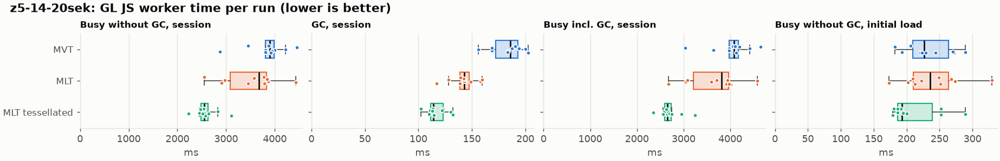
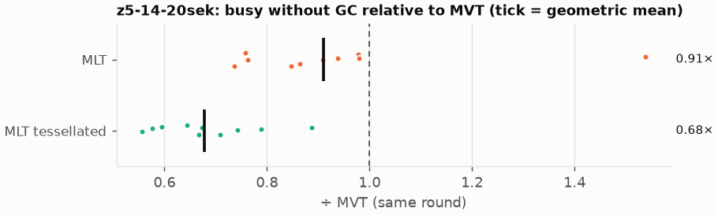
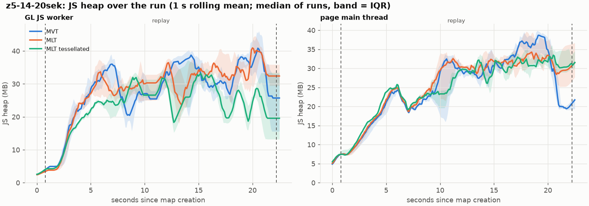
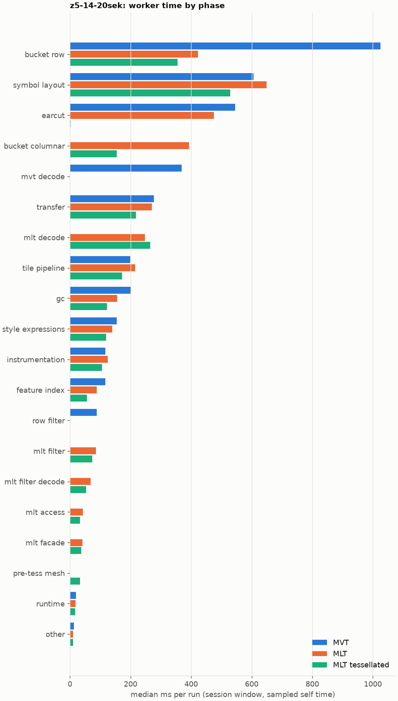
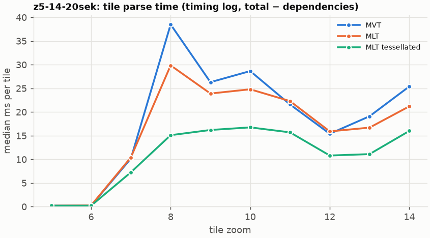
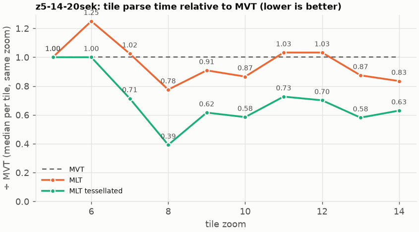

# Session trace benchmark — 20261022-144914

## Setup

- Created 2026-10-22T14:49:14+02:00; 10 repetitions + 1 warm-up round(s) (excluded); variants rotate per round (A B C, B C A, …); one cold browser context per run.
- Machine: 13th Gen Intel(R) Core(TM) i7-1365U, 12 logical cores, 31.3 GB RAM, Windows-11-10.0.26200-SP0; power: GUID des Energieschemas: 381b4222-f694-41f0-9685-ff5bb260df2e  (Ausbalanciert), AC True.
- GL JS gl7-performance-optimization @ f9bd50a8b5 (dirty); worker count 1; viewport {'width': 1280, 'height': 1024}.
- Python 3.12.2, packages {'playwright': '1.64.0', 'numpy': '2.5.3', 'matplotlib': '3.11.2'}.

| variant | bundle | format | bundle sha256 | branch build |
|---|---|---|---|---|
| MVT | `dist/maplibre-gl-dev.mjs` | mvt | `b2691453151d` | – |
| MLT | `dist/maplibre-gl-dev.mjs` | mlt | `b2691453151d` | – |
| MLT tessellated | `dist/maplibre-gl-dev.mjs` | mlt-pre-tess | `b2691453151d` | – |

| session | style | duration | frames | sha256 |
|---|---|---:|---:|---|
| z5-14-20sek | maptiler-basic | 21.4 s | 829 | `5a376e5ede30` |

CPU sampling interval (median over runs): 605 µs.

## Definitions

- **busy** = wall time in which a GL JS worker thread runs a task (union of top-level task slices and GC slices on `DedicatedWorker thread`s), summed over workers. **GC** = union of `MinorGC`/`MajorGC`/`V8.GC*` slices on those threads. **busy without GC** = busy − GC (headline metric).
- **CPU** = thread time (`tdur`) of the same slices. Phase categories and functions come from the trace's CPU samples (self time), categorised by `config/categories.toml` (nearest matching frame, leaf to root).
- Windows: **load** = map creation → first idle; **session** = camera replay; **tail** = end of replay → idle; **total** = load + session + tail.
- Ratios are against **MVT**: ratio of medians with a bootstrap 95 % CI, the geometric mean of per-round ratios, and a two-sided Mann–Whitney U p-value (normal approximation, not corrected for multiple comparisons; rough below n = 8). Lower than 1× means less worker time.

## Session `z5-14-20sek`

### Worker busy without GC (session window)

| variant | n ok / failed | median ms | IQR | mean | ratio vs MVT | 95 % CI | geo-mean paired | MWU p |
|---|---:|---:|---:|---:|---:|---:|---:|---:|
| MVT | 10 / 0 | 3,896 | 3,810–3,981 | 3,836 | 1.00× | – | – | – |
| MLT | 10 / 0 | 3,674 | 3,090–3,825 | 3,513 | 0.94× | 0.76–1.01× | 0.91× | 0.076 |
| MLT tessellated | 10 / 0 | 2,547 | 2,483–2,625 | 2,592 | 0.65× | 0.62–0.71× | 0.68× | <0.001 |

### All worker metrics (median, ratio vs baseline)

| metric | MVT | MLT | MLT tessellated |
|---|---:|---:|---:|
| busy incl. GC | 4,085 | 3,815 (0.93×) | 2,658 (0.65×) |
| &nbsp;&nbsp;of which GC | 185.7 | 142.8 (0.77×) | 113.9 (0.61×) |
| &nbsp;&nbsp;of which busy without GC | 3,896 | 3,674 (0.94×) | 2,547 (0.65×) |
| &nbsp;&nbsp;&nbsp;&nbsp;of which filtering (sampled, incl. callees) | 89.3 | 86.3 (0.97×) | 73.4 (0.82×) |
| &nbsp;&nbsp;&nbsp;&nbsp;of which column decoding inside the MLT filter (sampled) | 0.0 | 68.8 | 53.0 |
| &nbsp;&nbsp;&nbsp;&nbsp;of which timing instrumentation (sampled) | 116.6 | 124.2 (1.07×) | 105.3 (0.90×) |
| busy without GC and instrumentation | 3,783 | 3,553 (0.94×) | 2,444 (0.65×) |
| CPU time without GC | 3,552 | 3,319 (0.93×) | 2,296 (0.65×) |
| tile: download end → sent to main thread, median per tile | 190.6 | 181.9 (0.95×) | 135.1 (0.71×) |
| tile: download end → sent to main thread, 90th percentile | 436.4 | 357.8 (0.82×) | 261.3 (0.60×) |
| tile: download end → sent to main thread, 95th percentile | 481.1 | 397.1 (0.83×) | 277.1 (0.58×) |
| tile: download end → sent to main thread, 99th percentile | 492.5 | 434.5 (0.88×) | 299.1 (0.61×) |
| &nbsp;&nbsp;parse part (timing log, incl. waiting for glyphs/icons), median per tile | 104.0 | 97.0 (0.93×) | 70.5 (0.68×) |
| &nbsp;&nbsp;queue + hand-off part, median per tile | 78.0 | 73.3 (0.94×) | 52.6 (0.67×) |
| minor GCs | 58.50 | 49.50 (0.85×) | 35.00 (0.60×) |
| major GCs | 5.00 | 3.00 (0.60×) | 4.50 (0.90×) |
| peak worker heap (MB) | 52.0 | 56.7 (1.09×) | 46.5 (0.89×) |
| load: busy without GC | 226.2 | 235.9 (1.04×) | 192.9 (0.85×) |
| load: GC | 7.4 | 7.0 (0.95×) | 4.9 (0.66×) |
| total: busy without GC | 4,126 | 3,905 (0.95×) | 2,759 (0.67×) |

Rows marked *of which* are parts of the row above, not additional time. Tile rows are per-tile latencies (medians over tiles, then over runs), not sums: tiles overlap in time, and the medians of the parse and queue parts do not add up exactly to the median latency.

### Filtering (session window)

Sampled worker time spent in feature filtering, including everything the filter calls (expression evaluation, property access): **row filter** = the style-spec feature filter that MVT runs per feature, **mlt filter** = the columnar MLT filter (incl. the geometry-type selection), without the columns it decodes (see the next table). Medians per run; rules in `config/categories.toml`.

| variant | mlt filter | row filter | filtering | ratio vs MVT | 95 % CI | MWU p | share of sampled busy |
|---|---:|---:|---:|---:|---:|---:|---:|
| MVT | 0.0 | 89.0 | 89.3 | 1.00× | – | – | 2.3% |
| MLT | 86.3 | 0.0 | 86.3 | 0.97× | 0.84–1.18× | 1.000 | 2.6% |
| MLT tessellated | 73.4 | 0.0 | 73.4 | 0.82× | 0.71–0.97× | 0.031 | 3.2% |

**Filtering together with tile decoding.** The MLT decoder leaves columns encoded until something reads them, and the filter is usually the first reader: the columns it decodes (properties, and the geometry for `$type`) are **of which inside the filter** (phase *mlt filter decode*), the rest is *mlt decode* (geometry and columns read later, e.g. by paint properties and symbols). MVT decodes every feature's properties and geometry while it reads the tile (*mvt decode*), whether the filter keeps the feature or not. So **filtering** above compares the filters, and **decoding + filtering** compares all that the formats spend on decoding the tile and selecting features. **tile decoding** = *mvt decode* or *mlt decode* + *mlt filter decode*: work inside a call into a decoder. Reading data that is already decoded is not counted, as for MVT's feature objects: *mlt access* (row views, value getters, looking a column up by name) and the MLT facade (*mlt facade*). MVT decodes geometry only for the features its filter keeps, MLT decodes a layer's whole geometry column.

| variant | tile decoding | of which inside the filter | filtering | decoding + filtering | ratio vs MVT | 95 % CI | MWU p |
|---|---:|---:|---:|---:|---:|---:|---:|
| MVT | 369.3 | 0.0 | 89.3 | 456.8 | 1.00× | – | – |
| MLT | 316.0 | 68.8 | 86.3 | 406.9 | 0.89× | 0.73–0.99× | 0.026 |
| MLT tessellated | 316.0 | 53.0 | 73.4 | 391.8 | 0.86× | 0.78–0.92× | 0.014 |

Top 12 functions inside filtering and its column decoding (self time, mean ms per run):

| phase | function | source | MVT | MLT | MLT tessellated |
|---|---|---|---:|---:|---:|
| row filter | `evaluate` | node_modules/@maplibre/maplibre-gl-style-spec/dist/expression/compound_expression.mjs | 23.2 | 0.0 | 0.0 |
| row filter | `evaluate` | node_modules/@maplibre/maplibre-gl-style-spec/dist/expression/index.mjs | 20.2 | 0.0 | 0.0 |
| mlt filter decode | `unpackNullable` | maplibre-tile-spec/ts/dist/decoding/unpackNullableUtils.js | 0.0 | 14.3 | 11.8 |
| mlt filter | `filterByGeometryType` | maplibre-tile-spec/ts/dist/vector/geometry/geometryVector.js | 0.0 | 11.5 | 9.8 |
| row filter | `CompoundExpression.register.filter-==` | node_modules/@maplibre/maplibre-gl-style-spec/dist/expression/compound_expression.mjs | 10.0 | 0.0 | 0.0 |
| mlt filter | `scanDictionaryCodes` | maplibre-tile-spec/ts/dist/processing/filter/execution/filterKernel.js | 0.0 | 9.1 | 8.3 |
| row filter | `CompoundExpression.register.filter-in-small` | node_modules/@maplibre/maplibre-gl-style-spec/dist/expression/compound_expression.mjs | 8.7 | 0.0 | 0.0 |
| row filter | `filter` | node_modules/@maplibre/maplibre-gl-style-spec/dist/feature_filter/index.mjs | 7.5 | 0.0 | 0.0 |
| mlt filter | `dictionaryRowMatches` | maplibre-tile-spec/ts/dist/processing/filter/execution/filterKernel.js | 0.0 | 7.2 | 5.8 |
| mlt filter decode | `decodeFsst` | maplibre-tile-spec/ts/dist/decoding/fsstDecoder.js | 0.0 | 6.5 | 6.0 |
| mlt filter | `resolveDictionaryExecutor` | maplibre-tile-spec/ts/dist/processing/filter/execution/filterKernel.js | 0.0 | 5.7 | 5.0 |
| row filter | `CompoundExpression.register.filter-type-==` | node_modules/@maplibre/maplibre-gl-style-spec/dist/expression/compound_expression.mjs | 5.4 | 0.0 | 0.0 |

### Where the variants differ from MVT (session window, mean ms per run)

Open **[flame.html](flame.html)** to explore the call tree interactively: pick a variant, compare it with MVT (red = more time at the same call path, blue = less), click a frame to zoom in, and read the phase and function breakdown under it. Without a comparison, frames are coloured by phase: filtering is green in both formats, and the columns the MLT filter decodes on first access (*mlt filter decode*) are MLT blue frames under the green filter. `flame/*.txt` open in https://www.speedscope.app.

#### MLT vs MVT

**By phase** (sampled self time; the Δ column sums to the difference in sampled busy time):

| phase | MVT | MLT | Δ |
|---|---:|---:|---:|
| bucket columnar | 0.0 | 375.4 | +375.4 |
| mlt decode | 0.0 | 240.4 | +240.4 |
| mlt filter | 0.2 | 87.8 | +87.6 |
| mlt filter decode | 0.0 | 69.6 | +69.6 |
| mlt access | 0.0 | 41.1 | +41.1 |
| mlt facade | 0.1 | 39.5 | +39.4 |
| symbol layout | 598.5 | 622.7 | +24.2 |
| tile pipeline | 191.6 | 200.6 | +9.1 |
| instrumentation | 115.4 | 122.6 | +7.2 |
| other | 12.8 | 11.1 | -1.7 |
| runtime | 20.0 | 18.3 | -1.7 |
| transfer | 268.0 | 264.3 | -3.7 |
| style expressions | 154.0 | 135.6 | -18.5 |
| feature index | 118.6 | 83.4 | -35.3 |
| gc | 198.9 | 154.5 | -44.4 |
| earcut | 543.9 | 461.4 | -82.5 |
| row filter | 88.1 | 0.0 | -88.1 |
| mvt decode | 366.8 | 0.0 | -366.8 |
| bucket row | 1,016 | 411.8 | -604.3 |

**By source layer** (timing log: createBucket + populate + addFeatures, summed over the style layers that use it; wall time, includes GC pauses; total Δ -275 ms):

| source layer | type | MVT | MLT | Δ |
|---|---|---:|---:|---:|
| place | symbol | 549.8 | 655.2 | +105.4 |
| transportation | line | 546.2 | 579.3 | +33.1 |
| waterway | line | 43.2 | 64.3 | +21.1 |
| poi | symbol | 41.9 | 60.9 | +18.9 |
| boundary | line | 36.5 | 52.9 | +16.4 |
| transportation_name | symbol | 136.1 | 151.8 | +15.7 |
| aeroway | fill | 1.1 | 4.1 | +2.9 |
| aeroway | line | 2.0 | 4.2 | +2.2 |
| water | fill | 65.8 | 67.7 | +1.9 |
| building | fill | 326.7 | 183.6 | -143.1 |
| landuse | fill | 466.2 | 315.3 | -150.9 |
| landcover | fill | 677.5 | 478.1 | -199.4 |

**Functions with the largest self-time difference** (by function name, summed over source files):

| function | MVT | MLT | Δ |
|---|---:|---:|---:|
| `readScaledRings` | 0.0 | 56.5 | +56.5 |
| `writeEarcutFill` | 0.0 | 38.5 | +38.5 |
| `buildEarcutMesh` | 0.0 | 31.9 | +31.9 |
| `decodeComponentwiseDeltaVec2` | 0.0 | 27.8 | +27.8 |
| `unpackNullable` | 0.0 | 21.4 | +21.4 |
| `get` | 22.7 | 42.5 | +19.8 |
| `decodeString$2` | 0.0 | 16.5 | +16.5 |
| `registerGlyphs` | 0.0 | 14.9 | +14.9 |
| `appendSymbolFeature` | 0.0 | 14.8 | +14.8 |
| `decodeFastPforInt32` | 0.0 | 14.1 | +14.1 |
| `materializeSelectedFeatures` | 0.0 | 11.8 | +11.8 |
| `filterByGeometryType` | 0.0 | 11.5 | +11.5 |
| `_vertexToIndex` | 189.7 | 0.0 | -189.7 |
| `readSVarint` | 160.5 | 0.0 | -160.5 |
| `loadGeometry` | 89.9 | 13.8 | -76.1 |
| `readVarint` | 59.9 | 3.4 | -56.5 |
| `isEar` | 164.1 | 116.9 | -47.2 |

#### MLT tessellated vs MVT

**By phase** (sampled self time; the Δ column sums to the difference in sampled busy time):

| phase | MVT | MLT tessellated | Δ |
|---|---:|---:|---:|
| mlt decode | 0.0 | 263.6 | +263.6 |
| bucket columnar | 0.0 | 160.2 | +160.2 |
| mlt filter | 0.2 | 75.6 | +75.4 |
| mlt filter decode | 0.0 | 56.2 | +56.2 |
| mlt facade | 0.1 | 36.2 | +36.1 |
| mlt access | 0.0 | 34.2 | +34.2 |
| pre-tess mesh | 0.0 | 33.2 | +33.2 |
| other | 12.8 | 10.4 | -2.4 |
| runtime | 20.0 | 17.0 | -3.0 |
| instrumentation | 115.4 | 111.0 | -4.4 |
| tile pipeline | 191.6 | 177.6 | -14.0 |
| style expressions | 154.0 | 122.4 | -31.7 |
| transfer | 268.0 | 225.0 | -43.0 |
| feature index | 118.6 | 56.4 | -62.2 |
| symbol layout | 598.5 | 535.3 | -63.2 |
| gc | 198.9 | 127.1 | -71.8 |
| row filter | 88.1 | 0.0 | -88.1 |
| mvt decode | 366.8 | 0.0 | -366.8 |
| earcut | 543.9 | 2.5 | -541.4 |
| bucket row | 1,016 | 362.7 | -653.4 |

**By source layer** (timing log: createBucket + populate + addFeatures, summed over the style layers that use it; wall time, includes GC pauses; total Δ -1134 ms):

| source layer | type | MVT | MLT tessellated | Δ |
|---|---|---:|---:|---:|
| place | symbol | 549.8 | 574.3 | +24.4 |
| waterway | line | 43.2 | 58.2 | +15.0 |
| poi | symbol | 41.9 | 54.0 | +12.0 |
| boundary | line | 36.5 | 47.0 | +10.5 |
| transportation | fill | 16.7 | 21.1 | +4.4 |
| aeroway | fill | 1.1 | 4.1 | +3.0 |
| transportation_name | symbol | 136.1 | 125.9 | -10.2 |
| water | fill | 65.8 | 36.2 | -29.6 |
| transportation | line | 546.2 | 513.6 | -32.6 |
| building | fill | 326.7 | 55.8 | -270.9 |
| landuse | fill | 466.2 | 116.9 | -349.3 |
| landcover | fill | 677.5 | 164.3 | -513.3 |

**Functions with the largest self-time difference** (by function name, summed over source files):

| function | MVT | MLT tessellated | Δ |
|---|---:|---:|---:|
| `buildTessellatedBoundingBox` | 0.0 | 30.6 | +30.6 |
| `decodeUnsignedZigZagDeltaInt32` | 0.0 | 28.0 | +28.0 |
| `decodeComponentwiseDeltaVec2` | 0.0 | 23.6 | +23.6 |
| `unpackNullable` | 0.0 | 18.1 | +18.1 |
| `decodeString$2` | 0.0 | 15.6 | +15.6 |
| `writeTessellatedFill` | 0.0 | 15.1 | +15.1 |
| `appendSymbolFeature` | 0.0 | 14.5 | +14.5 |
| `decodeFastPforInt32` | 0.0 | 14.4 | +14.4 |
| `registerGlyphs` | 0.0 | 12.6 | +12.6 |
| `get` | 22.7 | 34.7 | +12.0 |
| `decodeBigEndianInt32sInto` | 0.0 | 10.9 | +10.9 |
| `fastUnpack256_4` | 0.0 | 10.5 | +10.5 |
| `_vertexToIndex` | 189.7 | 0.0 | -189.7 |
| `isEar` | 164.1 | 0.2 | -163.9 |
| `readSVarint` | 160.5 | 0.0 | -160.5 |
| `isEarHashed` | 102.7 | 0.0 | -102.7 |
| `loadGeometry` | 89.9 | 11.2 | -78.7 |

### Memory (session window)

**JS heap** = V8's used heap of the thread (`jsHeapSizeUsed` from the trace's `UpdateCounters`, about every 20 ms; the mean is time-weighted). It does not include ArrayBuffer contents, so the tile data itself (vertex, index and feature-index arrays) is not in it: **tile data sent to the main thread** is the size of the ArrayBuffers each tile result transfers (`web/worker_hook.js`), which then live on the main thread and are uploaded to the GPU. **garbage collected** = heap freed by the worker's GCs, a measure of how much it allocates. Medians per run; ratio of medians with a bootstrap 95 % CI.

| metric | MVT | MLT | MLT tessellated |
|---|---:|---:|---:|
| worker JS heap, mean (MB) | 22.7 | 24.0 (1.06×, 0.93–1.15×) | 20.9 (0.92×, 0.78–0.99×) |
| worker JS heap, peak (MB) | 52.0 | 56.7 (1.09×, 0.97–1.15×) | 46.5 (0.89×, 0.80–0.96×) |
| worker JS heap after the last GC (MB) | 19.0 | 24.0 (1.26×, 0.79–2.46×) | 10.0 (0.52×, 0.38–1.02×) |
| garbage collected in the worker (MB) | 1,287 | 871.4 (0.68×, 0.67–0.69×) | 500.7 (0.39×, 0.37–0.40×) |
| main thread JS heap, mean (MB) | 23.0 | 23.8 (1.03×, 0.97–1.11×) | 23.3 (1.01×, 0.96–1.08×) |
| main thread JS heap, peak (MB) | 49.2 | 44.5 (0.91×, 0.86–1.08×) | 44.3 (0.90×, 0.86–1.04×) |
| main thread JS heap at the end of the replay (MB) | 19.7 | 29.8 (1.51×, 1.17–1.95×) | 30.6 (1.55×, 1.44–1.82×) |
| tile data sent to the main thread, total (MB) | 72.4 | 68.8 (0.95×, 0.93–0.95×) | 69.3 (0.96×, 0.95–0.96×) |
| tile data sent to the main thread, median per tile (KB) | 509.1 | 484.5 (0.95×, 0.95–0.96×) | 471.1 (0.93×, 0.92–0.94×) |

### Worker time by phase (session window, median ms of sampled self time)

| phase | MVT | MLT | MLT tessellated |
|---|---:|---:|---:|
| bucket row | 1,024 | 422.9 | 355.9 |
| symbol layout | 605.9 | 649.2 | 529.0 |
| earcut | 545.0 | 475.5 | 2.3 |
| bucket columnar | 0.0 | 392.8 | 154.7 |
| mvt decode | 369.3 | 0.0 | 0.0 |
| transfer | 276.5 | 270.1 | 217.4 |
| mlt decode | 0.0 | 247.2 | 264.4 |
| tile pipeline | 198.6 | 215.1 | 172.2 |
| gc | 202.2 | 155.5 | 122.6 |
| style expressions | 154.7 | 139.2 | 120.0 |
| instrumentation | 116.6 | 124.2 | 105.3 |
| feature index | 116.5 | 88.0 | 56.1 |
| row filter | 89.0 | 0.0 | 0.0 |
| mlt filter | 0.0 | 86.3 | 73.4 |
| mlt filter decode | 0.0 | 68.8 | 53.0 |
| mlt access | 0.0 | 42.7 | 32.5 |
| mlt facade | 0.0 | 41.2 | 36.8 |
| pre-tess mesh | 0.0 | 0.0 | 33.6 |
| runtime | 19.9 | 18.0 | 17.2 |
| other | 12.5 | 9.8 | 9.7 |

### Top 20 worker functions by self time (session window, mean ms per run)

| function | source | phase | MVT | MLT | MLT tessellated |
|---|---|---|---:|---:|---:|
| `(garbage collector)` | (native) | gc | 198.9 | 154.5 | 127.1 |
| `_vertexToIndex` | src/render/subdivision.ts | bucket row | 189.7 | 0.0 | 0.0 |
| `isEar` | node_modules/earcut/src/earcut.js | earcut | 164.1 | 116.9 | 0.2 |
| `readSVarint` | node_modules/pbf/index.js | mvt decode | 160.5 | 0.0 | 0.0 |
| `reserve` | src/util/struct_array.ts | bucket row | 141.8 | 123.7 | 108.1 |
| `isEarHashed` | node_modules/earcut/src/earcut.js | earcut | 102.7 | 81.1 | 0.0 |
| `postMessage` | (native) | transfer | 77.5 | 83.9 | 76.4 |
| `emplace` | src/data/array_types.g.ts | bucket row | 78.6 | 80.3 | 65.8 |
| `fetch` | (native) | tile pipeline | 67.6 | 72.6 | 66.5 |
| `readVarint` | node_modules/pbf/index.js | mvt decode | 59.9 | 0.0 | 0.0 |
| `insert` | src/data/feature_index.ts | feature index | 59.8 | 25.6 | 18.4 |
| `_trim` | src/util/struct_array.ts | transfer | 57.6 | 46.8 | 34.6 |
| `populate` | src/data/bucket/line_bucket.ts | bucket row | 56.9 | 0.0 | 0.0 |
| `readScaledRings` | src/data/bucket/columnar/columnar_mesh_arrays.ts | bucket columnar | 0.0 | 56.5 | 0.3 |
| `addLine` | src/data/bucket/line_bucket.ts | bucket row | 48.7 | 55.1 | 46.4 |
| `earcutLinked` | node_modules/earcut/src/earcut.js | earcut | 52.6 | 45.0 | 0.3 |
| `serialize` | src/util/web_worker_transfer.ts | transfer | 50.8 | 51.1 | 42.8 |
| `addHalfVertex` | src/data/bucket/line_bucket.ts | bucket row | 46.0 | 49.5 | 45.5 |
| `getGlyphAdvance` | src/symbol/tagged_string.ts | symbol layout | 49.1 | 48.4 | 45.5 |
| `loadGeometry` | node_modules/@mapbox/vector-tile/index.js | mvt decode | 46.1 | 0.0 | 0.0 |

### Top 20 worker functions by total time (incl. callees) (session window, mean ms per run)

| function | source | phase | MVT | MLT | MLT tessellated |
|---|---|---|---:|---:|---:|
| `parse` | src/source/worker_tile.ts | tile pipeline | 3,003 | 2,754 | 1,901 |
| `loadTile` | src/source/vector_tile_worker_source.ts | tile pipeline | 2,549 | 2,232 | 1,453 |
| `_parseWorkerTile` | src/source/vector_tile_worker_source.ts | tile pipeline | 2,427 | 2,150 | 1,381 |
| `populate` | src/data/bucket/fill_bucket.ts | bucket row | 1,400 | 0.0 | 0.0 |
| `addBucketFeatures` | src/data/bucket/fill_bucket.ts | bucket row | 1,136 | 775.0 | 90.9 |
| `addFeature` | src/data/bucket/fill_bucket.ts | bucket row | 1,056 | 0.0 | 0.0 |
| `populate` | src/data/bucket/columnar/columnar_fill_bucket.ts | bucket columnar | 0.0 | 943.6 | 343.0 |
| `subdividePolygon` | src/render/subdivision.ts |  | 894.3 | 0.0 | 0.0 |
| `subdividePolygonInternal` | src/render/subdivision.ts | bucket row | 887.0 | 0.0 | 0.0 |
| `addFeature` | src/data/bucket/columnar/columnar_fill_bucket.ts | bucket columnar | 0.0 | 750.0 | 81.0 |
| `writeEarcutFill` | src/data/bucket/columnar/columnar_mesh_arrays.ts | bucket columnar | 0.0 | 739.3 | 6.3 |
| `populate` | src/data/bucket/columnar/columnar_line_bucket.ts | bucket columnar | 0.0 | 580.4 | 500.4 |
| `addFeatures` | src/data/bucket/symbol_bucket.ts | symbol layout | 534.4 | 552.0 | 478.6 |
| `performSymbolLayout` | src/symbol/symbol_layout.ts | symbol layout | 528.1 | 545.5 | 472.8 |
| `earcut` | node_modules/earcut/src/earcut.js | earcut | 542.9 | 460.4 | 2.5 |
| `populate` | src/data/bucket/line_bucket.ts | bucket row | 524.1 | 0.0 | 0.0 |
| `buildEarcutMesh` | src/data/bucket/columnar/columnar_mesh_arrays.ts | bucket columnar | 0.0 | 516.3 | 3.5 |
| `earcutLinked` | node_modules/earcut/src/earcut.js | earcut | 431.3 | 360.6 | 0.6 |
| `processTask` | src/util/actor.ts | transfer | 351.4 | 344.7 | 299.7 |
| `loadGeometry` | src/data/load_geometry.ts | bucket row | 303.1 | 37.2 | 34.2 |

### Tile parse time by zoom (timing log, median ms per tile, total − dependencies)

| zoom | MVT | MLT | MLT tessellated |
|---:|---:|---:|---:|
| 5 | 0.20 (n=90) | 0.20 (n=90) | 0.20 (n=90) |
| 6 | 0.20 (n=90) | 0.25 (n=90) | 0.20 (n=90) |
| 7 | 10.15 (n=60) | 10.40 (n=60) | 7.25 (n=60) |
| 8 | 38.50 (n=45) | 29.85 (n=56) | 15.10 (n=65) |
| 9 | 26.30 (n=160) | 23.90 (n=160) | 16.20 (n=160) |
| 10 | 28.65 (n=200) | 24.80 (n=200) | 16.75 (n=200) |
| 11 | 21.60 (n=153) | 22.30 (n=147) | 15.70 (n=140) |
| 12 | 15.40 (n=203) | 15.90 (n=205) | 10.80 (n=205) |
| 13 | 19.10 (n=210) | 16.70 (n=209) | 11.10 (n=213) |
| 14 | 25.40 (n=180) | 21.20 (n=180) | 16.00 (n=180) |

### Tile latency by zoom: download end → result sent to the main thread (session window, ms per tile: median / p95 / p99)

Includes waiting in the worker's queue, the parse and posting the result; see `tile_latency.csv` for the per-tile split (`parse_ms`, `wait_ms`). Percentiles over the tiles of all runs; with few tiles (n) p99 is close to the maximum.

| zoom | MVT | MLT | MLT tessellated |
|---:|---:|---:|---:|
| 6 | 61.8 / 96.0 / 104.2 (n=90) | 62.5 / 99.2 / 101.5 (n=90) | 49.3 / 77.1 / 83.2 (n=90) |
| 7 | 181.9 / 444.5 / 450.2 (n=60) | 123.7 / 172.9 / 179.1 (n=60) | 79.0 / 106.4 / 112.4 (n=60) |
| 8 | 231.1 / 295.2 / 310.8 (n=45) | 235.7 / 252.3 / 254.6 (n=56) | 155.8 / 181.4 / 187.2 (n=65) |
| 9 | 293.8 / 492.0 / 500.9 (n=160) | 235.1 / 424.0 / 440.6 (n=160) | 190.8 / 302.1 / 328.8 (n=160) |
| 10 | 339.0 / 564.5 / 602.6 (n=200) | 289.6 / 492.4 / 526.5 (n=200) | 214.2 / 390.3 / 453.9 (n=200) |
| 11 | 180.0 / 274.2 / 287.9 (n=153) | 180.2 / 272.4 / 289.2 (n=147) | 150.0 / 224.2 / 242.7 (n=140) |
| 12 | 90.7 / 246.0 / 277.7 (n=203) | 89.8 / 267.9 / 295.0 (n=205) | 66.6 / 261.5 / 278.1 (n=205) |
| 13 | 204.7 / 364.9 / 403.9 (n=210) | 189.6 / 317.7 / 383.4 (n=209) | 135.1 / 251.5 / 289.0 (n=213) |
| 14 | 264.4 / 426.1 / 450.0 (n=180) | 216.2 / 394.2 / 423.4 (n=180) | 174.7 / 312.1 / 381.3 (n=180) |

## Runs

33 ok, 0 failed/aborted, 0 not run, 30 used in statistics.

## Validity checks

- Counted once: all 33 analysed runs pass (windows load + session + tail add up to total; phases add up to the sampled busy time; GC and sampled time lie within busy time; no timing-log line twice).
- other programs used 3.97–9.09 logical processors during the replays (median 6.35)
- 30 run(s) with more than 0.5 cores of background load: z5-14-20sek/mlt/rep-01 (4.64), z5-14-20sek/mlt-pre-tess/rep-01 (4.71), z5-14-20sek/mvt/rep-01 (5.79), z5-14-20sek/mlt-pre-tess/rep-02 (5.57), z5-14-20sek/mvt/rep-02 (9.09), z5-14-20sek/mlt/rep-02 (7.51)
- 11 of 11 rounds parsed different tile sets across variants (e.g. z5-14-20sek round 0: mvt 123 tiles, mlt 126 tiles, mlt-pre-tess 130 tiles; z5-14-20sek round 1: mlt 127 tiles, mlt-pre-tess 129 tiles, mvt 124 tiles; z5-14-20sek round 2: mlt-pre-tess 129 tiles, mvt 126 tiles, mlt 126 tiles; z5-14-20sek round 3: mvt 126 tiles, mlt 123 tiles, mlt-pre-tess 130 tiles; z5-14-20sek round 4: mlt 130 tiles, mlt-pre-tess 126 tiles, mvt 126 tiles); no run went past z14, so this is timing: which tiles finish loading before the camera moves on, and which get cancelled; compare per-tile metrics (by zoom) rather than totals when the counts differ a lot

## Files

- `runs.csv`: one row per run (incl. failed and warm-up runs), every scalar metric as `<window>.<metric>`.
- `summary.csv`: session × variant × metric statistics.
- `functions.csv`, `categories.csv`: CPU-sample self/total time per function and phase per run and window.
- `category_functions.csv`: self time per phase × function (e.g. what the filters spend their time on).
- `tiles.csv`, `tile_layers.csv`, `tile_phases.csv`: the per-tile worker timing log, long format.
- `flame.html`: interactive call tree per variant with a diff view; `flame/*.txt`: collapsed stacks for speedscope.
- `analysis/stacks.csv` (per run): sampled self time per full call stack.
- `tile_latency.csv`: per tile request, worker clock: received, download start/end, result sent, latency = sent − download end, parse_ms, wait_ms = latency − parse.
- `runs/<session>/<variant>/rep-NN/trace.json.gz`: the raw trace (opens in the DevTools Performance tab).
