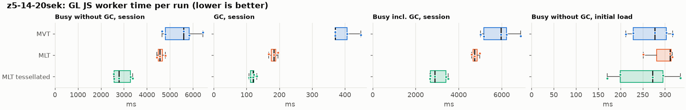
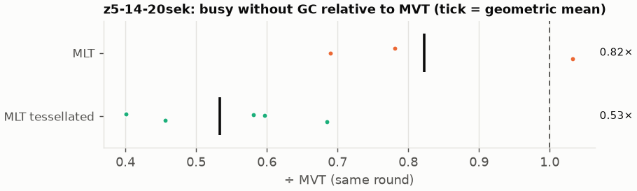
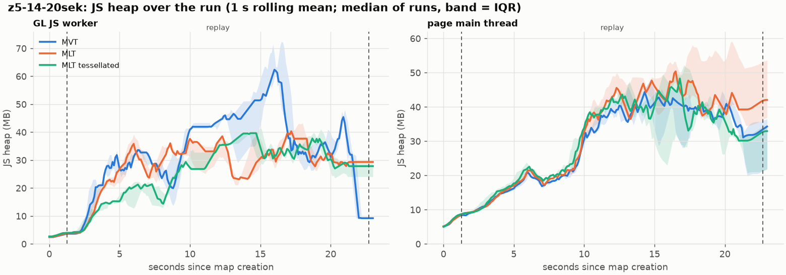
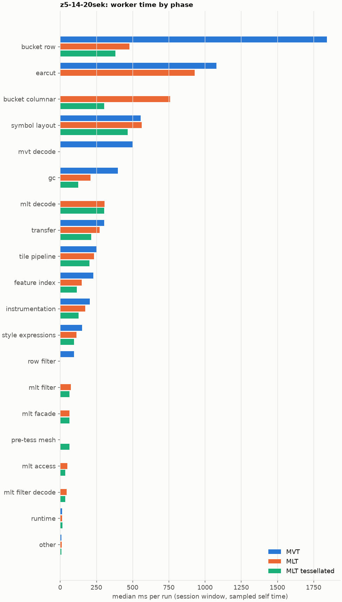
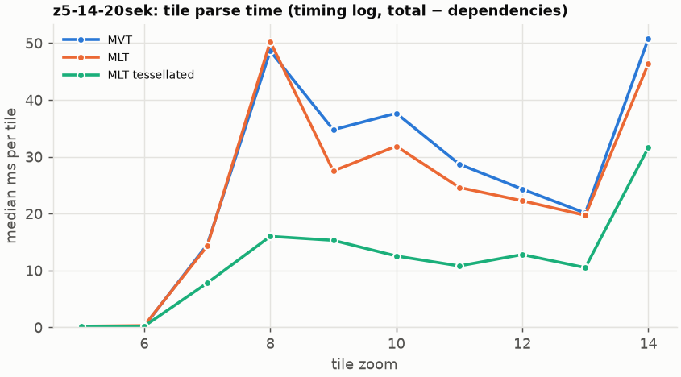
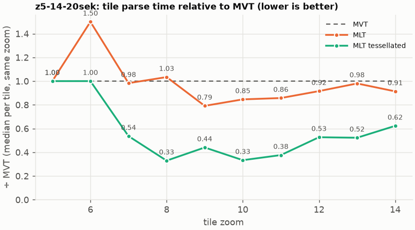

# Session trace benchmark — 20261022-153226

## Setup

- Created 2026-10-22T15:32:27+02:00; 5 repetitions + 1 warm-up round(s) (excluded); variants rotate per round (A B C, B C A, …); one cold browser context per run.
- Machine: 13th Gen Intel(R) Core(TM) i7-1365U, 12 logical cores, 31.3 GB RAM, Windows-11-10.0.26200-SP0; power: GUID des Energieschemas: 381b4222-f694-41f0-9685-ff5bb260df2e  (Ausbalanciert), AC True.
- GL JS gl7-performance-optimization @ f9bd50a8b5 (dirty); worker count 1; viewport {'width': 1280, 'height': 1024}.
- Python 3.12.2, packages {'playwright': '1.64.0', 'numpy': '2.5.3', 'matplotlib': '3.11.2'}.

| variant | bundle | format | bundle sha256 | branch build |
|---|---|---|---|---|
| MVT | `dist/maplibre-gl-dev.mjs` | mvt | `b2691453151d` | – |
| MLT | `dist/maplibre-gl-dev.mjs` | mlt | `b2691453151d` | – |
| MLT tessellated | `dist/maplibre-gl-dev.mjs` | mlt-pre-tess | `b2691453151d` | – |

| session | style | duration | frames | sha256 |
|---|---|---:|---:|---|
| z5-14-20sek | kernel-coverage (recorded: maptiler-basic) | 21.4 s | 829 | `5a376e5ede30` |

CPU sampling interval (median over runs): 611 µs.

## Definitions

- **busy** = wall time in which a GL JS worker thread runs a task (union of top-level task slices and GC slices on `DedicatedWorker thread`s), summed over workers. **GC** = union of `MinorGC`/`MajorGC`/`V8.GC*` slices on those threads. **busy without GC** = busy − GC (headline metric).
- **CPU** = thread time (`tdur`) of the same slices. Phase categories and functions come from the trace's CPU samples (self time), categorised by `config/categories.toml` (nearest matching frame, leaf to root).
- Windows: **load** = map creation → first idle; **session** = camera replay; **tail** = end of replay → idle; **total** = load + session + tail.
- Ratios are against **MVT**: ratio of medians with a bootstrap 95 % CI, the geometric mean of per-round ratios, and a two-sided Mann–Whitney U p-value (normal approximation, not corrected for multiple comparisons; rough below n = 8). Lower than 1× means less worker time.

## Session `z5-14-20sek`

### Worker busy without GC (session window)

| variant | n ok / failed | median ms | IQR | mean | ratio vs MVT | 95 % CI | geo-mean paired | MWU p |
|---|---:|---:|---:|---:|---:|---:|---:|---:|
| MVT | 5 / 0 | 5,601 | 4,794–5,829 | 5,462 | 1.00× | – | – | – |
| MLT | 3 / 0 | 4,553 | 4,496–4,678 | 4,598 | 0.81× | 0.71–1.00× | 0.82× | 0.136 |
| MLT tessellated | 5 / 0 | 2,776 | 2,576–3,286 | 2,916 | 0.50× | 0.43–0.71× | 0.53× | 0.012 |

### All worker metrics (median, ratio vs baseline)

| metric | MVT | MLT | MLT tessellated |
|---|---:|---:|---:|
| busy incl. GC | 5,971 | 4,749 (0.80×) | 2,896 (0.48×) |
| &nbsp;&nbsp;of which GC | 370.9 | 183.2 (0.49×) | 120.0 (0.32×) |
| &nbsp;&nbsp;of which busy without GC | 5,601 | 4,553 (0.81×) | 2,776 (0.50×) |
| &nbsp;&nbsp;&nbsp;&nbsp;of which filtering (sampled, incl. callees) | 96.4 | 74.0 (0.77×) | 65.3 (0.68×) |
| &nbsp;&nbsp;&nbsp;&nbsp;of which column decoding inside the MLT filter (sampled) | 0.0 | 44.0 | 36.5 |
| &nbsp;&nbsp;&nbsp;&nbsp;of which timing instrumentation (sampled) | 204.6 | 172.6 (0.84×) | 128.0 (0.63×) |
| busy without GC and instrumentation | 5,379 | 4,399 (0.82×) | 2,648 (0.49×) |
| CPU time without GC | 5,148 | 4,172 (0.81×) | 2,548 (0.49×) |
| tile: download end → sent to main thread, median per tile | 291.0 | 203.8 (0.70×) | 153.2 (0.53×) |
| tile: download end → sent to main thread, 90th percentile | 633.8 | 550.5 (0.87×) | 292.8 (0.46×) |
| tile: download end → sent to main thread, 95th percentile | 750.5 | 569.1 (0.76×) | 351.8 (0.47×) |
| tile: download end → sent to main thread, 99th percentile | 882.9 | 621.0 (0.70×) | 442.8 (0.50×) |
| &nbsp;&nbsp;parse part (timing log, incl. waiting for glyphs/icons), median per tile | 141.0 | 111.5 (0.79×) | 75.4 (0.53×) |
| &nbsp;&nbsp;queue + hand-off part, median per tile | 107.2 | 89.5 (0.84×) | 66.3 (0.62×) |
| minor GCs | 80.00 | 65.00 (0.81×) | 36.00 (0.45×) |
| major GCs | 8.00 | 4.00 (0.50×) | 3.00 (0.38×) |
| peak worker heap (MB) | 90.9 | 53.1 (0.58×) | 52.3 (0.58×) |
| load: busy without GC | 277.5 | 311.3 (1.12×) | 272.1 (0.98×) |
| load: GC | 9.9 | 8.7 (0.88×) | 5.9 (0.59×) |
| total: busy without GC | 5,813 | 4,865 (0.84×) | 2,946 (0.51×) |

Rows marked *of which* are parts of the row above, not additional time. Tile rows are per-tile latencies (medians over tiles, then over runs), not sums: tiles overlap in time, and the medians of the parse and queue parts do not add up exactly to the median latency.

### Filtering (session window)

Sampled worker time spent in feature filtering, including everything the filter calls (expression evaluation, property access): **row filter** = the style-spec feature filter that MVT runs per feature, **mlt filter** = the columnar MLT filter (incl. the geometry-type selection), without the columns it decodes (see the next table). Medians per run; rules in `config/categories.toml`.

| variant | mlt filter | row filter | filtering | ratio vs MVT | 95 % CI | MWU p | share of sampled busy |
|---|---:|---:|---:|---:|---:|---:|---:|
| MVT | 0.0 | 96.4 | 96.4 | 1.00× | – | – | 1.6% |
| MLT | 74.0 | 0.0 | 74.0 | 0.77× | 0.68–1.43× | 0.766 | 1.7% |
| MLT tessellated | 65.3 | 0.0 | 65.3 | 0.68× | 0.55–1.26× | 0.531 | 2.3% |

**Filtering together with tile decoding.** The MLT decoder leaves columns encoded until something reads them, and the filter is usually the first reader: the columns it decodes (properties, and the geometry for `$type`) are **of which inside the filter** (phase *mlt filter decode*), the rest is *mlt decode* (geometry and columns read later, e.g. by paint properties and symbols). MVT decodes every feature's properties and geometry while it reads the tile (*mvt decode*), whether the filter keeps the feature or not. So **filtering** above compares the filters, and **decoding + filtering** compares all that the formats spend on decoding the tile and selecting features. **tile decoding** = *mvt decode* or *mlt decode* + *mlt filter decode*: work inside a call into a decoder. Reading data that is already decoded is not counted, as for MVT's feature objects: *mlt access* (row views, value getters, looking a column up by name) and the MLT facade (*mlt facade*). MVT decodes geometry only for the features its filter keeps, MLT decodes a layer's whole geometry column.

| variant | tile decoding | of which inside the filter | filtering | decoding + filtering | ratio vs MVT | 95 % CI | MWU p |
|---|---:|---:|---:|---:|---:|---:|---:|
| MVT | 503.8 | 0.0 | 96.4 | 555.6 | 1.00× | – | – |
| MLT | 353.5 | 44.0 | 74.0 | 427.5 | 0.77× | 0.54–1.09× | 0.136 |
| MLT tessellated | 336.9 | 36.5 | 65.3 | 398.1 | 0.72× | 0.50–1.02× | 0.095 |

Top 12 functions inside filtering and its column decoding (self time, mean ms per run):

| phase | function | source | MVT | MLT | MLT tessellated |
|---|---|---|---:|---:|---:|
| row filter | `evaluate` | node_modules/@maplibre/maplibre-gl-style-spec/dist/expression/index.mjs | 27.7 | 0.0 | 0.0 |
| mlt filter decode | `decodeFsst` | maplibre-tile-spec/ts/dist/decoding/fsstDecoder.js | 0.0 | 15.8 | 12.9 |
| row filter | `evaluate` | node_modules/@maplibre/maplibre-gl-style-spec/dist/expression/definitions/comparison.mjs | 10.4 | 0.0 | 0.0 |
| row filter | `evaluate` | node_modules/@maplibre/maplibre-gl-style-spec/dist/expression/compound_expression.mjs | 7.4 | 0.0 | 0.0 |
| row filter | `(anonymous)` | node_modules/@maplibre/maplibre-gl-style-spec/dist/expression/compound_expression.mjs | 7.3 | 0.0 | 0.0 |
| row filter | `get` | node_modules/@maplibre/maplibre-gl-style-spec/dist/expression/compound_expression.mjs | 5.8 | 0.0 | 0.0 |
| row filter | `filter` | node_modules/@maplibre/maplibre-gl-style-spec/dist/feature_filter/index.mjs | 5.4 | 0.0 | 0.0 |
| mlt filter | `scanSelection` | maplibre-tile-spec/ts/dist/vector/filter/selectionVectorUtils.js | 0.0 | 4.7 | 2.8 |
| mlt filter | `scanDictionaryCodes` | maplibre-tile-spec/ts/dist/processing/filter/execution/filterKernel.js | 0.0 | 4.6 | 3.9 |
| mlt filter | `dictionaryRowMatches` | maplibre-tile-spec/ts/dist/processing/filter/execution/filterKernel.js | 0.0 | 4.6 | 4.2 |
| mlt filter decode | `unpackNullable` | maplibre-tile-spec/ts/dist/decoding/unpackNullableUtils.js | 0.0 | 4.2 | 2.7 |
| mlt filter | `resolveDictionaryExecutor` | maplibre-tile-spec/ts/dist/processing/filter/execution/filterKernel.js | 0.0 | 3.7 | 3.6 |

### Where the variants differ from MVT (session window, mean ms per run)

Open **[flame.html](flame.html)** to explore the call tree interactively: pick a variant, compare it with MVT (red = more time at the same call path, blue = less), click a frame to zoom in, and read the phase and function breakdown under it. Without a comparison, frames are coloured by phase: filtering is green in both formats, and the columns the MLT filter decodes on first access (*mlt filter decode*) are MLT blue frames under the green filter. `flame/*.txt` open in https://www.speedscope.app.

#### MLT vs MVT

**By phase** (sampled self time; the Δ column sums to the difference in sampled busy time):

| phase | MVT | MLT | Δ |
|---|---:|---:|---:|
| bucket columnar | 0.0 | 749.0 | +749.0 |
| mlt decode | 0.0 | 297.1 | +297.1 |
| mlt filter | 0.1 | 73.2 | +73.0 |
| mlt facade | 0.5 | 67.0 | +66.5 |
| mlt access | 0.0 | 48.1 | +48.1 |
| mlt filter decode | 0.0 | 44.9 | +44.9 |
| symbol layout | 528.6 | 558.9 | +30.3 |
| other | 10.3 | 11.4 | +1.0 |
| runtime | 14.1 | 14.9 | +0.8 |
| tile pipeline | 243.8 | 233.3 | -10.5 |
| transfer | 298.3 | 281.3 | -17.0 |
| instrumentation | 201.2 | 169.0 | -32.2 |
| style expressions | 149.9 | 114.3 | -35.6 |
| feature index | 234.5 | 156.4 | -78.1 |
| row filter | 81.5 | 0.0 | -81.5 |
| earcut | 1,063 | 947.2 | -116.1 |
| gc | 414.7 | 202.4 | -212.3 |
| mvt decode | 502.8 | 0.0 | -502.8 |
| bucket row | 1,749 | 472.7 | -1276.7 |

**By source layer** (timing log: createBucket + populate + addFeatures, summed over the style layers that use it; wall time, includes GC pauses; total Δ -918 ms):

| source layer | type | MVT | MLT | Δ |
|---|---|---:|---:|---:|
| transportation | line | 653.7 | 774.4 | +120.7 |
| transportation_name | line | 46.2 | 79.0 | +32.8 |
| housenumber | symbol | 280.9 | 308.5 | +27.6 |
| transportation_name | symbol | 265.7 | 287.7 | +22.0 |
| boundary | line | 38.8 | 49.6 | +10.8 |
| poi | symbol | 41.7 | 29.9 | -11.8 |
| housenumber | line | 28.3 | 8.6 | -19.6 |
| water | fill | 138.7 | 112.4 | -26.3 |
| poi | line | 130.6 | 45.5 | -85.1 |
| building | fill | 351.8 | 233.3 | -118.5 |
| landuse | fill | 1,026 | 620.6 | -405.5 |
| landcover | fill | 1,455 | 982.6 | -472.5 |

**Functions with the largest self-time difference** (by function name, summed over source files):

| function | MVT | MLT | Δ |
|---|---:|---:|---:|
| `readScaledRings` | 0.0 | 109.1 | +109.1 |
| `writeEarcutFill` | 0.0 | 70.6 | +70.6 |
| `buildEarcutMesh` | 0.0 | 65.1 | +65.1 |
| `scaleCheckedCoordinate` | 0.0 | 28.5 | +28.5 |
| `decodeComponentwiseDeltaVec2` | 0.0 | 26.3 | +26.3 |
| `unpackNullable` | 0.0 | 26.1 | +26.1 |
| `emplace` | 147.7 | 167.3 | +19.5 |
| `signedArea$1` | 0.0 | 16.9 | +16.9 |
| `decodeFastPforInt32` | 0.0 | 16.5 | +16.5 |
| `decodeFsst` | 0.0 | 16.3 | +16.3 |
| `decodeString$2` | 0.0 | 15.6 | +15.6 |
| `materializeSelectedFeatures` | 0.0 | 15.1 | +15.1 |
| `_vertexToIndex` | 388.0 | 0.0 | -388.0 |
| `(garbage collector)` | 414.7 | 202.4 | -212.3 |
| `readSVarint` | 210.2 | 0.0 | -210.2 |
| `loadGeometry` | 158.6 | 28.3 | -130.3 |
| `isEar` | 346.5 | 248.7 | -97.7 |

#### MLT tessellated vs MVT

**By phase** (sampled self time; the Δ column sums to the difference in sampled busy time):

| phase | MVT | MLT tessellated | Δ |
|---|---:|---:|---:|
| mlt decode | 0.0 | 318.1 | +318.1 |
| bucket columnar | 0.0 | 309.0 | +309.0 |
| pre-tess mesh | 0.0 | 71.3 | +71.3 |
| mlt filter | 0.1 | 63.6 | +63.5 |
| mlt facade | 0.5 | 59.8 | +59.3 |
| mlt filter decode | 0.0 | 38.4 | +38.4 |
| mlt access | 0.0 | 35.3 | +35.3 |
| runtime | 14.1 | 16.9 | +2.8 |
| tile pipeline | 243.8 | 209.5 | -34.3 |
| symbol layout | 528.6 | 483.4 | -45.2 |
| style expressions | 149.9 | 92.6 | -57.3 |
| transfer | 298.3 | 236.6 | -61.7 |
| instrumentation | 201.2 | 126.6 | -74.6 |
| row filter | 81.5 | 0.0 | -81.5 |
| feature index | 234.5 | 115.4 | -119.1 |
| gc | 414.7 | 128.9 | -285.8 |
| mvt decode | 502.8 | 0.0 | -502.8 |
| earcut | 1,063 | 0.0 | -1063.3 |
| bucket row | 1,749 | 389.7 | -1359.7 |

**By source layer** (timing log: createBucket + populate + addFeatures, summed over the style layers that use it; wall time, includes GC pauses; total Δ -2555 ms):

| source layer | type | MVT | MLT tessellated | Δ |
|---|---|---:|---:|---:|
| transportation_name | line | 46.2 | 68.2 | +22.0 |
| place | line | 83.5 | 77.3 | -6.2 |
| transportation_name | symbol | 265.7 | 252.1 | -13.6 |
| transportation | line | 653.7 | 636.7 | -17.0 |
| poi | symbol | 41.7 | 24.2 | -17.5 |
| housenumber | symbol | 280.9 | 260.2 | -20.7 |
| housenumber | line | 28.3 | 6.1 | -22.2 |
| water | fill | 138.7 | 50.5 | -88.2 |
| poi | line | 130.6 | 32.0 | -98.6 |
| building | fill | 351.8 | 64.4 | -287.4 |
| landuse | fill | 1,026 | 184.9 | -841.2 |
| landcover | fill | 1,455 | 281.6 | -1173.5 |

**Functions with the largest self-time difference** (by function name, summed over source files):

| function | MVT | MLT tessellated | Δ |
|---|---:|---:|---:|
| `buildTessellatedBoundingBox` | 0.0 | 69.9 | +69.9 |
| `decodeUnsignedZigZagDeltaInt32` | 0.0 | 31.9 | +31.9 |
| `writeTessellatedFill` | 0.0 | 29.5 | +29.5 |
| `appendScaledVertices` | 0.0 | 25.1 | +25.1 |
| `decodeComponentwiseDeltaVec2` | 0.0 | 24.6 | +24.6 |
| `unpackNullable` | 0.0 | 23.0 | +23.0 |
| `decodeFastPforInt32` | 0.0 | 18.5 | +18.5 |
| `decodeFsst` | 0.0 | 13.3 | +13.3 |
| `decodeBigEndianInt32sInto` | 0.0 | 13.1 | +13.1 |
| `readVertices` | 0.0 | 12.4 | +12.4 |
| `materializeSelectedFeatures` | 0.0 | 12.1 | +12.1 |
| `fastUnpack256_4` | 0.0 | 12.1 | +12.1 |
| `_vertexToIndex` | 388.0 | 0.0 | -388.0 |
| `isEar` | 346.5 | 0.0 | -346.5 |
| `(garbage collector)` | 414.7 | 128.9 | -285.8 |
| `readSVarint` | 210.2 | 0.0 | -210.2 |
| `isEarHashed` | 200.7 | 0.0 | -200.7 |

### Memory (session window)

**JS heap** = V8's used heap of the thread (`jsHeapSizeUsed` from the trace's `UpdateCounters`, about every 20 ms; the mean is time-weighted). It does not include ArrayBuffer contents, so the tile data itself (vertex, index and feature-index arrays) is not in it: **tile data sent to the main thread** is the size of the ArrayBuffers each tile result transfers (`web/worker_hook.js`), which then live on the main thread and are uploaded to the GPU. **garbage collected** = heap freed by the worker's GCs, a measure of how much it allocates. Medians per run; ratio of medians with a bootstrap 95 % CI.

| metric | MVT | MLT | MLT tessellated |
|---|---:|---:|---:|
| worker JS heap, mean (MB) | 26.0 | 22.0 (0.85×, 0.77–0.98×) | 21.6 (0.83×, 0.72–1.05×) |
| worker JS heap, peak (MB) | 90.9 | 53.1 (0.58×, 0.49–0.69×) | 52.3 (0.58×, 0.48–0.68×) |
| worker JS heap after the last GC (MB) | 8.8 | 16.2 (1.84×, 1.51–1.97×) | 22.3 (2.52×, 0.94–3.02×) |
| garbage collected in the worker (MB) | 1,929 | 1,196 (0.62×, 0.60–0.63×) | 502.9 (0.26×, 0.25–0.27×) |
| main thread JS heap, mean (MB) | 26.5 | 28.3 (1.06×, 0.80–1.58×) | 27.7 (1.04×, 0.78–1.21×) |
| main thread JS heap, peak (MB) | 52.2 | 64.7 (1.24×, 0.81–1.57×) | 58.2 (1.11×, 0.73–1.34×) |
| main thread JS heap at the end of the replay (MB) | 32.1 | 39.6 (1.23×, 0.85–3.09×) | 30.5 (0.95×, 0.59–1.83×) |
| tile data sent to the main thread, total (MB) | 117.9 | 112.2 (0.95×, 0.92–0.97×) | 110.4 (0.94×, 0.92–0.95×) |
| tile data sent to the main thread, median per tile (KB) | 726.7 | 710.3 (0.98×, 0.97–0.98×) | 714.4 (0.98×, 0.94–0.99×) |

### Worker time by phase (session window, median ms of sampled self time)

| phase | MVT | MLT | MLT tessellated |
|---|---:|---:|---:|
| bucket row | 1,841 | 479.3 | 380.7 |
| earcut | 1,079 | 929.4 | 0.0 |
| bucket columnar | 0.0 | 760.3 | 303.9 |
| symbol layout | 556.6 | 562.5 | 467.5 |
| mvt decode | 503.8 | 0.0 | 0.0 |
| gc | 399.8 | 210.2 | 125.9 |
| mlt decode | 0.0 | 307.7 | 303.3 |
| transfer | 305.4 | 273.9 | 214.4 |
| tile pipeline | 251.1 | 233.6 | 202.4 |
| feature index | 228.2 | 148.3 | 116.4 |
| instrumentation | 204.6 | 172.6 | 128.0 |
| style expressions | 151.8 | 112.2 | 96.3 |
| row filter | 96.4 | 0.0 | 0.0 |
| mlt filter | 0.0 | 74.0 | 65.3 |
| mlt facade | 0.6 | 64.2 | 65.4 |
| pre-tess mesh | 0.0 | 0.0 | 64.4 |
| mlt access | 0.0 | 51.0 | 34.4 |
| mlt filter decode | 0.0 | 44.0 | 36.5 |
| runtime | 14.1 | 14.6 | 17.1 |
| other | 10.0 | 11.4 | 9.0 |

### Top 20 worker functions by self time (session window, mean ms per run)

| function | source | phase | MVT | MLT | MLT tessellated |
|---|---|---|---:|---:|---:|
| `(garbage collector)` | (native) | gc | 414.7 | 202.4 | 128.9 |
| `_vertexToIndex` | src/render/subdivision.ts | bucket row | 388.0 | 0.0 | 0.0 |
| `isEar` | node_modules/earcut/src/earcut.js | earcut | 346.5 | 248.7 | 0.0 |
| `readSVarint` | node_modules/pbf/index.js | mvt decode | 210.2 | 0.0 | 0.0 |
| `isEarHashed` | node_modules/earcut/src/earcut.js | earcut | 200.7 | 161.3 | 0.0 |
| `reserve` | src/util/struct_array.ts | bucket row | 198.5 | 160.4 | 135.2 |
| `emplace` | src/data/array_types.g.ts | bucket columnar | 147.7 | 167.3 | 117.3 |
| `populate` | src/data/bucket/line_bucket.ts | bucket row | 149.0 | 0.0 | 0.0 |
| `addPhase` | src/source/worker_timing.ts | instrumentation | 120.3 | 85.0 | 62.4 |
| `insert` | src/data/feature_index.ts | feature index | 114.9 | 44.4 | 34.1 |
| `readScaledRings` | src/data/bucket/columnar/columnar_mesh_arrays.ts | bucket columnar | 0.0 | 109.1 | 0.0 |
| `readVarint` | node_modules/pbf/index.js | mvt decode | 98.4 | 0.0 | 0.0 |
| `earcutLinked` | node_modules/earcut/src/earcut.js | earcut | 96.5 | 95.2 | 0.0 |
| `populate` | src/data/bucket/columnar/columnar_line_bucket.ts | bucket columnar | 0.0 | 90.3 | 70.0 |
| `postMessage` | (native) | transfer | 81.2 | 87.7 | 79.8 |
| `_trim` | src/util/struct_array.ts | transfer | 86.6 | 65.7 | 41.4 |
| `loadGeometry` | node_modules/@mapbox/vector-tile/index.js | mvt decode | 80.1 | 0.0 | 0.0 |
| `loadGeometry` | src/data/load_geometry.ts | bucket row | 78.5 | 23.4 | 19.8 |
| `fetch` | (native) | tile pipeline | 70.3 | 74.3 | 75.1 |
| `radixPass` | node_modules/earcut/src/earcut.js | earcut | 64.0 | 70.8 | 0.0 |

### Top 20 worker functions by total time (incl. callees) (session window, mean ms per run)

| function | source | phase | MVT | MLT | MLT tessellated |
|---|---|---|---:|---:|---:|
| `parse` | src/source/worker_tile.ts | tile pipeline | 4,538 | 3,779 | 2,173 |
| `loadTile` | src/source/vector_tile_worker_source.ts | tile pipeline | 4,133 | 3,302 | 1,762 |
| `_parseWorkerTile` | src/source/vector_tile_worker_source.ts | tile pipeline | 4,001 | 3,217 | 1,679 |
| `populate` | src/data/bucket/fill_bucket.ts | bucket row | 2,658 | 0.0 | 0.0 |
| `addBucketFeatures` | src/data/bucket/fill_bucket.ts | bucket row | 2,254 | 1,594 | 182.4 |
| `addFeature` | src/data/bucket/fill_bucket.ts | bucket row | 2,128 | 0.0 | 0.0 |
| `populate` | src/data/bucket/columnar/columnar_fill_bucket.ts | bucket columnar | 0.0 | 1,789 | 526.8 |
| `subdividePolygon` | src/render/subdivision.ts | bucket row | 1,788 | 0.0 | 0.0 |
| `subdividePolygonInternal` | src/render/subdivision.ts | bucket row | 1,770 | 0.0 | 0.0 |
| `addFeature` | src/data/bucket/columnar/columnar_fill_bucket.ts | bucket columnar | 0.0 | 1,541 | 157.4 |
| `writeEarcutFill` | src/data/bucket/columnar/columnar_mesh_arrays.ts | bucket columnar | 0.0 | 1,522 | 0.0 |
| `buildEarcutMesh` | src/data/bucket/columnar/columnar_mesh_arrays.ts | bucket columnar | 0.0 | 1,065 | 0.0 |
| `earcut` | node_modules/earcut/src/earcut.js | earcut | 1,062 | 945.9 | 0.0 |
| `populate` | src/data/bucket/columnar/columnar_line_bucket.ts | bucket columnar | 0.0 | 907.9 | 744.4 |
| `earcutLinked` | node_modules/earcut/src/earcut.js | earcut | 862.4 | 746.2 | 0.0 |
| `populate` | src/data/bucket/line_bucket.ts | bucket row | 835.8 | 0.0 | 0.0 |
| `addFeatures` | src/data/bucket/symbol_bucket.ts | symbol layout | 471.3 | 497.8 | 432.9 |
| `performSymbolLayout` | src/symbol/symbol_layout.ts | symbol layout | 465.9 | 488.9 | 426.4 |
| `loadGeometry` | src/data/load_geometry.ts | bucket row | 472.3 | 78.0 | 63.6 |
| `_initializeVertices` | src/render/subdivision.ts | bucket row | 422.6 | 0.0 | 0.0 |

### Tile parse time by zoom (timing log, median ms per tile, total − dependencies)

| zoom | MVT | MLT | MLT tessellated |
|---:|---:|---:|---:|
| 5 | 0.20 (n=45) | 0.20 (n=27) | 0.20 (n=45) |
| 6 | 0.20 (n=45) | 0.30 (n=27) | 0.20 (n=45) |
| 7 | 14.55 (n=30) | 14.30 (n=18) | 7.80 (n=30) |
| 8 | 48.60 (n=21) | 50.25 (n=12) | 16.00 (n=27) |
| 9 | 34.75 (n=80) | 27.50 (n=48) | 15.30 (n=80) |
| 10 | 37.65 (n=100) | 31.85 (n=60) | 12.55 (n=100) |
| 11 | 28.70 (n=77) | 24.60 (n=43) | 10.80 (n=74) |
| 12 | 24.30 (n=115) | 22.25 (n=66) | 12.80 (n=103) |
| 13 | 20.10 (n=105) | 19.70 (n=63) | 10.50 (n=105) |
| 14 | 50.75 (n=90) | 46.35 (n=54) | 31.60 (n=90) |

### Tile latency by zoom: download end → result sent to the main thread (session window, ms per tile: median / p95 / p99)

Includes waiting in the worker's queue, the parse and posting the result; see `tile_latency.csv` for the per-tile split (`parse_ms`, `wait_ms`). Percentiles over the tiles of all runs; with few tiles (n) p99 is close to the maximum.

| zoom | MVT | MLT | MLT tessellated |
|---:|---:|---:|---:|
| 6 | 87.0 / 126.1 / 136.4 (n=45) | 82.5 / 125.9 / 129.1 (n=27) | 65.9 / 116.3 / 128.0 (n=45) |
| 7 | 270.0 / 528.3 / 545.8 (n=30) | 206.6 / 458.4 / 458.9 (n=18) | 109.0 / 127.9 / 129.5 (n=30) |
| 8 | 361.8 / 385.4 / 390.0 (n=21) | 266.5 / 274.5 / 275.2 (n=12) | 154.5 / 191.9 / 201.4 (n=27) |
| 9 | 394.7 / 700.0 / 713.4 (n=80) | 355.9 / 485.5 / 487.8 (n=48) | 187.1 / 323.5 / 331.3 (n=80) |
| 10 | 586.2 / 758.0 / 762.9 (n=100) | 513.8 / 573.4 / 577.4 (n=60) | 225.9 / 344.1 / 352.6 (n=100) |
| 11 | 260.6 / 332.5 / 334.3 (n=77) | 127.0 / 254.6 / 255.3 (n=43) | 130.7 / 181.3 / 189.3 (n=74) |
| 12 | 145.9 / 432.8 / 443.0 (n=115) | 140.8 / 372.4 / 376.9 (n=66) | 57.0 / 313.1 / 333.8 (n=103) |
| 13 | 225.7 / 443.2 / 460.4 (n=105) | 177.0 / 363.4 / 366.3 (n=63) | 143.2 / 284.9 / 294.3 (n=105) |
| 14 | 448.0 / 885.9 / 934.4 (n=90) | 424.5 / 649.8 / 659.8 (n=54) | 281.4 / 520.9 / 577.8 (n=90) |

## Runs

18 ok, 0 failed/aborted, 0 not run, 13 used in statistics.

## Validity checks

- Counted once: all 18 analysed runs pass (windows load + session + tail add up to total; phases add up to the sampled busy time; GC and sampled time lie within busy time; no timing-log line twice).
- outlier runs left out of all statistics: busy without GC (session) more than 1.5 × IQR outside the quartiles of its session and variant (groups of at least 4 runs): 2 run(s): z5-14-20sek/mlt/rep-01 (5,417 ms, background 9.17 cores), z5-14-20sek/mlt/rep-04 (3,171 ms, background 4.87 cores)
- other programs used 5.39–9.43 logical processors during the replays (median 7.75)
- 13 run(s) with more than 0.5 cores of background load: z5-14-20sek/mlt-pre-tess/rep-01 (6.51), z5-14-20sek/mvt/rep-01 (5.53), z5-14-20sek/mlt-pre-tess/rep-02 (5.39), z5-14-20sek/mvt/rep-02 (9.43), z5-14-20sek/mlt/rep-02 (7.75), z5-14-20sek/mvt/rep-03 (5.48)
- 6 of 6 rounds parsed different tile sets across variants (e.g. z5-14-20sek round 0: mvt 126 tiles, mlt 123 tiles, mlt-pre-tess 123 tiles; z5-14-20sek round 1: mlt 122 tiles, mlt-pre-tess 124 tiles, mvt 127 tiles; z5-14-20sek round 2: mlt-pre-tess 130 tiles, mvt 123 tiles, mlt 125 tiles; z5-14-20sek round 3: mvt 126 tiles, mlt 125 tiles, mlt-pre-tess 126 tiles; z5-14-20sek round 4: mlt 126 tiles, mlt-pre-tess 129 tiles, mvt 126 tiles); expected where a session zooms past the last MVT level (MVT overzooms, MLT loads deeper tiles)

## Files

- `runs.csv`: one row per run (incl. failed and warm-up runs), every scalar metric as `<window>.<metric>`.
- `summary.csv`: session × variant × metric statistics.
- `functions.csv`, `categories.csv`: CPU-sample self/total time per function and phase per run and window.
- `category_functions.csv`: self time per phase × function (e.g. what the filters spend their time on).
- `tiles.csv`, `tile_layers.csv`, `tile_phases.csv`: the per-tile worker timing log, long format.
- `flame.html`: interactive call tree per variant with a diff view; `flame/*.txt`: collapsed stacks for speedscope.
- `analysis/stacks.csv` (per run): sampled self time per full call stack.
- `tile_latency.csv`: per tile request, worker clock: received, download start/end, result sent, latency = sent − download end, parse_ms, wait_ms = latency − parse.
- `runs/<session>/<variant>/rep-NN/trace.json.gz`: the raw trace (opens in the DevTools Performance tab).
