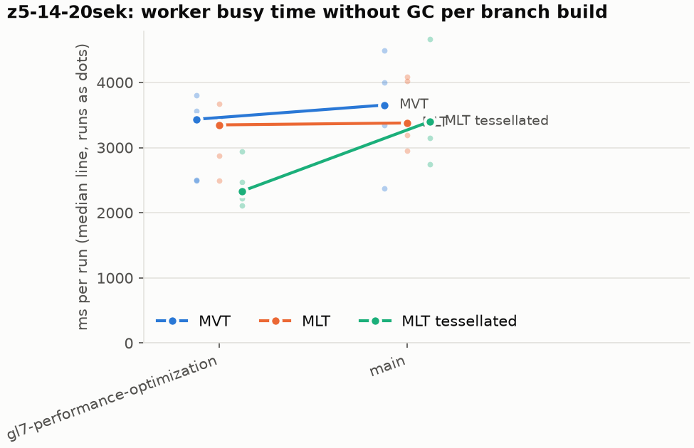
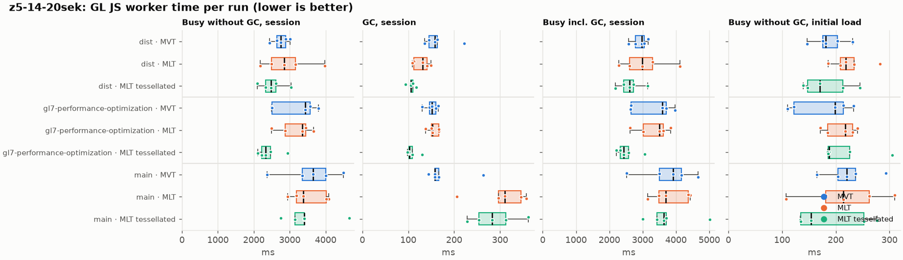
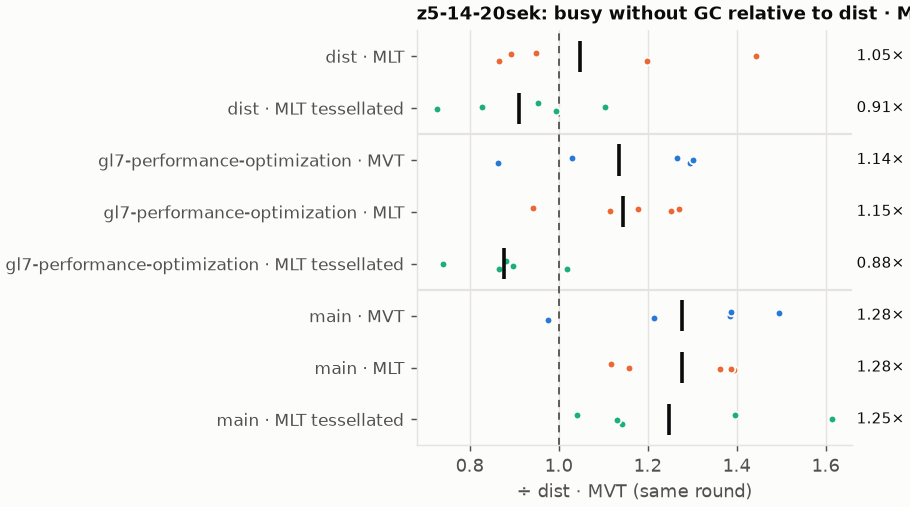
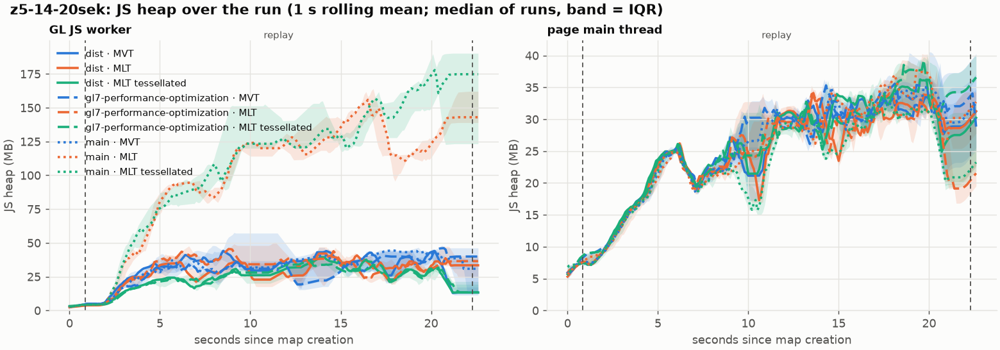
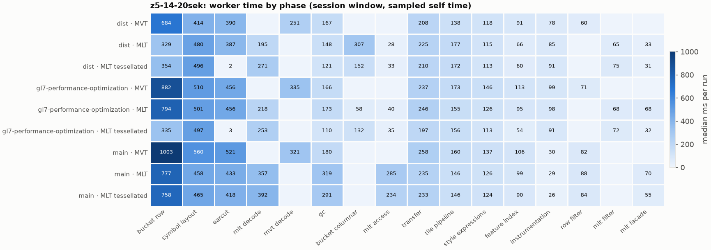
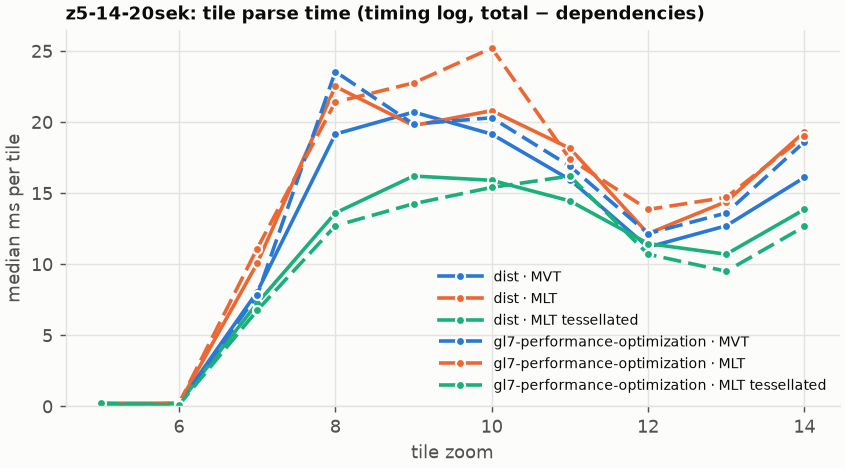
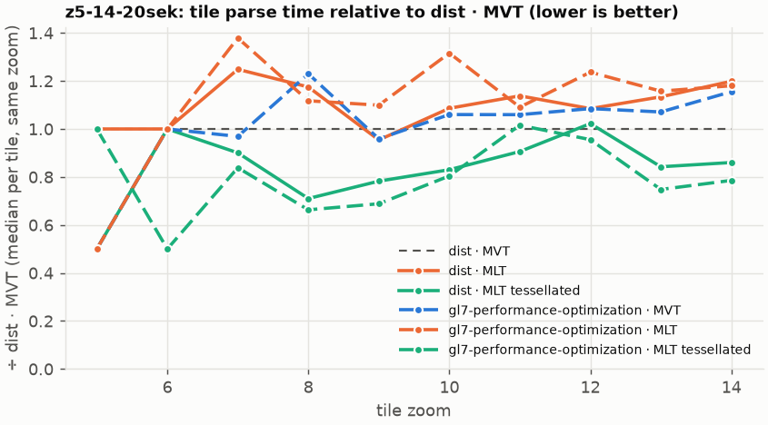

# Session trace benchmark — 20261023-065948

## Setup

- Created 2026-10-23T06:59:48+02:00; 5 repetitions + 1 warm-up round(s) (excluded); variants rotate per round (A B C, B C A, …); one cold browser context per run.
- Machine: 13th Gen Intel(R) Core(TM) i7-1365U, 12 logical cores, 31.3 GB RAM, Windows-11-10.0.26200-SP0; power: GUID des Energieschemas: 381b4222-f694-41f0-9685-ff5bb260df2e  (Ausbalanciert), AC True.
- GL JS gl7-performance-optimization @ f9bd50a8b5 (dirty); worker count 1; viewport {'width': 1280, 'height': 1024}.
- Python 3.12.2, packages {'playwright': '1.64.0', 'numpy': '2.5.3', 'matplotlib': '3.11.2'}.

| variant | bundle | format | bundle sha256 | branch build |
|---|---|---|---|---|
| MVT | `dist/maplibre-gl-dev.mjs` | mvt | `b2691453151d` | – |
| MLT | `dist/maplibre-gl-dev.mjs` | mlt | `b2691453151d` | – |
| MLT tessellated | `dist/maplibre-gl-dev.mjs` | mlt-pre-tess | `b2691453151d` | – |
| gl7-performance-optimization · MVT | `bench-builds/branches/gl7-performance-optimization/maplibre-gl-dev.mjs` | mvt | `e74f9d5a3da7` | gl7-performance-optimization @ f9bd50a8b5 (2026-10-19), MLT @ 9bf846d053 |
| gl7-performance-optimization · MLT | `bench-builds/branches/gl7-performance-optimization/maplibre-gl-dev.mjs` | mlt | `e74f9d5a3da7` | gl7-performance-optimization @ f9bd50a8b5 (2026-10-19), MLT @ 9bf846d053 |
| gl7-performance-optimization · MLT tessellated | `bench-builds/branches/gl7-performance-optimization/maplibre-gl-dev.mjs` | mlt-pre-tess | `e74f9d5a3da7` | gl7-performance-optimization @ f9bd50a8b5 (2026-10-19), MLT @ 9bf846d053 |
| main · MVT | `bench-builds/branches/main/maplibre-gl-dev.mjs` | mvt | `ced4373133d3` | main @ 8470a6193d (2026-09-18), MLT @ 9bf846d053 |
| main · MLT | `bench-builds/branches/main/maplibre-gl-dev.mjs` | mlt | `ced4373133d3` | main @ 8470a6193d (2026-09-18), MLT @ 9bf846d053 |
| main · MLT tessellated | `bench-builds/branches/main/maplibre-gl-dev.mjs` | mlt-pre-tess | `ced4373133d3` | main @ 8470a6193d (2026-09-18), MLT @ 9bf846d053 |

| session | style | duration | frames | sha256 |
|---|---|---:|---:|---|
| z5-14-20sek | maptiler-basic | 21.4 s | 829 | `5a376e5ede30` |

CPU sampling interval (median over runs): 589 µs.

## Definitions

- **busy** = wall time in which a GL JS worker thread runs a task (union of top-level task slices and GC slices on `DedicatedWorker thread`s), summed over workers. **GC** = union of `MinorGC`/`MajorGC`/`V8.GC*` slices on those threads. **busy without GC** = busy − GC (headline metric).
- **CPU** = thread time (`tdur`) of the same slices. Phase categories and functions come from the trace's CPU samples (self time), categorised by `config/categories.toml` (nearest matching frame, leaf to root).
- Windows: **load** = map creation → first idle; **session** = camera replay; **tail** = end of replay → idle; **total** = load + session + tail.
- Ratios are against **MVT**: ratio of medians with a bootstrap 95 % CI, the geometric mean of per-round ratios, and a two-sided Mann–Whitney U p-value (normal approximation, not corrected for multiple comparisons; rough below n = 8). Lower than 1× means less worker time.

## Session `z5-14-20sek`

### Worker busy without GC (session window)

| variant | n ok / failed | median ms | IQR | mean | ratio vs MVT | 95 % CI | geo-mean paired | MWU p |
|---|---:|---:|---:|---:|---:|---:|---:|---:|
| MVT | 5 / 0 | 2,755 | 2,639–2,885 | 2,744 | 1.00× | – | – | – |
| MLT | 5 / 0 | 2,852 | 2,498–3,165 | 2,933 | 1.04× | 0.79–1.44× | 1.05× | 0.835 |
| MLT tessellated | 5 / 0 | 2,483 | 2,324–2,622 | 2,512 | 0.90× | 0.76–1.10× | 0.91× | 0.296 |
| gl7-performance-optimization · MVT | 5 / 0 | 3,435 | 2,508–3,567 | 3,161 | 1.25× | 0.86–1.44× | 1.14× | 0.403 |
| gl7-performance-optimization · MLT | 5 / 0 | 3,348 | 2,871–3,448 | 3,164 | 1.22× | 0.90–1.39× | 1.15× | 0.210 |
| gl7-performance-optimization · MLT tessellated | 5 / 0 | 2,328 | 2,222–2,472 | 2,414 | 0.85× | 0.74–1.07× | 0.88× | 0.144 |
| main · MVT | 5 / 0 | 3,653 | 3,346–4,004 | 3,574 | 1.33× | 0.86–1.64× | 1.28× | 0.144 |
| main · MLT | 5 / 0 | 3,378 | 3,194–4,020 | 3,526 | 1.23× | 1.06–1.55× | 1.28× | 0.022 |
| main · MLT tessellated | 5 / 0 | 3,400 | 3,147–3,401 | 3,471 | 1.23× | 1.00–1.69× | 1.25× | 0.060 |

### All worker metrics (median, ratio vs baseline)

| metric | MVT | MLT | MLT tessellated | gl7-performance-optimization · MVT | gl7-performance-optimization · MLT | gl7-performance-optimization · MLT tessellated | main · MVT | main · MLT | main · MLT tessellated |
|---|---:|---:|---:|---:|---:|---:|---:|---:|---:|
| busy incl. GC | 2,976 | 2,993 (1.01×) | 2,601 (0.87×) | 3,587 (1.21×) | 3,501 (1.18×) | 2,437 (0.82×) | 3,917 (1.32×) | 3,688 (1.24×) | 3,630 (1.22×) |
| &nbsp;&nbsp;of which GC | 157.5 | 131.9 (0.84×) | 105.6 (0.67×) | 152.0 (0.96×) | 152.7 (0.97×) | 103.0 (0.65×) | 158.5 (1.01×) | 310.1 (1.97×) | 283.1 (1.80×) |
| &nbsp;&nbsp;of which busy without GC | 2,755 | 2,852 (1.04×) | 2,483 (0.90×) | 3,435 (1.25×) | 3,348 (1.22×) | 2,328 (0.85×) | 3,653 (1.33×) | 3,378 (1.23×) | 3,400 (1.23×) |
| &nbsp;&nbsp;&nbsp;&nbsp;of which filtering (sampled, incl. callees) | 59.9 | 65.3 (1.09×) | 74.9 (1.25×) | 70.9 (1.18×) | 68.3 (1.14×) | 72.2 (1.20×) | 81.6 (1.36×) | 88.0 (1.47×) | 84.4 (1.41×) |
| &nbsp;&nbsp;&nbsp;&nbsp;of which column decoding inside the MLT filter (sampled) | 0.0 | 56.7 | 52.5 | 0.0 | 52.2 | 48.8 | 0.0 | 0.0 | 0.0 |
| &nbsp;&nbsp;&nbsp;&nbsp;of which timing instrumentation (sampled) | 77.8 | 84.9 (1.09×) | 90.6 (1.16×) | 98.6 (1.27×) | 97.6 (1.26×) | 91.4 (1.17×) | 30.4 (0.39×) | 29.3 (0.38×) | 26.3 (0.34×) |
| busy without GC and instrumentation | 2,669 | 2,768 (1.04×) | 2,393 (0.90×) | 3,335 (1.25×) | 3,251 (1.22×) | 2,237 (0.84×) | 3,619 (1.36×) | 3,348 (1.25×) | 3,373 (1.26×) |
| CPU time without GC | 2,549 | 2,638 (1.04×) | 2,255 (0.88×) | 3,139 (1.23×) | 3,057 (1.20×) | 2,124 (0.83×) | 3,340 (1.31×) | 3,110 (1.22×) | 3,070 (1.20×) |
| tile: download end → sent to main thread, median per tile | 134.1 | 156.6 (1.17×) | 116.0 (0.87×) | 154.6 (1.15×) | 164.3 (1.23×) | 116.9 (0.87×) | 178.9 (1.33×) | 156.2 (1.17×) | 189.4 (1.41×) |
| tile: download end → sent to main thread, 90th percentile | 276.9 | 276.7 (1.00×) | 257.6 (0.93×) | 362.9 (1.31×) | 335.2 (1.21×) | 219.6 (0.79×) | 411.4 (1.49×) | 399.0 (1.44×) | 394.3 (1.42×) |
| tile: download end → sent to main thread, 95th percentile | 298.5 | 292.6 (0.98×) | 267.4 (0.90×) | 385.9 (1.29×) | 360.4 (1.21×) | 249.5 (0.84×) | 442.4 (1.48×) | 479.1 (1.61×) | 443.5 (1.49×) |
| tile: download end → sent to main thread, 99th percentile | 312.0 | 344.4 (1.10×) | 277.2 (0.89×) | 431.9 (1.38×) | 385.8 (1.24×) | 285.7 (0.92×) | 458.3 (1.47×) | 514.6 (1.65×) | 475.1 (1.52×) |
| &nbsp;&nbsp;parse part (timing log, incl. waiting for glyphs/icons), median per tile | 72.4 | 82.4 (1.14×) | 61.9 (0.85×) | 74.7 (1.03×) | 84.0 (1.16×) | 57.2 (0.79×) | – | – | – |
| &nbsp;&nbsp;queue + hand-off part, median per tile | 56.3 | 53.5 (0.95×) | 47.9 (0.85×) | 66.7 (1.18×) | 64.8 (1.15×) | 50.1 (0.89×) | – | – | – |
| minor GCs | 58.00 | 50.00 (0.86×) | 37.00 (0.64×) | 59.00 (1.02×) | 55.00 (0.95×) | 37.00 (0.64×) | 58.00 (1.00×) | 61.00 (1.05×) | 60.00 (1.03×) |
| major GCs | 4.00 | 4.00 (1.00×) | 3.00 (0.75×) | 4.00 (1.00×) | 4.00 (1.00×) | 4.00 (1.00×) | 4.00 (1.00×) | 4.00 (1.00×) | 3.00 (0.75×) |
| peak worker heap (MB) | 63.4 | 54.5 (0.86×) | 48.2 (0.76×) | 57.3 (0.90×) | 61.3 (0.97×) | 47.1 (0.74×) | 55.9 (0.88×) | 190.2 (3.00×) | 202.0 (3.18×) |
| load: busy without GC | 181.7 | 218.7 (1.20×) | 170.0 (0.94×) | 198.5 (1.09×) | 217.5 (1.20×) | 187.5 (1.03×) | 220.4 (1.21×) | 214.3 (1.18×) | 154.2 (0.85×) |
| load: GC | 5.8 | 6.8 (1.16×) | 4.2 (0.72×) | 5.6 (0.96×) | 6.2 (1.07×) | 5.8 (1.00×) | 7.3 (1.26×) | 7.1 (1.22×) | 5.0 (0.86×) |
| total: busy without GC | 2,931 | 3,060 (1.04×) | 2,697 (0.92×) | 3,633 (1.24×) | 3,589 (1.22×) | 2,516 (0.86×) | 3,947 (1.35×) | 3,485 (1.19×) | 3,536 (1.21×) |

Rows marked *of which* are parts of the row above, not additional time. Tile rows are per-tile latencies (medians over tiles, then over runs), not sums: tiles overlap in time, and the medians of the parse and queue parts do not add up exactly to the median latency.

### Filtering (session window)

Sampled worker time spent in feature filtering, including everything the filter calls (expression evaluation, property access): **row filter** = the style-spec feature filter that MVT runs per feature, **mlt filter** = the columnar MLT filter (incl. the geometry-type selection), without the columns it decodes (see the next table). Medians per run; rules in `config/categories.toml`.

| variant | mlt filter | row filter | filtering | ratio vs MVT | 95 % CI | MWU p | share of sampled busy |
|---|---:|---:|---:|---:|---:|---:|---:|
| MVT | 0.0 | 59.9 | 59.9 | 1.00× | – | – | 2.3% |
| MLT | 65.3 | 0.0 | 65.3 | 1.09× | 0.89–1.77× | 0.210 | 2.7% |
| MLT tessellated | 74.9 | 0.0 | 74.9 | 1.25× | 0.92–1.70× | 0.095 | 3.2% |
| gl7-performance-optimization · MVT | 0.0 | 70.9 | 70.9 | 1.18× | 0.64–1.71× | 0.676 | 2.2% |
| gl7-performance-optimization · MLT | 68.3 | 0.0 | 68.3 | 1.14× | 0.85–1.65× | 0.210 | 2.4% |
| gl7-performance-optimization · MLT tessellated | 72.2 | 0.0 | 72.2 | 1.20× | 1.04–1.47× | 0.022 | 3.2% |
| main · MVT | 0.0 | 81.6 | 81.6 | 1.36× | 0.81–1.78× | 0.144 | 2.2% |
| main · MLT | 0.0 | 88.0 | 88.0 | 1.47× | 1.12–1.85× | 0.022 | 2.4% |
| main · MLT tessellated | 0.0 | 84.4 | 84.4 | 1.41× | 1.04–2.33× | 0.037 | 2.6% |

**Filtering together with tile decoding.** The MLT decoder leaves columns encoded until something reads them, and the filter is usually the first reader: the columns it decodes (properties, and the geometry for `$type`) are **of which inside the filter** (phase *mlt filter decode*), the rest is *mlt decode* (geometry and columns read later, e.g. by paint properties and symbols). MVT decodes every feature's properties and geometry while it reads the tile (*mvt decode*), whether the filter keeps the feature or not. So **filtering** above compares the filters, and **decoding + filtering** compares all that the formats spend on decoding the tile and selecting features. **tile decoding** = *mvt decode* or *mlt decode* + *mlt filter decode*: work inside a call into a decoder. Reading data that is already decoded is not counted, as for MVT's feature objects: *mlt access* (row views, value getters, looking a column up by name) and the MLT facade (*mlt facade*). MVT decodes geometry only for the features its filter keeps, MLT decodes a layer's whole geometry column.

| variant | tile decoding | of which inside the filter | filtering | decoding + filtering | ratio vs MVT | 95 % CI | MWU p |
|---|---:|---:|---:|---:|---:|---:|---:|
| MVT | 251.4 | 0.0 | 59.9 | 309.7 | 1.00× | – | – |
| MLT | 252.0 | 56.7 | 65.3 | 316.5 | 1.02× | 0.79–1.49× | 1.000 |
| MLT tessellated | 324.1 | 52.5 | 74.9 | 399.0 | 1.29× | 1.03–1.57× | 0.037 |
| gl7-performance-optimization · MVT | 334.8 | 0.0 | 70.9 | 405.7 | 1.31× | 0.85–1.47× | 0.531 |
| gl7-performance-optimization · MLT | 269.8 | 52.2 | 68.3 | 338.0 | 1.09× | 0.83–1.26× | 0.835 |
| gl7-performance-optimization · MLT tessellated | 301.7 | 48.8 | 72.2 | 371.6 | 1.20× | 1.02–1.50× | 0.022 |
| main · MVT | 321.1 | 0.0 | 81.6 | 401.3 | 1.30× | 0.93–3.82× | 0.144 |
| main · MLT | 357.1 | 0.0 | 88.0 | 446.0 | 1.44× | 1.10–1.70× | 0.012 |
| main · MLT tessellated | 392.4 | 0.0 | 84.4 | 476.7 | 1.54× | 1.24–2.26× | 0.012 |

Top 12 functions inside filtering and its column decoding (self time, mean ms per run):

| phase | function | source | MVT | MLT | MLT tessellated | gl7-performance-optimization · MVT | gl7-performance-optimization · MLT | gl7-performance-optimization · MLT tessellated | main · MVT | main · MLT | main · MLT tessellated |
|---|---|---|---:|---:|---:|---:|---:|---:|---:|---:|---:|
| row filter | `evaluate` | node_modules/@maplibre/maplibre-gl-style-spec/dist/expression/compound_expression.mjs | 14.5 | 0.0 | 0.0 | 16.3 | 0.0 | 0.0 | 15.9 | 29.7 | 28.2 |
| row filter | `evaluate` | node_modules/@maplibre/maplibre-gl-style-spec/dist/expression/index.mjs | 12.4 | 0.0 | 0.0 | 15.1 | 0.0 | 0.0 | 18.4 | 16.4 | 21.0 |
| mlt filter decode | `unpackNullable` | maplibre-tile-spec/ts/dist/decoding/unpackNullableUtils.js | 0.0 | 12.2 | 12.7 | 0.0 | 11.4 | 10.4 | 0.0 | 0.0 | 0.0 |
| row filter | `CompoundExpression.register.filter-==` | node_modules/@maplibre/maplibre-gl-style-spec/dist/expression/compound_expression.mjs | 6.4 | 0.0 | 0.0 | 8.1 | 0.0 | 0.0 | 9.6 | 7.2 | 10.5 |
| mlt filter | `filterByGeometryType` | maplibre-tile-spec/ts/dist/vector/geometry/geometryVector.js | 0.0 | 8.6 | 8.4 | 0.0 | 8.8 | 8.9 | 0.0 | 0.0 | 0.0 |
| row filter | `filter` | node_modules/@maplibre/maplibre-gl-style-spec/dist/feature_filter/index.mjs | 5.5 | 0.0 | 0.0 | 6.4 | 0.0 | 0.0 | 8.5 | 7.3 | 6.7 |
| mlt filter | `scanDictionaryCodes` | maplibre-tile-spec/ts/dist/processing/filter/execution/filterKernel.js | 0.0 | 7.8 | 6.5 | 0.0 | 7.0 | 8.4 | 0.0 | 0.0 | 0.0 |
| row filter | `CompoundExpression.register.filter-in-small` | node_modules/@maplibre/maplibre-gl-style-spec/dist/expression/compound_expression.mjs | 6.1 | 0.0 | 0.0 | 6.2 | 0.0 | 0.0 | 6.7 | 6.6 | 7.8 |
| mlt filter decode | `decodeFsst` | maplibre-tile-spec/ts/dist/decoding/fsstDecoder.js | 0.0 | 6.2 | 6.4 | 0.0 | 4.7 | 5.1 | 0.0 | 0.0 | 0.0 |
| mlt filter | `resolveDictionaryExecutor` | maplibre-tile-spec/ts/dist/processing/filter/execution/filterKernel.js | 0.0 | 5.9 | 6.4 | 0.0 | 3.9 | 5.4 | 0.0 | 0.0 | 0.0 |
| row filter | `CompoundExpression.register.filter-type-==` | node_modules/@maplibre/maplibre-gl-style-spec/dist/expression/compound_expression.mjs | 4.4 | 0.0 | 0.0 | 4.6 | 0.0 | 0.0 | 5.7 | 5.9 | 4.6 |
| mlt filter | `dictionaryRowMatches` | maplibre-tile-spec/ts/dist/processing/filter/execution/filterKernel.js | 0.0 | 4.0 | 5.9 | 0.0 | 5.5 | 5.3 | 0.0 | 0.0 | 0.0 |

### Where the variants differ from MVT (session window, mean ms per run)

Open **[flame.html](flame.html)** to explore the call tree interactively: pick a variant, compare it with MVT (red = more time at the same call path, blue = less), click a frame to zoom in, and read the phase and function breakdown under it. Without a comparison, frames are coloured by phase: filtering is green in both formats, and the columns the MLT filter decodes on first access (*mlt filter decode*) are MLT blue frames under the green filter. `flame/*.txt` open in https://www.speedscope.app.

#### MLT vs MVT

**By phase** (sampled self time; the Δ column sums to the difference in sampled busy time):

| phase | MVT | MLT | Δ |
|---|---:|---:|---:|
| bucket columnar | 0.0 | 308.5 | +308.5 |
| mlt decode | 0.0 | 203.6 | +203.6 |
| symbol layout | 412.3 | 501.2 | +88.8 |
| mlt filter | 0.1 | 74.2 | +74.0 |
| mlt filter decode | 0.0 | 56.1 | +56.1 |
| mlt facade | 0.1 | 33.0 | +32.9 |
| mlt access | 0.0 | 32.5 | +32.5 |
| tile pipeline | 143.8 | 169.4 | +25.6 |
| instrumentation | 76.9 | 101.9 | +25.0 |
| transfer | 204.6 | 221.0 | +16.4 |
| style expressions | 113.3 | 124.2 | +11.0 |
| other | 6.8 | 10.9 | +4.1 |
| runtime | 12.9 | 15.5 | +2.7 |
| earcut | 399.6 | 384.4 | -15.2 |
| feature index | 88.8 | 66.1 | -22.7 |
| gc | 174.0 | 142.0 | -32.0 |
| row filter | 59.2 | 0.0 | -59.2 |
| mvt decode | 258.0 | 0.0 | -258.0 |
| bucket row | 694.7 | 344.5 | -350.2 |

**By source layer** (timing log: createBucket + populate + addFeatures, summed over the style layers that use it; wall time, includes GC pauses; total Δ +129 ms):

| source layer | type | MVT | MLT | Δ |
|---|---|---:|---:|---:|
| place | symbol | 388.4 | 543.4 | +155.0 |
| transportation | line | 378.0 | 469.8 | +91.8 |
| transportation_name | symbol | 89.6 | 120.4 | +30.8 |
| poi | symbol | 29.9 | 52.9 | +23.0 |
| waterway | line | 29.8 | 52.0 | +22.2 |
| boundary | line | 25.6 | 45.3 | +19.7 |
| water | fill | 50.5 | 54.1 | +3.7 |
| aeroway | line | 1.0 | 3.4 | +2.4 |
| aeroway | fill | 0.9 | 3.2 | +2.3 |
| building | fill | 214.8 | 157.0 | -57.8 |
| landuse | fill | 351.4 | 269.3 | -82.1 |
| landcover | fill | 491.6 | 408.7 | -82.9 |

**Functions with the largest self-time difference** (by function name, summed over source files):

| function | MVT | MLT | Δ |
|---|---:|---:|---:|
| `readScaledRings` | 0.0 | 49.7 | +49.7 |
| `writeEarcutFill` | 0.0 | 32.5 | +32.5 |
| `buildEarcutMesh` | 0.0 | 28.2 | +28.2 |
| `decodeComponentwiseDeltaVec2` | 0.0 | 27.4 | +27.4 |
| `get` | 18.2 | 37.6 | +19.4 |
| `addLine` | 31.5 | 49.3 | +17.8 |
| `unpackNullable` | 0.0 | 17.5 | +17.5 |
| `decodeString$2` | 0.0 | 14.5 | +14.5 |
| `decodeFastPforInt32` | 0.0 | 12.1 | +12.1 |
| `emplace` | 56.0 | 67.5 | +11.5 |
| `getGlyphAdvance` | 31.6 | 43.0 | +11.4 |
| `(anonymous)` | 33.0 | 44.2 | +11.2 |
| `_vertexToIndex` | 134.7 | 0.0 | -134.7 |
| `readSVarint` | 114.9 | 0.0 | -114.9 |
| `loadGeometry` | 61.9 | 10.0 | -51.9 |
| `readVarint` | 36.8 | 3.5 | -33.3 |
| `(garbage collector)` | 174.0 | 142.0 | -32.0 |

#### MLT tessellated vs MVT

**By phase** (sampled self time; the Δ column sums to the difference in sampled busy time):

| phase | MVT | MLT tessellated | Δ |
|---|---:|---:|---:|
| mlt decode | 0.0 | 263.5 | +263.5 |
| bucket columnar | 0.0 | 153.3 | +153.3 |
| symbol layout | 412.3 | 505.1 | +92.7 |
| mlt filter | 0.1 | 75.5 | +75.4 |
| mlt filter decode | 0.0 | 57.0 | +57.0 |
| mlt access | 0.0 | 34.6 | +34.6 |
| mlt facade | 0.1 | 34.0 | +33.9 |
| pre-tess mesh | 0.0 | 31.5 | +31.5 |
| tile pipeline | 143.8 | 172.4 | +28.6 |
| instrumentation | 76.9 | 102.2 | +25.3 |
| transfer | 204.6 | 214.4 | +9.8 |
| runtime | 12.9 | 18.0 | +5.1 |
| other | 6.8 | 10.4 | +3.6 |
| style expressions | 113.3 | 114.6 | +1.4 |
| feature index | 88.8 | 58.1 | -30.6 |
| gc | 174.0 | 116.9 | -57.0 |
| row filter | 59.2 | 0.0 | -59.2 |
| mvt decode | 258.0 | 0.0 | -258.0 |
| bucket row | 694.7 | 356.0 | -338.7 |
| earcut | 399.6 | 2.5 | -397.1 |

**By source layer** (timing log: createBucket + populate + addFeatures, summed over the style layers that use it; wall time, includes GC pauses; total Δ -337 ms):

| source layer | type | MVT | MLT tessellated | Δ |
|---|---|---:|---:|---:|
| place | symbol | 388.4 | 541.4 | +152.9 |
| transportation | line | 378.0 | 507.4 | +129.4 |
| transportation_name | symbol | 89.6 | 124.6 | +35.0 |
| poi | symbol | 29.9 | 60.3 | +30.4 |
| waterway | line | 29.8 | 55.7 | +25.9 |
| boundary | line | 25.6 | 45.0 | +19.4 |
| transportation | fill | 13.0 | 19.3 | +6.2 |
| aerodrome_label | symbol | 5.9 | 9.1 | +3.2 |
| water | fill | 50.5 | 33.9 | -16.6 |
| building | fill | 214.8 | 54.8 | -159.9 |
| landuse | fill | 351.4 | 114.8 | -236.6 |
| landcover | fill | 491.6 | 159.8 | -331.8 |

**Functions with the largest self-time difference** (by function name, summed over source files):

| function | MVT | MLT tessellated | Δ |
|---|---:|---:|---:|
| `buildTessellatedBoundingBox` | 0.0 | 29.6 | +29.6 |
| `decodeUnsignedZigZagDeltaInt32` | 0.0 | 27.4 | +27.4 |
| `decodeComponentwiseDeltaVec2` | 0.0 | 22.8 | +22.8 |
| `unpackNullable` | 0.0 | 17.5 | +17.5 |
| `decodeString$2` | 0.0 | 16.0 | +16.0 |
| `decodeFastPforInt32` | 0.0 | 15.7 | +15.7 |
| `serialize` | 41.9 | 55.7 | +13.8 |
| `get` | 18.2 | 31.4 | +13.2 |
| `appendSymbolFeature` | 0.0 | 13.0 | +13.0 |
| `writeTessellatedFill` | 0.0 | 12.2 | +12.2 |
| `appendScaledVertices` | 0.0 | 11.4 | +11.4 |
| `fastUnpack256_4` | 0.0 | 11.4 | +11.4 |
| `_vertexToIndex` | 134.7 | 0.0 | -134.7 |
| `isEar` | 125.9 | 0.5 | -125.4 |
| `readSVarint` | 114.9 | 0.0 | -114.9 |
| `isEarHashed` | 72.8 | 0.0 | -72.8 |
| `(garbage collector)` | 174.0 | 116.9 | -57.0 |

#### gl7-performance-optimization · MVT vs MVT

**By phase** (sampled self time; the Δ column sums to the difference in sampled busy time):

| phase | MVT | gl7-performance-optimization · MVT | Δ |
|---|---:|---:|---:|
| bucket row | 694.7 | 831.4 | +136.8 |
| symbol layout | 412.3 | 477.5 | +65.1 |
| mvt decode | 258.0 | 304.9 | +46.9 |
| earcut | 399.6 | 439.5 | +39.8 |
| tile pipeline | 143.8 | 167.4 | +23.5 |
| transfer | 204.6 | 226.9 | +22.2 |
| style expressions | 113.3 | 130.0 | +16.7 |
| feature index | 88.8 | 102.7 | +14.0 |
| instrumentation | 76.9 | 88.0 | +11.2 |
| row filter | 59.2 | 67.1 | +7.9 |
| runtime | 12.9 | 16.6 | +3.7 |
| other | 6.8 | 8.8 | +2.0 |
| gc | 174.0 | 165.9 | -8.1 |

**By source layer** (timing log: createBucket + populate + addFeatures, summed over the style layers that use it; wall time, includes GC pauses; total Δ +307 ms):

| source layer | type | MVT | gl7-performance-optimization · MVT | Δ |
|---|---|---:|---:|---:|
| transportation | line | 378.0 | 462.7 | +84.7 |
| building | fill | 214.8 | 264.8 | +50.0 |
| landcover | fill | 491.6 | 541.5 | +49.9 |
| place | symbol | 388.4 | 435.4 | +46.9 |
| landuse | fill | 351.4 | 381.5 | +30.1 |
| transportation_name | symbol | 89.6 | 110.4 | +20.8 |
| poi | symbol | 29.9 | 39.9 | +10.0 |
| water | fill | 50.5 | 55.8 | +5.3 |
| waterway | line | 29.8 | 33.8 | +4.0 |
| boundary | line | 25.6 | 29.1 | +3.5 |
| transportation | fill | 13.0 | 14.1 | +1.1 |
| aeroway | line | 1.0 | 1.5 | +0.4 |

**Functions with the largest self-time difference** (by function name, summed over source files):

| function | MVT | gl7-performance-optimization · MVT | Δ |
|---|---:|---:|---:|
| `reserve` | 100.4 | 128.6 | +28.2 |
| `loadGeometry` | 61.9 | 79.3 | +17.4 |
| `readSVarint` | 114.9 | 132.3 | +17.3 |
| `isEar` | 125.9 | 139.4 | +13.5 |
| `populate` | 65.8 | 77.5 | +11.7 |
| `_vertexToIndex` | 134.7 | 146.2 | +11.5 |
| `readVarint` | 36.8 | 47.6 | +10.8 |
| `parse` | 27.1 | 37.8 | +10.7 |
| `serialize` | 41.9 | 51.0 | +9.1 |
| `isEarHashed` | 72.8 | 81.8 | +8.9 |
| `addCurrentVertex` | 18.8 | 26.3 | +7.5 |
| `evaluate` | 35.3 | 42.8 | +7.5 |
| `(garbage collector)` | 174.0 | 165.9 | -8.1 |
| `signedArea$2` | 4.5 | 0.0 | -4.5 |
| `leastBadBreaks` | 11.7 | 8.6 | -3.1 |
| `addBucketFeatures` | 12.1 | 9.8 | -2.3 |
| `takePhases` | 9.1 | 7.3 | -1.8 |

#### gl7-performance-optimization · MLT vs MVT

**By phase** (sampled self time; the Δ column sums to the difference in sampled busy time):

| phase | MVT | gl7-performance-optimization · MLT | Δ |
|---|---:|---:|---:|
| mlt decode | 0.0 | 201.1 | +201.1 |
| mlt filter | 0.1 | 71.8 | +71.7 |
| symbol layout | 412.3 | 473.0 | +60.7 |
| mlt facade | 0.1 | 60.2 | +60.1 |
| bucket row | 694.7 | 753.7 | +59.0 |
| bucket columnar | 0.0 | 55.7 | +55.7 |
| mlt filter decode | 0.0 | 54.0 | +54.0 |
| earcut | 399.6 | 444.4 | +44.7 |
| mlt access | 0.0 | 36.5 | +36.5 |
| transfer | 204.6 | 230.1 | +25.5 |
| instrumentation | 76.9 | 97.8 | +20.9 |
| tile pipeline | 143.8 | 156.8 | +13.0 |
| style expressions | 113.3 | 121.9 | +8.7 |
| feature index | 88.8 | 95.4 | +6.6 |
| other | 6.8 | 11.0 | +4.2 |
| runtime | 12.9 | 16.8 | +3.9 |
| gc | 174.0 | 169.7 | -4.3 |
| row filter | 59.2 | 0.0 | -59.2 |
| mvt decode | 258.0 | 0.0 | -258.0 |

**By source layer** (timing log: createBucket + populate + addFeatures, summed over the style layers that use it; wall time, includes GC pauses; total Δ +375 ms):

| source layer | type | MVT | gl7-performance-optimization · MLT | Δ |
|---|---|---:|---:|---:|
| place | symbol | 388.4 | 508.0 | +119.6 |
| transportation | line | 378.0 | 442.6 | +64.6 |
| landcover | fill | 491.6 | 538.0 | +46.4 |
| landuse | fill | 351.4 | 391.6 | +40.2 |
| water | fill | 50.5 | 70.8 | +20.4 |
| transportation_name | symbol | 89.6 | 108.4 | +18.8 |
| boundary | line | 25.6 | 43.3 | +17.7 |
| waterway | line | 29.8 | 47.4 | +17.6 |
| poi | symbol | 29.9 | 45.9 | +16.0 |
| building | fill | 214.8 | 223.0 | +8.3 |
| aeroway | fill | 0.9 | 3.4 | +2.5 |
| aeroway | line | 1.0 | 3.3 | +2.3 |

**Functions with the largest self-time difference** (by function name, summed over source files):

| function | MVT | gl7-performance-optimization · MLT | Δ |
|---|---:|---:|---:|
| `readVertices` | 0.0 | 23.0 | +23.0 |
| `_vertexToIndex` | 134.7 | 154.9 | +20.2 |
| `decodeComponentwiseDeltaVec2` | 0.0 | 19.6 | +19.6 |
| `reserve` | 100.4 | 117.4 | +17.0 |
| `unpackNullable` | 0.0 | 16.2 | +16.2 |
| `decodeString` | 0.0 | 15.4 | +15.4 |
| `get` | 18.2 | 31.8 | +13.6 |
| `decodeFastPforInt32` | 0.0 | 12.4 | +12.4 |
| `isEarHashed` | 72.8 | 85.0 | +12.1 |
| `registerGlyphs` | 0.0 | 11.0 | +11.0 |
| `appendSymbolFeature` | 0.0 | 10.5 | +10.5 |
| `serialize` | 41.9 | 52.0 | +10.1 |
| `readSVarint` | 114.9 | 0.0 | -114.9 |
| `readVarint` | 36.8 | 3.1 | -33.6 |
| `populate` | 65.8 | 34.5 | -31.3 |
| `loadGeometry` | 61.9 | 32.6 | -29.4 |
| `readString` | 27.7 | 0.0 | -27.7 |

#### gl7-performance-optimization · MLT tessellated vs MVT

**By phase** (sampled self time; the Δ column sums to the difference in sampled busy time):

| phase | MVT | gl7-performance-optimization · MLT tessellated | Δ |
|---|---:|---:|---:|
| mlt decode | 0.0 | 260.0 | +260.0 |
| bucket columnar | 0.0 | 143.1 | +143.1 |
| symbol layout | 412.3 | 489.9 | +77.6 |
| mlt filter | 0.1 | 72.4 | +72.2 |
| mlt filter decode | 0.0 | 50.5 | +50.5 |
| mlt facade | 0.1 | 34.8 | +34.6 |
| mlt access | 0.0 | 34.6 | +34.6 |
| pre-tess mesh | 0.0 | 30.3 | +30.3 |
| tile pipeline | 143.8 | 162.8 | +19.0 |
| instrumentation | 76.9 | 94.2 | +17.3 |
| style expressions | 113.3 | 120.4 | +7.2 |
| other | 6.8 | 8.7 | +1.9 |
| runtime | 12.9 | 13.6 | +0.7 |
| transfer | 204.6 | 205.3 | +0.6 |
| feature index | 88.8 | 54.5 | -34.2 |
| gc | 174.0 | 115.9 | -58.0 |
| row filter | 59.2 | 0.0 | -59.2 |
| mvt decode | 258.0 | 0.0 | -258.0 |
| bucket row | 694.7 | 332.8 | -361.8 |
| earcut | 399.6 | 3.1 | -396.6 |

**By source layer** (timing log: createBucket + populate + addFeatures, summed over the style layers that use it; wall time, includes GC pauses; total Δ -430 ms):

| source layer | type | MVT | gl7-performance-optimization · MLT tessellated | Δ |
|---|---|---:|---:|---:|
| place | symbol | 388.4 | 540.7 | +152.3 |
| transportation | line | 378.0 | 466.1 | +88.1 |
| waterway | line | 29.8 | 51.0 | +21.1 |
| transportation_name | symbol | 89.6 | 108.6 | +19.0 |
| boundary | line | 25.6 | 43.8 | +18.1 |
| poi | symbol | 29.9 | 44.2 | +14.3 |
| transportation | fill | 13.0 | 21.0 | +8.0 |
| aeroway | fill | 0.9 | 3.3 | +2.4 |
| water | fill | 50.5 | 33.2 | -17.3 |
| building | fill | 214.8 | 48.0 | -166.7 |
| landuse | fill | 351.4 | 110.8 | -240.6 |
| landcover | fill | 491.6 | 158.7 | -332.9 |

**Functions with the largest self-time difference** (by function name, summed over source files):

| function | MVT | gl7-performance-optimization · MLT tessellated | Δ |
|---|---:|---:|---:|
| `buildTessellatedBoundingBox` | 0.0 | 29.2 | +29.2 |
| `decodeUnsignedZigZagDeltaInt32` | 0.0 | 25.5 | +25.5 |
| `decodeComponentwiseDeltaVec2` | 0.0 | 21.6 | +21.6 |
| `decodeFastPforInt32` | 0.0 | 18.4 | +18.4 |
| `unpackNullable` | 0.0 | 16.6 | +16.6 |
| `get` | 18.2 | 32.5 | +14.3 |
| `decodeString` | 0.0 | 13.3 | +13.3 |
| `decodeBigEndianInt32sInto` | 0.0 | 10.9 | +10.9 |
| `registerGlyphs` | 0.0 | 10.9 | +10.9 |
| `writeTessellatedFill` | 0.0 | 10.6 | +10.6 |
| `appendScaledVertices` | 0.0 | 10.2 | +10.2 |
| `addLine` | 31.5 | 41.4 | +10.0 |
| `_vertexToIndex` | 134.7 | 0.4 | -134.3 |
| `isEar` | 125.9 | 0.1 | -125.8 |
| `readSVarint` | 114.9 | 0.0 | -114.9 |
| `isEarHashed` | 72.8 | 0.0 | -72.8 |
| `(garbage collector)` | 174.0 | 115.9 | -58.0 |

#### main · MVT vs MVT

**By phase** (sampled self time; the Δ column sums to the difference in sampled busy time):

| phase | MVT | main · MVT | Δ |
|---|---:|---:|---:|
| bucket row | 694.7 | 943.2 | +248.6 |
| mvt decode | 258.0 | 475.9 | +217.9 |
| symbol layout | 412.3 | 535.1 | +122.7 |
| earcut | 399.6 | 495.6 | +96.0 |
| transfer | 204.6 | 250.2 | +45.6 |
| style expressions | 113.3 | 141.4 | +28.1 |
| tile pipeline | 143.8 | 167.5 | +23.7 |
| row filter | 59.2 | 80.1 | +20.9 |
| gc | 174.0 | 194.9 | +20.9 |
| feature index | 88.8 | 100.7 | +11.9 |
| runtime | 12.9 | 23.2 | +10.3 |
| other | 6.8 | 9.1 | +2.3 |
| instrumentation | 76.9 | 29.8 | -47.1 |

**By source layer** (timing log: createBucket + populate + addFeatures, summed over the style layers that use it; wall time, includes GC pauses; total Δ -2071 ms):

| source layer | type | MVT | main · MVT | Δ |
|---|---|---:|---:|---:|
| aerodrome_label | symbol | 5.9 | 0.0 | -5.9 |
| transportation | fill | 13.0 | 0.0 | -13.0 |
| boundary | line | 25.6 | 0.0 | -25.6 |
| waterway | line | 29.8 | 0.0 | -29.8 |
| poi | symbol | 29.9 | 0.0 | -29.9 |
| water | fill | 50.5 | 0.0 | -50.5 |
| transportation_name | symbol | 89.6 | 0.0 | -89.6 |
| building | fill | 214.8 | 0.0 | -214.8 |
| landuse | fill | 351.4 | 0.0 | -351.4 |
| transportation | line | 378.0 | 0.0 | -378.0 |
| place | symbol | 388.4 | 0.0 | -388.4 |
| landcover | fill | 491.6 | 0.0 | -491.6 |

**Functions with the largest self-time difference** (by function name, summed over source files):

| function | MVT | main · MVT | Δ |
|---|---:|---:|---:|
| `readSVarint` | 114.9 | 226.8 | +111.9 |
| `loadGeometry` | 61.9 | 164.4 | +102.5 |
| `_vertexToIndex` | 134.7 | 178.0 | +43.4 |
| `reserve` | 100.4 | 127.3 | +26.9 |
| `isEarHashed` | 72.8 | 96.2 | +23.3 |
| `(garbage collector)` | 174.0 | 194.9 | +20.9 |
| `emplace` | 56.0 | 74.4 | +18.4 |
| `readVarint` | 36.8 | 55.2 | +18.4 |
| `serialize` | 41.9 | 56.9 | +15.0 |
| `isEar` | 125.9 | 140.8 | +14.9 |
| `addLine` | 31.5 | 45.9 | +14.4 |
| `addHalfVertex` | 32.4 | 46.6 | +14.2 |
| `addPhase` | 22.0 | 0.0 | -22.0 |
| `addBucketFeatures` | 12.1 | 0.0 | -12.1 |
| `now` | 10.4 | 0.0 | -10.4 |
| `takePhases` | 9.1 | 0.0 | -9.1 |
| `signedArea$2` | 4.5 | 0.0 | -4.5 |

#### main · MLT vs MVT

**By phase** (sampled self time; the Δ column sums to the difference in sampled busy time):

| phase | MVT | main · MLT | Δ |
|---|---:|---:|---:|
| mlt decode | 0.0 | 356.7 | +356.7 |
| mlt access | 0.0 | 262.4 | +262.4 |
| gc | 174.0 | 316.8 | +142.9 |
| bucket row | 694.7 | 835.6 | +141.0 |
| symbol layout | 412.3 | 494.7 | +82.4 |
| mlt facade | 0.1 | 70.6 | +70.5 |
| earcut | 399.6 | 457.9 | +58.3 |
| row filter | 59.2 | 86.5 | +27.3 |
| transfer | 204.6 | 231.2 | +26.5 |
| style expressions | 113.3 | 127.5 | +14.3 |
| feature index | 88.8 | 101.5 | +12.8 |
| tile pipeline | 143.8 | 150.6 | +6.8 |
| runtime | 12.9 | 18.3 | +5.4 |
| other | 6.8 | 9.7 | +2.9 |
| instrumentation | 76.9 | 29.3 | -47.5 |
| mvt decode | 258.0 | 0.0 | -258.0 |

**By source layer** (timing log: createBucket + populate + addFeatures, summed over the style layers that use it; wall time, includes GC pauses; total Δ -2071 ms):

| source layer | type | MVT | main · MLT | Δ |
|---|---|---:|---:|---:|
| aerodrome_label | symbol | 5.9 | 0.0 | -5.9 |
| transportation | fill | 13.0 | 0.0 | -13.0 |
| boundary | line | 25.6 | 0.0 | -25.6 |
| waterway | line | 29.8 | 0.0 | -29.8 |
| poi | symbol | 29.9 | 0.0 | -29.9 |
| water | fill | 50.5 | 0.0 | -50.5 |
| transportation_name | symbol | 89.6 | 0.0 | -89.6 |
| building | fill | 214.8 | 0.0 | -214.8 |
| landuse | fill | 351.4 | 0.0 | -351.4 |
| transportation | line | 378.0 | 0.0 | -378.0 |
| place | symbol | 388.4 | 0.0 | -388.4 |
| landcover | fill | 491.6 | 0.0 | -491.6 |

**Functions with the largest self-time difference** (by function name, summed over source files):

| function | MVT | main · MLT | Δ |
|---|---:|---:|---:|
| `(garbage collector)` | 174.0 | 316.8 | +142.9 |
| `getFeatures` | 0.0 | 110.8 | +110.8 |
| `decodeString$2` | 0.0 | 81.4 | +81.4 |
| `convertGeometryVector` | 0.0 | 41.6 | +41.6 |
| `reserve` | 100.4 | 128.3 | +27.9 |
| `decodeComponentwiseDeltaVec2` | 0.0 | 26.6 | +26.6 |
| `_vertexToIndex` | 134.7 | 159.2 | +24.5 |
| `evaluate` | 35.3 | 57.1 | +21.8 |
| `unpackNullable` | 0.0 | 21.4 | +21.4 |
| `getLineStringOrRing` | 0.0 | 21.0 | +21.0 |
| `getValue` | 0.0 | 17.7 | +17.7 |
| `MLTVectorTileLayer` | 0.0 | 17.0 | +17.0 |
| `readSVarint` | 114.9 | 0.0 | -114.9 |
| `readVarint` | 36.8 | 2.7 | -34.1 |
| `readString` | 27.7 | 0.0 | -27.7 |
| `VectorTileFeature` | 23.3 | 0.0 | -23.3 |
| `addPhase` | 22.0 | 0.0 | -22.0 |

#### main · MLT tessellated vs MVT

**By phase** (sampled self time; the Δ column sums to the difference in sampled busy time):

| phase | MVT | main · MLT tessellated | Δ |
|---|---:|---:|---:|
| mlt decode | 0.0 | 405.1 | +405.1 |
| mlt access | 0.0 | 251.4 | +251.4 |
| gc | 174.0 | 297.1 | +123.2 |
| bucket row | 694.7 | 790.2 | +95.5 |
| symbol layout | 412.3 | 484.1 | +71.8 |
| mlt facade | 0.1 | 64.2 | +64.1 |
| earcut | 399.6 | 439.9 | +40.2 |
| row filter | 59.2 | 90.9 | +31.7 |
| transfer | 204.6 | 228.4 | +23.8 |
| style expressions | 113.3 | 126.7 | +13.4 |
| feature index | 88.8 | 94.1 | +5.4 |
| tile pipeline | 143.8 | 148.7 | +4.9 |
| runtime | 12.9 | 14.4 | +1.5 |
| other | 6.8 | 8.3 | +1.4 |
| instrumentation | 76.9 | 26.7 | -50.2 |
| mvt decode | 258.0 | 0.0 | -258.0 |

**By source layer** (timing log: createBucket + populate + addFeatures, summed over the style layers that use it; wall time, includes GC pauses; total Δ -2071 ms):

| source layer | type | MVT | main · MLT tessellated | Δ |
|---|---|---:|---:|---:|
| aerodrome_label | symbol | 5.9 | 0.0 | -5.9 |
| transportation | fill | 13.0 | 0.0 | -13.0 |
| boundary | line | 25.6 | 0.0 | -25.6 |
| waterway | line | 29.8 | 0.0 | -29.8 |
| poi | symbol | 29.9 | 0.0 | -29.9 |
| water | fill | 50.5 | 0.0 | -50.5 |
| transportation_name | symbol | 89.6 | 0.0 | -89.6 |
| building | fill | 214.8 | 0.0 | -214.8 |
| landuse | fill | 351.4 | 0.0 | -351.4 |
| transportation | line | 378.0 | 0.0 | -378.0 |
| place | symbol | 388.4 | 0.0 | -388.4 |
| landcover | fill | 491.6 | 0.0 | -491.6 |

**Functions with the largest self-time difference** (by function name, summed over source files):

| function | MVT | main · MLT tessellated | Δ |
|---|---:|---:|---:|
| `(garbage collector)` | 174.0 | 297.1 | +123.2 |
| `getFeatures` | 0.0 | 94.7 | +94.7 |
| `decodeString$2` | 0.0 | 80.7 | +80.7 |
| `convertGeometryVector` | 0.0 | 35.3 | +35.3 |
| `getLineStringOrRing` | 0.0 | 26.3 | +26.3 |
| `decodeComponentwiseDeltaVec2` | 0.0 | 25.1 | +25.1 |
| `evaluate` | 35.3 | 58.9 | +23.5 |
| `decodeUnsignedZigZagDeltaInt32` | 0.0 | 23.0 | +23.0 |
| `getValue` | 0.0 | 20.9 | +20.9 |
| `decodeFastPforInt32` | 0.0 | 20.0 | +20.0 |
| `reserve` | 100.4 | 120.4 | +19.9 |
| `unpackNullable` | 0.0 | 19.6 | +19.6 |
| `readSVarint` | 114.9 | 0.0 | -114.9 |
| `readVarint` | 36.8 | 2.1 | -34.7 |
| `readString` | 27.7 | 0.0 | -27.7 |
| `VectorTileFeature` | 23.3 | 0.0 | -23.3 |
| `addPhase` | 22.0 | 0.0 | -22.0 |

### Memory (session window)

**JS heap** = V8's used heap of the thread (`jsHeapSizeUsed` from the trace's `UpdateCounters`, about every 20 ms; the mean is time-weighted). It does not include ArrayBuffer contents, so the tile data itself (vertex, index and feature-index arrays) is not in it: **tile data sent to the main thread** is the size of the ArrayBuffers each tile result transfers (`web/worker_hook.js`), which then live on the main thread and are uploaded to the GPU. **garbage collected** = heap freed by the worker's GCs, a measure of how much it allocates. Medians per run; ratio of medians with a bootstrap 95 % CI.

| metric | MVT | MLT | MLT tessellated | gl7-performance-optimization · MVT | gl7-performance-optimization · MLT | gl7-performance-optimization · MLT tessellated | main · MVT | main · MLT | main · MLT tessellated |
|---|---:|---:|---:|---:|---:|---:|---:|---:|---:|
| worker JS heap, mean (MB) | 27.9 | 23.4 (0.84×, 0.63–1.19×) | 19.3 (0.69×, 0.58–0.96×) | 24.6 (0.88×, 0.74–1.06×) | 26.5 (0.95×, 0.73–1.11×) | 20.3 (0.73×, 0.60–0.83×) | 26.1 (0.93×, 0.70–1.54×) | 98.1 (3.51×, 2.95–4.14×) | 100.1 (3.59×, 3.00–4.71×) |
| worker JS heap, peak (MB) | 63.4 | 54.5 (0.86×, 0.65–1.11×) | 48.2 (0.76×, 0.57–0.90×) | 57.3 (0.90×, 0.68–0.98×) | 61.3 (0.97×, 0.73–1.11×) | 47.1 (0.74×, 0.56–0.83×) | 55.9 (0.88×, 0.66–1.58×) | 190.2 (3.00×, 2.26–3.38×) | 202.0 (3.18×, 2.40–3.56×) |
| worker JS heap after the last GC (MB) | 9.8 | 19.4 (1.99×, 0.60–3.95×) | 10.3 (1.06×, 0.34–1.77×) | 18.9 (1.94×, 0.54–2.84×) | 19.5 (2.00×, 0.47–2.64×) | 9.8 (1.00×, 0.32–1.77×) | 17.3 (1.77×, 0.49–2.65×) | 131.2 (13.44×, 4.34–20.06×) | 162.9 (16.70×, 4.47–22.02×) |
| garbage collected in the worker (MB) | 1,307 | 882.8 (0.68×, 0.66–0.70×) | 507.5 (0.39×, 0.37–0.40×) | 1,273 (0.97×, 0.94–1.00×) | 1,185 (0.91×, 0.90–0.93×) | 509.2 (0.39×, 0.38–0.40×) | 1,278 (0.98×, 0.94–1.01×) | 1,318 (1.01×, 0.97–1.04×) | 1,290 (0.99×, 0.97–1.07×) |
| main thread JS heap, mean (MB) | 23.7 | 22.7 (0.96×, 0.90–1.06×) | 23.2 (0.98×, 0.92–1.12×) | 23.4 (0.98×, 0.92–1.15×) | 22.1 (0.93×, 0.87–1.07×) | 24.4 (1.03×, 0.95–1.15×) | 23.3 (0.98×, 0.92–1.12×) | 23.9 (1.01×, 0.94–1.08×) | 21.8 (0.92×, 0.86–0.99×) |
| main thread JS heap, peak (MB) | 43.2 | 43.0 (1.00×, 0.87–1.15×) | 44.7 (1.03×, 0.90–1.19×) | 44.1 (1.02×, 0.89–1.17×) | 42.8 (0.99×, 0.86–1.14×) | 49.3 (1.14×, 0.95–1.17×) | 44.7 (1.03×, 0.90–1.17×) | 45.9 (1.06×, 0.92–1.17×) | 42.1 (0.97×, 0.85–1.02×) |
| main thread JS heap at the end of the replay (MB) | 29.2 | 28.9 (0.99×, 0.63–1.47×) | 27.8 (0.95×, 0.48–1.46×) | 32.3 (1.11×, 0.56–1.66×) | 19.4 (0.67×, 0.44–1.17×) | 34.5 (1.18×, 0.72–1.91×) | 29.8 (1.02×, 0.68–1.80×) | 30.5 (1.05×, 0.53–1.75×) | 21.2 (0.73×, 0.51–1.59×) |
| tile data sent to the main thread, total (MB) | 72.4 | 68.8 (0.95×, 0.94–0.96×) | 69.6 (0.96×, 0.96–0.97×) | 72.2 (1.00×, 0.98–1.01×) | 68.3 (0.94×, 0.93–0.95×) | 69.6 (0.96×, 0.94–0.97×) | 71.8 (0.99×, 0.97–1.00×) | 67.9 (0.94×, 0.92–0.95×) | 71.8 (0.99×, 0.99–1.00×) |
| tile data sent to the main thread, median per tile (KB) | 501.7 | 484.5 (0.97×, 0.95–0.98×) | 470.0 (0.94×, 0.92–0.95×) | 501.7 (1.00×, 0.98–1.01×) | 479.8 (0.96×, 0.90–0.97×) | 470.0 (0.94×, 0.92–0.94×) | 504.9 (1.01×, 0.99–1.01×) | 481.6 (0.96×, 0.95–0.97×) | 500.5 (1.00×, 0.95–1.01×) |

### Worker time by phase (session window, median ms of sampled self time)

| phase | MVT | MLT | MLT tessellated | gl7-performance-optimization · MVT | gl7-performance-optimization · MLT | gl7-performance-optimization · MLT tessellated | main · MVT | main · MLT | main · MLT tessellated |
|---|---:|---:|---:|---:|---:|---:|---:|---:|---:|
| bucket row | 684.2 | 328.5 | 353.8 | 882.0 | 794.0 | 334.8 | 1,003 | 777.2 | 757.8 |
| symbol layout | 413.9 | 479.8 | 496.4 | 509.9 | 501.1 | 497.2 | 559.9 | 458.0 | 464.8 |
| earcut | 389.9 | 386.9 | 2.2 | 455.8 | 456.2 | 2.7 | 521.5 | 432.8 | 418.1 |
| mlt decode | 0.0 | 195.3 | 270.9 | 0.0 | 217.6 | 252.9 | 0.0 | 357.1 | 392.4 |
| mvt decode | 251.4 | 0.0 | 0.0 | 334.8 | 0.0 | 0.0 | 321.1 | 0.0 | 0.0 |
| gc | 167.1 | 147.8 | 120.6 | 166.3 | 172.9 | 110.3 | 179.8 | 319.4 | 290.9 |
| bucket columnar | 0.0 | 307.4 | 151.8 | 0.0 | 58.3 | 132.2 | 0.0 | 0.0 | 0.0 |
| mlt access | 0.0 | 27.8 | 33.2 | 0.0 | 39.6 | 34.6 | 0.0 | 284.5 | 234.1 |
| transfer | 208.1 | 225.2 | 210.2 | 237.4 | 245.7 | 197.3 | 258.4 | 235.0 | 233.2 |
| tile pipeline | 138.3 | 177.5 | 171.7 | 172.6 | 154.6 | 156.4 | 160.4 | 146.1 | 145.9 |
| style expressions | 117.7 | 115.1 | 113.5 | 146.1 | 126.5 | 113.0 | 137.1 | 125.6 | 123.8 |
| feature index | 91.2 | 65.6 | 60.1 | 112.9 | 95.2 | 54.2 | 106.3 | 98.8 | 90.0 |
| instrumentation | 77.8 | 84.9 | 90.6 | 98.6 | 97.6 | 91.4 | 30.4 | 29.3 | 26.3 |
| row filter | 59.9 | 0.0 | 0.0 | 70.9 | 0.0 | 0.0 | 81.6 | 88.0 | 84.4 |
| mlt filter | 0.0 | 65.3 | 74.9 | 0.0 | 68.3 | 72.2 | 0.0 | 0.0 | 0.0 |
| mlt facade | 0.0 | 33.1 | 31.1 | 0.0 | 68.4 | 32.0 | 0.0 | 70.3 | 55.2 |
| mlt filter decode | 0.0 | 56.7 | 52.5 | 0.0 | 52.2 | 48.8 | 0.0 | 0.0 | 0.0 |
| pre-tess mesh | 0.0 | 0.0 | 31.2 | 0.0 | 0.0 | 28.3 | 0.0 | 0.0 | 0.0 |
| runtime | 13.6 | 15.2 | 18.3 | 17.7 | 14.2 | 15.1 | 21.8 | 18.8 | 14.8 |
| other | 6.0 | 10.6 | 10.2 | 8.5 | 9.6 | 8.7 | 8.6 | 10.0 | 7.6 |

### Top 20 worker functions by self time (session window, mean ms per run)

| function | source | phase | MVT | MLT | MLT tessellated | gl7-performance-optimization · MVT | gl7-performance-optimization · MLT | gl7-performance-optimization · MLT tessellated | main · MVT | main · MLT | main · MLT tessellated |
|---|---|---|---:|---:|---:|---:|---:|---:|---:|---:|---:|
| `(garbage collector)` | (native) | gc | 174.0 | 142.0 | 116.9 | 165.9 | 169.7 | 115.9 | 194.9 | 316.8 | 297.1 |
| `readSVarint` | node_modules/pbf/index.js | mvt decode | 114.9 | 0.0 | 0.0 | 132.3 | 0.0 | 0.0 | 226.8 | 0.0 | 0.0 |
| `_vertexToIndex` | src/render/subdivision.ts | bucket row | 134.7 | 0.0 | 0.0 | 146.2 | 154.9 | 0.4 | 178.0 | 159.2 | 153.7 |
| `isEar` | node_modules/earcut/src/earcut.js | earcut | 125.9 | 96.0 | 0.5 | 139.4 | 131.4 | 0.1 | 140.8 | 140.4 | 132.6 |
| `reserve` | src/util/struct_array.ts | feature index | 100.4 | 107.0 | 101.7 | 128.6 | 117.4 | 98.4 | 127.3 | 128.3 | 120.4 |
| `getFeatures` | maplibre-tile-spec/ts/dist/vector/featureTable.js | mlt access | 0.0 | 0.0 | 0.0 | 0.0 | 0.0 | 0.0 | 0.0 | 110.8 | 94.7 |
| `loadGeometry` | node_modules/@mapbox/vector-tile/index.js | mvt decode | 32.9 | 0.0 | 0.0 | 40.7 | 0.0 | 0.0 | 100.6 | 0.0 | 0.0 |
| `isEarHashed` | node_modules/earcut/src/earcut.js | earcut | 72.8 | 68.2 | 0.0 | 81.8 | 85.0 | 0.0 | 96.2 | 81.7 | 83.8 |
| `decodeString$2` | maplibre-tile-spec/ts/dist/decoding/decodingUtils.js | mlt decode | 0.0 | 14.5 | 16.0 | 0.0 | 7.3 | 8.9 | 0.0 | 81.4 | 80.7 |
| `postMessage` | (native) | transfer | 68.9 | 73.9 | 77.6 | 70.6 | 73.6 | 72.6 | 77.4 | 71.2 | 71.7 |
| `emplace` | src/data/array_types.g.ts | bucket row | 56.0 | 67.5 | 64.4 | 61.5 | 64.3 | 63.1 | 74.4 | 65.1 | 63.1 |
| `loadGeometry` | src/data/load_geometry.ts | bucket row | 29.1 | 8.6 | 10.8 | 38.6 | 31.5 | 10.0 | 63.9 | 31.5 | 31.6 |
| `fetch` | (native) | tile pipeline | 55.4 | 60.5 | 62.4 | 61.6 | 60.2 | 60.9 | 63.2 | 59.5 | 56.9 |
| `readVarint` | node_modules/pbf/index.js | mvt decode | 36.8 | 0.0 | 0.0 | 47.6 | 0.0 | 0.0 | 55.2 | 0.0 | 0.0 |
| `populate` | src/data/bucket/line_bucket.ts | bucket row | 38.3 | 0.0 | 0.0 | 52.1 | 0.0 | 0.0 | 18.6 | 17.1 | 18.7 |
| `insert` | src/data/feature_index.ts | feature index | 45.7 | 19.5 | 19.0 | 51.5 | 47.8 | 17.0 | 47.1 | 52.1 | 46.6 |
| `_trim` | src/util/struct_array.ts | transfer | 46.3 | 41.1 | 27.1 | 49.0 | 46.5 | 30.3 | 51.6 | 49.7 | 50.7 |
| `readScaledRings` | src/data/bucket/columnar/columnar_mesh_arrays.ts | bucket columnar | 0.0 | 49.7 | 0.3 | 0.0 | 0.0 | 0.0 | 0.0 | 0.0 | 0.0 |
| `addLine` | src/data/bucket/line_bucket.ts | bucket row | 31.5 | 49.3 | 42.7 | 36.6 | 40.3 | 41.4 | 45.9 | 44.2 | 42.3 |
| `earcutLinked` | node_modules/earcut/src/earcut.js | earcut | 38.9 | 36.9 | 0.4 | 39.5 | 39.8 | 0.3 | 47.6 | 44.0 | 42.6 |

### Top 20 worker functions by total time (incl. callees) (session window, mean ms per run)

| function | source | phase | MVT | MLT | MLT tessellated | gl7-performance-optimization · MVT | gl7-performance-optimization · MLT | gl7-performance-optimization · MLT tessellated | main · MVT | main · MLT | main · MLT tessellated |
|---|---|---|---:|---:|---:|---:|---:|---:|---:|---:|---:|
| `parse` | src/source/worker_tile.ts | tile pipeline | 2,110 | 2,281 | 1,848 | 2,448 | 2,513 | 1,774 | 2,810 | 2,229 | 2,147 |
| `loadTile` | src/source/vector_tile_worker_source.ts | tile pipeline | 1,797 | 1,855 | 1,419 | 2,090 | 2,124 | 1,355 | 2,410 | 2,460 | 2,419 |
| `_parseWorkerTile` | src/source/vector_tile_worker_source.ts | tile pipeline | 1,700 | 1,791 | 1,351 | 1,983 | 2,059 | 1,290 | 2,298 | 1,755 | 1,685 |
| `populate` | src/data/bucket/fill_bucket.ts | bucket row | 996.2 | 0.0 | 0.0 | 1,136 | 0.0 | 0.0 | 1,397 | 1,053 | 996.2 |
| `populate` | src/data/bucket/columnar/columnar_fill_bucket.ts | bucket columnar | 0.0 | 791.6 | 331.4 | 0.0 | 1,103 | 318.9 | 0.0 | 0.0 | 0.0 |
| `addFeature` | src/data/bucket/fill_bucket.ts | bucket row | 749.9 | 0.0 | 0.0 | 861.2 | 862.6 | 7.0 | 983.1 | 903.4 | 856.8 |
| `addBucketFeatures` | src/data/bucket/fill_bucket.ts | bucket row | 807.8 | 647.8 | 85.2 | 923.0 | 922.2 | 86.1 | 0.0 | 0.0 | 0.0 |
| `addFeature` | src/data/bucket/columnar/columnar_fill_bucket.ts | bucket columnar | 0.0 | 629.9 | 74.8 | 0.0 | 865.6 | 75.2 | 0.0 | 0.0 | 0.0 |
| `subdividePolygon` | src/render/subdivision.ts | bucket row | 641.7 | 0.0 | 0.0 | 721.0 | 737.8 | 5.8 | 827.4 | 763.1 | 726.3 |
| `subdividePolygonInternal` | src/render/subdivision.ts | bucket row | 636.0 | 0.0 | 0.0 | 713.4 | 720.9 | 5.5 | 819.9 | 752.3 | 712.5 |
| `loadVectorTile` | src/source/vector_tile_worker_source.ts |  | 44.1 | 5.0 | 5.6 | 50.1 | 5.6 | 5.3 | 50.3 | 644.1 | 679.1 |
| `MLTVectorTile` | src/source/vector_tile_mlt.ts |  | 0.0 | 4.3 | 4.8 | 0.0 | 5.2 | 4.8 | 0.0 | 643.8 | 678.6 |
| `(anonymous)` | src/source/vector_tile_mlt.ts | mlt facade | 0.0 | 0.0 | 0.0 | 0.0 | 0.0 | 0.0 | 0.0 | 614.4 | 647.2 |
| `MLTVectorTileLayer` | src/source/vector_tile_mlt.ts | mlt facade | 0.0 | 0.5 | 0.5 | 0.0 | 0.7 | 0.8 | 0.0 | 608.0 | 642.6 |
| `getFeatures` | maplibre-tile-spec/ts/dist/vector/featureTable.js | mlt access | 0.0 | 0.0 | 0.0 | 0.0 | 0.0 | 0.0 | 0.0 | 589.5 | 625.9 |
| `writeEarcutFill` | src/data/bucket/columnar/columnar_mesh_arrays.ts | bucket columnar | 0.0 | 622.4 | 5.4 | 0.0 | 0.0 | 0.0 | 0.0 | 0.0 | 0.0 |
| `populate` | src/data/bucket/columnar/columnar_line_bucket.ts | bucket columnar | 0.0 | 468.4 | 503.3 | 0.0 | 444.4 | 458.4 | 0.0 | 0.0 | 0.0 |
| `earcut` | node_modules/earcut/src/earcut.js | earcut | 399.3 | 384.3 | 2.5 | 439.1 | 444.0 | 3.1 | 495.3 | 457.6 | 439.2 |
| `addFeatures` | src/data/bucket/symbol_bucket.ts | symbol layout | 375.5 | 457.8 | 452.8 | 431.7 | 418.8 | 442.8 | 482.6 | 442.7 | 437.1 |
| `populate` | src/data/bucket/line_bucket.ts | bucket row | 357.0 | 0.0 | 0.0 | 438.4 | 0.0 | 0.0 | 478.5 | 366.0 | 356.6 |

### Tile parse time by zoom (timing log, median ms per tile, total − dependencies)

| zoom | MVT | MLT | MLT tessellated | gl7-performance-optimization · MVT | gl7-performance-optimization · MLT | gl7-performance-optimization · MLT tessellated | main · MVT | main · MLT | main · MLT tessellated |
|---:|---:|---:|---:|---:|---:|---:|---:|---:|---:|
| 5 | 0.20 (n=45) | 0.20 (n=45) | 0.10 (n=45) | 0.10 (n=45) | 0.10 (n=45) | 0.20 (n=45) | – | – | – |
| 6 | 0.20 (n=45) | 0.20 (n=45) | 0.20 (n=45) | 0.20 (n=45) | 0.20 (n=45) | 0.10 (n=45) | – | – | – |
| 7 | 8.05 (n=30) | 10.05 (n=30) | 7.25 (n=30) | 7.80 (n=30) | 11.10 (n=30) | 6.75 (n=30) | – | – | – |
| 8 | 19.15 (n=32) | 22.50 (n=31) | 13.60 (n=36) | 23.55 (n=30) | 21.40 (n=39) | 12.70 (n=43) | – | – | – |
| 9 | 20.70 (n=80) | 19.75 (n=80) | 16.20 (n=80) | 19.85 (n=80) | 22.75 (n=80) | 14.25 (n=80) | – | – | – |
| 10 | 19.15 (n=100) | 20.80 (n=100) | 15.90 (n=100) | 20.30 (n=100) | 25.20 (n=100) | 15.40 (n=100) | – | – | – |
| 11 | 15.95 (n=78) | 18.15 (n=78) | 14.45 (n=76) | 16.90 (n=72) | 17.40 (n=75) | 16.20 (n=73) | – | – | – |
| 12 | 11.20 (n=100) | 12.15 (n=100) | 11.45 (n=100) | 12.15 (n=100) | 13.85 (n=100) | 10.70 (n=100) | – | – | – |
| 13 | 12.70 (n=105) | 14.40 (n=105) | 10.70 (n=105) | 13.60 (n=105) | 14.70 (n=107) | 9.50 (n=105) | – | – | – |
| 14 | 16.10 (n=90) | 19.30 (n=90) | 13.85 (n=90) | 18.60 (n=90) | 19.00 (n=90) | 12.65 (n=90) | – | – | – |

### Tile latency by zoom: download end → result sent to the main thread (session window, ms per tile: median / p95 / p99)

Includes waiting in the worker's queue, the parse and posting the result; see `tile_latency.csv` for the per-tile split (`parse_ms`, `wait_ms`). Percentiles over the tiles of all runs; with few tiles (n) p99 is close to the maximum.

| zoom | MVT | MLT | MLT tessellated | gl7-performance-optimization · MVT | gl7-performance-optimization · MLT | gl7-performance-optimization · MLT tessellated | main · MVT | main · MLT | main · MLT tessellated |
|---:|---:|---:|---:|---:|---:|---:|---:|---:|---:|
| 6 | 41.6 / 79.2 / 81.3 (n=45) | 50.7 / 106.2 / 112.1 (n=45) | 43.1 / 77.5 / 78.5 (n=45) | 39.9 / 88.3 / 92.8 (n=45) | 52.4 / 88.6 / 90.3 (n=45) | 52.2 / 83.0 / 95.9 (n=45) | 53.8 / 78.6 / 79.2 (n=45) | 54.7 / 81.9 / 82.6 (n=45) | 53.7 / 91.2 / 98.7 (n=45) |
| 7 | 125.4 / 187.6 / 194.1 (n=30) | 100.4 / 184.9 / 189.1 (n=30) | 79.4 / 87.1 / 89.2 (n=30) | 124.8 / 225.3 / 234.2 (n=30) | 138.7 / 181.4 / 335.3 (n=30) | 75.1 / 91.7 / 94.0 (n=30) | 169.7 / 211.3 / 275.8 (n=30) | 161.9 / 191.4 / 194.9 (n=30) | 128.0 / 213.5 / 380.0 (n=30) |
| 8 | 191.7 / 208.4 / 211.0 (n=32) | 200.2 / 230.8 / 234.2 (n=31) | 143.2 / 171.0 / 174.9 (n=36) | 223.5 / 254.6 / 259.6 (n=30) | 230.4 / 284.6 / 294.5 (n=39) | 140.9 / 206.3 / 212.4 (n=43) | 231.0 / 257.9 / 261.0 (n=27) | 232.9 / 255.6 / 256.4 (n=28) | 229.4 / 281.4 / 292.1 (n=36) |
| 9 | 230.2 / 392.7 / 407.0 (n=80) | 211.9 / 429.5 / 446.4 (n=80) | 113.7 / 261.6 / 269.6 (n=80) | 237.0 / 454.1 / 462.5 (n=80) | 254.7 / 395.1 / 409.0 (n=80) | 152.8 / 261.8 / 265.2 (n=80) | 263.5 / 480.7 / 490.4 (n=80) | 286.2 / 480.2 / 498.2 (n=80) | 285.2 / 523.9 / 533.4 (n=80) |
| 10 | 250.4 / 393.2 / 408.2 (n=100) | 254.8 / 396.7 / 420.2 (n=100) | 195.3 / 363.4 / 370.2 (n=100) | 284.1 / 489.7 / 500.5 (n=100) | 284.7 / 473.7 / 515.4 (n=100) | 192.7 / 425.8 / 447.5 (n=100) | 249.0 / 741.9 / 763.2 (n=100) | 291.9 / 542.1 / 563.3 (n=99) | 390.3 / 611.5 / 637.3 (n=100) |
| 11 | 153.8 / 196.8 / 202.5 (n=78) | 150.0 / 240.4 / 266.5 (n=78) | 119.2 / 194.1 / 207.9 (n=76) | 139.6 / 263.4 / 283.8 (n=72) | 168.7 / 206.3 / 219.7 (n=75) | 138.1 / 227.9 / 236.5 (n=73) | 169.8 / 260.5 / 266.7 (n=71) | 149.2 / 259.0 / 281.1 (n=73) | 173.3 / 337.7 / 357.4 (n=75) |
| 12 | 63.9 / 175.8 / 184.9 (n=100) | 80.2 / 170.4 / 178.7 (n=100) | 56.1 / 226.4 / 231.3 (n=100) | 63.4 / 250.5 / 260.1 (n=100) | 68.8 / 213.4 / 223.6 (n=100) | 52.1 / 203.2 / 214.8 (n=100) | 92.7 / 207.8 / 220.8 (n=100) | 102.3 / 254.1 / 279.0 (n=103) | 83.6 / 312.2 / 320.9 (n=103) |
| 13 | 142.4 / 237.0 / 253.0 (n=105) | 139.8 / 308.4 / 319.0 (n=105) | 123.5 / 249.3 / 256.7 (n=105) | 153.4 / 377.7 / 393.8 (n=105) | 167.5 / 284.5 / 293.3 (n=107) | 106.4 / 184.9 / 194.6 (n=105) | 172.6 / 326.5 / 347.4 (n=105) | 163.4 / 297.6 / 311.0 (n=105) | 156.6 / 375.6 / 395.5 (n=105) |
| 14 | 173.1 / 259.9 / 288.0 (n=90) | 194.8 / 339.5 / 352.7 (n=90) | 148.1 / 333.4 / 349.3 (n=90) | 186.9 / 416.6 / 434.6 (n=90) | 195.6 / 306.1 / 324.7 (n=90) | 145.4 / 281.6 / 320.4 (n=90) | 221.2 / 420.0 / 446.2 (n=90) | 273.1 / 593.3 / 616.7 (n=90) | 265.4 / 582.7 / 618.1 (n=90) |

## Runs

54 ok, 0 failed/aborted, 0 not run, 45 used in statistics.

## Validity checks

- Counted once: all 54 analysed runs pass (windows load + session + tail add up to total; phases add up to the sampled busy time; GC and sampled time lie within busy time; no timing-log line twice).
- other programs used 2.95–9.46 logical processors during the replays (median 5.77)
- 45 run(s) with more than 0.5 cores of background load: z5-14-20sek/mlt/rep-01 (9.27), z5-14-20sek/mlt-pre-tess/rep-01 (7.90), z5-14-20sek/gl7-performance-optimization.mvt/rep-01 (7.10), z5-14-20sek/gl7-performance-optimization.mlt/rep-01 (6.01), z5-14-20sek/gl7-performance-optimization.mlt-pre-tess/rep-01 (6.11), z5-14-20sek/main.mvt/rep-01 (7.46)
- 6 of 6 rounds parsed different tile sets across variants (e.g. z5-14-20sek round 0: mvt 123 tiles, mlt 126 tiles, mlt-pre-tess 123 tiles, gl7-performance-optimization.mvt 125 tiles, gl7-performance-optimization.mlt 130 tiles, gl7-performance-optimization.mlt-pre-tess 127 tiles; z5-14-20sek round 1: mlt 126 tiles, mlt-pre-tess 130 tiles, gl7-performance-optimization.mvt 127 tiles, gl7-performance-optimization.mlt 127 tiles, gl7-performance-optimization.mlt-pre-tess 134 tiles, mvt 130 tiles; z5-14-20sek round 2: mlt-pre-tess 130 tiles, gl7-performance-optimization.mvt 125 tiles, gl7-performance-optimization.mlt 130 tiles, gl7-performance-optimization.mlt-pre-tess 129 tiles, mvt 126 tiles, mlt 130 tiles; z5-14-20sek round 3: gl7-performance-optimization.mvt 126 tiles, gl7-performance-optimization.mlt 126 tiles, gl7-performance-optimization.mlt-pre-tess 127 tiles, mvt 126 tiles, mlt 127 tiles, mlt-pre-tess 126 tiles; z5-14-20sek round 4: gl7-performance-optimization.mlt 129 tiles, gl7-performance-optimization.mlt-pre-tess 129 tiles, mvt 130 tiles, mlt 130 tiles, mlt-pre-tess 130 tiles, gl7-performance-optimization.mvt 129 tiles); no run went past z14, so this is timing: which tiles finish loading before the camera moves on, and which get cancelled; compare per-tile metrics (by zoom) rather than totals when the counts differ a lot

## Files

- `runs.csv`: one row per run (incl. failed and warm-up runs), every scalar metric as `<window>.<metric>`.
- `summary.csv`: session × variant × metric statistics.
- `functions.csv`, `categories.csv`: CPU-sample self/total time per function and phase per run and window.
- `category_functions.csv`: self time per phase × function (e.g. what the filters spend their time on).
- `tiles.csv`, `tile_layers.csv`, `tile_phases.csv`: the per-tile worker timing log, long format.
- `flame.html`: interactive call tree per variant with a diff view; `flame/*.txt`: collapsed stacks for speedscope.
- `analysis/stacks.csv` (per run): sampled self time per full call stack.
- `tile_latency.csv`: per tile request, worker clock: received, download start/end, result sent, latency = sent − download end, parse_ms, wait_ms = latency − parse.
- `runs/<session>/<variant>/rep-NN/trace.json.gz`: the raw trace (opens in the DevTools Performance tab).
