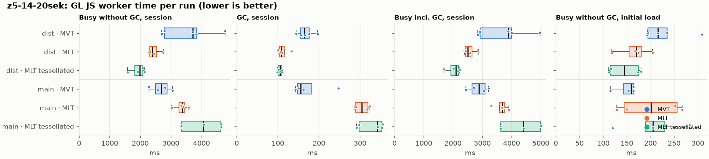
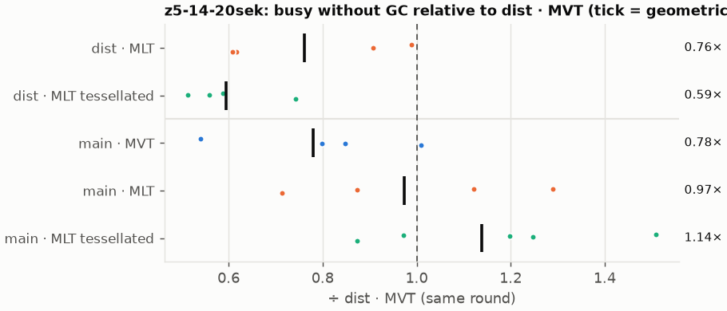
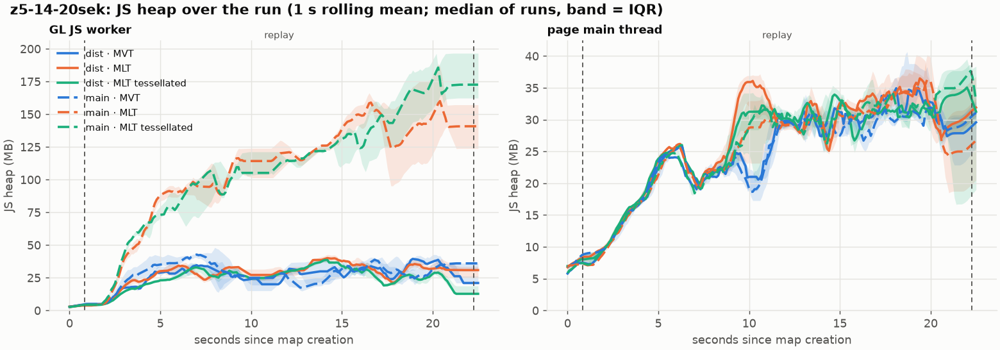
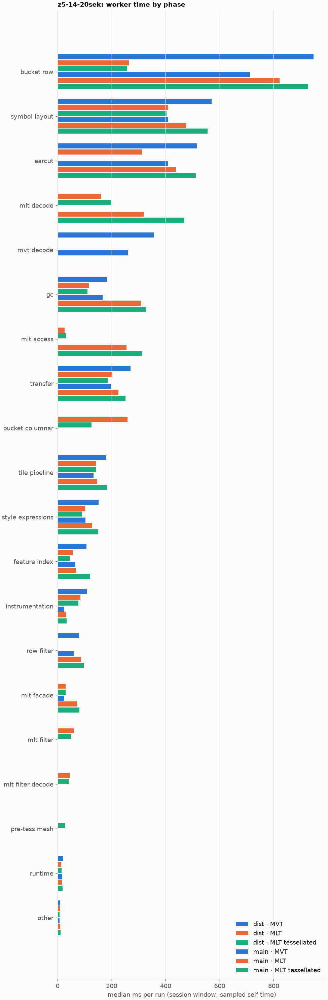
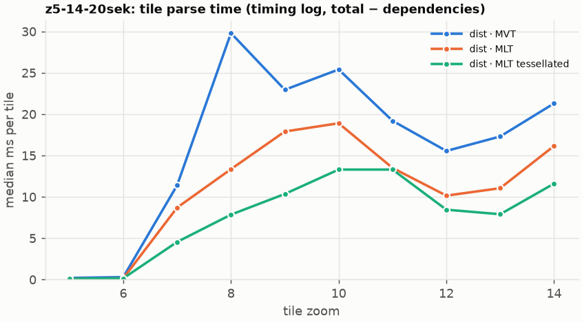
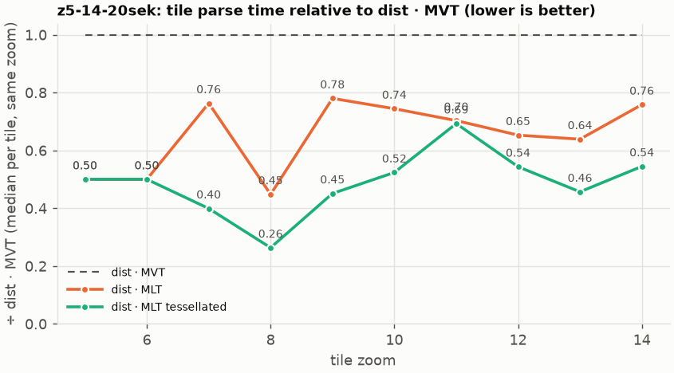

# Session trace benchmark — 20261023-074205

## Setup

- Created 2026-10-23T07:42:05+02:00; 5 repetitions + 1 warm-up round(s) (excluded); variants rotate per round (A B C, B C A, …); one cold browser context per run.
- Machine: 13th Gen Intel(R) Core(TM) i7-1365U, 12 logical cores, 31.3 GB RAM, Windows-11-10.0.26200-SP0; power: GUID des Energieschemas: 381b4222-f694-41f0-9685-ff5bb260df2e  (Ausbalanciert), AC True.
- GL JS gl7-performance-optimization @ f9bd50a8b5 (dirty); worker count 1; viewport {'width': 1280, 'height': 1024}.
- Python 3.12.2, packages {'playwright': '1.64.0', 'numpy': '2.5.3', 'matplotlib': '3.11.2'}.

| variant | bundle | format | bundle sha256 | branch build |
|---|---|---|---|---|
| MVT | `dist/maplibre-gl-dev.mjs` | mvt | `b2691453151d` | – |
| MLT | `dist/maplibre-gl-dev.mjs` | mlt | `b2691453151d` | – |
| MLT tessellated | `dist/maplibre-gl-dev.mjs` | mlt-pre-tess | `b2691453151d` | – |
| main · MVT | `bench-builds/branches/main/maplibre-gl-dev.mjs` | mvt | `ced4373133d3` | main @ 8470a6193d (2026-09-18), MLT @ 9bf846d053 |
| main · MLT | `bench-builds/branches/main/maplibre-gl-dev.mjs` | mlt | `ced4373133d3` | main @ 8470a6193d (2026-09-18), MLT @ 9bf846d053 |
| main · MLT tessellated | `bench-builds/branches/main/maplibre-gl-dev.mjs` | mlt-pre-tess | `ced4373133d3` | main @ 8470a6193d (2026-09-18), MLT @ 9bf846d053 |

| session | style | duration | frames | sha256 |
|---|---|---:|---:|---|
| z5-14-20sek | maptiler-basic | 21.4 s | 829 | `5a376e5ede30` |

CPU sampling interval (median over runs): 582 µs.

## Definitions

- **busy** = wall time in which a GL JS worker thread runs a task (union of top-level task slices and GC slices on `DedicatedWorker thread`s), summed over workers. **GC** = union of `MinorGC`/`MajorGC`/`V8.GC*` slices on those threads. **busy without GC** = busy − GC (headline metric).
- **CPU** = thread time (`tdur`) of the same slices. Phase categories and functions come from the trace's CPU samples (self time), categorised by `config/categories.toml` (nearest matching frame, leaf to root).
- Windows: **load** = map creation → first idle; **session** = camera replay; **tail** = end of replay → idle; **total** = load + session + tail.
- Ratios are against **MVT**: ratio of medians with a bootstrap 95 % CI, the geometric mean of per-round ratios, and a two-sided Mann–Whitney U p-value (normal approximation, not corrected for multiple comparisons; rough below n = 8). Lower than 1× means less worker time.

## Session `z5-14-20sek`

### Worker busy without GC (session window)

| variant | n ok / failed | median ms | IQR | mean | ratio vs MVT | 95 % CI | geo-mean paired | MWU p |
|---|---:|---:|---:|---:|---:|---:|---:|---:|
| MVT | 5 / 0 | 3,718 | 2,786–3,828 | 3,561 | 1.00× | – | – | – |
| MLT | 4 / 0 | 2,386 | 2,317–2,524 | 2,455 | 0.64× | 0.50–0.94× | 0.76× | 0.037 |
| MLT tessellated | 4 / 0 | 1,989 | 1,828–2,087 | 1,926 | 0.54× | 0.41–0.77× | 0.59× | 0.020 |
| main · MVT | 4 / 0 | 2,695 | 2,505–2,873 | 2,683 | 0.72× | 0.56–1.05× | 0.78× | 0.178 |
| main · MLT | 4 / 0 | 3,375 | 3,264–3,452 | 3,341 | 0.91× | 0.71–1.29× | 0.97× | 0.713 |
| main · MLT tessellated | 5 / 0 | 4,071 | 3,341–4,637 | 4,006 | 1.09× | 0.85–1.67× | 1.14× | 0.531 |

### All worker metrics (median, ratio vs baseline)

| metric | MVT | MLT | MLT tessellated | main · MVT | main · MLT | main · MLT tessellated |
|---|---:|---:|---:|---:|---:|---:|
| busy incl. GC | 3,883 | 2,506 (0.65×) | 2,099 (0.54×) | 2,890 (0.74×) | 3,682 (0.95×) | 4,414 (1.14×) |
| &nbsp;&nbsp;of which GC | 165.0 | 108.0 (0.65×) | 105.4 (0.64×) | 156.1 (0.95×) | 304.1 (1.84×) | 343.1 (2.08×) |
| &nbsp;&nbsp;of which busy without GC | 3,718 | 2,386 (0.64×) | 1,989 (0.54×) | 2,695 (0.72×) | 3,375 (0.91×) | 4,071 (1.09×) |
| &nbsp;&nbsp;&nbsp;&nbsp;of which filtering (sampled, incl. callees) | 78.6 | 58.8 (0.75×) | 49.7 (0.63×) | 59.5 (0.76×) | 87.0 (1.11×) | 96.6 (1.23×) |
| &nbsp;&nbsp;&nbsp;&nbsp;of which column decoding inside the MLT filter (sampled) | 0.0 | 45.9 | 40.8 | 0.0 | 0.0 | 0.0 |
| &nbsp;&nbsp;&nbsp;&nbsp;of which timing instrumentation (sampled) | 107.6 | 84.3 (0.78×) | 76.7 (0.71×) | 24.2 (0.22×) | 31.3 (0.29×) | 33.6 (0.31×) |
| busy without GC and instrumentation | 3,599 | 2,302 (0.64×) | 1,913 (0.53×) | 2,671 (0.74×) | 3,343 (0.93×) | 4,039 (1.12×) |
| CPU time without GC | 3,357 | 2,189 (0.65×) | 1,831 (0.55×) | 2,455 (0.73×) | 3,079 (0.92×) | 3,734 (1.11×) |
| tile: download end → sent to main thread, median per tile | 190.6 | 119.7 (0.63×) | 106.2 (0.56×) | 136.5 (0.72×) | 154.9 (0.81×) | 199.4 (1.05×) |
| tile: download end → sent to main thread, 90th percentile | 386.5 | 242.7 (0.63×) | 174.5 (0.45×) | 284.6 (0.74×) | 411.6 (1.06×) | 507.2 (1.31×) |
| tile: download end → sent to main thread, 95th percentile | 406.9 | 262.6 (0.65×) | 232.8 (0.57×) | 339.7 (0.83×) | 468.1 (1.15×) | 585.8 (1.44×) |
| tile: download end → sent to main thread, 99th percentile | 422.6 | 284.3 (0.67×) | 252.3 (0.60×) | 358.7 (0.85×) | 498.4 (1.18×) | 615.4 (1.46×) |
| &nbsp;&nbsp;parse part (timing log, incl. waiting for glyphs/icons), median per tile | 97.8 | 59.9 (0.61×) | 54.5 (0.56×) | – | – | – |
| &nbsp;&nbsp;queue + hand-off part, median per tile | 76.0 | 49.5 (0.65×) | 38.6 (0.51×) | – | – | – |
| minor GCs | 59.00 | 50.00 (0.85×) | 34.50 (0.58×) | 56.50 (0.96×) | 60.50 (1.03×) | 59.00 (1.00×) |
| major GCs | 4.00 | 3.00 (0.75×) | 5.00 (1.25×) | 5.00 (1.25×) | 4.00 (1.00×) | 4.00 (1.00×) |
| peak worker heap (MB) | 57.2 | 53.0 (0.93×) | 50.6 (0.89×) | 65.1 (1.14×) | 200.2 (3.50×) | 199.4 (3.49×) |
| load: busy without GC | 216.1 | 170.7 (0.79×) | 144.7 (0.67×) | 158.8 (0.73×) | 201.2 (0.93×) | 204.8 (0.95×) |
| load: GC | 6.5 | 4.9 (0.76×) | 4.0 (0.61×) | 5.3 (0.82×) | 6.2 (0.96×) | 7.2 (1.11×) |
| total: busy without GC | 3,953 | 2,532 (0.64×) | 2,137 (0.54×) | 2,854 (0.72×) | 3,576 (0.90×) | 4,275 (1.08×) |

Rows marked *of which* are parts of the row above, not additional time. Tile rows are per-tile latencies (medians over tiles, then over runs), not sums: tiles overlap in time, and the medians of the parse and queue parts do not add up exactly to the median latency.

### Filtering (session window)

Sampled worker time spent in feature filtering, including everything the filter calls (expression evaluation, property access): **row filter** = the style-spec feature filter that MVT runs per feature, **mlt filter** = the columnar MLT filter (incl. the geometry-type selection), without the columns it decodes (see the next table). Medians per run; rules in `config/categories.toml`.

| variant | mlt filter | row filter | filtering | ratio vs MVT | 95 % CI | MWU p | share of sampled busy |
|---|---:|---:|---:|---:|---:|---:|---:|
| MVT | 0.0 | 78.6 | 78.6 | 1.00× | – | – | 2.2% |
| MLT | 58.8 | 0.0 | 58.8 | 0.75× | 0.48–1.17× | 0.270 | 2.5% |
| MLT tessellated | 49.7 | 0.0 | 49.7 | 0.63× | 0.41–1.17× | 0.066 | 2.8% |
| main · MVT | 0.0 | 59.5 | 59.5 | 0.76× | 0.49–1.33× | 0.391 | 2.3% |
| main · MLT | 0.0 | 86.3 | 87.0 | 1.11× | 0.71–1.73× | 0.540 | 2.5% |
| main · MLT tessellated | 0.0 | 96.6 | 96.6 | 1.23× | 0.79–2.00× | 0.403 | 2.4% |

**Filtering together with tile decoding.** The MLT decoder leaves columns encoded until something reads them, and the filter is usually the first reader: the columns it decodes (properties, and the geometry for `$type`) are **of which inside the filter** (phase *mlt filter decode*), the rest is *mlt decode* (geometry and columns read later, e.g. by paint properties and symbols). MVT decodes every feature's properties and geometry while it reads the tile (*mvt decode*), whether the filter keeps the feature or not. So **filtering** above compares the filters, and **decoding + filtering** compares all that the formats spend on decoding the tile and selecting features. **tile decoding** = *mvt decode* or *mlt decode* + *mlt filter decode*: work inside a call into a decoder. Reading data that is already decoded is not counted, as for MVT's feature objects: *mlt access* (row views, value getters, looking a column up by name) and the MLT facade (*mlt facade*). MVT decodes geometry only for the features its filter keeps, MLT decodes a layer's whole geometry column.

| variant | tile decoding | of which inside the filter | filtering | decoding + filtering | ratio vs MVT | 95 % CI | MWU p |
|---|---:|---:|---:|---:|---:|---:|---:|
| MVT | 356.5 | 0.0 | 78.6 | 442.3 | 1.00× | – | – |
| MLT | 203.3 | 45.9 | 58.8 | 260.5 | 0.59× | 0.46–0.90× | 0.020 |
| MLT tessellated | 238.5 | 40.8 | 49.7 | 288.2 | 0.65× | 0.51–1.02× | 0.111 |
| main · MVT | 261.0 | 0.0 | 59.5 | 320.5 | 0.72× | 0.56–1.13× | 0.178 |
| main · MLT | 318.7 | 0.0 | 87.0 | 405.1 | 0.92× | 0.71–1.34× | 0.713 |
| main · MLT tessellated | 468.3 | 0.0 | 96.6 | 564.9 | 1.28× | 0.99–1.98× | 0.060 |

Top 12 functions inside filtering and its column decoding (self time, mean ms per run):

| phase | function | source | MVT | MLT | MLT tessellated | main · MVT | main · MLT | main · MLT tessellated |
|---|---|---|---:|---:|---:|---:|---:|---:|
| row filter | `evaluate` | node_modules/@maplibre/maplibre-gl-style-spec/dist/expression/compound_expression.mjs | 19.0 | 0.0 | 0.0 | 14.3 | 28.2 | 32.0 |
| row filter | `evaluate` | node_modules/@maplibre/maplibre-gl-style-spec/dist/expression/index.mjs | 19.3 | 0.0 | 0.0 | 14.7 | 20.1 | 22.4 |
| row filter | `CompoundExpression.register.filter-==` | node_modules/@maplibre/maplibre-gl-style-spec/dist/expression/compound_expression.mjs | 9.1 | 0.0 | 0.0 | 8.1 | 8.9 | 10.8 |
| mlt filter decode | `unpackNullable` | maplibre-tile-spec/ts/dist/decoding/unpackNullableUtils.js | 0.0 | 8.9 | 9.1 | 0.0 | 0.0 | 0.0 |
| row filter | `filter` | node_modules/@maplibre/maplibre-gl-style-spec/dist/feature_filter/index.mjs | 8.2 | 0.0 | 0.0 | 5.1 | 5.3 | 8.4 |
| mlt filter | `filterByGeometryType` | maplibre-tile-spec/ts/dist/vector/geometry/geometryVector.js | 0.0 | 7.5 | 5.2 | 0.0 | 0.0 | 0.0 |
| mlt filter | `scanDictionaryCodes` | maplibre-tile-spec/ts/dist/processing/filter/execution/filterKernel.js | 0.0 | 7.1 | 7.4 | 0.0 | 0.0 | 0.0 |
| row filter | `CompoundExpression.register.filter-in-small` | node_modules/@maplibre/maplibre-gl-style-spec/dist/expression/compound_expression.mjs | 6.6 | 0.0 | 0.0 | 6.7 | 5.5 | 7.2 |
| row filter | `CompoundExpression.register.filter-type-==` | node_modules/@maplibre/maplibre-gl-style-spec/dist/expression/compound_expression.mjs | 6.2 | 0.0 | 0.0 | 4.2 | 4.3 | 3.6 |
| mlt filter decode | `decodeFsst` | maplibre-tile-spec/ts/dist/decoding/fsstDecoder.js | 0.0 | 5.6 | 5.3 | 0.0 | 0.0 | 0.0 |
| mlt filter | `dictionaryRowMatches` | maplibre-tile-spec/ts/dist/processing/filter/execution/filterKernel.js | 0.0 | 4.7 | 4.4 | 0.0 | 0.0 | 0.0 |
| row filter | `(anonymous)` | node_modules/@maplibre/maplibre-gl-style-spec/dist/expression/compound_expression.mjs | 3.1 | 0.0 | 0.0 | 2.6 | 3.0 | 4.6 |

### Where the variants differ from MVT (session window, mean ms per run)

Open **[flame.html](flame.html)** to explore the call tree interactively: pick a variant, compare it with MVT (red = more time at the same call path, blue = less), click a frame to zoom in, and read the phase and function breakdown under it. Without a comparison, frames are coloured by phase: filtering is green in both formats, and the columns the MLT filter decodes on first access (*mlt filter decode*) are MLT blue frames under the green filter. `flame/*.txt` open in https://www.speedscope.app.

#### MLT vs MVT

**By phase** (sampled self time; the Δ column sums to the difference in sampled busy time):

| phase | MVT | MLT | Δ |
|---|---:|---:|---:|
| bucket columnar | 0.0 | 259.7 | +259.7 |
| mlt decode | 0.0 | 163.0 | +163.0 |
| mlt filter | 0.0 | 59.6 | +59.6 |
| mlt filter decode | 0.0 | 46.9 | +46.9 |
| mlt facade | 0.1 | 27.8 | +27.7 |
| mlt access | 0.0 | 25.3 | +25.3 |
| other | 10.5 | 9.3 | -1.1 |
| runtime | 19.1 | 13.8 | -5.3 |
| instrumentation | 103.5 | 84.6 | -18.9 |
| tile pipeline | 179.4 | 143.6 | -35.8 |
| style expressions | 146.0 | 99.1 | -46.9 |
| feature index | 106.5 | 54.0 | -52.6 |
| transfer | 256.4 | 201.5 | -54.8 |
| gc | 181.9 | 122.8 | -59.1 |
| row filter | 80.3 | 0.0 | -80.3 |
| symbol layout | 548.6 | 420.7 | -127.9 |
| earcut | 502.5 | 319.3 | -183.3 |
| mvt decode | 338.5 | 0.0 | -338.5 |
| bucket row | 940.1 | 275.0 | -665.0 |

**By source layer** (timing log: createBucket + populate + addFeatures, summed over the style layers that use it; wall time, includes GC pauses; total Δ -875 ms):

| source layer | type | MVT | MLT | Δ |
|---|---|---:|---:|---:|
| poi | symbol | 38.9 | 49.0 | +10.1 |
| waterway | line | 40.7 | 43.1 | +2.4 |
| boundary | line | 34.4 | 36.2 | +1.8 |
| aeroway | fill | 1.4 | 2.8 | +1.4 |
| transportation_name | symbol | 118.7 | 115.5 | -3.2 |
| transportation | fill | 14.9 | 9.3 | -5.6 |
| water | fill | 60.4 | 44.1 | -16.2 |
| place | symbol | 503.2 | 433.8 | -69.4 |
| transportation | line | 510.5 | 385.0 | -125.5 |
| building | fill | 282.7 | 135.0 | -147.7 |
| landuse | fill | 440.6 | 220.3 | -220.3 |
| landcover | fill | 633.7 | 331.0 | -302.7 |

**Functions with the largest self-time difference** (by function name, summed over source files):

| function | MVT | MLT | Δ |
|---|---:|---:|---:|
| `readScaledRings` | 0.0 | 44.7 | +44.7 |
| `writeEarcutFill` | 0.0 | 24.1 | +24.1 |
| `buildEarcutMesh` | 0.0 | 22.2 | +22.2 |
| `decodeComponentwiseDeltaVec2` | 0.0 | 16.6 | +16.6 |
| `unpackNullable` | 0.0 | 13.8 | +13.8 |
| `decodeString$2` | 0.0 | 11.6 | +11.6 |
| `decodeFastPforInt32` | 0.0 | 11.2 | +11.2 |
| `registerGlyphs` | 0.0 | 9.8 | +9.8 |
| `decodeFsst` | 0.0 | 8.8 | +8.8 |
| `decodeUnsignedRleInt32` | 0.0 | 8.0 | +8.0 |
| `scaleCheckedCoordinate` | 0.0 | 7.7 | +7.7 |
| `signedArea$1` | 0.0 | 7.5 | +7.5 |
| `_vertexToIndex` | 164.6 | 0.0 | -164.6 |
| `readSVarint` | 148.3 | 0.0 | -148.3 |
| `isEar` | 157.0 | 82.6 | -74.3 |
| `loadGeometry` | 83.5 | 10.0 | -73.5 |
| `(garbage collector)` | 181.9 | 122.8 | -59.1 |

#### MLT tessellated vs MVT

**By phase** (sampled self time; the Δ column sums to the difference in sampled busy time):

| phase | MVT | MLT tessellated | Δ |
|---|---:|---:|---:|
| mlt decode | 0.0 | 196.3 | +196.3 |
| bucket columnar | 0.0 | 119.5 | +119.5 |
| mlt filter | 0.0 | 52.5 | +52.5 |
| mlt filter decode | 0.0 | 40.5 | +40.5 |
| mlt facade | 0.1 | 30.1 | +30.0 |
| mlt access | 0.0 | 29.4 | +29.4 |
| pre-tess mesh | 0.0 | 27.0 | +27.0 |
| other | 10.5 | 7.9 | -2.6 |
| runtime | 19.1 | 14.9 | -4.2 |
| instrumentation | 103.5 | 74.4 | -29.1 |
| tile pipeline | 179.4 | 139.1 | -40.3 |
| style expressions | 146.0 | 90.0 | -56.0 |
| feature index | 106.5 | 43.5 | -63.0 |
| gc | 181.9 | 109.8 | -72.1 |
| transfer | 256.4 | 178.5 | -77.9 |
| row filter | 80.3 | 0.0 | -80.3 |
| symbol layout | 548.6 | 386.1 | -162.5 |
| mvt decode | 338.5 | 0.0 | -338.5 |
| earcut | 502.5 | 2.5 | -500.0 |
| bucket row | 940.1 | 247.6 | -692.4 |

**By source layer** (timing log: createBucket + populate + addFeatures, summed over the style layers that use it; wall time, includes GC pauses; total Δ -1379 ms):

| source layer | type | MVT | MLT tessellated | Δ |
|---|---|---:|---:|---:|
| poi | symbol | 38.9 | 40.4 | +1.5 |
| aeroway | fill | 1.4 | 2.9 | +1.5 |
| aerodrome_label | symbol | 6.9 | 7.7 | +0.8 |
| transportation | fill | 14.9 | 13.7 | -1.2 |
| boundary | line | 34.4 | 32.9 | -1.5 |
| transportation_name | symbol | 118.7 | 90.1 | -28.6 |
| water | fill | 60.4 | 26.2 | -34.1 |
| place | symbol | 503.2 | 426.2 | -77.0 |
| transportation | line | 510.5 | 380.8 | -129.6 |
| building | fill | 282.7 | 40.8 | -241.9 |
| landuse | fill | 440.6 | 85.0 | -355.6 |
| landcover | fill | 633.7 | 120.3 | -513.4 |

**Functions with the largest self-time difference** (by function name, summed over source files):

| function | MVT | MLT tessellated | Δ |
|---|---:|---:|---:|
| `buildTessellatedBoundingBox` | 0.0 | 24.4 | +24.4 |
| `decodeUnsignedZigZagDeltaInt32` | 0.0 | 21.1 | +21.1 |
| `decodeComponentwiseDeltaVec2` | 0.0 | 16.1 | +16.1 |
| `unpackNullable` | 0.0 | 12.3 | +12.3 |
| `decodeFastPforInt32` | 0.0 | 12.2 | +12.2 |
| `decodeString$2` | 0.0 | 12.1 | +12.1 |
| `get` | 20.0 | 30.4 | +10.4 |
| `writeTessellatedFill` | 0.0 | 10.2 | +10.2 |
| `appendSymbolFeature` | 0.0 | 9.6 | +9.6 |
| `registerGlyphs` | 0.0 | 8.9 | +8.9 |
| `fastUnpack256_4` | 0.0 | 8.4 | +8.4 |
| `appendScaledVertices` | 0.0 | 8.3 | +8.3 |
| `_vertexToIndex` | 164.6 | 0.0 | -164.6 |
| `isEar` | 157.0 | 0.3 | -156.7 |
| `readSVarint` | 148.3 | 0.0 | -148.3 |
| `isEarHashed` | 92.7 | 0.0 | -92.7 |
| `loadGeometry` | 83.5 | 8.4 | -75.1 |

#### main · MVT vs MVT

**By phase** (sampled self time; the Δ column sums to the difference in sampled busy time):

| phase | MVT | main · MVT | Δ |
|---|---:|---:|---:|
| mlt facade | 0.1 | 24.5 | +24.4 |
| gc | 181.9 | 187.2 | +5.3 |
| runtime | 19.1 | 16.8 | -2.4 |
| other | 10.5 | 7.1 | -3.4 |
| row filter | 80.3 | 61.9 | -18.4 |
| tile pipeline | 179.4 | 138.5 | -40.9 |
| feature index | 106.5 | 62.5 | -44.0 |
| style expressions | 146.0 | 98.5 | -47.6 |
| transfer | 256.4 | 201.3 | -55.0 |
| mvt decode | 338.5 | 260.5 | -78.0 |
| instrumentation | 103.5 | 24.4 | -79.1 |
| earcut | 502.5 | 395.2 | -107.3 |
| symbol layout | 548.6 | 415.0 | -133.6 |
| bucket row | 940.1 | 703.5 | -236.6 |

**By source layer** (timing log: createBucket + populate + addFeatures, summed over the style layers that use it; wall time, includes GC pauses; total Δ -2689 ms):

| source layer | type | MVT | main · MVT | Δ |
|---|---|---:|---:|---:|
| aerodrome_label | symbol | 6.9 | 0.0 | -6.9 |
| transportation | fill | 14.9 | 0.0 | -14.9 |
| boundary | line | 34.4 | 0.0 | -34.4 |
| poi | symbol | 38.9 | 0.0 | -38.9 |
| waterway | line | 40.7 | 0.0 | -40.7 |
| water | fill | 60.4 | 0.0 | -60.4 |
| transportation_name | symbol | 118.7 | 0.0 | -118.7 |
| building | fill | 282.7 | 0.0 | -282.7 |
| landuse | fill | 440.6 | 0.0 | -440.6 |
| place | symbol | 503.2 | 0.0 | -503.2 |
| transportation | line | 510.5 | 0.0 | -510.5 |
| landcover | fill | 633.7 | 0.0 | -633.7 |

**Functions with the largest self-time difference** (by function name, summed over source files):

| function | MVT | main · MVT | Δ |
|---|---:|---:|---:|
| `hasLineDasharray` | 0.4 | 11.2 | +10.9 |
| `(garbage collector)` | 181.9 | 187.2 | +5.3 |
| `signedArea$1` | 0.0 | 4.8 | +4.8 |
| `subdividePolygon` | 0.5 | 3.9 | +3.4 |
| `readUtf8$1` | 0.0 | 2.9 | +2.9 |
| `Subdivider` | 5.7 | 7.2 | +1.5 |
| `SymbolBuffers` | 0.6 | 2.0 | +1.4 |
| `readVarintRemainder$1` | 0.0 | 1.3 | +1.3 |
| `_ensureNoPoleVertices` | 2.0 | 3.1 | +1.2 |
| `determineAverageLineWidth` | 3.5 | 4.4 | +0.9 |
| `PbfReader` | 0.9 | 1.7 | +0.9 |
| `containsRTLText` | 1.3 | 2.1 | +0.7 |
| `populate` | 86.1 | 45.6 | -40.5 |
| `readSVarint` | 148.3 | 109.2 | -39.1 |
| `isEar` | 157.0 | 119.0 | -38.0 |
| `_vertexToIndex` | 164.6 | 128.9 | -35.6 |
| `addPhase` | 28.5 | 0.0 | -28.5 |

#### main · MLT vs MVT

**By phase** (sampled self time; the Δ column sums to the difference in sampled busy time):

| phase | MVT | main · MLT | Δ |
|---|---:|---:|---:|
| mlt decode | 0.0 | 321.3 | +321.3 |
| mlt access | 0.0 | 246.6 | +246.6 |
| gc | 181.9 | 311.1 | +129.2 |
| mlt facade | 0.1 | 69.6 | +69.5 |
| row filter | 80.3 | 82.9 | +2.6 |
| other | 10.5 | 8.5 | -2.0 |
| runtime | 19.1 | 16.8 | -2.3 |
| style expressions | 146.0 | 123.4 | -22.6 |
| transfer | 256.4 | 227.4 | -28.9 |
| tile pipeline | 179.4 | 145.4 | -34.0 |
| feature index | 106.5 | 68.4 | -38.2 |
| earcut | 502.5 | 439.9 | -62.6 |
| symbol layout | 548.6 | 476.1 | -72.5 |
| instrumentation | 103.5 | 30.5 | -73.0 |
| bucket row | 940.1 | 809.2 | -130.9 |
| mvt decode | 338.5 | 0.0 | -338.5 |

**By source layer** (timing log: createBucket + populate + addFeatures, summed over the style layers that use it; wall time, includes GC pauses; total Δ -2689 ms):

| source layer | type | MVT | main · MLT | Δ |
|---|---|---:|---:|---:|
| aerodrome_label | symbol | 6.9 | 0.0 | -6.9 |
| transportation | fill | 14.9 | 0.0 | -14.9 |
| boundary | line | 34.4 | 0.0 | -34.4 |
| poi | symbol | 38.9 | 0.0 | -38.9 |
| waterway | line | 40.7 | 0.0 | -40.7 |
| water | fill | 60.4 | 0.0 | -60.4 |
| transportation_name | symbol | 118.7 | 0.0 | -118.7 |
| building | fill | 282.7 | 0.0 | -282.7 |
| landuse | fill | 440.6 | 0.0 | -440.6 |
| place | symbol | 503.2 | 0.0 | -503.2 |
| transportation | line | 510.5 | 0.0 | -510.5 |
| landcover | fill | 633.7 | 0.0 | -633.7 |

**Functions with the largest self-time difference** (by function name, summed over source files):

| function | MVT | main · MLT | Δ |
|---|---:|---:|---:|
| `(garbage collector)` | 181.9 | 311.1 | +129.2 |
| `getFeatures` | 0.0 | 100.0 | +100.0 |
| `decodeString$2` | 0.0 | 73.1 | +73.1 |
| `convertGeometryVector` | 0.0 | 38.6 | +38.6 |
| `decodeComponentwiseDeltaVec2` | 0.0 | 25.3 | +25.3 |
| `getLineStringOrRing` | 0.0 | 23.1 | +23.1 |
| `unpackNullable` | 0.0 | 18.1 | +18.1 |
| `getValue` | 0.0 | 16.6 | +16.6 |
| `decodeFastPforInt32` | 0.0 | 15.0 | +15.0 |
| `MLTVectorTileLayer` | 0.0 | 12.9 | +12.9 |
| `get name` | 0.0 | 12.2 | +12.2 |
| `evaluate` | 49.2 | 59.9 | +10.7 |
| `readSVarint` | 148.3 | 0.0 | -148.3 |
| `readVarint` | 50.8 | 1.8 | -49.0 |
| `populate` | 86.1 | 50.4 | -35.6 |
| `readString` | 32.8 | 0.0 | -32.8 |
| `VectorTileFeature` | 29.7 | 0.0 | -29.7 |

#### main · MLT tessellated vs MVT

**By phase** (sampled self time; the Δ column sums to the difference in sampled busy time):

| phase | MVT | main · MLT tessellated | Δ |
|---|---:|---:|---:|
| mlt decode | 0.0 | 457.4 | +457.4 |
| mlt access | 0.0 | 295.8 | +295.8 |
| gc | 181.9 | 323.3 | +141.4 |
| mlt facade | 0.1 | 77.8 | +77.7 |
| row filter | 80.3 | 98.9 | +18.6 |
| symbol layout | 548.6 | 566.5 | +17.9 |
| earcut | 502.5 | 506.2 | +3.6 |
| style expressions | 146.0 | 148.7 | +2.7 |
| other | 10.5 | 12.9 | +2.4 |
| transfer | 256.4 | 257.4 | +1.0 |
| runtime | 19.1 | 17.6 | -1.5 |
| bucket row | 940.1 | 936.6 | -3.4 |
| tile pipeline | 179.4 | 169.8 | -9.6 |
| feature index | 106.5 | 87.7 | -18.8 |
| instrumentation | 103.5 | 33.8 | -69.7 |
| mvt decode | 338.5 | 0.0 | -338.5 |

**By source layer** (timing log: createBucket + populate + addFeatures, summed over the style layers that use it; wall time, includes GC pauses; total Δ -2689 ms):

| source layer | type | MVT | main · MLT tessellated | Δ |
|---|---|---:|---:|---:|
| aerodrome_label | symbol | 6.9 | 0.0 | -6.9 |
| transportation | fill | 14.9 | 0.0 | -14.9 |
| boundary | line | 34.4 | 0.0 | -34.4 |
| poi | symbol | 38.9 | 0.0 | -38.9 |
| waterway | line | 40.7 | 0.0 | -40.7 |
| water | fill | 60.4 | 0.0 | -60.4 |
| transportation_name | symbol | 118.7 | 0.0 | -118.7 |
| building | fill | 282.7 | 0.0 | -282.7 |
| landuse | fill | 440.6 | 0.0 | -440.6 |
| place | symbol | 503.2 | 0.0 | -503.2 |
| transportation | line | 510.5 | 0.0 | -510.5 |
| landcover | fill | 633.7 | 0.0 | -633.7 |

**Functions with the largest self-time difference** (by function name, summed over source files):

| function | MVT | main · MLT tessellated | Δ |
|---|---:|---:|---:|
| `(garbage collector)` | 181.9 | 323.3 | +141.4 |
| `getFeatures` | 0.0 | 119.9 | +119.9 |
| `decodeString$2` | 0.0 | 90.5 | +90.5 |
| `convertGeometryVector` | 0.0 | 44.7 | +44.7 |
| `decodeUnsignedZigZagDeltaInt32` | 0.0 | 29.6 | +29.6 |
| `decodeComponentwiseDeltaVec2` | 0.0 | 28.7 | +28.7 |
| `getLineStringOrRing` | 0.0 | 27.9 | +27.9 |
| `unpackNullable` | 0.0 | 25.4 | +25.4 |
| `MLTVectorTileLayer` | 0.0 | 21.0 | +21.0 |
| `evaluate` | 49.2 | 69.9 | +20.7 |
| `getValue` | 0.0 | 19.5 | +19.5 |
| `decodeFastPforInt32` | 0.0 | 19.1 | +19.1 |
| `readSVarint` | 148.3 | 0.0 | -148.3 |
| `readVarint` | 50.8 | 3.1 | -47.7 |
| `readString` | 32.8 | 0.0 | -32.8 |
| `populate` | 86.1 | 56.0 | -30.1 |
| `VectorTileFeature` | 29.7 | 0.0 | -29.7 |

### Memory (session window)

**JS heap** = V8's used heap of the thread (`jsHeapSizeUsed` from the trace's `UpdateCounters`, about every 20 ms; the mean is time-weighted). It does not include ArrayBuffer contents, so the tile data itself (vertex, index and feature-index arrays) is not in it: **tile data sent to the main thread** is the size of the ArrayBuffers each tile result transfers (`web/worker_hook.js`), which then live on the main thread and are uploaded to the GPU. **garbage collected** = heap freed by the worker's GCs, a measure of how much it allocates. Medians per run; ratio of medians with a bootstrap 95 % CI.

| metric | MVT | MLT | MLT tessellated | main · MVT | main · MLT | main · MLT tessellated |
|---|---:|---:|---:|---:|---:|---:|
| worker JS heap, mean (MB) | 22.2 | 23.2 (1.04×, 0.93–1.27×) | 20.6 (0.93×, 0.83–1.10×) | 23.4 (1.05×, 0.90–1.33×) | 98.6 (4.44×, 3.98–5.02×) | 97.0 (4.37×, 3.92–5.27×) |
| worker JS heap, peak (MB) | 57.2 | 53.0 (0.93×, 0.90–1.10×) | 50.6 (0.89×, 0.82–1.09×) | 65.1 (1.14×, 1.00–1.44×) | 200.2 (3.50×, 3.34–4.17×) | 199.4 (3.49×, 2.95–4.20×) |
| worker JS heap after the last GC (MB) | 19.2 | 19.4 (1.01×, 0.53–1.98×) | 10.4 (0.54×, 0.49–1.06×) | 15.3 (0.79×, 0.46–2.14×) | 127.0 (6.62×, 4.00–13.37×) | 160.8 (8.38×, 4.01–16.37×) |
| garbage collected in the worker (MB) | 1,287 | 871.1 (0.68×, 0.67–0.71×) | 508.8 (0.40×, 0.38–0.41×) | 1,272 (0.99×, 0.98–1.03×) | 1,323 (1.03×, 0.98–1.09×) | 1,266 (0.98×, 0.97–1.09×) |
| main thread JS heap, mean (MB) | 23.4 | 24.7 (1.06×, 1.02–1.17×) | 24.3 (1.04×, 0.98–1.12×) | 22.5 (0.96×, 0.93–1.05×) | 23.5 (1.00×, 0.97–1.06×) | 23.7 (1.01×, 0.91–1.10×) |
| main thread JS heap, peak (MB) | 43.1 | 46.4 (1.08×, 0.86–1.15×) | 43.1 (1.00×, 0.85–1.06×) | 42.1 (0.98×, 0.83–1.01×) | 46.5 (1.08×, 0.85–1.18×) | 44.5 (1.03×, 0.87–1.11×) |
| main thread JS heap at the end of the replay (MB) | 28.2 | 29.8 (1.06×, 0.86–1.76×) | 34.2 (1.21×, 0.75–1.70×) | 29.1 (1.03×, 0.84–1.50×) | 25.3 (0.90×, 0.61–1.40×) | 35.3 (1.25×, 0.50–1.78×) |
| tile data sent to the main thread, total (MB) | 72.2 | 68.7 (0.95×, 0.93–0.98×) | 69.6 (0.96×, 0.96–0.99×) | 72.3 (1.00×, 0.99–1.03×) | 68.3 (0.95×, 0.94–0.97×) | 71.9 (1.00×, 0.97–1.02×) |
| tile data sent to the main thread, median per tile (KB) | 504.9 | 478.3 (0.95×, 0.90–0.97×) | 470.0 (0.93×, 0.93–0.94×) | 500.1 (0.99×, 0.99–1.01×) | 484.3 (0.96×, 0.95–0.97×) | 506.8 (1.00×, 0.97–1.02×) |

### Worker time by phase (session window, median ms of sampled self time)

| phase | MVT | MLT | MLT tessellated | main · MVT | main · MLT | main · MLT tessellated |
|---|---:|---:|---:|---:|---:|---:|
| bucket row | 947.2 | 263.8 | 257.6 | 712.3 | 821.5 | 927.7 |
| symbol layout | 570.8 | 409.2 | 403.6 | 409.7 | 476.0 | 555.2 |
| earcut | 515.4 | 311.8 | 2.4 | 407.8 | 438.3 | 511.0 |
| mlt decode | 0.0 | 159.7 | 197.6 | 0.0 | 318.7 | 468.3 |
| mvt decode | 356.5 | 0.0 | 0.0 | 261.0 | 0.0 | 0.0 |
| gc | 183.2 | 115.5 | 110.7 | 165.9 | 308.4 | 327.4 |
| mlt access | 0.0 | 25.5 | 30.3 | 0.0 | 254.8 | 313.6 |
| transfer | 270.1 | 202.2 | 185.8 | 196.9 | 224.5 | 250.8 |
| bucket columnar | 0.0 | 258.4 | 125.5 | 0.0 | 0.0 | 0.0 |
| tile pipeline | 179.1 | 141.9 | 141.2 | 132.6 | 146.6 | 182.3 |
| style expressions | 151.7 | 102.1 | 89.7 | 103.2 | 127.3 | 150.3 |
| feature index | 106.6 | 55.7 | 45.1 | 65.1 | 66.2 | 118.7 |
| instrumentation | 107.6 | 84.3 | 76.7 | 24.2 | 31.3 | 33.6 |
| row filter | 78.6 | 0.0 | 0.0 | 59.5 | 86.3 | 96.6 |
| mlt facade | 0.0 | 29.4 | 30.1 | 23.4 | 71.8 | 80.3 |
| mlt filter | 0.0 | 58.8 | 49.7 | 0.0 | 0.0 | 0.0 |
| mlt filter decode | 0.0 | 45.9 | 40.8 | 0.0 | 0.0 | 0.0 |
| pre-tess mesh | 0.0 | 0.0 | 27.0 | 0.0 | 0.0 | 0.0 |
| runtime | 19.2 | 12.2 | 14.4 | 16.4 | 15.8 | 18.5 |
| other | 10.0 | 8.5 | 7.4 | 6.6 | 9.1 | 10.4 |

### Top 20 worker functions by self time (session window, mean ms per run)

| function | source | phase | MVT | MLT | MLT tessellated | main · MVT | main · MLT | main · MLT tessellated |
|---|---|---|---:|---:|---:|---:|---:|---:|
| `(garbage collector)` | (native) | gc | 181.9 | 122.8 | 109.8 | 187.2 | 311.1 | 323.3 |
| `_vertexToIndex` | src/render/subdivision.ts | bucket row | 164.6 | 0.0 | 0.0 | 128.9 | 152.1 | 174.2 |
| `isEar` | node_modules/earcut/src/earcut.js | earcut | 157.0 | 82.6 | 0.3 | 119.0 | 132.1 | 155.5 |
| `readSVarint` | node_modules/pbf/index.js | mvt decode | 148.3 | 0.0 | 0.0 | 109.2 | 0.0 | 0.0 |
| `reserve` | src/util/struct_array.ts | bucket row | 134.5 | 85.3 | 82.8 | 112.9 | 119.5 | 131.9 |
| `getFeatures` | maplibre-tile-spec/ts/dist/vector/featureTable.js | mlt access | 0.0 | 0.0 | 0.0 | 0.0 | 100.0 | 119.9 |
| `isEarHashed` | node_modules/earcut/src/earcut.js | earcut | 92.7 | 58.2 | 0.0 | 71.9 | 86.9 | 92.4 |
| `decodeString$2` | maplibre-tile-spec/ts/dist/decoding/decodingUtils.js | mlt decode | 0.0 | 11.6 | 12.1 | 0.0 | 73.1 | 90.5 |
| `postMessage` | (native) | transfer | 75.1 | 71.8 | 68.3 | 65.6 | 71.4 | 77.3 |
| `emplace` | src/data/array_types.g.ts | bucket row | 74.3 | 58.9 | 47.4 | 56.7 | 63.9 | 72.7 |
| `fetch` | (native) | tile pipeline | 63.2 | 54.5 | 51.7 | 53.8 | 59.6 | 65.0 |
| `_trim` | src/util/struct_array.ts | transfer | 55.5 | 32.1 | 22.9 | 43.3 | 47.4 | 54.1 |
| `populate` | src/data/bucket/line_bucket.ts | bucket row | 54.7 | 0.0 | 0.0 | 15.3 | 19.2 | 17.7 |
| `insert` | src/data/feature_index.ts | feature index | 51.8 | 18.3 | 15.5 | 19.6 | 26.5 | 35.1 |
| `readVarint` | node_modules/pbf/index.js | mvt decode | 50.8 | 0.0 | 0.0 | 42.9 | 0.0 | 0.0 |
| `addHalfVertex` | src/data/bucket/line_bucket.ts | bucket row | 47.6 | 30.0 | 29.9 | 29.3 | 37.4 | 43.3 |
| `earcutLinked` | node_modules/earcut/src/earcut.js | earcut | 44.3 | 28.4 | 0.5 | 40.4 | 42.9 | 47.1 |
| `serialize` | src/util/web_worker_transfer.ts | transfer | 45.5 | 38.5 | 34.7 | 34.4 | 40.5 | 46.6 |
| `addLine` | src/data/bucket/line_bucket.ts | bucket row | 44.8 | 35.2 | 28.9 | 34.3 | 37.8 | 46.3 |
| `loadGeometry` | node_modules/@mapbox/vector-tile/index.js | mvt decode | 44.7 | 0.0 | 0.0 | 35.2 | 0.0 | 0.0 |

### Top 20 worker functions by total time (incl. callees) (session window, mean ms per run)

| function | source | phase | MVT | MLT | MLT tessellated | main · MVT | main · MLT | main · MLT tessellated |
|---|---|---|---:|---:|---:|---:|---:|---:|
| `loadTile` | src/source/vector_tile_worker_source.ts | tile pipeline | 2,356 | 1,534 | 1,060 | 1,747 | 2,306 | 2,791 |
| `parse` | src/source/worker_tile.ts | tile pipeline | 2,771 | 1,883 | 1,391 | 2,047 | 2,130 | 2,481 |
| `_parseWorkerTile` | src/source/vector_tile_worker_source.ts | tile pipeline | 2,240 | 1,474 | 1,005 | 1,652 | 1,660 | 1,944 |
| `populate` | src/data/bucket/fill_bucket.ts | bucket row | 1,286 | 0.0 | 0.0 | 1,017 | 1,018 | 1,160 |
| `addBucketFeatures` | src/data/bucket/fill_bucket.ts | bucket row | 1,047 | 539.6 | 65.6 | 0.0 | 0.0 | 0.0 |
| `addFeature` | src/data/bucket/fill_bucket.ts | bucket row | 973.2 | 0.0 | 0.0 | 769.5 | 868.5 | 1,001 |
| `subdividePolygon` | src/render/subdivision.ts | bucket row | 824.0 | 0.0 | 0.0 | 650.8 | 731.6 | 850.3 |
| `subdividePolygonInternal` | src/render/subdivision.ts | bucket row | 817.8 | 0.0 | 0.0 | 639.4 | 717.1 | 836.2 |
| `loadVectorTile` | src/source/vector_tile_worker_source.ts |  | 54.3 | 4.9 | 6.4 | 44.6 | 584.6 | 780.2 |
| `MLTVectorTile` | src/source/vector_tile_mlt.ts | mlt facade | 0.0 | 4.8 | 5.4 | 0.0 | 584.1 | 779.9 |
| `(anonymous)` | src/source/vector_tile_mlt.ts | mlt facade | 0.0 | 0.0 | 0.0 | 0.0 | 562.0 | 754.9 |
| `MLTVectorTileLayer` | src/source/vector_tile_mlt.ts | mlt facade | 0.0 | 1.0 | 0.8 | 0.0 | 557.3 | 748.9 |
| `getFeatures` | maplibre-tile-spec/ts/dist/vector/featureTable.js | mlt access | 0.0 | 0.0 | 0.0 | 0.0 | 543.6 | 726.9 |
| `populate` | src/data/bucket/columnar/columnar_fill_bucket.ts | bucket columnar | 0.0 | 658.5 | 254.8 | 0.0 | 0.0 | 0.0 |
| `addFeature` | src/data/bucket/columnar/columnar_fill_bucket.ts | bucket columnar | 0.0 | 521.6 | 58.7 | 0.0 | 0.0 | 0.0 |
| `writeEarcutFill` | src/data/bucket/columnar/columnar_mesh_arrays.ts | bucket columnar | 0.0 | 514.9 | 5.0 | 0.0 | 0.0 | 0.0 |
| `addFeatures` | src/data/bucket/symbol_bucket.ts | symbol layout | 488.4 | 376.3 | 352.0 | 371.9 | 437.2 | 511.5 |
| `earcut` | node_modules/earcut/src/earcut.js | earcut | 501.7 | 318.5 | 2.5 | 394.6 | 438.9 | 505.2 |
| `performSymbolLayout` | src/symbol/symbol_layout.ts | symbol layout | 482.0 | 370.6 | 348.0 | 367.6 | 432.0 | 504.2 |
| `populate` | src/data/bucket/line_bucket.ts | bucket row | 479.5 | 0.0 | 0.0 | 317.0 | 336.0 | 395.9 |

### Tile parse time by zoom (timing log, median ms per tile, total − dependencies)

| zoom | MVT | MLT | MLT tessellated | main · MVT | main · MLT | main · MLT tessellated |
|---:|---:|---:|---:|---:|---:|---:|
| 5 | 0.20 (n=45) | 0.10 (n=36) | 0.10 (n=36) | – | – | – |
| 6 | 0.30 (n=45) | 0.15 (n=36) | 0.15 (n=36) | – | – | – |
| 7 | 11.40 (n=30) | 8.70 (n=24) | 4.55 (n=24) | – | – | – |
| 8 | 29.80 (n=25) | 13.35 (n=36) | 7.85 (n=32) | – | – | – |
| 9 | 22.95 (n=80) | 17.90 (n=64) | 10.35 (n=64) | – | – | – |
| 10 | 25.40 (n=100) | 18.90 (n=80) | 13.30 (n=80) | – | – | – |
| 11 | 19.20 (n=71) | 13.50 (n=57) | 13.30 (n=61) | – | – | – |
| 12 | 15.55 (n=102) | 10.15 (n=80) | 8.45 (n=80) | – | – | – |
| 13 | 17.30 (n=107) | 11.05 (n=84) | 7.90 (n=84) | – | – | – |
| 14 | 21.30 (n=90) | 16.15 (n=72) | 11.60 (n=72) | – | – | – |

### Tile latency by zoom: download end → result sent to the main thread (session window, ms per tile: median / p95 / p99)

Includes waiting in the worker's queue, the parse and posting the result; see `tile_latency.csv` for the per-tile split (`parse_ms`, `wait_ms`). Percentiles over the tiles of all runs; with few tiles (n) p99 is close to the maximum.

| zoom | MVT | MLT | MLT tessellated | main · MVT | main · MLT | main · MLT tessellated |
|---:|---:|---:|---:|---:|---:|---:|
| 6 | 61.9 / 93.0 / 98.1 (n=45) | 38.8 / 59.8 / 63.5 (n=36) | 34.5 / 49.9 / 50.7 (n=36) | 43.6 / 59.6 / 60.4 (n=36) | 59.8 / 87.8 / 88.6 (n=36) | 71.4 / 113.5 / 128.0 (n=45) |
| 7 | 168.7 / 351.1 / 460.0 (n=30) | 81.1 / 100.3 / 101.7 (n=24) | 51.2 / 64.1 / 64.3 (n=24) | 124.0 / 135.3 / 136.3 (n=24) | 154.8 / 178.2 / 180.2 (n=24) | 147.8 / 379.7 / 514.0 (n=30) |
| 8 | 231.7 / 283.0 / 294.2 (n=25) | 181.4 / 206.3 / 209.6 (n=36) | 109.6 / 132.4 / 134.4 (n=32) | 227.9 / 246.9 / 250.9 (n=27) | 252.2 / 273.8 / 276.4 (n=20) | 269.3 / 329.9 / 344.2 (n=28) |
| 9 | 302.4 / 485.9 / 494.2 (n=80) | 196.2 / 252.0 / 258.5 (n=64) | 93.8 / 196.5 / 203.0 (n=64) | 196.8 / 357.2 / 363.9 (n=64) | 314.1 / 457.4 / 463.2 (n=64) | 284.1 / 477.7 / 491.1 (n=80) |
| 10 | 326.1 / 535.3 / 556.0 (n=100) | 228.9 / 348.8 / 362.7 (n=80) | 190.6 / 270.6 / 287.7 (n=80) | 242.2 / 386.3 / 403.3 (n=80) | 317.8 / 593.5 / 611.5 (n=80) | 421.1 / 600.2 / 617.8 (n=100) |
| 11 | 151.6 / 297.7 / 312.8 (n=71) | 118.0 / 191.0 / 209.2 (n=57) | 122.5 / 166.6 / 172.8 (n=61) | 137.4 / 178.0 / 183.3 (n=60) | 153.4 / 201.9 / 207.8 (n=62) | 207.6 / 285.9 / 290.7 (n=73) |
| 12 | 97.8 / 248.0 / 260.3 (n=102) | 56.7 / 221.3 / 229.0 (n=80) | 43.0 / 203.8 / 211.9 (n=80) | 59.6 / 172.8 / 179.1 (n=80) | 61.7 / 191.4 / 219.0 (n=80) | 103.5 / 238.8 / 248.0 (n=100) |
| 13 | 185.9 / 318.5 / 324.9 (n=107) | 126.0 / 210.9 / 223.8 (n=84) | 96.2 / 175.6 / 188.8 (n=84) | 141.6 / 243.0 / 257.4 (n=84) | 121.5 / 271.7 / 278.0 (n=84) | 197.9 / 353.5 / 372.6 (n=105) |
| 14 | 236.4 / 466.1 / 507.5 (n=90) | 174.8 / 328.5 / 357.7 (n=72) | 129.9 / 212.6 / 240.1 (n=72) | 149.7 / 324.5 / 348.5 (n=72) | 249.6 / 446.7 / 475.9 (n=72) | 322.1 / 661.5 / 685.2 (n=90) |

## Runs

36 ok, 0 failed/aborted, 0 not run, 26 used in statistics.

## Validity checks

- Counted once: all 36 analysed runs pass (windows load + session + tail add up to total; phases add up to the sampled busy time; GC and sampled time lie within busy time; no timing-log line twice).
- outlier runs left out of all statistics: busy without GC (session) more than 1.5 × IQR outside the quartiles of its session and variant (groups of at least 4 runs): 4 run(s): z5-14-20sek/main.mvt/rep-02 (3,985 ms, background 9.43 cores), z5-14-20sek/main.mlt/rep-02 (3,977 ms, background 6.29 cores), z5-14-20sek/mlt/rep-03 (3,857 ms, background 8.53 cores), z5-14-20sek/mlt-pre-tess/rep-03 (2,939 ms, background 6.91 cores)
- other programs used 3.23–9.93 logical processors during the replays (median 5.59)
- 26 run(s) with more than 0.5 cores of background load: z5-14-20sek/mlt/rep-01 (5.28), z5-14-20sek/mlt-pre-tess/rep-01 (3.23), z5-14-20sek/main.mvt/rep-01 (3.54), z5-14-20sek/main.mlt/rep-01 (4.06), z5-14-20sek/main.mlt-pre-tess/rep-01 (6.39), z5-14-20sek/mvt/rep-01 (3.81)
- 5 of 6 rounds parsed different tile sets across variants (e.g. z5-14-20sek round 0: mvt 129 tiles, mlt 128 tiles, mlt-pre-tess 127 tiles; z5-14-20sek round 2: mlt-pre-tess 130 tiles, mvt 125 tiles, mlt 130 tiles; z5-14-20sek round 3: mvt 123 tiles, mlt 123 tiles, mlt-pre-tess 130 tiles; z5-14-20sek round 4: mvt 127 tiles, mlt 134 tiles, mlt-pre-tess 130 tiles; z5-14-20sek round 5: mvt 123 tiles, mlt 127 tiles, mlt-pre-tess 130 tiles); no run went past z14, so this is timing: which tiles finish loading before the camera moves on, and which get cancelled; compare per-tile metrics (by zoom) rather than totals when the counts differ a lot

## Files

- `runs.csv`: one row per run (incl. failed and warm-up runs), every scalar metric as `<window>.<metric>`.
- `summary.csv`: session × variant × metric statistics.
- `functions.csv`, `categories.csv`: CPU-sample self/total time per function and phase per run and window.
- `category_functions.csv`: self time per phase × function (e.g. what the filters spend their time on).
- `tiles.csv`, `tile_layers.csv`, `tile_phases.csv`: the per-tile worker timing log, long format.
- `flame.html`: interactive call tree per variant with a diff view; `flame/*.txt`: collapsed stacks for speedscope.
- `analysis/stacks.csv` (per run): sampled self time per full call stack.
- `tile_latency.csv`: per tile request, worker clock: received, download start/end, result sent, latency = sent − download end, parse_ms, wait_ms = latency − parse.
- `runs/<session>/<variant>/rep-NN/trace.json.gz`: the raw trace (opens in the DevTools Performance tab).
