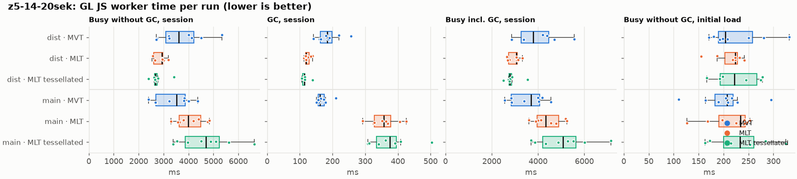
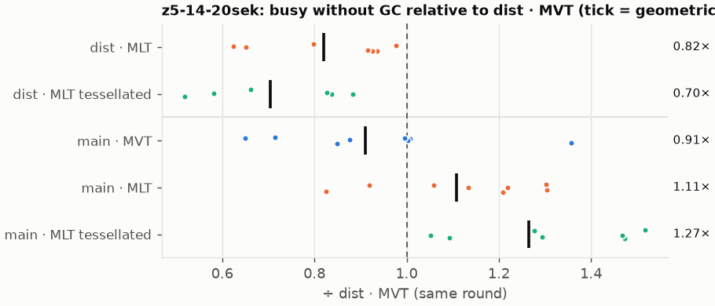
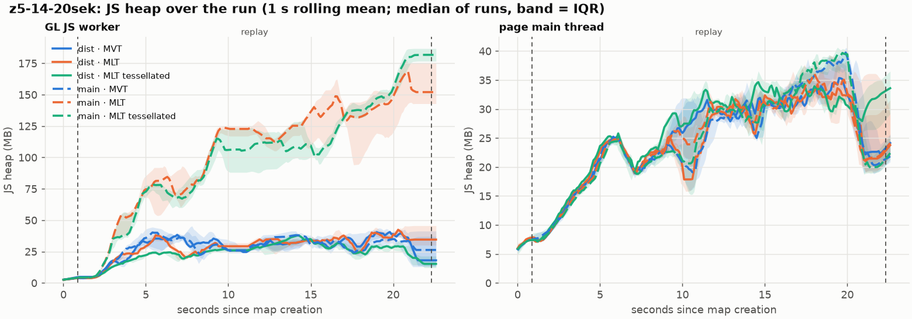
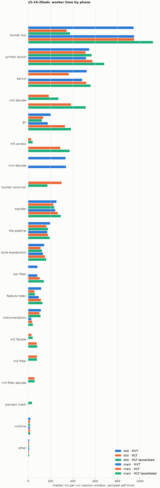
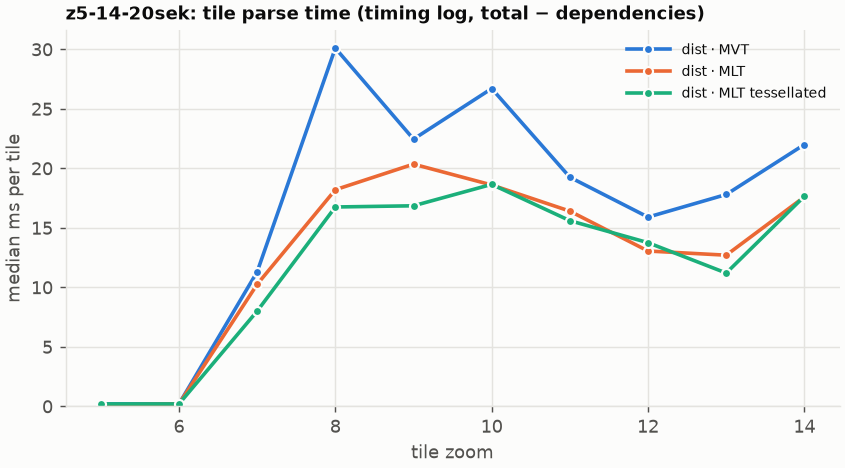
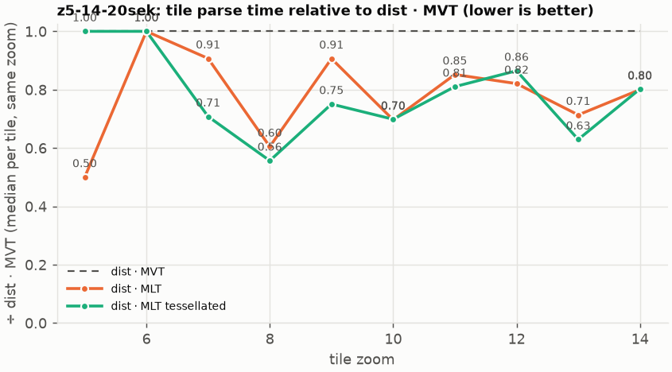

# Session trace benchmark — 20261023-090811

## Setup

- Created 2026-10-23T09:08:12+02:00; 8 repetitions + 1 warm-up round(s) (excluded); variants rotate per round (A B C, B C A, …); one cold browser context per run.
- Machine: 13th Gen Intel(R) Core(TM) i7-1365U, 12 logical cores, 31.3 GB RAM
- GL JS gl7-performance-optimization @ f9bd50a8b5; worker count 1; viewport {'width': 1280, 'height': 1024}.
- Python 3.12.2, packages {'playwright': '1.64.0', 'numpy': '2.5.3', 'matplotlib': '3.11.2'}.

| variant | bundle | format | bundle sha256 | branch build |
|---|---|---|---|---|
| MVT | `dist/maplibre-gl-dev.mjs` | mvt | `b2691453151d` | – |
| MLT | `dist/maplibre-gl-dev.mjs` | mlt | `b2691453151d` | – |
| MLT tessellated | `dist/maplibre-gl-dev.mjs` | mlt-pre-tess | `b2691453151d` | – |
| main · MVT | `bench-builds/branches/main/maplibre-gl-dev.mjs` | mvt | `ced4373133d3` | main @ 8470a6193d (2026-09-18), MLT @ 9bf846d053 |
| main · MLT | `bench-builds/branches/main/maplibre-gl-dev.mjs` | mlt | `ced4373133d3` | main @ 8470a6193d (2026-09-18), MLT @ 9bf846d053 |
| main · MLT tessellated | `bench-builds/branches/main/maplibre-gl-dev.mjs` | mlt-pre-tess | `ced4373133d3` | main @ 8470a6193d (2026-09-18), MLT @ 9bf846d053 |

| session | style | duration | frames | sha256 |
|---|---|---:|---:|---|
| z5-14-20sek | maptiler-basic | 21.4 s | 829 | `5a376e5ede30` |

CPU sampling interval (median over runs): 602 µs.

## Session `z5-14-20sek`

### Worker busy without GC (session window)

| variant | n ok / failed | median ms | IQR | mean | ratio vs MVT | 95 % CI | geo-mean paired | MWU p |
|---|---:|---:|---:|---:|---:|---:|---:|---:|
| MVT | 8 / 0 | 3,611 | 3,092–4,223 | 3,733 | 1.00× | – | – | – |
| MLT | 7 / 0 | 2,941 | 2,611–2,975 | 2,835 | 0.81× | 0.61–0.99× | 0.82× | 0.024 |
| MLT tessellated | 6 / 0 | 2,668 | 2,632–2,750 | 2,757 | 0.74× | 0.59–0.97× | 0.70× | 0.024 |
| main · MVT | 8 / 0 | 3,527 | 2,694–3,875 | 3,381 | 0.98× | 0.65–1.29× | 0.91× | 0.372 |
| main · MLT | 8 / 0 | 3,992 | 3,620–4,499 | 4,065 | 1.11× | 0.85–1.48× | 1.11× | 0.318 |
| main · MLT tessellated | 8 / 0 | 4,699 | 3,873–5,236 | 4,710 | 1.30× | 0.92–1.75× | 1.27× | 0.083 |

### All worker metrics (median, ratio vs baseline)

| metric | MVT | MLT | MLT tessellated | main · MVT | main · MLT | main · MLT tessellated |
|---|---:|---:|---:|---:|---:|---:|
| busy incl. GC | 3,791 | 3,063 (0.81×) | 2,781 (0.73×) | 3,693 (0.97×) | 4,339 (1.14×) | 5,075 (1.34×) |
| &nbsp;&nbsp;of which GC | 183.8 | 119.8 (0.65×) | 113.4 (0.62×) | 161.0 (0.88×) | 357.6 (1.95×) | 375.1 (2.04×) |
| &nbsp;&nbsp;of which busy without GC | 3,611 | 2,941 (0.81×) | 2,668 (0.74×) | 3,527 (0.98×) | 3,992 (1.11×) | 4,699 (1.30×) |
| &nbsp;&nbsp;&nbsp;&nbsp;of which filtering (sampled, incl. callees) | 83.0 | 78.1 (0.94×) | 79.0 (0.95×) | 81.0 (0.98×) | 104.0 (1.25×) | 141.1 (1.70×) |
| &nbsp;&nbsp;&nbsp;&nbsp;of which column decoding inside the MLT filter (sampled) | 0.0 | 56.0 | 58.0 | 0.0 | 0.0 | 0.0 |
| &nbsp;&nbsp;&nbsp;&nbsp;of which timing instrumentation (sampled) | 114.1 | 100.7 (0.88×) | 111.3 (0.98×) | 28.1 (0.25×) | 36.2 (0.32×) | 41.4 (0.36×) |
| busy without GC and instrumentation | 3,504 | 2,822 (0.81×) | 2,559 (0.73×) | 3,496 (1.00×) | 3,956 (1.13×) | 4,657 (1.33×) |
| CPU time without GC | 3,350 | 2,708 (0.81×) | 2,446 (0.73×) | 3,244 (0.97×) | 3,718 (1.11×) | 4,296 (1.28×) |
| tile: download end → sent to main thread, median per tile | 178.2 | 130.0 (0.73×) | 135.7 (0.76×) | 165.9 (0.93×) | 210.3 (1.18×) | 225.0 (1.26×) |
| tile: download end → sent to main thread, 90th percentile | 379.2 | 298.9 (0.79×) | 271.7 (0.72×) | 359.3 (0.95×) | 456.6 (1.20×) | 557.0 (1.47×) |
| tile: download end → sent to main thread, 95th percentile | 406.2 | 329.3 (0.81×) | 315.1 (0.78×) | 405.4 (1.00×) | 490.1 (1.21×) | 595.8 (1.47×) |
| tile: download end → sent to main thread, 99th percentile | 442.8 | 352.3 (0.80×) | 339.4 (0.77×) | 429.2 (0.97×) | 531.4 (1.20×) | 676.1 (1.53×) |
| &nbsp;&nbsp;parse part (timing log, incl. waiting for glyphs/icons), median per tile | 94.7 | 74.0 (0.78×) | 70.5 (0.74×) | – | – | – |
| &nbsp;&nbsp;queue + hand-off part, median per tile | 68.9 | 57.5 (0.84×) | 56.0 (0.81×) | – | – | – |
| minor GCs | 58.00 | 50.00 (0.86×) | 37.00 (0.64×) | 58.00 (1.00×) | 61.00 (1.05×) | 61.00 (1.05×) |
| major GCs | 5.00 | 3.00 (0.60×) | 4.00 (0.80×) | 5.00 (1.00×) | 4.00 (0.80×) | 4.00 (0.80×) |
| peak worker heap (MB) | 59.3 | 56.7 (0.96×) | 43.4 (0.73×) | 60.1 (1.01×) | 191.3 (3.23×) | 189.3 (3.19×) |
| load: busy without GC | 203.2 | 223.1 (1.10×) | 221.4 (1.09×) | 206.7 (1.02×) | 233.6 (1.15×) | 233.1 (1.15×) |
| load: GC | 6.9 | 7.2 (1.03×) | 5.4 (0.78×) | 6.3 (0.90×) | 7.4 (1.06×) | 6.8 (0.98×) |
| total: busy without GC | 3,840 | 3,096 (0.81×) | 2,903 (0.76×) | 3,738 (0.97×) | 4,240 (1.10×) | 4,911 (1.28×) |

Rows marked *of which* are parts of the row above, not additional time. Tile rows are per-tile latencies (medians over tiles, then over runs), not sums: tiles overlap in time, and the medians of the parse and queue parts do not add up exactly to the median latency.

### Filtering (session window)

Sampled worker time spent in feature filtering, including everything the filter calls (expression evaluation, property access): **row filter** = the style-spec feature filter that MVT runs per feature, **mlt filter** = the columnar MLT filter (incl. the geometry-type selection), without the columns it decodes (see the next table). Medians per run; rules in `config/categories.toml`.

| variant | mlt filter | row filter | filtering | ratio vs MVT | 95 % CI | MWU p | share of sampled busy |
|---|---:|---:|---:|---:|---:|---:|---:|
| MVT | 0.0 | 82.9 | 83.0 | 1.00× | – | – | 2.4% |
| MLT | 78.1 | 0.0 | 78.1 | 0.94× | 0.64–1.28× | 0.685 | 2.8% |
| MLT tessellated | 79.0 | 0.0 | 79.0 | 0.95× | 0.66–1.42× | 1.000 | 3.3% |
| main · MVT | 0.0 | 81.0 | 81.0 | 0.98× | 0.51–1.46× | 0.372 | 2.4% |
| main · MLT | 0.0 | 104.0 | 104.0 | 1.25× | 0.77–1.87× | 0.270 | 2.6% |
| main · MLT tessellated | 0.0 | 141.1 | 141.1 | 1.70× | 0.84–2.34× | 0.066 | 2.7% |

**Filtering together with tile decoding.** The MLT decoder leaves columns encoded until something reads them, and the filter is usually the first reader: the columns it decodes (properties, and the geometry for `$type`) are **of which inside the filter** (phase *mlt filter decode*), the rest is *mlt decode* (geometry and columns read later, e.g. by paint properties and symbols). MVT decodes every feature's properties and geometry while it reads the tile (*mvt decode*), whether the filter keeps the feature or not. So **filtering** above compares the filters, and **decoding + filtering** compares all that the formats spend on decoding the tile and selecting features. **tile decoding** = *mvt decode* or *mlt decode* + *mlt filter decode*: work inside a call into a decoder. Reading data that is already decoded is not counted, as for MVT's feature objects: *mlt access* (row views, value getters, looking a column up by name) and the MLT facade (*mlt facade*). MVT decodes geometry only for the features its filter keeps, MLT decodes a layer's whole geometry column.

| variant | tile decoding | of which inside the filter | filtering | decoding + filtering | ratio vs MVT | 95 % CI | MWU p |
|---|---:|---:|---:|---:|---:|---:|---:|
| MVT | 333.8 | 0.0 | 83.0 | 426.2 | 1.00× | – | – |
| MLT | 244.0 | 56.0 | 78.1 | 321.1 | 0.75× | 0.59–0.98× | 0.056 |
| MLT tessellated | 329.0 | 58.0 | 79.0 | 407.2 | 0.96× | 0.76–1.32× | 0.747 |
| main · MVT | 338.4 | 0.0 | 81.0 | 425.2 | 1.00× | 0.67–1.42× | 1.000 |
| main · MLT | 384.2 | 0.0 | 104.0 | 488.2 | 1.15× | 0.87–1.58× | 0.227 |
| main · MLT tessellated | 514.8 | 0.0 | 141.1 | 658.4 | 1.54× | 1.04–2.13× | 0.018 |

### Where the variants differ from MVT (session window, mean ms per run)

Open **[flame.html](flame.html)** to explore the call tree interactively: pick a variant, compare it with MVT (red = more time at the same call path, blue = less), click a frame to zoom in, and read the phase and function breakdown under it. Without a comparison, frames are coloured by phase: filtering is green in both formats, and the columns the MLT filter decodes on first access (*mlt filter decode*) are MLT blue frames under the green filter. `flame/*.txt` open in https://www.speedscope.app.

#### MLT vs MVT

**By phase** (sampled self time; the Δ column sums to the difference in sampled busy time):

| phase | MVT | MLT | Δ |
|---|---:|---:|---:|
| bucket columnar | 0.0 | 304.9 | +304.9 |
| mlt decode | 0.0 | 189.2 | +189.2 |
| mlt filter | 0.1 | 76.9 | +76.8 |
| mlt filter decode | 0.0 | 55.3 | +55.3 |
| mlt facade | 0.1 | 31.4 | +31.2 |
| mlt access | 0.0 | 29.3 | +29.3 |
| other | 10.3 | 9.1 | -1.3 |
| runtime | 18.5 | 16.0 | -2.6 |
| instrumentation | 113.8 | 96.8 | -17.0 |
| tile pipeline | 190.5 | 158.5 | -32.1 |
| style expressions | 151.1 | 111.7 | -39.4 |
| transfer | 263.0 | 223.6 | -39.5 |
| feature index | 118.0 | 60.5 | -57.4 |
| gc | 201.5 | 136.3 | -65.2 |
| symbol layout | 569.8 | 491.9 | -77.9 |
| row filter | 91.4 | 0.0 | -91.4 |
| earcut | 524.0 | 361.6 | -162.5 |
| mvt decode | 342.5 | 0.0 | -342.5 |
| bucket row | 998.6 | 338.7 | -659.8 |

**By source layer** (timing log: createBucket + populate + addFeatures, summed over the style layers that use it; wall time, includes GC pauses; total Δ -729 ms):

| source layer | type | MVT | MLT | Δ |
|---|---|---:|---:|---:|
| poi | symbol | 40.0 | 55.0 | +15.0 |
| waterway | line | 41.4 | 49.6 | +8.2 |
| boundary | line | 35.0 | 43.2 | +8.1 |
| aeroway | fill | 1.2 | 3.1 | +1.9 |
| transportation | fill | 16.7 | 11.3 | -5.4 |
| transportation_name | symbol | 131.7 | 123.2 | -8.5 |
| place | symbol | 527.1 | 518.3 | -8.8 |
| water | fill | 66.4 | 53.0 | -13.4 |
| transportation | line | 548.7 | 459.5 | -89.2 |
| building | fill | 308.4 | 149.9 | -158.6 |
| landuse | fill | 457.1 | 253.8 | -203.3 |
| landcover | fill | 658.5 | 383.0 | -275.5 |

**Functions with the largest self-time difference** (by function name, summed over source files):

| function | MVT | MLT | Δ |
|---|---:|---:|---:|
| `readScaledRings` | 0.0 | 45.4 | +45.4 |
| `writeEarcutFill` | 0.0 | 33.9 | +33.9 |
| `buildEarcutMesh` | 0.0 | 28.8 | +28.8 |
| `decodeComponentwiseDeltaVec2` | 0.0 | 25.0 | +25.0 |
| `unpackNullable` | 0.0 | 18.1 | +18.1 |
| `decodeString$2` | 0.0 | 13.8 | +13.8 |
| `decodeFastPforInt32` | 0.0 | 12.1 | +12.1 |
| `get` | 21.9 | 32.8 | +10.9 |
| `appendSymbolFeature` | 0.0 | 10.8 | +10.8 |
| `filterByGeometryType` | 0.0 | 10.1 | +10.1 |
| `scaleCheckedCoordinate` | 0.0 | 9.9 | +9.9 |
| `decodeFsst` | 0.0 | 8.9 | +8.9 |
| `_vertexToIndex` | 186.1 | 0.0 | -186.1 |
| `readSVarint` | 139.9 | 0.0 | -139.9 |
| `loadGeometry` | 87.1 | 11.5 | -75.5 |
| `isEar` | 159.4 | 90.8 | -68.5 |
| `(garbage collector)` | 201.5 | 136.3 | -65.2 |

#### MLT tessellated vs MVT

**By phase** (sampled self time; the Δ column sums to the difference in sampled busy time):

| phase | MVT | MLT tessellated | Δ |
|---|---:|---:|---:|
| mlt decode | 0.0 | 287.2 | +287.2 |
| bucket columnar | 0.0 | 172.6 | +172.6 |
| mlt filter | 0.1 | 83.8 | +83.7 |
| mlt filter decode | 0.0 | 60.5 | +60.5 |
| mlt facade | 0.1 | 40.0 | +39.8 |
| mlt access | 0.0 | 38.5 | +38.5 |
| pre-tess mesh | 0.0 | 34.5 | +34.5 |
| symbol layout | 569.8 | 572.0 | +2.1 |
| runtime | 18.5 | 17.9 | -0.7 |
| other | 10.3 | 9.5 | -0.9 |
| tile pipeline | 190.5 | 183.8 | -6.7 |
| style expressions | 151.1 | 128.1 | -23.0 |
| transfer | 263.0 | 236.1 | -26.9 |
| feature index | 118.0 | 61.8 | -56.2 |
| gc | 201.5 | 125.2 | -76.3 |
| row filter | 91.4 | 0.0 | -91.4 |
| mvt decode | 342.5 | 0.0 | -342.5 |
| earcut | 524.0 | 2.9 | -521.1 |
| bucket row | 998.6 | 390.6 | -608.0 |

**By source layer** (timing log: createBucket + populate + addFeatures, summed over the style layers that use it; wall time, includes GC pauses; total Δ -927 ms):

| source layer | type | MVT | MLT tessellated | Δ |
|---|---|---:|---:|---:|
| place | symbol | 527.1 | 595.9 | +68.8 |
| poi | symbol | 40.0 | 64.2 | +24.2 |
| waterway | line | 41.4 | 58.5 | +17.1 |
| boundary | line | 35.0 | 48.6 | +13.6 |
| transportation | line | 548.7 | 562.0 | +13.2 |
| transportation_name | symbol | 131.7 | 143.5 | +11.8 |
| transportation | fill | 16.7 | 22.1 | +5.5 |
| aeroway | fill | 1.2 | 4.2 | +3.0 |
| water | fill | 66.4 | 37.5 | -28.9 |
| building | fill | 308.4 | 60.5 | -247.9 |
| landuse | fill | 457.1 | 125.0 | -332.2 |
| landcover | fill | 658.5 | 181.4 | -477.1 |

**Functions with the largest self-time difference** (by function name, summed over source files):

| function | MVT | MLT tessellated | Δ |
|---|---:|---:|---:|
| `buildTessellatedBoundingBox` | 0.0 | 32.1 | +32.1 |
| `decodeUnsignedZigZagDeltaInt32` | 0.0 | 29.9 | +29.9 |
| `decodeComponentwiseDeltaVec2` | 0.0 | 23.8 | +23.8 |
| `unpackNullable` | 0.0 | 20.1 | +20.1 |
| `decodeFastPforInt32` | 0.0 | 16.6 | +16.6 |
| `decodeString$2` | 0.0 | 15.3 | +15.3 |
| `appendSymbolFeature` | 0.0 | 14.9 | +14.9 |
| `get` | 21.9 | 36.0 | +14.1 |
| `writeTessellatedFill` | 0.0 | 13.3 | +13.3 |
| `registerGlyphs` | 0.0 | 13.1 | +13.1 |
| `filterByGeometryType` | 0.0 | 12.0 | +12.0 |
| `fastUnpack256_4` | 0.0 | 11.6 | +11.6 |
| `_vertexToIndex` | 186.1 | 0.0 | -186.1 |
| `isEar` | 159.4 | 0.2 | -159.2 |
| `readSVarint` | 139.9 | 0.0 | -139.9 |
| `isEarHashed` | 94.7 | 0.0 | -94.7 |
| `(garbage collector)` | 201.5 | 125.2 | -76.3 |

#### main · MLT vs MVT

**By phase** (sampled self time; the Δ column sums to the difference in sampled busy time):

| phase | MVT | main · MLT | Δ |
|---|---:|---:|---:|
| mlt decode | 0.0 | 392.5 | +392.5 |
| mlt access | 0.0 | 294.9 | +294.9 |
| gc | 201.5 | 352.4 | +150.9 |
| mlt facade | 0.1 | 76.5 | +76.4 |
| symbol layout | 569.8 | 589.3 | +19.5 |
| row filter | 91.4 | 106.5 | +15.1 |
| transfer | 263.0 | 267.8 | +4.8 |
| style expressions | 151.1 | 154.4 | +3.3 |
| runtime | 18.5 | 17.2 | -1.3 |
| earcut | 524.0 | 522.2 | -1.9 |
| other | 10.3 | 7.6 | -2.8 |
| feature index | 118.0 | 113.7 | -4.3 |
| tile pipeline | 190.5 | 175.3 | -15.2 |
| bucket row | 998.6 | 971.6 | -26.9 |
| instrumentation | 113.8 | 36.0 | -77.8 |
| mvt decode | 342.5 | 0.0 | -342.5 |

**By source layer** (timing log: createBucket + populate + addFeatures, summed over the style layers that use it; wall time, includes GC pauses; total Δ -2842 ms):

| source layer | type | MVT | main · MLT | Δ |
|---|---|---:|---:|---:|
| aerodrome_label | symbol | 8.5 | 0.0 | -8.5 |
| transportation | fill | 16.7 | 0.0 | -16.7 |
| boundary | line | 35.0 | 0.0 | -35.0 |
| poi | symbol | 40.0 | 0.0 | -40.0 |
| waterway | line | 41.4 | 0.0 | -41.4 |
| water | fill | 66.4 | 0.0 | -66.4 |
| transportation_name | symbol | 131.7 | 0.0 | -131.7 |
| building | fill | 308.4 | 0.0 | -308.4 |
| landuse | fill | 457.1 | 0.0 | -457.1 |
| place | symbol | 527.1 | 0.0 | -527.1 |
| transportation | line | 548.7 | 0.0 | -548.7 |
| landcover | fill | 658.5 | 0.0 | -658.5 |

**Functions with the largest self-time difference** (by function name, summed over source files):

| function | MVT | main · MLT | Δ |
|---|---:|---:|---:|
| `(garbage collector)` | 201.5 | 352.4 | +150.9 |
| `getFeatures` | 0.0 | 120.5 | +120.5 |
| `decodeString$2` | 0.0 | 85.4 | +85.4 |
| `convertGeometryVector` | 0.0 | 46.0 | +46.0 |
| `decodeComponentwiseDeltaVec2` | 0.0 | 30.3 | +30.3 |
| `getLineStringOrRing` | 0.0 | 27.8 | +27.8 |
| `unpackNullable` | 0.0 | 23.7 | +23.7 |
| `getValue` | 0.0 | 22.9 | +22.9 |
| `MLTVectorTileLayer` | 0.0 | 19.1 | +19.1 |
| `reserve` | 130.8 | 147.3 | +16.5 |
| `evaluate` | 57.0 | 72.9 | +15.9 |
| `decodeFsst` | 0.0 | 15.3 | +15.3 |
| `readSVarint` | 139.9 | 0.0 | -139.9 |
| `readVarint` | 57.4 | 3.3 | -54.1 |
| `addPhase` | 36.4 | 0.0 | -36.4 |
| `readString` | 34.1 | 0.0 | -34.1 |
| `populate` | 93.2 | 60.1 | -33.1 |

#### main · MLT tessellated vs MVT

**By phase** (sampled self time; the Δ column sums to the difference in sampled busy time):

| phase | MVT | main · MLT tessellated | Δ |
|---|---:|---:|---:|
| mlt decode | 0.0 | 523.9 | +523.9 |
| mlt access | 0.0 | 353.3 | +353.3 |
| gc | 201.5 | 387.0 | +185.4 |
| bucket row | 998.6 | 1,118 | +119.0 |
| symbol layout | 569.8 | 667.0 | +97.2 |
| mlt facade | 0.1 | 84.6 | +84.5 |
| earcut | 524.0 | 588.3 | +64.3 |
| row filter | 91.4 | 129.0 | +37.6 |
| transfer | 263.0 | 291.4 | +28.4 |
| style expressions | 151.1 | 174.8 | +23.8 |
| feature index | 118.0 | 123.8 | +5.8 |
| tile pipeline | 190.5 | 196.3 | +5.7 |
| runtime | 18.5 | 20.5 | +1.9 |
| other | 10.3 | 11.2 | +0.9 |
| instrumentation | 113.8 | 44.4 | -69.3 |
| mvt decode | 342.5 | 0.0 | -342.5 |

**By source layer** (timing log: createBucket + populate + addFeatures, summed over the style layers that use it; wall time, includes GC pauses; total Δ -2842 ms):

| source layer | type | MVT | main · MLT tessellated | Δ |
|---|---|---:|---:|---:|
| aerodrome_label | symbol | 8.5 | 0.0 | -8.5 |
| transportation | fill | 16.7 | 0.0 | -16.7 |
| boundary | line | 35.0 | 0.0 | -35.0 |
| poi | symbol | 40.0 | 0.0 | -40.0 |
| waterway | line | 41.4 | 0.0 | -41.4 |
| water | fill | 66.4 | 0.0 | -66.4 |
| transportation_name | symbol | 131.7 | 0.0 | -131.7 |
| building | fill | 308.4 | 0.0 | -308.4 |
| landuse | fill | 457.1 | 0.0 | -457.1 |
| place | symbol | 527.1 | 0.0 | -527.1 |
| transportation | line | 548.7 | 0.0 | -548.7 |
| landcover | fill | 658.5 | 0.0 | -658.5 |

**Functions with the largest self-time difference** (by function name, summed over source files):

| function | MVT | main · MLT tessellated | Δ |
|---|---:|---:|---:|
| `(garbage collector)` | 201.5 | 387.0 | +185.4 |
| `getFeatures` | 0.0 | 143.5 | +143.5 |
| `decodeString$2` | 0.0 | 98.0 | +98.0 |
| `convertGeometryVector` | 0.0 | 55.4 | +55.4 |
| `decodeUnsignedZigZagDeltaInt32` | 0.0 | 32.5 | +32.5 |
| `getLineStringOrRing` | 0.0 | 32.3 | +32.3 |
| `decodeComponentwiseDeltaVec2` | 0.0 | 32.2 | +32.2 |
| `getValue` | 0.0 | 30.4 | +30.4 |
| `unpackNullable` | 0.0 | 27.2 | +27.2 |
| `evaluate` | 57.0 | 83.1 | +26.1 |
| `decodeFastPforInt32` | 0.0 | 26.1 | +26.1 |
| `reserve` | 130.8 | 155.3 | +24.5 |
| `readSVarint` | 139.9 | 0.0 | -139.9 |
| `readVarint` | 57.4 | 2.4 | -55.0 |
| `addPhase` | 36.4 | 0.0 | -36.4 |
| `readString` | 34.1 | 0.0 | -34.1 |
| `VectorTileFeature` | 32.3 | 0.0 | -32.3 |

### Worker time by phase (session window, median ms of sampled self time)

| phase | MVT | MLT | MLT tessellated | main · MVT | main · MLT | main · MLT tessellated |
|---|---:|---:|---:|---:|---:|---:|
| bucket row | 943.5 | 344.2 | 374.8 | 948.2 | 947.6 | 1,116 |
| symbol layout | 545.2 | 513.4 | 567.2 | 517.8 | 574.6 | 681.5 |
| earcut | 523.6 | 363.8 | 2.7 | 482.6 | 520.6 | 559.1 |
| mlt decode | 0.0 | 183.9 | 271.1 | 0.0 | 384.2 | 514.8 |
| gc | 201.1 | 134.8 | 122.3 | 175.3 | 329.5 | 383.1 |
| mlt access | 0.0 | 27.2 | 40.6 | 0.0 | 286.6 | 371.6 |
| mvt decode | 333.8 | 0.0 | 0.0 | 338.4 | 0.0 | 0.0 |
| bucket columnar | 0.0 | 299.2 | 173.0 | 0.0 | 0.0 | 0.0 |
| transfer | 253.2 | 225.3 | 233.3 | 242.4 | 265.8 | 291.5 |
| tile pipeline | 195.7 | 163.7 | 179.1 | 171.2 | 177.1 | 193.6 |
| style expressions | 143.6 | 110.7 | 124.7 | 133.3 | 151.3 | 163.0 |
| row filter | 82.9 | 0.0 | 0.0 | 81.0 | 104.0 | 141.1 |
| feature index | 116.5 | 57.2 | 60.3 | 95.0 | 114.2 | 128.1 |
| instrumentation | 114.1 | 100.7 | 111.3 | 28.1 | 36.2 | 41.4 |
| mlt facade | 0.0 | 29.7 | 40.9 | 0.0 | 75.6 | 81.5 |
| mlt filter | 0.0 | 78.1 | 79.0 | 0.0 | 0.0 | 0.0 |
| mlt filter decode | 0.0 | 56.0 | 58.0 | 0.0 | 0.0 | 0.0 |
| pre-tess mesh | 0.0 | 0.0 | 34.6 | 0.0 | 0.0 | 0.0 |
| runtime | 19.5 | 16.1 | 17.1 | 15.9 | 17.6 | 18.8 |
| other | 9.8 | 8.6 | 9.2 | 10.1 | 7.3 | 9.9 |

### Tile parse time by zoom (timing log, median ms per tile, total − dependencies)

| zoom | MVT | MLT | MLT tessellated | main · MVT | main · MLT | main · MLT tessellated |
|---:|---:|---:|---:|---:|---:|---:|
| 5 | 0.20 (n=72) | 0.10 (n=63) | 0.20 (n=54) | – | – | – |
| 6 | 0.20 (n=72) | 0.20 (n=63) | 0.20 (n=54) | – | – | – |
| 7 | 11.30 (n=48) | 10.25 (n=42) | 8.00 (n=36) | – | – | – |
| 8 | 30.10 (n=43) | 18.20 (n=52) | 16.75 (n=40) | – | – | – |
| 9 | 22.45 (n=128) | 20.35 (n=112) | 16.85 (n=96) | – | – | – |
| 10 | 26.70 (n=160) | 18.60 (n=140) | 18.65 (n=120) | – | – | – |
| 11 | 19.25 (n=120) | 16.40 (n=103) | 15.60 (n=86) | – | – | – |
| 12 | 15.90 (n=165) | 13.05 (n=140) | 13.75 (n=120) | – | – | – |
| 13 | 17.80 (n=172) | 12.70 (n=147) | 11.20 (n=123) | – | – | – |
| 14 | 22.00 (n=144) | 17.60 (n=126) | 17.65 (n=108) | – | – | – |

### Tile latency by zoom: download end → result sent to the main thread (session window, ms per tile: median / p95 / p99)

Includes waiting in the worker's queue, the parse and posting the result; see `tile_latency.csv` for the per-tile split (`parse_ms`, `wait_ms`). Percentiles over the tiles of all runs; with few tiles (n) p99 is close to the maximum.

| zoom | MVT | MLT | MLT tessellated | main · MVT | main · MLT | main · MLT tessellated |
|---:|---:|---:|---:|---:|---:|---:|
| 6 | 57.8 / 94.4 / 108.3 (n=72) | 52.9 / 78.1 / 82.6 (n=63) | 58.7 / 93.5 / 98.8 (n=54) | 44.2 / 88.5 / 104.9 (n=72) | 68.0 / 89.2 / 92.7 (n=72) | 72.8 / 144.5 / 157.7 (n=72) |
| 7 | 160.1 / 227.8 / 475.0 (n=48) | 118.7 / 141.5 / 145.7 (n=42) | 93.0 / 114.7 / 117.7 (n=36) | 157.8 / 238.7 / 397.4 (n=47) | 166.6 / 217.1 / 334.3 (n=48) | 174.7 / 390.9 / 583.4 (n=48) |
| 8 | 203.6 / 278.8 / 289.6 (n=43) | 212.4 / 247.0 / 252.8 (n=52) | 168.8 / 183.8 / 184.7 (n=40) | 197.8 / 256.7 / 264.6 (n=44) | 256.9 / 289.7 / 295.5 (n=32) | 281.5 / 410.1 / 437.3 (n=40) |
| 9 | 257.6 / 496.1 / 523.3 (n=128) | 149.2 / 375.8 / 404.8 (n=112) | 186.7 / 317.9 / 342.8 (n=96) | 252.8 / 489.5 / 526.5 (n=128) | 311.1 / 570.4 / 625.0 (n=128) | 333.0 / 638.9 / 655.4 (n=128) |
| 10 | 333.6 / 604.7 / 651.8 (n=160) | 245.2 / 395.5 / 415.5 (n=140) | 235.9 / 414.6 / 436.3 (n=120) | 291.4 / 527.2 / 545.9 (n=160) | 414.1 / 659.1 / 716.2 (n=160) | 406.2 / 740.2 / 791.3 (n=159) |
| 11 | 151.9 / 281.5 / 295.6 (n=120) | 140.9 / 222.7 / 240.9 (n=103) | 135.9 / 222.1 / 234.2 (n=86) | 149.2 / 246.8 / 259.5 (n=120) | 202.8 / 339.2 / 378.9 (n=116) | 188.4 / 372.6 / 381.0 (n=113) |
| 12 | 93.8 / 267.5 / 287.1 (n=165) | 64.3 / 235.4 / 241.5 (n=140) | 67.0 / 230.3 / 242.6 (n=120) | 90.9 / 266.7 / 280.1 (n=166) | 116.9 / 285.0 / 324.7 (n=163) | 139.8 / 324.7 / 415.2 (n=172) |
| 13 | 166.4 / 387.5 / 463.5 (n=172) | 144.2 / 242.2 / 271.9 (n=147) | 130.1 / 273.9 / 302.8 (n=123) | 172.5 / 360.8 / 393.9 (n=168) | 201.1 / 362.2 / 414.7 (n=169) | 201.8 / 428.0 / 473.6 (n=174) |
| 14 | 232.9 / 503.9 / 534.4 (n=144) | 183.3 / 339.4 / 361.2 (n=126) | 192.4 / 379.2 / 405.5 (n=108) | 209.0 / 409.0 / 452.0 (n=144) | 323.9 / 582.4 / 621.2 (n=144) | 370.6 / 709.2 / 786.4 (n=144) |

## Runs

54 ok, 0 failed/aborted, 0 not run, 45 used in statistics.

