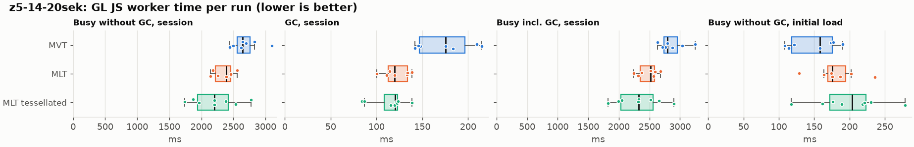
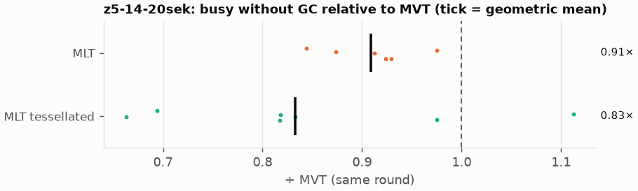
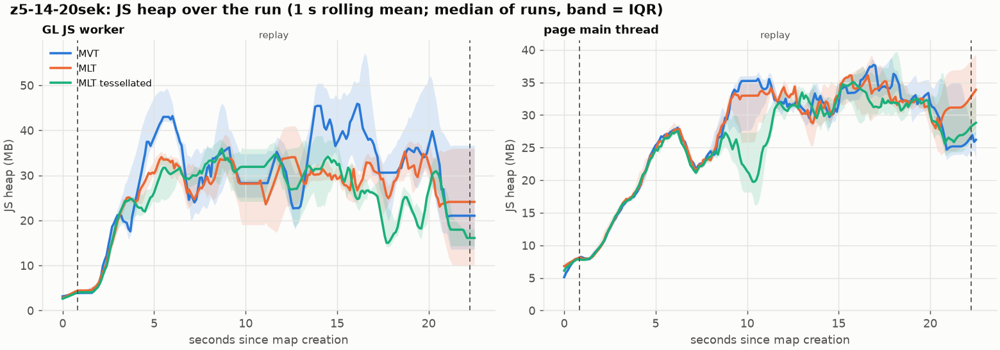
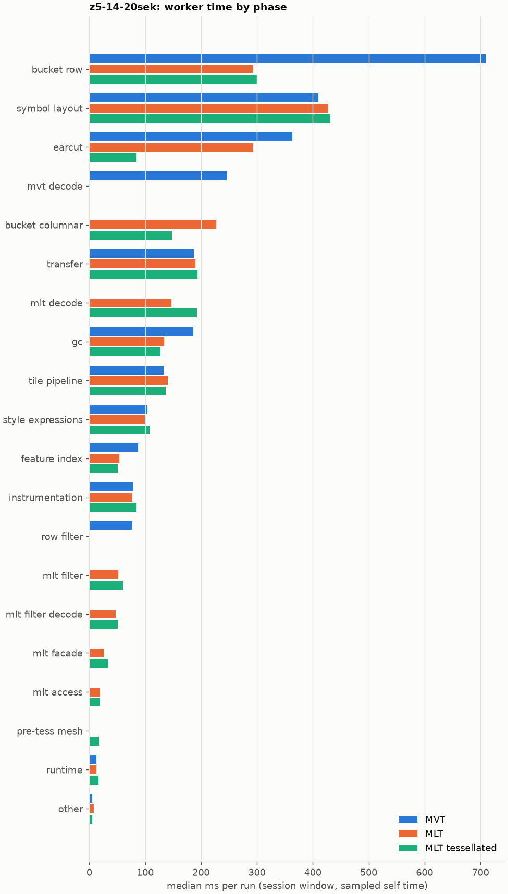
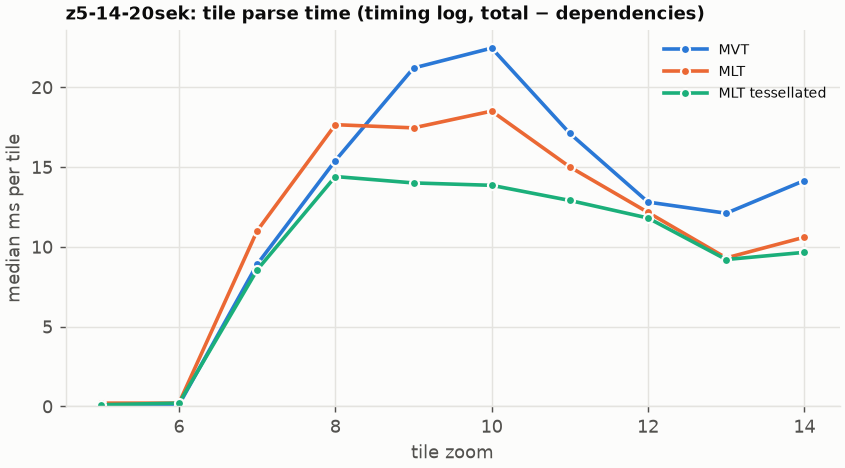
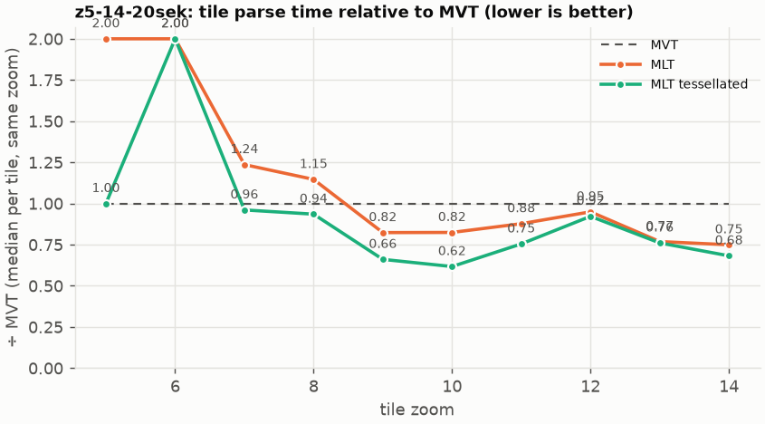

# Session trace benchmark — 20261023-110933-positron

## Setup

- Created 2026-10-23T11:09:33+02:00; 8 repetitions + 1 warm-up round(s) (excluded); variants rotate per round (A B C, B C A, …); one cold browser context per run.
- Machine: 13th Gen Intel(R) Core(TM) i7-1365U, 12 logical cores, 31.3 GB RAM, Windows-11-10.0.26200-SP0; power: GUID des Energieschemas: 381b4222-f694-41f0-9685-ff5bb260df2e  (Ausbalanciert), AC True.
- GL JS gl7-performance-optimization @ f9bd50a8b5 (dirty); worker count 1; viewport {'width': 1280, 'height': 1024}.
- Python 3.12.2, packages {'playwright': '1.64.0', 'numpy': '2.5.3', 'matplotlib': '3.11.2'}.

| variant | bundle | format | bundle sha256 | branch build |
|---|---|---|---|---|
| MVT | `dist/maplibre-gl-dev.mjs` | mvt | `b2691453151d` | – |
| MLT | `dist/maplibre-gl-dev.mjs` | mlt | `b2691453151d` | – |
| MLT tessellated | `dist/maplibre-gl-dev.mjs` | mlt-pre-tess | `b2691453151d` | – |

| session | style | duration | frames | sha256 |
|---|---|---:|---:|---|
| z5-14-20sek | positron (recorded: maptiler-basic) | 21.4 s | 829 | `5a376e5ede30` |

CPU sampling interval (median over runs): 576 µs.

## Definitions

- **busy** = wall time in which a GL JS worker thread runs a task (union of top-level task slices and GC slices on `DedicatedWorker thread`s), summed over workers. **GC** = union of `MinorGC`/`MajorGC`/`V8.GC*` slices on those threads. **busy without GC** = busy − GC (headline metric).
- **CPU** = thread time (`tdur`) of the same slices. Phase categories and functions come from the trace's CPU samples (self time), categorised by `config/categories.toml` (nearest matching frame, leaf to root).
- Windows: **load** = map creation → first idle; **session** = camera replay; **tail** = end of replay → idle; **total** = load + session + tail.
- Ratios are against **MVT**: ratio of medians with a bootstrap 95 % CI, the geometric mean of per-round ratios, and a two-sided Mann–Whitney U p-value (normal approximation, not corrected for multiple comparisons; rough below n = 8). Lower than 1× means less worker time.

## Session `z5-14-20sek`

### Worker busy without GC (session window)

| variant | n ok / failed | median ms | IQR | mean | ratio vs MVT | 95 % CI | geo-mean paired | MWU p |
|---|---:|---:|---:|---:|---:|---:|---:|---:|
| MVT | 7 / 0 | 2,645 | 2,559–2,763 | 2,691 | 1.00× | – | – | – |
| MLT | 7 / 0 | 2,388 | 2,219–2,459 | 2,349 | 0.90× | 0.80–0.99× | 0.91× | 0.011 |
| MLT tessellated | 8 / 0 | 2,204 | 1,941–2,422 | 2,209 | 0.83× | 0.69–0.96× | 0.83× | 0.018 |

### All worker metrics (median, ratio vs baseline)

| metric | MVT | MLT | MLT tessellated |
|---|---:|---:|---:|
| busy incl. GC | 2,791 | 2,522 (0.90×) | 2,322 (0.83×) |
| &nbsp;&nbsp;of which GC | 175.5 | 119.8 (0.68×) | 120.6 (0.69×) |
| &nbsp;&nbsp;of which busy without GC | 2,645 | 2,388 (0.90×) | 2,204 (0.83×) |
| &nbsp;&nbsp;&nbsp;&nbsp;of which filtering (sampled, incl. callees) | 77.5 | 51.8 (0.67×) | 60.0 (0.77×) |
| &nbsp;&nbsp;&nbsp;&nbsp;of which column decoding inside the MLT filter (sampled) | 0.0 | 47.3 | 51.3 |
| &nbsp;&nbsp;&nbsp;&nbsp;of which timing instrumentation (sampled) | 79.1 | 77.1 (0.98×) | 83.5 (1.06×) |
| busy without GC and instrumentation | 2,566 | 2,313 (0.90×) | 2,121 (0.83×) |
| CPU time without GC | 2,421 | 2,176 (0.90×) | 1,997 (0.82×) |
| tile: download end → sent to main thread, median per tile | 136.8 | 119.8 (0.88×) | 106.2 (0.78×) |
| tile: download end → sent to main thread, 90th percentile | 251.1 | 238.2 (0.95×) | 194.9 (0.78×) |
| tile: download end → sent to main thread, 95th percentile | 331.4 | 283.8 (0.86×) | 232.6 (0.70×) |
| tile: download end → sent to main thread, 99th percentile | 344.5 | 310.2 (0.90×) | 256.9 (0.75×) |
| &nbsp;&nbsp;parse part (timing log, incl. waiting for glyphs/icons), median per tile | 70.0 | 59.9 (0.86×) | 56.4 (0.81×) |
| &nbsp;&nbsp;queue + hand-off part, median per tile | 57.1 | 48.6 (0.85×) | 44.7 (0.78×) |
| minor GCs | 57.00 | 50.00 (0.88×) | 37.00 (0.65×) |
| major GCs | 5.00 | 5.00 (1.00×) | 5.50 (1.10×) |
| peak worker heap (MB) | 69.5 | 51.9 (0.75×) | 49.4 (0.71×) |
| load: busy without GC | 158.0 | 175.8 (1.11×) | 203.7 (1.29×) |
| load: GC | 6.0 | 4.7 (0.79×) | 6.0 (1.00×) |
| total: busy without GC | 2,835 | 2,562 (0.90×) | 2,430 (0.86×) |

Rows marked *of which* are parts of the row above, not additional time. Tile rows are per-tile latencies (medians over tiles, then over runs), not sums: tiles overlap in time, and the medians of the parse and queue parts do not add up exactly to the median latency.

### Filtering (session window)

Sampled worker time spent in feature filtering, including everything the filter calls (expression evaluation, property access): **row filter** = the style-spec feature filter that MVT runs per feature, **mlt filter** = the columnar MLT filter (incl. the geometry-type selection), without the columns it decodes (see the next table). Medians per run; rules in `config/categories.toml`.

| variant | mlt filter | row filter | filtering | ratio vs MVT | 95 % CI | MWU p | share of sampled busy |
|---|---:|---:|---:|---:|---:|---:|---:|
| MVT | 0.0 | 77.5 | 77.5 | 1.00× | – | – | 3.0% |
| MLT | 51.8 | 0.0 | 51.8 | 0.67× | 0.62–0.83× | 0.002 | 2.4% |
| MLT tessellated | 60.0 | 0.0 | 60.0 | 0.77× | 0.70–0.92× | 0.018 | 2.9% |

**Filtering together with tile decoding.** The MLT decoder leaves columns encoded until something reads them, and the filter is usually the first reader: the columns it decodes (properties, and the geometry for `$type`) are **of which inside the filter** (phase *mlt filter decode*), the rest is *mlt decode* (geometry and columns read later, e.g. by paint properties and symbols). MVT decodes every feature's properties and geometry while it reads the tile (*mvt decode*), whether the filter keeps the feature or not. So **filtering** above compares the filters, and **decoding + filtering** compares all that the formats spend on decoding the tile and selecting features. **tile decoding** = *mvt decode* or *mlt decode* + *mlt filter decode*: work inside a call into a decoder. Reading data that is already decoded is not counted, as for MVT's feature objects: *mlt access* (row views, value getters, looking a column up by name) and the MLT facade (*mlt facade*). MVT decodes geometry only for the features its filter keeps, MLT decodes a layer's whole geometry column.

| variant | tile decoding | of which inside the filter | filtering | decoding + filtering | ratio vs MVT | 95 % CI | MWU p |
|---|---:|---:|---:|---:|---:|---:|---:|
| MVT | 246.5 | 0.0 | 77.5 | 316.2 | 1.00× | – | – |
| MLT | 193.1 | 47.3 | 51.8 | 246.4 | 0.78× | 0.67–0.81× | 0.002 |
| MLT tessellated | 243.5 | 51.3 | 60.0 | 305.0 | 0.96× | 0.76–1.08× | 0.272 |

Top 12 functions inside filtering and its column decoding (self time, mean ms per run):

| phase | function | source | MVT | MLT | MLT tessellated |
|---|---|---|---:|---:|---:|
| row filter | `(anonymous)` | node_modules/@maplibre/maplibre-gl-style-spec/dist/expression/compound_expression.mjs | 17.9 | 0.0 | 0.0 |
| row filter | `evaluate` | node_modules/@maplibre/maplibre-gl-style-spec/dist/expression/index.mjs | 16.3 | 0.0 | 0.0 |
| mlt filter decode | `unpackNullable` | maplibre-tile-spec/ts/dist/decoding/unpackNullableUtils.js | 0.0 | 8.8 | 10.2 |
| row filter | `evaluate` | node_modules/@maplibre/maplibre-gl-style-spec/dist/expression/compound_expression.mjs | 10.0 | 0.0 | 0.0 |
| mlt filter | `filterByGeometryType` | maplibre-tile-spec/ts/dist/vector/geometry/geometryVector.js | 0.0 | 6.3 | 7.3 |
| row filter | `evaluate` | node_modules/@maplibre/maplibre-gl-style-spec/dist/expression/definitions/comparison.mjs | 7.3 | 0.0 | 0.0 |
| mlt filter decode | `decodeFsst` | maplibre-tile-spec/ts/dist/decoding/fsstDecoder.js | 0.0 | 5.4 | 6.4 |
| mlt filter | `scanDictionaryCodes` | maplibre-tile-spec/ts/dist/processing/filter/execution/filterKernel.js | 0.0 | 4.7 | 5.8 |
| mlt filter | `dictionaryRowMatches` | maplibre-tile-spec/ts/dist/processing/filter/execution/filterKernel.js | 0.0 | 3.4 | 4.9 |
| row filter | `get` | node_modules/@maplibre/maplibre-gl-style-spec/dist/expression/compound_expression.mjs | 4.9 | 0.0 | 0.0 |
| row filter | `filter` | node_modules/@maplibre/maplibre-gl-style-spec/dist/feature_filter/index.mjs | 4.8 | 0.0 | 0.0 |
| mlt filter decode | `decodeLazyColumn` | maplibre-tile-spec/ts/dist/vector/lazyPropertyVectors.js | 0.0 | 4.5 | 4.5 |

### Where the variants differ from MVT (session window, mean ms per run)

Open **[flame.html](flame.html)** to explore the call tree interactively: pick a variant, compare it with MVT (red = more time at the same call path, blue = less), click a frame to zoom in, and read the phase and function breakdown under it. Without a comparison, frames are coloured by phase: filtering is green in both formats, and the columns the MLT filter decodes on first access (*mlt filter decode*) are MLT blue frames under the green filter. `flame/*.txt` open in https://www.speedscope.app.

#### MLT vs MVT

**By phase** (sampled self time; the Δ column sums to the difference in sampled busy time):

| phase | MVT | MLT | Δ |
|---|---:|---:|---:|
| bucket columnar | 0.0 | 230.8 | +230.8 |
| mlt decode | 0.0 | 145.3 | +145.3 |
| mlt filter | 0.2 | 52.7 | +52.5 |
| mlt filter decode | 0.0 | 48.1 | +48.1 |
| mlt facade | 0.0 | 27.1 | +27.1 |
| mlt access | 0.0 | 19.0 | +19.0 |
| symbol layout | 423.0 | 430.1 | +7.1 |
| tile pipeline | 133.0 | 137.4 | +4.4 |
| other | 5.8 | 8.6 | +2.7 |
| style expressions | 106.7 | 103.3 | -3.4 |
| transfer | 192.9 | 184.7 | -8.2 |
| feature index | 86.3 | 55.3 | -31.0 |
| gc | 184.2 | 129.9 | -54.2 |
| earcut | 358.3 | 288.9 | -69.4 |
| row filter | 76.7 | 0.0 | -76.7 |
| mvt decode | 257.1 | 0.0 | -257.1 |
| bucket row | 699.8 | 285.0 | -414.8 |

**By source layer** (timing log: createBucket + populate + addFeatures, summed over the style layers that use it; wall time, includes GC pauses; total Δ -322 ms):

| source layer | type | MVT | MLT | Δ |
|---|---|---:|---:|---:|
| place | symbol | 393.6 | 445.2 | +51.7 |
| transportation_name | symbol | 123.8 | 144.1 | +20.3 |
| boundary | line | 19.3 | 26.2 | +6.8 |
| waterway | line | 22.6 | 29.0 | +6.3 |
| aeroway | fill | 0.9 | 2.0 | +1.1 |
| transportation | fill | 7.5 | 6.0 | -1.5 |
| water | fill | 47.8 | 36.4 | -11.4 |
| transportation | line | 474.4 | 439.9 | -34.5 |
| landcover | fill | 158.3 | 118.5 | -39.8 |
| park | fill | 251.0 | 166.7 | -84.3 |
| building | fill | 222.6 | 115.4 | -107.1 |
| landuse | fill | 329.9 | 198.2 | -131.7 |

**Functions with the largest self-time difference** (by function name, summed over source files):

| function | MVT | MLT | Δ |
|---|---:|---:|---:|
| `readScaledRings` | 0.0 | 28.8 | +28.8 |
| `writeEarcutFill` | 0.0 | 26.4 | +26.4 |
| `buildEarcutMesh` | 0.0 | 20.5 | +20.5 |
| `decodeComponentwiseDeltaVec2` | 0.0 | 19.1 | +19.1 |
| `decodeString$2` | 0.0 | 12.0 | +12.0 |
| `unpackNullable` | 0.0 | 11.2 | +11.2 |
| `registerGlyphs` | 0.0 | 11.2 | +11.2 |
| `appendSymbolFeature` | 0.0 | 10.8 | +10.8 |
| `decodeFastPforInt32` | 0.0 | 10.5 | +10.5 |
| `scaleCheckedCoordinate` | 0.0 | 7.7 | +7.7 |
| `signedArea$1` | 0.0 | 7.2 | +7.2 |
| `get` | 20.3 | 27.2 | +6.8 |
| `_vertexToIndex` | 127.7 | 0.0 | -127.7 |
| `readSVarint` | 118.7 | 0.0 | -118.7 |
| `loadGeometry` | 69.4 | 11.2 | -58.2 |
| `(garbage collector)` | 184.2 | 129.9 | -54.2 |
| `isEar` | 105.1 | 69.4 | -35.7 |

#### MLT tessellated vs MVT

**By phase** (sampled self time; the Δ column sums to the difference in sampled busy time):

| phase | MVT | MLT tessellated | Δ |
|---|---:|---:|---:|
| mlt decode | 0.0 | 189.8 | +189.8 |
| bucket columnar | 0.0 | 146.6 | +146.6 |
| mlt filter | 0.2 | 60.7 | +60.5 |
| mlt filter decode | 0.0 | 50.3 | +50.3 |
| mlt facade | 0.0 | 33.5 | +33.5 |
| mlt access | 0.0 | 19.9 | +19.9 |
| pre-tess mesh | 0.0 | 18.3 | +18.3 |
| symbol layout | 423.0 | 439.5 | +16.5 |
| instrumentation | 79.0 | 87.8 | +8.8 |
| tile pipeline | 133.0 | 137.2 | +4.2 |
| runtime | 12.1 | 16.2 | +4.1 |
| style expressions | 106.7 | 108.3 | +1.6 |
| transfer | 192.9 | 189.0 | -3.9 |
| feature index | 86.3 | 50.3 | -36.0 |
| gc | 184.2 | 120.3 | -63.9 |
| row filter | 76.7 | 0.0 | -76.7 |
| mvt decode | 257.1 | 0.0 | -257.1 |
| earcut | 358.3 | 86.2 | -272.1 |
| bucket row | 699.8 | 306.3 | -393.4 |

**By source layer** (timing log: createBucket + populate + addFeatures, summed over the style layers that use it; wall time, includes GC pauses; total Δ -522 ms):

| source layer | type | MVT | MLT tessellated | Δ |
|---|---|---:|---:|---:|
| place | symbol | 393.6 | 456.8 | +63.3 |
| transportation_name | symbol | 123.8 | 149.3 | +25.5 |
| boundary | line | 19.3 | 29.7 | +10.3 |
| waterway | line | 22.6 | 29.0 | +6.3 |
| transportation | line | 474.4 | 478.5 | +4.2 |
| water_name | symbol | 12.7 | 15.4 | +2.7 |
| transportation | fill | 7.5 | 5.6 | -1.9 |
| water | fill | 47.8 | 25.4 | -22.4 |
| park | fill | 251.0 | 171.8 | -79.2 |
| landcover | fill | 158.3 | 53.8 | -104.5 |
| building | fill | 222.6 | 46.6 | -176.0 |
| landuse | fill | 329.9 | 76.7 | -253.2 |

**Functions with the largest self-time difference** (by function name, summed over source files):

| function | MVT | MLT tessellated | Δ |
|---|---:|---:|---:|
| `decodeUnsignedZigZagDeltaInt32` | 0.0 | 19.3 | +19.3 |
| `decodeComponentwiseDeltaVec2` | 0.0 | 19.1 | +19.1 |
| `buildTessellatedBoundingBox` | 0.0 | 18.3 | +18.3 |
| `decodeFastPforInt32` | 0.0 | 14.0 | +14.0 |
| `appendSymbolFeature` | 0.0 | 13.0 | +13.0 |
| `unpackNullable` | 0.0 | 12.9 | +12.9 |
| `decodeString$2` | 0.0 | 11.7 | +11.7 |
| `registerGlyphs` | 0.0 | 10.4 | +10.4 |
| `decodeBigEndianInt32sInto` | 0.0 | 9.6 | +9.6 |
| `readVertices` | 0.0 | 9.2 | +9.2 |
| `fastUnpack256_4` | 0.0 | 7.7 | +7.7 |
| `writeTessellatedFill` | 0.0 | 7.4 | +7.4 |
| `_vertexToIndex` | 127.7 | 0.0 | -127.7 |
| `readSVarint` | 118.7 | 0.0 | -118.7 |
| `isEar` | 105.1 | 12.4 | -92.7 |
| `(garbage collector)` | 184.2 | 120.3 | -63.9 |
| `loadGeometry` | 69.4 | 10.8 | -58.6 |

### Memory (session window)

**JS heap** = V8's used heap of the thread (`jsHeapSizeUsed` from the trace's `UpdateCounters`, about every 20 ms; the mean is time-weighted). It does not include ArrayBuffer contents, so the tile data itself (vertex, index and feature-index arrays) is not in it: **tile data sent to the main thread** is the size of the ArrayBuffers each tile result transfers (`web/worker_hook.js`), which then live on the main thread and are uploaded to the GPU. **garbage collected** = heap freed by the worker's GCs, a measure of how much it allocates. Medians per run; ratio of medians with a bootstrap 95 % CI.

| metric | MVT | MLT | MLT tessellated |
|---|---:|---:|---:|
| worker JS heap, mean (MB) | 29.2 | 22.8 (0.78×, 0.62–1.28×) | 20.3 (0.69×, 0.56–1.11×) |
| worker JS heap, peak (MB) | 69.5 | 51.9 (0.75×, 0.55–0.98×) | 49.4 (0.71×, 0.51–0.94×) |
| worker JS heap after the last GC (MB) | 15.3 | 9.9 (0.65×, 0.27–2.35×) | 11.3 (0.73×, 0.35–1.29×) |
| garbage collected in the worker (MB) | 1,235 | 887.0 (0.72×, 0.69–0.73×) | 584.8 (0.47×, 0.46–0.48×) |
| main thread JS heap, mean (MB) | 25.5 | 25.8 (1.01×, 0.95–1.05×) | 24.9 (0.98×, 0.89–1.02×) |
| main thread JS heap, peak (MB) | 49.0 | 48.6 (0.99×, 0.92–1.10×) | 46.9 (0.96×, 0.88–1.10×) |
| main thread JS heap at the end of the replay (MB) | 25.5 | 31.4 (1.23×, 0.57–1.54×) | 27.2 (1.07×, 0.57–1.45×) |
| tile data sent to the main thread, total (MB) | 74.7 | 71.1 (0.95×, 0.94–0.96×) | 72.2 (0.97×, 0.96–0.98×) |
| tile data sent to the main thread, median per tile (KB) | 548.3 | 521.4 (0.95×, 0.93–0.97×) | 530.8 (0.97×, 0.96–0.97×) |

### Worker time by phase (session window, median ms of sampled self time)

| phase | MVT | MLT | MLT tessellated |
|---|---:|---:|---:|
| bucket row | 708.9 | 292.9 | 300.9 |
| symbol layout | 409.9 | 427.4 | 430.4 |
| earcut | 363.6 | 293.8 | 84.0 |
| mvt decode | 246.5 | 0.0 | 0.0 |
| bucket columnar | 0.0 | 227.5 | 147.6 |
| transfer | 187.2 | 189.7 | 193.5 |
| mlt decode | 0.0 | 146.8 | 192.2 |
| gc | 186.0 | 133.7 | 126.6 |
| tile pipeline | 133.1 | 140.0 | 137.0 |
| style expressions | 104.2 | 99.9 | 107.5 |
| feature index | 87.7 | 53.8 | 51.0 |
| instrumentation | 79.1 | 77.1 | 83.5 |
| row filter | 77.5 | 0.0 | 0.0 |
| mlt filter | 0.0 | 51.8 | 60.0 |
| mlt filter decode | 0.0 | 47.3 | 51.3 |
| mlt facade | 0.0 | 25.6 | 33.3 |
| mlt access | 0.0 | 19.4 | 19.6 |
| pre-tess mesh | 0.0 | 0.0 | 17.7 |
| runtime | 12.8 | 13.2 | 16.7 |
| other | 5.6 | 8.1 | 5.6 |

### Top 20 worker functions by self time (session window, mean ms per run)

| function | source | phase | MVT | MLT | MLT tessellated |
|---|---|---|---:|---:|---:|
| `(garbage collector)` | (native) | gc | 184.2 | 129.9 | 120.3 |
| `_vertexToIndex` | src/render/subdivision.ts | bucket row | 127.7 | 0.0 | 0.0 |
| `readSVarint` | node_modules/pbf/index.js | mvt decode | 118.7 | 0.0 | 0.0 |
| `reserve` | src/util/struct_array.ts | bucket row | 115.2 | 97.4 | 96.6 |
| `isEar` | node_modules/earcut/src/earcut.js | earcut | 105.1 | 69.4 | 12.4 |
| `isEarHashed` | node_modules/earcut/src/earcut.js | earcut | 75.8 | 56.9 | 21.9 |
| `postMessage` | (native) | transfer | 64.3 | 69.1 | 69.3 |
| `emplace` | src/data/array_types.g.ts | bucket row | 60.0 | 57.6 | 55.9 |
| `fetch` | (native) | tile pipeline | 52.6 | 55.2 | 54.5 |
| `_trim` | src/util/struct_array.ts | transfer | 47.1 | 35.1 | 31.3 |
| `populate` | src/data/bucket/line_bucket.ts | bucket row | 47.0 | 0.0 | 0.0 |
| `addHalfVertex` | src/data/bucket/line_bucket.ts | bucket row | 36.1 | 36.7 | 41.0 |
| `addLine` | src/data/bucket/line_bucket.ts | bucket row | 38.4 | 38.2 | 40.2 |
| `insert` | src/data/feature_index.ts | feature index | 39.5 | 17.3 | 16.1 |
| `populate` | src/data/bucket/columnar/columnar_line_bucket.ts | bucket columnar | 0.0 | 34.0 | 38.8 |
| `readVarint` | node_modules/pbf/index.js | mvt decode | 38.0 | 0.0 | 0.0 |
| `loadGeometry` | node_modules/@mapbox/vector-tile/index.js | mvt decode | 36.5 | 0.0 | 0.0 |
| `addPhase` | src/source/worker_timing.ts | instrumentation | 28.2 | 30.9 | 35.1 |
| `serialize` | src/util/web_worker_transfer.ts | transfer | 31.7 | 31.4 | 34.8 |
| `earcutLinked` | node_modules/earcut/src/earcut.js | earcut | 33.1 | 27.6 | 6.3 |

### Top 20 worker functions by total time (incl. callees) (session window, mean ms per run)

| function | source | phase | MVT | MLT | MLT tessellated |
|---|---|---|---:|---:|---:|
| `parse` | src/source/worker_tile.ts | tile pipeline | 2,092 | 1,815 | 1,643 |
| `loadTile` | src/source/vector_tile_worker_source.ts | tile pipeline | 1,773 | 1,455 | 1,274 |
| `_parseWorkerTile` | src/source/vector_tile_worker_source.ts | tile pipeline | 1,680 | 1,396 | 1,217 |
| `populate` | src/data/bucket/fill_bucket.ts | bucket row | 906.4 | 0.0 | 0.0 |
| `addBucketFeatures` | src/data/bucket/fill_bucket.ts | bucket row | 743.1 | 474.7 | 169.6 |
| `addFeature` | src/data/bucket/fill_bucket.ts | bucket row | 700.0 | 0.0 | 0.0 |
| `subdividePolygon` | src/render/subdivision.ts | bucket row | 597.7 | 0.0 | 0.0 |
| `subdividePolygonInternal` | src/render/subdivision.ts | bucket row | 584.7 | 0.0 | 0.0 |
| `populate` | src/data/bucket/columnar/columnar_fill_bucket.ts | bucket columnar | 0.0 | 574.4 | 343.3 |
| `addFeature` | src/data/bucket/columnar/columnar_fill_bucket.ts | bucket columnar | 0.0 | 461.2 | 162.1 |
| `writeEarcutFill` | src/data/bucket/columnar/columnar_mesh_arrays.ts | bucket columnar | 0.0 | 457.0 | 121.2 |
| `populate` | src/data/bucket/columnar/columnar_line_bucket.ts | bucket columnar | 0.0 | 421.8 | 456.3 |
| `populate` | src/data/bucket/line_bucket.ts | bucket row | 435.8 | 0.0 | 0.0 |
| `addFeatures` | src/data/bucket/symbol_bucket.ts | symbol layout | 374.3 | 379.0 | 384.1 |
| `performSymbolLayout` | src/symbol/symbol_layout.ts | symbol layout | 365.8 | 373.4 | 377.8 |
| `earcut` | node_modules/earcut/src/earcut.js | earcut | 357.5 | 288.3 | 86.0 |
| `buildEarcutMesh` | src/data/bucket/columnar/columnar_mesh_arrays.ts | bucket columnar | 0.0 | 322.3 | 92.9 |
| `earcutLinked` | node_modules/earcut/src/earcut.js | earcut | 292.7 | 234.2 | 69.5 |
| `processTask` | src/util/actor.ts | transfer | 246.3 | 236.4 | 241.8 |
| `addFeature` | src/data/bucket/line_bucket.ts | bucket row | 221.4 | 221.6 | 240.3 |

### Tile parse time by zoom (timing log, median ms per tile, total − dependencies)

| zoom | MVT | MLT | MLT tessellated |
|---:|---:|---:|---:|
| 5 | 0.10 (n=63) | 0.20 (n=63) | 0.10 (n=72) |
| 6 | 0.10 (n=63) | 0.20 (n=63) | 0.20 (n=72) |
| 7 | 8.90 (n=42) | 11.00 (n=42) | 8.55 (n=48) |
| 8 | 15.40 (n=46) | 17.65 (n=44) | 14.40 (n=54) |
| 9 | 21.20 (n=112) | 17.45 (n=112) | 14.00 (n=128) |
| 10 | 22.45 (n=140) | 18.50 (n=140) | 13.85 (n=160) |
| 11 | 17.10 (n=106) | 15.00 (n=106) | 12.90 (n=123) |
| 12 | 12.80 (n=140) | 12.15 (n=140) | 11.80 (n=160) |
| 13 | 12.10 (n=147) | 9.30 (n=147) | 9.20 (n=167) |
| 14 | 14.15 (n=126) | 10.60 (n=126) | 9.65 (n=144) |

### Tile latency by zoom: download end → result sent to the main thread (session window, ms per tile: median / p95 / p99)

Includes waiting in the worker's queue, the parse and posting the result; see `tile_latency.csv` for the per-tile split (`parse_ms`, `wait_ms`). Percentiles over the tiles of all runs; with few tiles (n) p99 is close to the maximum.

| zoom | MVT | MLT | MLT tessellated |
|---:|---:|---:|---:|
| 6 | 55.7 / 86.8 / 90.7 (n=63) | 52.9 / 89.0 / 99.1 (n=63) | 55.8 / 101.1 / 126.7 (n=72) |
| 7 | 144.1 / 167.5 / 169.7 (n=42) | 104.2 / 131.4 / 133.1 (n=42) | 101.3 / 153.1 / 159.0 (n=48) |
| 8 | 163.4 / 227.6 / 231.0 (n=46) | 166.0 / 188.2 / 191.4 (n=44) | 153.1 / 176.6 / 180.3 (n=54) |
| 9 | 185.8 / 325.3 / 334.5 (n=112) | 158.2 / 269.7 / 276.3 (n=112) | 118.8 / 242.1 / 279.1 (n=128) |
| 10 | 288.9 / 384.1 / 403.3 (n=140) | 250.8 / 359.0 / 390.4 (n=140) | 195.3 / 328.4 / 379.4 (n=160) |
| 11 | 136.7 / 200.0 / 220.7 (n=106) | 130.0 / 237.3 / 260.1 (n=106) | 118.5 / 222.5 / 240.5 (n=123) |
| 12 | 77.0 / 175.4 / 190.7 (n=140) | 59.1 / 216.7 / 225.6 (n=140) | 64.4 / 246.2 / 257.0 (n=160) |
| 13 | 128.6 / 208.8 / 213.0 (n=147) | 101.4 / 173.4 / 178.0 (n=147) | 106.4 / 176.7 / 199.1 (n=167) |
| 14 | 167.3 / 232.5 / 254.2 (n=126) | 102.5 / 216.9 / 247.4 (n=126) | 115.8 / 225.1 / 235.7 (n=144) |

## Runs

27 ok, 0 failed/aborted, 0 not run, 22 used in statistics.

## Validity checks

- Counted once: all 27 analysed runs pass (windows load + session + tail add up to total; phases add up to the sampled busy time; GC and sampled time lie within busy time; no timing-log line twice).
- outlier runs left out of all statistics: busy without GC (session) more than 1.5 × IQR outside the quartiles of its session and variant (groups of at least 4 runs): 2 run(s): z5-14-20sek/mlt/rep-01 (3,884 ms, background 9.30 cores), z5-14-20sek/mvt/rep-07 (4,460 ms, background 5.77 cores)
- other programs used 2.80–6.57 logical processors during the replays (median 4.14)
- 22 run(s) with more than 0.5 cores of background load: z5-14-20sek/mlt-pre-tess/rep-01 (5.44), z5-14-20sek/mvt/rep-01 (6.57), z5-14-20sek/mlt-pre-tess/rep-02 (4.38), z5-14-20sek/mvt/rep-02 (4.28), z5-14-20sek/mlt/rep-02 (4.34), z5-14-20sek/mvt/rep-03 (3.85)
- 5 of 9 rounds parsed different tile sets across variants (e.g. z5-14-20sek round 0: mvt 126 tiles, mlt 123 tiles, mlt-pre-tess 130 tiles; z5-14-20sek round 1: mlt 125 tiles, mlt-pre-tess 130 tiles, mvt 125 tiles; z5-14-20sek round 4: mlt 126 tiles, mlt-pre-tess 130 tiles, mvt 130 tiles; z5-14-20sek round 7: mlt 129 tiles, mlt-pre-tess 128 tiles, mvt 126 tiles; z5-14-20sek round 8: mlt-pre-tess 125 tiles, mvt 125 tiles, mlt 127 tiles); no run went past z14, so this is timing: which tiles finish loading before the camera moves on, and which get cancelled; compare per-tile metrics (by zoom) rather than totals when the counts differ a lot

## Files

- `runs.csv`: one row per run (incl. failed and warm-up runs), every scalar metric as `<window>.<metric>`.
- `summary.csv`: session × variant × metric statistics.
- `functions.csv`, `categories.csv`: CPU-sample self/total time per function and phase per run and window.
- `category_functions.csv`: self time per phase × function (e.g. what the filters spend their time on).
- `tiles.csv`, `tile_layers.csv`, `tile_phases.csv`: the per-tile worker timing log, long format.
- `flame.html`: interactive call tree per variant with a diff view; `flame/*.txt`: collapsed stacks for speedscope.
- `analysis/stacks.csv` (per run): sampled self time per full call stack.
- `tile_latency.csv`: per tile request, worker clock: received, download start/end, result sent, latency = sent − download end, parse_ms, wait_ms = latency − parse.
- `runs/<session>/<variant>/rep-NN/trace.json.gz`: the raw trace (opens in the DevTools Performance tab).
