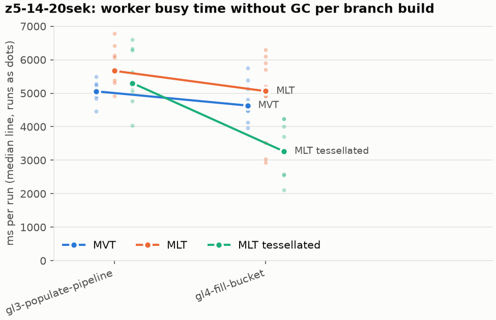
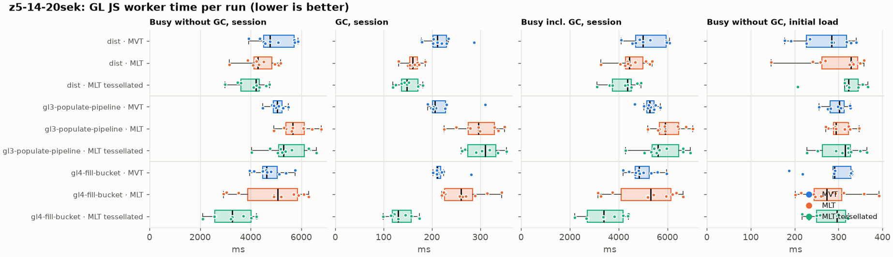
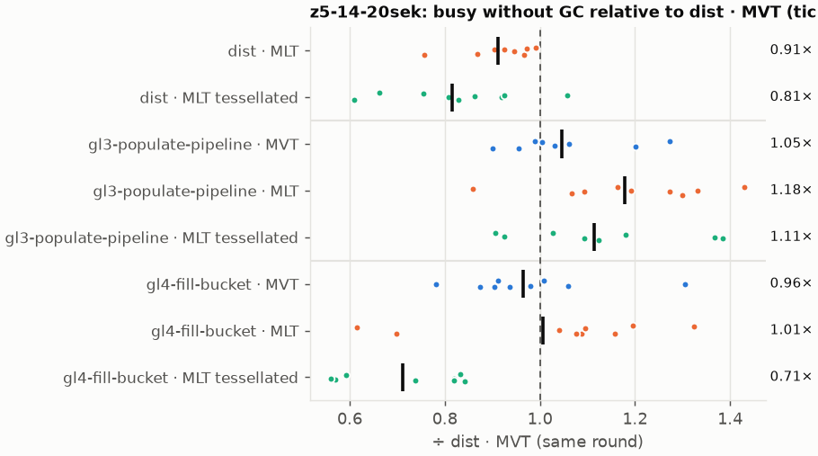
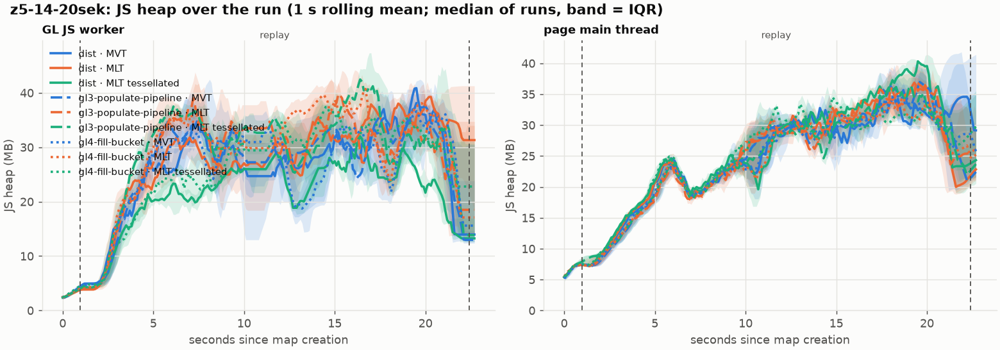
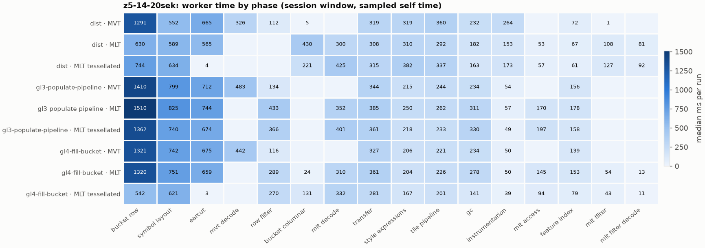
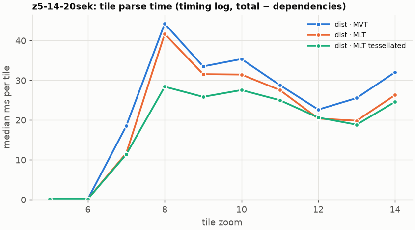
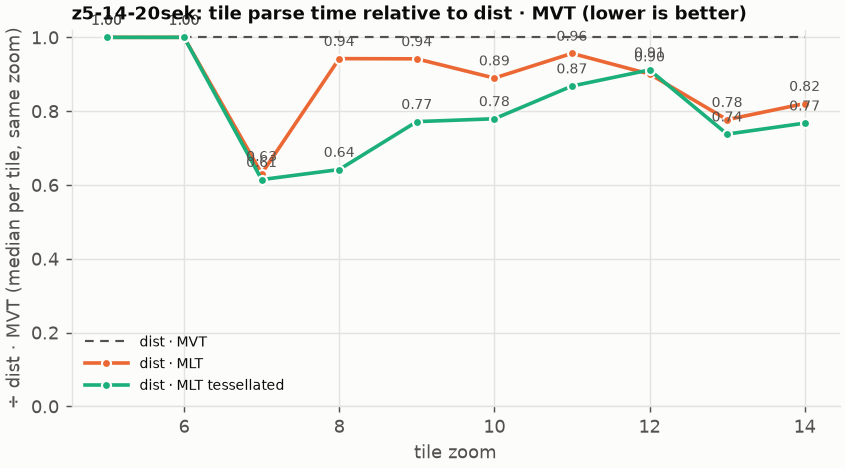

# Session trace benchmark — 20261027-064651

## Setup

- Created 2026-10-27T06:46:52+01:00; 10 repetitions + 1 warm-up round(s) (excluded); variants rotate per round (A B C, B C A, …); one cold browser context per run.
- Machine: 13th Gen Intel(R) Core(TM) i7-1365U, 12 logical cores, 31.3 GB RAM, Windows-11-10.0.26200-SP0; power: GUID des Energieschemas: 381b4222-f694-41f0-9685-ff5bb260df2e  (Ausbalanciert), AC True.
- GL JS gl7-performance-optimization @ f9bd50a8b5 (dirty); worker count 1; viewport {'width': 1280, 'height': 1024}.
- Python 3.12.2, packages {'playwright': '1.64.0', 'numpy': '2.5.3', 'matplotlib': '3.11.2'}.

| variant | bundle | format | bundle sha256 | branch build |
|---|---|---|---|---|
| MVT | `dist/maplibre-gl-dev.mjs` | mvt | `b2691453151d` | – |
| MLT | `dist/maplibre-gl-dev.mjs` | mlt | `b2691453151d` | – |
| MLT tessellated | `dist/maplibre-gl-dev.mjs` | mlt-pre-tess | `b2691453151d` | – |
| gl3-populate-pipeline · MVT | `bench-builds/branches/gl3-populate-pipeline/maplibre-gl-dev.mjs` | mvt | `b73e5cbe0eb6` | gl3-populate-pipeline @ a9a7824b99 (2026-10-07), MLT @ 9bf846d053 |
| gl3-populate-pipeline · MLT | `bench-builds/branches/gl3-populate-pipeline/maplibre-gl-dev.mjs` | mlt | `b73e5cbe0eb6` | gl3-populate-pipeline @ a9a7824b99 (2026-10-07), MLT @ 9bf846d053 |
| gl3-populate-pipeline · MLT tessellated | `bench-builds/branches/gl3-populate-pipeline/maplibre-gl-dev.mjs` | mlt-pre-tess | `b73e5cbe0eb6` | gl3-populate-pipeline @ a9a7824b99 (2026-10-07), MLT @ 9bf846d053 |
| gl4-fill-bucket · MVT | `bench-builds/branches/gl4-fill-bucket/maplibre-gl-dev.mjs` | mvt | `1e1932eb11bc` | gl4-fill-bucket @ 9d419af4cf (2026-10-14), MLT @ 9bf846d053 |
| gl4-fill-bucket · MLT | `bench-builds/branches/gl4-fill-bucket/maplibre-gl-dev.mjs` | mlt | `1e1932eb11bc` | gl4-fill-bucket @ 9d419af4cf (2026-10-14), MLT @ 9bf846d053 |
| gl4-fill-bucket · MLT tessellated | `bench-builds/branches/gl4-fill-bucket/maplibre-gl-dev.mjs` | mlt-pre-tess | `1e1932eb11bc` | gl4-fill-bucket @ 9d419af4cf (2026-10-14), MLT @ 9bf846d053 |

| session | style | duration | frames | sha256 |
|---|---|---:|---:|---|
| z5-14-20sek | maptiler-basic | 21.4 s | 829 | `5a376e5ede30` |

CPU sampling interval (median over runs): 603 µs.

## Definitions

- **busy** = wall time in which a GL JS worker thread runs a task (union of top-level task slices and GC slices on `DedicatedWorker thread`s), summed over workers. **GC** = union of `MinorGC`/`MajorGC`/`V8.GC*` slices on those threads. **busy without GC** = busy − GC (headline metric).
- **CPU** = thread time (`tdur`) of the same slices. Phase categories and functions come from the trace's CPU samples (self time), categorised by `config/categories.toml` (nearest matching frame, leaf to root).
- Windows: **load** = map creation → first idle; **session** = camera replay; **tail** = end of replay → idle; **total** = load + session + tail.
- Ratios are against **MVT**: ratio of medians with a bootstrap 95 % CI, the geometric mean of per-round ratios, and a two-sided Mann–Whitney U p-value (normal approximation, not corrected for multiple comparisons; rough below n = 8). Lower than 1× means less worker time.

## Session `z5-14-20sek`

### Worker busy without GC (session window)

| variant | n ok / failed | median ms | IQR | mean | ratio vs MVT | 95 % CI | geo-mean paired | MWU p |
|---|---:|---:|---:|---:|---:|---:|---:|---:|
| MVT | 9 / 0 | 4,771 | 4,521–5,729 | 4,954 | 1.00× | – | – | – |
| MLT | 10 / 0 | 4,277 | 4,130–4,842 | 4,367 | 0.90× | 0.73–1.06× | 0.91× | 0.079 |
| MLT tessellated | 9 / 0 | 4,214 | 3,615–4,334 | 4,038 | 0.88× | 0.69–0.97× | 0.81× | 0.013 |
| gl3-populate-pipeline · MVT | 8 / 0 | 5,056 | 4,898–5,249 | 5,044 | 1.06× | 0.86–1.16× | 1.05× | 0.665 |
| gl3-populate-pipeline · MLT | 9 / 0 | 5,669 | 5,387–6,128 | 5,813 | 1.19× | 0.98–1.36× | 1.18× | 0.034 |
| gl3-populate-pipeline · MLT tessellated | 10 / 0 | 5,301 | 5,101–6,122 | 5,450 | 1.11× | 0.91–1.32× | 1.11× | 0.206 |
| gl4-fill-bucket · MVT | 10 / 0 | 4,632 | 4,474–5,045 | 4,737 | 0.97× | 0.79–1.12× | 0.96× | 0.653 |
| gl4-fill-bucket · MLT | 10 / 0 | 5,061 | 3,875–5,847 | 4,854 | 1.06× | 0.69–1.29× | 1.01× | 0.775 |
| gl4-fill-bucket · MLT tessellated | 9 / 0 | 3,264 | 2,581–4,013 | 3,324 | 0.68× | 0.50–0.89× | 0.71× | 0.001 |

### All worker metrics (median, ratio vs baseline)

| metric | MVT | MLT | MLT tessellated | gl3-populate-pipeline · MVT | gl3-populate-pipeline · MLT | gl3-populate-pipeline · MLT tessellated | gl4-fill-bucket · MVT | gl4-fill-bucket · MLT | gl4-fill-bucket · MLT tessellated |
|---|---:|---:|---:|---:|---:|---:|---:|---:|---:|
| busy incl. GC | 5,005 | 4,437 (0.89×) | 4,366 (0.87×) | 5,272 (1.05×) | 5,919 (1.18×) | 5,612 (1.12×) | 4,842 (0.97×) | 5,317 (1.06×) | 3,382 (0.68×) |
| &nbsp;&nbsp;of which GC | 211.4 | 160.5 (0.76×) | 148.7 (0.70×) | 205.8 (0.97×) | 296.7 (1.40×) | 310.3 (1.47×) | 211.5 (1.00×) | 260.2 (1.23×) | 130.6 (0.62×) |
| &nbsp;&nbsp;of which busy without GC | 4,771 | 4,277 (0.90×) | 4,214 (0.88×) | 5,056 (1.06×) | 5,669 (1.19×) | 5,301 (1.11×) | 4,632 (0.97×) | 5,061 (1.06×) | 3,264 (0.68×) |
| &nbsp;&nbsp;&nbsp;&nbsp;of which filtering (sampled, incl. callees) | 112.5 | 107.6 (0.96×) | 127.1 (1.13×) | 133.6 (1.19×) | 432.8 (3.85×) | 365.8 (3.25×) | 115.9 (1.03×) | 340.0 (3.02×) | 313.6 (2.79×) |
| &nbsp;&nbsp;&nbsp;&nbsp;of which column decoding inside the MLT filter (sampled) | 0.0 | 81.3 | 92.0 | 0.0 | 0.0 | 0.0 | 0.0 | 12.8 | 10.6 |
| &nbsp;&nbsp;&nbsp;&nbsp;of which timing instrumentation (sampled) | 263.6 | 153.5 (0.58×) | 172.6 (0.65×) | 54.4 (0.21×) | 56.9 (0.22×) | 48.9 (0.19×) | 49.8 (0.19×) | 50.3 (0.19×) | 38.9 (0.15×) |
| busy without GC and instrumentation | 4,492 | 4,133 (0.92×) | 4,042 (0.90×) | 5,005 (1.11×) | 5,613 (1.25×) | 5,253 (1.17×) | 4,585 (1.02×) | 5,011 (1.12×) | 3,225 (0.72×) |
| CPU time without GC | 4,301 | 3,926 (0.91×) | 3,722 (0.87×) | 4,593 (1.07×) | 5,198 (1.21×) | 4,839 (1.13×) | 4,155 (0.97×) | 4,633 (1.08×) | 2,924 (0.68×) |
| tile: download end → sent to main thread, median per tile | 230.6 | 198.7 (0.86×) | 189.2 (0.82×) | 258.1 (1.12×) | 274.6 (1.19×) | 271.2 (1.18×) | 238.5 (1.03×) | 254.8 (1.10×) | 132.0 (0.57×) |
| tile: download end → sent to main thread, 90th percentile | 484.9 | 456.1 (0.94×) | 413.4 (0.85×) | 529.2 (1.09×) | 575.6 (1.19×) | 548.1 (1.13×) | 498.7 (1.03×) | 524.2 (1.08×) | 328.4 (0.68×) |
| tile: download end → sent to main thread, 95th percentile | 526.6 | 494.3 (0.94×) | 451.7 (0.86×) | 592.6 (1.13×) | 636.0 (1.21×) | 615.8 (1.17×) | 537.8 (1.02×) | 606.6 (1.15×) | 377.2 (0.72×) |
| tile: download end → sent to main thread, 99th percentile | 550.8 | 536.3 (0.97×) | 472.2 (0.86×) | 626.0 (1.14×) | 672.1 (1.22×) | 659.7 (1.20×) | 579.4 (1.05×) | 657.6 (1.19×) | 395.5 (0.72×) |
| &nbsp;&nbsp;parse part (timing log, incl. waiting for glyphs/icons), median per tile | 118.2 | 112.4 (0.95×) | 111.5 (0.94×) | – | – | – | – | – | – |
| &nbsp;&nbsp;queue + hand-off part, median per tile | 95.2 | 85.7 (0.90×) | 77.8 (0.82×) | – | – | – | – | – | – |
| minor GCs | 58.00 | 51.50 (0.89×) | 36.00 (0.62×) | 58.00 (1.00×) | 63.00 (1.09×) | 65.00 (1.12×) | 57.50 (0.99×) | 62.50 (1.08×) | 41.00 (0.71×) |
| major GCs | 4.00 | 3.00 (0.75×) | 4.00 (1.00×) | 4.50 (1.12×) | 7.00 (1.75×) | 7.00 (1.75×) | 5.00 (1.25×) | 6.00 (1.50×) | 3.00 (0.75×) |
| peak worker heap (MB) | 55.7 | 55.6 (1.00×) | 43.6 (0.78×) | 56.7 (1.02×) | 65.6 (1.18×) | 70.0 (1.26×) | 54.9 (0.99×) | 68.3 (1.23×) | 50.3 (0.90×) |
| load: busy without GC | 283.9 | 328.2 (1.16×) | 322.9 (1.14×) | 302.1 (1.06×) | 294.0 (1.04×) | 315.0 (1.11×) | 290.9 (1.02×) | 273.3 (0.96×) | 296.7 (1.05×) |
| load: GC | 8.1 | 9.3 (1.15×) | 7.9 (0.98×) | 8.9 (1.10×) | 8.2 (1.01×) | 8.4 (1.03×) | 8.9 (1.10×) | 7.0 (0.87×) | 7.9 (0.97×) |
| total: busy without GC | 5,054 | 4,609 (0.91×) | 4,435 (0.88×) | 5,360 (1.06×) | 5,991 (1.19×) | 5,623 (1.11×) | 4,940 (0.98×) | 5,338 (1.06×) | 3,560 (0.70×) |

Rows marked *of which* are parts of the row above, not additional time. Tile rows are per-tile latencies (medians over tiles, then over runs), not sums: tiles overlap in time, and the medians of the parse and queue parts do not add up exactly to the median latency.

### Filtering (session window)

Sampled worker time spent in feature filtering, including everything the filter calls (expression evaluation, property access): **row filter** = the style-spec feature filter that MVT runs per feature, **mlt filter** = the columnar MLT filter (incl. the geometry-type selection), without the columns it decodes (see the next table). Medians per run; rules in `config/categories.toml`.

| variant | mlt filter | row filter | filtering | ratio vs MVT | 95 % CI | MWU p | share of sampled busy |
|---|---:|---:|---:|---:|---:|---:|---:|
| MVT | 0.5 | 112.1 | 112.5 | 1.00× | – | – | 2.4% |
| MLT | 107.6 | 0.0 | 107.6 | 0.96× | 0.74–1.28× | 0.775 | 2.6% |
| MLT tessellated | 127.1 | 0.0 | 127.1 | 1.13× | 0.84–1.43× | 0.427 | 3.4% |
| gl3-populate-pipeline · MVT | 0.0 | 133.6 | 133.6 | 1.19× | 0.92–1.53× | 0.136 | 2.8% |
| gl3-populate-pipeline · MLT | 0.0 | 432.8 | 432.8 | 3.85× | 2.93–5.13× | <0.001 | 7.8% |
| gl3-populate-pipeline · MLT tessellated | 0.0 | 365.8 | 365.8 | 3.25× | 2.50–4.63× | <0.001 | 7.0% |
| gl4-fill-bucket · MVT | 0.0 | 115.9 | 115.9 | 1.03× | 0.79–1.44× | 0.596 | 2.7% |
| gl4-fill-bucket · MLT | 54.1 | 289.5 | 340.0 | 3.02× | 1.95–4.31× | <0.001 | 6.8% |
| gl4-fill-bucket · MLT tessellated | 43.4 | 270.2 | 313.6 | 2.79× | 1.66–3.93× | <0.001 | 9.7% |

**Filtering together with tile decoding.** The MLT decoder leaves columns encoded until something reads them, and the filter is usually the first reader: the columns it decodes (properties, and the geometry for `$type`) are **of which inside the filter** (phase *mlt filter decode*), the rest is *mlt decode* (geometry and columns read later, e.g. by paint properties and symbols). MVT decodes every feature's properties and geometry while it reads the tile (*mvt decode*), whether the filter keeps the feature or not. So **filtering** above compares the filters, and **decoding + filtering** compares all that the formats spend on decoding the tile and selecting features. **tile decoding** = *mvt decode* or *mlt decode* + *mlt filter decode*: work inside a call into a decoder. Reading data that is already decoded is not counted, as for MVT's feature objects: *mlt access* (row views, value getters, looking a column up by name) and the MLT facade (*mlt facade*). MVT decodes geometry only for the features its filter keeps, MLT decodes a layer's whole geometry column.

| variant | tile decoding | of which inside the filter | filtering | decoding + filtering | ratio vs MVT | 95 % CI | MWU p |
|---|---:|---:|---:|---:|---:|---:|---:|
| MVT | 325.9 | 0.0 | 112.5 | 451.5 | 1.00× | – | – |
| MLT | 380.4 | 81.3 | 107.6 | 481.0 | 1.07× | 0.93–1.37× | 0.391 |
| MLT tessellated | 523.2 | 92.0 | 127.1 | 650.7 | 1.44× | 1.12–1.87× | 0.006 |
| gl3-populate-pipeline · MVT | 482.5 | 0.0 | 133.6 | 613.0 | 1.36× | 1.15–1.69× | 0.006 |
| gl3-populate-pipeline · MLT | 352.3 | 0.0 | 432.8 | 786.5 | 1.74× | 1.48–2.21× | <0.001 |
| gl3-populate-pipeline · MLT tessellated | 400.9 | 0.0 | 365.8 | 774.3 | 1.72× | 1.44–2.29× | <0.001 |
| gl4-fill-bucket · MVT | 441.7 | 0.0 | 115.9 | 556.9 | 1.23× | 1.02–1.57× | 0.037 |
| gl4-fill-bucket · MLT | 321.0 | 12.8 | 340.0 | 661.1 | 1.46× | 1.00–1.93× | 0.045 |
| gl4-fill-bucket · MLT tessellated | 342.6 | 10.6 | 313.6 | 643.9 | 1.43× | 1.01–2.02× | 0.022 |

Top 12 functions inside filtering and its column decoding (self time, mean ms per run):

| phase | function | source | MVT | MLT | MLT tessellated | gl3-populate-pipeline · MVT | gl3-populate-pipeline · MLT | gl3-populate-pipeline · MLT tessellated | gl4-fill-bucket · MVT | gl4-fill-bucket · MLT | gl4-fill-bucket · MLT tessellated |
|---|---|---|---:|---:|---:|---:|---:|---:|---:|---:|---:|
| row filter | `CompoundExpression.register.filter-==` | node_modules/@maplibre/maplibre-gl-style-spec/dist/expression/compound_expression.mjs | 12.7 | 0.0 | 0.0 | 13.7 | 52.9 | 44.1 | 13.3 | 29.8 | 28.0 |
| row filter | `evaluate` | node_modules/@maplibre/maplibre-gl-style-spec/dist/expression/compound_expression.mjs | 30.3 | 0.0 | 0.0 | 32.7 | 43.6 | 37.0 | 29.3 | 29.1 | 26.1 |
| row filter | `evaluate` | node_modules/@maplibre/maplibre-gl-style-spec/dist/expression/index.mjs | 25.1 | 0.0 | 0.0 | 30.7 | 38.5 | 35.2 | 28.6 | 18.5 | 18.5 |
| row filter | `CompoundExpression.register.filter-in-small` | node_modules/@maplibre/maplibre-gl-style-spec/dist/expression/compound_expression.mjs | 12.8 | 0.0 | 0.0 | 12.5 | 31.4 | 26.2 | 10.6 | 22.4 | 18.8 |
| row filter | `readProperty` | maplibre-tile-spec/ts/dist/vector/rowView.js | 0.0 | 0.0 | 0.0 | 0.0 | 27.5 | 28.4 | 0.0 | 19.9 | 16.9 |
| row filter | `unpackNullable` | maplibre-tile-spec/ts/dist/decoding/unpackNullableUtils.js | 0.0 | 0.0 | 0.0 | 0.0 | 20.4 | 21.6 | 0.0 | 17.3 | 15.8 |
| mlt filter decode | `unpackNullable` | maplibre-tile-spec/ts/dist/decoding/unpackNullableUtils.js | 0.0 | 16.8 | 19.2 | 0.0 | 0.0 | 0.0 | 0.0 | 1.2 | 1.5 |
| row filter | `get` | maplibre-tile-spec/ts/dist/vector/lazyPropertyVectors.js | 0.0 | 0.0 | 0.0 | 0.0 | 18.1 | 16.4 | 0.0 | 12.9 | 13.7 |
| row filter | `__classPrivateFieldGet` | maplibre-tile-spec/ts/dist/vector/lazyPropertyVectors.js | 0.0 | 0.0 | 0.0 | 0.0 | 17.9 | 15.3 | 0.0 | 10.8 | 9.6 |
| mlt filter | `filterByGeometryType` | maplibre-tile-spec/ts/dist/vector/geometry/geometryVector.js | 0.0 | 16.3 | 15.2 | 0.0 | 0.0 | 0.0 | 0.0 | 6.0 | 2.9 |
| row filter | `filter` | node_modules/@maplibre/maplibre-gl-style-spec/dist/feature_filter/index.mjs | 9.7 | 0.0 | 0.0 | 12.2 | 14.9 | 10.4 | 11.9 | 7.1 | 8.2 |
| row filter | `getValue` | maplibre-tile-spec/ts/dist/vector/vector.js | 0.0 | 0.0 | 0.0 | 0.0 | 13.9 | 10.7 | 0.0 | 7.9 | 6.5 |

### Where the variants differ from MVT (session window, mean ms per run)

Open **[flame.html](flame.html)** to explore the call tree interactively: pick a variant, compare it with MVT (red = more time at the same call path, blue = less), click a frame to zoom in, and read the phase and function breakdown under it. Without a comparison, frames are coloured by phase: filtering is green in both formats, and the columns the MLT filter decodes on first access (*mlt filter decode*) are MLT blue frames under the green filter. `flame/*.txt` open in https://www.speedscope.app.

#### MLT vs MVT

**By phase** (sampled self time; the Δ column sums to the difference in sampled busy time):

| phase | MVT | MLT | Δ |
|---|---:|---:|---:|
| bucket columnar | 5.1 | 434.7 | +429.7 |
| mlt decode | 0.0 | 301.1 | +301.1 |
| mlt filter | 0.4 | 109.8 | +109.4 |
| mlt filter decode | 0.0 | 83.4 | +83.4 |
| mlt access | 0.0 | 52.7 | +52.7 |
| mlt facade | 0.4 | 52.3 | +51.9 |
| other | 14.2 | 16.2 | +2.0 |
| runtime | 21.4 | 21.9 | +0.5 |
| style expressions | 322.3 | 308.6 | -13.7 |
| feature index | 91.3 | 68.8 | -22.5 |
| transfer | 327.7 | 304.2 | -23.6 |
| symbol layout | 607.6 | 581.1 | -26.5 |
| tile pipeline | 343.3 | 288.2 | -55.1 |
| gc | 239.9 | 181.2 | -58.7 |
| row filter | 116.6 | 0.0 | -116.6 |
| earcut | 687.1 | 565.7 | -121.4 |
| instrumentation | 277.4 | 154.5 | -122.9 |
| mvt decode | 345.2 | 0.0 | -345.2 |
| bucket row | 1,349 | 635.1 | -713.5 |

**By source layer** (timing log: createBucket + populate + addFeatures, summed over the style layers that use it; wall time, includes GC pauses; total Δ -460 ms):

| source layer | type | MVT | MLT | Δ |
|---|---|---:|---:|---:|
| place | symbol | 706.6 | 794.2 | +87.6 |
| transportation | line | 735.4 | 766.5 | +31.1 |
| poi | symbol | 54.6 | 82.3 | +27.6 |
| transportation_name | symbol | 171.9 | 192.5 | +20.7 |
| waterway | line | 60.8 | 77.6 | +16.8 |
| boundary | line | 48.0 | 63.8 | +15.9 |
| aeroway | fill | 1.7 | 4.9 | +3.2 |
| transportation | fill | 22.8 | 19.3 | -3.5 |
| water | fill | 90.8 | 82.9 | -8.0 |
| building | fill | 415.8 | 244.2 | -171.6 |
| landuse | fill | 595.0 | 387.3 | -207.7 |
| landcover | fill | 860.0 | 582.6 | -277.4 |

**Functions with the largest self-time difference** (by function name, summed over source files):

| function | MVT | MLT | Δ |
|---|---:|---:|---:|
| `writeEarcutFill` | 0.0 | 47.5 | +47.5 |
| `buildEarcutMesh` | 0.0 | 41.8 | +41.8 |
| `buildRingBoundingBoxes` | 0.0 | 41.8 | +41.8 |
| `decodeComponentwiseDeltaVec2` | 0.0 | 34.4 | +34.4 |
| `readScaledRings` | 0.0 | 33.3 | +33.3 |
| `get` | 28.6 | 55.2 | +26.6 |
| `unpackNullable` | 0.0 | 25.8 | +25.8 |
| `decodeString$2` | 0.0 | 21.7 | +21.7 |
| `registerGlyphs` | 0.0 | 19.7 | +19.7 |
| `appendSymbolFeature` | 0.0 | 18.9 | +18.9 |
| `decodeFastPforInt32` | 0.0 | 17.1 | +17.1 |
| `filterByGeometryType` | 0.0 | 16.3 | +16.3 |
| `_vertexToIndex` | 237.7 | 0.0 | -237.7 |
| `readSVarint` | 196.0 | 0.0 | -196.0 |
| `loadGeometry` | 116.5 | 16.6 | -99.8 |
| `readVarint` | 74.0 | 4.2 | -69.8 |
| `populate` | 130.8 | 65.9 | -65.0 |

#### MLT tessellated vs MVT

**By phase** (sampled self time; the Δ column sums to the difference in sampled busy time):

| phase | MVT | MLT tessellated | Δ |
|---|---:|---:|---:|
| mlt decode | 0.0 | 420.6 | +420.6 |
| bucket columnar | 5.1 | 214.5 | +209.4 |
| mlt filter | 0.4 | 125.0 | +124.5 |
| mlt filter decode | 0.0 | 90.0 | +90.0 |
| mlt access | 0.0 | 56.8 | +56.8 |
| pre-tess mesh | 0.0 | 53.0 | +53.0 |
| mlt facade | 0.4 | 53.2 | +52.8 |
| symbol layout | 607.6 | 649.6 | +42.0 |
| style expressions | 322.3 | 326.7 | +4.4 |
| other | 14.2 | 16.8 | +2.6 |
| runtime | 21.4 | 23.5 | +2.1 |
| transfer | 327.7 | 314.5 | -13.3 |
| tile pipeline | 343.3 | 316.6 | -26.7 |
| feature index | 91.3 | 61.8 | -29.5 |
| gc | 239.9 | 165.8 | -74.1 |
| instrumentation | 277.4 | 172.3 | -105.1 |
| row filter | 116.6 | 0.0 | -116.6 |
| mvt decode | 345.2 | 0.0 | -345.2 |
| bucket row | 1,349 | 688.5 | -660.1 |
| earcut | 687.1 | 4.4 | -682.7 |

**By source layer** (timing log: createBucket + populate + addFeatures, summed over the style layers that use it; wall time, includes GC pauses; total Δ -932 ms):

| source layer | type | MVT | MLT tessellated | Δ |
|---|---|---:|---:|---:|
| place | symbol | 706.6 | 880.0 | +173.5 |
| transportation | line | 735.4 | 867.5 | +132.2 |
| transportation_name | symbol | 171.9 | 205.4 | +33.5 |
| poi | symbol | 54.6 | 85.1 | +30.5 |
| waterway | line | 60.8 | 88.9 | +28.1 |
| boundary | line | 48.0 | 71.1 | +23.1 |
| transportation | fill | 22.8 | 31.8 | +9.0 |
| aeroway | fill | 1.7 | 5.9 | +4.2 |
| water | fill | 90.8 | 57.8 | -33.0 |
| building | fill | 415.8 | 93.2 | -322.6 |
| landuse | fill | 595.0 | 174.6 | -420.3 |
| landcover | fill | 860.0 | 263.1 | -596.9 |

**Functions with the largest self-time difference** (by function name, summed over source files):

| function | MVT | MLT tessellated | Δ |
|---|---:|---:|---:|
| `buildTessellatedBoundingBox` | 0.0 | 50.4 | +50.4 |
| `decodeUnsignedZigZagDeltaInt32` | 0.0 | 41.1 | +41.1 |
| `decodeComponentwiseDeltaVec2` | 0.0 | 40.2 | +40.2 |
| `unpackNullable` | 0.0 | 29.3 | +29.3 |
| `decodeString$2` | 0.0 | 26.6 | +26.6 |
| `get` | 28.6 | 55.0 | +26.3 |
| `decodeFastPforInt32` | 0.0 | 25.3 | +25.3 |
| `appendSymbolFeature` | 0.0 | 21.3 | +21.3 |
| `writeTessellatedFill` | 0.0 | 20.9 | +20.9 |
| `registerGlyphs` | 0.0 | 20.6 | +20.6 |
| `decodeBigEndianInt32sInto` | 0.0 | 19.4 | +19.4 |
| `materializeSelectedFeatures` | 0.0 | 18.0 | +18.0 |
| `_vertexToIndex` | 237.7 | 0.0 | -237.7 |
| `isEar` | 209.3 | 0.5 | -208.8 |
| `readSVarint` | 196.0 | 0.0 | -196.0 |
| `isEarHashed` | 128.5 | 0.0 | -128.5 |
| `loadGeometry` | 116.5 | 19.1 | -97.3 |

#### gl3-populate-pipeline · MVT vs MVT

**By phase** (sampled self time; the Δ column sums to the difference in sampled busy time):

| phase | MVT | gl3-populate-pipeline · MVT | Δ |
|---|---:|---:|---:|
| symbol layout | 607.6 | 792.1 | +184.4 |
| mvt decode | 345.2 | 479.5 | +134.3 |
| feature index | 91.3 | 159.5 | +68.2 |
| bucket row | 1,349 | 1,402 | +53.0 |
| earcut | 687.1 | 718.1 | +31.0 |
| row filter | 116.6 | 136.7 | +20.2 |
| transfer | 327.7 | 345.6 | +17.8 |
| gc | 239.9 | 245.0 | +5.0 |
| runtime | 21.4 | 23.4 | +2.0 |
| other | 14.2 | 15.8 | +1.6 |
| bucket columnar | 5.1 | 0.0 | -5.1 |
| tile pipeline | 343.3 | 242.7 | -100.6 |
| style expressions | 322.3 | 214.9 | -107.5 |
| instrumentation | 277.4 | 54.0 | -223.4 |

**By source layer** (timing log: createBucket + populate + addFeatures, summed over the style layers that use it; wall time, includes GC pauses; total Δ -3774 ms):

| source layer | type | MVT | gl3-populate-pipeline · MVT | Δ |
|---|---|---:|---:|---:|
| aerodrome_label | symbol | 8.7 | 0.0 | -8.7 |
| transportation | fill | 22.8 | 0.0 | -22.8 |
| boundary | line | 48.0 | 0.0 | -48.0 |
| poi | symbol | 54.6 | 0.0 | -54.6 |
| waterway | line | 60.8 | 0.0 | -60.8 |
| water | fill | 90.8 | 0.0 | -90.8 |
| transportation_name | symbol | 171.9 | 0.0 | -171.9 |
| building | fill | 415.8 | 0.0 | -415.8 |
| landuse | fill | 595.0 | 0.0 | -595.0 |
| place | symbol | 706.6 | 0.0 | -706.6 |
| transportation | line | 735.4 | 0.0 | -735.4 |
| landcover | fill | 860.0 | 0.0 | -860.0 |

**Functions with the largest self-time difference** (by function name, summed over source files):

| function | MVT | gl3-populate-pipeline · MVT | Δ |
|---|---:|---:|---:|
| `_vertexToIndex` | 237.7 | 260.6 | +22.8 |
| `hasLineDasharray` | 0.3 | 21.5 | +21.1 |
| `reserve` | 181.6 | 199.1 | +17.5 |
| `loadGeometry` | 116.5 | 127.7 | +11.2 |
| `isEarHashed` | 128.5 | 139.4 | +10.8 |
| `signedArea$1` | 0.0 | 10.5 | +10.5 |
| `readUtf8$1` | 0.0 | 9.0 | +9.0 |
| `emplace` | 104.0 | 112.9 | +8.9 |
| `addLine` | 59.9 | 68.4 | +8.5 |
| `evaluate` | 73.5 | 80.6 | +7.2 |
| `isEar` | 209.3 | 215.3 | +6.0 |
| `earcutLinked` | 62.3 | 67.9 | +5.6 |
| `addPhase` | 44.4 | 0.0 | -44.4 |
| `populate` | 130.8 | 103.9 | -26.9 |
| `now` | 23.4 | 0.0 | -23.4 |
| `addBucketFeatures` | 21.3 | 0.0 | -21.3 |
| `takePhases` | 19.3 | 0.0 | -19.3 |

#### gl3-populate-pipeline · MLT vs MVT

**By phase** (sampled self time; the Δ column sums to the difference in sampled busy time):

| phase | MVT | gl3-populate-pipeline · MLT | Δ |
|---|---:|---:|---:|
| mlt decode | 0.0 | 350.5 | +350.5 |
| row filter | 116.6 | 433.2 | +316.6 |
| symbol layout | 607.6 | 845.1 | +237.5 |
| bucket row | 1,349 | 1,527 | +178.2 |
| mlt access | 0.0 | 173.2 | +173.2 |
| mlt facade | 0.4 | 89.1 | +88.6 |
| feature index | 91.3 | 174.2 | +82.9 |
| gc | 239.9 | 319.4 | +79.5 |
| transfer | 327.7 | 404.0 | +76.2 |
| earcut | 687.1 | 741.9 | +54.8 |
| runtime | 21.4 | 25.3 | +3.9 |
| other | 14.2 | 16.7 | +2.5 |
| bucket columnar | 5.1 | 0.0 | -5.1 |
| tile pipeline | 343.3 | 270.2 | -73.1 |
| style expressions | 322.3 | 249.0 | -73.4 |
| instrumentation | 277.4 | 59.7 | -217.7 |
| mvt decode | 345.2 | 0.0 | -345.2 |

**By source layer** (timing log: createBucket + populate + addFeatures, summed over the style layers that use it; wall time, includes GC pauses; total Δ -3774 ms):

| source layer | type | MVT | gl3-populate-pipeline · MLT | Δ |
|---|---|---:|---:|---:|
| aerodrome_label | symbol | 8.7 | 0.0 | -8.7 |
| transportation | fill | 22.8 | 0.0 | -22.8 |
| boundary | line | 48.0 | 0.0 | -48.0 |
| poi | symbol | 54.6 | 0.0 | -54.6 |
| waterway | line | 60.8 | 0.0 | -60.8 |
| water | fill | 90.8 | 0.0 | -90.8 |
| transportation_name | symbol | 171.9 | 0.0 | -171.9 |
| building | fill | 415.8 | 0.0 | -415.8 |
| landuse | fill | 595.0 | 0.0 | -595.0 |
| place | symbol | 706.6 | 0.0 | -706.6 |
| transportation | line | 735.4 | 0.0 | -735.4 |
| landcover | fill | 860.0 | 0.0 | -860.0 |

**Functions with the largest self-time difference** (by function name, summed over source files):

| function | MVT | gl3-populate-pipeline · MLT | Δ |
|---|---:|---:|---:|
| `(garbage collector)` | 239.9 | 319.4 | +79.5 |
| `get` | 28.6 | 102.7 | +74.1 |
| `serialize` | 82.1 | 126.0 | +43.8 |
| `CompoundExpression.register.filter-==` | 13.2 | 53.4 | +40.2 |
| `(anonymous)` | 68.3 | 107.1 | +38.9 |
| `decodeComponentwiseDeltaVec2` | 0.0 | 38.7 | +38.7 |
| `readVertices` | 0.0 | 38.3 | +38.3 |
| `readProperty` | 0.0 | 31.4 | +31.4 |
| `evaluate` | 73.5 | 103.9 | +30.5 |
| `_vertexToIndex` | 237.7 | 264.6 | +26.8 |
| `unpackNullable` | 0.0 | 25.7 | +25.7 |
| `hasLineDasharray` | 0.3 | 25.8 | +25.5 |
| `readSVarint` | 196.0 | 0.0 | -196.0 |
| `readVarint` | 74.0 | 5.2 | -68.8 |
| `readString` | 45.8 | 0.0 | -45.8 |
| `addPhase` | 44.4 | 0.0 | -44.4 |
| `VectorTileFeature` | 43.9 | 0.0 | -43.9 |

#### gl3-populate-pipeline · MLT tessellated vs MVT

**By phase** (sampled self time; the Δ column sums to the difference in sampled busy time):

| phase | MVT | gl3-populate-pipeline · MLT tessellated | Δ |
|---|---:|---:|---:|
| mlt decode | 0.0 | 408.6 | +408.6 |
| row filter | 116.6 | 380.7 | +264.1 |
| mlt access | 0.0 | 200.5 | +200.5 |
| symbol layout | 607.6 | 765.2 | +157.5 |
| gc | 239.9 | 330.9 | +91.0 |
| mlt facade | 0.4 | 79.2 | +78.7 |
| bucket row | 1,349 | 1,419 | +70.6 |
| feature index | 91.3 | 157.9 | +66.6 |
| transfer | 327.7 | 366.4 | +38.6 |
| runtime | 21.4 | 23.2 | +1.8 |
| other | 14.2 | 15.9 | +1.8 |
| earcut | 687.1 | 686.0 | -1.1 |
| bucket columnar | 5.1 | 0.0 | -5.1 |
| tile pipeline | 343.3 | 237.5 | -105.9 |
| style expressions | 322.3 | 215.6 | -106.7 |
| instrumentation | 277.4 | 51.6 | -225.8 |
| mvt decode | 345.2 | 0.0 | -345.2 |

**By source layer** (timing log: createBucket + populate + addFeatures, summed over the style layers that use it; wall time, includes GC pauses; total Δ -3774 ms):

| source layer | type | MVT | gl3-populate-pipeline · MLT tessellated | Δ |
|---|---|---:|---:|---:|
| aerodrome_label | symbol | 8.7 | 0.0 | -8.7 |
| transportation | fill | 22.8 | 0.0 | -22.8 |
| boundary | line | 48.0 | 0.0 | -48.0 |
| poi | symbol | 54.6 | 0.0 | -54.6 |
| waterway | line | 60.8 | 0.0 | -60.8 |
| water | fill | 90.8 | 0.0 | -90.8 |
| transportation_name | symbol | 171.9 | 0.0 | -171.9 |
| building | fill | 415.8 | 0.0 | -415.8 |
| landuse | fill | 595.0 | 0.0 | -595.0 |
| place | symbol | 706.6 | 0.0 | -706.6 |
| transportation | line | 735.4 | 0.0 | -735.4 |
| landcover | fill | 860.0 | 0.0 | -860.0 |

**Functions with the largest self-time difference** (by function name, summed over source files):

| function | MVT | gl3-populate-pipeline · MLT tessellated | Δ |
|---|---:|---:|---:|
| `(garbage collector)` | 239.9 | 330.9 | +91.0 |
| `get` | 28.6 | 88.3 | +59.7 |
| `readVertices` | 0.0 | 45.5 | +45.5 |
| `decodeUnsignedZigZagDeltaInt32` | 0.0 | 41.3 | +41.3 |
| `getVertex` | 0.0 | 38.6 | +38.6 |
| `decodeComponentwiseDeltaVec2` | 0.0 | 33.0 | +33.0 |
| `serialize` | 82.1 | 114.6 | +32.5 |
| `readProperty` | 0.0 | 31.7 | +31.7 |
| `CompoundExpression.register.filter-==` | 13.2 | 44.5 | +31.3 |
| `unpackNullable` | 0.0 | 26.0 | +26.0 |
| `hasLineDasharray` | 0.3 | 24.0 | +23.7 |
| `decodeFastPforInt32` | 0.0 | 23.5 | +23.5 |
| `readSVarint` | 196.0 | 0.0 | -196.0 |
| `readVarint` | 74.0 | 5.1 | -68.9 |
| `loadGeometry` | 116.5 | 69.9 | -46.6 |
| `readString` | 45.8 | 0.0 | -45.8 |
| `addPhase` | 44.4 | 0.0 | -44.4 |

#### gl4-fill-bucket · MVT vs MVT

**By phase** (sampled self time; the Δ column sums to the difference in sampled busy time):

| phase | MVT | gl4-fill-bucket · MVT | Δ |
|---|---:|---:|---:|
| symbol layout | 607.6 | 755.6 | +148.0 |
| mvt decode | 345.2 | 439.3 | +94.1 |
| feature index | 91.3 | 146.6 | +55.3 |
| row filter | 116.6 | 120.6 | +4.0 |
| transfer | 327.7 | 330.0 | +2.3 |
| runtime | 21.4 | 22.1 | +0.7 |
| gc | 239.9 | 239.1 | -0.8 |
| bucket columnar | 5.1 | 0.0 | -5.1 |
| earcut | 687.1 | 678.4 | -8.7 |
| bucket row | 1,349 | 1,328 | -20.6 |
| style expressions | 322.3 | 203.5 | -118.8 |
| tile pipeline | 343.3 | 223.5 | -119.8 |
| instrumentation | 277.4 | 51.2 | -226.3 |

**By source layer** (timing log: createBucket + populate + addFeatures, summed over the style layers that use it; wall time, includes GC pauses; total Δ -3774 ms):

| source layer | type | MVT | gl4-fill-bucket · MVT | Δ |
|---|---|---:|---:|---:|
| aerodrome_label | symbol | 8.7 | 0.0 | -8.7 |
| transportation | fill | 22.8 | 0.0 | -22.8 |
| boundary | line | 48.0 | 0.0 | -48.0 |
| poi | symbol | 54.6 | 0.0 | -54.6 |
| waterway | line | 60.8 | 0.0 | -60.8 |
| water | fill | 90.8 | 0.0 | -90.8 |
| transportation_name | symbol | 171.9 | 0.0 | -171.9 |
| building | fill | 415.8 | 0.0 | -415.8 |
| landuse | fill | 595.0 | 0.0 | -595.0 |
| place | symbol | 706.6 | 0.0 | -706.6 |
| transportation | line | 735.4 | 0.0 | -735.4 |
| landcover | fill | 860.0 | 0.0 | -860.0 |

**Functions with the largest self-time difference** (by function name, summed over source files):

| function | MVT | gl4-fill-bucket · MVT | Δ |
|---|---:|---:|---:|
| `hasLineDasharray` | 0.3 | 19.0 | +18.7 |
| `_vertexToIndex` | 237.7 | 252.6 | +14.9 |
| `reserve` | 181.6 | 191.6 | +10.0 |
| `signedArea$1` | 0.0 | 7.9 | +7.9 |
| `readVarint` | 74.0 | 80.5 | +6.5 |
| `addLine` | 59.9 | 64.2 | +4.3 |
| `codePointIsWrittenWithoutSpaces` | 13.8 | 17.6 | +3.8 |
| `emplace` | 104.0 | 107.6 | +3.6 |
| `loadGeometry` | 116.5 | 119.4 | +2.9 |
| `leastBadBreaks` | 16.3 | 18.9 | +2.6 |
| `Subdivider` | 7.9 | 10.2 | +2.3 |
| `filter` | 9.7 | 11.9 | +2.2 |
| `populate` | 130.8 | 77.8 | -53.0 |
| `addPhase` | 44.4 | 0.0 | -44.4 |
| `readSVarint` | 196.0 | 170.8 | -25.2 |
| `now` | 23.4 | 0.0 | -23.4 |
| `takePhases` | 19.3 | 0.0 | -19.3 |

#### gl4-fill-bucket · MLT vs MVT

**By phase** (sampled self time; the Δ column sums to the difference in sampled busy time):

| phase | MVT | gl4-fill-bucket · MLT | Δ |
|---|---:|---:|---:|
| mlt decode | 0.0 | 290.7 | +290.7 |
| row filter | 116.6 | 276.4 | +159.8 |
| mlt access | 0.0 | 136.0 | +136.0 |
| symbol layout | 607.6 | 721.2 | +113.6 |
| mlt facade | 0.4 | 71.6 | +71.2 |
| feature index | 91.3 | 145.3 | +53.9 |
| mlt filter | 0.4 | 53.4 | +53.0 |
| gc | 239.9 | 284.9 | +45.0 |
| bucket columnar | 5.1 | 22.0 | +17.0 |
| transfer | 327.7 | 342.6 | +14.9 |
| mlt filter decode | 0.0 | 12.4 | +12.4 |
| other | 14.2 | 13.5 | -0.7 |
| earcut | 687.1 | 637.5 | -49.6 |
| bucket row | 1,349 | 1,256 | -92.5 |
| style expressions | 322.3 | 197.7 | -124.7 |
| tile pipeline | 343.3 | 218.1 | -125.2 |
| instrumentation | 277.4 | 46.3 | -231.1 |
| mvt decode | 345.2 | 0.0 | -345.2 |

**By source layer** (timing log: createBucket + populate + addFeatures, summed over the style layers that use it; wall time, includes GC pauses; total Δ -3774 ms):

| source layer | type | MVT | gl4-fill-bucket · MLT | Δ |
|---|---|---:|---:|---:|
| aerodrome_label | symbol | 8.7 | 0.0 | -8.7 |
| transportation | fill | 22.8 | 0.0 | -22.8 |
| boundary | line | 48.0 | 0.0 | -48.0 |
| poi | symbol | 54.6 | 0.0 | -54.6 |
| waterway | line | 60.8 | 0.0 | -60.8 |
| water | fill | 90.8 | 0.0 | -90.8 |
| transportation_name | symbol | 171.9 | 0.0 | -171.9 |
| building | fill | 415.8 | 0.0 | -415.8 |
| landuse | fill | 595.0 | 0.0 | -595.0 |
| place | symbol | 706.6 | 0.0 | -706.6 |
| transportation | line | 735.4 | 0.0 | -735.4 |
| landcover | fill | 860.0 | 0.0 | -860.0 |

**Functions with the largest self-time difference** (by function name, summed over source files):

| function | MVT | gl4-fill-bucket · MLT | Δ |
|---|---:|---:|---:|
| `get` | 28.6 | 82.8 | +54.2 |
| `(garbage collector)` | 239.9 | 284.9 | +45.0 |
| `decodeComponentwiseDeltaVec2` | 0.0 | 31.1 | +31.1 |
| `readVertices` | 0.0 | 30.4 | +30.4 |
| `unpackNullable` | 0.0 | 22.7 | +22.7 |
| `readProperty` | 0.0 | 22.4 | +22.4 |
| `serialize` | 82.1 | 104.3 | +22.2 |
| `decodeString` | 0.0 | 21.4 | +21.4 |
| `hasLineDasharray` | 0.3 | 20.0 | +19.7 |
| `getVertex` | 0.0 | 19.0 | +19.0 |
| `addFeature` | 52.4 | 71.3 | +19.0 |
| `decodeFastPforInt32` | 0.0 | 17.2 | +17.2 |
| `readSVarint` | 196.0 | 0.0 | -196.0 |
| `readVarint` | 74.0 | 3.8 | -70.2 |
| `populate` | 130.8 | 63.6 | -67.2 |
| `loadGeometry` | 116.5 | 59.7 | -56.8 |
| `readString` | 45.8 | 0.0 | -45.8 |

#### gl4-fill-bucket · MLT tessellated vs MVT

**By phase** (sampled self time; the Δ column sums to the difference in sampled busy time):

| phase | MVT | gl4-fill-bucket · MLT tessellated | Δ |
|---|---:|---:|---:|
| mlt decode | 0.0 | 341.8 | +341.8 |
| row filter | 116.6 | 255.4 | +138.9 |
| bucket columnar | 5.1 | 137.4 | +132.3 |
| mlt access | 0.0 | 88.9 | +88.9 |
| pre-tess mesh | 0.0 | 43.2 | +43.2 |
| mlt filter | 0.4 | 41.1 | +40.6 |
| symbol layout | 607.6 | 644.8 | +37.1 |
| mlt facade | 0.4 | 36.9 | +36.5 |
| mlt filter decode | 0.0 | 12.1 | +12.1 |
| runtime | 21.4 | 20.1 | -1.3 |
| other | 14.2 | 11.6 | -2.6 |
| feature index | 91.3 | 75.6 | -15.7 |
| transfer | 327.7 | 293.4 | -34.3 |
| gc | 239.9 | 148.2 | -91.7 |
| tile pipeline | 343.3 | 201.5 | -141.8 |
| style expressions | 322.3 | 156.9 | -165.4 |
| instrumentation | 277.4 | 40.4 | -237.0 |
| mvt decode | 345.2 | 0.0 | -345.2 |
| earcut | 687.1 | 4.4 | -682.7 |
| bucket row | 1,349 | 556.5 | -792.1 |

**By source layer** (timing log: createBucket + populate + addFeatures, summed over the style layers that use it; wall time, includes GC pauses; total Δ -3774 ms):

| source layer | type | MVT | gl4-fill-bucket · MLT tessellated | Δ |
|---|---|---:|---:|---:|
| aerodrome_label | symbol | 8.7 | 0.0 | -8.7 |
| transportation | fill | 22.8 | 0.0 | -22.8 |
| boundary | line | 48.0 | 0.0 | -48.0 |
| poi | symbol | 54.6 | 0.0 | -54.6 |
| waterway | line | 60.8 | 0.0 | -60.8 |
| water | fill | 90.8 | 0.0 | -90.8 |
| transportation_name | symbol | 171.9 | 0.0 | -171.9 |
| building | fill | 415.8 | 0.0 | -415.8 |
| landuse | fill | 595.0 | 0.0 | -595.0 |
| place | symbol | 706.6 | 0.0 | -706.6 |
| transportation | line | 735.4 | 0.0 | -735.4 |
| landcover | fill | 860.0 | 0.0 | -860.0 |

**Functions with the largest self-time difference** (by function name, summed over source files):

| function | MVT | gl4-fill-bucket · MLT tessellated | Δ |
|---|---:|---:|---:|
| `get` | 28.6 | 73.6 | +45.0 |
| `buildTessellatedBoundingBox` | 0.0 | 41.5 | +41.5 |
| `decodeUnsignedZigZagDeltaInt32` | 0.0 | 32.4 | +32.4 |
| `decodeComponentwiseDeltaVec2` | 0.0 | 27.4 | +27.4 |
| `hasLineDasharray` | 0.3 | 22.1 | +21.7 |
| `unpackNullable` | 0.0 | 21.4 | +21.4 |
| `readProperty` | 0.0 | 19.8 | +19.8 |
| `decodeString` | 0.0 | 19.7 | +19.7 |
| `decodeFastPforInt32` | 0.0 | 19.2 | +19.2 |
| `writeTessellatedFill` | 0.0 | 17.9 | +17.9 |
| `lineFeatureClips` | 1.9 | 17.4 | +15.5 |
| `CompoundExpression.register.filter-==` | 13.2 | 28.1 | +14.9 |
| `_vertexToIndex` | 237.7 | 0.3 | -237.4 |
| `isEar` | 209.3 | 0.4 | -209.0 |
| `readSVarint` | 196.0 | 0.0 | -196.0 |
| `isEarHashed` | 128.5 | 0.0 | -128.5 |
| `loadGeometry` | 116.5 | 20.1 | -96.3 |

### Memory (session window)

**JS heap** = V8's used heap of the thread (`jsHeapSizeUsed` from the trace's `UpdateCounters`, about every 20 ms; the mean is time-weighted). It does not include ArrayBuffer contents, so the tile data itself (vertex, index and feature-index arrays) is not in it: **tile data sent to the main thread** is the size of the ArrayBuffers each tile result transfers (`web/worker_hook.js`), which then live on the main thread and are uploaded to the GPU. **garbage collected** = heap freed by the worker's GCs, a measure of how much it allocates. Medians per run; ratio of medians with a bootstrap 95 % CI.

| metric | MVT | MLT | MLT tessellated | gl3-populate-pipeline · MVT | gl3-populate-pipeline · MLT | gl3-populate-pipeline · MLT tessellated | gl4-fill-bucket · MVT | gl4-fill-bucket · MLT | gl4-fill-bucket · MLT tessellated |
|---|---:|---:|---:|---:|---:|---:|---:|---:|---:|
| worker JS heap, mean (MB) | 22.9 | 23.7 (1.04×, 0.93–1.18×) | 19.0 (0.83×, 0.77–0.95×) | 22.1 (0.97×, 0.89–1.11×) | 24.5 (1.07×, 0.98–1.24×) | 25.2 (1.10×, 1.03–1.26×) | 21.6 (0.94×, 0.88–1.09×) | 24.6 (1.08×, 0.97–1.28×) | 22.5 (0.98×, 0.89–1.16×) |
| worker JS heap, peak (MB) | 55.7 | 55.6 (1.00×, 0.93–1.03×) | 43.6 (0.78×, 0.73–0.81×) | 56.7 (1.02×, 0.90–1.08×) | 65.6 (1.18×, 1.09–1.27×) | 70.0 (1.26×, 1.16–1.30×) | 54.9 (0.99×, 0.89–1.06×) | 68.3 (1.23×, 0.94–1.29×) | 50.3 (0.90×, 0.84–0.99×) |
| worker JS heap after the last GC (MB) | 9.8 | 24.2 (2.48×, 1.06–2.69×) | 10.5 (1.08×, 0.57–1.18×) | 8.7 (0.89×, 0.48–1.30×) | 9.8 (1.01×, 0.79–2.44×) | 9.7 (1.00×, 0.52–3.03×) | 8.9 (0.92×, 0.62–1.61×) | 12.5 (1.28×, 0.81–2.23×) | 17.0 (1.74×, 0.91–2.20×) |
| garbage collected in the worker (MB) | 1,298 | 876.9 (0.68×, 0.66–0.69×) | 503.4 (0.39×, 0.38–0.40×) | 1,279 (0.99×, 0.96–1.00×) | 1,444 (1.11×, 1.10–1.14×) | 1,504 (1.16×, 1.14–1.18×) | 1,275 (0.98×, 0.97–1.00×) | 1,401 (1.08×, 1.07–1.10×) | 639.7 (0.49×, 0.48–0.51×) |
| main thread JS heap, mean (MB) | 23.4 | 23.6 (1.01×, 0.93–1.07×) | 23.3 (0.99×, 0.93–1.09×) | 23.4 (1.00×, 0.92–1.05×) | 23.7 (1.01×, 0.94–1.05×) | 23.1 (0.98×, 0.89–1.03×) | 23.0 (0.98×, 0.91–1.04×) | 23.2 (0.99×, 0.92–1.04×) | 23.8 (1.01×, 0.95–1.07×) |
| main thread JS heap, peak (MB) | 43.1 | 48.3 (1.12×, 0.93–1.17×) | 49.9 (1.16×, 0.99–1.18×) | 45.9 (1.07×, 0.92–1.17×) | 46.1 (1.07×, 0.96–1.15×) | 46.2 (1.07×, 0.93–1.15×) | 45.9 (1.06×, 0.92–1.15×) | 46.5 (1.08×, 0.92–1.13×) | 44.4 (1.03×, 0.91–1.09×) |
| main thread JS heap at the end of the replay (MB) | 34.9 | 19.6 (0.56×, 0.45–1.01×) | 23.7 (0.68×, 0.48–1.19×) | 21.1 (0.60×, 0.48–1.36×) | 25.2 (0.72×, 0.50–1.27×) | 21.8 (0.62×, 0.49–1.07×) | 25.3 (0.72×, 0.52–1.18×) | 26.3 (0.75×, 0.50–1.29×) | 27.1 (0.78×, 0.55–1.18×) |
| tile data sent to the main thread, total (MB) | 72.4 | 68.8 (0.95×, 0.94–0.96×) | 69.2 (0.96×, 0.93–0.97×) | 71.6 (0.99×, 0.97–0.99×) | 68.8 (0.95×, 0.94–0.97×) | 72.1 (1.00×, 0.98–1.00×) | 71.7 (0.99×, 0.97–1.00×) | 69.0 (0.95×, 0.94–0.96×) | 70.1 (0.97×, 0.95–0.98×) |
| tile data sent to the main thread, median per tile (KB) | 498.5 | 484.2 (0.97×, 0.94–0.99×) | 470.0 (0.94×, 0.93–0.96×) | 503.2 (1.01×, 0.99–1.03×) | 470.9 (0.94×, 0.91–0.96×) | 491.3 (0.99×, 0.95–1.02×) | 505.0 (1.01×, 0.99–1.03×) | 476.2 (0.96×, 0.93–0.98×) | 472.1 (0.95×, 0.93–0.97×) |

### Worker time by phase (session window, median ms of sampled self time)

| phase | MVT | MLT | MLT tessellated | gl3-populate-pipeline · MVT | gl3-populate-pipeline · MLT | gl3-populate-pipeline · MLT tessellated | gl4-fill-bucket · MVT | gl4-fill-bucket · MLT | gl4-fill-bucket · MLT tessellated |
|---|---:|---:|---:|---:|---:|---:|---:|---:|---:|
| bucket row | 1,291 | 629.5 | 744.4 | 1,410 | 1,510 | 1,362 | 1,321 | 1,320 | 541.9 |
| symbol layout | 552.2 | 589.2 | 634.2 | 798.6 | 825.4 | 740.3 | 741.5 | 751.1 | 621.5 |
| earcut | 664.6 | 564.9 | 4.0 | 712.0 | 744.0 | 674.3 | 675.1 | 659.2 | 2.6 |
| mvt decode | 325.9 | 0.0 | 0.0 | 482.5 | 0.0 | 0.0 | 441.7 | 0.0 | 0.0 |
| row filter | 112.1 | 0.0 | 0.0 | 133.6 | 432.8 | 365.8 | 115.9 | 289.5 | 270.2 |
| bucket columnar | 5.3 | 430.5 | 221.3 | 0.0 | 0.0 | 0.0 | 0.0 | 24.2 | 131.0 |
| mlt decode | 0.0 | 299.7 | 425.5 | 0.0 | 352.3 | 400.9 | 0.0 | 310.0 | 332.0 |
| transfer | 319.0 | 307.6 | 315.4 | 344.5 | 384.7 | 360.6 | 326.7 | 361.2 | 281.2 |
| style expressions | 319.5 | 309.7 | 382.1 | 214.9 | 249.9 | 218.2 | 205.6 | 204.4 | 166.7 |
| tile pipeline | 360.1 | 292.4 | 337.2 | 243.6 | 262.4 | 232.6 | 221.3 | 225.9 | 201.1 |
| gc | 231.7 | 182.4 | 162.8 | 234.4 | 311.2 | 329.5 | 234.0 | 277.6 | 140.6 |
| instrumentation | 263.6 | 153.5 | 172.6 | 54.4 | 56.9 | 48.9 | 49.8 | 50.3 | 38.9 |
| mlt access | 0.0 | 53.0 | 56.6 | 0.0 | 169.8 | 197.3 | 0.0 | 145.2 | 94.0 |
| feature index | 71.8 | 67.3 | 61.3 | 156.0 | 178.3 | 158.2 | 139.0 | 153.2 | 78.6 |
| mlt filter | 0.5 | 107.6 | 127.1 | 0.0 | 0.0 | 0.0 | 0.0 | 54.1 | 43.4 |
| mlt filter decode | 0.0 | 81.3 | 92.0 | 0.0 | 0.0 | 0.0 | 0.0 | 12.8 | 10.6 |
| mlt facade | 0.0 | 51.0 | 53.1 | 0.3 | 88.6 | 80.8 | 0.0 | 76.2 | 35.6 |
| pre-tess mesh | 0.0 | 0.0 | 50.9 | 0.0 | 0.0 | 0.0 | 0.0 | 0.0 | 40.3 |
| runtime | 21.3 | 20.8 | 24.9 | 22.0 | 25.4 | 23.3 | 22.2 | 22.2 | 18.1 |
| other | 14.8 | 16.5 | 16.9 | 15.9 | 16.2 | 17.1 | 14.1 | 13.9 | 10.7 |

### Top 20 worker functions by self time (session window, mean ms per run)

| function | source | phase | MVT | MLT | MLT tessellated | gl3-populate-pipeline · MVT | gl3-populate-pipeline · MLT | gl3-populate-pipeline · MLT tessellated | gl4-fill-bucket · MVT | gl4-fill-bucket · MLT | gl4-fill-bucket · MLT tessellated |
|---|---|---|---:|---:|---:|---:|---:|---:|---:|---:|---:|
| `(garbage collector)` | (native) | gc | 239.9 | 181.2 | 165.8 | 245.0 | 319.4 | 330.9 | 239.1 | 284.9 | 148.2 |
| `_vertexToIndex` | src/render/subdivision.ts | bucket row | 237.7 | 0.0 | 0.0 | 260.6 | 264.6 | 254.3 | 252.6 | 232.2 | 0.3 |
| `isEar` | node_modules/earcut/src/earcut.js | earcut | 209.3 | 146.3 | 0.5 | 215.3 | 223.8 | 213.8 | 204.6 | 196.5 | 0.4 |
| `reserve` | src/util/struct_array.ts | bucket row | 181.6 | 154.2 | 170.0 | 199.1 | 205.1 | 191.1 | 191.6 | 175.8 | 134.1 |
| `readSVarint` | node_modules/pbf/index.js | mvt decode | 196.0 | 0.0 | 0.0 | 197.7 | 0.0 | 0.0 | 170.8 | 0.0 | 0.0 |
| `isEarHashed` | node_modules/earcut/src/earcut.js | earcut | 128.5 | 94.1 | 0.0 | 139.4 | 134.2 | 124.3 | 122.5 | 119.2 | 0.0 |
| `emplace` | src/data/array_types.g.ts | bucket row | 104.0 | 110.9 | 107.1 | 112.9 | 119.8 | 108.0 | 107.6 | 99.3 | 81.6 |
| `serialize` | src/util/web_worker_transfer.ts | transfer | 63.4 | 61.1 | 67.3 | 65.8 | 108.1 | 99.6 | 62.3 | 88.1 | 79.9 |
| `postMessage` | (native) | transfer | 95.0 | 91.9 | 100.6 | 94.4 | 99.7 | 92.8 | 91.2 | 91.1 | 88.3 |
| `fetch` | (native) | tile pipeline | 81.7 | 80.3 | 87.7 | 83.8 | 92.1 | 80.9 | 79.1 | 77.0 | 73.8 |
| `insert` | src/data/feature_index.ts | feature index | 16.6 | 2.5 | 5.1 | 76.1 | 88.6 | 79.0 | 70.2 | 73.8 | 25.7 |
| `readVarint` | node_modules/pbf/index.js | mvt decode | 18.0 | 0.0 | 0.0 | 79.5 | 0.0 | 0.0 | 80.5 | 0.0 | 0.0 |
| `_trim` | src/util/struct_array.ts | transfer | 71.8 | 55.6 | 48.2 | 76.3 | 74.7 | 71.9 | 71.4 | 66.3 | 38.1 |
| `addHalfVertex` | src/data/bucket/line_bucket.ts | bucket row | 67.3 | 64.5 | 75.1 | 70.9 | 71.2 | 71.1 | 65.6 | 55.4 | 56.6 |
| `addLine` | src/data/bucket/line_bucket.ts | bucket row | 59.9 | 68.8 | 72.4 | 68.4 | 72.6 | 67.0 | 64.2 | 61.6 | 59.3 |
| `loadGeometry` | src/data/load_geometry.ts | bucket row | 59.2 | 14.6 | 16.6 | 62.5 | 71.8 | 64.5 | 58.1 | 54.4 | 16.9 |
| `earcutLinked` | node_modules/earcut/src/earcut.js | earcut | 62.3 | 56.2 | 0.5 | 67.9 | 69.7 | 62.9 | 61.5 | 60.0 | 1.2 |
| `getGlyphAdvance` | src/symbol/tagged_string.ts | symbol layout | 13.9 | 5.9 | 12.7 | 66.3 | 65.7 | 59.1 | 59.8 | 55.4 | 50.5 |
| `loadGeometry` | node_modules/@mapbox/vector-tile/index.js | mvt decode | 12.3 | 0.0 | 0.0 | 65.2 | 0.0 | 0.0 | 61.3 | 0.0 | 0.0 |
| `populate` | src/source/worker_timing.ts | instrumentation | 61.7 | 0.0 | 0.0 | 0.0 | 0.0 | 0.0 | 0.0 | 0.0 | 0.0 |

### Top 20 worker functions by total time (incl. callees) (session window, mean ms per run)

| function | source | phase | MVT | MLT | MLT tessellated | gl3-populate-pipeline · MVT | gl3-populate-pipeline · MLT | gl3-populate-pipeline · MLT tessellated | gl4-fill-bucket · MVT | gl4-fill-bucket · MLT | gl4-fill-bucket · MLT tessellated |
|---|---|---|---:|---:|---:|---:|---:|---:|---:|---:|---:|
| `parse` | src/source/worker_tile.ts | tile pipeline | 3,891 | 3,454 | 3,028 | 3,946 | 4,711 | 4,424 | 3,705 | 3,925 | 2,499 |
| `loadTile` | src/source/vector_tile_worker_source.ts | tile pipeline | 3,308 | 2,823 | 2,350 | 3,360 | 4,023 | 3,800 | 3,135 | 3,331 | 1,970 |
| `_parseWorkerTile` | src/source/vector_tile_worker_source.ts | tile pipeline | 3,153 | 2,735 | 2,255 | 3,206 | 3,919 | 3,708 | 2,988 | 3,244 | 1,890 |
| `populate` | src/data/bucket/fill_bucket.ts | bucket row | 1,788 | 0.0 | 0.0 | 1,881 | 1,892 | 1,793 | 1,772 | 0.0 | 0.0 |
| `populate` | src/data/bucket/columnar/columnar_fill_bucket.ts | bucket columnar | 0.0 | 109.7 | 95.8 | 0.0 | 0.0 | 0.0 | 0.0 | 1,721 | 455.7 |
| `addFeature` | src/data/bucket/fill_bucket.ts | bucket row | 1,357 | 0.0 | 0.0 | 1,439 | 1,523 | 1,424 | 1,358 | 1,302 | 11.5 |
| `addBucketFeatures` | src/data/bucket/fill_bucket.ts | bucket row | 1,455 | 929.5 | 143.7 | 0.0 | 0.0 | 0.0 | 1,454 | 1,392 | 118.8 |
| `addFeature` | src/data/bucket/columnar/columnar_fill_bucket.ts | bucket columnar | 0.0 | 896.4 | 127.4 | 0.0 | 0.0 | 0.0 | 0.0 | 1,309 | 104.9 |
| `subdividePolygon` | src/render/subdivision.ts | bucket row | 1,150 | 0.0 | 0.0 | 1,205 | 1,263 | 1,180 | 1,143 | 1,084 | 8.8 |
| `subdividePolygonInternal` | src/render/subdivision.ts | bucket row | 1,140 | 0.0 | 0.0 | 1,194 | 1,247 | 1,164 | 1,132 | 1,070 | 8.3 |
| `populate` | maplibre-gl-shared-dev.mjs | tile pipeline | 0.0 | 1,075 | 447.1 | 0.0 | 0.0 | 0.0 | 0.0 | 0.0 | 0.0 |
| `writeEarcutFill` | src/data/bucket/columnar/columnar_mesh_arrays.ts | bucket columnar | 0.0 | 883.7 | 10.0 | 0.0 | 0.0 | 0.0 | 0.0 | 0.0 | 0.0 |
| `populate` | src/data/bucket/line_bucket.ts | bucket row | 164.5 | 691.4 | 703.5 | 663.7 | 851.5 | 781.4 | 619.9 | 690.5 | 696.1 |
| `addFeatures` | src/data/bucket/symbol_bucket.ts | symbol layout | 682.9 | 669.1 | 723.5 | 703.1 | 747.0 | 675.7 | 681.1 | 640.8 | 571.6 |
| `earcut` | node_modules/earcut/src/earcut.js | earcut | 686.4 | 564.9 | 4.4 | 716.7 | 740.6 | 685.1 | 678.0 | 636.3 | 4.4 |
| `performSymbolLayout` | src/symbol/symbol_layout.ts | symbol layout | 155.4 | 63.6 | 129.7 | 694.7 | 737.5 | 666.4 | 671.7 | 633.2 | 564.3 |
| `buildEarcutMesh` | src/data/bucket/columnar/columnar_mesh_arrays.ts | bucket columnar | 0.0 | 637.8 | 5.9 | 0.0 | 0.0 | 0.0 | 0.0 | 0.0 | 0.0 |
| `performSymbolLayout` | src/style/style_layer/variable_text_anchor.ts | style expressions | 519.0 | 596.7 | 583.2 | 0.0 | 0.0 | 0.0 | 0.0 | 0.0 | 0.0 |
| `earcutLinked` | node_modules/earcut/src/earcut.js | earcut | 547.0 | 441.9 | 1.0 | 571.0 | 581.1 | 542.9 | 538.2 | 506.3 | 1.6 |
| `populate` | src/source/worker_timing.ts | instrumentation | 528.2 | 0.0 | 0.0 | 0.0 | 0.0 | 0.0 | 0.0 | 0.0 | 0.0 |

### Tile parse time by zoom (timing log, median ms per tile, total − dependencies)

| zoom | MVT | MLT | MLT tessellated | gl3-populate-pipeline · MVT | gl3-populate-pipeline · MLT | gl3-populate-pipeline · MLT tessellated | gl4-fill-bucket · MVT | gl4-fill-bucket · MLT | gl4-fill-bucket · MLT tessellated |
|---:|---:|---:|---:|---:|---:|---:|---:|---:|---:|
| 5 | 0.20 (n=81) | 0.20 (n=90) | 0.20 (n=81) | – | – | – | – | – | – |
| 6 | 0.20 (n=81) | 0.20 (n=90) | 0.20 (n=81) | – | – | – | – | – | – |
| 7 | 18.55 (n=52) | 11.70 (n=60) | 11.40 (n=54) | – | – | – | – | – | – |
| 8 | 44.25 (n=40) | 41.70 (n=48) | 28.40 (n=43) | – | – | – | – | – | – |
| 9 | 33.50 (n=144) | 31.55 (n=160) | 25.85 (n=144) | – | – | – | – | – | – |
| 10 | 35.35 (n=180) | 31.45 (n=200) | 27.55 (n=180) | – | – | – | – | – | – |
| 11 | 28.80 (n=131) | 27.55 (n=144) | 25.00 (n=122) | – | – | – | – | – | – |
| 12 | 22.65 (n=192) | 20.40 (n=220) | 20.65 (n=200) | – | – | – | – | – | – |
| 13 | 25.55 (n=200) | 19.85 (n=214) | 18.85 (n=184) | – | – | – | – | – | – |
| 14 | 32.05 (n=162) | 26.30 (n=180) | 24.60 (n=162) | – | – | – | – | – | – |

### Tile latency by zoom: download end → result sent to the main thread (session window, ms per tile: median / p95 / p99)

Includes waiting in the worker's queue, the parse and posting the result; see `tile_latency.csv` for the per-tile split (`parse_ms`, `wait_ms`). Percentiles over the tiles of all runs; with few tiles (n) p99 is close to the maximum.

| zoom | MVT | MLT | MLT tessellated | gl3-populate-pipeline · MVT | gl3-populate-pipeline · MLT | gl3-populate-pipeline · MLT tessellated | gl4-fill-bucket · MVT | gl4-fill-bucket · MLT | gl4-fill-bucket · MLT tessellated |
|---:|---:|---:|---:|---:|---:|---:|---:|---:|---:|
| 6 | 67.4 / 106.0 / 109.4 (n=81) | 72.5 / 118.0 / 127.3 (n=90) | 68.2 / 109.7 / 117.1 (n=81) | 72.0 / 103.9 / 108.2 (n=72) | 92.1 / 129.2 / 136.0 (n=81) | 97.8 / 136.9 / 142.8 (n=90) | 75.8 / 109.9 / 111.6 (n=90) | 79.8 / 133.0 / 141.0 (n=90) | 57.3 / 95.7 / 109.3 (n=81) |
| 7 | 203.4 / 430.2 / 496.8 (n=52) | 156.2 / 215.3 / 429.6 (n=60) | 117.0 / 147.8 / 152.0 (n=54) | 247.8 / 508.9 / 526.1 (n=48) | 255.1 / 622.9 / 630.7 (n=54) | 269.1 / 540.2 / 552.4 (n=60) | 251.0 / 516.6 / 522.1 (n=60) | 240.2 / 632.8 / 636.8 (n=60) | 99.8 / 133.4 / 136.1 (n=54) |
| 8 | 262.6 / 332.7 / 337.0 (n=40) | 231.4 / 275.0 / 289.1 (n=48) | 188.1 / 264.7 / 266.4 (n=43) | 290.0 / 330.4 / 335.0 (n=32) | 315.9 / 414.6 / 426.8 (n=36) | 323.6 / 366.8 / 375.4 (n=40) | 289.6 / 322.1 / 335.9 (n=40) | 296.0 / 390.0 / 395.3 (n=44) | 207.0 / 239.4 / 242.6 (n=51) |
| 9 | 315.8 / 550.7 / 599.8 (n=144) | 279.4 / 483.2 / 498.1 (n=160) | 199.6 / 384.0 / 397.9 (n=144) | 338.8 / 551.5 / 560.7 (n=128) | 422.6 / 727.7 / 757.0 (n=144) | 387.8 / 637.0 / 655.5 (n=160) | 328.4 / 554.1 / 573.5 (n=160) | 331.6 / 596.3 / 620.8 (n=160) | 207.9 / 362.2 / 394.8 (n=144) |
| 10 | 383.0 / 666.5 / 686.9 (n=180) | 402.9 / 580.2 / 599.3 (n=200) | 348.3 / 529.8 / 553.0 (n=180) | 527.0 / 661.3 / 679.8 (n=160) | 544.5 / 868.2 / 922.6 (n=182) | 538.7 / 726.5 / 756.0 (n=200) | 468.3 / 660.2 / 696.9 (n=200) | 416.9 / 746.3 / 791.2 (n=200) | 224.6 / 446.2 / 478.2 (n=175) |
| 11 | 211.3 / 318.4 / 337.7 (n=131) | 220.2 / 326.8 / 338.7 (n=144) | 221.6 / 294.6 / 316.7 (n=122) | 258.3 / 312.6 / 325.7 (n=107) | 246.7 / 474.7 / 512.3 (n=128) | 275.2 / 354.2 / 371.9 (n=138) | 235.6 / 310.6 / 340.7 (n=141) | 198.3 / 360.8 / 373.4 (n=153) | 143.0 / 298.8 / 314.6 (n=138) |
| 12 | 129.6 / 305.6 / 319.4 (n=192) | 119.5 / 304.7 / 310.2 (n=220) | 119.9 / 312.3 / 333.8 (n=200) | 122.8 / 274.9 / 283.9 (n=168) | 152.6 / 374.6 / 425.0 (n=207) | 150.3 / 370.0 / 381.7 (n=220) | 120.3 / 270.1 / 319.5 (n=205) | 133.3 / 349.8 / 379.4 (n=217) | 86.7 / 324.3 / 354.1 (n=192) |
| 13 | 229.1 / 439.1 / 450.6 (n=200) | 202.2 / 383.4 / 395.6 (n=214) | 187.8 / 354.0 / 371.7 (n=184) | 236.2 / 451.9 / 469.4 (n=171) | 260.0 / 515.3 / 548.5 (n=213) | 276.1 / 522.2 / 547.0 (n=231) | 227.5 / 428.5 / 445.0 (n=216) | 234.6 / 465.6 / 481.6 (n=227) | 141.0 / 381.9 / 394.3 (n=189) |
| 14 | 299.1 / 559.8 / 585.5 (n=162) | 283.6 / 481.0 / 512.1 (n=180) | 251.6 / 467.3 / 486.2 (n=162) | 336.4 / 533.2 / 553.9 (n=144) | 355.1 / 600.7 / 657.2 (n=162) | 361.4 / 616.3 / 641.5 (n=180) | 306.5 / 517.8 / 557.0 (n=180) | 321.4 / 554.2 / 613.5 (n=180) | 198.8 / 421.4 / 452.4 (n=162) |

## Runs

99 ok, 0 failed/aborted, 0 not run, 84 used in statistics.

## Validity checks

- Counted once: all 99 analysed runs pass (windows load + session + tail add up to total; phases add up to the sampled busy time; GC and sampled time lie within busy time; no timing-log line twice).
- outlier runs left out of all statistics: busy without GC (session) more than 1.5 × IQR outside the quartiles of its session and variant (groups of at least 4 runs): 6 run(s): z5-14-20sek/gl3-populate-pipeline.mvt/rep-02 (3,573 ms, background 6.95 cores), z5-14-20sek/gl3-populate-pipeline.mlt/rep-04 (8,773 ms, background 10.01 cores), z5-14-20sek/mvt/rep-04 (2,497 ms, background 2.70 cores), z5-14-20sek/mlt-pre-tess/rep-04 (2,281 ms, background 3.90 cores), z5-14-20sek/gl3-populate-pipeline.mvt/rep-04 (3,349 ms, background 4.50 cores), z5-14-20sek/gl4-fill-bucket.mlt-pre-tess/rep-08 (6,941 ms, background 10.06 cores)
- other programs used 3.45–10.48 logical processors during the replays (median 8.89)
- 84 run(s) with more than 0.5 cores of background load: z5-14-20sek/mlt/rep-01 (8.27), z5-14-20sek/mlt-pre-tess/rep-01 (8.09), z5-14-20sek/gl3-populate-pipeline.mvt/rep-01 (9.40), z5-14-20sek/gl3-populate-pipeline.mlt/rep-01 (10.16), z5-14-20sek/gl3-populate-pipeline.mlt-pre-tess/rep-01 (9.64), z5-14-20sek/gl4-fill-bucket.mvt/rep-01 (9.01)
- 10 of 11 rounds parsed different tile sets across variants (e.g. z5-14-20sek round 0: mvt 126 tiles, mlt 130 tiles, mlt-pre-tess 124 tiles; z5-14-20sek round 1: mlt 126 tiles, mlt-pre-tess 123 tiles, mvt 126 tiles; z5-14-20sek round 2: mlt-pre-tess 126 tiles, mvt 122 tiles, mlt 126 tiles; z5-14-20sek round 3: mvt 126 tiles, mlt 127 tiles, mlt-pre-tess 123 tiles; z5-14-20sek round 4: mvt 129 tiles, mlt 130 tiles, mlt-pre-tess 130 tiles); no run went past z14, so this is timing: which tiles finish loading before the camera moves on, and which get cancelled; compare per-tile metrics (by zoom) rather than totals when the counts differ a lot

## Files

- `runs.csv`: one row per run (incl. failed and warm-up runs), every scalar metric as `<window>.<metric>`.
- `summary.csv`: session × variant × metric statistics.
- `functions.csv`, `categories.csv`: CPU-sample self/total time per function and phase per run and window.
- `category_functions.csv`: self time per phase × function (e.g. what the filters spend their time on).
- `tiles.csv`, `tile_layers.csv`, `tile_phases.csv`: the per-tile worker timing log, long format.
- `flame.html`: interactive call tree per variant with a diff view; `flame/*.txt`: collapsed stacks for speedscope.
- `analysis/stacks.csv` (per run): sampled self time per full call stack.
- `tile_latency.csv`: per tile request, worker clock: received, download start/end, result sent, latency = sent − download end, parse_ms, wait_ms = latency − parse.
- `runs/<session>/<variant>/rep-NN/trace.json.gz`: the raw trace (opens in the DevTools Performance tab).
