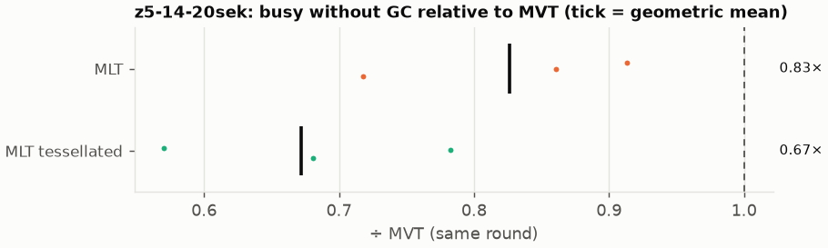
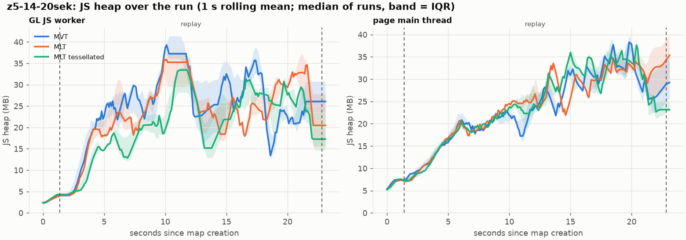
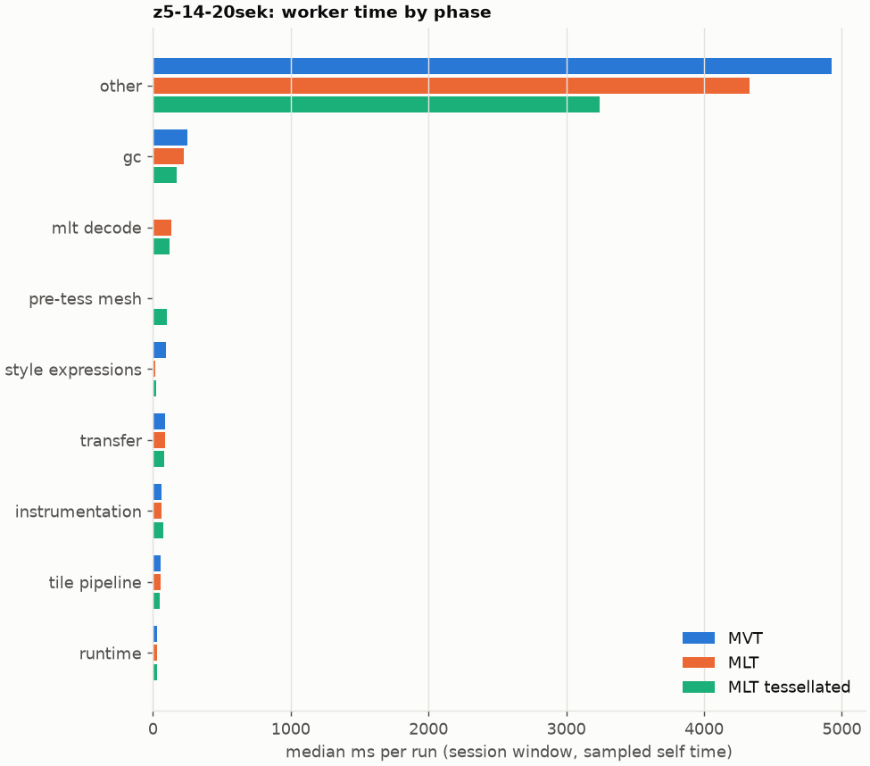
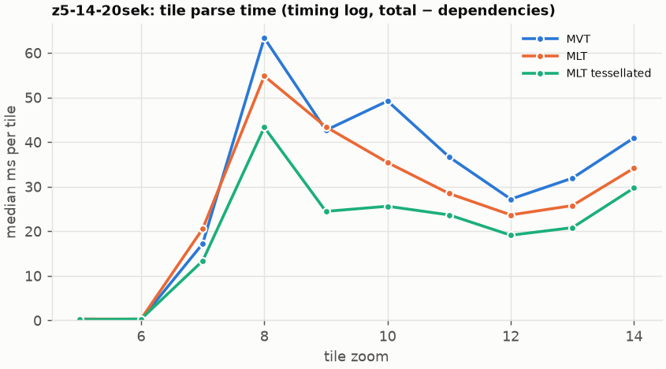
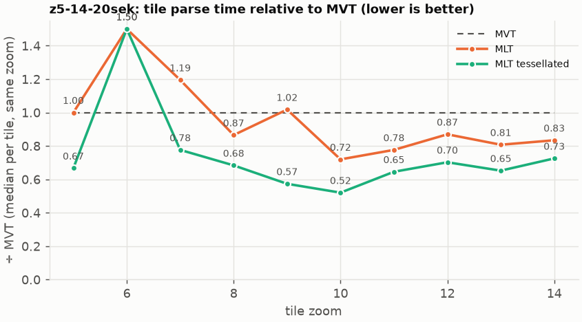

# Session trace benchmark — 20261027-081430

## Setup

- Created 2026-10-27T08:14:30+01:00; 3 repetitions + 1 warm-up round(s) (excluded); variants rotate per round (A B C, B C A, …); one cold browser context per run.
- Machine: 13th Gen Intel(R) Core(TM) i7-1365U, 12 logical cores, 31.3 GB RAM, Windows-11-10.0.26200-SP0; power: GUID des Energieschemas: 381b4222-f694-41f0-9685-ff5bb260df2e  (Ausbalanciert), AC True.
- GL JS gl7-performance-optimization @ ef8500dcf4 (dirty); worker count 1; viewport {'width': 1280, 'height': 1024}.
- Python 3.12.2, packages {'playwright': '1.64.0', 'numpy': '2.5.3', 'matplotlib': '3.11.2'}.

| variant | bundle | format | bundle sha256 | branch build |
|---|---|---|---|---|
| MVT | `dist/maplibre-gl-dev.mjs` | mvt | `b2691453151d` | – |
| MLT | `dist/maplibre-gl-dev.mjs` | mlt | `b2691453151d` | – |
| MLT tessellated | `dist/maplibre-gl-dev.mjs` | mlt-pre-tess | `b2691453151d` | – |

| session | style | duration | frames | sha256 |
|---|---|---:|---:|---|
| z5-14-20sek | maptiler-basic | 21.4 s | 829 | `5a376e5ede30` |

CPU sampling interval (median over runs): 610 µs.

## Definitions

- **busy** = wall time in which a GL JS worker thread runs a task (union of top-level task slices and GC slices on `DedicatedWorker thread`s), summed over workers. **GC** = union of `MinorGC`/`MajorGC`/`V8.GC*` slices on those threads. **busy without GC** = busy − GC (headline metric).
- **CPU** = thread time (`tdur`) of the same slices. Phase categories and functions come from the trace's CPU samples (self time), categorised by `config/categories.toml` (nearest matching frame, leaf to root).
- Windows: **load** = map creation → first idle; **session** = camera replay; **tail** = end of replay → idle; **total** = load + session + tail.
- Ratios are against **MVT**: ratio of medians with a bootstrap 95 % CI, the geometric mean of per-round ratios, and a two-sided Mann–Whitney U p-value (normal approximation, not corrected for multiple comparisons; rough below n = 8). Lower than 1× means less worker time.

## Session `z5-14-20sek`

### Worker busy without GC (session window)

| variant | n ok / failed | median ms | IQR | mean | ratio vs MVT | 95 % CI | geo-mean paired | MWU p |
|---|---:|---:|---:|---:|---:|---:|---:|---:|
| MVT | 3 / 0 | 6,297 | 5,961–6,796 | 6,406 | 1.00× | – | – | – |
| MLT | 3 / 0 | 5,237 | 5,186–5,329 | 5,264 | 0.83× | 0.70–0.96× | 0.83× | 0.081 |
| MLT tessellated | 3 / 0 | 4,286 | 4,221–4,344 | 4,282 | 0.68× | 0.57–0.78× | 0.67× | 0.081 |

### All worker metrics (median, ratio vs baseline)

| metric | MVT | MLT | MLT tessellated |
|---|---:|---:|---:|
| busy incl. GC | 6,518 | 5,445 (0.84×) | 4,424 (0.68×) |
| &nbsp;&nbsp;of which GC | 223.3 | 199.4 (0.89×) | 138.8 (0.62×) |
| &nbsp;&nbsp;of which busy without GC | 6,297 | 5,237 (0.83×) | 4,286 (0.68×) |
| &nbsp;&nbsp;&nbsp;&nbsp;of which filtering (sampled, incl. callees) | 0.0 | 0.0 | 0.0 |
| &nbsp;&nbsp;&nbsp;&nbsp;of which column decoding inside the MLT filter (sampled) | 0.0 | 0.0 | 0.0 |
| &nbsp;&nbsp;&nbsp;&nbsp;of which timing instrumentation (sampled) | 65.1 | 62.8 (0.97×) | 73.4 (1.13×) |
| busy without GC and instrumentation | 6,085 | 5,174 (0.85×) | 4,100 (0.67×) |
| CPU time without GC | 5,687 | 4,601 (0.81×) | 3,899 (0.69×) |
| tile: download end → sent to main thread, median per tile | 310.3 | 234.0 (0.75×) | 190.1 (0.61×) |
| tile: download end → sent to main thread, 90th percentile | 606.0 | 499.5 (0.82×) | 378.4 (0.62×) |
| tile: download end → sent to main thread, 95th percentile | 684.2 | 514.9 (0.75×) | 438.9 (0.64×) |
| tile: download end → sent to main thread, 99th percentile | 744.5 | 546.1 (0.73×) | 490.4 (0.66×) |
| &nbsp;&nbsp;parse part (timing log, incl. waiting for glyphs/icons), median per tile | 149.3 | 106.8 (0.71×) | 95.6 (0.64×) |
| &nbsp;&nbsp;queue + hand-off part, median per tile | 117.5 | 94.5 (0.80×) | 94.0 (0.80×) |
| minor GCs | 58.00 | 49.00 (0.84×) | 33.00 (0.57×) |
| major GCs | 4.00 | 5.00 (1.25×) | 5.00 (1.25×) |
| peak worker heap (MB) | 51.9 | 46.8 (0.90×) | 42.7 (0.82×) |
| load: busy without GC | 319.8 | 377.2 (1.18×) | 371.5 (1.16×) |
| load: GC | 8.2 | 9.5 (1.16×) | 10.5 (1.28×) |
| total: busy without GC | 6,617 | 5,599 (0.85×) | 4,649 (0.70×) |

Rows marked *of which* are parts of the row above, not additional time. Tile rows are per-tile latencies (medians over tiles, then over runs), not sums: tiles overlap in time, and the medians of the parse and queue parts do not add up exactly to the median latency.

### Filtering (session window)

Sampled worker time spent in feature filtering, including everything the filter calls (expression evaluation, property access): **row filter** = the style-spec feature filter that MVT runs per feature, **mlt filter** = the columnar MLT filter (incl. the geometry-type selection), without the columns it decodes (see the next table). Medians per run; rules in `config/categories.toml`.

| variant | mlt filter | row filter | filtering | ratio vs MVT | 95 % CI | MWU p | share of sampled busy |
|---|---:|---:|---:|---:|---:|---:|---:|
| MVT | 0.0 | 0.0 | 0.0 | 1.00× | – | – | 0.0% |
| MLT | 0.0 | 0.0 | 0.0 | – | 0.00–0.71× | 1.000 | 0.0% |
| MLT tessellated | 0.0 | 0.0 | 0.0 | – | 0.00–0.68× | 1.000 | 0.0% |

**Filtering together with tile decoding.** The MLT decoder leaves columns encoded until something reads them, and the filter is usually the first reader: the columns it decodes (properties, and the geometry for `$type`) are **of which inside the filter** (phase *mlt filter decode*), the rest is *mlt decode* (geometry and columns read later, e.g. by paint properties and symbols). MVT decodes every feature's properties and geometry while it reads the tile (*mvt decode*), whether the filter keeps the feature or not. So **filtering** above compares the filters, and **decoding + filtering** compares all that the formats spend on decoding the tile and selecting features. **tile decoding** = *mvt decode* or *mlt decode* + *mlt filter decode*: work inside a call into a decoder. Reading data that is already decoded is not counted, as for MVT's feature objects: *mlt access* (row views, value getters, looking a column up by name) and the MLT facade (*mlt facade*). MVT decodes geometry only for the features its filter keeps, MLT decodes a layer's whole geometry column.

| variant | tile decoding | of which inside the filter | filtering | decoding + filtering | ratio vs MVT | 95 % CI | MWU p |
|---|---:|---:|---:|---:|---:|---:|---:|
| MVT | 0.0 | 0.0 | 0.0 | 0.0 | 1.00× | – | – |
| MLT | 135.3 | 0.0 | 0.0 | 135.3 | – | 0.16–0.82× | 0.658 |
| MLT tessellated | 123.6 | 0.0 | 0.0 | 123.6 | – | 0.15–0.88× | 0.658 |

Top 12 functions inside filtering and its column decoding (self time, mean ms per run):

| phase | function | source | MVT | MLT | MLT tessellated |
|---|---|---|---:|---:|---:|
| row filter | `evaluate` | node_modules/@maplibre/maplibre-gl-style-spec/dist/expression/compound_expression.mjs | 16.5 | 0.0 | 0.0 |
| row filter | `evaluate` | node_modules/@maplibre/maplibre-gl-style-spec/dist/expression/index.mjs | 14.2 | 0.0 | 0.0 |
| row filter | `CompoundExpression.register.filter-in-small` | node_modules/@maplibre/maplibre-gl-style-spec/dist/expression/compound_expression.mjs | 10.7 | 0.0 | 0.0 |
| mlt filter | `filterByGeometryType` | maplibre-tile-spec/ts/dist/vector/geometry/geometryVector.js | 0.0 | 6.4 | 7.8 |
| mlt filter decode | `unpackNullable` | maplibre-tile-spec/ts/dist/decoding/unpackNullableUtils.js | 0.0 | 7.7 | 7.1 |
| row filter | `CompoundExpression.register.filter-==` | node_modules/@maplibre/maplibre-gl-style-spec/dist/expression/compound_expression.mjs | 6.0 | 0.0 | 0.0 |
| mlt filter | `scanDictionaryCodes` | maplibre-tile-spec/ts/dist/processing/filter/execution/filterKernel.js | 0.0 | 5.4 | 3.0 |
| mlt filter decode | `decodeFsst` | maplibre-tile-spec/ts/dist/decoding/fsstDecoder.js | 0.0 | 4.2 | 4.0 |
| row filter | `filter` | node_modules/@maplibre/maplibre-gl-style-spec/dist/feature_filter/index.mjs | 3.8 | 0.0 | 0.0 |
| mlt filter decode | `decodeFastPforInt32` | maplibre-tile-spec/ts/dist/decoding/fastPforDecoder.js | 0.0 | 2.7 | 1.8 |
| mlt filter | `dictionaryRowMatches` | maplibre-tile-spec/ts/dist/processing/filter/execution/filterKernel.js | 0.0 | 2.6 | 2.3 |
| mlt filter | `resolveDictionaryExecutor` | maplibre-tile-spec/ts/dist/processing/filter/execution/filterKernel.js | 0.0 | 2.5 | 2.5 |

### Where the variants differ from MVT (session window, mean ms per run)

Open **[flame.html](flame.html)** to explore the call tree interactively: pick a variant, compare it with MVT (red = more time at the same call path, blue = less), click a frame to zoom in, and read the phase and function breakdown under it. Without a comparison, frames are coloured by phase: filtering is green in both formats, and the columns the MLT filter decodes on first access (*mlt filter decode*) are MLT blue frames under the green filter. `flame/*.txt` open in https://www.speedscope.app.

#### MLT vs MVT

**By phase** (sampled self time; the Δ column sums to the difference in sampled busy time):

| phase | MVT | MLT | Δ |
|---|---:|---:|---:|
| mlt decode | 0.0 | 212.9 | +212.9 |
| bucket columnar | 0.0 | 207.9 | +207.9 |
| mlt filter | 0.0 | 44.8 | +44.8 |
| mlt filter decode | 0.0 | 35.5 | +35.5 |
| mlt access | 0.0 | 23.5 | +23.5 |
| mlt facade | 0.0 | 20.5 | +20.5 |
| instrumentation | 111.5 | 114.0 | +2.5 |
| tile pipeline | 134.9 | 137.1 | +2.2 |
| runtime | 39.0 | 29.5 | -9.5 |
| transfer | 195.0 | 182.1 | -12.9 |
| symbol layout | 322.7 | 304.1 | -18.6 |
| gc | 248.1 | 223.4 | -24.8 |
| feature index | 67.1 | 38.9 | -28.2 |
| style expressions | 126.3 | 87.9 | -38.4 |
| row filter | 63.2 | 0.0 | -63.2 |
| earcut | 293.1 | 226.5 | -66.6 |
| mvt decode | 191.7 | 0.0 | -191.7 |
| bucket row | 576.7 | 224.1 | -352.7 |
| other | 3,802 | 2,906 | -896.2 |

**By source layer** (timing log: createBucket + populate + addFeatures, summed over the style layers that use it; wall time, includes GC pauses; total Δ -1025 ms):

| source layer | type | MVT | MLT | Δ |
|---|---|---:|---:|---:|
| place | symbol | 553.8 | 632.1 | +78.3 |
| poi | symbol | 53.8 | 92.9 | +39.1 |
| transportation_name | symbol | 212.6 | 244.5 | +31.9 |
| waterway | line | 88.8 | 110.2 | +21.4 |
| boundary | line | 71.2 | 86.2 | +15.0 |
| aeroway | fill | 2.2 | 6.4 | +4.2 |
| transportation | fill | 31.9 | 24.8 | -7.1 |
| water | fill | 128.5 | 108.5 | -20.0 |
| transportation | line | 1,149 | 1,043 | -106.4 |
| building | fill | 611.0 | 327.6 | -283.5 |
| landuse | fill | 814.1 | 488.2 | -325.9 |
| landcover | fill | 1,201 | 725.0 | -476.1 |

**Functions with the largest self-time difference** (by function name, summed over source files):

| function | MVT | MLT | Δ |
|---|---:|---:|---:|
| `writeEarcutFill` | 0.0 | 68.3 | +68.3 |
| `buildEarcutMesh` | 0.0 | 61.9 | +61.9 |
| `buildRingBoundingBoxes` | 0.0 | 49.1 | +49.1 |
| `decodeComponentwiseDeltaVec2` | 0.0 | 48.1 | +48.1 |
| `readScaledRings` | 0.0 | 33.6 | +33.6 |
| `unpackNullable` | 0.0 | 32.3 | +32.3 |
| `decodeString$2` | 0.0 | 23.7 | +23.7 |
| `emplace` | 139.6 | 162.5 | +22.9 |
| `decodeFastPforInt32` | 0.0 | 22.1 | +22.1 |
| `get` | 26.2 | 47.0 | +20.8 |
| `filterByGeometryType` | 0.0 | 20.0 | +20.0 |
| `materializeSelectedFeatures` | 0.0 | 19.9 | +19.9 |
| `readSVarint` | 403.6 | 0.0 | -403.6 |
| `loadGeometry` | 367.3 | 23.8 | -343.6 |
| `_vertexToIndex` | 318.7 | 0.0 | -318.7 |
| `readVarint` | 112.3 | 5.9 | -106.4 |
| `evaluate` | 96.4 | 14.6 | -81.8 |

#### MLT tessellated vs MVT

**By phase** (sampled self time; the Δ column sums to the difference in sampled busy time):

| phase | MVT | MLT tessellated | Δ |
|---|---:|---:|---:|
| mlt decode | 0.0 | 229.7 | +229.7 |
| bucket columnar | 0.0 | 95.4 | +95.4 |
| pre-tess mesh | 0.0 | 93.5 | +93.5 |
| mlt filter | 0.0 | 43.3 | +43.3 |
| mlt filter decode | 0.0 | 30.5 | +30.5 |
| mlt facade | 0.0 | 23.1 | +23.1 |
| mlt access | 0.0 | 19.0 | +19.0 |
| instrumentation | 111.5 | 116.2 | +4.6 |
| runtime | 39.0 | 32.0 | -7.0 |
| tile pipeline | 134.9 | 125.6 | -9.3 |
| transfer | 195.0 | 165.5 | -29.5 |
| symbol layout | 322.7 | 292.6 | -30.0 |
| feature index | 67.1 | 32.5 | -34.6 |
| style expressions | 126.3 | 77.8 | -48.5 |
| row filter | 63.2 | 0.0 | -63.2 |
| gc | 248.1 | 182.1 | -66.0 |
| mvt decode | 191.7 | 0.0 | -191.7 |
| earcut | 293.1 | 2.0 | -291.1 |
| bucket row | 576.7 | 216.0 | -360.7 |
| other | 3,802 | 2,226 | -1575.9 |

**By source layer** (timing log: createBucket + populate + addFeatures, summed over the style layers that use it; wall time, includes GC pauses; total Δ -1989 ms):

| source layer | type | MVT | MLT tessellated | Δ |
|---|---|---:|---:|---:|
| place | symbol | 553.8 | 614.7 | +60.9 |
| poi | symbol | 53.8 | 91.5 | +37.7 |
| transportation_name | symbol | 212.6 | 232.6 | +20.0 |
| waterway | line | 88.8 | 100.9 | +12.1 |
| boundary | line | 71.2 | 81.5 | +10.4 |
| aeroway | fill | 2.2 | 6.6 | +4.4 |
| transportation | fill | 31.9 | 36.1 | +4.3 |
| water | fill | 128.5 | 66.6 | -61.9 |
| transportation | line | 1,149 | 1,041 | -108.2 |
| building | fill | 611.0 | 121.0 | -490.1 |
| landuse | fill | 814.1 | 224.0 | -590.0 |
| landcover | fill | 1,201 | 310.3 | -890.7 |

**Functions with the largest self-time difference** (by function name, summed over source files):

| function | MVT | MLT tessellated | Δ |
|---|---:|---:|---:|
| `buildTessellatedBoundingBox` | 0.0 | 68.9 | +68.9 |
| `writeTessellatedFill` | 0.0 | 62.5 | +62.5 |
| `decodeUnsignedZigZagDeltaInt32` | 0.0 | 44.4 | +44.4 |
| `decodeComponentwiseDeltaVec2` | 0.0 | 40.6 | +40.6 |
| `unpackNullable` | 0.0 | 32.9 | +32.9 |
| `scaleCoordinate` | 0.0 | 27.1 | +27.1 |
| `decodeFastPforInt32` | 0.0 | 25.5 | +25.5 |
| `decodeBigEndianInt32sInto` | 0.0 | 23.2 | +23.2 |
| `fastUnpack256_4` | 0.0 | 21.9 | +21.9 |
| `decodeString$2` | 0.0 | 20.7 | +20.7 |
| `get` | 26.2 | 45.2 | +19.0 |
| `filterByGeometryType` | 0.0 | 19.0 | +19.0 |
| `readSVarint` | 403.6 | 0.0 | -403.6 |
| `loadGeometry` | 367.3 | 22.0 | -345.3 |
| `_vertexToIndex` | 318.7 | 0.0 | -318.7 |
| `isEar` | 250.6 | 0.7 | -249.9 |
| `isEarHashed` | 170.9 | 0.0 | -170.9 |

### Memory (session window)

**JS heap** = V8's used heap of the thread (`jsHeapSizeUsed` from the trace's `UpdateCounters`, about every 20 ms; the mean is time-weighted). It does not include ArrayBuffer contents, so the tile data itself (vertex, index and feature-index arrays) is not in it: **tile data sent to the main thread** is the size of the ArrayBuffers each tile result transfers (`web/worker_hook.js`), which then live on the main thread and are uploaded to the GPU. **garbage collected** = heap freed by the worker's GCs, a measure of how much it allocates. Medians per run; ratio of medians with a bootstrap 95 % CI.

| metric | MVT | MLT | MLT tessellated |
|---|---:|---:|---:|
| worker JS heap, mean (MB) | 21.6 | 19.1 (0.89×, 0.75–1.40×) | 17.5 (0.81×, 0.71–1.38×) |
| worker JS heap, peak (MB) | 51.9 | 46.8 (0.90×, 0.81–0.99×) | 42.7 (0.82×, 0.72–0.91×) |
| worker JS heap after the last GC (MB) | 12.9 | 15.7 (1.21×, 0.68–1.66×) | 10.3 (0.80×, 0.78–1.22×) |
| garbage collected in the worker (MB) | 1,283 | 797.5 (0.62×, 0.59–0.71×) | 419.9 (0.33×, 0.31–0.38×) |
| main thread JS heap, mean (MB) | 21.7 | 21.8 (1.00×, 0.91–1.16×) | 22.4 (1.03×, 0.90–1.15×) |
| main thread JS heap, peak (MB) | 46.6 | 43.3 (0.93×, 0.84–1.12×) | 45.9 (0.99×, 0.84–1.21×) |
| main thread JS heap at the end of the replay (MB) | 26.0 | 33.1 (1.27×, 0.55–2.14×) | 23.5 (0.90×, 0.52–1.39×) |
| tile data sent to the main thread, total (MB) | 75.1 | 67.7 (0.90×, 0.86–0.95×) | 69.1 (0.92×, 0.85–0.95×) |
| tile data sent to the main thread, median per tile (KB) | 497.8 | 472.9 (0.95×, 0.91–1.03×) | 482.8 (0.97×, 0.94–0.98×) |

### Worker time by phase (session window, median ms of sampled self time)

| phase | MVT | MLT | MLT tessellated |
|---|---:|---:|---:|
| other | 4,923 | 4,333 | 3,245 |
| gc | 249.7 | 225.1 | 170.5 |
| mlt decode | 0.0 | 135.3 | 123.6 |
| pre-tess mesh | 0.0 | 0.0 | 102.6 |
| style expressions | 93.2 | 18.8 | 23.8 |
| transfer | 89.0 | 89.3 | 83.9 |
| instrumentation | 65.1 | 62.8 | 73.4 |
| tile pipeline | 57.7 | 53.0 | 52.5 |
| runtime | 30.8 | 31.6 | 32.3 |
| row filter | 0.0 | 0.0 | 0.0 |
| mlt filter | 0.0 | 0.0 | 0.0 |
| mlt filter decode | 0.0 | 0.0 | 0.0 |
| earcut | 0.0 | 0.0 | 0.0 |
| mlt access | 0.0 | 0.0 | 0.0 |
| mlt facade | 0.0 | 0.0 | 0.0 |
| mvt decode | 0.0 | 0.0 | 0.0 |
| symbol layout | 0.0 | 0.0 | 0.0 |
| feature index | 0.0 | 0.0 | 0.0 |
| bucket columnar | 0.0 | 0.0 | 0.0 |
| bucket row | 0.0 | 0.0 | 0.0 |

### Top 20 worker functions by self time (session window, mean ms per run)

| function | source | phase | MVT | MLT | MLT tessellated |
|---|---|---|---:|---:|---:|
| `readSVarint` | maplibre-gl-worker-dev.mjs?v=6.16.0 | other | 324.9 | 0.0 | 0.0 |
| `loadGeometry` | maplibre-gl-worker-dev.mjs?v=6.16.0 | other | 317.6 | 17.5 | 13.4 |
| `(garbage collector)` | (native) | gc | 248.1 | 223.4 | 182.1 |
| `_vertexToIndex` | maplibre-gl-worker-dev.mjs?v=6.16.0 | other | 217.5 | 0.0 | 0.0 |
| `isEar` | maplibre-gl-worker-dev.mjs?v=6.16.0 | other | 159.8 | 117.5 | 0.2 |
| `reserve` | maplibre-gl-worker-dev.mjs?v=6.16.0 | other | 153.2 | 156.6 | 154.1 |
| `isEarHashed` | maplibre-gl-worker-dev.mjs?v=6.16.0 | other | 112.2 | 72.0 | 0.0 |
| `emplace` | maplibre-gl-worker-dev.mjs?v=6.16.0 | other | 97.3 | 108.0 | 96.1 |
| `_vertexToIndex` | src/render/subdivision.ts | bucket row | 101.2 | 0.0 | 0.0 |
| `fetch` | (native) | other | 92.9 | 100.1 | 92.5 |
| `postMessage` | (native) | transfer | 92.5 | 93.3 | 88.2 |
| `isEar` | node_modules/earcut/src/earcut.js | earcut | 90.9 | 51.9 | 0.5 |
| `populate` | maplibre-gl-worker-dev.mjs?v=6.16.0 | other | 86.2 | 50.9 | 57.3 |
| `readVarint` | maplibre-gl-worker-dev.mjs?v=6.16.0 | other | 83.3 | 3.6 | 2.9 |
| `reserve` | src/util/struct_array.ts | bucket row | 83.0 | 64.1 | 60.3 |
| `addHalfVertex` | maplibre-gl-worker-dev.mjs?v=6.16.0 | other | 81.7 | 75.0 | 60.4 |
| `readSVarint` | node_modules/pbf/index.js | mvt decode | 78.7 | 0.0 | 0.0 |
| `serialize` | maplibre-gl-worker-dev.mjs?v=6.16.0 | other | 67.0 | 67.9 | 68.1 |
| `addLine` | maplibre-gl-worker-dev.mjs?v=6.16.0 | other | 63.7 | 67.1 | 65.8 |
| `addCurrentVertex` | maplibre-gl-worker-dev.mjs?v=6.16.0 | other | 65.9 | 49.9 | 48.6 |

### Top 20 worker functions by total time (incl. callees) (session window, mean ms per run)

| function | source | phase | MVT | MLT | MLT tessellated |
|---|---|---|---:|---:|---:|
| `parse` | maplibre-gl-worker-dev.mjs?v=6.16.0 | other | 3,447 | 2,644 | 2,064 |
| `loadTile` | maplibre-gl-worker-dev.mjs?v=6.16.0 | other | 3,252 | 2,393 | 1,807 |
| `_parseWorkerTile` | maplibre-gl-worker-dev.mjs?v=6.16.0 | other | 3,134 | 2,308 | 1,739 |
| `populate` | maplibre-gl-worker-dev.mjs?v=6.16.0 | other | 2,752 | 1,937 | 1,381 |
| `addFeature` | maplibre-gl-worker-dev.mjs?v=6.16.0 | other | 1,692 | 1,279 | 638.0 |
| `parse` | src/source/worker_tile.ts | tile pipeline | 1,665 | 1,432 | 1,075 |
| `loadTile` | src/source/vector_tile_worker_source.ts | tile pipeline | 1,427 | 1,180 | 841.6 |
| `_parseWorkerTile` | src/source/vector_tile_worker_source.ts | tile pipeline | 1,366 | 1,144 | 806.9 |
| `addBucketFeatures` | maplibre-gl-worker-dev.mjs?v=6.16.0 | other | 1,258 | 817.0 | 175.0 |
| `subdividePolygon` | maplibre-gl-worker-dev.mjs?v=6.16.0 | other | 991.4 | 0.0 | 0.0 |
| `subdividePolygonInternal` | maplibre-gl-worker-dev.mjs?v=6.16.0 | other | 969.5 | 0.0 | 0.0 |
| `writeEarcutFill` | maplibre-gl-worker-dev.mjs?v=6.16.0 | other | 0.0 | 782.5 | 7.3 |
| `populate` | src/data/bucket/fill_bucket.ts | bucket row | 758.6 | 0.0 | 0.0 |
| `loadGeometry` | maplibre-gl-worker-dev.mjs?v=6.16.0 | other | 740.2 | 44.8 | 43.4 |
| `addBucketFeatures` | src/data/bucket/fill_bucket.ts | bucket row | 623.8 | 383.7 | 51.4 |
| `addFeature` | src/data/bucket/fill_bucket.ts | bucket row | 587.9 | 0.0 | 0.0 |
| `earcut` | maplibre-gl-worker-dev.mjs?v=6.16.0 | other | 573.8 | 471.3 | 3.3 |
| `buildEarcutMesh` | maplibre-gl-worker-dev.mjs?v=6.16.0 | other | 0.0 | 533.9 | 4.4 |
| `subdividePolygon` | src/render/subdivision.ts | bucket row | 491.8 | 0.0 | 0.0 |
| `populate` | src/data/bucket/columnar/columnar_fill_bucket.ts | bucket columnar | 0.0 | 491.4 | 191.7 |

### Tile parse time by zoom (timing log, median ms per tile, total − dependencies)

| zoom | MVT | MLT | MLT tessellated |
|---:|---:|---:|---:|
| 5 | 0.30 (n=27) | 0.30 (n=27) | 0.20 (n=27) |
| 6 | 0.20 (n=27) | 0.30 (n=27) | 0.30 (n=27) |
| 7 | 17.20 (n=18) | 20.55 (n=18) | 13.35 (n=18) |
| 8 | 63.35 (n=12) | 54.80 (n=12) | 43.30 (n=12) |
| 9 | 42.65 (n=48) | 43.40 (n=40) | 24.45 (n=48) |
| 10 | 49.20 (n=60) | 35.40 (n=57) | 25.60 (n=52) |
| 11 | 36.65 (n=44) | 28.45 (n=38) | 23.65 (n=38) |
| 12 | 27.20 (n=69) | 23.65 (n=68) | 19.10 (n=69) |
| 13 | 31.90 (n=73) | 25.75 (n=68) | 20.80 (n=62) |
| 14 | 40.95 (n=54) | 34.15 (n=54) | 29.70 (n=54) |

### Tile latency by zoom: download end → result sent to the main thread (session window, ms per tile: median / p95 / p99)

Includes waiting in the worker's queue, the parse and posting the result; see `tile_latency.csv` for the per-tile split (`parse_ms`, `wait_ms`). Percentiles over the tiles of all runs; with few tiles (n) p99 is close to the maximum.

| zoom | MVT | MLT | MLT tessellated |
|---:|---:|---:|---:|
| 6 | 83.0 / 115.8 / 121.8 (n=27) | 76.7 / 120.0 / 137.4 (n=27) | 87.5 / 119.7 / 131.4 (n=27) |
| 7 | 266.1 / 351.5 / 376.6 (n=18) | 187.2 / 481.1 / 481.8 (n=18) | 136.8 / 159.7 / 162.2 (n=18) |
| 8 | 318.1 / 362.1 / 367.5 (n=12) | 291.9 / 326.2 / 339.6 (n=12) | 170.8 / 187.2 / 188.5 (n=12) |
| 9 | 386.0 / 704.5 / 711.8 (n=48) | 264.2 / 515.3 / 519.8 (n=40) | 258.1 / 385.0 / 408.5 (n=48) |
| 10 | 618.7 / 764.1 / 778.3 (n=60) | 462.0 / 633.4 / 645.7 (n=57) | 114.1 / 433.7 / 438.1 (n=52) |
| 11 | 275.2 / 370.4 / 378.2 (n=44) | 211.7 / 287.5 / 296.4 (n=38) | 190.6 / 295.8 / 300.4 (n=38) |
| 12 | 161.3 / 365.5 / 371.9 (n=69) | 141.9 / 304.8 / 306.2 (n=68) | 133.2 / 294.4 / 302.3 (n=69) |
| 13 | 268.2 / 640.6 / 658.3 (n=73) | 231.9 / 458.7 / 472.9 (n=68) | 203.3 / 375.7 / 378.5 (n=62) |
| 14 | 445.8 / 672.9 / 687.0 (n=54) | 283.9 / 534.0 / 551.6 (n=54) | 236.9 / 533.6 / 547.5 (n=54) |

## Runs

12 ok, 0 failed/aborted, 0 not run, 9 used in statistics.

## Validity checks

- Counted once: all 12 analysed runs pass (windows load + session + tail add up to total; phases add up to the sampled busy time; GC and sampled time lie within busy time; no timing-log line twice).
- outlier runs left out of all statistics: busy without GC (session) more than 1.5 × IQR outside the quartiles of its session and variant (groups of at least 4 runs): none
- other programs used 9.78–10.31 logical processors during the replays (median 10.18)
- 9 run(s) with more than 0.5 cores of background load: z5-14-20sek/mlt/rep-01 (10.24), z5-14-20sek/mlt-pre-tess/rep-01 (10.19), z5-14-20sek/mvt/rep-01 (10.03), z5-14-20sek/mlt-pre-tess/rep-02 (10.07), z5-14-20sek/mvt/rep-02 (9.78), z5-14-20sek/mlt/rep-02 (10.18)
- 2 of 4 rounds parsed different tile sets across variants (e.g. z5-14-20sek round 1: mlt 120 tiles, mlt-pre-tess 123 tiles, mvt 126 tiles; z5-14-20sek round 2: mlt-pre-tess 122 tiles, mvt 123 tiles, mlt 114 tiles); no run went past z14, so this is timing: which tiles finish loading before the camera moves on, and which get cancelled; compare per-tile metrics (by zoom) rather than totals when the counts differ a lot

## Files

- `runs.csv`: one row per run (incl. failed and warm-up runs), every scalar metric as `<window>.<metric>`.
- `summary.csv`: session × variant × metric statistics.
- `functions.csv`, `categories.csv`: CPU-sample self/total time per function and phase per run and window.
- `category_functions.csv`: self time per phase × function (e.g. what the filters spend their time on).
- `tiles.csv`, `tile_layers.csv`, `tile_phases.csv`: the per-tile worker timing log, long format.
- `flame.html`: interactive call tree per variant with a diff view; `flame/*.txt`: collapsed stacks for speedscope.
- `analysis/stacks.csv` (per run): sampled self time per full call stack.
- `tile_latency.csv`: per tile request, worker clock: received, download start/end, result sent, latency = sent − download end, parse_ms, wait_ms = latency − parse.
- `runs/<session>/<variant>/rep-NN/trace.json.gz`: the raw trace (opens in the DevTools Performance tab).
