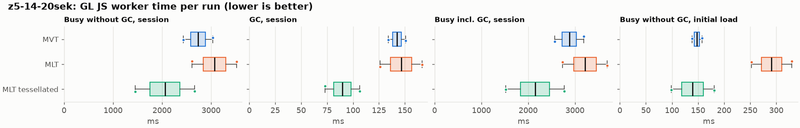
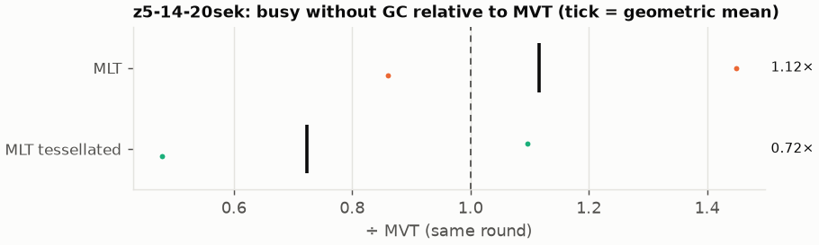
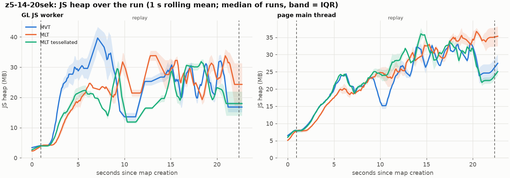
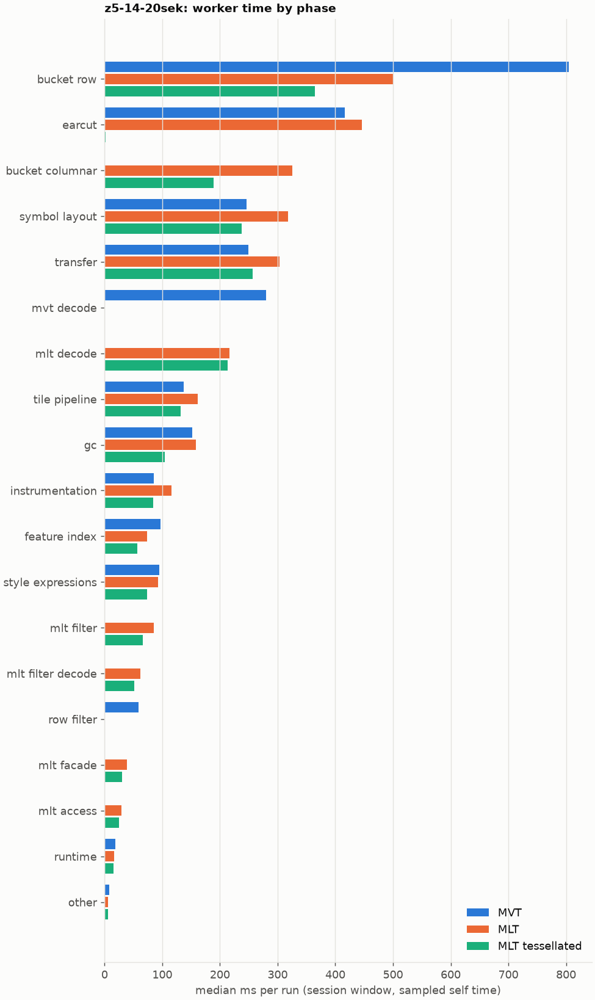
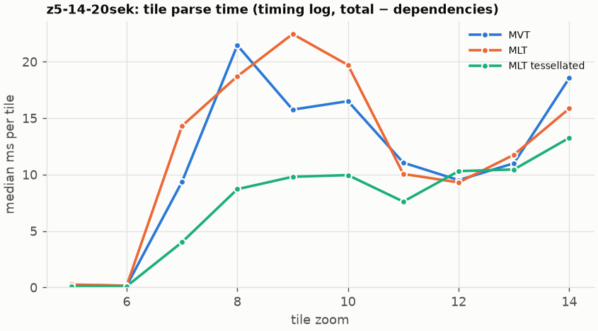
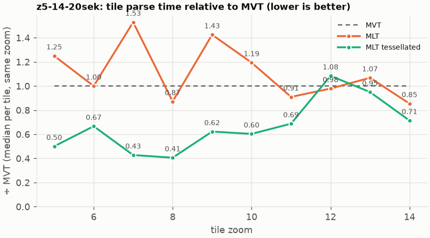

# Session trace benchmark — 20261027-142219

## Setup

- Created 2026-10-27T14:22:19+01:00; 2 repetitions + 1 warm-up round(s) (excluded); variants rotate per round (A B C, B C A, …); one cold browser context per run.
- Machine: 13th Gen Intel(R) Core(TM) i7-1365U, 12 logical cores, 31.3 GB RAM, Windows-11-10.0.26200-SP0; power: GUID des Energieschemas: 381b4222-f694-41f0-9685-ff5bb260df2e  (Ausbalanciert), AC True.
- GL JS gl7-performance-optimization @ db982f206f (dirty); worker count 1; viewport {'width': 1280, 'height': 1024}.
- Python 3.12.2, packages {'playwright': '1.64.0', 'numpy': '2.5.3', 'matplotlib': '3.11.2'}.

| variant | bundle | format | bundle sha256 | branch build |
|---|---|---|---|---|
| MVT | `dist/maplibre-gl-dev.mjs` | mvt | `9778149f31b3` | – |
| MLT | `dist/maplibre-gl-dev.mjs` | mlt | `9778149f31b3` | – |
| MLT tessellated | `dist/maplibre-gl-dev.mjs` | mlt-pre-tess | `9778149f31b3` | – |

| session | style | duration | frames | sha256 |
|---|---|---:|---:|---|
| z5-14-20sek | maptiler-basic | 21.4 s | 829 | `5a376e5ede30` |

CPU sampling interval (median over runs): 580 µs.

## Definitions

- **busy** = wall time in which a GL JS worker thread runs a task (union of top-level task slices and GC slices on `DedicatedWorker thread`s), summed over workers. **GC** = union of `MinorGC`/`MajorGC`/`V8.GC*` slices on those threads. **busy without GC** = busy − GC (headline metric).
- **CPU** = thread time (`tdur`) of the same slices. Phase categories and functions come from the trace's CPU samples (self time), categorised by `config/categories.toml` (nearest matching frame, leaf to root).
- Windows: **load** = map creation → first idle; **session** = camera replay; **tail** = end of replay → idle; **total** = load + session + tail.
- Ratios are against **MVT**: ratio of medians with a bootstrap 95 % CI, the geometric mean of per-round ratios, and a two-sided Mann–Whitney U p-value (normal approximation, not corrected for multiple comparisons; rough below n = 8). Lower than 1× means less worker time.

## Session `z5-14-20sek`

### Worker busy without GC (session window)

| variant | n ok / failed | median ms | IQR | mean | ratio vs MVT | 95 % CI | geo-mean paired | MWU p |
|---|---:|---:|---:|---:|---:|---:|---:|---:|
| MVT | 2 / 0 | 2,737 | 2,586–2,889 | 2,737 | 1.00× | – | – | – |
| MLT | 2 / 0 | 3,070 | 2,842–3,298 | 3,070 | 1.12× | 0.86–1.45× | 1.12× | 0.699 |
| MLT tessellated | 2 / 0 | 2,060 | 1,756–2,364 | 2,060 | 0.75× | 0.48–1.10× | 0.72× | 0.699 |

### All worker metrics (median, ratio vs baseline)

| metric | MVT | MLT | MLT tessellated |
|---|---:|---:|---:|
| busy incl. GC | 2,879 | 3,216 (1.12×) | 2,150 (0.75×) |
| &nbsp;&nbsp;of which GC | 142.3 | 146.4 (1.03×) | 89.8 (0.63×) |
| &nbsp;&nbsp;of which busy without GC | 2,737 | 3,070 (1.12×) | 2,060 (0.75×) |
| &nbsp;&nbsp;&nbsp;&nbsp;of which filtering (sampled, incl. callees) | 59.3 | 85.6 (1.44×) | 66.1 (1.11×) |
| &nbsp;&nbsp;&nbsp;&nbsp;of which column decoding inside the MLT filter (sampled) | 0.0 | 62.4 | 51.7 |
| &nbsp;&nbsp;&nbsp;&nbsp;of which timing instrumentation (sampled) | 85.1 | 116.1 (1.36×) | 84.0 (0.99×) |
| busy without GC and instrumentation | 2,652 | 2,954 (1.11×) | 1,976 (0.75×) |
| CPU time without GC | 2,507 | 2,815 (1.12×) | 1,874 (0.75×) |
| tile: download end → sent to main thread, median per tile | 113.2 | 112.2 (0.99×) | 90.5 (0.80×) |
| tile: download end → sent to main thread, 90th percentile | 279.7 | 355.1 (1.27×) | 207.4 (0.74×) |
| tile: download end → sent to main thread, 95th percentile | 334.0 | 412.8 (1.24×) | 221.5 (0.66×) |
| tile: download end → sent to main thread, 99th percentile | 346.1 | 431.6 (1.25×) | 235.4 (0.68×) |
| &nbsp;&nbsp;parse part (timing log, incl. waiting for glyphs/icons), median per tile | 58.3 | 60.5 (1.04×) | 41.9 (0.72×) |
| &nbsp;&nbsp;queue + hand-off part, median per tile | 55.9 | 50.5 (0.90×) | 43.5 (0.78×) |
| minor GCs | 57.00 | 50.50 (0.89×) | 31.00 (0.54×) |
| major GCs | 4.50 | 5.50 (1.22×) | 5.00 (1.11×) |
| peak worker heap (MB) | 55.9 | 47.8 (0.85×) | 41.7 (0.75×) |
| load: busy without GC | 147.9 | 291.1 (1.97×) | 139.7 (0.94×) |
| load: GC | 4.7 | 8.2 (1.75×) | 4.5 (0.97×) |
| total: busy without GC | 2,885 | 3,361 (1.16×) | 2,200 (0.76×) |

Rows marked *of which* are parts of the row above, not additional time. Tile rows are per-tile latencies (medians over tiles, then over runs), not sums: tiles overlap in time, and the medians of the parse and queue parts do not add up exactly to the median latency.

### Filtering (session window)

Sampled worker time spent in feature filtering, including everything the filter calls (expression evaluation, property access): **row filter** = the style-spec feature filter that MVT runs per feature, **mlt filter** = the columnar MLT filter (incl. the geometry-type selection), without the columns it decodes (see the next table). Medians per run; rules in `config/categories.toml`.

| variant | mlt filter | row filter | filtering | ratio vs MVT | 95 % CI | MWU p | share of sampled busy |
|---|---:|---:|---:|---:|---:|---:|---:|
| MVT | 0.0 | 59.3 | 59.3 | 1.00× | – | – | 2.2% |
| MLT | 85.6 | 0.0 | 85.6 | 1.44× | 0.85–2.36× | 0.699 | 2.8% |
| MLT tessellated | 66.1 | 0.0 | 66.1 | 1.11× | 0.60–1.91× | 1.000 | 3.4% |

**Filtering together with tile decoding.** The MLT decoder leaves columns encoded until something reads them, and the filter is usually the first reader: the columns it decodes (properties, and the geometry for `$type`) are **of which inside the filter** (phase *mlt filter decode*), the rest is *mlt decode* (geometry and columns read later, e.g. by paint properties and symbols). MVT decodes every feature's properties and geometry while it reads the tile (*mvt decode*), whether the filter keeps the feature or not. So **filtering** above compares the filters, and **decoding + filtering** compares all that the formats spend on decoding the tile and selecting features. **tile decoding** = *mvt decode* or *mlt decode* + *mlt filter decode*: work inside a call into a decoder. Reading data that is already decoded is not counted, as for MVT's feature objects: *mlt access* (row views, value getters, looking a column up by name) and the MLT facade (*mlt facade*). MVT decodes geometry only for the features its filter keeps, MLT decodes a layer's whole geometry column.

| variant | tile decoding | of which inside the filter | filtering | decoding + filtering | ratio vs MVT | 95 % CI | MWU p |
|---|---:|---:|---:|---:|---:|---:|---:|
| MVT | 279.6 | 0.0 | 59.3 | 339.0 | 1.00× | – | – |
| MLT | 279.1 | 62.4 | 85.6 | 364.7 | 1.08× | 0.76–1.47× | 1.000 |
| MLT tessellated | 265.3 | 51.7 | 66.1 | 331.4 | 0.98× | 0.60–1.45× | 1.000 |

Top 12 functions inside filtering and its column decoding (self time, mean ms per run):

| phase | function | source | MVT | MLT | MLT tessellated |
|---|---|---|---:|---:|---:|
| mlt filter decode | `unpackNullable` | maplibre-tile-spec/ts/dist/decoding/unpackNullableUtils.js | 0.0 | 15.9 | 11.6 |
| row filter | `evaluate` | node_modules/@maplibre/maplibre-gl-style-spec/dist/expression/compound_expression.mjs | 15.5 | 0.0 | 0.0 |
| mlt filter | `filterByGeometryType` | maplibre-tile-spec/ts/dist/vector/geometry/geometryVector.js | 0.0 | 11.7 | 8.8 |
| row filter | `evaluate` | node_modules/@maplibre/maplibre-gl-style-spec/dist/expression/index.mjs | 11.3 | 0.0 | 0.0 |
| row filter | `CompoundExpression.register.filter-==` | node_modules/@maplibre/maplibre-gl-style-spec/dist/expression/compound_expression.mjs | 8.7 | 0.0 | 0.0 |
| mlt filter | `dictionaryRowMatches` | maplibre-tile-spec/ts/dist/processing/filter/execution/filterKernel.js | 0.0 | 8.4 | 5.1 |
| mlt filter | `scanDictionaryCodes` | maplibre-tile-spec/ts/dist/processing/filter/execution/filterKernel.js | 0.0 | 6.6 | 7.6 |
| mlt filter decode | `decodeFsst` | maplibre-tile-spec/ts/dist/decoding/fsstDecoder.js | 0.0 | 6.3 | 6.6 |
| mlt filter | `resolveDictionaryExecutor` | maplibre-tile-spec/ts/dist/processing/filter/execution/filterKernel.js | 0.0 | 5.9 | 4.8 |
| row filter | `CompoundExpression.register.filter-in-small` | node_modules/@maplibre/maplibre-gl-style-spec/dist/expression/compound_expression.mjs | 5.7 | 0.0 | 0.0 |
| row filter | `filter` | node_modules/@maplibre/maplibre-gl-style-spec/dist/feature_filter/index.mjs | 4.7 | 0.0 | 0.0 |
| mlt filter | `getNormalizedFilter` | maplibre-tile-spec/ts/dist/processing/filter/filterCache.js | 0.0 | 1.0 | 4.7 |

### Where the variants differ from MVT (session window, mean ms per run)

Open **[flame.html](flame.html)** to explore the call tree interactively: pick a variant, compare it with MVT (red = more time at the same call path, blue = less), click a frame to zoom in, and read the phase and function breakdown under it. Without a comparison, frames are coloured by phase: filtering is green in both formats, and the columns the MLT filter decodes on first access (*mlt filter decode*) are MLT blue frames under the green filter. `flame/*.txt` open in https://www.speedscope.app.

#### MLT vs MVT

**By phase** (sampled self time; the Δ column sums to the difference in sampled busy time):

| phase | MVT | MLT | Δ |
|---|---:|---:|---:|
| bucket columnar | 0.0 | 325.6 | +325.6 |
| mlt decode | 0.0 | 216.7 | +216.7 |
| mlt filter | 0.0 | 85.6 | +85.6 |
| symbol layout | 246.1 | 317.8 | +71.7 |
| mlt filter decode | 0.0 | 62.4 | +62.4 |
| transfer | 249.5 | 303.4 | +53.9 |
| mlt facade | 0.0 | 39.0 | +39.0 |
| instrumentation | 85.1 | 116.1 | +31.0 |
| earcut | 415.9 | 446.4 | +30.4 |
| mlt access | 0.0 | 29.2 | +29.2 |
| tile pipeline | 137.2 | 161.4 | +24.3 |
| gc | 151.7 | 158.7 | +7.0 |
| style expressions | 94.4 | 92.7 | -1.7 |
| other | 8.5 | 6.5 | -2.0 |
| runtime | 18.9 | 16.2 | -2.7 |
| feature index | 97.2 | 73.8 | -23.4 |
| row filter | 59.3 | 0.0 | -59.3 |
| mvt decode | 279.6 | 0.0 | -279.6 |
| bucket row | 804.2 | 499.7 | -304.5 |

**By source layer** (timing log: createBucket + populate + addFeatures, summed over the style layers that use it; wall time, includes GC pauses; total Δ +250 ms):

| source layer | type | MVT | MLT | Δ |
|---|---|---:|---:|---:|
| transportation | line | 459.7 | 647.9 | +188.2 |
| place | symbol | 165.4 | 291.3 | +126.0 |
| transportation_name | symbol | 109.3 | 146.2 | +36.9 |
| waterway | line | 29.1 | 59.1 | +30.0 |
| boundary | line | 30.4 | 54.7 | +24.4 |
| poi | symbol | 30.7 | 53.1 | +22.4 |
| water | fill | 47.9 | 58.7 | +10.8 |
| transportation | fill | 11.4 | 16.1 | +4.7 |
| aeroway | fill | 0.8 | 4.4 | +3.6 |
| building | fill | 231.7 | 187.2 | -44.5 |
| landcover | fill | 513.6 | 437.1 | -76.5 |
| landuse | fill | 380.0 | 299.0 | -81.0 |

**Functions with the largest self-time difference** (by function name, summed over source files):

| function | MVT | MLT | Δ |
|---|---:|---:|---:|
| `writeEarcutFill` | 0.0 | 35.3 | +35.3 |
| `reserve` | 101.5 | 135.8 | +34.3 |
| `ringBoundingBoxes` | 0.0 | 30.9 | +30.9 |
| `buildEarcutMesh` | 0.0 | 29.7 | +29.7 |
| `unpackNullable` | 0.0 | 23.7 | +23.7 |
| `addHalfVertex` | 41.5 | 63.1 | +21.6 |
| `decodeComponentwiseDeltaVec2` | 0.0 | 20.2 | +20.2 |
| `emplace` | 68.8 | 89.0 | +20.2 |
| `addLine` | 43.5 | 63.4 | +20.0 |
| `readScaledRings` | 0.0 | 16.7 | +16.7 |
| `serialize` | 43.8 | 58.3 | +14.5 |
| `decodeFastPforInt32` | 0.0 | 13.2 | +13.2 |
| `_vertexToIndex` | 141.6 | 0.0 | -141.6 |
| `readSVarint` | 112.5 | 0.0 | -112.5 |
| `loadGeometry` | 68.3 | 12.5 | -55.8 |
| `readVarint` | 44.5 | 1.8 | -42.7 |
| `readString` | 33.1 | 0.0 | -33.1 |

#### MLT tessellated vs MVT

**By phase** (sampled self time; the Δ column sums to the difference in sampled busy time):

| phase | MVT | MLT tessellated | Δ |
|---|---:|---:|---:|
| mlt decode | 0.0 | 213.7 | +213.7 |
| bucket columnar | 0.0 | 188.9 | +188.9 |
| mlt filter | 0.0 | 66.1 | +66.1 |
| mlt filter decode | 0.0 | 51.7 | +51.7 |
| mlt facade | 0.0 | 30.0 | +30.0 |
| mlt access | 0.0 | 25.5 | +25.5 |
| transfer | 249.5 | 256.7 | +7.2 |
| instrumentation | 85.1 | 84.0 | -1.1 |
| other | 8.5 | 6.0 | -2.5 |
| runtime | 18.9 | 15.0 | -3.9 |
| tile pipeline | 137.2 | 132.0 | -5.2 |
| symbol layout | 246.1 | 237.8 | -8.3 |
| style expressions | 94.4 | 74.0 | -20.4 |
| feature index | 97.2 | 56.5 | -40.7 |
| gc | 151.7 | 103.9 | -47.7 |
| row filter | 59.3 | 0.0 | -59.3 |
| mvt decode | 279.6 | 0.0 | -279.6 |
| earcut | 415.9 | 1.7 | -414.2 |
| bucket row | 804.2 | 364.4 | -439.9 |

**By source layer** (timing log: createBucket + populate + addFeatures, summed over the style layers that use it; wall time, includes GC pauses; total Δ -679 ms):

| source layer | type | MVT | MLT tessellated | Δ |
|---|---|---:|---:|---:|
| place | symbol | 165.4 | 207.0 | +41.7 |
| transportation | line | 459.7 | 493.7 | +34.0 |
| waterway | line | 29.1 | 50.3 | +21.2 |
| poi | symbol | 30.7 | 42.7 | +12.0 |
| transportation_name | symbol | 109.3 | 118.5 | +9.2 |
| transportation | fill | 11.4 | 19.9 | +8.5 |
| boundary | line | 30.4 | 38.1 | +7.8 |
| aeroway | fill | 0.8 | 3.0 | +2.3 |
| water | fill | 47.9 | 31.1 | -16.8 |
| building | fill | 231.7 | 60.8 | -170.8 |
| landuse | fill | 380.0 | 114.8 | -265.2 |
| landcover | fill | 513.6 | 149.2 | -364.5 |

**Functions with the largest self-time difference** (by function name, summed over source files):

| function | MVT | MLT tessellated | Δ |
|---|---:|---:|---:|
| `writeTessellatedFill` | 0.0 | 38.8 | +38.8 |
| `tessellatedBoundingBox` | 0.0 | 30.4 | +30.4 |
| `decodeUnsignedZigZagDeltaInt32` | 0.0 | 21.8 | +21.8 |
| `decodeComponentwiseDeltaVec2` | 0.0 | 16.8 | +16.8 |
| `unpackNullable` | 0.0 | 16.1 | +16.1 |
| `scaleCoordinate` | 0.0 | 15.1 | +15.1 |
| `decodeFastPforInt32` | 0.0 | 13.2 | +13.2 |
| `decodeFsst` | 0.0 | 11.3 | +11.3 |
| `decodeString$2` | 0.0 | 10.3 | +10.3 |
| `get` | 13.1 | 22.4 | +9.3 |
| `filterByGeometryType` | 0.0 | 8.8 | +8.8 |
| `fastUnpack256_4` | 0.0 | 8.7 | +8.7 |
| `_vertexToIndex` | 141.6 | 0.0 | -141.6 |
| `isEar` | 129.1 | 0.5 | -128.6 |
| `readSVarint` | 112.5 | 0.0 | -112.5 |
| `isEarHashed` | 74.5 | 0.0 | -74.5 |
| `loadGeometry` | 68.3 | 5.3 | -63.0 |

### Memory (session window)

**JS heap** = V8's used heap of the thread (`jsHeapSizeUsed` from the trace's `UpdateCounters`, about every 20 ms; the mean is time-weighted). It does not include ArrayBuffer contents, so the tile data itself (vertex, index and feature-index arrays) is not in it: **tile data sent to the main thread** is the size of the ArrayBuffers each tile result transfers (`web/worker_hook.js`), which then live on the main thread and are uploaded to the GPU. **garbage collected** = heap freed by the worker's GCs, a measure of how much it allocates. Medians per run; ratio of medians with a bootstrap 95 % CI.

| metric | MVT | MLT | MLT tessellated |
|---|---:|---:|---:|
| worker JS heap, mean (MB) | 19.9 | 19.4 (0.97×, 0.76–1.25×) | 16.3 (0.82×, 0.71–0.97×) |
| worker JS heap, peak (MB) | 55.9 | 47.8 (0.85×, 0.71–1.06×) | 41.7 (0.75×, 0.62–0.92×) |
| worker JS heap after the last GC (MB) | 16.8 | 13.2 (0.79×, 0.47–1.26×) | 9.7 (0.58×, 0.46–0.76×) |
| garbage collected in the worker (MB) | 1,199 | 743.9 (0.62×, 0.61–0.63×) | 403.0 (0.34×, 0.33–0.34×) |
| main thread JS heap, mean (MB) | 21.3 | 23.7 (1.11×, 0.99–1.24×) | 22.7 (1.07×, 0.99–1.15×) |
| main thread JS heap, peak (MB) | 42.3 | 45.1 (1.07×, 0.99–1.15×) | 43.5 (1.03×, 1.01–1.05×) |
| main thread JS heap at the end of the replay (MB) | 25.0 | 35.3 (1.42×, 0.99–2.05×) | 22.8 (0.91×, 0.70–1.24×) |
| tile data sent to the main thread, total (MB) | 73.1 | 69.2 (0.95×, 0.92–0.97×) | 69.8 (0.96×, 0.95–0.96×) |
| tile data sent to the main thread, median per tile (KB) | 509.2 | 488.5 (0.96×, 0.94–0.98×) | 487.1 (0.96×, 0.93–0.98×) |

### Worker time by phase (session window, median ms of sampled self time)

| phase | MVT | MLT | MLT tessellated |
|---|---:|---:|---:|
| bucket row | 804.2 | 499.7 | 364.4 |
| earcut | 415.9 | 446.4 | 1.7 |
| bucket columnar | 0.0 | 325.6 | 188.9 |
| symbol layout | 246.1 | 317.8 | 237.8 |
| transfer | 249.5 | 303.4 | 256.7 |
| mvt decode | 279.6 | 0.0 | 0.0 |
| mlt decode | 0.0 | 216.7 | 213.7 |
| tile pipeline | 137.2 | 161.4 | 132.0 |
| gc | 151.7 | 158.7 | 103.9 |
| instrumentation | 85.1 | 116.1 | 84.0 |
| feature index | 97.2 | 73.8 | 56.5 |
| style expressions | 94.4 | 92.7 | 74.0 |
| mlt filter | 0.0 | 85.6 | 66.1 |
| mlt filter decode | 0.0 | 62.4 | 51.7 |
| row filter | 59.3 | 0.0 | 0.0 |
| mlt facade | 0.0 | 39.0 | 30.0 |
| mlt access | 0.0 | 29.2 | 25.5 |
| runtime | 18.9 | 16.2 | 15.0 |
| other | 8.5 | 6.5 | 6.0 |
| pre-tess mesh | 0.0 | 0.0 | 0.0 |

### Top 20 worker functions by self time (session window, mean ms per run)

| function | source | phase | MVT | MLT | MLT tessellated |
|---|---|---|---:|---:|---:|
| `(garbage collector)` | (native) | gc | 151.7 | 158.7 | 103.9 |
| `_vertexToIndex` | src/render/subdivision.ts | bucket row | 141.6 | 0.0 | 0.0 |
| `reserve` | src/util/struct_array.ts | tile pipeline | 101.5 | 135.8 | 109.9 |
| `isEar` | node_modules/earcut/src/earcut.js | earcut | 129.1 | 111.3 | 0.5 |
| `readSVarint` | node_modules/pbf/index.js | mvt decode | 112.5 | 0.0 | 0.0 |
| `emplace` | src/data/array_types.g.ts | bucket row | 68.8 | 89.0 | 61.2 |
| `isEarHashed` | node_modules/earcut/src/earcut.js | earcut | 74.5 | 78.2 | 0.0 |
| `setTimeout` | (native) | transfer | 60.8 | 71.2 | 67.7 |
| `addLine` | src/data/bucket/line_bucket.ts | bucket row | 43.5 | 63.4 | 42.4 |
| `addHalfVertex` | src/data/bucket/line_bucket.ts | bucket row | 41.5 | 63.1 | 37.8 |
| `fetch` | (native) | tile pipeline | 51.6 | 60.2 | 52.9 |
| `postMessage` | (native) | transfer | 53.7 | 58.5 | 51.1 |
| `_trim` | src/util/struct_array.ts | transfer | 47.7 | 55.2 | 47.2 |
| `insert` | src/data/feature_index.ts | feature index | 48.4 | 15.9 | 14.3 |
| `serialize` | src/util/web_worker_transfer.ts | transfer | 34.0 | 47.4 | 35.2 |
| `earcutLinked` | node_modules/earcut/src/earcut.js | earcut | 37.1 | 45.7 | 0.3 |
| `readVarint` | node_modules/pbf/index.js | mvt decode | 44.5 | 0.0 | 0.0 |
| `addBucketFeatures` | src/data/bucket/line_bucket.ts | bucket row | 25.3 | 40.4 | 27.9 |
| `addCurrentVertex` | src/data/bucket/line_bucket.ts | bucket row | 29.1 | 40.0 | 32.1 |
| `writeTessellatedFill` | src/data/bucket/columnar/columnar_mesh_arrays.ts | bucket columnar | 0.0 | 0.0 | 38.8 |

### Top 20 worker functions by total time (incl. callees) (session window, mean ms per run)

| function | source | phase | MVT | MLT | MLT tessellated |
|---|---|---|---:|---:|---:|
| `parse` | src/source/worker_tile.ts | tile pipeline | 2,069 | 2,341 | 1,429 |
| `loadTile` | src/source/vector_tile_worker_source.ts |  | 1,932 | 2,105 | 1,254 |
| `_parseWorkerTile` | src/source/vector_tile_worker_source.ts | tile pipeline | 1,831 | 2,037 | 1,194 |
| `populate` | src/data/bucket/fill_bucket.ts | bucket row | 1,057 | 0.0 | 0.0 |
| `populate` | src/data/bucket/columnar/columnar_fill_bucket.ts | bucket columnar | 0.0 | 885.9 | 331.0 |
| `addBucketFeatures` | src/data/bucket/fill_bucket.ts | bucket row | 862.6 | 0.0 | 0.6 |
| `addFeature` | src/data/bucket/fill_bucket.ts | bucket row | 800.0 | 0.0 | 0.0 |
| `writeSelectedFeatures` | src/data/bucket/columnar/columnar_fill_bucket.ts | bucket columnar | 0.0 | 759.6 | 183.1 |
| `writeDirect` | src/data/bucket/columnar/columnar_fill_bucket.ts | bucket columnar | 0.0 | 692.2 | 108.8 |
| `writeEarcutFill` | src/data/bucket/columnar/columnar_mesh_arrays.ts | bucket columnar | 0.0 | 689.3 | 4.1 |
| `subdividePolygon` | src/render/subdivision.ts |  | 679.8 | 0.0 | 0.0 |
| `subdividePolygonInternal` | src/render/subdivision.ts | bucket row | 673.2 | 0.0 | 0.0 |
| `populate` | src/data/bucket/columnar/columnar_line_bucket.ts | bucket columnar | 0.0 | 644.9 | 478.4 |
| `buildEarcutMesh` | src/data/bucket/columnar/columnar_mesh_arrays.ts | bucket columnar | 0.0 | 501.3 | 2.0 |
| `addBucketFeatures` | src/data/bucket/line_bucket.ts | bucket row | 320.8 | 454.0 | 332.6 |
| `earcut` | node_modules/earcut/src/earcut.js | earcut | 415.6 | 446.0 | 1.7 |
| `populate` | src/data/bucket/line_bucket.ts | bucket row | 435.5 | 0.0 | 0.0 |
| `addFeature` | src/data/bucket/line_bucket.ts | bucket row | 242.4 | 347.0 | 250.9 |
| `earcutLinked` | node_modules/earcut/src/earcut.js | earcut | 325.1 | 347.0 | 0.8 |
| `addLine` | src/data/bucket/line_bucket.ts | bucket row | 215.4 | 309.0 | 217.1 |

### Tile parse time by zoom (timing log, median ms per tile, total − dependencies)

| zoom | MVT | MLT | MLT tessellated |
|---:|---:|---:|---:|
| 5 | 0.20 (n=18) | 0.25 (n=18) | 0.10 (n=18) |
| 6 | 0.15 (n=18) | 0.15 (n=18) | 0.10 (n=18) |
| 7 | 9.35 (n=12) | 14.30 (n=9) | 4.00 (n=12) |
| 8 | 21.45 (n=12) | 18.70 (n=12) | 8.70 (n=12) |
| 9 | 15.75 (n=32) | 22.45 (n=30) | 9.80 (n=32) |
| 10 | 16.50 (n=40) | 19.70 (n=39) | 9.95 (n=38) |
| 11 | 11.05 (n=26) | 10.05 (n=30) | 7.60 (n=27) |
| 12 | 9.50 (n=40) | 9.30 (n=43) | 10.30 (n=40) |
| 13 | 11.00 (n=42) | 11.75 (n=42) | 10.45 (n=42) |
| 14 | 18.55 (n=36) | 15.85 (n=36) | 13.25 (n=36) |

### Tile latency by zoom: download end → result sent to the main thread (session window, ms per tile: median / p95 / p99)

Includes waiting in the worker's queue, the parse and posting the result; see `tile_latency.csv` for the per-tile split (`parse_ms`, `wait_ms`). Percentiles over the tiles of all runs; with few tiles (n) p99 is close to the maximum.

| zoom | MVT | MLT | MLT tessellated |
|---:|---:|---:|---:|
| 6 | 53.0 / 73.5 / 84.4 (n=18) | 53.0 / 90.8 / 114.4 (n=18) | 44.4 / 75.4 / 82.8 (n=18) |
| 7 | 111.3 / 181.3 / 183.4 (n=12) | 77.4 / 89.0 / 90.6 (n=9) | 58.5 / 96.5 / 97.9 (n=12) |
| 8 | 213.1 / 223.9 / 225.8 (n=12) | 156.8 / 204.5 / 210.0 (n=12) | 87.2 / 151.4 / 153.7 (n=12) |
| 9 | 190.4 / 308.2 / 314.4 (n=32) | 144.1 / 306.4 / 311.1 (n=30) | 107.0 / 231.6 / 234.2 (n=32) |
| 10 | 223.9 / 435.1 / 440.1 (n=40) | 258.6 / 541.9 / 544.8 (n=39) | 128.1 / 278.5 / 287.5 (n=38) |
| 11 | 86.7 / 224.7 / 225.9 (n=26) | 101.8 / 289.7 / 296.1 (n=30) | 68.6 / 136.5 / 143.8 (n=27) |
| 12 | 54.1 / 241.6 / 245.4 (n=40) | 56.9 / 272.6 / 278.7 (n=43) | 51.0 / 210.1 / 212.2 (n=40) |
| 13 | 107.5 / 245.1 / 249.0 (n=42) | 113.8 / 410.2 / 413.9 (n=42) | 119.0 / 238.5 / 244.6 (n=42) |
| 14 | 158.1 / 314.1 / 322.7 (n=36) | 194.1 / 351.2 / 363.0 (n=36) | 107.8 / 292.6 / 304.5 (n=36) |

## Runs

9 ok, 0 failed/aborted, 0 not run, 6 used in statistics.

## Validity checks

- Counted once: all 9 analysed runs pass (windows load + session + tail add up to total; phases add up to the sampled busy time; GC and sampled time lie within busy time; no timing-log line twice).
- other programs used 2.83–9.85 logical processors during the replays (median 5.61)
- 6 run(s) with more than 0.5 cores of background load: z5-14-20sek/mlt/rep-01 (5.72), z5-14-20sek/mlt-pre-tess/rep-01 (9.85), z5-14-20sek/mvt/rep-01 (5.61), z5-14-20sek/mlt-pre-tess/rep-02 (2.83), z5-14-20sek/mvt/rep-02 (4.85), z5-14-20sek/mlt/rep-02 (3.79)
- 3 of 3 rounds parsed different tile sets across variants (e.g. z5-14-20sek round 0: mvt 130 tiles, mlt 132 tiles, mlt-pre-tess 129 tiles; z5-14-20sek round 1: mlt 120 tiles, mlt-pre-tess 123 tiles, mvt 127 tiles; z5-14-20sek round 2: mlt-pre-tess 130 tiles, mvt 125 tiles, mlt 130 tiles); no run went past z14, so this is timing: which tiles finish loading before the camera moves on, and which get cancelled; compare per-tile metrics (by zoom) rather than totals when the counts differ a lot

## Files

- `runs.csv`: one row per run (incl. failed and warm-up runs), every scalar metric as `<window>.<metric>`.
- `summary.csv`: session × variant × metric statistics.
- `functions.csv`, `categories.csv`: CPU-sample self/total time per function and phase per run and window.
- `category_functions.csv`: self time per phase × function (e.g. what the filters spend their time on).
- `tiles.csv`, `tile_layers.csv`, `tile_phases.csv`: the per-tile worker timing log, long format.
- `flame.html`: interactive call tree per variant with a diff view; `flame/*.txt`: collapsed stacks for speedscope.
- `analysis/stacks.csv` (per run): sampled self time per full call stack.
- `tile_latency.csv`: per tile request, worker clock: received, download start/end, result sent, latency = sent − download end, parse_ms, wait_ms = latency − parse.
- `runs/<session>/<variant>/rep-NN/trace.json.gz`: the raw trace (opens in the DevTools Performance tab).
