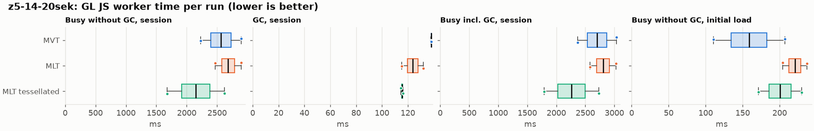
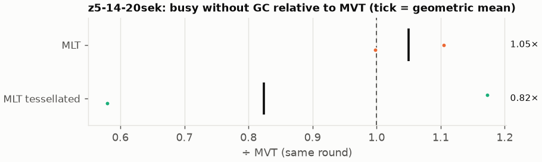
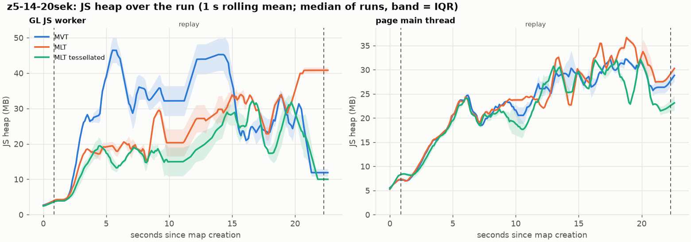
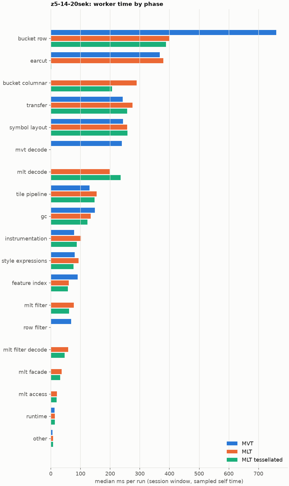
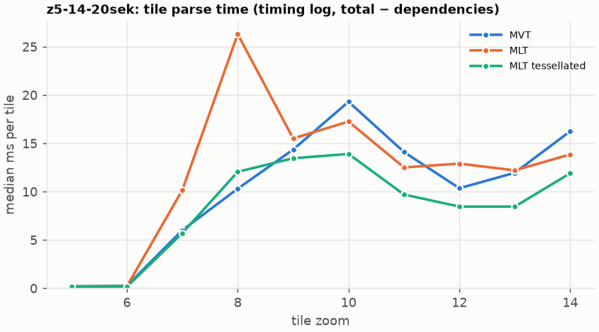
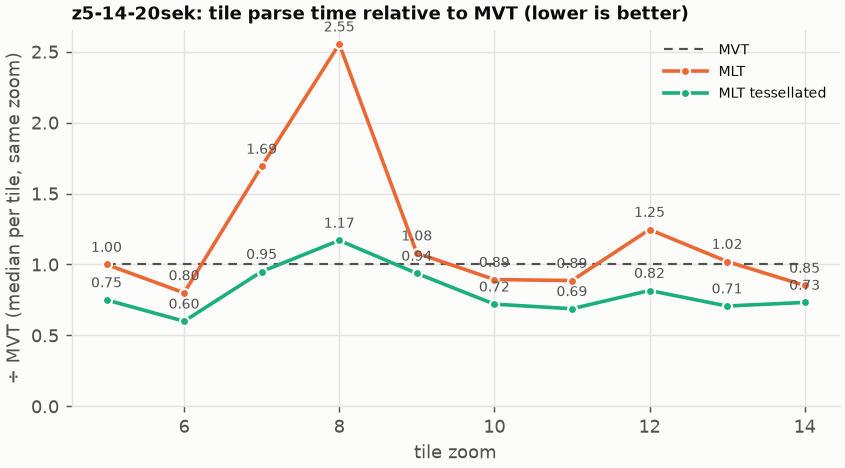

# Session trace benchmark — 20261027-143159

## Setup

- Created 2026-10-27T14:31:59+01:00; 2 repetitions + 1 warm-up round(s) (excluded); variants rotate per round (A B C, B C A, …); one cold browser context per run.
- Machine: 13th Gen Intel(R) Core(TM) i7-1365U, 12 logical cores, 31.3 GB RAM, Windows-11-10.0.26200-SP0; power: GUID des Energieschemas: 381b4222-f694-41f0-9685-ff5bb260df2e  (Ausbalanciert), AC True.
- GL JS gl7-performance-optimization @ db982f206f (dirty); worker count 1; viewport {'width': 1280, 'height': 1024}.
- Python 3.12.2, packages {'playwright': '1.64.0', 'numpy': '2.5.3', 'matplotlib': '3.11.2'}.

| variant | bundle | format | bundle sha256 | branch build |
|---|---|---|---|---|
| MVT | `dist/maplibre-gl-dev.mjs` | mvt | `9778149f31b3` | – |
| MLT | `dist/maplibre-gl-dev.mjs` | mlt | `9778149f31b3` | – |
| MLT tessellated | `dist/maplibre-gl-dev.mjs` | mlt-pre-tess | `9778149f31b3` | – |

| session | style | duration | frames | sha256 |
|---|---|---:|---:|---|
| z5-14-20sek | maptiler-basic | 21.4 s | 829 | `5a376e5ede30` |

CPU sampling interval (median over runs): 581 µs.

## Definitions

- **busy** = wall time in which a GL JS worker thread runs a task (union of top-level task slices and GC slices on `DedicatedWorker thread`s), summed over workers. **GC** = union of `MinorGC`/`MajorGC`/`V8.GC*` slices on those threads. **busy without GC** = busy − GC (headline metric).
- **CPU** = thread time (`tdur`) of the same slices. Phase categories and functions come from the trace's CPU samples (self time), categorised by `config/categories.toml` (nearest matching frame, leaf to root).
- Windows: **load** = map creation → first idle; **session** = camera replay; **tail** = end of replay → idle; **total** = load + session + tail.
- Ratios are against **MVT**: ratio of medians with a bootstrap 95 % CI, the geometric mean of per-round ratios, and a two-sided Mann–Whitney U p-value (normal approximation, not corrected for multiple comparisons; rough below n = 8). Lower than 1× means less worker time.

## Session `z5-14-20sek`

### Worker busy without GC (session window)

| variant | n ok / failed | median ms | IQR | mean | ratio vs MVT | 95 % CI | geo-mean paired | MWU p |
|---|---:|---:|---:|---:|---:|---:|---:|---:|
| MVT | 2 / 0 | 2,566 | 2,399–2,733 | 2,566 | 1.00× | – | – | – |
| MLT | 2 / 0 | 2,681 | 2,574–2,787 | 2,681 | 1.04× | 0.85–1.30× | 1.05× | 1.000 |
| MLT tessellated | 2 / 0 | 2,148 | 1,914–2,383 | 2,148 | 0.84× | 0.58–1.17× | 0.82× | 0.699 |

### All worker metrics (median, ratio vs baseline)

| metric | MVT | MLT | MLT tessellated |
|---|---:|---:|---:|
| busy incl. GC | 2,704 | 2,804 (1.04×) | 2,264 (0.84×) |
| &nbsp;&nbsp;of which GC | 138.0 | 123.7 (0.90×) | 115.5 (0.84×) |
| &nbsp;&nbsp;of which busy without GC | 2,566 | 2,681 (1.04×) | 2,148 (0.84×) |
| &nbsp;&nbsp;&nbsp;&nbsp;of which filtering (sampled, incl. callees) | 69.1 | 77.3 (1.12×) | 61.7 (0.89×) |
| &nbsp;&nbsp;&nbsp;&nbsp;of which column decoding inside the MLT filter (sampled) | 0.0 | 58.7 | 46.8 |
| &nbsp;&nbsp;&nbsp;&nbsp;of which timing instrumentation (sampled) | 78.8 | 101.2 (1.28×) | 87.4 (1.11×) |
| busy without GC and instrumentation | 2,487 | 2,580 (1.04×) | 2,061 (0.83×) |
| CPU time without GC | 2,326 | 2,434 (1.05×) | 1,967 (0.85×) |
| tile: download end → sent to main thread, median per tile | 118.8 | 120.3 (1.01×) | 101.7 (0.86×) |
| tile: download end → sent to main thread, 90th percentile | 289.6 | 259.7 (0.90×) | 204.4 (0.71×) |
| tile: download end → sent to main thread, 95th percentile | 300.9 | 344.8 (1.15×) | 216.7 (0.72×) |
| tile: download end → sent to main thread, 99th percentile | 316.6 | 358.4 (1.13×) | 244.5 (0.77×) |
| &nbsp;&nbsp;parse part (timing log, incl. waiting for glyphs/icons), median per tile | 59.1 | 61.7 (1.04×) | 50.6 (0.86×) |
| &nbsp;&nbsp;queue + hand-off part, median per tile | 49.2 | 56.4 (1.14×) | 47.0 (0.96×) |
| minor GCs | 57.50 | 52.00 (0.90×) | 30.50 (0.53×) |
| major GCs | 4.00 | 4.00 (1.00×) | 6.50 (1.62×) |
| peak worker heap (MB) | 62.7 | 51.3 (0.82×) | 44.1 (0.70×) |
| load: busy without GC | 158.6 | 220.6 (1.39×) | 200.5 (1.26×) |
| load: GC | 4.7 | 6.0 (1.25×) | 7.3 (1.53×) |
| total: busy without GC | 2,724 | 2,901 (1.06×) | 2,349 (0.86×) |

Rows marked *of which* are parts of the row above, not additional time. Tile rows are per-tile latencies (medians over tiles, then over runs), not sums: tiles overlap in time, and the medians of the parse and queue parts do not add up exactly to the median latency.

### Filtering (session window)

Sampled worker time spent in feature filtering, including everything the filter calls (expression evaluation, property access): **row filter** = the style-spec feature filter that MVT runs per feature, **mlt filter** = the columnar MLT filter (incl. the geometry-type selection), without the columns it decodes (see the next table). Medians per run; rules in `config/categories.toml`.

| variant | mlt filter | row filter | filtering | ratio vs MVT | 95 % CI | MWU p | share of sampled busy |
|---|---:|---:|---:|---:|---:|---:|---:|
| MVT | 0.3 | 68.7 | 69.1 | 1.00× | – | – | 2.8% |
| MLT | 77.3 | 0.0 | 77.3 | 1.12× | 0.87–1.53× | 1.000 | 3.0% |
| MLT tessellated | 61.7 | 0.0 | 61.7 | 0.89× | 0.52–1.51× | 0.699 | 3.0% |

**Filtering together with tile decoding.** The MLT decoder leaves columns encoded until something reads them, and the filter is usually the first reader: the columns it decodes (properties, and the geometry for `$type`) are **of which inside the filter** (phase *mlt filter decode*), the rest is *mlt decode* (geometry and columns read later, e.g. by paint properties and symbols). MVT decodes every feature's properties and geometry while it reads the tile (*mvt decode*), whether the filter keeps the feature or not. So **filtering** above compares the filters, and **decoding + filtering** compares all that the formats spend on decoding the tile and selecting features. **tile decoding** = *mvt decode* or *mlt decode* + *mlt filter decode*: work inside a call into a decoder. Reading data that is already decoded is not counted, as for MVT's feature objects: *mlt access* (row views, value getters, looking a column up by name) and the MLT facade (*mlt facade*). MVT decodes geometry only for the features its filter keeps, MLT decodes a layer's whole geometry column.

| variant | tile decoding | of which inside the filter | filtering | decoding + filtering | ratio vs MVT | 95 % CI | MWU p |
|---|---:|---:|---:|---:|---:|---:|---:|
| MVT | 239.3 | 0.0 | 69.1 | 308.3 | 1.00× | – | – |
| MLT | 257.2 | 58.7 | 77.3 | 334.5 | 1.08× | 1.00–1.17× | 0.245 |
| MLT tessellated | 282.1 | 46.8 | 61.7 | 343.8 | 1.11× | 0.85–1.38× | 1.000 |

Top 12 functions inside filtering and its column decoding (self time, mean ms per run):

| phase | function | source | MVT | MLT | MLT tessellated |
|---|---|---|---:|---:|---:|
| row filter | `evaluate` | node_modules/@maplibre/maplibre-gl-style-spec/dist/expression/compound_expression.mjs | 20.3 | 0.0 | 0.0 |
| row filter | `evaluate` | node_modules/@maplibre/maplibre-gl-style-spec/dist/expression/index.mjs | 14.3 | 0.0 | 0.0 |
| mlt filter decode | `unpackNullable` | maplibre-tile-spec/ts/dist/decoding/unpackNullableUtils.js | 0.0 | 12.5 | 8.7 |
| row filter | `CompoundExpression.register.filter-in-small` | node_modules/@maplibre/maplibre-gl-style-spec/dist/expression/compound_expression.mjs | 9.0 | 0.0 | 0.0 |
| mlt filter | `filterByGeometryType` | maplibre-tile-spec/ts/dist/vector/geometry/geometryVector.js | 0.0 | 8.0 | 5.7 |
| mlt filter | `scanDictionaryCodes` | maplibre-tile-spec/ts/dist/processing/filter/execution/filterKernel.js | 0.0 | 6.3 | 7.3 |
| row filter | `CompoundExpression.register.filter-==` | node_modules/@maplibre/maplibre-gl-style-spec/dist/expression/compound_expression.mjs | 6.5 | 0.0 | 0.0 |
| mlt filter | `dictionaryRowMatches` | maplibre-tile-spec/ts/dist/processing/filter/execution/filterKernel.js | 0.0 | 5.7 | 4.5 |
| mlt filter decode | `decodeFsst` | maplibre-tile-spec/ts/dist/decoding/fsstDecoder.js | 0.0 | 5.2 | 5.6 |
| mlt filter decode | `decodeLazyColumn` | maplibre-tile-spec/ts/dist/vector/lazyPropertyVectors.js | 0.0 | 5.2 | 3.9 |
| row filter | `filter` | node_modules/@maplibre/maplibre-gl-style-spec/dist/feature_filter/index.mjs | 5.0 | 0.0 | 0.0 |
| row filter | `CompoundExpression.register.filter-type-==` | node_modules/@maplibre/maplibre-gl-style-spec/dist/expression/compound_expression.mjs | 4.9 | 0.0 | 0.0 |

### Where the variants differ from MVT (session window, mean ms per run)

Open **[flame.html](flame.html)** to explore the call tree interactively: pick a variant, compare it with MVT (red = more time at the same call path, blue = less), click a frame to zoom in, and read the phase and function breakdown under it. Without a comparison, frames are coloured by phase: filtering is green in both formats, and the columns the MLT filter decodes on first access (*mlt filter decode*) are MLT blue frames under the green filter. `flame/*.txt` open in https://www.speedscope.app.

#### MLT vs MVT

**By phase** (sampled self time; the Δ column sums to the difference in sampled busy time):

| phase | MVT | MLT | Δ |
|---|---:|---:|---:|
| bucket columnar | 0.0 | 289.1 | +289.1 |
| mlt decode | 0.0 | 198.6 | +198.6 |
| mlt filter | 0.3 | 77.3 | +76.9 |
| mlt filter decode | 0.0 | 58.7 | +58.7 |
| mlt facade | 0.2 | 36.6 | +36.4 |
| transfer | 243.0 | 275.9 | +32.9 |
| tile pipeline | 130.6 | 154.9 | +24.3 |
| instrumentation | 78.8 | 101.2 | +22.3 |
| mlt access | 0.0 | 21.1 | +21.1 |
| symbol layout | 244.0 | 257.9 | +13.9 |
| style expressions | 80.6 | 93.3 | +12.8 |
| earcut | 367.1 | 379.8 | +12.6 |
| other | 6.0 | 7.7 | +1.7 |
| runtime | 12.7 | 13.9 | +1.2 |
| gc | 148.2 | 134.6 | -13.6 |
| feature index | 90.6 | 60.9 | -29.6 |
| row filter | 68.7 | 0.0 | -68.7 |
| mvt decode | 239.3 | 0.0 | -239.3 |
| bucket row | 759.9 | 399.7 | -360.3 |

**By source layer** (timing log: createBucket + populate + addFeatures, summed over the style layers that use it; wall time, includes GC pauses; total Δ +61 ms):

| source layer | type | MVT | MLT | Δ |
|---|---|---:|---:|---:|
| place | symbol | 167.9 | 264.4 | +96.5 |
| transportation | line | 441.4 | 529.0 | +87.6 |
| waterway | line | 30.0 | 54.4 | +24.5 |
| boundary | line | 26.5 | 47.5 | +21.0 |
| water | fill | 46.0 | 56.8 | +10.8 |
| poi | symbol | 31.1 | 38.9 | +7.8 |
| aeroway | fill | 0.9 | 4.5 | +3.6 |
| aerodrome_label | symbol | 5.4 | 7.7 | +2.3 |
| aeroway | line | 1.8 | 3.8 | +2.0 |
| landcover | fill | 437.8 | 389.8 | -48.0 |
| landuse | fill | 325.3 | 267.6 | -57.7 |
| building | fill | 236.9 | 149.6 | -87.3 |

**Functions with the largest self-time difference** (by function name, summed over source files):

| function | MVT | MLT | Δ |
|---|---:|---:|---:|
| `writeEarcutFill` | 0.0 | 32.3 | +32.3 |
| `reserve` | 99.4 | 128.0 | +28.6 |
| `ringBoundingBoxes` | 0.0 | 24.7 | +24.7 |
| `buildEarcutMesh` | 0.0 | 24.1 | +24.1 |
| `decodeComponentwiseDeltaVec2` | 0.0 | 23.2 | +23.2 |
| `unpackNullable` | 0.0 | 19.1 | +19.1 |
| `readScaledRings` | 0.0 | 15.6 | +15.6 |
| `get` | 14.3 | 27.3 | +13.0 |
| `fetch` | 46.5 | 59.2 | +12.7 |
| `decodeFastPforInt32` | 0.0 | 12.3 | +12.3 |
| `decodeString$2` | 0.0 | 11.9 | +11.9 |
| `emplace` | 63.7 | 75.0 | +11.3 |
| `_vertexToIndex` | 136.7 | 0.0 | -136.7 |
| `readSVarint` | 79.8 | 0.0 | -79.8 |
| `readVarint` | 51.5 | 3.2 | -48.3 |
| `loadGeometry` | 56.6 | 12.8 | -43.9 |
| `evaluate` | 40.2 | 8.5 | -31.6 |

#### MLT tessellated vs MVT

**By phase** (sampled self time; the Δ column sums to the difference in sampled busy time):

| phase | MVT | MLT tessellated | Δ |
|---|---:|---:|---:|
| mlt decode | 0.0 | 235.4 | +235.4 |
| bucket columnar | 0.0 | 206.4 | +206.4 |
| mlt filter | 0.3 | 61.7 | +61.3 |
| mlt filter decode | 0.0 | 46.8 | +46.8 |
| mlt facade | 0.2 | 31.2 | +30.9 |
| mlt access | 0.0 | 20.0 | +20.0 |
| tile pipeline | 130.6 | 147.3 | +16.7 |
| transfer | 243.0 | 258.0 | +15.0 |
| symbol layout | 244.0 | 258.4 | +14.3 |
| instrumentation | 78.8 | 87.4 | +8.6 |
| other | 6.0 | 7.8 | +1.8 |
| runtime | 12.7 | 13.4 | +0.7 |
| style expressions | 80.6 | 76.5 | -4.1 |
| gc | 148.2 | 123.5 | -24.7 |
| feature index | 90.6 | 57.8 | -32.8 |
| row filter | 68.7 | 0.0 | -68.7 |
| mvt decode | 239.3 | 0.0 | -239.3 |
| earcut | 367.1 | 2.0 | -365.2 |
| bucket row | 759.9 | 388.9 | -371.1 |

**By source layer** (timing log: createBucket + populate + addFeatures, summed over the style layers that use it; wall time, includes GC pauses; total Δ -455 ms):

| source layer | type | MVT | MLT tessellated | Δ |
|---|---|---:|---:|---:|
| place | symbol | 167.9 | 239.8 | +71.9 |
| transportation | line | 441.4 | 504.6 | +63.2 |
| waterway | line | 30.0 | 54.1 | +24.1 |
| boundary | line | 26.5 | 44.6 | +18.1 |
| poi | symbol | 31.1 | 44.1 | +13.0 |
| transportation | fill | 12.5 | 16.7 | +4.3 |
| aeroway | fill | 0.9 | 3.1 | +2.3 |
| aeroway | line | 1.8 | 3.6 | +1.8 |
| water | fill | 46.0 | 35.7 | -10.3 |
| building | fill | 236.9 | 58.9 | -178.0 |
| landuse | fill | 325.3 | 126.1 | -199.1 |
| landcover | fill | 437.8 | 168.6 | -269.2 |

**Functions with the largest self-time difference** (by function name, summed over source files):

| function | MVT | MLT tessellated | Δ |
|---|---:|---:|---:|
| `writeTessellatedFill` | 0.0 | 39.8 | +39.8 |
| `tessellatedBoundingBox` | 0.0 | 39.6 | +39.6 |
| `decodeUnsignedZigZagDeltaInt32` | 0.0 | 25.4 | +25.4 |
| `decodeComponentwiseDeltaVec2` | 0.0 | 20.6 | +20.6 |
| `scaleCoordinate` | 0.0 | 19.3 | +19.3 |
| `unpackNullable` | 0.0 | 15.0 | +15.0 |
| `applyBlockExceptions` | 0.0 | 11.6 | +11.6 |
| `decodeFastPforInt32` | 0.0 | 11.5 | +11.5 |
| `fastUnpack256_4` | 0.0 | 11.4 | +11.4 |
| `reserve` | 99.4 | 110.6 | +11.2 |
| `get` | 14.3 | 24.6 | +10.2 |
| `decodeBigEndianInt32sInto` | 0.0 | 9.1 | +9.1 |
| `_vertexToIndex` | 136.7 | 0.0 | -136.7 |
| `isEar` | 112.7 | 0.0 | -112.7 |
| `readSVarint` | 79.8 | 0.0 | -79.8 |
| `isEarHashed` | 61.6 | 0.0 | -61.6 |
| `readVarint` | 51.5 | 1.8 | -49.7 |

### Memory (session window)

**JS heap** = V8's used heap of the thread (`jsHeapSizeUsed` from the trace's `UpdateCounters`, about every 20 ms; the mean is time-weighted). It does not include ArrayBuffer contents, so the tile data itself (vertex, index and feature-index arrays) is not in it: **tile data sent to the main thread** is the size of the ArrayBuffers each tile result transfers (`web/worker_hook.js`), which then live on the main thread and are uploaded to the GPU. **garbage collected** = heap freed by the worker's GCs, a measure of how much it allocates. Medians per run; ratio of medians with a bootstrap 95 % CI.

| metric | MVT | MLT | MLT tessellated |
|---|---:|---:|---:|
| worker JS heap, mean (MB) | 24.1 | 20.5 (0.85×, 0.69–1.04×) | 15.9 (0.66×, 0.53–0.81×) |
| worker JS heap, peak (MB) | 62.7 | 51.3 (0.82×, 0.73–0.93×) | 44.1 (0.70×, 0.62–0.80×) |
| worker JS heap after the last GC (MB) | 11.4 | 19.8 (1.73×, 1.31–2.37×) | 9.2 (0.80×, 0.66–1.02×) |
| garbage collected in the worker (MB) | 1,205 | 741.2 (0.62×, 0.60–0.63×) | 411.8 (0.34×, 0.34–0.35×) |
| main thread JS heap, mean (MB) | 21.9 | 22.5 (1.03×, 1.03–1.03×) | 20.8 (0.95×, 0.95–0.95×) |
| main thread JS heap, peak (MB) | 42.1 | 47.5 (1.13×, 1.12–1.13×) | 41.1 (0.98×, 0.97–0.98×) |
| main thread JS heap at the end of the replay (MB) | 26.7 | 27.8 (1.04×, 0.94–1.17×) | 22.0 (0.82×, 0.70–0.97×) |
| tile data sent to the main thread, total (MB) | 73.2 | 70.7 (0.97×, 0.95–0.99×) | 71.6 (0.98×, 0.96–1.00×) |
| tile data sent to the main thread, median per tile (KB) | 501.6 | 498.6 (0.99×, 0.98–1.01×) | 487.4 (0.97×, 0.96–0.99×) |

### Worker time by phase (session window, median ms of sampled self time)

| phase | MVT | MLT | MLT tessellated |
|---|---:|---:|---:|
| bucket row | 759.9 | 399.7 | 388.9 |
| earcut | 367.1 | 379.8 | 2.0 |
| bucket columnar | 0.0 | 289.1 | 206.4 |
| transfer | 243.0 | 275.9 | 258.0 |
| symbol layout | 244.0 | 257.9 | 258.4 |
| mvt decode | 239.3 | 0.0 | 0.0 |
| mlt decode | 0.0 | 198.6 | 235.4 |
| tile pipeline | 130.6 | 154.9 | 147.3 |
| gc | 148.2 | 134.6 | 123.5 |
| instrumentation | 78.8 | 101.2 | 87.4 |
| style expressions | 80.6 | 93.3 | 76.5 |
| feature index | 90.6 | 60.9 | 57.8 |
| mlt filter | 0.3 | 77.3 | 61.7 |
| row filter | 68.7 | 0.0 | 0.0 |
| mlt filter decode | 0.0 | 58.7 | 46.8 |
| mlt facade | 0.2 | 36.6 | 31.2 |
| mlt access | 0.0 | 21.1 | 20.0 |
| runtime | 12.7 | 13.9 | 13.4 |
| other | 6.0 | 7.7 | 7.8 |
| pre-tess mesh | 0.0 | 0.0 | 0.0 |

### Top 20 worker functions by self time (session window, mean ms per run)

| function | source | phase | MVT | MLT | MLT tessellated |
|---|---|---|---:|---:|---:|
| `(garbage collector)` | (native) | gc | 148.2 | 134.6 | 123.5 |
| `_vertexToIndex` | src/render/subdivision.ts | bucket row | 136.7 | 0.0 | 0.0 |
| `reserve` | src/util/struct_array.ts | feature index | 99.4 | 128.0 | 110.6 |
| `isEar` | node_modules/earcut/src/earcut.js | earcut | 112.7 | 98.1 | 0.0 |
| `readSVarint` | node_modules/pbf/index.js | mvt decode | 79.8 | 0.0 | 0.0 |
| `emplace` | src/data/array_types.g.ts | bucket columnar | 63.7 | 75.0 | 66.2 |
| `isEarHashed` | node_modules/earcut/src/earcut.js | earcut | 61.6 | 71.2 | 0.0 |
| `setTimeout` | (native) | transfer | 62.6 | 67.5 | 64.3 |
| `fetch` | (native) | tile pipeline | 46.5 | 59.2 | 52.0 |
| `postMessage` | (native) | transfer | 53.4 | 56.0 | 55.0 |
| `readVarint` | node_modules/pbf/index.js | mvt decode | 51.5 | 0.0 | 0.0 |
| `_trim` | src/util/struct_array.ts | transfer | 45.6 | 51.2 | 46.2 |
| `addLine` | src/data/bucket/line_bucket.ts | bucket row | 41.8 | 44.8 | 46.5 |
| `addHalfVertex` | src/data/bucket/line_bucket.ts | bucket row | 40.6 | 44.5 | 46.2 |
| `serialize` | src/util/web_worker_transfer.ts | transfer | 37.9 | 44.6 | 36.7 |
| `insert` | src/data/feature_index.ts | feature index | 41.0 | 12.6 | 12.8 |
| `writeTessellatedFill` | src/data/bucket/columnar/columnar_mesh_arrays.ts | bucket columnar | 0.0 | 0.0 | 39.8 |
| `tessellatedBoundingBox` | src/data/bucket/columnar/columnar_mesh_arrays.ts | bucket columnar | 0.0 | 0.0 | 39.6 |
| `earcutLinked` | node_modules/earcut/src/earcut.js | earcut | 37.3 | 37.0 | 0.2 |
| `addCurrentVertex` | src/data/bucket/line_bucket.ts | bucket row | 34.6 | 35.0 | 37.0 |

### Top 20 worker functions by total time (incl. callees) (session window, mean ms per run)

| function | source | phase | MVT | MLT | MLT tessellated |
|---|---|---|---:|---:|---:|
| `parse` | src/source/worker_tile.ts | tile pipeline | 1,923 | 2,010 | 1,514 |
| `loadTile` | src/source/vector_tile_worker_source.ts | tile pipeline | 1,772 | 1,820 | 1,312 |
| `_parseWorkerTile` | src/source/vector_tile_worker_source.ts | tile pipeline | 1,682 | 1,750 | 1,256 |
| `populate` | src/data/bucket/fill_bucket.ts | bucket row | 954.1 | 0.0 | 0.0 |
| `addBucketFeatures` | src/data/bucket/fill_bucket.ts | bucket row | 791.7 | 0.0 | 0.0 |
| `populate` | src/data/bucket/columnar/columnar_fill_bucket.ts | bucket columnar | 0.0 | 782.0 | 364.1 |
| `addFeature` | src/data/bucket/fill_bucket.ts | bucket row | 741.1 | 0.0 | 0.0 |
| `writeSelectedFeatures` | src/data/bucket/columnar/columnar_fill_bucket.ts | bucket columnar | 0.0 | 662.2 | 198.6 |
| `subdividePolygon` | src/render/subdivision.ts | bucket row | 629.3 | 0.0 | 0.0 |
| `subdividePolygonInternal` | src/render/subdivision.ts | bucket row | 614.2 | 0.0 | 0.0 |
| `writeDirect` | src/data/bucket/columnar/columnar_fill_bucket.ts | bucket columnar | 0.0 | 598.0 | 109.7 |
| `writeEarcutFill` | src/data/bucket/columnar/columnar_mesh_arrays.ts | bucket columnar | 0.0 | 594.8 | 4.4 |
| `populate` | src/data/bucket/columnar/columnar_line_bucket.ts | bucket columnar | 0.0 | 524.4 | 487.0 |
| `buildEarcutMesh` | src/data/bucket/columnar/columnar_mesh_arrays.ts | bucket columnar | 0.0 | 422.2 | 2.0 |
| `populate` | src/data/bucket/line_bucket.ts | bucket row | 420.0 | 0.0 | 0.0 |
| `earcut` | node_modules/earcut/src/earcut.js | earcut | 366.1 | 379.5 | 2.0 |
| `addBucketFeatures` | src/data/bucket/line_bucket.ts | bucket row | 299.2 | 364.0 | 349.5 |
| `earcutLinked` | node_modules/earcut/src/earcut.js | earcut | 284.2 | 302.5 | 0.8 |
| `processTask` | src/util/actor.ts | transfer | 236.2 | 283.6 | 256.2 |
| `addFeature` | src/data/bucket/line_bucket.ts | bucket row | 226.7 | 282.0 | 274.5 |

### Tile parse time by zoom (timing log, median ms per tile, total − dependencies)

| zoom | MVT | MLT | MLT tessellated |
|---:|---:|---:|---:|
| 5 | 0.20 (n=18) | 0.20 (n=18) | 0.15 (n=18) |
| 6 | 0.25 (n=18) | 0.20 (n=18) | 0.15 (n=18) |
| 7 | 6.00 (n=12) | 10.15 (n=12) | 5.70 (n=12) |
| 8 | 10.30 (n=16) | 26.30 (n=11) | 12.05 (n=12) |
| 9 | 14.35 (n=32) | 15.50 (n=32) | 13.45 (n=32) |
| 10 | 19.30 (n=37) | 17.25 (n=40) | 13.90 (n=40) |
| 11 | 14.10 (n=29) | 12.50 (n=30) | 9.70 (n=30) |
| 12 | 10.35 (n=40) | 12.90 (n=40) | 8.45 (n=40) |
| 13 | 11.95 (n=42) | 12.20 (n=42) | 8.45 (n=42) |
| 14 | 16.25 (n=36) | 13.85 (n=36) | 11.90 (n=36) |

### Tile latency by zoom: download end → result sent to the main thread (session window, ms per tile: median / p95 / p99)

Includes waiting in the worker's queue, the parse and posting the result; see `tile_latency.csv` for the per-tile split (`parse_ms`, `wait_ms`). Percentiles over the tiles of all runs; with few tiles (n) p99 is close to the maximum.

| zoom | MVT | MLT | MLT tessellated |
|---:|---:|---:|---:|
| 6 | 33.5 / 43.6 / 45.7 (n=18) | 54.6 / 73.2 / 76.8 (n=18) | 43.8 / 55.3 / 65.4 (n=18) |
| 7 | 71.2 / 89.1 / 89.6 (n=12) | 96.3 / 119.5 / 120.5 (n=12) | 62.1 / 87.0 / 88.2 (n=12) |
| 8 | 145.7 / 158.8 / 159.2 (n=16) | 189.4 / 214.9 / 220.3 (n=11) | 118.8 / 165.7 / 167.2 (n=12) |
| 9 | 133.6 / 238.4 / 239.1 (n=32) | 191.3 / 273.6 / 279.3 (n=32) | 143.8 / 258.5 / 260.6 (n=32) |
| 10 | 184.5 / 289.7 / 296.7 (n=37) | 234.4 / 449.9 / 459.3 (n=40) | 161.5 / 267.8 / 270.8 (n=40) |
| 11 | 101.2 / 159.0 / 163.6 (n=29) | 137.9 / 243.6 / 244.3 (n=30) | 90.0 / 155.4 / 158.3 (n=30) |
| 12 | 51.6 / 186.7 / 190.2 (n=40) | 55.4 / 215.0 / 216.3 (n=40) | 44.0 / 196.2 / 200.6 (n=40) |
| 13 | 122.3 / 360.2 / 368.6 (n=42) | 106.3 / 268.6 / 270.7 (n=42) | 96.0 / 243.3 / 248.4 (n=42) |
| 14 | 174.8 / 373.8 / 380.9 (n=36) | 149.1 / 257.2 / 267.1 (n=36) | 125.2 / 309.2 / 317.0 (n=36) |

## Runs

9 ok, 0 failed/aborted, 0 not run, 6 used in statistics.

## Validity checks

- Counted once: all 9 analysed runs pass (windows load + session + tail add up to total; phases add up to the sampled busy time; GC and sampled time lie within busy time; no timing-log line twice).
- other programs used 2.75–6.41 logical processors during the replays (median 5.54)
- 6 run(s) with more than 0.5 cores of background load: z5-14-20sek/mlt/rep-01 (3.98), z5-14-20sek/mlt-pre-tess/rep-01 (6.41), z5-14-20sek/mvt/rep-01 (2.75), z5-14-20sek/mlt-pre-tess/rep-02 (3.01), z5-14-20sek/mvt/rep-02 (6.18), z5-14-20sek/mlt/rep-02 (5.54)
- 3 of 3 rounds parsed different tile sets across variants (e.g. z5-14-20sek round 0: mvt 129 tiles, mlt 129 tiles, mlt-pre-tess 134 tiles; z5-14-20sek round 1: mlt 126 tiles, mlt-pre-tess 126 tiles, mvt 130 tiles; z5-14-20sek round 2: mlt-pre-tess 130 tiles, mvt 129 tiles, mlt 129 tiles); no run went past z14, so this is timing: which tiles finish loading before the camera moves on, and which get cancelled; compare per-tile metrics (by zoom) rather than totals when the counts differ a lot

## Files

- `runs.csv`: one row per run (incl. failed and warm-up runs), every scalar metric as `<window>.<metric>`.
- `summary.csv`: session × variant × metric statistics.
- `functions.csv`, `categories.csv`: CPU-sample self/total time per function and phase per run and window.
- `category_functions.csv`: self time per phase × function (e.g. what the filters spend their time on).
- `tiles.csv`, `tile_layers.csv`, `tile_phases.csv`: the per-tile worker timing log, long format.
- `flame.html`: interactive call tree per variant with a diff view; `flame/*.txt`: collapsed stacks for speedscope.
- `analysis/stacks.csv` (per run): sampled self time per full call stack.
- `tile_latency.csv`: per tile request, worker clock: received, download start/end, result sent, latency = sent − download end, parse_ms, wait_ms = latency − parse.
- `runs/<session>/<variant>/rep-NN/trace.json.gz`: the raw trace (opens in the DevTools Performance tab).
