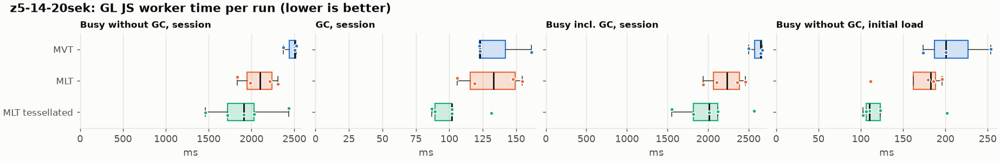
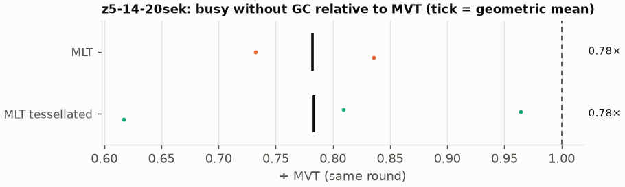
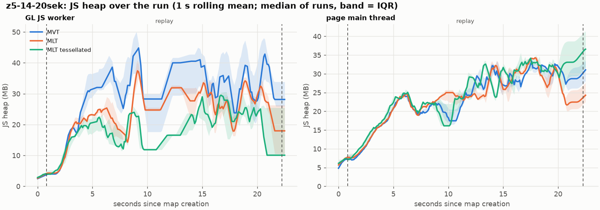
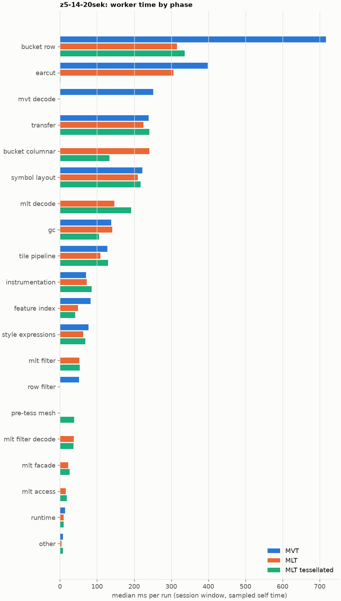
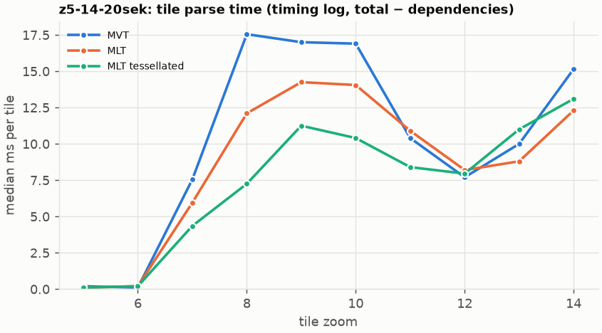
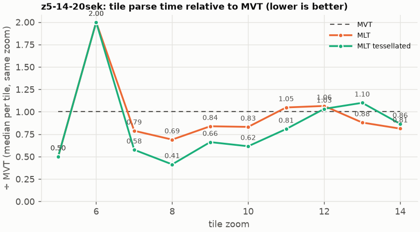

# Session trace benchmark — 20261027-145149

## Setup

- Created 2026-10-27T14:51:49+01:00; 5 repetitions + 1 warm-up round(s) (excluded); variants rotate per round (A B C, B C A, …); one cold browser context per run.
- Machine: 13th Gen Intel(R) Core(TM) i7-1365U, 12 logical cores, 31.3 GB RAM, Windows-11-10.0.26200-SP0; power: GUID des Energieschemas: 381b4222-f694-41f0-9685-ff5bb260df2e  (Ausbalanciert), AC True.
- GL JS gl7-performance-optimization @ c539936344 (dirty); worker count 1; viewport {'width': 1280, 'height': 1024}.
- Python 3.12.2, packages {'playwright': '1.64.0', 'numpy': '2.5.3', 'matplotlib': '3.11.2'}.

| variant | bundle | format | bundle sha256 | branch build |
|---|---|---|---|---|
| MVT | `dist/maplibre-gl-dev.mjs` | mvt | `0f0319f135a2` | – |
| MLT | `dist/maplibre-gl-dev.mjs` | mlt | `0f0319f135a2` | – |
| MLT tessellated | `dist/maplibre-gl-dev.mjs` | mlt-pre-tess | `0f0319f135a2` | – |

| session | style | duration | frames | sha256 |
|---|---|---:|---:|---|
| z5-14-20sek | maptiler-basic | 21.4 s | 829 | `5a376e5ede30` |

CPU sampling interval (median over runs): 578 µs.

## Definitions

- **busy** = wall time in which a GL JS worker thread runs a task (union of top-level task slices and GC slices on `DedicatedWorker thread`s), summed over workers. **GC** = union of `MinorGC`/`MajorGC`/`V8.GC*` slices on those threads. **busy without GC** = busy − GC (headline metric).
- **CPU** = thread time (`tdur`) of the same slices. Phase categories and functions come from the trace's CPU samples (self time), categorised by `config/categories.toml` (nearest matching frame, leaf to root).
- Windows: **load** = map creation → first idle; **session** = camera replay; **tail** = end of replay → idle; **total** = load + session + tail.
- Ratios are against **MVT**: ratio of medians with a bootstrap 95 % CI, the geometric mean of per-round ratios, and a two-sided Mann–Whitney U p-value (normal approximation, not corrected for multiple comparisons; rough below n = 8). Lower than 1× means less worker time.

## Session `z5-14-20sek`

### Worker busy without GC (session window)

| variant | n ok / failed | median ms | IQR | mean | ratio vs MVT | 95 % CI | geo-mean paired | MWU p |
|---|---:|---:|---:|---:|---:|---:|---:|---:|
| MVT | 3 / 0 | 2,506 | 2,440–2,515 | 2,468 | 1.00× | – | – | – |
| MLT | 4 / 0 | 2,099 | 1,947–2,237 | 2,085 | 0.84× | 0.73–0.95× | 0.78× | 0.052 |
| MLT tessellated | 5 / 0 | 1,909 | 1,718–2,028 | 1,911 | 0.76× | 0.58–0.97× | 0.78× | 0.074 |

### All worker metrics (median, ratio vs baseline)

| metric | MVT | MLT | MLT tessellated |
|---|---:|---:|---:|
| busy incl. GC | 2,648 | 2,232 (0.84×) | 2,011 (0.76×) |
| &nbsp;&nbsp;of which GC | 122.8 | 133.2 (1.09×) | 101.8 (0.83×) |
| &nbsp;&nbsp;of which busy without GC | 2,506 | 2,099 (0.84×) | 1,909 (0.76×) |
| &nbsp;&nbsp;&nbsp;&nbsp;of which filtering (sampled, incl. callees) | 51.6 | 52.7 (1.02×) | 53.6 (1.04×) |
| &nbsp;&nbsp;&nbsp;&nbsp;of which column decoding inside the MLT filter (sampled) | 0.0 | 37.5 | 36.2 |
| &nbsp;&nbsp;&nbsp;&nbsp;of which timing instrumentation (sampled) | 70.6 | 72.2 (1.02×) | 85.2 (1.21×) |
| busy without GC and instrumentation | 2,435 | 2,021 (0.83×) | 1,824 (0.75×) |
| CPU time without GC | 2,263 | 1,917 (0.85×) | 1,747 (0.77×) |
| tile: download end → sent to main thread, median per tile | 109.2 | 107.0 (0.98×) | 104.3 (0.96×) |
| tile: download end → sent to main thread, 90th percentile | 252.1 | 227.9 (0.90×) | 173.7 (0.69×) |
| tile: download end → sent to main thread, 95th percentile | 274.1 | 284.5 (1.04×) | 189.8 (0.69×) |
| tile: download end → sent to main thread, 99th percentile | 294.5 | 306.8 (1.04×) | 201.5 (0.68×) |
| &nbsp;&nbsp;parse part (timing log, incl. waiting for glyphs/icons), median per tile | 57.2 | 52.4 (0.92×) | 52.5 (0.92×) |
| &nbsp;&nbsp;queue + hand-off part, median per tile | 50.8 | 46.2 (0.91×) | 42.8 (0.84×) |
| minor GCs | 58.00 | 48.00 (0.83×) | 33.00 (0.57×) |
| major GCs | 3.00 | 8.00 (2.67×) | 6.00 (2.00×) |
| peak worker heap (MB) | 62.6 | 49.0 (0.78×) | 42.5 (0.68×) |
| load: busy without GC | 200.5 | 182.4 (0.91×) | 110.3 (0.55×) |
| load: GC | 5.9 | 5.5 (0.94×) | 3.5 (0.60×) |
| total: busy without GC | 2,698 | 2,248 (0.83×) | 2,032 (0.75×) |

Rows marked *of which* are parts of the row above, not additional time. Tile rows are per-tile latencies (medians over tiles, then over runs), not sums: tiles overlap in time, and the medians of the parse and queue parts do not add up exactly to the median latency.

### Filtering (session window)

Sampled worker time spent in feature filtering, including everything the filter calls (expression evaluation, property access): **row filter** = the style-spec feature filter that MVT runs per feature, **mlt filter** = the columnar MLT filter (incl. the geometry-type selection), without the columns it decodes (see the next table). Medians per run; rules in `config/categories.toml`.

| variant | mlt filter | row filter | filtering | ratio vs MVT | 95 % CI | MWU p | share of sampled busy |
|---|---:|---:|---:|---:|---:|---:|---:|
| MVT | 0.0 | 51.6 | 51.6 | 1.00× | – | – | 2.2% |
| MLT | 52.7 | 0.0 | 52.7 | 1.02× | 0.81–1.13× | 0.596 | 2.6% |
| MLT tessellated | 53.6 | 0.0 | 53.6 | 1.04× | 0.75–1.61× | 0.551 | 3.4% |

**Filtering together with tile decoding.** The MLT decoder leaves columns encoded until something reads them, and the filter is usually the first reader: the columns it decodes (properties, and the geometry for `$type`) are **of which inside the filter** (phase *mlt filter decode*), the rest is *mlt decode* (geometry and columns read later, e.g. by paint properties and symbols). MVT decodes every feature's properties and geometry while it reads the tile (*mvt decode*), whether the filter keeps the feature or not. So **filtering** above compares the filters, and **decoding + filtering** compares all that the formats spend on decoding the tile and selecting features. **tile decoding** = *mvt decode* or *mlt decode* + *mlt filter decode*: work inside a call into a decoder. Reading data that is already decoded is not counted, as for MVT's feature objects: *mlt access* (row views, value getters, looking a column up by name) and the MLT facade (*mlt facade*). MVT decodes geometry only for the features its filter keeps, MLT decodes a layer's whole geometry column.

| variant | tile decoding | of which inside the filter | filtering | decoding + filtering | ratio vs MVT | 95 % CI | MWU p |
|---|---:|---:|---:|---:|---:|---:|---:|
| MVT | 251.5 | 0.0 | 51.6 | 303.2 | 1.00× | – | – |
| MLT | 185.9 | 37.5 | 52.7 | 238.6 | 0.79× | 0.70–0.97× | 0.052 |
| MLT tessellated | 232.1 | 36.2 | 53.6 | 284.6 | 0.94× | 0.82–1.33× | 1.000 |

Top 12 functions inside filtering and its column decoding (self time, mean ms per run):

| phase | function | source | MVT | MLT | MLT tessellated |
|---|---|---|---:|---:|---:|
| row filter | `evaluate` | node_modules/@maplibre/maplibre-gl-style-spec/dist/expression/index.mjs | 13.0 | 0.0 | 0.0 |
| row filter | `evaluate` | node_modules/@maplibre/maplibre-gl-style-spec/dist/expression/compound_expression.mjs | 12.9 | 0.0 | 0.0 |
| mlt filter decode | `unpackNullable` | maplibre-tile-spec/ts/dist/decoding/unpackNullableUtils.js | 0.0 | 8.5 | 8.8 |
| mlt filter | `filterByGeometryType` | maplibre-tile-spec/ts/dist/vector/geometry/geometryVector.js | 0.0 | 6.6 | 8.2 |
| mlt filter | `scanDictionaryCodes` | maplibre-tile-spec/ts/dist/processing/filter/execution/filterKernel.js | 0.0 | 6.4 | 6.7 |
| row filter | `CompoundExpression.register.filter-==` | node_modules/@maplibre/maplibre-gl-style-spec/dist/expression/compound_expression.mjs | 5.9 | 0.0 | 0.0 |
| row filter | `CompoundExpression.register.filter-in-small` | node_modules/@maplibre/maplibre-gl-style-spec/dist/expression/compound_expression.mjs | 5.4 | 0.0 | 0.0 |
| mlt filter decode | `decodeFsst` | maplibre-tile-spec/ts/dist/decoding/fsstDecoder.js | 0.0 | 3.4 | 5.1 |
| mlt filter | `dictionaryRowMatches` | maplibre-tile-spec/ts/dist/processing/filter/execution/filterKernel.js | 0.0 | 3.0 | 4.6 |
| row filter | `filter` | node_modules/@maplibre/maplibre-gl-style-spec/dist/feature_filter/index.mjs | 4.4 | 0.0 | 0.0 |
| mlt filter | `resolveDictionaryExecutor` | maplibre-tile-spec/ts/dist/processing/filter/execution/filterKernel.js | 0.0 | 3.7 | 4.1 |
| row filter | `CompoundExpression.register.filter-type-==` | node_modules/@maplibre/maplibre-gl-style-spec/dist/expression/compound_expression.mjs | 4.0 | 0.0 | 0.0 |

### Where the variants differ from MVT (session window, mean ms per run)

Open **[flame.html](flame.html)** to explore the call tree interactively: pick a variant, compare it with MVT (red = more time at the same call path, blue = less), click a frame to zoom in, and read the phase and function breakdown under it. Without a comparison, frames are coloured by phase: filtering is green in both formats, and the columns the MLT filter decodes on first access (*mlt filter decode*) are MLT blue frames under the green filter. `flame/*.txt` open in https://www.speedscope.app.

#### MLT vs MVT

**By phase** (sampled self time; the Δ column sums to the difference in sampled busy time):

| phase | MVT | MLT | Δ |
|---|---:|---:|---:|
| bucket columnar | 0.0 | 236.2 | +236.2 |
| mlt decode | 0.0 | 142.7 | +142.7 |
| mlt filter | 0.1 | 52.2 | +52.1 |
| mlt filter decode | 0.0 | 41.4 | +41.4 |
| mlt facade | 0.0 | 23.0 | +23.0 |
| mlt access | 0.0 | 15.4 | +15.4 |
| runtime | 12.8 | 11.0 | -1.8 |
| instrumentation | 73.0 | 69.6 | -3.4 |
| other | 9.2 | 5.0 | -4.1 |
| symbol layout | 215.7 | 209.3 | -6.3 |
| gc | 145.8 | 138.1 | -7.7 |
| transfer | 238.8 | 230.5 | -8.3 |
| tile pipeline | 123.5 | 111.8 | -11.7 |
| style expressions | 79.6 | 63.5 | -16.1 |
| feature index | 80.1 | 49.6 | -30.5 |
| row filter | 53.4 | 0.0 | -53.4 |
| earcut | 400.2 | 306.4 | -93.9 |
| mvt decode | 234.8 | 0.0 | -234.8 |
| bucket row | 711.4 | 309.4 | -402.0 |

**By source layer** (timing log: createBucket + populate + addFeatures, summed over the style layers that use it; wall time, includes GC pauses; total Δ -310 ms):

| source layer | type | MVT | MLT | Δ |
|---|---|---:|---:|---:|
| place | symbol | 156.9 | 200.4 | +43.5 |
| waterway | line | 31.8 | 41.9 | +10.2 |
| poi | symbol | 23.6 | 31.9 | +8.3 |
| boundary | line | 27.7 | 35.3 | +7.6 |
| aeroway | fill | 0.8 | 2.5 | +1.7 |
| aerodrome_label | symbol | 4.9 | 5.7 | +0.9 |
| water | fill | 43.4 | 42.0 | -1.4 |
| transportation | fill | 10.3 | 8.5 | -1.8 |
| transportation_name | symbol | 90.3 | 85.5 | -4.8 |
| building | fill | 201.5 | 113.2 | -88.3 |
| landuse | fill | 335.4 | 220.8 | -114.6 |
| landcover | fill | 498.3 | 326.3 | -172.0 |

**Functions with the largest self-time difference** (by function name, summed over source files):

| function | MVT | MLT | Δ |
|---|---:|---:|---:|
| `writeEarcutFill` | 0.0 | 25.1 | +25.1 |
| `buildRingBoundingBoxes` | 0.0 | 24.9 | +24.9 |
| `buildEarcutMesh` | 0.0 | 19.3 | +19.3 |
| `decodeComponentwiseDeltaVec2` | 0.0 | 16.6 | +16.6 |
| `readScaledRings` | 0.0 | 15.1 | +15.1 |
| `unpackNullable` | 0.0 | 14.0 | +14.0 |
| `decodeFastPforInt32` | 0.0 | 10.8 | +10.8 |
| `decodeString$2` | 0.0 | 6.9 | +6.9 |
| `decodeBigEndianInt32sInto` | 0.0 | 6.8 | +6.8 |
| `signedArea$1` | 0.0 | 6.6 | +6.6 |
| `filterByGeometryType` | 0.0 | 6.6 | +6.6 |
| `scaleCoordinate` | 0.0 | 6.6 | +6.6 |
| `_vertexToIndex` | 131.5 | 0.0 | -131.5 |
| `readSVarint` | 92.2 | 0.0 | -92.2 |
| `loadGeometry` | 59.5 | 8.5 | -51.0 |
| `isEar` | 126.8 | 79.8 | -47.0 |
| `readVarint` | 39.8 | 2.1 | -37.7 |

#### MLT tessellated vs MVT

**By phase** (sampled self time; the Δ column sums to the difference in sampled busy time):

| phase | MVT | MLT tessellated | Δ |
|---|---:|---:|---:|
| mlt decode | 0.0 | 205.5 | +205.5 |
| bucket columnar | 0.0 | 135.8 | +135.8 |
| mlt filter | 0.1 | 61.3 | +61.2 |
| mlt filter decode | 0.0 | 40.0 | +40.0 |
| pre-tess mesh | 0.0 | 38.8 | +38.8 |
| mlt facade | 0.0 | 26.1 | +26.1 |
| mlt access | 0.0 | 18.3 | +18.3 |
| symbol layout | 215.7 | 223.9 | +8.3 |
| instrumentation | 73.0 | 80.9 | +7.9 |
| transfer | 238.8 | 243.8 | +5.0 |
| tile pipeline | 123.5 | 125.8 | +2.3 |
| runtime | 12.8 | 12.0 | -0.7 |
| other | 9.2 | 7.1 | -2.1 |
| style expressions | 79.6 | 69.6 | -10.0 |
| feature index | 80.1 | 44.9 | -35.2 |
| gc | 145.8 | 106.8 | -39.0 |
| row filter | 53.4 | 0.0 | -53.4 |
| mvt decode | 234.8 | 0.0 | -234.8 |
| bucket row | 711.4 | 336.4 | -375.0 |
| earcut | 400.2 | 2.2 | -398.1 |

**By source layer** (timing log: createBucket + populate + addFeatures, summed over the style layers that use it; wall time, includes GC pauses; total Δ -582 ms):

| source layer | type | MVT | MLT tessellated | Δ |
|---|---|---:|---:|---:|
| place | symbol | 156.9 | 205.3 | +48.4 |
| transportation | line | 378.9 | 425.6 | +46.7 |
| waterway | line | 31.8 | 53.8 | +22.0 |
| transportation_name | symbol | 90.3 | 101.3 | +11.0 |
| poi | symbol | 23.6 | 34.1 | +10.5 |
| boundary | line | 27.7 | 36.2 | +8.6 |
| transportation | fill | 10.3 | 15.6 | +5.3 |
| aeroway | fill | 0.8 | 3.0 | +2.2 |
| water | fill | 43.4 | 28.1 | -15.3 |
| building | fill | 201.5 | 57.2 | -144.3 |
| landuse | fill | 335.4 | 107.6 | -227.8 |
| landcover | fill | 498.3 | 147.2 | -351.1 |

**Functions with the largest self-time difference** (by function name, summed over source files):

| function | MVT | MLT tessellated | Δ |
|---|---:|---:|---:|
| `buildTessellatedBoundingBox` | 0.0 | 37.5 | +37.5 |
| `writeTessellatedFill` | 0.0 | 30.3 | +30.3 |
| `decodeUnsignedZigZagDeltaInt32` | 0.0 | 22.4 | +22.4 |
| `decodeComponentwiseDeltaVec2` | 0.0 | 19.7 | +19.7 |
| `scaleCoordinate` | 0.0 | 15.3 | +15.3 |
| `unpackNullable` | 0.0 | 14.6 | +14.6 |
| `decodeFastPforInt32` | 0.0 | 11.3 | +11.3 |
| `get` | 10.0 | 19.3 | +9.3 |
| `fastUnpack256_4` | 0.0 | 8.9 | +8.9 |
| `filterByGeometryType` | 0.0 | 8.2 | +8.2 |
| `decodeBigEndianInt32sInto` | 0.0 | 7.9 | +7.9 |
| `applyBlockExceptions` | 0.0 | 7.6 | +7.6 |
| `_vertexToIndex` | 131.5 | 0.0 | -131.5 |
| `isEar` | 126.8 | 0.1 | -126.7 |
| `readSVarint` | 92.2 | 0.0 | -92.2 |
| `isEarHashed` | 71.5 | 0.0 | -71.5 |
| `loadGeometry` | 59.5 | 7.4 | -52.0 |

### Memory (session window)

**JS heap** = V8's used heap of the thread (`jsHeapSizeUsed` from the trace's `UpdateCounters`, about every 20 ms; the mean is time-weighted). It does not include ArrayBuffer contents, so the tile data itself (vertex, index and feature-index arrays) is not in it: **tile data sent to the main thread** is the size of the ArrayBuffers each tile result transfers (`web/worker_hook.js`), which then live on the main thread and are uploaded to the GPU. **garbage collected** = heap freed by the worker's GCs, a measure of how much it allocates. Medians per run; ratio of medians with a bootstrap 95 % CI.

| metric | MVT | MLT | MLT tessellated |
|---|---:|---:|---:|
| worker JS heap, mean (MB) | 22.1 | 18.7 (0.84×, 0.52–1.03×) | 14.8 (0.67×, 0.44–0.75×) |
| worker JS heap, peak (MB) | 62.6 | 49.0 (0.78×, 0.69–0.95×) | 42.5 (0.68×, 0.60–0.79×) |
| worker JS heap after the last GC (MB) | 23.6 | 16.0 (0.68×, 0.24–1.02×) | 9.2 (0.39×, 0.23–0.42×) |
| garbage collected in the worker (MB) | 1,201 | 796.5 (0.66×, 0.65–0.68×) | 412.0 (0.34×, 0.33–0.36×) |
| main thread JS heap, mean (MB) | 22.0 | 21.4 (0.97×, 0.96–1.03×) | 22.7 (1.03×, 0.98–1.13×) |
| main thread JS heap, peak (MB) | 41.6 | 41.3 (0.99×, 0.98–1.02×) | 42.7 (1.02×, 1.00–1.16×) |
| main thread JS heap at the end of the replay (MB) | 29.0 | 22.8 (0.79×, 0.59–1.16×) | 33.4 (1.15×, 0.85–1.64×) |
| tile data sent to the main thread, total (MB) | 74.0 | 70.1 (0.95×, 0.93–0.96×) | 70.1 (0.95×, 0.92–0.97×) |
| tile data sent to the main thread, median per tile (KB) | 511.8 | 483.7 (0.95×, 0.92–0.97×) | 482.8 (0.94×, 0.93–0.96×) |

### Worker time by phase (session window, median ms of sampled self time)

| phase | MVT | MLT | MLT tessellated |
|---|---:|---:|---:|
| bucket row | 716.6 | 315.3 | 336.0 |
| earcut | 398.8 | 306.0 | 1.7 |
| mvt decode | 251.5 | 0.0 | 0.0 |
| transfer | 239.3 | 225.1 | 241.3 |
| bucket columnar | 0.0 | 240.8 | 133.6 |
| symbol layout | 222.4 | 209.6 | 217.1 |
| mlt decode | 0.0 | 147.1 | 192.0 |
| gc | 138.1 | 140.9 | 104.8 |
| tile pipeline | 127.6 | 109.1 | 129.6 |
| instrumentation | 70.6 | 72.2 | 85.2 |
| feature index | 82.7 | 48.2 | 40.8 |
| style expressions | 76.7 | 63.1 | 68.6 |
| mlt filter | 0.0 | 52.7 | 53.6 |
| row filter | 51.6 | 0.0 | 0.0 |
| pre-tess mesh | 0.0 | 0.0 | 38.4 |
| mlt filter decode | 0.0 | 37.5 | 36.2 |
| mlt facade | 0.0 | 22.7 | 25.9 |
| mlt access | 0.0 | 15.7 | 18.9 |
| runtime | 13.4 | 9.7 | 10.3 |
| other | 8.3 | 4.7 | 8.6 |

### Top 20 worker functions by self time (session window, mean ms per run)

| function | source | phase | MVT | MLT | MLT tessellated |
|---|---|---|---:|---:|---:|
| `(garbage collector)` | (native) | gc | 145.8 | 138.1 | 106.8 |
| `_vertexToIndex` | src/render/subdivision.ts | bucket row | 131.5 | 0.0 | 0.0 |
| `isEar` | node_modules/earcut/src/earcut.js | earcut | 126.8 | 79.8 | 0.1 |
| `reserve` | src/util/struct_array.ts | feature index | 100.5 | 101.4 | 103.5 |
| `readSVarint` | node_modules/pbf/index.js | mvt decode | 92.2 | 0.0 | 0.0 |
| `isEarHashed` | node_modules/earcut/src/earcut.js | earcut | 71.5 | 56.1 | 0.0 |
| `setTimeout` | (native) | transfer | 60.5 | 61.6 | 60.9 |
| `emplace` | src/data/array_types.g.ts | bucket row | 60.4 | 58.3 | 56.8 |
| `postMessage` | (native) | transfer | 50.2 | 49.2 | 50.7 |
| `fetch` | (native) | tile pipeline | 46.3 | 44.7 | 49.2 |
| `_trim` | src/util/struct_array.ts | transfer | 48.9 | 44.9 | 43.6 |
| `addLine` | src/data/bucket/line_bucket.ts | bucket row | 42.3 | 34.5 | 40.0 |
| `addHalfVertex` | src/data/bucket/line_bucket.ts | bucket row | 35.1 | 35.2 | 42.0 |
| `insert` | src/data/feature_index.ts | feature index | 40.3 | 15.0 | 14.7 |
| `readVarint` | node_modules/pbf/index.js | mvt decode | 39.8 | 0.0 | 0.0 |
| `earcutLinked` | node_modules/earcut/src/earcut.js | earcut | 38.3 | 30.2 | 0.2 |
| `buildTessellatedBoundingBox` | src/data/bucket/columnar/columnar_mesh_arrays.ts | pre-tess mesh | 0.0 | 0.0 | 37.5 |
| `serialize` | src/util/web_worker_transfer.ts | transfer | 32.8 | 28.9 | 36.5 |
| `loadGeometry` | node_modules/@mapbox/vector-tile/index.js | mvt decode | 32.0 | 0.0 | 0.0 |
| `writeTessellatedFill` | src/data/bucket/columnar/columnar_mesh_arrays.ts | bucket columnar | 0.0 | 0.0 | 30.3 |

### Top 20 worker functions by total time (incl. callees) (session window, mean ms per run)

| function | source | phase | MVT | MLT | MLT tessellated |
|---|---|---|---:|---:|---:|
| `parse` | src/source/worker_tile.ts | tile pipeline | 1,844 | 1,551 | 1,322 |
| `loadTile` | src/source/vector_tile_worker_source.ts | tile pipeline | 1,713 | 1,390 | 1,148 |
| `_parseWorkerTile` | src/source/vector_tile_worker_source.ts | tile pipeline | 1,629 | 1,339 | 1,095 |
| `populate` | src/data/bucket/fill_bucket.ts | bucket row | 970.8 | 0.0 | 0.0 |
| `addBucketFeatures` | src/data/bucket/fill_bucket.ts | bucket row | 804.2 | 506.2 | 105.2 |
| `addFeature` | src/data/bucket/fill_bucket.ts | bucket row | 752.8 | 0.0 | 0.0 |
| `subdividePolygon` | src/render/subdivision.ts | bucket row | 641.7 | 0.0 | 0.0 |
| `subdividePolygonInternal` | src/render/subdivision.ts | bucket row | 637.8 | 0.0 | 0.0 |
| `populate` | src/data/bucket/columnar/columnar_fill_bucket.ts | bucket columnar | 0.0 | 626.9 | 317.9 |
| `addFeature` | src/data/bucket/columnar/columnar_fill_bucket.ts | bucket columnar | 0.0 | 490.4 | 97.3 |
| `writeEarcutFill` | src/data/bucket/columnar/columnar_mesh_arrays.ts | bucket columnar | 0.0 | 484.8 | 5.0 |
| `populate` | src/data/bucket/columnar/columnar_line_bucket.ts | bucket columnar | 0.0 | 380.9 | 429.9 |
| `earcut` | node_modules/earcut/src/earcut.js | earcut | 399.7 | 305.9 | 2.0 |
| `populate` | src/data/bucket/line_bucket.ts | bucket row | 369.2 | 0.0 | 0.0 |
| `buildEarcutMesh` | src/data/bucket/columnar/columnar_mesh_arrays.ts |  | 0.0 | 342.0 | 2.4 |
| `earcutLinked` | node_modules/earcut/src/earcut.js | earcut | 314.7 | 241.3 | 0.3 |
| `addBucketFeatures` | src/data/bucket/line_bucket.ts | bucket row | 266.1 | 269.3 | 306.0 |
| `addFeature` | src/data/bucket/line_bucket.ts | bucket row | 209.9 | 208.3 | 242.4 |
| `processTask` | src/util/actor.ts | transfer | 230.2 | 216.3 | 236.7 |
| `addLine` | src/data/bucket/line_bucket.ts | bucket row | 193.0 | 190.8 | 217.8 |

### Tile parse time by zoom (timing log, median ms per tile, total − dependencies)

| zoom | MVT | MLT | MLT tessellated |
|---:|---:|---:|---:|
| 5 | 0.20 (n=27) | 0.10 (n=36) | 0.10 (n=45) |
| 6 | 0.10 (n=27) | 0.20 (n=36) | 0.20 (n=45) |
| 7 | 7.55 (n=18) | 5.95 (n=24) | 4.35 (n=30) |
| 8 | 17.55 (n=18) | 12.10 (n=30) | 7.25 (n=36) |
| 9 | 17.00 (n=48) | 14.25 (n=64) | 11.25 (n=80) |
| 10 | 16.90 (n=60) | 14.05 (n=80) | 10.40 (n=98) |
| 11 | 10.40 (n=44) | 10.90 (n=55) | 8.40 (n=66) |
| 12 | 7.70 (n=60) | 8.20 (n=80) | 7.95 (n=100) |
| 13 | 10.00 (n=63) | 8.80 (n=83) | 11.00 (n=105) |
| 14 | 15.15 (n=54) | 12.30 (n=72) | 13.10 (n=90) |

### Tile latency by zoom: download end → result sent to the main thread (session window, ms per tile: median / p95 / p99)

Includes waiting in the worker's queue, the parse and posting the result; see `tile_latency.csv` for the per-tile split (`parse_ms`, `wait_ms`). Percentiles over the tiles of all runs; with few tiles (n) p99 is close to the maximum.

| zoom | MVT | MLT | MLT tessellated |
|---:|---:|---:|---:|
| 6 | 35.0 / 63.2 / 75.1 (n=27) | 36.0 / 68.5 / 78.8 (n=36) | 30.7 / 75.1 / 88.7 (n=45) |
| 7 | 96.4 / 181.6 / 185.4 (n=18) | 56.2 / 93.6 / 101.8 (n=24) | 39.6 / 97.0 / 99.4 (n=30) |
| 8 | 169.6 / 199.6 / 203.6 (n=18) | 141.0 / 214.6 / 217.5 (n=30) | 83.8 / 162.5 / 188.9 (n=36) |
| 9 | 233.1 / 321.3 / 324.1 (n=48) | 179.8 / 283.4 / 288.2 (n=64) | 105.0 / 290.5 / 297.1 (n=80) |
| 10 | 223.3 / 297.6 / 300.6 (n=60) | 168.2 / 336.8 / 344.7 (n=80) | 132.7 / 338.5 / 354.7 (n=98) |
| 11 | 102.5 / 154.0 / 162.6 (n=44) | 93.9 / 163.8 / 170.7 (n=55) | 77.8 / 172.4 / 179.6 (n=66) |
| 12 | 66.0 / 141.5 / 144.8 (n=60) | 46.8 / 145.4 / 151.6 (n=80) | 39.4 / 184.2 / 190.0 (n=100) |
| 13 | 96.1 / 207.7 / 212.3 (n=63) | 108.7 / 191.0 / 198.2 (n=83) | 120.1 / 188.8 / 207.9 (n=105) |
| 14 | 196.7 / 261.9 / 278.0 (n=54) | 128.6 / 196.3 / 212.1 (n=72) | 142.8 / 200.8 / 219.6 (n=90) |

## Runs

18 ok, 0 failed/aborted, 0 not run, 12 used in statistics.

## Validity checks

- Counted once: all 18 analysed runs pass (windows load + session + tail add up to total; phases add up to the sampled busy time; GC and sampled time lie within busy time; no timing-log line twice).
- outlier runs left out of all statistics: busy without GC (session) more than 1.5 × IQR outside the quartiles of its session and variant (groups of at least 4 runs): 3 run(s): z5-14-20sek/mvt/rep-03 (2,113 ms, background 2.52 cores), z5-14-20sek/mvt/rep-04 (3,883 ms, background 7.63 cores), z5-14-20sek/mlt/rep-05 (3,167 ms, background 5.41 cores)
- other programs used 2.38–5.38 logical processors during the replays (median 3.98)
- 12 run(s) with more than 0.5 cores of background load: z5-14-20sek/mlt/rep-01 (3.96), z5-14-20sek/mlt-pre-tess/rep-01 (5.23), z5-14-20sek/mvt/rep-01 (3.98), z5-14-20sek/mlt-pre-tess/rep-02 (2.41), z5-14-20sek/mvt/rep-02 (2.38), z5-14-20sek/mlt/rep-02 (3.03)
- 6 of 6 rounds parsed different tile sets across variants (e.g. z5-14-20sek round 0: mvt 121 tiles, mlt 124 tiles, mlt-pre-tess 127 tiles; z5-14-20sek round 1: mlt 127 tiles, mlt-pre-tess 127 tiles, mvt 129 tiles; z5-14-20sek round 2: mlt-pre-tess 130 tiles, mvt 126 tiles, mlt 130 tiles; z5-14-20sek round 3: mvt 128 tiles, mlt 130 tiles, mlt-pre-tess 127 tiles; z5-14-20sek round 4: mlt 125 tiles, mlt-pre-tess 127 tiles, mvt 123 tiles); no run went past z14, so this is timing: which tiles finish loading before the camera moves on, and which get cancelled; compare per-tile metrics (by zoom) rather than totals when the counts differ a lot

## Files

- `runs.csv`: one row per run (incl. failed and warm-up runs), every scalar metric as `<window>.<metric>`.
- `summary.csv`: session × variant × metric statistics.
- `functions.csv`, `categories.csv`: CPU-sample self/total time per function and phase per run and window.
- `category_functions.csv`: self time per phase × function (e.g. what the filters spend their time on).
- `tiles.csv`, `tile_layers.csv`, `tile_phases.csv`: the per-tile worker timing log, long format.
- `flame.html`: interactive call tree per variant with a diff view; `flame/*.txt`: collapsed stacks for speedscope.
- `analysis/stacks.csv` (per run): sampled self time per full call stack.
- `tile_latency.csv`: per tile request, worker clock: received, download start/end, result sent, latency = sent − download end, parse_ms, wait_ms = latency − parse.
- `runs/<session>/<variant>/rep-NN/trace.json.gz`: the raw trace (opens in the DevTools Performance tab).
