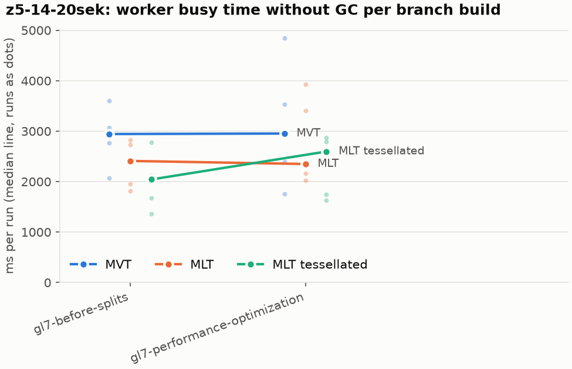
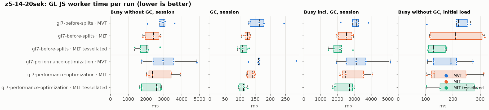
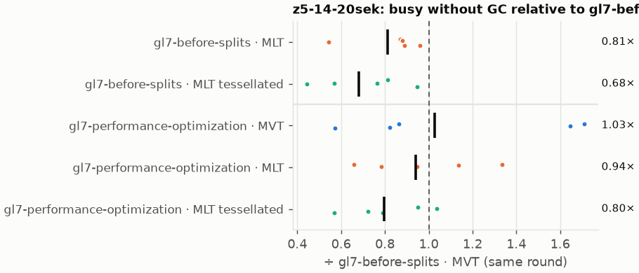
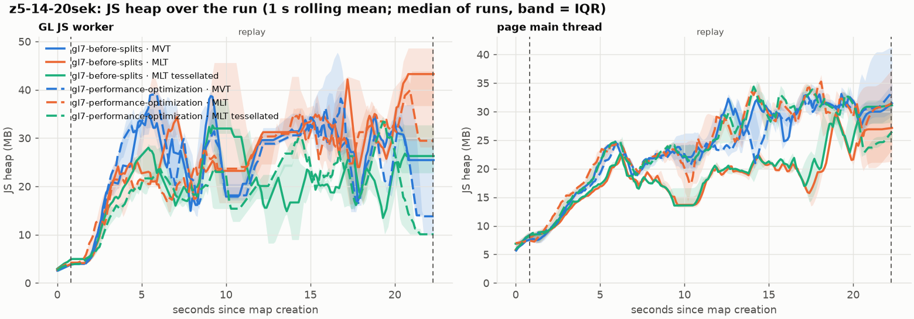
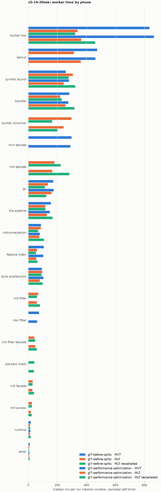
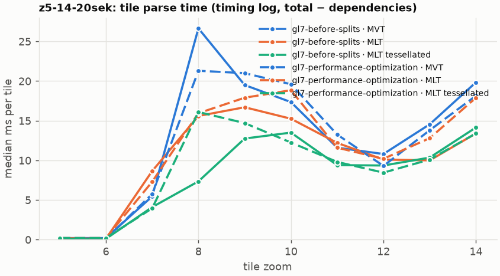
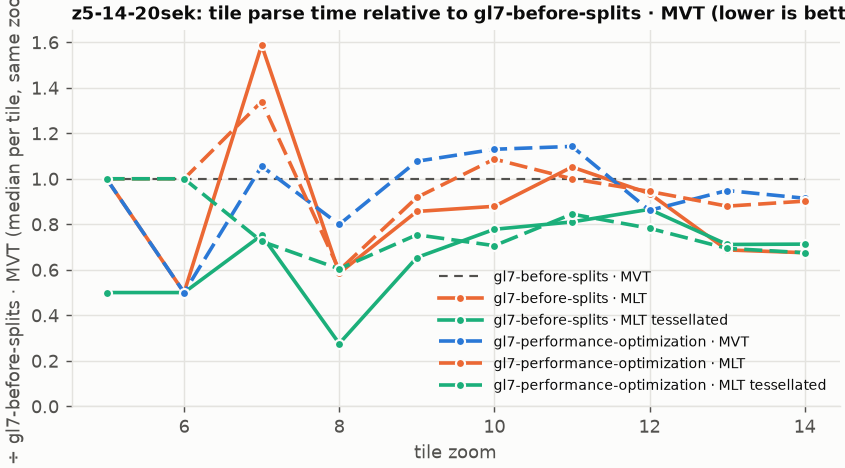

# Session trace benchmark — 20261027-151854-splits

## Setup

- Created 2026-10-27T15:18:54+01:00; 5 repetitions + 1 warm-up round(s) (excluded); variants rotate per round (A B C, B C A, …); one cold browser context per run.
- Machine: 13th Gen Intel(R) Core(TM) i7-1365U, 12 logical cores, 31.3 GB RAM, Windows-11-10.0.26200-SP0; power: GUID des Energieschemas: 381b4222-f694-41f0-9685-ff5bb260df2e  (Ausbalanciert), AC True.
- GL JS gl7-performance-optimization @ c539936344 (dirty); worker count 1; viewport {'width': 1280, 'height': 1024}.
- Python 3.12.2, packages {'playwright': '1.64.0', 'numpy': '2.5.3', 'matplotlib': '3.11.2'}.

| variant | bundle | format | bundle sha256 | branch build |
|---|---|---|---|---|
| gl7-before-splits · MVT | `bench-builds/branches/gl7-before-splits/maplibre-gl-dev.mjs` | mvt | `23d9e1c1efa6` | gl7-before-splits @ ef8500dcf4 (2026-10-27), MLT @ 9bf846d053 |
| gl7-before-splits · MLT | `bench-builds/branches/gl7-before-splits/maplibre-gl-dev.mjs` | mlt | `23d9e1c1efa6` | gl7-before-splits @ ef8500dcf4 (2026-10-27), MLT @ 9bf846d053 |
| gl7-before-splits · MLT tessellated | `bench-builds/branches/gl7-before-splits/maplibre-gl-dev.mjs` | mlt-pre-tess | `23d9e1c1efa6` | gl7-before-splits @ ef8500dcf4 (2026-10-27), MLT @ 9bf846d053 |
| gl7-performance-optimization · MVT | `bench-builds/branches/gl7-performance-optimization/maplibre-gl-dev.mjs` | mvt | `c1d3ac49797b` | gl7-performance-optimization @ c539936344 (2026-10-27), MLT @ 9bf846d053 |
| gl7-performance-optimization · MLT | `bench-builds/branches/gl7-performance-optimization/maplibre-gl-dev.mjs` | mlt | `c1d3ac49797b` | gl7-performance-optimization @ c539936344 (2026-10-27), MLT @ 9bf846d053 |
| gl7-performance-optimization · MLT tessellated | `bench-builds/branches/gl7-performance-optimization/maplibre-gl-dev.mjs` | mlt-pre-tess | `c1d3ac49797b` | gl7-performance-optimization @ c539936344 (2026-10-27), MLT @ 9bf846d053 |

| session | style | duration | frames | sha256 |
|---|---|---:|---:|---|
| z5-14-20sek | maptiler-basic | 21.4 s | 829 | `5a376e5ede30` |

CPU sampling interval (median over runs): 581 µs.

## Definitions

- **busy** = wall time in which a GL JS worker thread runs a task (union of top-level task slices and GC slices on `DedicatedWorker thread`s), summed over workers. **GC** = union of `MinorGC`/`MajorGC`/`V8.GC*` slices on those threads. **busy without GC** = busy − GC (headline metric).
- **CPU** = thread time (`tdur`) of the same slices. Phase categories and functions come from the trace's CPU samples (self time), categorised by `config/categories.toml` (nearest matching frame, leaf to root).
- Windows: **load** = map creation → first idle; **session** = camera replay; **tail** = end of replay → idle; **total** = load + session + tail.
- Ratios are against **gl7-before-splits · MVT**: ratio of medians with a bootstrap 95 % CI, the geometric mean of per-round ratios, and a two-sided Mann–Whitney U p-value (normal approximation, not corrected for multiple comparisons; rough below n = 8). Lower than 1× means less worker time.

## Session `z5-14-20sek`

### Worker busy without GC (session window)

| variant | n ok / failed | median ms | IQR | mean | ratio vs gl7-before-splits · MVT | 95 % CI | geo-mean paired | MWU p |
|---|---:|---:|---:|---:|---:|---:|---:|---:|
| gl7-before-splits · MVT | 5 / 0 | 2,943 | 2,770–3,070 | 2,889 | 1.00× | – | – | – |
| gl7-before-splits · MLT | 5 / 0 | 2,410 | 1,950–2,727 | 2,345 | 0.82× | 0.59–1.17× | 0.81× | 0.095 |
| gl7-before-splits · MLT tessellated | 5 / 0 | 2,042 | 1,680–2,115 | 1,996 | 0.69× | 0.46–1.00× | 0.68× | 0.060 |
| gl7-performance-optimization · MVT | 5 / 0 | 2,953 | 2,392–3,535 | 3,097 | 1.00× | 0.60–1.71× | 1.03× | 1.000 |
| gl7-performance-optimization · MLT | 5 / 0 | 2,349 | 2,167–3,405 | 2,774 | 0.80× | 0.65–1.42× | 0.94× | 0.835 |
| gl7-performance-optimization · MLT tessellated | 5 / 0 | 2,597 | 1,746–2,794 | 2,328 | 0.88× | 0.53–1.26× | 0.80× | 0.144 |

### All worker metrics (median, ratio vs baseline)

| metric | gl7-before-splits · MVT | gl7-before-splits · MLT | gl7-before-splits · MLT tessellated | gl7-performance-optimization · MVT | gl7-performance-optimization · MLT | gl7-performance-optimization · MLT tessellated |
|---|---:|---:|---:|---:|---:|---:|
| busy incl. GC | 3,106 | 2,534 (0.82×) | 2,144 (0.69×) | 3,113 (1.00×) | 2,499 (0.80×) | 2,708 (0.87×) |
| &nbsp;&nbsp;of which GC | 162.7 | 123.7 (0.76×) | 108.5 (0.67×) | 160.0 (0.98×) | 142.2 (0.87×) | 111.4 (0.68×) |
| &nbsp;&nbsp;of which busy without GC | 2,943 | 2,410 (0.82×) | 2,042 (0.69×) | 2,953 (1.00×) | 2,349 (0.80×) | 2,597 (0.88×) |
| &nbsp;&nbsp;&nbsp;&nbsp;of which filtering (sampled, incl. callees) | 73.6 | 68.7 (0.93×) | 59.9 (0.81×) | 61.0 (0.83×) | 58.9 (0.80×) | 80.5 (1.09×) |
| &nbsp;&nbsp;&nbsp;&nbsp;of which column decoding inside the MLT filter (sampled) | 0.0 | 42.1 | 47.4 | 0.0 | 48.2 | 59.0 |
| &nbsp;&nbsp;&nbsp;&nbsp;of which timing instrumentation (sampled) | 86.8 | 85.5 (0.99×) | 67.4 (0.78×) | 79.3 (0.91×) | 76.3 (0.88×) | 108.1 (1.24×) |
| busy without GC and instrumentation | 2,869 | 2,323 (0.81×) | 1,963 (0.68×) | 2,875 (1.00×) | 2,273 (0.79×) | 2,488 (0.87×) |
| CPU time without GC | 2,697 | 2,197 (0.81×) | 1,839 (0.68×) | 2,693 (1.00×) | 2,145 (0.80×) | 2,333 (0.86×) |
| tile: download end → sent to main thread, median per tile | 145.9 | 116.3 (0.80×) | 101.0 (0.69×) | 138.0 (0.95×) | 136.7 (0.94×) | 105.2 (0.72×) |
| tile: download end → sent to main thread, 90th percentile | 312.6 | 287.4 (0.92×) | 198.7 (0.64×) | 423.2 (1.35×) | 252.0 (0.81×) | 278.4 (0.89×) |
| tile: download end → sent to main thread, 95th percentile | 332.6 | 311.9 (0.94×) | 222.2 (0.67×) | 439.8 (1.32×) | 277.3 (0.83×) | 292.9 (0.88×) |
| tile: download end → sent to main thread, 99th percentile | 344.3 | 345.4 (1.00×) | 237.3 (0.69×) | 465.0 (1.35×) | 298.6 (0.87×) | 306.6 (0.89×) |
| &nbsp;&nbsp;parse part (timing log, incl. waiting for glyphs/icons), median per tile | 69.5 | 50.8 (0.73×) | 48.6 (0.70×) | 73.0 (1.05×) | 58.1 (0.84×) | 53.7 (0.77×) |
| &nbsp;&nbsp;queue + hand-off part, median per tile | 59.3 | 53.0 (0.89×) | 46.4 (0.78×) | 60.6 (1.02×) | 45.9 (0.77×) | 52.9 (0.89×) |
| minor GCs | 55.00 | 52.00 (0.95×) | 32.00 (0.58×) | 55.00 (1.00×) | 50.00 (0.91×) | 31.00 (0.56×) |
| major GCs | 6.00 | 4.00 (0.67×) | 7.00 (1.17×) | 5.00 (0.83×) | 5.00 (0.83×) | 5.00 (0.83×) |
| peak worker heap (MB) | 56.0 | 53.2 (0.95×) | 42.2 (0.75×) | 55.1 (0.98×) | 51.7 (0.92×) | 43.5 (0.78×) |
| load: busy without GC | 220.7 | 210.0 (0.95×) | 127.9 (0.58×) | 192.6 (0.87×) | 130.6 (0.59×) | 248.4 (1.13×) |
| load: GC | 6.3 | 6.2 (0.99×) | 4.9 (0.78×) | 5.4 (0.85×) | 3.8 (0.60×) | 7.0 (1.10×) |
| total: busy without GC | 3,208 | 2,727 (0.85×) | 2,215 (0.69×) | 3,082 (0.96×) | 2,454 (0.76×) | 2,845 (0.89×) |

Rows marked *of which* are parts of the row above, not additional time. Tile rows are per-tile latencies (medians over tiles, then over runs), not sums: tiles overlap in time, and the medians of the parse and queue parts do not add up exactly to the median latency.

### Filtering (session window)

Sampled worker time spent in feature filtering, including everything the filter calls (expression evaluation, property access): **row filter** = the style-spec feature filter that MVT runs per feature, **mlt filter** = the columnar MLT filter (incl. the geometry-type selection), without the columns it decodes (see the next table). Medians per run; rules in `config/categories.toml`.

| variant | mlt filter | row filter | filtering | ratio vs gl7-before-splits · MVT | 95 % CI | MWU p | share of sampled busy |
|---|---:|---:|---:|---:|---:|---:|---:|
| gl7-before-splits · MVT | 0.0 | 73.6 | 73.6 | 1.00× | – | – | 2.6% |
| gl7-before-splits · MLT | 68.7 | 0.0 | 68.7 | 0.93× | 0.58–1.49× | 0.835 | 3.0% |
| gl7-before-splits · MLT tessellated | 59.9 | 0.0 | 59.9 | 0.81× | 0.63–1.52× | 0.676 | 3.6% |
| gl7-performance-optimization · MVT | 0.0 | 61.0 | 61.0 | 0.83× | 0.46–2.00× | 1.000 | 2.1% |
| gl7-performance-optimization · MLT | 58.9 | 0.0 | 58.9 | 0.80× | 0.63–1.78× | 1.000 | 2.6% |
| gl7-performance-optimization · MLT tessellated | 80.5 | 0.0 | 80.5 | 1.09× | 0.59–1.70× | 1.000 | 3.3% |

**Filtering together with tile decoding.** The MLT decoder leaves columns encoded until something reads them, and the filter is usually the first reader: the columns it decodes (properties, and the geometry for `$type`) are **of which inside the filter** (phase *mlt filter decode*), the rest is *mlt decode* (geometry and columns read later, e.g. by paint properties and symbols). MVT decodes every feature's properties and geometry while it reads the tile (*mvt decode*), whether the filter keeps the feature or not. So **filtering** above compares the filters, and **decoding + filtering** compares all that the formats spend on decoding the tile and selecting features. **tile decoding** = *mvt decode* or *mlt decode* + *mlt filter decode*: work inside a call into a decoder. Reading data that is already decoded is not counted, as for MVT's feature objects: *mlt access* (row views, value getters, looking a column up by name) and the MLT facade (*mlt facade*). MVT decodes geometry only for the features its filter keeps, MLT decodes a layer's whole geometry column.

| variant | tile decoding | of which inside the filter | filtering | decoding + filtering | ratio vs gl7-before-splits · MVT | 95 % CI | MWU p |
|---|---:|---:|---:|---:|---:|---:|---:|
| gl7-before-splits · MVT | 297.2 | 0.0 | 73.6 | 362.7 | 1.00× | – | – |
| gl7-before-splits · MLT | 222.3 | 42.1 | 68.7 | 291.0 | 0.80× | 0.60–1.12× | 0.144 |
| gl7-before-splits · MLT tessellated | 273.6 | 47.4 | 59.9 | 334.0 | 0.92× | 0.62–1.33× | 0.531 |
| gl7-performance-optimization · MVT | 290.1 | 0.0 | 61.0 | 351.1 | 0.97× | 0.58–1.72× | 1.000 |
| gl7-performance-optimization · MLT | 212.4 | 48.2 | 58.9 | 271.3 | 0.75× | 0.60–1.42× | 0.676 |
| gl7-performance-optimization · MLT tessellated | 341.8 | 59.0 | 80.5 | 422.3 | 1.16× | 0.68–1.63× | 0.835 |

Top 12 functions inside filtering and its column decoding (self time, mean ms per run):

| phase | function | source | gl7-before-splits · MVT | gl7-before-splits · MLT | gl7-before-splits · MLT tessellated | gl7-performance-optimization · MVT | gl7-performance-optimization · MLT | gl7-performance-optimization · MLT tessellated |
|---|---|---|---:|---:|---:|---:|---:|---:|
| row filter | `evaluate` | node_modules/@maplibre/maplibre-gl-style-spec/dist/expression/compound_expression.mjs | 20.3 | 0.0 | 0.0 | 17.9 | 0.0 | 0.0 |
| row filter | `evaluate` | node_modules/@maplibre/maplibre-gl-style-spec/dist/expression/index.mjs | 17.6 | 0.0 | 0.0 | 17.9 | 0.0 | 0.0 |
| mlt filter decode | `unpackNullable` | maplibre-tile-spec/ts/dist/decoding/unpackNullableUtils.js | 0.0 | 9.4 | 9.4 | 0.0 | 12.3 | 10.5 |
| mlt filter | `filterByGeometryType` | maplibre-tile-spec/ts/dist/vector/geometry/geometryVector.js | 0.0 | 8.8 | 10.4 | 0.0 | 10.6 | 9.9 |
| row filter | `CompoundExpression.register.filter-==` | node_modules/@maplibre/maplibre-gl-style-spec/dist/expression/compound_expression.mjs | 6.9 | 0.0 | 0.0 | 8.9 | 0.0 | 0.0 |
| row filter | `CompoundExpression.register.filter-in-small` | node_modules/@maplibre/maplibre-gl-style-spec/dist/expression/compound_expression.mjs | 5.0 | 0.0 | 0.0 | 8.3 | 0.0 | 0.0 |
| row filter | `filter` | node_modules/@maplibre/maplibre-gl-style-spec/dist/feature_filter/index.mjs | 7.0 | 0.0 | 0.0 | 7.0 | 0.0 | 0.0 |
| mlt filter decode | `decodeFsst` | maplibre-tile-spec/ts/dist/decoding/fsstDecoder.js | 0.0 | 5.0 | 5.1 | 0.0 | 6.8 | 5.5 |
| mlt filter | `scanDictionaryCodes` | maplibre-tile-spec/ts/dist/processing/filter/execution/filterKernel.js | 0.0 | 6.0 | 6.0 | 0.0 | 6.5 | 6.3 |
| mlt filter | `dictionaryRowMatches` | maplibre-tile-spec/ts/dist/processing/filter/execution/filterKernel.js | 0.0 | 4.3 | 5.1 | 0.0 | 5.8 | 5.1 |
| mlt filter decode | `decodeLazyColumn` | maplibre-tile-spec/ts/dist/vector/lazyPropertyVectors.js | 0.0 | 4.6 | 2.4 | 0.0 | 4.4 | 5.3 |
| mlt filter | `resolveDictionaryExecutor` | maplibre-tile-spec/ts/dist/processing/filter/execution/filterKernel.js | 0.0 | 4.9 | 4.4 | 0.0 | 3.9 | 3.6 |

### Where the variants differ from gl7-before-splits · MVT (session window, mean ms per run)

Open **[flame.html](flame.html)** to explore the call tree interactively: pick a variant, compare it with gl7-before-splits · MVT (red = more time at the same call path, blue = less), click a frame to zoom in, and read the phase and function breakdown under it. Without a comparison, frames are coloured by phase: filtering is green in both formats, and the columns the MLT filter decodes on first access (*mlt filter decode*) are MLT blue frames under the green filter. `flame/*.txt` open in https://www.speedscope.app.

#### gl7-before-splits · MLT vs gl7-before-splits · MVT

**By phase** (sampled self time; the Δ column sums to the difference in sampled busy time):

| phase | gl7-before-splits · MVT | gl7-before-splits · MLT | Δ |
|---|---:|---:|---:|
| bucket columnar | 0.0 | 276.3 | +276.3 |
| mlt decode | 0.0 | 169.1 | +169.1 |
| mlt filter | 0.1 | 66.4 | +66.3 |
| mlt filter decode | 0.0 | 46.2 | +46.2 |
| symbol layout | 256.7 | 286.3 | +29.6 |
| mlt facade | 0.1 | 27.7 | +27.6 |
| mlt access | 0.0 | 24.6 | +24.6 |
| other | 8.5 | 5.5 | -3.0 |
| runtime | 17.9 | 14.7 | -3.3 |
| instrumentation | 87.1 | 75.0 | -12.1 |
| tile pipeline | 150.7 | 115.1 | -35.7 |
| feature index | 97.7 | 59.1 | -38.5 |
| gc | 178.5 | 132.5 | -46.0 |
| transfer | 271.9 | 219.6 | -52.2 |
| row filter | 71.3 | 0.0 | -71.3 |
| earcut | 452.4 | 336.6 | -115.9 |
| mvt decode | 281.6 | 0.0 | -281.6 |
| bucket row | 838.9 | 319.9 | -519.0 |

**By source layer** (timing log: createBucket + populate + addFeatures, summed over the style layers that use it; wall time, includes GC pauses; total Δ -371 ms):

| source layer | type | gl7-before-splits · MVT | gl7-before-splits · MLT | Δ |
|---|---|---:|---:|---:|
| place | symbol | 178.6 | 349.3 | +170.7 |
| waterway | line | 37.2 | 46.4 | +9.3 |
| poi | symbol | 31.1 | 38.3 | +7.2 |
| boundary | line | 33.5 | 39.5 | +5.9 |
| aeroway | fill | 0.8 | 2.6 | +1.8 |
| transportation | fill | 13.5 | 10.2 | -3.3 |
| water | fill | 52.4 | 46.8 | -5.7 |
| transportation | line | 473.7 | 431.1 | -42.6 |
| transportation_name | symbol | 116.6 | 73.3 | -43.3 |
| building | fill | 264.8 | 140.1 | -124.6 |
| landuse | fill | 383.0 | 233.5 | -149.5 |
| landcover | fill | 546.4 | 347.0 | -199.3 |

**Functions with the largest self-time difference** (by function name, summed over source files):

| function | gl7-before-splits · MVT | gl7-before-splits · MLT | Δ |
|---|---:|---:|---:|
| `buildRingBoundingBoxes` | 0.0 | 26.7 | +26.7 |
| `writeEarcutFill` | 0.0 | 26.4 | +26.4 |
| `buildEarcutMesh` | 0.0 | 24.5 | +24.5 |
| `decodeComponentwiseDeltaVec2` | 0.0 | 20.1 | +20.1 |
| `readScaledRings` | 0.0 | 14.8 | +14.8 |
| `get` | 10.6 | 25.1 | +14.5 |
| `unpackNullable` | 0.0 | 13.9 | +13.9 |
| `decodeString$2` | 0.0 | 12.6 | +12.6 |
| `registerGlyphs` | 0.0 | 9.6 | +9.6 |
| `decodeFastPforInt32` | 0.0 | 9.5 | +9.5 |
| `filterByGeometryType` | 0.0 | 8.8 | +8.8 |
| `appendSymbolFeature` | 0.0 | 8.7 | +8.7 |
| `_vertexToIndex` | 152.6 | 0.0 | -152.6 |
| `readSVarint` | 112.9 | 0.0 | -112.9 |
| `loadGeometry` | 73.8 | 8.5 | -65.4 |
| `isEar` | 143.9 | 85.3 | -58.6 |
| `(garbage collector)` | 178.5 | 132.5 | -46.0 |

#### gl7-before-splits · MLT tessellated vs gl7-before-splits · MVT

**By phase** (sampled self time; the Δ column sums to the difference in sampled busy time):

| phase | gl7-before-splits · MVT | gl7-before-splits · MLT tessellated | Δ |
|---|---:|---:|---:|
| mlt decode | 0.0 | 215.9 | +215.9 |
| bucket columnar | 0.0 | 167.4 | +167.4 |
| mlt filter | 0.1 | 65.6 | +65.5 |
| mlt filter decode | 0.0 | 43.6 | +43.6 |
| pre-tess mesh | 0.0 | 40.1 | +40.1 |
| mlt facade | 0.1 | 33.6 | +33.4 |
| mlt access | 0.0 | 26.3 | +26.3 |
| symbol layout | 256.7 | 279.6 | +22.9 |
| style expressions | 91.7 | 90.2 | -1.4 |
| other | 8.5 | 5.6 | -2.9 |
| runtime | 17.9 | 13.0 | -4.9 |
| instrumentation | 87.1 | 74.5 | -12.6 |
| tile pipeline | 150.7 | 116.9 | -33.8 |
| transfer | 271.9 | 222.7 | -49.2 |
| feature index | 97.7 | 44.4 | -53.2 |
| gc | 178.5 | 117.1 | -61.4 |
| row filter | 71.3 | 0.0 | -71.3 |
| mvt decode | 281.6 | 0.0 | -281.6 |
| earcut | 452.4 | 3.0 | -449.5 |
| bucket row | 838.9 | 325.8 | -513.1 |

**By source layer** (timing log: createBucket + populate + addFeatures, summed over the style layers that use it; wall time, includes GC pauses; total Δ -755 ms):

| source layer | type | gl7-before-splits · MVT | gl7-before-splits · MLT tessellated | Δ |
|---|---|---:|---:|---:|
| place | symbol | 178.6 | 343.3 | +164.7 |
| waterway | line | 37.2 | 50.9 | +13.7 |
| poi | symbol | 31.1 | 37.6 | +6.6 |
| boundary | line | 33.5 | 37.9 | +4.4 |
| transportation | fill | 13.5 | 15.5 | +2.0 |
| aeroway | fill | 0.8 | 2.8 | +2.0 |
| transportation | line | 473.7 | 461.7 | -12.0 |
| water | fill | 52.4 | 30.6 | -21.8 |
| transportation_name | symbol | 116.6 | 74.6 | -42.0 |
| building | fill | 264.8 | 63.7 | -201.1 |
| landuse | fill | 383.0 | 106.5 | -276.5 |
| landcover | fill | 546.4 | 148.3 | -398.1 |

**Functions with the largest self-time difference** (by function name, summed over source files):

| function | gl7-before-splits · MVT | gl7-before-splits · MLT tessellated | Δ |
|---|---:|---:|---:|
| `buildTessellatedBoundingBox` | 0.0 | 37.0 | +37.0 |
| `writeTessellatedFill` | 0.0 | 31.2 | +31.2 |
| `decodeUnsignedZigZagDeltaInt32` | 0.0 | 22.7 | +22.7 |
| `scaleCoordinate` | 0.0 | 18.8 | +18.8 |
| `decodeComponentwiseDeltaVec2` | 0.0 | 17.9 | +17.9 |
| `unpackNullable` | 0.0 | 14.2 | +14.2 |
| `decodeFastPforInt32` | 0.0 | 13.9 | +13.9 |
| `get` | 10.6 | 24.1 | +13.4 |
| `decodeString$2` | 0.0 | 12.4 | +12.4 |
| `appendSymbolFeature` | 0.0 | 11.6 | +11.6 |
| `resolveTokens` | 4.2 | 15.2 | +11.0 |
| `filterByGeometryType` | 0.0 | 10.4 | +10.4 |
| `_vertexToIndex` | 152.6 | 0.0 | -152.6 |
| `isEar` | 143.9 | 0.3 | -143.6 |
| `readSVarint` | 112.9 | 0.0 | -112.9 |
| `isEarHashed` | 84.9 | 0.0 | -84.9 |
| `loadGeometry` | 73.8 | 10.3 | -63.6 |

#### gl7-performance-optimization · MVT vs gl7-before-splits · MVT

**By phase** (sampled self time; the Δ column sums to the difference in sampled busy time):

| phase | gl7-before-splits · MVT | gl7-performance-optimization · MVT | Δ |
|---|---:|---:|---:|
| bucket row | 838.9 | 923.7 | +84.8 |
| mvt decode | 281.6 | 309.2 | +27.6 |
| symbol layout | 256.7 | 283.8 | +27.1 |
| earcut | 452.4 | 474.1 | +21.6 |
| gc | 178.5 | 192.1 | +13.6 |
| instrumentation | 87.1 | 99.5 | +12.5 |
| transfer | 271.9 | 282.3 | +10.4 |
| style expressions | 91.7 | 99.5 | +7.8 |
| feature index | 97.7 | 104.9 | +7.2 |
| row filter | 71.3 | 74.5 | +3.2 |
| tile pipeline | 150.7 | 149.1 | -1.7 |
| runtime | 17.9 | 15.6 | -2.3 |

**By source layer** (timing log: createBucket + populate + addFeatures, summed over the style layers that use it; wall time, includes GC pauses; total Δ +185 ms):

| source layer | type | gl7-before-splits · MVT | gl7-performance-optimization · MVT | Δ |
|---|---|---:|---:|---:|
| landcover | fill | 546.4 | 601.7 | +55.3 |
| transportation | line | 473.7 | 520.5 | +46.9 |
| landuse | fill | 383.0 | 416.1 | +33.1 |
| place | symbol | 178.6 | 208.0 | +29.5 |
| water | fill | 52.4 | 60.1 | +7.7 |
| waterway | line | 37.2 | 41.6 | +4.4 |
| building | fill | 264.8 | 269.2 | +4.4 |
| boundary | line | 33.5 | 36.6 | +3.1 |
| aerodrome_label | symbol | 4.8 | 6.3 | +1.5 |
| aeroway | line | 1.3 | 1.8 | +0.5 |
| transportation | fill | 13.5 | 13.6 | +0.1 |
| poi | symbol | 31.1 | 29.7 | -1.3 |

**Functions with the largest self-time difference** (by function name, summed over source files):

| function | gl7-before-splits · MVT | gl7-performance-optimization · MVT | Δ |
|---|---:|---:|---:|
| `addBucketFeatures` | 11.9 | 44.5 | +32.7 |
| `readSVarint` | 112.9 | 132.1 | +19.2 |
| `(garbage collector)` | 178.5 | 192.1 | +13.6 |
| `reserve` | 115.1 | 128.4 | +13.3 |
| `_vertexToIndex` | 152.6 | 163.4 | +10.7 |
| `loadGeometry` | 73.8 | 81.3 | +7.5 |
| `emplace` | 70.3 | 77.2 | +6.9 |
| `serialize` | 49.4 | 56.1 | +6.7 |
| `addHalfVertex` | 41.7 | 47.8 | +6.0 |
| `readVarint` | 46.2 | 52.2 | +6.0 |
| `addPhase` | 26.2 | 31.6 | +5.4 |
| `earcutLinked` | 39.6 | 45.0 | +5.4 |
| `populate` | 67.4 | 47.4 | -20.0 |
| `parse` | 31.5 | 26.1 | -5.4 |
| `evaluate` | 46.1 | 42.5 | -3.6 |
| `subdividePolygon` | 3.9 | 0.5 | -3.4 |
| `getClassRegistryKey` | 8.6 | 6.3 | -2.4 |

#### gl7-performance-optimization · MLT vs gl7-before-splits · MVT

**By phase** (sampled self time; the Δ column sums to the difference in sampled busy time):

| phase | gl7-before-splits · MVT | gl7-performance-optimization · MLT | Δ |
|---|---:|---:|---:|
| bucket columnar | 0.0 | 312.6 | +312.6 |
| mlt decode | 0.0 | 194.5 | +194.5 |
| mlt filter | 0.1 | 71.8 | +71.7 |
| mlt filter decode | 0.0 | 57.7 | +57.7 |
| mlt facade | 0.1 | 34.1 | +34.0 |
| symbol layout | 256.7 | 280.9 | +24.2 |
| mlt access | 0.0 | 22.7 | +22.7 |
| instrumentation | 87.1 | 106.8 | +19.7 |
| transfer | 271.9 | 288.3 | +16.4 |
| other | 8.5 | 7.3 | -1.2 |
| runtime | 17.9 | 12.5 | -5.4 |
| style expressions | 91.7 | 85.2 | -6.5 |
| tile pipeline | 150.7 | 142.1 | -8.6 |
| gc | 178.5 | 152.0 | -26.5 |
| feature index | 97.7 | 67.9 | -29.7 |
| earcut | 452.4 | 399.0 | -53.4 |
| row filter | 71.3 | 0.0 | -71.3 |
| mvt decode | 281.6 | 0.0 | -281.6 |
| bucket row | 838.9 | 429.7 | -409.2 |

**By source layer** (timing log: createBucket + populate + addFeatures, summed over the style layers that use it; wall time, includes GC pauses; total Δ -120 ms):

| source layer | type | gl7-before-splits · MVT | gl7-performance-optimization · MLT | Δ |
|---|---|---:|---:|---:|
| place | symbol | 178.6 | 256.1 | +77.5 |
| transportation | line | 473.7 | 533.9 | +60.2 |
| waterway | line | 37.2 | 58.7 | +21.5 |
| poi | symbol | 31.1 | 47.9 | +16.9 |
| boundary | line | 33.5 | 47.0 | +13.5 |
| transportation_name | symbol | 116.6 | 125.8 | +9.2 |
| water | fill | 52.4 | 57.6 | +5.1 |
| aeroway | line | 1.3 | 4.5 | +3.1 |
| aerodrome_label | symbol | 4.8 | 7.5 | +2.7 |
| building | fill | 264.8 | 167.0 | -97.8 |
| landuse | fill | 383.0 | 272.6 | -110.4 |
| landcover | fill | 546.4 | 424.6 | -121.8 |

**Functions with the largest self-time difference** (by function name, summed over source files):

| function | gl7-before-splits · MVT | gl7-performance-optimization · MLT | Δ |
|---|---:|---:|---:|
| `writeEarcutFill` | 0.0 | 34.7 | +34.7 |
| `buildRingBoundingBoxes` | 0.0 | 32.7 | +32.7 |
| `buildEarcutMesh` | 0.0 | 28.0 | +28.0 |
| `decodeComponentwiseDeltaVec2` | 0.0 | 23.3 | +23.3 |
| `readScaledRings` | 0.0 | 18.7 | +18.7 |
| `addBucketFeatures` | 11.9 | 30.3 | +18.4 |
| `unpackNullable` | 0.0 | 18.3 | +18.3 |
| `get` | 10.6 | 25.9 | +15.3 |
| `addLine` | 39.1 | 53.1 | +14.1 |
| `reserve` | 115.1 | 129.0 | +13.9 |
| `decodeFastPforInt32` | 0.0 | 12.8 | +12.8 |
| `decodeFsst` | 0.0 | 10.7 | +10.7 |
| `_vertexToIndex` | 152.6 | 0.0 | -152.6 |
| `readSVarint` | 112.9 | 0.0 | -112.9 |
| `loadGeometry` | 73.8 | 11.0 | -62.9 |
| `populate` | 67.4 | 10.7 | -56.6 |
| `readVarint` | 46.2 | 2.5 | -43.7 |

#### gl7-performance-optimization · MLT tessellated vs gl7-before-splits · MVT

**By phase** (sampled self time; the Δ column sums to the difference in sampled busy time):

| phase | gl7-before-splits · MVT | gl7-performance-optimization · MLT tessellated | Δ |
|---|---:|---:|---:|
| mlt decode | 0.0 | 242.5 | +242.5 |
| bucket columnar | 0.0 | 184.9 | +184.9 |
| mlt filter | 0.1 | 73.4 | +73.3 |
| mlt filter decode | 0.0 | 53.6 | +53.6 |
| pre-tess mesh | 0.0 | 40.8 | +40.8 |
| mlt facade | 0.1 | 35.1 | +35.0 |
| symbol layout | 256.7 | 285.4 | +28.7 |
| mlt access | 0.0 | 23.9 | +23.9 |
| transfer | 271.9 | 282.6 | +10.7 |
| instrumentation | 87.1 | 96.5 | +9.4 |
| tile pipeline | 150.7 | 152.5 | +1.7 |
| other | 8.5 | 9.7 | +1.2 |
| runtime | 17.9 | 14.9 | -3.1 |
| style expressions | 91.7 | 85.9 | -5.7 |
| feature index | 97.7 | 56.0 | -41.7 |
| gc | 178.5 | 114.3 | -64.2 |
| row filter | 71.3 | 0.0 | -71.3 |
| mvt decode | 281.6 | 0.0 | -281.6 |
| bucket row | 838.9 | 423.1 | -415.8 |
| earcut | 452.4 | 2.2 | -450.2 |

**By source layer** (timing log: createBucket + populate + addFeatures, summed over the style layers that use it; wall time, includes GC pauses; total Δ -596 ms):

| source layer | type | gl7-before-splits · MVT | gl7-performance-optimization · MLT tessellated | Δ |
|---|---|---:|---:|---:|
| place | symbol | 178.6 | 258.6 | +80.0 |
| transportation | line | 473.7 | 553.4 | +79.7 |
| waterway | line | 37.2 | 55.4 | +18.2 |
| poi | symbol | 31.1 | 46.7 | +15.6 |
| boundary | line | 33.5 | 49.0 | +15.5 |
| transportation_name | symbol | 116.6 | 130.5 | +13.8 |
| transportation | fill | 13.5 | 19.2 | +5.7 |
| aeroway | line | 1.3 | 5.0 | +3.7 |
| water | fill | 52.4 | 34.9 | -17.6 |
| building | fill | 264.8 | 65.5 | -199.2 |
| landuse | fill | 383.0 | 131.4 | -251.6 |
| landcover | fill | 546.4 | 182.1 | -364.3 |

**Functions with the largest self-time difference** (by function name, summed over source files):

| function | gl7-before-splits · MVT | gl7-performance-optimization · MLT tessellated | Δ |
|---|---:|---:|---:|
| `writeTessellatedFill` | 0.0 | 43.3 | +43.3 |
| `buildTessellatedBoundingBox` | 0.0 | 38.0 | +38.0 |
| `decodeUnsignedZigZagDeltaInt32` | 0.0 | 26.6 | +26.6 |
| `decodeComponentwiseDeltaVec2` | 0.0 | 22.3 | +22.3 |
| `scaleCoordinate` | 0.0 | 19.5 | +19.5 |
| `addBucketFeatures` | 11.9 | 31.0 | +19.1 |
| `unpackNullable` | 0.0 | 16.8 | +16.8 |
| `get` | 10.6 | 26.5 | +15.9 |
| `addLine` | 39.1 | 53.1 | +14.0 |
| `decodeBigEndianInt32sInto` | 0.0 | 12.3 | +12.3 |
| `decodeFastPforInt32` | 0.0 | 11.5 | +11.5 |
| `fastUnpack256_4` | 0.0 | 10.0 | +10.0 |
| `_vertexToIndex` | 152.6 | 0.0 | -152.6 |
| `isEar` | 143.9 | 0.6 | -143.4 |
| `readSVarint` | 112.9 | 0.0 | -112.9 |
| `isEarHashed` | 84.9 | 0.0 | -84.9 |
| `(garbage collector)` | 178.5 | 114.3 | -64.2 |

### Memory (session window)

**JS heap** = V8's used heap of the thread (`jsHeapSizeUsed` from the trace's `UpdateCounters`, about every 20 ms; the mean is time-weighted). It does not include ArrayBuffer contents, so the tile data itself (vertex, index and feature-index arrays) is not in it: **tile data sent to the main thread** is the size of the ArrayBuffers each tile result transfers (`web/worker_hook.js`), which then live on the main thread and are uploaded to the GPU. **garbage collected** = heap freed by the worker's GCs, a measure of how much it allocates. Medians per run; ratio of medians with a bootstrap 95 % CI.

| metric | gl7-before-splits · MVT | gl7-before-splits · MLT | gl7-before-splits · MLT tessellated | gl7-performance-optimization · MVT | gl7-performance-optimization · MLT | gl7-performance-optimization · MLT tessellated |
|---|---:|---:|---:|---:|---:|---:|
| worker JS heap, mean (MB) | 21.1 | 21.5 (1.02×, 0.87–1.32×) | 16.2 (0.77×, 0.69–0.99×) | 18.0 (0.85×, 0.77–1.82×) | 19.4 (0.92×, 0.80–1.19×) | 16.1 (0.76×, 0.68–0.99×) |
| worker JS heap, peak (MB) | 56.0 | 53.2 (0.95×, 0.71–1.08×) | 42.2 (0.75×, 0.56–0.88×) | 55.1 (0.98×, 0.74–2.05×) | 51.7 (0.92×, 0.69–1.05×) | 43.5 (0.78×, 0.58–0.88×) |
| worker JS heap after the last GC (MB) | 14.1 | 22.1 (1.57×, 0.66–2.63×) | 8.9 (0.63×, 0.35–1.04×) | 13.8 (0.98×, 0.54–2.47×) | 18.3 (1.30×, 0.68–2.34×) | 9.2 (0.65×, 0.36–1.08×) |
| garbage collected in the worker (MB) | 1,216 | 861.6 (0.71×, 0.70–0.73×) | 465.9 (0.38×, 0.38–0.41×) | 1,222 (1.00×, 0.97–1.04×) | 786.3 (0.65×, 0.62–0.67×) | 423.5 (0.35×, 0.34–0.36×) |
| main thread JS heap, mean (MB) | 22.6 | 18.0 (0.79×, 0.72–0.87×) | 18.1 (0.80×, 0.72–0.87×) | 22.2 (0.98×, 0.89–1.07×) | 21.7 (0.96×, 0.87–1.14×) | 22.4 (0.99×, 0.90–1.08×) |
| main thread JS heap, peak (MB) | 43.0 | 37.6 (0.87×, 0.76–0.91×) | 37.5 (0.87×, 0.76–0.91×) | 41.7 (0.97×, 0.85–1.09×) | 42.7 (0.99×, 0.87–1.16×) | 42.7 (0.99×, 0.87–1.04×) |
| main thread JS heap at the end of the replay (MB) | 30.3 | 27.2 (0.90×, 0.62–1.15×) | 31.1 (1.03×, 0.56–1.31×) | 30.8 (1.02×, 0.84–1.45×) | 31.1 (1.03×, 0.62–1.31×) | 24.9 (0.82×, 0.68–1.09×) |
| tile data sent to the main thread, total (MB) | 74.4 | 62.9 (0.85×, 0.83–0.86×) | 62.9 (0.85×, 0.83–0.86×) | 74.4 (1.00×, 0.97–1.02×) | 70.9 (0.95×, 0.93–0.97×) | 71.0 (0.95×, 0.93–0.97×) |
| tile data sent to the main thread, median per tile (KB) | 511.8 | 399.8 (0.78×, 0.76–0.81×) | 403.1 (0.79×, 0.76–0.80×) | 511.8 (1.00×, 0.96–1.01×) | 502.7 (0.98×, 0.91–0.99×) | 490.8 (0.96×, 0.93–0.97×) |

### Worker time by phase (session window, median ms of sampled self time)

| phase | gl7-before-splits · MVT | gl7-before-splits · MLT | gl7-before-splits · MLT tessellated | gl7-performance-optimization · MVT | gl7-performance-optimization · MLT | gl7-performance-optimization · MLT tessellated |
|---|---:|---:|---:|---:|---:|---:|
| bucket row | 834.4 | 339.6 | 322.7 | 864.8 | 364.2 | 459.9 |
| earcut | 474.6 | 315.0 | 2.8 | 462.6 | 361.4 | 2.0 |
| symbol layout | 257.3 | 307.1 | 278.7 | 281.1 | 244.0 | 324.2 |
| transfer | 283.3 | 218.7 | 230.3 | 276.2 | 256.7 | 316.6 |
| bucket columnar | 0.0 | 297.2 | 164.9 | 0.0 | 242.6 | 200.5 |
| mvt decode | 297.2 | 0.0 | 0.0 | 290.1 | 0.0 | 0.0 |
| mlt decode | 0.0 | 180.1 | 222.2 | 0.0 | 164.2 | 282.8 |
| gc | 171.0 | 134.6 | 114.1 | 174.6 | 159.7 | 123.1 |
| tile pipeline | 155.1 | 116.2 | 117.8 | 148.6 | 126.9 | 166.4 |
| instrumentation | 86.8 | 85.5 | 67.4 | 79.3 | 76.3 | 108.1 |
| feature index | 106.1 | 59.9 | 53.0 | 103.3 | 53.9 | 61.9 |
| style expressions | 92.8 | 96.2 | 90.8 | 104.3 | 79.6 | 98.3 |
| mlt filter | 0.0 | 68.7 | 59.9 | 0.0 | 58.9 | 80.5 |
| row filter | 73.6 | 0.0 | 0.0 | 61.0 | 0.0 | 0.0 |
| mlt filter decode | 0.0 | 42.1 | 47.4 | 0.0 | 48.2 | 59.0 |
| pre-tess mesh | 0.0 | 0.0 | 41.8 | 0.0 | 0.0 | 38.1 |
| mlt facade | 0.0 | 30.0 | 29.1 | 0.0 | 28.2 | 39.1 |
| mlt access | 0.0 | 24.4 | 24.9 | 0.0 | 17.9 | 23.7 |
| runtime | 17.1 | 11.7 | 13.3 | 14.1 | 10.9 | 16.0 |
| other | 9.6 | 6.2 | 5.3 | 7.2 | 6.9 | 9.7 |

### Top 20 worker functions by self time (session window, mean ms per run)

| function | source | phase | gl7-before-splits · MVT | gl7-before-splits · MLT | gl7-before-splits · MLT tessellated | gl7-performance-optimization · MVT | gl7-performance-optimization · MLT | gl7-performance-optimization · MLT tessellated |
|---|---|---|---:|---:|---:|---:|---:|---:|
| `(garbage collector)` | (native) | gc | 178.5 | 132.5 | 117.1 | 192.1 | 152.0 | 114.3 |
| `_vertexToIndex` | src/render/subdivision.ts | bucket row | 152.6 | 0.0 | 0.0 | 163.4 | 0.0 | 0.0 |
| `isEar` | node_modules/earcut/src/earcut.js | earcut | 143.9 | 85.3 | 0.3 | 143.9 | 100.6 | 0.6 |
| `readSVarint` | node_modules/pbf/index.js | mvt decode | 112.9 | 0.0 | 0.0 | 132.1 | 0.0 | 0.0 |
| `reserve` | src/util/struct_array.ts | feature index | 115.1 | 105.3 | 102.1 | 128.4 | 129.0 | 122.8 |
| `isEarHashed` | node_modules/earcut/src/earcut.js | earcut | 84.9 | 58.8 | 0.0 | 88.8 | 71.3 | 0.0 |
| `emplace` | src/data/array_types.g.ts | bucket columnar | 70.3 | 53.0 | 52.7 | 77.2 | 79.2 | 74.2 |
| `setTimeout` | (native) | transfer | 66.3 | 67.1 | 63.3 | 68.2 | 72.1 | 64.9 |
| `postMessage` | (native) | transfer | 58.5 | 50.3 | 49.1 | 56.1 | 58.7 | 57.7 |
| `fetch` | (native) | tile pipeline | 52.8 | 49.9 | 49.8 | 54.8 | 57.1 | 56.9 |
| `addLine` | src/data/bucket/line_bucket.ts | bucket row | 39.1 | 38.6 | 42.0 | 43.0 | 53.1 | 53.1 |
| `_trim` | src/util/struct_array.ts | transfer | 52.2 | 35.2 | 37.7 | 52.8 | 49.5 | 52.0 |
| `readVarint` | node_modules/pbf/index.js | mvt decode | 46.2 | 0.0 | 0.0 | 52.2 | 0.0 | 0.0 |
| `insert` | src/data/feature_index.ts | feature index | 50.5 | 17.6 | 14.4 | 49.7 | 20.2 | 16.0 |
| `addHalfVertex` | src/data/bucket/line_bucket.ts | bucket row | 41.7 | 42.3 | 35.1 | 47.8 | 49.3 | 47.5 |
| `populate` | src/data/bucket/line_bucket.ts | bucket row | 47.3 | 0.0 | 0.0 | 30.1 | 0.0 | 0.0 |
| `earcutLinked` | node_modules/earcut/src/earcut.js | earcut | 39.6 | 35.7 | 1.1 | 45.0 | 32.7 | 0.0 |
| `serialize` | src/util/web_worker_transfer.ts | transfer | 38.7 | 33.1 | 32.6 | 44.9 | 43.5 | 43.0 |
| `writeTessellatedFill` | src/data/bucket/columnar/columnar_mesh_arrays.ts | bucket columnar | 0.0 | 0.0 | 31.2 | 0.0 | 0.0 | 43.3 |
| `addCurrentVertex` | src/data/bucket/line_bucket.ts | bucket row | 32.9 | 29.4 | 36.2 | 33.7 | 43.0 | 39.9 |

### Top 20 worker functions by total time (incl. callees) (session window, mean ms per run)

| function | source | phase | gl7-before-splits · MVT | gl7-before-splits · MLT | gl7-before-splits · MLT tessellated | gl7-performance-optimization · MVT | gl7-performance-optimization · MLT | gl7-performance-optimization · MLT tessellated |
|---|---|---|---:|---:|---:|---:|---:|---:|
| `parse` | src/source/worker_tile.ts | tile pipeline | 2,181 | 1,813 | 1,451 | 2,360 | 2,092 | 1,642 |
| `loadTile` | src/source/vector_tile_worker_source.ts | tile pipeline | 2,022 | 1,627 | 1,269 | 2,181 | 1,880 | 1,424 |
| `_parseWorkerTile` | src/source/vector_tile_worker_source.ts | tile pipeline | 1,925 | 1,569 | 1,217 | 2,079 | 1,815 | 1,361 |
| `populate` | src/data/bucket/fill_bucket.ts | bucket row | 1,131 | 0.0 | 0.0 | 1,213 | 0.0 | 0.0 |
| `addBucketFeatures` | src/data/bucket/fill_bucket.ts | bucket row | 930.4 | 553.1 | 115.0 | 987.3 | 669.8 | 140.8 |
| `addFeature` | src/data/bucket/fill_bucket.ts | bucket row | 866.1 | 0.0 | 0.0 | 917.5 | 0.0 | 0.0 |
| `populate` | src/data/bucket/columnar/columnar_fill_bucket.ts | bucket columnar | 0.0 | 690.3 | 333.2 | 0.0 | 835.2 | 390.9 |
| `subdividePolygon` | src/render/subdivision.ts | bucket row | 741.3 | 0.0 | 0.0 | 780.8 | 0.0 | 0.0 |
| `subdividePolygonInternal` | src/render/subdivision.ts | bucket row | 732.6 | 0.0 | 0.0 | 775.4 | 0.0 | 0.0 |
| `addFeature` | src/data/bucket/columnar/columnar_fill_bucket.ts | bucket columnar | 0.0 | 534.1 | 104.7 | 0.0 | 646.7 | 129.7 |
| `writeEarcutFill` | src/data/bucket/columnar/columnar_mesh_arrays.ts | bucket columnar | 0.0 | 527.2 | 5.5 | 0.0 | 638.0 | 6.7 |
| `populate` | src/data/bucket/columnar/columnar_line_bucket.ts | bucket columnar | 0.0 | 432.6 | 448.4 | 0.0 | 539.3 | 538.5 |
| `populate` | src/data/bucket/line_bucket.ts | bucket row | 446.4 | 0.0 | 0.0 | 497.4 | 0.0 | 0.0 |
| `earcut` | node_modules/earcut/src/earcut.js | earcut | 452.3 | 336.2 | 3.0 | 473.7 | 398.7 | 2.2 |
| `buildEarcutMesh` | src/data/bucket/columnar/columnar_mesh_arrays.ts | bucket columnar | 0.0 | 376.9 | 3.5 | 0.0 | 446.1 | 3.2 |
| `addBucketFeatures` | src/data/bucket/line_bucket.ts | bucket row | 0.0 | 0.0 | 0.0 | 354.7 | 384.2 | 384.5 |
| `earcutLinked` | node_modules/earcut/src/earcut.js | earcut | 363.1 | 265.5 | 1.5 | 380.9 | 310.5 | 0.6 |
| `addFeature` | src/data/bucket/line_bucket.ts | bucket row | 249.0 | 232.7 | 242.7 | 271.2 | 299.6 | 301.2 |
| `processTask` | src/util/actor.ts | transfer | 267.3 | 201.9 | 200.6 | 285.8 | 288.6 | 286.3 |
| `addLine` | src/data/bucket/line_bucket.ts | bucket row | 221.8 | 209.4 | 220.3 | 246.2 | 273.1 | 268.6 |

### Tile parse time by zoom (timing log, median ms per tile, total − dependencies)

| zoom | gl7-before-splits · MVT | gl7-before-splits · MLT | gl7-before-splits · MLT tessellated | gl7-performance-optimization · MVT | gl7-performance-optimization · MLT | gl7-performance-optimization · MLT tessellated |
|---:|---:|---:|---:|---:|---:|---:|
| 5 | 0.20 (n=45) | 0.20 (n=45) | 0.10 (n=45) | 0.20 (n=45) | 0.20 (n=45) | 0.20 (n=45) |
| 6 | 0.20 (n=45) | 0.10 (n=45) | 0.10 (n=45) | 0.10 (n=45) | 0.20 (n=45) | 0.20 (n=45) |
| 7 | 5.45 (n=30) | 8.65 (n=30) | 4.10 (n=30) | 5.75 (n=30) | 7.30 (n=30) | 3.95 (n=30) |
| 8 | 26.65 (n=24) | 15.60 (n=38) | 7.35 (n=44) | 21.30 (n=28) | 15.95 (n=32) | 16.10 (n=26) |
| 9 | 19.50 (n=80) | 16.70 (n=80) | 12.75 (n=80) | 21.00 (n=80) | 17.90 (n=80) | 14.70 (n=80) |
| 10 | 17.35 (n=100) | 15.25 (n=100) | 13.50 (n=98) | 19.60 (n=100) | 18.85 (n=100) | 12.25 (n=100) |
| 11 | 11.60 (n=75) | 12.20 (n=76) | 9.40 (n=70) | 13.25 (n=70) | 11.60 (n=73) | 9.80 (n=69) |
| 12 | 10.80 (n=100) | 10.10 (n=100) | 9.35 (n=98) | 9.30 (n=103) | 10.20 (n=103) | 8.45 (n=100) |
| 13 | 14.55 (n=108) | 10.00 (n=105) | 10.35 (n=104) | 13.80 (n=107) | 12.80 (n=102) | 10.10 (n=103) |
| 14 | 19.85 (n=90) | 13.40 (n=90) | 14.15 (n=90) | 18.15 (n=90) | 17.90 (n=90) | 13.40 (n=90) |

### Tile latency by zoom: download end → result sent to the main thread (session window, ms per tile: median / p95 / p99)

Includes waiting in the worker's queue, the parse and posting the result; see `tile_latency.csv` for the per-tile split (`parse_ms`, `wait_ms`). Percentiles over the tiles of all runs; with few tiles (n) p99 is close to the maximum.

| zoom | gl7-before-splits · MVT | gl7-before-splits · MLT | gl7-before-splits · MLT tessellated | gl7-performance-optimization · MVT | gl7-performance-optimization · MLT | gl7-performance-optimization · MLT tessellated |
|---:|---:|---:|---:|---:|---:|---:|
| 6 | 48.6 / 73.3 / 87.3 (n=45) | 44.3 / 82.3 / 84.4 (n=45) | 31.6 / 48.8 / 49.7 (n=45) | 38.6 / 77.0 / 88.8 (n=45) | 36.6 / 74.7 / 89.4 (n=45) | 41.4 / 82.0 / 94.2 (n=45) |
| 7 | 104.6 / 190.5 / 199.6 (n=30) | 93.4 / 129.6 / 133.6 (n=30) | 49.6 / 61.5 / 62.1 (n=30) | 100.3 / 228.5 / 248.7 (n=30) | 81.5 / 156.2 / 162.2 (n=30) | 67.9 / 102.9 / 105.5 (n=30) |
| 8 | 198.2 / 238.6 / 240.4 (n=24) | 176.8 / 262.2 / 265.6 (n=38) | 98.2 / 163.3 / 164.9 (n=44) | 180.1 / 287.7 / 298.1 (n=28) | 168.6 / 229.4 / 230.6 (n=32) | 135.3 / 206.3 / 207.7 (n=26) |
| 9 | 230.4 / 409.0 / 415.2 (n=80) | 174.8 / 357.0 / 362.6 (n=80) | 111.2 / 271.6 / 276.8 (n=80) | 212.1 / 514.0 / 520.5 (n=80) | 200.5 / 398.6 / 411.8 (n=80) | 147.8 / 290.5 / 305.2 (n=80) |
| 10 | 241.3 / 333.9 / 343.9 (n=100) | 180.9 / 308.6 / 318.9 (n=100) | 139.0 / 235.2 / 242.0 (n=98) | 177.6 / 540.9 / 560.4 (n=100) | 210.3 / 412.3 / 427.2 (n=100) | 159.4 / 391.4 / 399.1 (n=100) |
| 11 | 106.1 / 174.2 / 189.4 (n=75) | 106.6 / 188.5 / 203.5 (n=76) | 90.2 / 183.3 / 191.6 (n=70) | 135.2 / 242.7 / 254.1 (n=70) | 92.4 / 203.0 / 208.7 (n=73) | 83.9 / 191.6 / 199.3 (n=69) |
| 12 | 65.2 / 231.6 / 245.6 (n=100) | 50.0 / 158.6 / 162.5 (n=100) | 58.4 / 199.8 / 212.0 (n=98) | 86.7 / 273.4 / 282.3 (n=103) | 67.7 / 256.5 / 279.3 (n=103) | 55.5 / 263.3 / 267.9 (n=100) |
| 13 | 169.3 / 334.9 / 360.1 (n=108) | 98.0 / 254.0 / 266.1 (n=105) | 117.8 / 229.6 / 237.9 (n=104) | 148.3 / 399.0 / 417.7 (n=107) | 142.9 / 360.9 / 374.6 (n=102) | 121.0 / 303.8 / 314.5 (n=103) |
| 14 | 210.7 / 387.7 / 434.0 (n=90) | 136.2 / 347.8 / 360.0 (n=90) | 132.2 / 227.5 / 238.4 (n=90) | 196.7 / 504.3 / 537.5 (n=90) | 180.9 / 429.9 / 458.8 (n=90) | 137.7 / 366.7 / 404.0 (n=90) |

## Runs

36 ok, 0 failed/aborted, 0 not run, 30 used in statistics.

## Validity checks

- Counted once: all 36 analysed runs pass (windows load + session + tail add up to total; phases add up to the sampled busy time; GC and sampled time lie within busy time; no timing-log line twice).
- other programs used 1.62–10.05 logical processors during the replays (median 3.90)
- 30 run(s) with more than 0.5 cores of background load: z5-14-20sek/gl7-before-splits.mlt/rep-01 (2.92), z5-14-20sek/gl7-before-splits.mlt-pre-tess/rep-01 (4.48), z5-14-20sek/gl7-performance-optimization.mvt/rep-01 (3.75), z5-14-20sek/gl7-performance-optimization.mlt/rep-01 (7.70), z5-14-20sek/gl7-performance-optimization.mlt-pre-tess/rep-01 (6.13), z5-14-20sek/gl7-before-splits.mvt/rep-01 (8.32)
- 6 of 6 rounds parsed different tile sets across variants (e.g. z5-14-20sek round 0: gl7-before-splits.mvt 126 tiles, gl7-before-splits.mlt 123 tiles, gl7-before-splits.mlt-pre-tess 130 tiles, gl7-performance-optimization.mvt 130 tiles, gl7-performance-optimization.mlt 130 tiles, gl7-performance-optimization.mlt-pre-tess 131 tiles; z5-14-20sek round 1: gl7-before-splits.mlt 130 tiles, gl7-before-splits.mlt-pre-tess 127 tiles, gl7-performance-optimization.mvt 128 tiles, gl7-performance-optimization.mlt 126 tiles, gl7-performance-optimization.mlt-pre-tess 122 tiles, gl7-before-splits.mvt 126 tiles; z5-14-20sek round 2: gl7-before-splits.mlt-pre-tess 124 tiles, gl7-performance-optimization.mvt 123 tiles, gl7-performance-optimization.mlt 120 tiles, gl7-performance-optimization.mlt-pre-tess 123 tiles, gl7-before-splits.mvt 126 tiles, gl7-before-splits.mlt 130 tiles; z5-14-20sek round 3: gl7-performance-optimization.mvt 128 tiles, gl7-performance-optimization.mlt 134 tiles, gl7-performance-optimization.mlt-pre-tess 127 tiles, gl7-before-splits.mvt 124 tiles, gl7-before-splits.mlt 128 tiles, gl7-before-splits.mlt-pre-tess 130 tiles; z5-14-20sek round 4: gl7-performance-optimization.mlt 128 tiles, gl7-performance-optimization.mlt-pre-tess 126 tiles, gl7-before-splits.mvt 126 tiles, gl7-before-splits.mlt 130 tiles, gl7-before-splits.mlt-pre-tess 130 tiles, gl7-performance-optimization.mvt 130 tiles); no run went past z14, so this is timing: which tiles finish loading before the camera moves on, and which get cancelled; compare per-tile metrics (by zoom) rather than totals when the counts differ a lot

## Files

- `runs.csv`: one row per run (incl. failed and warm-up runs), every scalar metric as `<window>.<metric>`.
- `summary.csv`: session × variant × metric statistics.
- `functions.csv`, `categories.csv`: CPU-sample self/total time per function and phase per run and window.
- `category_functions.csv`: self time per phase × function (e.g. what the filters spend their time on).
- `tiles.csv`, `tile_layers.csv`, `tile_phases.csv`: the per-tile worker timing log, long format.
- `flame.html`: interactive call tree per variant with a diff view; `flame/*.txt`: collapsed stacks for speedscope.
- `analysis/stacks.csv` (per run): sampled self time per full call stack.
- `tile_latency.csv`: per tile request, worker clock: received, download start/end, result sent, latency = sent − download end, parse_ms, wait_ms = latency − parse.
- `runs/<session>/<variant>/rep-NN/trace.json.gz`: the raw trace (opens in the DevTools Performance tab).
