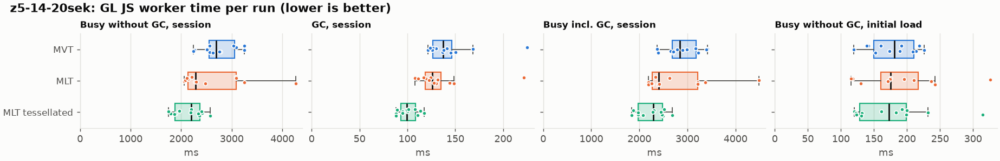
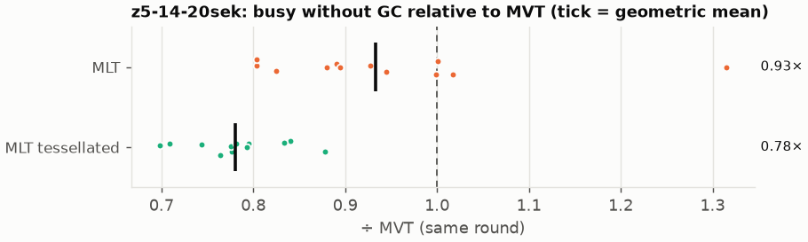
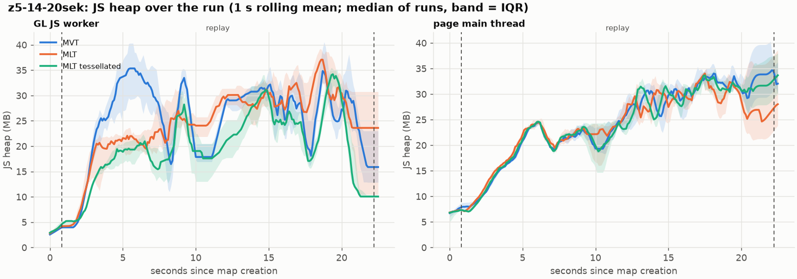
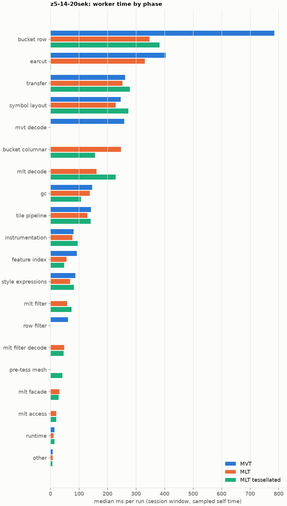
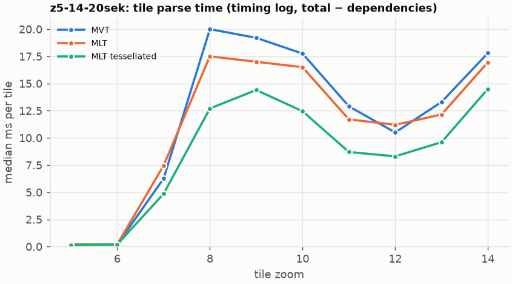
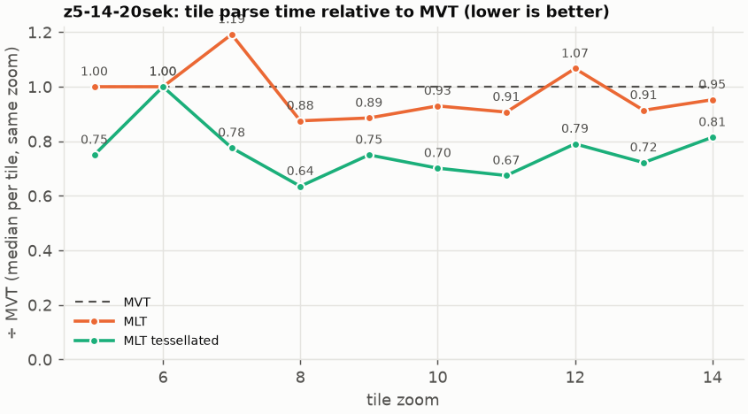

# Session trace benchmark — 20261028-072929

## Setup

- Created 2026-10-28T07:29:29+01:00; 12 repetitions + 1 warm-up round(s) (excluded); variants rotate per round (A B C, B C A, …); one cold browser context per run.
- Machine: 13th Gen Intel(R) Core(TM) i7-1365U, 12 logical cores, 31.3 GB RAM, Windows-11-10.0.26200-SP0; power: GUID des Energieschemas: 381b4222-f694-41f0-9685-ff5bb260df2e  (Ausbalanciert), AC True.
- GL JS gl7-performance-optimization @ c539936344 (dirty); worker count 1; viewport {'width': 1280, 'height': 1024}.
- Python 3.12.2, packages {'playwright': '1.64.0', 'numpy': '2.5.3', 'matplotlib': '3.11.2'}.

| variant | bundle | format | bundle sha256 | branch build |
|---|---|---|---|---|
| MVT | `dist/maplibre-gl-dev.mjs` | mvt | `0f0319f135a2` | – |
| MLT | `dist/maplibre-gl-dev.mjs` | mlt | `0f0319f135a2` | – |
| MLT tessellated | `dist/maplibre-gl-dev.mjs` | mlt-pre-tess | `0f0319f135a2` | – |

| session | style | duration | frames | sha256 |
|---|---|---:|---:|---|
| z5-14-20sek | maptiler-basic | 21.4 s | 829 | `5a376e5ede30` |

CPU sampling interval (median over runs): 580 µs.

## Definitions

- **busy** = wall time in which a GL JS worker thread runs a task (union of top-level task slices and GC slices on `DedicatedWorker thread`s), summed over workers. **GC** = union of `MinorGC`/`MajorGC`/`V8.GC*` slices on those threads. **busy without GC** = busy − GC (headline metric).
- **CPU** = thread time (`tdur`) of the same slices. Phase categories and functions come from the trace's CPU samples (self time), categorised by `config/categories.toml` (nearest matching frame, leaf to root).
- Windows: **load** = map creation → first idle; **session** = camera replay; **tail** = end of replay → idle; **total** = load + session + tail.
- Ratios are against **MVT**: ratio of medians with a bootstrap 95 % CI, the geometric mean of per-round ratios, and a two-sided Mann–Whitney U p-value (normal approximation, not corrected for multiple comparisons; rough below n = 8). Lower than 1× means less worker time.

## Session `z5-14-20sek`

### Worker busy without GC (session window)

| variant | n ok / failed | median ms | IQR | mean | ratio vs MVT | 95 % CI | geo-mean paired | MWU p |
|---|---:|---:|---:|---:|---:|---:|---:|---:|
| MVT | 12 / 0 | 2,696 | 2,551–3,052 | 2,745 | 1.00× | – | – | – |
| MLT | 12 / 0 | 2,286 | 2,131–3,088 | 2,612 | 0.85× | 0.73–1.17× | 0.93× | 0.194 |
| MLT tessellated | 12 / 0 | 2,196 | 1,880–2,367 | 2,144 | 0.81× | 0.66–0.92× | 0.78× | <0.001 |

### All worker metrics (median, ratio vs baseline)

| metric | MVT | MLT | MLT tessellated |
|---|---:|---:|---:|
| busy incl. GC | 2,842 | 2,401 (0.84×) | 2,291 (0.81×) |
| &nbsp;&nbsp;of which GC | 137.4 | 126.0 (0.92×) | 99.6 (0.73×) |
| &nbsp;&nbsp;of which busy without GC | 2,696 | 2,286 (0.85×) | 2,196 (0.81×) |
| &nbsp;&nbsp;&nbsp;&nbsp;of which filtering (sampled, incl. callees) | 61.4 | 58.9 (0.96×) | 73.9 (1.20×) |
| &nbsp;&nbsp;&nbsp;&nbsp;of which column decoding inside the MLT filter (sampled) | 0.0 | 47.9 | 46.5 |
| &nbsp;&nbsp;&nbsp;&nbsp;of which timing instrumentation (sampled) | 80.9 | 77.1 (0.95×) | 95.8 (1.18×) |
| busy without GC and instrumentation | 2,610 | 2,211 (0.85×) | 2,094 (0.80×) |
| CPU time without GC | 2,471 | 2,096 (0.85×) | 2,031 (0.82×) |
| tile: download end → sent to main thread, median per tile | 133.8 | 119.5 (0.89×) | 114.0 (0.85×) |
| tile: download end → sent to main thread, 90th percentile | 280.9 | 238.9 (0.85×) | 241.9 (0.86×) |
| tile: download end → sent to main thread, 95th percentile | 303.7 | 251.2 (0.83×) | 257.0 (0.85×) |
| tile: download end → sent to main thread, 99th percentile | 322.1 | 267.3 (0.83×) | 276.4 (0.86×) |
| &nbsp;&nbsp;parse part (timing log, incl. waiting for glyphs/icons), median per tile | 67.4 | 58.6 (0.87×) | 55.9 (0.83×) |
| &nbsp;&nbsp;queue + hand-off part, median per tile | 61.0 | 53.3 (0.87×) | 50.0 (0.82×) |
| minor GCs | 56.00 | 49.00 (0.88×) | 32.00 (0.57×) |
| major GCs | 4.50 | 5.50 (1.22×) | 5.50 (1.22×) |
| peak worker heap (MB) | 50.4 | 51.4 (1.02×) | 43.6 (0.86×) |
| load: busy without GC | 181.3 | 174.8 (0.96×) | 172.5 (0.95×) |
| load: GC | 5.4 | 5.3 (1.00×) | 5.2 (0.96×) |
| total: busy without GC | 2,864 | 2,457 (0.86×) | 2,350 (0.82×) |

Rows marked *of which* are parts of the row above, not additional time. Tile rows are per-tile latencies (medians over tiles, then over runs), not sums: tiles overlap in time, and the medians of the parse and queue parts do not add up exactly to the median latency.

### Filtering (session window)

Sampled worker time spent in feature filtering, including everything the filter calls (expression evaluation, property access): **row filter** = the style-spec feature filter that MVT runs per feature, **mlt filter** = the columnar MLT filter (incl. the geometry-type selection), without the columns it decodes (see the next table). Medians per run; rules in `config/categories.toml`.

| variant | mlt filter | row filter | filtering | ratio vs MVT | 95 % CI | MWU p | share of sampled busy |
|---|---:|---:|---:|---:|---:|---:|---:|
| MVT | 0.0 | 61.1 | 61.4 | 1.00× | – | – | 2.3% |
| MLT | 58.9 | 0.0 | 58.9 | 0.96× | 0.78–1.41× | 0.795 | 2.7% |
| MLT tessellated | 73.9 | 0.0 | 73.9 | 1.20× | 0.83–1.41× | 0.470 | 3.4% |

**Filtering together with tile decoding.** The MLT decoder leaves columns encoded until something reads them, and the filter is usually the first reader: the columns it decodes (properties, and the geometry for `$type`) are **of which inside the filter** (phase *mlt filter decode*), the rest is *mlt decode* (geometry and columns read later, e.g. by paint properties and symbols). MVT decodes every feature's properties and geometry while it reads the tile (*mvt decode*), whether the filter keeps the feature or not. So **filtering** above compares the filters, and **decoding + filtering** compares all that the formats spend on decoding the tile and selecting features. **tile decoding** = *mvt decode* or *mlt decode* + *mlt filter decode*: work inside a call into a decoder. Reading data that is already decoded is not counted, as for MVT's feature objects: *mlt access* (row views, value getters, looking a column up by name) and the MLT facade (*mlt facade*). MVT decodes geometry only for the features its filter keeps, MLT decodes a layer's whole geometry column.

| variant | tile decoding | of which inside the filter | filtering | decoding + filtering | ratio vs MVT | 95 % CI | MWU p |
|---|---:|---:|---:|---:|---:|---:|---:|
| MVT | 258.7 | 0.0 | 61.4 | 318.2 | 1.00× | – | – |
| MLT | 207.1 | 47.9 | 58.9 | 265.7 | 0.84× | 0.76–1.19× | 0.157 |
| MLT tessellated | 276.6 | 46.5 | 73.9 | 354.1 | 1.11× | 0.91–1.22× | 0.544 |

Top 12 functions inside filtering and its column decoding (self time, mean ms per run):

| phase | function | source | MVT | MLT | MLT tessellated |
|---|---|---|---:|---:|---:|
| row filter | `evaluate` | node_modules/@maplibre/maplibre-gl-style-spec/dist/expression/compound_expression.mjs | 16.6 | 0.0 | 0.0 |
| row filter | `evaluate` | node_modules/@maplibre/maplibre-gl-style-spec/dist/expression/index.mjs | 14.5 | 0.0 | 0.0 |
| mlt filter decode | `unpackNullable` | maplibre-tile-spec/ts/dist/decoding/unpackNullableUtils.js | 0.0 | 10.5 | 10.0 |
| mlt filter | `filterByGeometryType` | maplibre-tile-spec/ts/dist/vector/geometry/geometryVector.js | 0.0 | 8.9 | 8.5 |
| mlt filter | `scanDictionaryCodes` | maplibre-tile-spec/ts/dist/processing/filter/execution/filterKernel.js | 0.0 | 6.3 | 7.1 |
| row filter | `CompoundExpression.register.filter-==` | node_modules/@maplibre/maplibre-gl-style-spec/dist/expression/compound_expression.mjs | 7.0 | 0.0 | 0.0 |
| row filter | `CompoundExpression.register.filter-in-small` | node_modules/@maplibre/maplibre-gl-style-spec/dist/expression/compound_expression.mjs | 6.5 | 0.0 | 0.0 |
| mlt filter decode | `decodeFsst` | maplibre-tile-spec/ts/dist/decoding/fsstDecoder.js | 0.0 | 5.6 | 5.0 |
| row filter | `filter` | node_modules/@maplibre/maplibre-gl-style-spec/dist/feature_filter/index.mjs | 5.4 | 0.0 | 0.0 |
| mlt filter | `dictionaryRowMatches` | maplibre-tile-spec/ts/dist/processing/filter/execution/filterKernel.js | 0.0 | 5.1 | 5.1 |
| mlt filter | `resolveDictionaryExecutor` | maplibre-tile-spec/ts/dist/processing/filter/execution/filterKernel.js | 0.0 | 4.7 | 4.4 |
| mlt filter decode | `decodeLazyColumn` | maplibre-tile-spec/ts/dist/vector/lazyPropertyVectors.js | 0.0 | 4.4 | 4.0 |

### Where the variants differ from MVT (session window, mean ms per run)

Open **[flame.html](flame.html)** to explore the call tree interactively: pick a variant, compare it with MVT (red = more time at the same call path, blue = less), click a frame to zoom in, and read the phase and function breakdown under it. Without a comparison, frames are coloured by phase: filtering is green in both formats, and the columns the MLT filter decodes on first access (*mlt filter decode*) are MLT blue frames under the green filter. `flame/*.txt` open in https://www.speedscope.app.

#### MLT vs MVT

**By phase** (sampled self time; the Δ column sums to the difference in sampled busy time):

| phase | MVT | MLT | Δ |
|---|---:|---:|---:|
| bucket columnar | 0.0 | 289.1 | +289.1 |
| mlt decode | 0.0 | 184.7 | +184.7 |
| mlt filter | 0.2 | 68.0 | +67.7 |
| mlt filter decode | 0.0 | 54.3 | +54.3 |
| mlt facade | 0.1 | 32.5 | +32.4 |
| mlt access | 0.0 | 21.5 | +21.5 |
| transfer | 260.5 | 280.7 | +20.3 |
| symbol layout | 250.7 | 263.2 | +12.5 |
| instrumentation | 83.0 | 93.9 | +10.9 |
| tile pipeline | 141.8 | 144.9 | +3.2 |
| other | 8.3 | 7.4 | -0.9 |
| runtime | 14.8 | 12.7 | -2.1 |
| style expressions | 86.9 | 79.2 | -7.7 |
| gc | 155.4 | 145.5 | -9.8 |
| feature index | 91.5 | 64.5 | -27.0 |
| earcut | 416.8 | 367.8 | -49.0 |
| row filter | 63.6 | 0.0 | -63.6 |
| mvt decode | 259.8 | 0.0 | -259.8 |
| bucket row | 807.6 | 388.7 | -418.9 |

**By source layer** (timing log: createBucket + populate + addFeatures, summed over the style layers that use it; wall time, includes GC pauses; total Δ -134 ms):

| source layer | type | MVT | MLT | Δ |
|---|---|---:|---:|---:|
| place | symbol | 174.0 | 244.3 | +70.3 |
| transportation | line | 451.7 | 490.5 | +38.8 |
| waterway | line | 35.6 | 52.8 | +17.2 |
| poi | symbol | 28.4 | 44.6 | +16.2 |
| boundary | line | 30.9 | 44.6 | +13.6 |
| transportation_name | symbol | 110.8 | 120.7 | +9.9 |
| water | fill | 48.7 | 53.9 | +5.2 |
| aeroway | fill | 0.9 | 3.0 | +2.1 |
| aeroway | line | 1.5 | 3.3 | +1.8 |
| building | fill | 236.4 | 153.1 | -83.3 |
| landuse | fill | 356.9 | 256.9 | -100.1 |
| landcover | fill | 518.1 | 392.2 | -125.9 |

**Functions with the largest self-time difference** (by function name, summed over source files):

| function | MVT | MLT | Δ |
|---|---:|---:|---:|
| `writeEarcutFill` | 0.0 | 30.4 | +30.4 |
| `buildRingBoundingBoxes` | 0.0 | 28.6 | +28.6 |
| `buildEarcutMesh` | 0.0 | 24.4 | +24.4 |
| `decodeComponentwiseDeltaVec2` | 0.0 | 22.1 | +22.1 |
| `unpackNullable` | 0.0 | 16.5 | +16.5 |
| `readScaledRings` | 0.0 | 15.5 | +15.5 |
| `get` | 12.5 | 26.1 | +13.7 |
| `decodeFastPforInt32` | 0.0 | 11.3 | +11.3 |
| `decodeFsst` | 0.0 | 9.8 | +9.8 |
| `decodeString$2` | 0.0 | 9.5 | +9.5 |
| `filterByGeometryType` | 0.0 | 8.9 | +8.9 |
| `materializeSelectedFeatures` | 0.0 | 8.8 | +8.8 |
| `_vertexToIndex` | 143.3 | 0.0 | -143.3 |
| `readSVarint` | 107.7 | 0.0 | -107.7 |
| `loadGeometry` | 65.5 | 9.5 | -56.0 |
| `readVarint` | 41.5 | 3.0 | -38.6 |
| `isEar` | 125.2 | 92.6 | -32.6 |

#### MLT tessellated vs MVT

**By phase** (sampled self time; the Δ column sums to the difference in sampled busy time):

| phase | MVT | MLT tessellated | Δ |
|---|---:|---:|---:|
| mlt decode | 0.0 | 224.8 | +224.8 |
| bucket columnar | 0.0 | 157.0 | +157.0 |
| mlt filter | 0.2 | 67.9 | +67.7 |
| mlt filter decode | 0.0 | 47.8 | +47.8 |
| pre-tess mesh | 0.0 | 42.4 | +42.4 |
| mlt facade | 0.1 | 31.5 | +31.3 |
| mlt access | 0.0 | 20.5 | +20.5 |
| symbol layout | 250.7 | 268.3 | +17.6 |
| transfer | 260.5 | 271.7 | +11.2 |
| instrumentation | 83.0 | 92.3 | +9.3 |
| runtime | 14.8 | 15.8 | +0.9 |
| tile pipeline | 141.8 | 138.4 | -3.3 |
| style expressions | 86.9 | 79.7 | -7.2 |
| feature index | 91.5 | 48.4 | -43.1 |
| gc | 155.4 | 108.2 | -47.2 |
| row filter | 63.6 | 0.0 | -63.6 |
| mvt decode | 259.8 | 0.0 | -259.8 |
| earcut | 416.8 | 1.9 | -414.9 |
| bucket row | 807.6 | 375.3 | -432.3 |

**By source layer** (timing log: createBucket + populate + addFeatures, summed over the style layers that use it; wall time, includes GC pauses; total Δ -614 ms):

| source layer | type | MVT | MLT tessellated | Δ |
|---|---|---:|---:|---:|
| place | symbol | 174.0 | 239.5 | +65.6 |
| transportation | line | 451.7 | 480.3 | +28.6 |
| waterway | line | 35.6 | 56.3 | +20.8 |
| poi | symbol | 28.4 | 42.7 | +14.3 |
| boundary | line | 30.9 | 44.4 | +13.4 |
| transportation_name | symbol | 110.8 | 121.6 | +10.8 |
| transportation | fill | 13.0 | 17.2 | +4.3 |
| aeroway | fill | 0.9 | 3.2 | +2.3 |
| water | fill | 48.7 | 35.8 | -12.9 |
| building | fill | 236.4 | 59.2 | -177.2 |
| landuse | fill | 356.9 | 119.5 | -237.4 |
| landcover | fill | 518.1 | 168.5 | -349.6 |

**Functions with the largest self-time difference** (by function name, summed over source files):

| function | MVT | MLT tessellated | Δ |
|---|---:|---:|---:|
| `buildTessellatedBoundingBox` | 0.0 | 39.6 | +39.6 |
| `writeTessellatedFill` | 0.0 | 37.6 | +37.6 |
| `decodeUnsignedZigZagDeltaInt32` | 0.0 | 23.2 | +23.2 |
| `decodeComponentwiseDeltaVec2` | 0.0 | 20.9 | +20.9 |
| `scaleCoordinate` | 0.0 | 17.1 | +17.1 |
| `unpackNullable` | 0.0 | 15.1 | +15.1 |
| `decodeFastPforInt32` | 0.0 | 12.1 | +12.1 |
| `get` | 12.5 | 23.6 | +11.1 |
| `decodeBigEndianInt32sInto` | 0.0 | 9.5 | +9.5 |
| `fastUnpack256_4` | 0.0 | 9.0 | +9.0 |
| `decodeString$2` | 0.0 | 8.8 | +8.8 |
| `filterByGeometryType` | 0.0 | 8.5 | +8.5 |
| `_vertexToIndex` | 143.3 | 0.0 | -143.3 |
| `isEar` | 125.2 | 0.3 | -124.9 |
| `readSVarint` | 107.7 | 0.0 | -107.7 |
| `isEarHashed` | 76.3 | 0.0 | -76.3 |
| `loadGeometry` | 65.5 | 9.6 | -55.9 |

### Memory (session window)

**JS heap** = V8's used heap of the thread (`jsHeapSizeUsed` from the trace's `UpdateCounters`, about every 20 ms; the mean is time-weighted). It does not include ArrayBuffer contents, so the tile data itself (vertex, index and feature-index arrays) is not in it: **tile data sent to the main thread** is the size of the ArrayBuffers each tile result transfers (`web/worker_hook.js`), which then live on the main thread and are uploaded to the GPU. **garbage collected** = heap freed by the worker's GCs, a measure of how much it allocates. Medians per run; ratio of medians with a bootstrap 95 % CI.

| metric | MVT | MLT | MLT tessellated |
|---|---:|---:|---:|
| worker JS heap, mean (MB) | 19.2 | 19.3 (1.00×, 0.89–1.11×) | 17.5 (0.91×, 0.81–0.96×) |
| worker JS heap, peak (MB) | 50.4 | 51.4 (1.02×, 0.92–1.08×) | 43.6 (0.86×, 0.79–0.92×) |
| worker JS heap after the last GC (MB) | 14.2 | 14.6 (1.02×, 0.64–1.48×) | 9.2 (0.65×, 0.58–0.81×) |
| garbage collected in the worker (MB) | 1,211 | 797.6 (0.66×, 0.65–0.67×) | 424.4 (0.35×, 0.35–0.36×) |
| main thread JS heap, mean (MB) | 23.0 | 22.2 (0.97×, 0.92–1.01×) | 22.0 (0.96×, 0.92–1.01×) |
| main thread JS heap, peak (MB) | 42.9 | 42.5 (0.99×, 0.92–1.04×) | 42.5 (0.99×, 0.93–1.05×) |
| main thread JS heap at the end of the replay (MB) | 34.2 | 24.9 (0.73×, 0.57–1.12×) | 32.0 (0.94×, 0.74–1.21×) |
| tile data sent to the main thread, total (MB) | 74.1 | 70.9 (0.96×, 0.94–0.97×) | 71.7 (0.97×, 0.96–0.99×) |
| tile data sent to the main thread, median per tile (KB) | 508.6 | 488.5 (0.96×, 0.94–0.99×) | 490.8 (0.96×, 0.94–0.97×) |

### Worker time by phase (session window, median ms of sampled self time)

| phase | MVT | MLT | MLT tessellated |
|---|---:|---:|---:|
| bucket row | 784.6 | 347.7 | 382.5 |
| earcut | 404.6 | 330.4 | 1.8 |
| transfer | 262.0 | 252.9 | 277.8 |
| symbol layout | 246.6 | 229.0 | 273.2 |
| mvt decode | 258.7 | 0.0 | 0.0 |
| bucket columnar | 0.0 | 247.3 | 156.3 |
| mlt decode | 0.0 | 162.0 | 229.2 |
| gc | 146.4 | 138.1 | 106.9 |
| tile pipeline | 141.8 | 130.1 | 140.9 |
| instrumentation | 80.9 | 77.1 | 95.8 |
| feature index | 92.7 | 56.9 | 47.7 |
| style expressions | 87.8 | 69.0 | 82.5 |
| mlt filter | 0.0 | 58.9 | 73.9 |
| row filter | 61.1 | 0.0 | 0.0 |
| mlt filter decode | 0.0 | 47.9 | 46.5 |
| pre-tess mesh | 0.0 | 0.0 | 41.5 |
| mlt facade | 0.0 | 31.3 | 28.6 |
| mlt access | 0.0 | 20.8 | 20.6 |
| runtime | 14.4 | 11.4 | 14.4 |
| other | 7.6 | 7.6 | 7.3 |

### Top 20 worker functions by self time (session window, mean ms per run)

| function | source | phase | MVT | MLT | MLT tessellated |
|---|---|---|---:|---:|---:|
| `(garbage collector)` | (native) | gc | 155.4 | 145.5 | 108.2 |
| `_vertexToIndex` | src/render/subdivision.ts | bucket row | 143.3 | 0.0 | 0.0 |
| `isEar` | node_modules/earcut/src/earcut.js | earcut | 125.2 | 92.6 | 0.3 |
| `reserve` | src/util/struct_array.ts | bucket columnar | 110.9 | 119.3 | 111.2 |
| `readSVarint` | node_modules/pbf/index.js | mvt decode | 107.7 | 0.0 | 0.0 |
| `isEarHashed` | node_modules/earcut/src/earcut.js | earcut | 76.3 | 64.2 | 0.0 |
| `emplace` | src/data/array_types.g.ts | bucket row | 67.9 | 73.0 | 65.8 |
| `setTimeout` | (native) | transfer | 63.1 | 68.8 | 66.9 |
| `postMessage` | (native) | transfer | 54.5 | 57.1 | 54.8 |
| `fetch` | (native) | tile pipeline | 51.3 | 56.0 | 52.3 |
| `_trim` | src/util/struct_array.ts | transfer | 48.8 | 50.3 | 48.9 |
| `addLine` | src/data/bucket/line_bucket.ts | bucket row | 43.4 | 46.9 | 45.2 |
| `insert` | src/data/feature_index.ts | feature index | 44.4 | 19.7 | 13.8 |
| `addHalfVertex` | src/data/bucket/line_bucket.ts | bucket row | 40.5 | 43.7 | 44.3 |
| `serialize` | src/util/web_worker_transfer.ts | transfer | 39.1 | 43.4 | 41.6 |
| `readVarint` | node_modules/pbf/index.js | mvt decode | 41.5 | 0.0 | 0.0 |
| `earcutLinked` | node_modules/earcut/src/earcut.js |  | 40.5 | 35.2 | 0.2 |
| `buildTessellatedBoundingBox` | src/data/bucket/columnar/columnar_mesh_arrays.ts | pre-tess mesh | 0.0 | 0.0 | 39.6 |
| `writeTessellatedFill` | src/data/bucket/columnar/columnar_mesh_arrays.ts | bucket columnar | 0.0 | 0.0 | 37.6 |
| `addCurrentVertex` | src/data/bucket/line_bucket.ts | bucket row | 30.2 | 36.5 | 35.0 |

### Top 20 worker functions by total time (incl. callees) (session window, mean ms per run)

| function | source | phase | MVT | MLT | MLT tessellated |
|---|---|---|---:|---:|---:|
| `parse` | src/source/worker_tile.ts | tile pipeline | 2,065 | 1,946 | 1,497 |
| `loadTile` | src/source/vector_tile_worker_source.ts |  | 1,909 | 1,748 | 1,288 |
| `_parseWorkerTile` | src/source/vector_tile_worker_source.ts | tile pipeline | 1,815 | 1,685 | 1,232 |
| `populate` | src/data/bucket/fill_bucket.ts | bucket row | 1,050 | 0.0 | 0.0 |
| `addBucketFeatures` | src/data/bucket/fill_bucket.ts | bucket row | 864.8 | 615.0 | 122.3 |
| `addFeature` | src/data/bucket/fill_bucket.ts | bucket row | 806.5 | 0.0 | 0.0 |
| `populate` | src/data/bucket/columnar/columnar_fill_bucket.ts | bucket columnar | 0.0 | 771.5 | 351.2 |
| `subdividePolygon` | src/render/subdivision.ts | bucket row | 683.1 | 0.0 | 0.0 |
| `subdividePolygonInternal` | src/render/subdivision.ts | bucket row | 677.7 | 0.0 | 0.0 |
| `addFeature` | src/data/bucket/columnar/columnar_fill_bucket.ts | bucket columnar | 0.0 | 592.5 | 112.6 |
| `writeEarcutFill` | src/data/bucket/columnar/columnar_mesh_arrays.ts | bucket columnar | 0.0 | 584.0 | 4.6 |
| `populate` | src/data/bucket/columnar/columnar_line_bucket.ts | bucket columnar | 0.0 | 490.9 | 477.7 |
| `populate` | src/data/bucket/line_bucket.ts | bucket row | 431.6 | 0.0 | 0.0 |
| `earcut` | node_modules/earcut/src/earcut.js |  | 416.2 | 367.1 | 1.9 |
| `buildEarcutMesh` | src/data/bucket/columnar/columnar_mesh_arrays.ts | bucket columnar | 0.0 | 411.0 | 2.3 |
| `addBucketFeatures` | src/data/bucket/line_bucket.ts | bucket row | 313.5 | 343.3 | 336.9 |
| `earcutLinked` | node_modules/earcut/src/earcut.js |  | 331.1 | 286.4 | 0.6 |
| `processTask` | src/util/actor.ts | transfer | 258.6 | 277.6 | 263.0 |
| `addFeature` | src/data/bucket/line_bucket.ts | bucket row | 245.7 | 264.7 | 263.3 |
| `addLine` | src/data/bucket/line_bucket.ts | bucket row | 219.4 | 238.5 | 237.2 |

### Tile parse time by zoom (timing log, median ms per tile, total − dependencies)

| zoom | MVT | MLT | MLT tessellated |
|---:|---:|---:|---:|
| 5 | 0.20 (n=108) | 0.20 (n=108) | 0.15 (n=108) |
| 6 | 0.20 (n=108) | 0.20 (n=108) | 0.20 (n=108) |
| 7 | 6.25 (n=72) | 7.45 (n=72) | 4.85 (n=72) |
| 8 | 20.00 (n=77) | 17.50 (n=75) | 12.70 (n=77) |
| 9 | 19.20 (n=192) | 17.00 (n=192) | 14.40 (n=192) |
| 10 | 17.75 (n=240) | 16.50 (n=240) | 12.45 (n=240) |
| 11 | 12.90 (n=167) | 11.70 (n=172) | 8.70 (n=175) |
| 12 | 10.50 (n=240) | 11.20 (n=240) | 8.30 (n=240) |
| 13 | 13.30 (n=252) | 12.15 (n=254) | 9.60 (n=252) |
| 14 | 17.80 (n=216) | 16.95 (n=216) | 14.50 (n=216) |

### Tile latency by zoom: download end → result sent to the main thread (session window, ms per tile: median / p95 / p99)

Includes waiting in the worker's queue, the parse and posting the result; see `tile_latency.csv` for the per-tile split (`parse_ms`, `wait_ms`). Percentiles over the tiles of all runs; with few tiles (n) p99 is close to the maximum.

| zoom | MVT | MLT | MLT tessellated |
|---:|---:|---:|---:|
| 6 | 44.8 / 64.2 / 76.5 (n=108) | 48.2 / 84.2 / 97.0 (n=108) | 41.8 / 66.5 / 80.0 (n=108) |
| 7 | 109.7 / 156.4 / 188.1 (n=72) | 83.2 / 134.8 / 204.9 (n=72) | 62.6 / 91.0 / 97.4 (n=72) |
| 8 | 196.7 / 242.8 / 251.5 (n=77) | 169.5 / 224.4 / 241.6 (n=75) | 128.8 / 164.3 / 177.0 (n=77) |
| 9 | 229.2 / 334.5 / 366.0 (n=192) | 179.2 / 337.7 / 484.1 (n=192) | 125.5 / 254.4 / 260.9 (n=192) |
| 10 | 251.4 / 376.0 / 394.4 (n=240) | 191.9 / 356.6 / 392.8 (n=240) | 187.4 / 287.0 / 300.9 (n=240) |
| 11 | 117.4 / 208.3 / 228.8 (n=167) | 109.4 / 205.7 / 227.5 (n=172) | 94.0 / 144.3 / 177.7 (n=175) |
| 12 | 65.0 / 184.5 / 191.9 (n=240) | 63.5 / 222.1 / 264.0 (n=240) | 41.7 / 172.8 / 191.7 (n=240) |
| 13 | 152.4 / 274.9 / 351.5 (n=252) | 128.2 / 255.1 / 307.7 (n=254) | 116.0 / 200.1 / 244.1 (n=252) |
| 14 | 223.2 / 352.1 / 382.1 (n=216) | 175.0 / 354.5 / 434.4 (n=216) | 152.1 / 294.7 / 338.2 (n=216) |

## Runs

39 ok, 0 failed/aborted, 0 not run, 36 used in statistics.

## Validity checks

- Counted once: all 39 analysed runs pass (windows load + session + tail add up to total; phases add up to the sampled busy time; GC and sampled time lie within busy time; no timing-log line twice).
- other programs used 4.55–9.50 logical processors during the replays (median 7.11)
- 36 run(s) with more than 0.5 cores of background load: z5-14-20sek/mlt/rep-01 (8.51), z5-14-20sek/mlt-pre-tess/rep-01 (9.02), z5-14-20sek/mvt/rep-01 (9.13), z5-14-20sek/mlt-pre-tess/rep-02 (8.73), z5-14-20sek/mvt/rep-02 (8.62), z5-14-20sek/mlt/rep-02 (9.19)
- 13 of 13 rounds parsed different tile sets across variants (e.g. z5-14-20sek round 0: mvt 130 tiles, mlt 130 tiles, mlt-pre-tess 127 tiles; z5-14-20sek round 1: mlt 126 tiles, mlt-pre-tess 126 tiles, mvt 128 tiles; z5-14-20sek round 2: mlt-pre-tess 128 tiles, mvt 123 tiles, mlt 128 tiles; z5-14-20sek round 3: mvt 125 tiles, mlt 124 tiles, mlt-pre-tess 129 tiles; z5-14-20sek round 4: mlt 126 tiles, mlt-pre-tess 126 tiles, mvt 123 tiles); no run went past z14, so this is timing: which tiles finish loading before the camera moves on, and which get cancelled; compare per-tile metrics (by zoom) rather than totals when the counts differ a lot

## Files

- `runs.csv`: one row per run (incl. failed and warm-up runs), every scalar metric as `<window>.<metric>`.
- `summary.csv`: session × variant × metric statistics.
- `functions.csv`, `categories.csv`: CPU-sample self/total time per function and phase per run and window.
- `category_functions.csv`: self time per phase × function (e.g. what the filters spend their time on).
- `tiles.csv`, `tile_layers.csv`, `tile_phases.csv`: the per-tile worker timing log, long format.
- `flame.html`: interactive call tree per variant with a diff view; `flame/*.txt`: collapsed stacks for speedscope.
- `analysis/stacks.csv` (per run): sampled self time per full call stack.
- `tile_latency.csv`: per tile request, worker clock: received, download start/end, result sent, latency = sent − download end, parse_ms, wait_ms = latency − parse.
- `runs/<session>/<variant>/rep-NN/trace.json.gz`: the raw trace (opens in the DevTools Performance tab).
