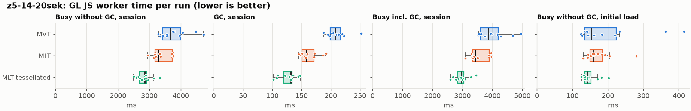
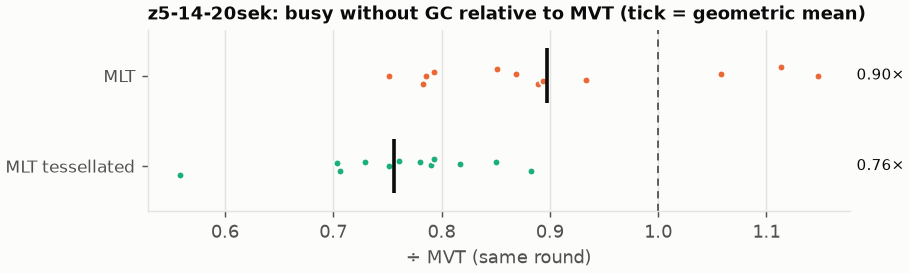
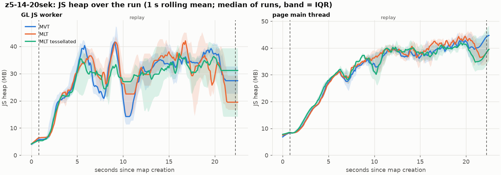
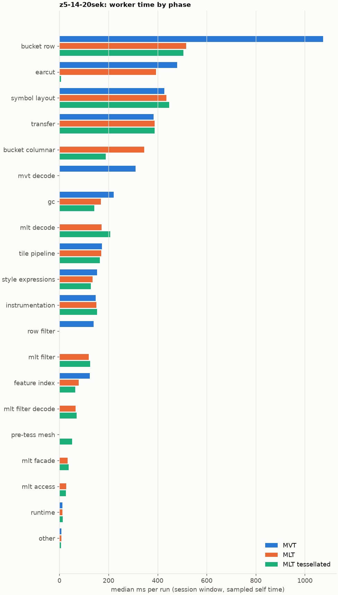
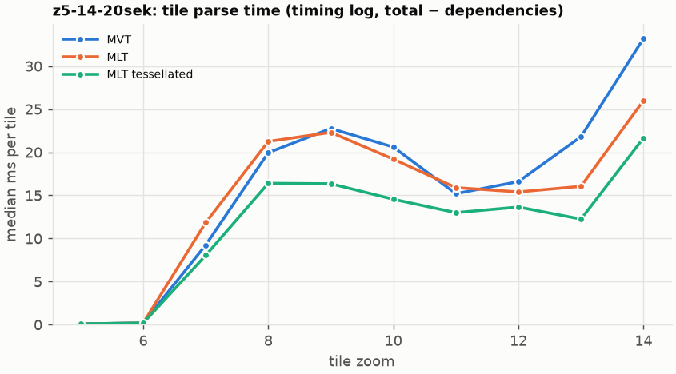
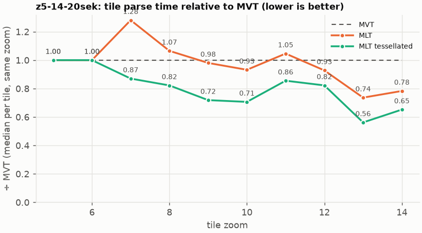

# Session trace benchmark — 20261028-075655

## Setup

- Created 2026-10-28T07:56:55+01:00; 12 repetitions + 1 warm-up round(s) (excluded); variants rotate per round (A B C, B C A, …); one cold browser context per run.
- Machine: 13th Gen Intel(R) Core(TM) i7-1365U, 12 logical cores, 31.3 GB RAM, Windows-11-10.0.26200-SP0; power: GUID des Energieschemas: 381b4222-f694-41f0-9685-ff5bb260df2e  (Ausbalanciert), AC True.
- GL JS gl7-performance-optimization @ c539936344 (dirty); worker count 1; viewport {'width': 1280, 'height': 1024}.
- Python 3.12.2, packages {'playwright': '1.64.0', 'numpy': '2.5.3', 'matplotlib': '3.11.2'}.

| variant | bundle | format | bundle sha256 | branch build |
|---|---|---|---|---|
| MVT | `dist/maplibre-gl-dev.mjs` | mvt | `0f0319f135a2` | – |
| MLT | `dist/maplibre-gl-dev.mjs` | mlt | `0f0319f135a2` | – |
| MLT tessellated | `dist/maplibre-gl-dev.mjs` | mlt-pre-tess | `0f0319f135a2` | – |

| session | style | duration | frames | sha256 |
|---|---|---:|---:|---|
| z5-14-20sek | osm-bright (recorded: maptiler-basic) | 21.4 s | 829 | `5a376e5ede30` |

CPU sampling interval (median over runs): 582 µs.

## Definitions

- **busy** = wall time in which a GL JS worker thread runs a task (union of top-level task slices and GC slices on `DedicatedWorker thread`s), summed over workers. **GC** = union of `MinorGC`/`MajorGC`/`V8.GC*` slices on those threads. **busy without GC** = busy − GC (headline metric).
- **CPU** = thread time (`tdur`) of the same slices. Phase categories and functions come from the trace's CPU samples (self time), categorised by `config/categories.toml` (nearest matching frame, leaf to root).
- Windows: **load** = map creation → first idle; **session** = camera replay; **tail** = end of replay → idle; **total** = load + session + tail.
- Ratios are against **MVT**: ratio of medians with a bootstrap 95 % CI, the geometric mean of per-round ratios, and a two-sided Mann–Whitney U p-value (normal approximation, not corrected for multiple comparisons; rough below n = 8). Lower than 1× means less worker time.

## Session `z5-14-20sek`

### Worker busy without GC (session window)

| variant | n ok / failed | median ms | IQR | mean | ratio vs MVT | 95 % CI | geo-mean paired | MWU p |
|---|---:|---:|---:|---:|---:|---:|---:|---:|
| MVT | 12 / 0 | 3,654 | 3,420–3,989 | 3,779 | 1.00× | – | – | – |
| MLT | 12 / 0 | 3,282 | 3,179–3,725 | 3,380 | 0.90× | 0.81–1.05× | 0.90× | 0.014 |
| MLT tessellated | 12 / 0 | 2,859 | 2,691–2,920 | 2,846 | 0.78× | 0.70–0.84× | 0.76× | <0.001 |

### All worker metrics (median, ratio vs baseline)

| metric | MVT | MLT | MLT tessellated |
|---|---:|---:|---:|
| busy incl. GC | 3,856 | 3,439 (0.89×) | 2,975 (0.77×) |
| &nbsp;&nbsp;of which GC | 207.3 | 157.8 (0.76×) | 131.8 (0.64×) |
| &nbsp;&nbsp;of which busy without GC | 3,654 | 3,282 (0.90×) | 2,859 (0.78×) |
| &nbsp;&nbsp;&nbsp;&nbsp;of which filtering (sampled, incl. callees) | 140.0 | 119.2 (0.85×) | 125.3 (0.89×) |
| &nbsp;&nbsp;&nbsp;&nbsp;of which column decoding inside the MLT filter (sampled) | 0.0 | 66.1 | 70.5 |
| &nbsp;&nbsp;&nbsp;&nbsp;of which timing instrumentation (sampled) | 147.8 | 151.1 (1.02×) | 152.9 (1.03×) |
| busy without GC and instrumentation | 3,518 | 3,129 (0.89×) | 2,701 (0.77×) |
| CPU time without GC | 3,375 | 2,998 (0.89×) | 2,610 (0.77×) |
| tile: download end → sent to main thread, median per tile | 182.8 | 178.3 (0.98×) | 146.2 (0.80×) |
| tile: download end → sent to main thread, 90th percentile | 393.8 | 339.9 (0.86×) | 262.4 (0.67×) |
| tile: download end → sent to main thread, 95th percentile | 433.7 | 360.8 (0.83×) | 285.6 (0.66×) |
| tile: download end → sent to main thread, 99th percentile | 489.2 | 418.8 (0.86×) | 367.2 (0.75×) |
| &nbsp;&nbsp;parse part (timing log, incl. waiting for glyphs/icons), median per tile | 106.6 | 100.4 (0.94×) | 85.0 (0.80×) |
| &nbsp;&nbsp;queue + hand-off part, median per tile | 74.7 | 65.2 (0.87×) | 54.5 (0.73×) |
| minor GCs | 73.50 | 54.00 (0.73×) | 33.00 (0.45×) |
| major GCs | 6.00 | 6.00 (1.00×) | 6.00 (1.00×) |
| peak worker heap (MB) | 61.0 | 64.1 (1.05×) | 52.9 (0.87×) |
| load: busy without GC | 152.9 | 160.3 (1.05×) | 142.9 (0.93×) |
| load: GC | 6.6 | 6.1 (0.92×) | 5.9 (0.89×) |
| total: busy without GC | 3,839 | 3,447 (0.90×) | 3,033 (0.79×) |

Rows marked *of which* are parts of the row above, not additional time. Tile rows are per-tile latencies (medians over tiles, then over runs), not sums: tiles overlap in time, and the medians of the parse and queue parts do not add up exactly to the median latency.

### Filtering (session window)

Sampled worker time spent in feature filtering, including everything the filter calls (expression evaluation, property access): **row filter** = the style-spec feature filter that MVT runs per feature, **mlt filter** = the columnar MLT filter (incl. the geometry-type selection), without the columns it decodes (see the next table). Medians per run; rules in `config/categories.toml`.

| variant | mlt filter | row filter | filtering | ratio vs MVT | 95 % CI | MWU p | share of sampled busy |
|---|---:|---:|---:|---:|---:|---:|---:|
| MVT | 0.0 | 139.6 | 140.0 | 1.00× | – | – | 3.9% |
| MLT | 119.2 | 0.0 | 119.2 | 0.85× | 0.67–1.01× | 0.007 | 3.5% |
| MLT tessellated | 125.3 | 0.0 | 125.3 | 0.89× | 0.68–1.04× | 0.030 | 4.5% |

**Filtering together with tile decoding.** The MLT decoder leaves columns encoded until something reads them, and the filter is usually the first reader: the columns it decodes (properties, and the geometry for `$type`) are **of which inside the filter** (phase *mlt filter decode*), the rest is *mlt decode* (geometry and columns read later, e.g. by paint properties and symbols). MVT decodes every feature's properties and geometry while it reads the tile (*mvt decode*), whether the filter keeps the feature or not. So **filtering** above compares the filters, and **decoding + filtering** compares all that the formats spend on decoding the tile and selecting features. **tile decoding** = *mvt decode* or *mlt decode* + *mlt filter decode*: work inside a call into a decoder. Reading data that is already decoded is not counted, as for MVT's feature objects: *mlt access* (row views, value getters, looking a column up by name) and the MLT facade (*mlt facade*). MVT decodes geometry only for the features its filter keeps, MLT decodes a layer's whole geometry column.

| variant | tile decoding | of which inside the filter | filtering | decoding + filtering | ratio vs MVT | 95 % CI | MWU p |
|---|---:|---:|---:|---:|---:|---:|---:|
| MVT | 310.6 | 0.0 | 140.0 | 454.8 | 1.00× | – | – |
| MLT | 238.5 | 66.1 | 119.2 | 361.5 | 0.79× | 0.71–0.87× | <0.001 |
| MLT tessellated | 277.0 | 70.5 | 125.3 | 392.6 | 0.86× | 0.77–0.98× | 0.004 |

Top 12 functions inside filtering and its column decoding (self time, mean ms per run):

| phase | function | source | MVT | MLT | MLT tessellated |
|---|---|---|---:|---:|---:|
| row filter | `evaluate` | node_modules/@maplibre/maplibre-gl-style-spec/dist/expression/compound_expression.mjs | 43.7 | 0.0 | 0.0 |
| row filter | `evaluate` | node_modules/@maplibre/maplibre-gl-style-spec/dist/expression/index.mjs | 21.6 | 0.0 | 0.0 |
| row filter | `CompoundExpression.register.filter-in-small` | node_modules/@maplibre/maplibre-gl-style-spec/dist/expression/compound_expression.mjs | 18.5 | 0.0 | 0.0 |
| row filter | `CompoundExpression.register.filter-==` | node_modules/@maplibre/maplibre-gl-style-spec/dist/expression/compound_expression.mjs | 18.4 | 0.0 | 0.0 |
| mlt filter decode | `unpackNullable` | maplibre-tile-spec/ts/dist/decoding/unpackNullableUtils.js | 0.0 | 13.0 | 15.8 |
| mlt filter | `scanDictionaryCodes` | maplibre-tile-spec/ts/dist/processing/filter/execution/filterKernel.js | 0.0 | 13.6 | 14.5 |
| mlt filter | `dictionaryRowMatches` | maplibre-tile-spec/ts/dist/processing/filter/execution/filterKernel.js | 0.0 | 12.8 | 11.9 |
| mlt filter | `filterByGeometryType` | maplibre-tile-spec/ts/dist/vector/geometry/geometryVector.js | 0.0 | 9.9 | 12.1 |
| row filter | `filter` | node_modules/@maplibre/maplibre-gl-style-spec/dist/feature_filter/index.mjs | 10.3 | 0.0 | 0.0 |
| row filter | `CompoundExpression.register.all.overloads` | node_modules/@maplibre/maplibre-gl-style-spec/dist/expression/compound_expression.mjs | 9.9 | 0.0 | 0.0 |
| mlt filter decode | `decodeFsst` | maplibre-tile-spec/ts/dist/decoding/fsstDecoder.js | 0.0 | 8.0 | 7.7 |
| mlt filter | `resolveDictionaryExecutor` | maplibre-tile-spec/ts/dist/processing/filter/execution/filterKernel.js | 0.0 | 7.1 | 6.6 |

### Where the variants differ from MVT (session window, mean ms per run)

Open **[flame.html](flame.html)** to explore the call tree interactively: pick a variant, compare it with MVT (red = more time at the same call path, blue = less), click a frame to zoom in, and read the phase and function breakdown under it. Without a comparison, frames are coloured by phase: filtering is green in both formats, and the columns the MLT filter decodes on first access (*mlt filter decode*) are MLT blue frames under the green filter. `flame/*.txt` open in https://www.speedscope.app.

#### MLT vs MVT

**By phase** (sampled self time; the Δ column sums to the difference in sampled busy time):

| phase | MVT | MLT | Δ |
|---|---:|---:|---:|
| bucket columnar | 0.0 | 350.9 | +350.9 |
| mlt decode | 0.0 | 173.1 | +173.1 |
| mlt filter | 0.3 | 118.4 | +118.2 |
| mlt filter decode | 0.0 | 67.3 | +67.3 |
| mlt facade | 0.2 | 32.6 | +32.4 |
| mlt access | 0.0 | 27.4 | +27.4 |
| symbol layout | 437.1 | 450.7 | +13.6 |
| transfer | 392.8 | 400.7 | +8.0 |
| instrumentation | 147.9 | 152.0 | +4.1 |
| runtime | 13.4 | 12.6 | -0.8 |
| tile pipeline | 177.9 | 172.1 | -5.9 |
| style expressions | 156.7 | 134.8 | -21.9 |
| feature index | 124.7 | 80.7 | -44.0 |
| gc | 222.1 | 174.2 | -47.8 |
| earcut | 483.1 | 400.0 | -83.1 |
| row filter | 144.7 | 0.0 | -144.7 |
| mvt decode | 324.3 | 0.0 | -324.3 |
| bucket row | 1,091 | 530.2 | -561.1 |

**By source layer** (timing log: createBucket + populate + addFeatures, summed over the style layers that use it; wall time, includes GC pauses; total Δ -395 ms):

| source layer | type | MVT | MLT | Δ |
|---|---|---:|---:|---:|
| place | symbol | 214.4 | 275.9 | +61.4 |
| transportation_name | symbol | 119.2 | 144.7 | +25.5 |
| park | fill | 3.4 | 25.6 | +22.3 |
| poi | symbol | 158.3 | 178.1 | +19.8 |
| boundary | line | 46.6 | 62.5 | +15.9 |
| waterway | line | 22.9 | 33.8 | +10.9 |
| transportation | fill | 16.3 | 10.1 | -6.2 |
| water | fill | 99.8 | 80.5 | -19.3 |
| transportation | line | 760.2 | 684.2 | -76.0 |
| landuse | fill | 371.1 | 255.8 | -115.3 |
| landcover | fill | 490.7 | 366.5 | -124.2 |
| building | fill | 474.8 | 255.8 | -218.9 |

**Functions with the largest self-time difference** (by function name, summed over source files):

| function | MVT | MLT | Δ |
|---|---:|---:|---:|
| `writeEarcutFill` | 0.0 | 35.7 | +35.7 |
| `buildRingBoundingBoxes` | 0.0 | 33.9 | +33.9 |
| `buildEarcutMesh` | 0.0 | 32.0 | +32.0 |
| `decodeComponentwiseDeltaVec2` | 0.0 | 22.7 | +22.7 |
| `readScaledRings` | 0.0 | 20.2 | +20.2 |
| `get` | 21.1 | 37.9 | +16.8 |
| `unpackNullable` | 0.0 | 15.5 | +15.5 |
| `scanDictionaryCodes` | 0.0 | 13.6 | +13.6 |
| `dictionaryRowMatches` | 0.0 | 12.8 | +12.8 |
| `decodeFastPforInt32` | 0.0 | 11.9 | +11.9 |
| `decodeFsst` | 0.0 | 10.5 | +10.5 |
| `decodeString$2` | 0.0 | 10.3 | +10.3 |
| `_vertexToIndex` | 181.6 | 0.0 | -181.6 |
| `readSVarint` | 154.9 | 0.0 | -154.9 |
| `loadGeometry` | 80.8 | 13.2 | -67.6 |
| `evaluate` | 78.2 | 12.5 | -65.7 |
| `populate` | 78.9 | 14.1 | -64.8 |

#### MLT tessellated vs MVT

**By phase** (sampled self time; the Δ column sums to the difference in sampled busy time):

| phase | MVT | MLT tessellated | Δ |
|---|---:|---:|---:|
| mlt decode | 0.0 | 209.3 | +209.3 |
| bucket columnar | 0.0 | 193.4 | +193.4 |
| mlt filter | 0.3 | 122.0 | +121.7 |
| mlt filter decode | 0.0 | 67.7 | +67.7 |
| pre-tess mesh | 0.0 | 50.6 | +50.6 |
| mlt facade | 0.2 | 36.2 | +36.1 |
| mlt access | 0.0 | 25.6 | +25.6 |
| symbol layout | 437.1 | 446.0 | +8.9 |
| instrumentation | 147.9 | 153.7 | +5.8 |
| runtime | 13.4 | 14.4 | +1.0 |
| other | 7.1 | 6.4 | -0.6 |
| transfer | 392.8 | 383.8 | -8.9 |
| tile pipeline | 177.9 | 166.5 | -11.4 |
| style expressions | 156.7 | 129.7 | -27.0 |
| feature index | 124.7 | 66.0 | -58.7 |
| gc | 222.1 | 135.8 | -86.3 |
| row filter | 144.7 | 0.0 | -144.7 |
| mvt decode | 324.3 | 0.0 | -324.3 |
| earcut | 483.1 | 6.4 | -476.7 |
| bucket row | 1,091 | 502.8 | -588.5 |

**By source layer** (timing log: createBucket + populate + addFeatures, summed over the style layers that use it; wall time, includes GC pauses; total Δ -939 ms):

| source layer | type | MVT | MLT tessellated | Δ |
|---|---|---:|---:|---:|
| place | symbol | 214.4 | 263.6 | +49.2 |
| poi | symbol | 158.3 | 182.5 | +24.2 |
| transportation_name | symbol | 119.2 | 141.3 | +22.1 |
| park | fill | 3.4 | 22.8 | +19.4 |
| boundary | line | 46.6 | 60.6 | +14.0 |
| waterway | line | 22.9 | 33.5 | +10.6 |
| transportation | fill | 16.3 | 21.5 | +5.2 |
| water | fill | 99.8 | 42.2 | -57.6 |
| transportation | line | 760.2 | 701.9 | -58.3 |
| landuse | fill | 371.1 | 113.8 | -257.3 |
| landcover | fill | 490.7 | 156.7 | -333.9 |
| building | fill | 474.8 | 92.1 | -382.7 |

**Functions with the largest self-time difference** (by function name, summed over source files):

| function | MVT | MLT tessellated | Δ |
|---|---:|---:|---:|
| `buildTessellatedBoundingBox` | 0.0 | 48.1 | +48.1 |
| `writeTessellatedFill` | 0.0 | 45.4 | +45.4 |
| `decodeUnsignedZigZagDeltaInt32` | 0.0 | 20.9 | +20.9 |
| `scaleCoordinate` | 0.0 | 19.9 | +19.9 |
| `decodeComponentwiseDeltaVec2` | 0.0 | 19.5 | +19.5 |
| `unpackNullable` | 0.0 | 17.4 | +17.4 |
| `decodeFastPforInt32` | 0.0 | 14.5 | +14.5 |
| `scanDictionaryCodes` | 0.0 | 14.5 | +14.5 |
| `filterByGeometryType` | 0.0 | 12.1 | +12.1 |
| `dictionaryRowMatches` | 0.0 | 11.9 | +11.9 |
| `materializeSelectedFeatures` | 0.0 | 11.5 | +11.5 |
| `get` | 21.1 | 32.3 | +11.2 |
| `_vertexToIndex` | 181.6 | 0.0 | -181.6 |
| `readSVarint` | 154.9 | 0.0 | -154.9 |
| `isEar` | 153.7 | 0.8 | -152.8 |
| `(garbage collector)` | 222.1 | 135.8 | -86.3 |
| `isEarHashed` | 78.6 | 0.3 | -78.4 |

### Memory (session window)

**JS heap** = V8's used heap of the thread (`jsHeapSizeUsed` from the trace's `UpdateCounters`, about every 20 ms; the mean is time-weighted). It does not include ArrayBuffer contents, so the tile data itself (vertex, index and feature-index arrays) is not in it: **tile data sent to the main thread** is the size of the ArrayBuffers each tile result transfers (`web/worker_hook.js`), which then live on the main thread and are uploaded to the GPU. **garbage collected** = heap freed by the worker's GCs, a measure of how much it allocates. Medians per run; ratio of medians with a bootstrap 95 % CI.

| metric | MVT | MLT | MLT tessellated |
|---|---:|---:|---:|
| worker JS heap, mean (MB) | 22.7 | 23.8 (1.05×, 0.89–1.15×) | 24.8 (1.09×, 0.84–1.17×) |
| worker JS heap, peak (MB) | 61.0 | 64.1 (1.05×, 0.92–1.19×) | 52.9 (0.87×, 0.78–0.97×) |
| worker JS heap after the last GC (MB) | 21.2 | 15.6 (0.73×, 0.60–1.33×) | 22.9 (1.08×, 0.55–1.77×) |
| garbage collected in the worker (MB) | 1,810 | 1,174 (0.65×, 0.64–0.65×) | 633.7 (0.35×, 0.34–0.36×) |
| main thread JS heap, mean (MB) | 30.4 | 30.8 (1.01×, 0.98–1.05×) | 30.0 (0.98×, 0.97–1.03×) |
| main thread JS heap, peak (MB) | 53.7 | 55.1 (1.03×, 0.97–1.08×) | 52.8 (0.98×, 0.92–1.03×) |
| main thread JS heap at the end of the replay (MB) | 40.4 | 36.9 (0.91×, 0.78–1.17×) | 35.2 (0.87×, 0.74–1.20×) |
| tile data sent to the main thread, total (MB) | 105.3 | 101.4 (0.96×, 0.96–0.97×) | 100.6 (0.96×, 0.95–0.96×) |
| tile data sent to the main thread, median per tile (KB) | 697.3 | 671.9 (0.96×, 0.95–0.98×) | 689.4 (0.99×, 0.97–1.01×) |

### Worker time by phase (session window, median ms of sampled self time)

| phase | MVT | MLT | MLT tessellated |
|---|---:|---:|---:|
| bucket row | 1,074 | 516.4 | 504.4 |
| earcut | 479.1 | 393.8 | 5.9 |
| symbol layout | 426.9 | 436.0 | 447.2 |
| transfer | 383.6 | 387.9 | 388.3 |
| bucket columnar | 0.0 | 346.0 | 188.1 |
| mvt decode | 310.6 | 0.0 | 0.0 |
| gc | 221.0 | 169.4 | 141.6 |
| mlt decode | 0.0 | 171.3 | 207.8 |
| tile pipeline | 173.6 | 170.0 | 164.2 |
| style expressions | 153.7 | 134.9 | 127.6 |
| instrumentation | 147.8 | 151.1 | 152.9 |
| row filter | 139.6 | 0.0 | 0.0 |
| mlt filter | 0.0 | 119.2 | 125.3 |
| feature index | 124.2 | 78.7 | 63.9 |
| mlt filter decode | 0.0 | 66.1 | 70.5 |
| pre-tess mesh | 0.0 | 0.0 | 51.8 |
| mlt facade | 0.0 | 32.8 | 37.0 |
| mlt access | 0.0 | 27.7 | 25.7 |
| runtime | 12.7 | 12.4 | 13.7 |
| other | 7.5 | 7.4 | 6.8 |

### Top 20 worker functions by self time (session window, mean ms per run)

| function | source | phase | MVT | MLT | MLT tessellated |
|---|---|---|---:|---:|---:|
| `(garbage collector)` | (native) | gc | 222.1 | 174.2 | 135.8 |
| `reserve` | src/util/struct_array.ts | bucket columnar | 204.3 | 212.7 | 194.7 |
| `_vertexToIndex` | src/render/subdivision.ts | bucket row | 181.6 | 0.0 | 0.0 |
| `readSVarint` | node_modules/pbf/index.js | mvt decode | 154.9 | 0.0 | 0.0 |
| `isEar` | node_modules/earcut/src/earcut.js |  | 153.7 | 104.7 | 0.8 |
| `emplace` | src/data/array_types.g.ts | bucket columnar | 94.2 | 98.0 | 90.5 |
| `setTimeout` | (native) | transfer | 88.1 | 90.3 | 88.6 |
| `postMessage` | (native) | transfer | 78.4 | 80.4 | 78.3 |
| `_trim` | src/util/struct_array.ts | transfer | 79.2 | 80.4 | 76.6 |
| `isEarHashed` | node_modules/earcut/src/earcut.js | earcut | 78.6 | 63.0 | 0.3 |
| `serialize` | src/util/web_worker_transfer.ts | transfer | 70.5 | 74.4 | 67.7 |
| `addLine` | src/data/bucket/line_bucket.ts | bucket row | 53.6 | 60.4 | 56.3 |
| `insert` | src/data/feature_index.ts | feature index | 59.3 | 20.1 | 17.6 |
| `ProgramConfiguration` | src/data/program_configuration.ts | bucket row | 55.5 | 58.3 | 54.1 |
| `populate` | src/data/bucket/line_bucket.ts | bucket row | 57.7 | 0.0 | 0.0 |
| `addHalfVertex` | src/data/bucket/line_bucket.ts | bucket row | 52.3 | 56.2 | 52.9 |
| `fetch` | (native) | tile pipeline | 48.6 | 50.0 | 48.0 |
| `readVarint` | node_modules/pbf/index.js | mvt decode | 49.3 | 0.0 | 0.0 |
| `buildTessellatedBoundingBox` | src/data/bucket/columnar/columnar_mesh_arrays.ts | pre-tess mesh | 0.0 | 0.0 | 48.1 |
| `earcutLinked` | node_modules/earcut/src/earcut.js | earcut | 46.8 | 42.8 | 0.9 |

### Top 20 worker functions by total time (incl. callees) (session window, mean ms per run)

| function | source | phase | MVT | MLT | MLT tessellated |
|---|---|---|---:|---:|---:|
| `parse` | src/source/worker_tile.ts | tile pipeline | 2,929 | 2,574 | 2,063 |
| `loadTile` | src/source/vector_tile_worker_source.ts | tile pipeline | 2,504 | 2,101 | 1,621 |
| `_parseWorkerTile` | src/source/vector_tile_worker_source.ts | tile pipeline | 2,416 | 2,045 | 1,570 |
| `populate` | src/data/bucket/fill_bucket.ts | bucket row | 1,262 | 0.0 | 0.0 |
| `addBucketFeatures` | src/data/bucket/fill_bucket.ts |  | 1,027 | 673.4 | 145.4 |
| `addFeature` | src/data/bucket/fill_bucket.ts | bucket row | 999.3 | 0.0 | 0.0 |
| `populate` | src/data/bucket/columnar/columnar_fill_bucket.ts | bucket columnar | 0.0 | 844.7 | 390.1 |
| `subdividePolygon` | src/render/subdivision.ts | bucket row | 833.4 | 0.0 | 0.0 |
| `subdividePolygonInternal` | src/render/subdivision.ts | bucket row | 814.1 | 0.0 | 0.0 |
| `addFeature` | src/data/bucket/columnar/columnar_fill_bucket.ts | bucket columnar | 0.0 | 675.8 | 142.2 |
| `writeEarcutFill` | src/data/bucket/columnar/columnar_mesh_arrays.ts | bucket columnar | 0.0 | 665.6 | 11.9 |
| `populate` | src/data/bucket/line_bucket.ts | bucket row | 657.7 | 0.0 | 0.0 |
| `populate` | src/data/bucket/columnar/columnar_line_bucket.ts | bucket columnar | 0.0 | 616.0 | 616.1 |
| `earcut` | node_modules/earcut/src/earcut.js | earcut | 482.6 | 398.5 | 6.4 |
| `buildEarcutMesh` | src/data/bucket/columnar/columnar_mesh_arrays.ts | bucket columnar | 0.0 | 454.1 | 8.0 |
| `addBucketFeatures` | src/data/bucket/line_bucket.ts | bucket row | 403.7 | 431.5 | 421.8 |
| `addFeatures` | src/data/bucket/symbol_bucket.ts | symbol layout | 398.4 | 417.0 | 409.9 |
| `performSymbolLayout` | src/symbol/symbol_layout.ts | symbol layout | 392.4 | 409.2 | 402.0 |
| `processTask` | src/util/actor.ts | transfer | 386.6 | 388.7 | 370.9 |
| `earcutLinked` | node_modules/earcut/src/earcut.js | earcut | 378.3 | 313.4 | 3.0 |

### Tile parse time by zoom (timing log, median ms per tile, total − dependencies)

| zoom | MVT | MLT | MLT tessellated |
|---:|---:|---:|---:|
| 5 | 0.10 (n=108) | 0.10 (n=108) | 0.10 (n=108) |
| 6 | 0.20 (n=108) | 0.20 (n=108) | 0.20 (n=108) |
| 7 | 9.25 (n=72) | 11.85 (n=72) | 8.05 (n=72) |
| 8 | 19.95 (n=76) | 21.25 (n=88) | 16.40 (n=80) |
| 9 | 22.75 (n=192) | 22.30 (n=192) | 16.35 (n=192) |
| 10 | 20.60 (n=237) | 19.20 (n=240) | 14.55 (n=240) |
| 11 | 15.20 (n=177) | 15.90 (n=176) | 13.00 (n=172) |
| 12 | 16.60 (n=254) | 15.40 (n=242) | 13.65 (n=240) |
| 13 | 21.80 (n=252) | 16.05 (n=252) | 12.25 (n=252) |
| 14 | 33.20 (n=216) | 26.00 (n=216) | 21.65 (n=216) |

### Tile latency by zoom: download end → result sent to the main thread (session window, ms per tile: median / p95 / p99)

Includes waiting in the worker's queue, the parse and posting the result; see `tile_latency.csv` for the per-tile split (`parse_ms`, `wait_ms`). Percentiles over the tiles of all runs; with few tiles (n) p99 is close to the maximum.

| zoom | MVT | MLT | MLT tessellated |
|---:|---:|---:|---:|
| 6 | 44.8 / 77.5 / 91.1 (n=108) | 48.7 / 81.2 / 101.3 (n=108) | 43.2 / 63.4 / 73.5 (n=108) |
| 7 | 124.8 / 199.4 / 237.1 (n=72) | 114.2 / 166.7 / 234.5 (n=72) | 77.1 / 124.8 / 146.4 (n=72) |
| 8 | 211.1 / 270.9 / 299.9 (n=76) | 196.9 / 240.9 / 261.0 (n=88) | 153.7 / 211.1 / 225.1 (n=80) |
| 9 | 219.4 / 389.0 / 415.1 (n=192) | 250.1 / 420.8 / 435.6 (n=192) | 167.1 / 325.6 / 339.7 (n=192) |
| 10 | 293.5 / 455.4 / 488.5 (n=237) | 286.1 / 368.1 / 414.9 (n=240) | 216.3 / 282.0 / 292.6 (n=240) |
| 11 | 146.3 / 260.4 / 297.3 (n=177) | 165.9 / 254.0 / 279.2 (n=176) | 140.0 / 194.7 / 208.0 (n=172) |
| 12 | 100.0 / 315.1 / 346.1 (n=254) | 72.7 / 257.9 / 287.1 (n=242) | 59.3 / 257.4 / 264.4 (n=240) |
| 13 | 196.2 / 420.9 / 461.0 (n=252) | 169.9 / 294.0 / 333.4 (n=252) | 134.8 / 266.9 / 399.4 (n=252) |
| 14 | 352.8 / 540.5 / 650.8 (n=216) | 262.6 / 456.7 / 509.4 (n=216) | 215.7 / 483.2 / 558.7 (n=216) |

## Runs

39 ok, 0 failed/aborted, 0 not run, 36 used in statistics.

## Validity checks

- Counted once: all 39 analysed runs pass (windows load + session + tail add up to total; phases add up to the sampled busy time; GC and sampled time lie within busy time; no timing-log line twice).
- z5-14-20sek/mvt/rep-00: replay frame gap of 808 ms (main thread blocked)
- other programs used 4.18–7.72 logical processors during the replays (median 5.79)
- 36 run(s) with more than 0.5 cores of background load: z5-14-20sek/mlt/rep-01 (6.18), z5-14-20sek/mlt-pre-tess/rep-01 (6.83), z5-14-20sek/mvt/rep-01 (7.72), z5-14-20sek/mlt-pre-tess/rep-02 (6.24), z5-14-20sek/mvt/rep-02 (6.61), z5-14-20sek/mlt/rep-02 (5.79)
- 13 of 13 rounds parsed different tile sets across variants (e.g. z5-14-20sek round 0: mvt 130 tiles, mlt 127 tiles, mlt-pre-tess 126 tiles; z5-14-20sek round 1: mlt 130 tiles, mlt-pre-tess 128 tiles, mvt 125 tiles; z5-14-20sek round 2: mlt-pre-tess 128 tiles, mvt 128 tiles, mlt 130 tiles; z5-14-20sek round 3: mvt 126 tiles, mlt 130 tiles, mlt-pre-tess 130 tiles; z5-14-20sek round 4: mlt 130 tiles, mlt-pre-tess 127 tiles, mvt 130 tiles); no run went past z14, so this is timing: which tiles finish loading before the camera moves on, and which get cancelled; compare per-tile metrics (by zoom) rather than totals when the counts differ a lot

## Files

- `runs.csv`: one row per run (incl. failed and warm-up runs), every scalar metric as `<window>.<metric>`.
- `summary.csv`: session × variant × metric statistics.
- `functions.csv`, `categories.csv`: CPU-sample self/total time per function and phase per run and window.
- `category_functions.csv`: self time per phase × function (e.g. what the filters spend their time on).
- `tiles.csv`, `tile_layers.csv`, `tile_phases.csv`: the per-tile worker timing log, long format.
- `flame.html`: interactive call tree per variant with a diff view; `flame/*.txt`: collapsed stacks for speedscope.
- `analysis/stacks.csv` (per run): sampled self time per full call stack.
- `tile_latency.csv`: per tile request, worker clock: received, download start/end, result sent, latency = sent − download end, parse_ms, wait_ms = latency − parse.
- `runs/<session>/<variant>/rep-NN/trace.json.gz`: the raw trace (opens in the DevTools Performance tab).
