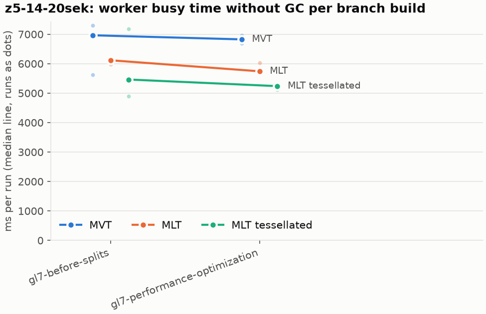
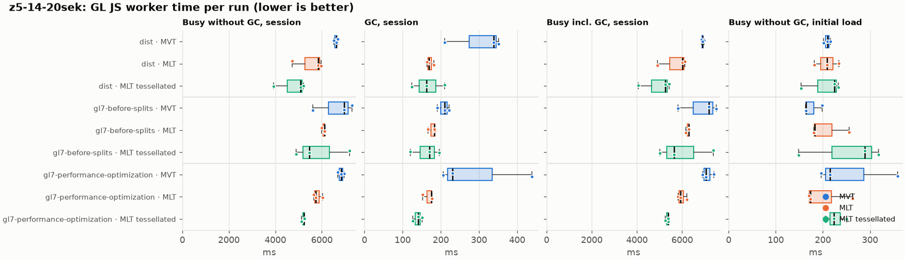
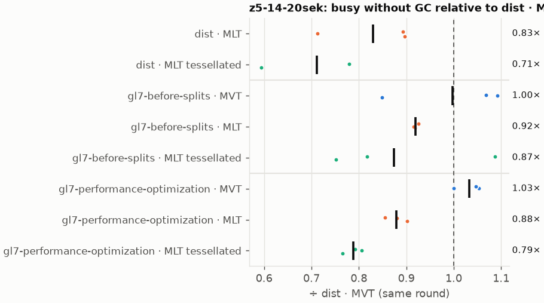
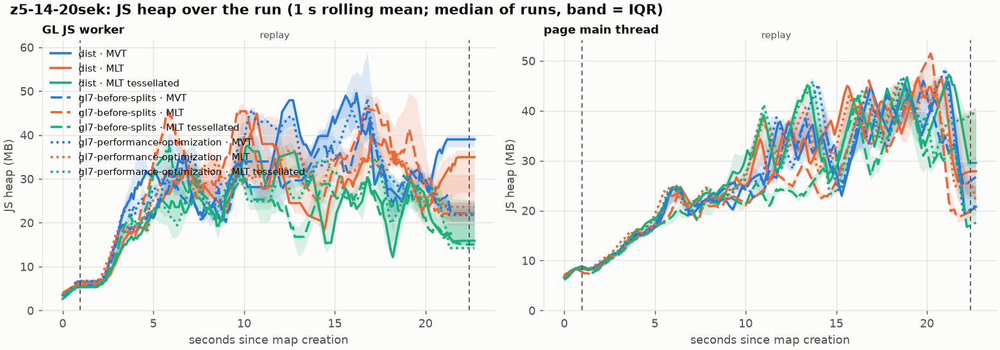
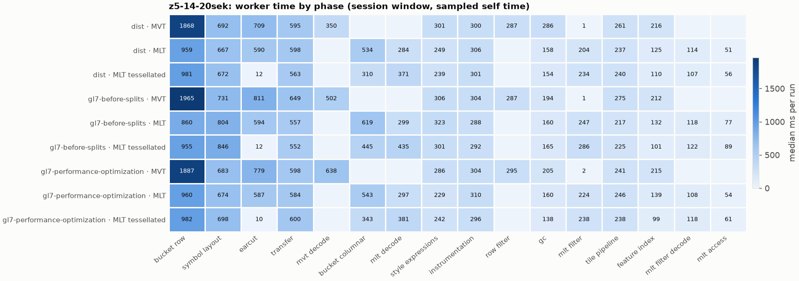
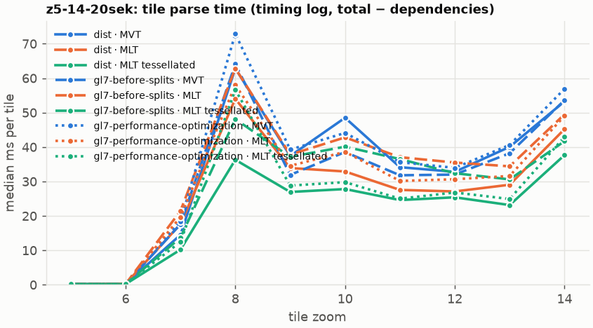
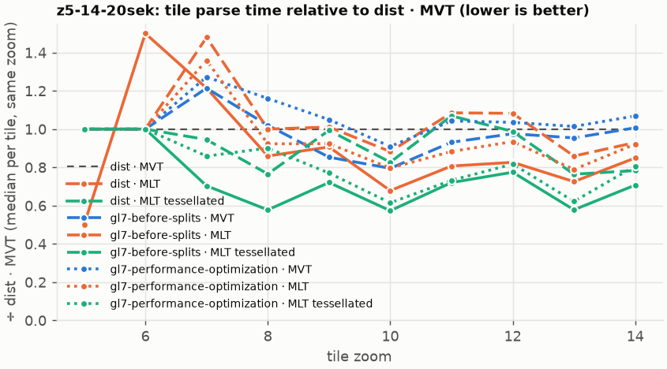

# Session trace benchmark — 20261028-085720

## Setup

- Created 2026-10-28T08:57:21+01:00; 3 repetitions + 1 warm-up round(s) (excluded); variants rotate per round (A B C, B C A, …); one cold browser context per run.
- Machine: 13th Gen Intel(R) Core(TM) i7-1365U, 12 logical cores, 31.3 GB RAM, Windows-11-10.0.26200-SP0; power: GUID des Energieschemas: 381b4222-f694-41f0-9685-ff5bb260df2e  (Ausbalanciert), AC True.
- GL JS gl7-performance-optimization @ 04c383327d (dirty); worker count 1; viewport {'width': 1280, 'height': 1024}.
- Python 3.12.2, packages {'playwright': '1.64.0', 'numpy': '2.5.3', 'matplotlib': '3.11.2'}.

| variant | bundle | format | bundle sha256 | branch build |
|---|---|---|---|---|
| MVT | `dist/maplibre-gl-dev.mjs` | mvt | `9fb2bff45ca6` | – |
| MLT | `dist/maplibre-gl-dev.mjs` | mlt | `9fb2bff45ca6` | – |
| MLT tessellated | `dist/maplibre-gl-dev.mjs` | mlt-pre-tess | `9fb2bff45ca6` | – |
| gl7-before-splits · MVT | `bench-builds/branches/gl7-before-splits/maplibre-gl-dev.mjs` | mvt | `23d9e1c1efa6` | gl7-before-splits @ ef8500dcf4 (2026-10-27), MLT @ 9bf846d053 |
| gl7-before-splits · MLT | `bench-builds/branches/gl7-before-splits/maplibre-gl-dev.mjs` | mlt | `23d9e1c1efa6` | gl7-before-splits @ ef8500dcf4 (2026-10-27), MLT @ 9bf846d053 |
| gl7-before-splits · MLT tessellated | `bench-builds/branches/gl7-before-splits/maplibre-gl-dev.mjs` | mlt-pre-tess | `23d9e1c1efa6` | gl7-before-splits @ ef8500dcf4 (2026-10-27), MLT @ 9bf846d053 |
| gl7-performance-optimization · MVT | `bench-builds/branches/gl7-performance-optimization/maplibre-gl-dev.mjs` | mvt | `c1d3ac49797b` | gl7-performance-optimization @ c539936344 (2026-10-27), MLT @ 9bf846d053 |
| gl7-performance-optimization · MLT | `bench-builds/branches/gl7-performance-optimization/maplibre-gl-dev.mjs` | mlt | `c1d3ac49797b` | gl7-performance-optimization @ c539936344 (2026-10-27), MLT @ 9bf846d053 |
| gl7-performance-optimization · MLT tessellated | `bench-builds/branches/gl7-performance-optimization/maplibre-gl-dev.mjs` | mlt-pre-tess | `c1d3ac49797b` | gl7-performance-optimization @ c539936344 (2026-10-27), MLT @ 9bf846d053 |

| session | style | duration | frames | sha256 |
|---|---|---:|---:|---|
| z5-14-20sek | osm-bright (recorded: maptiler-basic) | 21.4 s | 829 | `5a376e5ede30` |

CPU sampling interval (median over runs): 590 µs.

## Definitions

- **busy** = wall time in which a GL JS worker thread runs a task (union of top-level task slices and GC slices on `DedicatedWorker thread`s), summed over workers. **GC** = union of `MinorGC`/`MajorGC`/`V8.GC*` slices on those threads. **busy without GC** = busy − GC (headline metric).
- **CPU** = thread time (`tdur`) of the same slices. Phase categories and functions come from the trace's CPU samples (self time), categorised by `config/categories.toml` (nearest matching frame, leaf to root).
- Windows: **load** = map creation → first idle; **session** = camera replay; **tail** = end of replay → idle; **total** = load + session + tail.
- Ratios are against **MVT**: ratio of medians with a bootstrap 95 % CI, the geometric mean of per-round ratios, and a two-sided Mann–Whitney U p-value (normal approximation, not corrected for multiple comparisons; rough below n = 8). Lower than 1× means less worker time.

## Session `z5-14-20sek`

### Worker busy without GC (session window)

| variant | n ok / failed | median ms | IQR | mean | ratio vs MVT | 95 % CI | geo-mean paired | MWU p |
|---|---:|---:|---:|---:|---:|---:|---:|---:|
| MVT | 3 / 0 | 6,617 | 6,569–6,650 | 6,607 | 1.00× | – | – | – |
| MLT | 3 / 0 | 5,846 | 5,282–5,907 | 5,510 | 0.88× | 0.71–0.92× | 0.83× | 0.081 |
| MLT tessellated | 3 / 0 | 5,088 | 4,507–5,148 | 4,741 | 0.77× | 0.59–0.80× | 0.71× | 0.081 |
| gl7-before-splits · MVT | 3 / 0 | 6,965 | 6,292–7,134 | 6,629 | 1.05× | 0.84–1.12× | 1.00× | 0.663 |
| gl7-before-splits · MLT | 3 / 0 | 6,117 | 6,053–6,119 | 6,075 | 0.92× | 0.90–0.94× | 0.92× | 0.081 |
| gl7-before-splits · MLT tessellated | 3 / 0 | 5,464 | 5,182–6,326 | 5,851 | 0.83× | 0.73–1.10× | 0.87× | 0.663 |
| gl7-performance-optimization · MVT | 3 / 0 | 6,826 | 6,757–6,898 | 6,827 | 1.03× | 1.00–1.07× | 1.03× | 0.081 |
| gl7-performance-optimization · MLT | 3 / 0 | 5,742 | 5,701–5,886 | 5,810 | 0.87× | 0.85–0.92× | 0.88× | 0.081 |
| gl7-performance-optimization · MLT tessellated | 3 / 0 | 5,238 | 5,179–5,248 | 5,205 | 0.79× | 0.77–0.81× | 0.79× | 0.081 |

### All worker metrics (median, ratio vs baseline)

| metric | MVT | MLT | MLT tessellated | gl7-before-splits · MVT | gl7-before-splits · MLT | gl7-before-splits · MLT tessellated | gl7-performance-optimization · MVT | gl7-performance-optimization · MLT | gl7-performance-optimization · MLT tessellated |
|---|---:|---:|---:|---:|---:|---:|---:|---:|---:|
| busy incl. GC | 6,894 | 6,015 (0.87×) | 5,250 (0.76×) | 7,187 (1.04×) | 6,287 (0.91×) | 5,634 (0.82×) | 7,057 (1.02×) | 5,918 (0.86×) | 5,384 (0.78×) |
| &nbsp;&nbsp;of which GC | 338.0 | 168.5 (0.50×) | 162.5 (0.48×) | 210.6 (0.62×) | 183.4 (0.54×) | 170.3 (0.50×) | 230.8 (0.68×) | 175.1 (0.52×) | 140.4 (0.42×) |
| &nbsp;&nbsp;of which busy without GC | 6,617 | 5,846 (0.88×) | 5,088 (0.77×) | 6,965 (1.05×) | 6,117 (0.92×) | 5,464 (0.83×) | 6,826 (1.03×) | 5,742 (0.87×) | 5,238 (0.79×) |
| &nbsp;&nbsp;&nbsp;&nbsp;of which filtering (sampled, incl. callees) | 288.5 | 203.5 (0.71×) | 234.4 (0.81×) | 287.4 (1.00×) | 247.3 (0.86×) | 285.5 (0.99×) | 296.6 (1.03×) | 224.0 (0.78×) | 238.0 (0.82×) |
| &nbsp;&nbsp;&nbsp;&nbsp;of which column decoding inside the MLT filter (sampled) | 0.0 | 114.0 | 107.2 | 0.0 | 117.8 | 122.4 | 0.0 | 108.4 | 118.4 |
| &nbsp;&nbsp;&nbsp;&nbsp;of which timing instrumentation (sampled) | 300.4 | 305.9 (1.02×) | 300.9 (1.00×) | 304.3 (1.01×) | 288.4 (0.96×) | 291.5 (0.97×) | 303.7 (1.01×) | 309.6 (1.03×) | 295.8 (0.98×) |
| busy without GC and instrumentation | 6,330 | 5,541 (0.88×) | 4,784 (0.76×) | 6,661 (1.05×) | 5,824 (0.92×) | 5,172 (0.82×) | 6,544 (1.03×) | 5,446 (0.86×) | 4,958 (0.78×) |
| CPU time without GC | 6,151 | 5,386 (0.88×) | 4,720 (0.77×) | 6,455 (1.05×) | 5,539 (0.90×) | 5,060 (0.82×) | 6,332 (1.03×) | 5,269 (0.86×) | 4,832 (0.79×) |
| tile: download end → sent to main thread, median per tile | 294.6 | 252.6 (0.86×) | 227.1 (0.77×) | 283.9 (0.96×) | 262.3 (0.89×) | 254.3 (0.86×) | 294.1 (1.00×) | 280.4 (0.95×) | 231.3 (0.79×) |
| tile: download end → sent to main thread, 90th percentile | 604.7 | 468.2 (0.77×) | 385.9 (0.64×) | 587.8 (0.97×) | 517.5 (0.86×) | 453.2 (0.75×) | 616.0 (1.02×) | 504.4 (0.83×) | 414.2 (0.69×) |
| tile: download end → sent to main thread, 95th percentile | 642.8 | 496.2 (0.77×) | 419.2 (0.65×) | 635.9 (0.99×) | 561.9 (0.87×) | 494.9 (0.77×) | 637.1 (0.99×) | 530.4 (0.83×) | 445.8 (0.69×) |
| tile: download end → sent to main thread, 99th percentile | 716.5 | 615.2 (0.86×) | 609.8 (0.85×) | 730.7 (1.02×) | 589.9 (0.82×) | 511.0 (0.71×) | 758.4 (1.06×) | 599.0 (0.84×) | 640.7 (0.89×) |
| &nbsp;&nbsp;parse part (timing log, incl. waiting for glyphs/icons), median per tile | 178.0 | 146.5 (0.82×) | 144.4 (0.81×) | 164.4 (0.92×) | 160.9 (0.90×) | 154.3 (0.87×) | 175.9 (0.99×) | 169.6 (0.95×) | 151.8 (0.85×) |
| &nbsp;&nbsp;queue + hand-off part, median per tile | 89.3 | 66.5 (0.74×) | 62.8 (0.70×) | 87.8 (0.98×) | 81.5 (0.91×) | 76.1 (0.85×) | 93.0 (1.04×) | 69.3 (0.78×) | 65.5 (0.73×) |
| minor GCs | 72.00 | 56.00 (0.78×) | 33.00 (0.46×) | 75.00 (1.04×) | 59.00 (0.82×) | 35.00 (0.49×) | 75.00 (1.04×) | 54.00 (0.75×) | 34.00 (0.47×) |
| major GCs | 8.00 | 5.00 (0.62×) | 8.00 (1.00×) | 6.00 (0.75×) | 5.00 (0.62×) | 9.00 (1.12×) | 6.00 (0.75×) | 6.00 (0.75×) | 6.00 (0.75×) |
| peak worker heap (MB) | 73.2 | 59.4 (0.81×) | 50.0 (0.68×) | 61.8 (0.85×) | 62.3 (0.85×) | 49.6 (0.68×) | 65.3 (0.89×) | 56.0 (0.77×) | 51.9 (0.71×) |
| load: busy without GC | 209.7 | 208.8 (1.00×) | 224.8 (1.07×) | 164.2 (0.78×) | 182.8 (0.87×) | 288.9 (1.38×) | 215.4 (1.03×) | 173.2 (0.83×) | 223.5 (1.07×) |
| load: GC | 8.2 | 7.0 (0.85×) | 8.2 (1.00×) | 6.3 (0.77×) | 5.2 (0.63×) | 9.1 (1.10×) | 7.9 (0.96×) | 7.3 (0.88×) | 7.5 (0.91×) |
| total: busy without GC | 6,826 | 6,029 (0.88×) | 5,312 (0.78×) | 7,129 (1.04×) | 6,298 (0.92×) | 5,782 (0.85×) | 7,042 (1.03×) | 5,923 (0.87×) | 5,480 (0.80×) |

Rows marked *of which* are parts of the row above, not additional time. Tile rows are per-tile latencies (medians over tiles, then over runs), not sums: tiles overlap in time, and the medians of the parse and queue parts do not add up exactly to the median latency.

### Filtering (session window)

Sampled worker time spent in feature filtering, including everything the filter calls (expression evaluation, property access): **row filter** = the style-spec feature filter that MVT runs per feature, **mlt filter** = the columnar MLT filter (incl. the geometry-type selection), without the columns it decodes (see the next table). Medians per run; rules in `config/categories.toml`.

| variant | mlt filter | row filter | filtering | ratio vs MVT | 95 % CI | MWU p | share of sampled busy |
|---|---:|---:|---:|---:|---:|---:|---:|
| MVT | 1.2 | 287.3 | 288.5 | 1.00× | – | – | 4.8% |
| MLT | 203.5 | 0.0 | 203.5 | 0.71× | 0.67–0.85× | 0.081 | 4.2% |
| MLT tessellated | 234.4 | 0.0 | 234.4 | 0.81× | 0.62–0.91× | 0.081 | 5.1% |
| gl7-before-splits · MVT | 0.6 | 287.4 | 287.4 | 1.00× | 0.82–1.22× | 1.000 | 4.7% |
| gl7-before-splits · MLT | 247.3 | 0.0 | 247.3 | 0.86× | 0.83–0.97× | 0.081 | 4.5% |
| gl7-before-splits · MLT tessellated | 285.5 | 0.0 | 285.5 | 0.99× | 0.81–1.21× | 1.000 | 5.4% |
| gl7-performance-optimization · MVT | 1.5 | 295.1 | 296.6 | 1.03× | 0.96–1.15× | 0.383 | 4.6% |
| gl7-performance-optimization · MLT | 224.0 | 0.0 | 224.0 | 0.78× | 0.73–0.90× | 0.081 | 4.2% |
| gl7-performance-optimization · MLT tessellated | 238.0 | 0.0 | 238.0 | 0.82× | 0.80–0.95× | 0.081 | 5.1% |

**Filtering together with tile decoding.** The MLT decoder leaves columns encoded until something reads them, and the filter is usually the first reader: the columns it decodes (properties, and the geometry for `$type`) are **of which inside the filter** (phase *mlt filter decode*), the rest is *mlt decode* (geometry and columns read later, e.g. by paint properties and symbols). MVT decodes every feature's properties and geometry while it reads the tile (*mvt decode*), whether the filter keeps the feature or not. So **filtering** above compares the filters, and **decoding + filtering** compares all that the formats spend on decoding the tile and selecting features. **tile decoding** = *mvt decode* or *mlt decode* + *mlt filter decode*: work inside a call into a decoder. Reading data that is already decoded is not counted, as for MVT's feature objects: *mlt access* (row views, value getters, looking a column up by name) and the MLT facade (*mlt facade*). MVT decodes geometry only for the features its filter keeps, MLT decodes a layer's whole geometry column.

| variant | tile decoding | of which inside the filter | filtering | decoding + filtering | ratio vs MVT | 95 % CI | MWU p |
|---|---:|---:|---:|---:|---:|---:|---:|
| MVT | 350.0 | 0.0 | 288.5 | 643.1 | 1.00× | – | – |
| MLT | 403.9 | 114.0 | 203.5 | 608.6 | 0.95× | 0.58–1.00× | 0.190 |
| MLT tessellated | 478.3 | 107.2 | 234.4 | 712.7 | 1.11× | 0.62–1.19× | 1.000 |
| gl7-before-splits · MVT | 501.8 | 0.0 | 287.4 | 743.0 | 1.16× | 0.76–1.57× | 0.383 |
| gl7-before-splits · MLT | 418.4 | 117.8 | 247.3 | 665.6 | 1.04× | 0.73–1.14× | 0.663 |
| gl7-before-splits · MLT tessellated | 557.1 | 122.4 | 285.5 | 842.6 | 1.31× | 0.80–1.56× | 0.383 |
| gl7-performance-optimization · MVT | 637.9 | 0.0 | 296.6 | 934.5 | 1.45× | 1.03–1.51× | 0.081 |
| gl7-performance-optimization · MLT | 398.2 | 108.4 | 224.0 | 622.2 | 0.97× | 0.69–1.03× | 0.383 |
| gl7-performance-optimization · MLT tessellated | 488.1 | 118.4 | 238.0 | 726.1 | 1.13× | 0.80–1.22× | 0.663 |

Top 12 functions inside filtering and its column decoding (self time, mean ms per run):

| phase | function | source | MVT | MLT | MLT tessellated | gl7-before-splits · MVT | gl7-before-splits · MLT | gl7-before-splits · MLT tessellated | gl7-performance-optimization · MVT | gl7-performance-optimization · MLT | gl7-performance-optimization · MLT tessellated |
|---|---|---|---:|---:|---:|---:|---:|---:|---:|---:|---:|
| row filter | `evaluate` | node_modules/@maplibre/maplibre-gl-style-spec/dist/expression/compound_expression.mjs | 70.4 | 0.0 | 0.0 | 69.8 | 0.0 | 0.0 | 85.0 | 0.0 | 0.0 |
| row filter | `evaluate` | node_modules/@maplibre/maplibre-gl-style-spec/dist/expression/index.mjs | 41.1 | 0.0 | 0.0 | 45.5 | 0.0 | 0.0 | 43.2 | 0.0 | 0.0 |
| row filter | `CompoundExpression.register.filter-in-small` | node_modules/@maplibre/maplibre-gl-style-spec/dist/expression/compound_expression.mjs | 39.6 | 0.0 | 0.0 | 37.9 | 0.0 | 0.0 | 37.9 | 0.0 | 0.0 |
| row filter | `CompoundExpression.register.filter-==` | node_modules/@maplibre/maplibre-gl-style-spec/dist/expression/compound_expression.mjs | 36.6 | 0.0 | 0.0 | 36.5 | 0.0 | 0.0 | 38.4 | 0.0 | 0.0 |
| mlt filter | `scanDictionaryCodes` | maplibre-tile-spec/ts/dist/processing/filter/execution/filterKernel.js | 0.0 | 28.4 | 27.5 | 0.0 | 35.4 | 37.8 | 0.0 | 31.6 | 32.9 |
| mlt filter | `filterByGeometryType` | maplibre-tile-spec/ts/dist/vector/geometry/geometryVector.js | 0.0 | 19.2 | 21.1 | 0.0 | 23.3 | 31.7 | 0.0 | 20.9 | 24.0 |
| mlt filter decode | `unpackNullable` | maplibre-tile-spec/ts/dist/decoding/unpackNullableUtils.js | 0.0 | 22.8 | 18.8 | 0.0 | 22.6 | 26.4 | 0.0 | 25.8 | 25.4 |
| mlt filter | `dictionaryRowMatches` | maplibre-tile-spec/ts/dist/processing/filter/execution/filterKernel.js | 0.0 | 18.2 | 19.9 | 0.0 | 23.1 | 25.0 | 0.0 | 21.3 | 23.4 |
| row filter | `CompoundExpression.register.all.overloads` | node_modules/@maplibre/maplibre-gl-style-spec/dist/expression/compound_expression.mjs | 20.7 | 0.0 | 0.0 | 18.7 | 0.0 | 0.0 | 20.5 | 0.0 | 0.0 |
| mlt filter | `resolveDictionaryExecutor` | maplibre-tile-spec/ts/dist/processing/filter/execution/filterKernel.js | 0.0 | 12.0 | 16.1 | 0.0 | 18.4 | 19.6 | 0.0 | 18.4 | 14.4 |
| row filter | `filter` | node_modules/@maplibre/maplibre-gl-style-spec/dist/feature_filter/index.mjs | 16.8 | 0.0 | 0.0 | 19.1 | 0.0 | 0.0 | 14.9 | 0.0 | 0.0 |
| mlt filter decode | `decodeFsst` | maplibre-tile-spec/ts/dist/decoding/fsstDecoder.js | 0.0 | 10.9 | 13.9 | 0.0 | 10.9 | 12.2 | 0.0 | 8.4 | 11.5 |

### Where the variants differ from MVT (session window, mean ms per run)

Open **[flame.html](flame.html)** to explore the call tree interactively: pick a variant, compare it with MVT (red = more time at the same call path, blue = less), click a frame to zoom in, and read the phase and function breakdown under it. Without a comparison, frames are coloured by phase: filtering is green in both formats, and the columns the MLT filter decodes on first access (*mlt filter decode*) are MLT blue frames under the green filter. `flame/*.txt` open in https://www.speedscope.app.

#### MLT vs MVT

**By phase** (sampled self time; the Δ column sums to the difference in sampled busy time):

| phase | MVT | MLT | Δ |
|---|---:|---:|---:|
| bucket columnar | 0.0 | 505.7 | +505.7 |
| mlt decode | 0.0 | 268.3 | +268.3 |
| mlt filter | 1.0 | 206.9 | +205.9 |
| mlt filter decode | 0.0 | 106.7 | +106.7 |
| mlt access | 0.0 | 51.5 | +51.5 |
| mlt facade | 0.3 | 48.7 | +48.4 |
| other | 9.0 | 10.9 | +1.9 |
| runtime | 22.7 | 20.5 | -2.2 |
| instrumentation | 296.4 | 290.1 | -6.3 |
| tile pipeline | 252.9 | 229.2 | -23.7 |
| transfer | 599.6 | 565.5 | -34.1 |
| symbol layout | 686.9 | 634.8 | -52.1 |
| style expressions | 296.2 | 242.1 | -54.1 |
| feature index | 218.5 | 121.9 | -96.6 |
| gc | 267.5 | 162.8 | -104.8 |
| earcut | 743.2 | 555.7 | -187.4 |
| row filter | 279.6 | 0.0 | -279.6 |
| mvt decode | 437.3 | 0.0 | -437.3 |
| bucket row | 1,908 | 891.2 | -1017.2 |

**By source layer** (timing log: createBucket + populate + addFeatures, summed over the style layers that use it; wall time, includes GC pauses; total Δ -990 ms):

| source layer | type | MVT | MLT | Δ |
|---|---|---:|---:|---:|
| place | symbol | 373.1 | 442.4 | +69.3 |
| poi | symbol | 242.2 | 278.5 | +36.3 |
| park | fill | 8.4 | 42.7 | +34.3 |
| boundary | line | 87.3 | 105.3 | +18.0 |
| waterway | line | 50.3 | 66.0 | +15.6 |
| transportation_name | symbol | 212.4 | 227.2 | +14.7 |
| transportation | fill | 28.3 | 19.4 | -8.9 |
| water | fill | 158.9 | 133.6 | -25.3 |
| landuse | fill | 631.0 | 389.8 | -241.1 |
| transportation | line | 1,539 | 1,277 | -261.5 |
| landcover | fill | 804.5 | 530.5 | -274.0 |
| building | fill | 795.7 | 414.4 | -381.3 |

**Functions with the largest self-time difference** (by function name, summed over source files):

| function | MVT | MLT | Δ |
|---|---:|---:|---:|
| `writeEarcutFill` | 0.0 | 51.9 | +51.9 |
| `buildRingBoundingBoxes` | 0.0 | 49.1 | +49.1 |
| `buildEarcutMesh` | 0.0 | 43.1 | +43.1 |
| `decodeComponentwiseDeltaVec2` | 0.0 | 38.3 | +38.3 |
| `readScaledRings` | 0.0 | 37.6 | +37.6 |
| `scanDictionaryCodes` | 0.0 | 28.4 | +28.4 |
| `unpackNullable` | 0.0 | 26.2 | +26.2 |
| `materializeSelectedFeatures` | 0.0 | 23.4 | +23.4 |
| `get` | 45.9 | 65.6 | +19.7 |
| `filterByGeometryType` | 0.0 | 19.2 | +19.2 |
| `decodeString$2` | 0.0 | 18.4 | +18.4 |
| `dictionaryRowMatches` | 0.0 | 18.2 | +18.2 |
| `_vertexToIndex` | 255.7 | 0.0 | -255.7 |
| `readSVarint` | 150.9 | 0.0 | -150.9 |
| `populate` | 153.3 | 22.3 | -130.9 |
| `loadGeometry` | 143.7 | 18.3 | -125.5 |
| `isEar` | 256.1 | 141.1 | -115.0 |

#### MLT tessellated vs MVT

**By phase** (sampled self time; the Δ column sums to the difference in sampled busy time):

| phase | MVT | MLT tessellated | Δ |
|---|---:|---:|---:|
| mlt decode | 0.0 | 350.6 | +350.6 |
| bucket columnar | 0.0 | 283.7 | +283.7 |
| mlt filter | 1.0 | 217.2 | +216.2 |
| mlt filter decode | 0.0 | 101.1 | +101.1 |
| mlt facade | 0.3 | 60.3 | +60.0 |
| pre-tess mesh | 0.0 | 58.3 | +58.3 |
| mlt access | 0.0 | 54.1 | +54.1 |
| other | 9.0 | 12.6 | +3.6 |
| runtime | 22.7 | 25.5 | +2.8 |
| tile pipeline | 252.9 | 235.4 | -17.6 |
| instrumentation | 296.4 | 277.4 | -19.0 |
| symbol layout | 686.9 | 636.4 | -50.6 |
| style expressions | 296.2 | 235.8 | -60.4 |
| transfer | 599.6 | 533.6 | -66.0 |
| gc | 267.5 | 161.0 | -106.6 |
| feature index | 218.5 | 102.8 | -115.8 |
| row filter | 279.6 | 0.0 | -279.6 |
| mvt decode | 437.3 | 0.0 | -437.3 |
| earcut | 743.2 | 11.1 | -732.0 |
| bucket row | 1,908 | 903.8 | -1004.6 |

**By source layer** (timing log: createBucket + populate + addFeatures, summed over the style layers that use it; wall time, includes GC pauses; total Δ -1783 ms):

| source layer | type | MVT | MLT tessellated | Δ |
|---|---|---:|---:|---:|
| place | symbol | 373.1 | 436.2 | +63.1 |
| park | fill | 8.4 | 43.7 | +35.3 |
| boundary | line | 87.3 | 113.7 | +26.4 |
| waterway | line | 50.3 | 66.0 | +15.7 |
| poi | symbol | 242.2 | 255.8 | +13.6 |
| transportation_name | symbol | 212.4 | 224.2 | +11.8 |
| transportation | fill | 28.3 | 37.7 | +9.4 |
| water | fill | 158.9 | 71.3 | -87.6 |
| transportation | line | 1,539 | 1,308 | -230.4 |
| landuse | fill | 631.0 | 196.9 | -434.0 |
| landcover | fill | 804.5 | 239.3 | -565.2 |
| building | fill | 795.7 | 142.6 | -653.0 |

**Functions with the largest self-time difference** (by function name, summed over source files):

| function | MVT | MLT tessellated | Δ |
|---|---:|---:|---:|
| `buildTessellatedBoundingBox` | 0.0 | 54.9 | +54.9 |
| `writeTessellatedFill` | 0.0 | 53.1 | +53.1 |
| `decodeUnsignedZigZagDeltaInt32` | 0.0 | 37.0 | +37.0 |
| `decodeComponentwiseDeltaVec2` | 0.0 | 36.5 | +36.5 |
| `scanDictionaryCodes` | 0.0 | 27.5 | +27.5 |
| `unpackNullable` | 0.0 | 23.0 | +23.0 |
| `decodeFastPforInt32` | 0.0 | 22.7 | +22.7 |
| `materializeSelectedFeatures` | 0.0 | 21.7 | +21.7 |
| `filterByGeometryType` | 0.0 | 21.1 | +21.1 |
| `dictionaryRowMatches` | 0.0 | 19.9 | +19.9 |
| `decodeBigEndianInt32sInto` | 0.0 | 19.5 | +19.5 |
| `appendScaledVertices` | 0.0 | 18.8 | +18.8 |
| `_vertexToIndex` | 255.7 | 0.0 | -255.7 |
| `isEar` | 256.1 | 1.6 | -254.5 |
| `readSVarint` | 150.9 | 0.0 | -150.9 |
| `loadGeometry` | 143.7 | 19.9 | -123.9 |
| `populate` | 153.3 | 30.5 | -122.8 |

#### gl7-before-splits · MVT vs MVT

**By phase** (sampled self time; the Δ column sums to the difference in sampled busy time):

| phase | MVT | gl7-before-splits · MVT | Δ |
|---|---:|---:|---:|
| mvt decode | 437.3 | 514.4 | +77.1 |
| transfer | 599.6 | 608.2 | +8.6 |
| earcut | 743.2 | 751.2 | +8.0 |
| runtime | 22.7 | 27.7 | +5.0 |
| row filter | 279.6 | 281.9 | +2.3 |
| other | 9.0 | 11.0 | +2.0 |
| tile pipeline | 252.9 | 254.6 | +1.7 |
| mlt filter | 1.0 | 0.4 | -0.6 |
| symbol layout | 686.9 | 683.1 | -3.8 |
| instrumentation | 296.4 | 286.1 | -10.3 |
| feature index | 218.5 | 207.6 | -10.9 |
| style expressions | 296.2 | 284.9 | -11.3 |
| bucket row | 1,908 | 1,855 | -53.8 |
| gc | 267.5 | 191.5 | -76.0 |

**By source layer** (timing log: createBucket + populate + addFeatures, summed over the style layers that use it; wall time, includes GC pauses; total Δ -61 ms):

| source layer | type | MVT | gl7-before-splits · MVT | Δ |
|---|---|---:|---:|---:|
| water | fill | 158.9 | 172.2 | +13.3 |
| building | fill | 795.7 | 806.6 | +10.9 |
| place | symbol | 373.1 | 379.7 | +6.6 |
| water_name | symbol | 39.9 | 44.3 | +4.4 |
| landcover | fill | 804.5 | 807.4 | +2.8 |
| transportation | fill | 28.3 | 31.1 | +2.8 |
| boundary | line | 87.3 | 86.3 | -1.0 |
| park | fill | 8.4 | 5.5 | -2.9 |
| waterway | line | 50.3 | 47.1 | -3.2 |
| transportation_name | symbol | 212.4 | 207.5 | -4.9 |
| landuse | fill | 631.0 | 620.4 | -10.5 |
| transportation | line | 1,539 | 1,459 | -79.2 |

**Functions with the largest self-time difference** (by function name, summed over source files):

| function | MVT | gl7-before-splits · MVT | Δ |
|---|---:|---:|---:|
| `readSVarint` | 150.9 | 226.2 | +75.3 |
| `populate` | 153.3 | 220.8 | +67.5 |
| `isEarHashed` | 109.3 | 122.9 | +13.6 |
| `serialize` | 125.4 | 132.8 | +7.5 |
| `setTimeout` | 125.2 | 131.8 | +6.7 |
| `_vertexToIndex` | 255.7 | 262.3 | +6.7 |
| `readVarint` | 80.1 | 86.0 | +5.9 |
| `evaluate` | 132.5 | 138.2 | +5.7 |
| `(program)` | 22.7 | 27.7 | +5.0 |
| `codePointIsInCursiveScript` | 10.0 | 14.9 | +4.9 |
| `clamp$2` | 20.3 | 24.5 | +4.1 |
| `_refreshViews` | 41.1 | 45.0 | +4.0 |
| `(garbage collector)` | 267.5 | 191.5 | -76.0 |
| `addBucketFeatures` | 73.6 | 10.4 | -63.2 |
| `reserve` | 357.1 | 340.6 | -16.5 |
| `addSymbolFeature` | 14.9 | 0.0 | -14.9 |
| `addHalfVertex` | 95.7 | 81.9 | -13.9 |

#### gl7-before-splits · MLT vs MVT

**By phase** (sampled self time; the Δ column sums to the difference in sampled busy time):

| phase | MVT | gl7-before-splits · MLT | Δ |
|---|---:|---:|---:|
| bucket columnar | 0.0 | 627.4 | +627.4 |
| mlt decode | 0.0 | 309.6 | +309.6 |
| mlt filter | 1.0 | 247.4 | +246.4 |
| symbol layout | 686.9 | 810.2 | +123.3 |
| mlt filter decode | 0.0 | 117.6 | +117.6 |
| mlt access | 0.0 | 78.8 | +78.8 |
| mlt facade | 0.3 | 66.5 | +66.2 |
| style expressions | 296.2 | 324.8 | +28.6 |
| other | 9.0 | 11.6 | +2.5 |
| instrumentation | 296.4 | 286.1 | -10.3 |
| tile pipeline | 252.9 | 217.2 | -35.8 |
| transfer | 599.6 | 548.3 | -51.3 |
| feature index | 218.5 | 137.8 | -80.7 |
| gc | 267.5 | 167.4 | -100.2 |
| earcut | 743.2 | 597.8 | -145.4 |
| row filter | 279.6 | 0.0 | -279.6 |
| mvt decode | 437.3 | 0.0 | -437.3 |
| bucket row | 1,908 | 889.9 | -1018.5 |

**By source layer** (timing log: createBucket + populate + addFeatures, summed over the style layers that use it; wall time, includes GC pauses; total Δ -385 ms):

| source layer | type | MVT | gl7-before-splits · MLT | Δ |
|---|---|---:|---:|---:|
| place | symbol | 373.1 | 781.8 | +408.7 |
| poi | symbol | 242.2 | 303.0 | +60.8 |
| park | fill | 8.4 | 43.8 | +35.4 |
| boundary | line | 87.3 | 117.6 | +30.2 |
| waterway | line | 50.3 | 68.7 | +18.3 |
| transportation | fill | 28.3 | 22.2 | -6.1 |
| waterway | symbol | 34.1 | 26.1 | -7.9 |
| water | fill | 158.9 | 138.5 | -20.5 |
| transportation | line | 1,539 | 1,395 | -143.0 |
| landuse | fill | 631.0 | 418.9 | -212.1 |
| landcover | fill | 804.5 | 591.7 | -212.9 |
| building | fill | 795.7 | 449.4 | -346.2 |

**Functions with the largest self-time difference** (by function name, summed over source files):

| function | MVT | gl7-before-splits · MLT | Δ |
|---|---:|---:|---:|
| `writeEarcutFill` | 0.0 | 57.8 | +57.8 |
| `buildRingBoundingBoxes` | 0.0 | 49.6 | +49.6 |
| `buildEarcutMesh` | 0.0 | 45.1 | +45.1 |
| `appendSymbolFeature` | 0.0 | 39.5 | +39.5 |
| `decodeComponentwiseDeltaVec2` | 0.0 | 39.3 | +39.3 |
| `get` | 45.9 | 83.0 | +37.1 |
| `readScaledRings` | 0.0 | 36.8 | +36.8 |
| `scanDictionaryCodes` | 0.0 | 35.4 | +35.4 |
| `decodeString$2` | 0.0 | 30.3 | +30.3 |
| `resolveTokens` | 12.6 | 42.0 | +29.4 |
| `unpackNullable` | 0.0 | 28.1 | +28.1 |
| `registerGlyphs` | 0.0 | 25.0 | +25.0 |
| `_vertexToIndex` | 255.7 | 0.0 | -255.7 |
| `readSVarint` | 150.9 | 0.0 | -150.9 |
| `loadGeometry` | 143.7 | 25.8 | -118.0 |
| `isEar` | 256.1 | 146.4 | -109.6 |
| `evaluate` | 132.5 | 28.8 | -103.8 |

#### gl7-before-splits · MLT tessellated vs MVT

**By phase** (sampled self time; the Δ column sums to the difference in sampled busy time):

| phase | MVT | gl7-before-splits · MLT tessellated | Δ |
|---|---:|---:|---:|
| bucket columnar | 0.0 | 484.6 | +484.6 |
| mlt decode | 0.0 | 439.4 | +439.4 |
| mlt filter | 1.0 | 279.6 | +278.6 |
| symbol layout | 686.9 | 893.4 | +206.4 |
| mlt filter decode | 0.0 | 122.3 | +122.3 |
| pre-tess mesh | 0.0 | 91.3 | +91.3 |
| mlt access | 0.0 | 91.0 | +91.0 |
| mlt facade | 0.3 | 75.1 | +74.8 |
| style expressions | 296.2 | 336.2 | +40.1 |
| instrumentation | 296.4 | 322.2 | +25.8 |
| runtime | 22.7 | 25.2 | +2.5 |
| other | 9.0 | 10.9 | +1.9 |
| transfer | 599.6 | 587.4 | -12.3 |
| tile pipeline | 252.9 | 235.0 | -17.9 |
| feature index | 218.5 | 112.6 | -106.0 |
| gc | 267.5 | 159.0 | -108.5 |
| row filter | 279.6 | 0.0 | -279.6 |
| mvt decode | 437.3 | 0.0 | -437.3 |
| earcut | 743.2 | 12.3 | -730.9 |
| bucket row | 1,908 | 968.6 | -939.8 |

**By source layer** (timing log: createBucket + populate + addFeatures, summed over the style layers that use it; wall time, includes GC pauses; total Δ -792 ms):

| source layer | type | MVT | gl7-before-splits · MLT tessellated | Δ |
|---|---|---:|---:|---:|
| place | symbol | 373.1 | 827.4 | +454.3 |
| poi | symbol | 242.2 | 319.7 | +77.5 |
| park | fill | 8.4 | 48.4 | +40.0 |
| waterway | line | 50.3 | 86.9 | +36.6 |
| boundary | line | 87.3 | 118.7 | +31.4 |
| transportation_name | symbol | 212.4 | 238.3 | +25.9 |
| transportation | fill | 28.3 | 45.6 | +17.3 |
| water_name | symbol | 39.9 | 50.6 | +10.7 |
| water | fill | 158.9 | 101.1 | -57.9 |
| landuse | fill | 631.0 | 259.7 | -371.3 |
| landcover | fill | 804.5 | 317.2 | -487.4 |
| building | fill | 795.7 | 212.3 | -583.4 |

**Functions with the largest self-time difference** (by function name, summed over source files):

| function | MVT | gl7-before-splits · MLT tessellated | Δ |
|---|---:|---:|---:|
| `writeTessellatedFill` | 0.0 | 87.9 | +87.9 |
| `buildTessellatedBoundingBox` | 0.0 | 86.6 | +86.6 |
| `decodeUnsignedZigZagDeltaInt32` | 0.0 | 45.6 | +45.6 |
| `get` | 45.9 | 90.6 | +44.6 |
| `scanDictionaryCodes` | 0.0 | 37.8 | +37.8 |
| `decodeComponentwiseDeltaVec2` | 0.0 | 37.7 | +37.7 |
| `appendSymbolFeature` | 0.0 | 35.2 | +35.2 |
| `decodeString$2` | 0.0 | 34.5 | +34.5 |
| `registerGlyphs` | 0.0 | 32.4 | +32.4 |
| `filterByGeometryType` | 0.0 | 31.7 | +31.7 |
| `unpackNullable` | 0.0 | 31.0 | +31.0 |
| `materializeSelectedFeatures` | 0.0 | 30.1 | +30.1 |
| `_vertexToIndex` | 255.7 | 0.0 | -255.7 |
| `isEar` | 256.1 | 1.3 | -254.8 |
| `readSVarint` | 150.9 | 0.0 | -150.9 |
| `loadGeometry` | 143.7 | 22.6 | -121.1 |
| `isEarHashed` | 109.3 | 0.1 | -109.1 |

#### gl7-performance-optimization · MVT vs MVT

**By phase** (sampled self time; the Δ column sums to the difference in sampled busy time):

| phase | MVT | gl7-performance-optimization · MVT | Δ |
|---|---:|---:|---:|
| mvt decode | 437.3 | 639.2 | +201.8 |
| earcut | 743.2 | 781.6 | +38.4 |
| row filter | 279.6 | 290.8 | +11.3 |
| symbol layout | 686.9 | 697.2 | +10.3 |
| runtime | 22.7 | 28.6 | +5.9 |
| instrumentation | 296.4 | 299.8 | +3.4 |
| other | 9.0 | 10.9 | +1.9 |
| style expressions | 296.2 | 295.4 | -0.7 |
| feature index | 218.5 | 216.6 | -1.9 |
| tile pipeline | 252.9 | 249.2 | -3.7 |
| transfer | 599.6 | 595.5 | -4.1 |
| gc | 267.5 | 251.6 | -16.0 |
| bucket row | 1,908 | 1,892 | -16.5 |

**By source layer** (timing log: createBucket + populate + addFeatures, summed over the style layers that use it; wall time, includes GC pauses; total Δ +226 ms):

| source layer | type | MVT | gl7-performance-optimization · MVT | Δ |
|---|---|---:|---:|---:|
| building | fill | 795.7 | 899.9 | +104.3 |
| landcover | fill | 804.5 | 864.2 | +59.7 |
| landuse | fill | 631.0 | 653.5 | +22.5 |
| water | fill | 158.9 | 175.6 | +16.7 |
| place | symbol | 373.1 | 382.9 | +9.8 |
| boundary | line | 87.3 | 94.5 | +7.2 |
| poi | symbol | 242.2 | 247.1 | +4.9 |
| water_name | symbol | 39.9 | 44.2 | +4.3 |
| waterway | symbol | 34.1 | 37.1 | +3.0 |
| transportation | line | 1,539 | 1,541 | +2.5 |
| park | fill | 8.4 | 5.1 | -3.3 |
| transportation_name | symbol | 212.4 | 209.0 | -3.4 |

**Functions with the largest self-time difference** (by function name, summed over source files):

| function | MVT | gl7-performance-optimization · MVT | Δ |
|---|---:|---:|---:|
| `readSVarint` | 150.9 | 340.6 | +189.7 |
| `evaluate` | 132.5 | 153.2 | +20.7 |
| `isEarHashed` | 109.3 | 128.9 | +19.6 |
| `loadGeometry` | 143.7 | 157.5 | +13.7 |
| `_vertexToIndex` | 255.7 | 265.8 | +10.1 |
| `addPhase` | 74.6 | 83.4 | +8.8 |
| `ProgramConfiguration` | 104.9 | 113.3 | +8.4 |
| `setTimeout` | 125.2 | 131.7 | +6.5 |
| `insert` | 115.7 | 122.0 | +6.4 |
| `readVarint` | 80.1 | 86.1 | +6.0 |
| `(program)` | 22.7 | 28.6 | +5.9 |
| `getGlyphAdvance` | 17.9 | 23.4 | +5.5 |
| `(garbage collector)` | 267.5 | 251.6 | -16.0 |
| `postMessage` | 141.5 | 127.5 | -13.9 |
| `populate` | 153.3 | 140.6 | -12.7 |
| `get` | 45.9 | 37.7 | -8.2 |
| `addLine` | 104.2 | 97.2 | -7.0 |

#### gl7-performance-optimization · MLT vs MVT

**By phase** (sampled self time; the Δ column sums to the difference in sampled busy time):

| phase | MVT | gl7-performance-optimization · MLT | Δ |
|---|---:|---:|---:|
| bucket columnar | 0.0 | 553.3 | +553.3 |
| mlt decode | 0.0 | 294.3 | +294.3 |
| mlt filter | 1.0 | 223.5 | +222.5 |
| mlt filter decode | 0.0 | 107.7 | +107.7 |
| mlt access | 0.0 | 56.5 | +56.5 |
| mlt facade | 0.3 | 54.7 | +54.4 |
| instrumentation | 296.4 | 312.3 | +15.9 |
| symbol layout | 686.9 | 689.8 | +2.8 |
| other | 9.0 | 11.0 | +1.9 |
| runtime | 22.7 | 22.1 | -0.5 |
| transfer | 599.6 | 589.1 | -10.6 |
| tile pipeline | 252.9 | 241.1 | -11.8 |
| style expressions | 296.2 | 239.1 | -57.0 |
| feature index | 218.5 | 148.0 | -70.5 |
| gc | 267.5 | 157.8 | -109.7 |
| earcut | 743.2 | 594.1 | -149.0 |
| row filter | 279.6 | 0.0 | -279.6 |
| mvt decode | 437.3 | 0.0 | -437.3 |
| bucket row | 1,908 | 947.7 | -960.8 |

**By source layer** (timing log: createBucket + populate + addFeatures, summed over the style layers that use it; wall time, includes GC pauses; total Δ -757 ms):

| source layer | type | MVT | gl7-performance-optimization · MLT | Δ |
|---|---|---:|---:|---:|
| place | symbol | 373.1 | 451.6 | +78.5 |
| poi | symbol | 242.2 | 302.0 | +59.8 |
| transportation_name | symbol | 212.4 | 249.7 | +37.3 |
| park | fill | 8.4 | 43.8 | +35.4 |
| boundary | line | 87.3 | 112.6 | +25.3 |
| waterway | line | 50.3 | 69.3 | +19.0 |
| transportation | fill | 28.3 | 18.7 | -9.6 |
| water | fill | 158.9 | 134.2 | -24.7 |
| transportation | line | 1,539 | 1,363 | -175.7 |
| landuse | fill | 631.0 | 422.2 | -208.8 |
| landcover | fill | 804.5 | 569.8 | -234.7 |
| building | fill | 795.7 | 422.5 | -373.2 |

**Functions with the largest self-time difference** (by function name, summed over source files):

| function | MVT | gl7-performance-optimization · MLT | Δ |
|---|---:|---:|---:|
| `writeEarcutFill` | 0.0 | 55.0 | +55.0 |
| `buildRingBoundingBoxes` | 0.0 | 47.5 | +47.5 |
| `decodeComponentwiseDeltaVec2` | 0.0 | 44.3 | +44.3 |
| `buildEarcutMesh` | 0.0 | 43.8 | +43.8 |
| `readScaledRings` | 0.0 | 35.8 | +35.8 |
| `scanDictionaryCodes` | 0.0 | 31.6 | +31.6 |
| `unpackNullable` | 0.0 | 30.1 | +30.1 |
| `materializeSelectedFeatures` | 0.0 | 22.7 | +22.7 |
| `dictionaryRowMatches` | 0.0 | 21.3 | +21.3 |
| `filterByGeometryType` | 0.0 | 20.9 | +20.9 |
| `decodeString$2` | 0.0 | 18.6 | +18.6 |
| `resolveDictionaryExecutor` | 0.0 | 18.4 | +18.4 |
| `_vertexToIndex` | 255.7 | 0.0 | -255.7 |
| `readSVarint` | 150.9 | 0.0 | -150.9 |
| `populate` | 153.3 | 26.1 | -127.2 |
| `loadGeometry` | 143.7 | 21.8 | -122.0 |
| `(garbage collector)` | 267.5 | 157.8 | -109.7 |

#### gl7-performance-optimization · MLT tessellated vs MVT

**By phase** (sampled self time; the Δ column sums to the difference in sampled busy time):

| phase | MVT | gl7-performance-optimization · MLT tessellated | Δ |
|---|---:|---:|---:|
| mlt decode | 0.0 | 377.1 | +377.1 |
| bucket columnar | 0.0 | 342.3 | +342.3 |
| mlt filter | 1.0 | 239.4 | +238.4 |
| mlt filter decode | 0.0 | 115.7 | +115.7 |
| pre-tess mesh | 0.0 | 85.5 | +85.5 |
| mlt facade | 0.3 | 65.6 | +65.3 |
| mlt access | 0.0 | 59.3 | +59.3 |
| symbol layout | 686.9 | 706.9 | +20.0 |
| instrumentation | 296.4 | 291.2 | -5.2 |
| tile pipeline | 252.9 | 238.3 | -14.6 |
| style expressions | 296.2 | 239.8 | -56.3 |
| feature index | 218.5 | 102.7 | -115.8 |
| gc | 267.5 | 141.2 | -126.4 |
| row filter | 279.6 | 0.0 | -279.6 |
| mvt decode | 437.3 | 0.0 | -437.3 |
| earcut | 743.2 | 10.6 | -732.6 |
| bucket row | 1,908 | 958.2 | -950.2 |

**By source layer** (timing log: createBucket + populate + addFeatures, summed over the style layers that use it; wall time, includes GC pauses; total Δ -1466 ms):

| source layer | type | MVT | gl7-performance-optimization · MLT tessellated | Δ |
|---|---|---:|---:|---:|
| place | symbol | 373.1 | 472.3 | +99.2 |
| poi | symbol | 242.2 | 310.8 | +68.6 |
| transportation_name | symbol | 212.4 | 247.4 | +34.9 |
| park | fill | 8.4 | 41.1 | +32.8 |
| boundary | line | 87.3 | 111.3 | +24.0 |
| waterway | line | 50.3 | 64.8 | +14.5 |
| transportation | fill | 28.3 | 41.7 | +13.4 |
| water | fill | 158.9 | 76.9 | -82.0 |
| transportation | line | 1,539 | 1,379 | -159.1 |
| landuse | fill | 631.0 | 234.9 | -396.1 |
| landcover | fill | 804.5 | 288.6 | -515.9 |
| building | fill | 795.7 | 179.2 | -616.5 |

**Functions with the largest self-time difference** (by function name, summed over source files):

| function | MVT | gl7-performance-optimization · MLT tessellated | Δ |
|---|---:|---:|---:|
| `buildTessellatedBoundingBox` | 0.0 | 79.7 | +79.7 |
| `writeTessellatedFill` | 0.0 | 78.6 | +78.6 |
| `decodeUnsignedZigZagDeltaInt32` | 0.0 | 37.5 | +37.5 |
| `decodeComponentwiseDeltaVec2` | 0.0 | 36.5 | +36.5 |
| `scanDictionaryCodes` | 0.0 | 32.9 | +32.9 |
| `scaleCoordinate` | 0.0 | 30.9 | +30.9 |
| `unpackNullable` | 0.0 | 29.9 | +29.9 |
| `materializeSelectedFeatures` | 0.0 | 25.2 | +25.2 |
| `filterByGeometryType` | 0.0 | 24.0 | +24.0 |
| `dictionaryRowMatches` | 0.0 | 23.4 | +23.4 |
| `decodeFastPforInt32` | 0.0 | 22.7 | +22.7 |
| `decodeString$2` | 0.0 | 20.5 | +20.5 |
| `isEar` | 256.1 | 0.2 | -255.8 |
| `_vertexToIndex` | 255.7 | 0.0 | -255.7 |
| `readSVarint` | 150.9 | 0.0 | -150.9 |
| `(garbage collector)` | 267.5 | 141.2 | -126.4 |
| `populate` | 153.3 | 27.1 | -126.2 |

### Memory (session window)

**JS heap** = V8's used heap of the thread (`jsHeapSizeUsed` from the trace's `UpdateCounters`, about every 20 ms; the mean is time-weighted). It does not include ArrayBuffer contents, so the tile data itself (vertex, index and feature-index arrays) is not in it: **tile data sent to the main thread** is the size of the ArrayBuffers each tile result transfers (`web/worker_hook.js`), which then live on the main thread and are uploaded to the GPU. **garbage collected** = heap freed by the worker's GCs, a measure of how much it allocates. Medians per run; ratio of medians with a bootstrap 95 % CI.

| metric | MVT | MLT | MLT tessellated | gl7-before-splits · MVT | gl7-before-splits · MLT | gl7-before-splits · MLT tessellated | gl7-performance-optimization · MVT | gl7-performance-optimization · MLT | gl7-performance-optimization · MLT tessellated |
|---|---:|---:|---:|---:|---:|---:|---:|---:|---:|
| worker JS heap, mean (MB) | 27.1 | 23.6 (0.87×, 0.81–0.97×) | 19.7 (0.73×, 0.65–0.83×) | 22.5 (0.83×, 0.76–0.86×) | 24.0 (0.89×, 0.85–1.13×) | 19.0 (0.70×, 0.66–0.81×) | 24.4 (0.90×, 0.85–1.18×) | 24.7 (0.91×, 0.79–1.05×) | 22.5 (0.83×, 0.70–0.89×) |
| worker JS heap, peak (MB) | 73.2 | 59.4 (0.81×, 0.77–1.01×) | 50.0 (0.68×, 0.60–0.81×) | 61.8 (0.85×, 0.74–1.00×) | 62.3 (0.85×, 0.74–1.15×) | 49.6 (0.68×, 0.66–0.82×) | 65.3 (0.89×, 0.87–1.45×) | 56.0 (0.77×, 0.76–0.98×) | 51.9 (0.71×, 0.67–0.85×) |
| worker JS heap after the last GC (MB) | 30.7 | 20.1 (0.65×, 0.43–0.92×) | 12.3 (0.40×, 0.35–0.56×) | 19.1 (0.62×, 0.41–0.86×) | 16.9 (0.55×, 0.37–1.04×) | 12.0 (0.39×, 0.34–0.86×) | 20.2 (0.66×, 0.59–1.15×) | 19.7 (0.64×, 0.36–0.96×) | 11.9 (0.39×, 0.34–0.97×) |
| garbage collected in the worker (MB) | 1,763 | 1,188 (0.67×, 0.63–0.68×) | 667.8 (0.38×, 0.36–0.38×) | 1,826 (1.04×, 0.99–1.08×) | 1,252 (0.71×, 0.60–0.71×) | 673.4 (0.38×, 0.37–0.42×) | 1,842 (1.05×, 0.94–1.08×) | 1,153 (0.65×, 0.62–0.67×) | 638.9 (0.36×, 0.35–0.38×) |
| main thread JS heap, mean (MB) | 26.2 | 27.6 (1.06×, 1.02–1.18×) | 28.4 (1.08×, 1.05–1.16×) | 26.2 (1.00×, 0.94–1.09×) | 24.7 (0.94×, 0.88–0.96×) | 23.8 (0.91×, 0.79–0.95×) | 27.3 (1.04×, 0.95–1.10×) | 27.7 (1.06×, 1.00–1.08×) | 28.2 (1.08×, 1.03–1.10×) |
| main thread JS heap, peak (MB) | 51.5 | 55.6 (1.08×, 1.03–1.13×) | 54.4 (1.06×, 1.00–1.09×) | 52.0 (1.01×, 0.97–1.15×) | 55.0 (1.07×, 0.99–1.09×) | 49.2 (0.96×, 0.76–0.98×) | 54.3 (1.05×, 0.98–1.08×) | 53.7 (1.04×, 0.99–1.06×) | 52.5 (1.02×, 0.98–1.07×) |
| main thread JS heap at the end of the replay (MB) | 19.1 | 28.0 (1.46×, 0.99–2.71×) | 29.7 (1.55×, 1.39–2.42×) | 25.0 (1.31×, 0.99–1.79×) | 18.8 (0.98×, 0.87–1.07×) | 16.4 (0.86×, 0.86–1.76×) | 19.2 (1.00×, 1.00–1.53×) | 25.0 (1.30×, 0.99–1.90×) | 38.2 (2.00×, 0.99–2.10×) |
| tile data sent to the main thread, total (MB) | 101.9 | 103.2 (1.01×, 0.94–1.02×) | 102.9 (1.01×, 0.96–1.02×) | 105.3 (1.03×, 0.98–1.07×) | 86.6 (0.85×, 0.72–0.86×) | 82.1 (0.81×, 0.74–0.87×) | 105.4 (1.03×, 0.92–1.07×) | 100.2 (0.98×, 0.91–1.00×) | 98.9 (0.97×, 0.91–1.01×) |
| tile data sent to the main thread, median per tile (KB) | 694.1 | 688.1 (0.99×, 0.98–0.99×) | 704.9 (1.02×, 1.00–1.02×) | 697.3 (1.00×, 0.99–1.01×) | 575.8 (0.83×, 0.82–0.89×) | 574.0 (0.83×, 0.82–0.84×) | 697.3 (1.00×, 0.97–1.00×) | 695.6 (1.00×, 0.98–1.00×) | 704.9 (1.02×, 1.00–1.03×) |

### Worker time by phase (session window, median ms of sampled self time)

| phase | MVT | MLT | MLT tessellated | gl7-before-splits · MVT | gl7-before-splits · MLT | gl7-before-splits · MLT tessellated | gl7-performance-optimization · MVT | gl7-performance-optimization · MLT | gl7-performance-optimization · MLT tessellated |
|---|---:|---:|---:|---:|---:|---:|---:|---:|---:|
| bucket row | 1,868 | 958.6 | 981.3 | 1,965 | 860.1 | 954.5 | 1,887 | 960.2 | 981.7 |
| symbol layout | 692.0 | 667.4 | 671.7 | 730.5 | 803.7 | 846.0 | 683.5 | 673.6 | 697.8 |
| earcut | 708.6 | 589.7 | 11.6 | 810.8 | 594.3 | 12.4 | 779.3 | 587.1 | 10.5 |
| transfer | 595.1 | 598.3 | 562.9 | 648.6 | 556.8 | 552.2 | 597.6 | 583.6 | 600.4 |
| mvt decode | 350.0 | 0.0 | 0.0 | 501.8 | 0.0 | 0.0 | 637.9 | 0.0 | 0.0 |
| bucket columnar | 0.0 | 534.2 | 310.4 | 0.0 | 619.1 | 445.1 | 0.0 | 543.2 | 342.5 |
| mlt decode | 0.0 | 283.9 | 371.1 | 0.0 | 298.6 | 434.7 | 0.0 | 297.5 | 381.4 |
| style expressions | 300.9 | 249.3 | 238.8 | 306.0 | 322.8 | 300.6 | 285.9 | 229.3 | 241.5 |
| instrumentation | 300.4 | 305.9 | 300.9 | 304.3 | 288.4 | 291.5 | 303.7 | 309.6 | 295.8 |
| row filter | 287.3 | 0.0 | 0.0 | 287.4 | 0.0 | 0.0 | 295.1 | 0.0 | 0.0 |
| gc | 286.2 | 158.0 | 153.5 | 194.4 | 160.1 | 164.8 | 204.9 | 160.4 | 137.5 |
| mlt filter | 1.2 | 203.5 | 234.4 | 0.6 | 247.3 | 285.5 | 1.5 | 224.0 | 238.0 |
| tile pipeline | 260.9 | 237.4 | 240.0 | 275.0 | 216.7 | 224.6 | 241.4 | 246.3 | 238.0 |
| feature index | 216.0 | 125.0 | 110.0 | 212.4 | 132.4 | 100.8 | 214.7 | 139.0 | 99.1 |
| mlt filter decode | 0.0 | 114.0 | 107.2 | 0.0 | 117.8 | 122.4 | 0.0 | 108.4 | 118.4 |
| mlt access | 0.0 | 50.7 | 55.9 | 0.0 | 77.0 | 88.7 | 0.0 | 53.9 | 60.7 |
| pre-tess mesh | 0.0 | 0.0 | 61.1 | 0.0 | 0.0 | 83.6 | 0.0 | 0.0 | 85.0 |
| mlt facade | 0.0 | 50.3 | 63.5 | 0.0 | 67.9 | 72.6 | 0.0 | 54.9 | 66.6 |
| runtime | 22.5 | 20.4 | 25.7 | 29.1 | 24.7 | 24.1 | 27.1 | 21.5 | 25.1 |
| other | 9.2 | 9.8 | 13.3 | 12.3 | 12.1 | 9.4 | 12.7 | 11.7 | 8.6 |

### Top 20 worker functions by self time (session window, mean ms per run)

| function | source | phase | MVT | MLT | MLT tessellated | gl7-before-splits · MVT | gl7-before-splits · MLT | gl7-before-splits · MLT tessellated | gl7-performance-optimization · MVT | gl7-performance-optimization · MLT | gl7-performance-optimization · MLT tessellated |
|---|---|---|---:|---:|---:|---:|---:|---:|---:|---:|---:|
| `reserve` | src/util/struct_array.ts | tile pipeline | 357.1 | 300.1 | 290.3 | 340.6 | 348.0 | 343.8 | 357.4 | 346.6 | 333.5 |
| `readSVarint` | node_modules/pbf/index.js | mvt decode | 150.9 | 0.0 | 0.0 | 226.2 | 0.0 | 0.0 | 340.6 | 0.0 | 0.0 |
| `(garbage collector)` | (native) | gc | 267.5 | 162.8 | 161.0 | 191.5 | 167.4 | 159.0 | 251.6 | 157.8 | 141.2 |
| `_vertexToIndex` | src/render/subdivision.ts | bucket row | 255.7 | 0.0 | 0.0 | 262.3 | 0.0 | 0.0 | 265.8 | 0.0 | 0.0 |
| `isEar` | node_modules/earcut/src/earcut.js |  | 256.1 | 141.1 | 1.6 | 250.1 | 146.4 | 1.3 | 259.8 | 148.8 | 0.2 |
| `populate` | src/data/bucket/line_bucket.ts | bucket row | 115.7 | 0.0 | 0.0 | 172.4 | 0.0 | 0.0 | 105.9 | 0.0 | 0.0 |
| `emplace` | src/data/array_types.g.ts | bucket row | 153.6 | 154.1 | 145.6 | 153.5 | 134.3 | 151.8 | 149.2 | 167.1 | 157.7 |
| `postMessage` | (native) | transfer | 141.5 | 133.3 | 138.1 | 133.8 | 129.4 | 129.1 | 127.5 | 128.6 | 136.5 |
| `setTimeout` | (native) | transfer | 125.2 | 127.0 | 124.1 | 131.8 | 113.3 | 118.8 | 131.7 | 123.6 | 125.4 |
| `isEarHashed` | node_modules/earcut/src/earcut.js | earcut | 109.3 | 83.2 | 0.6 | 122.9 | 98.8 | 0.1 | 128.9 | 88.0 | 0.2 |
| `serialize` | src/util/web_worker_transfer.ts | transfer | 97.7 | 94.7 | 100.5 | 109.1 | 112.5 | 123.3 | 102.4 | 109.2 | 107.5 |
| `ProgramConfiguration` | src/data/program_configuration.ts | bucket row | 104.9 | 103.3 | 105.3 | 103.3 | 108.9 | 122.0 | 113.3 | 100.9 | 104.2 |
| `addLine` | src/data/bucket/line_bucket.ts | bucket row | 104.2 | 95.2 | 100.6 | 96.1 | 101.6 | 121.9 | 97.2 | 109.5 | 108.6 |
| `_trim` | src/util/struct_array.ts | transfer | 119.8 | 94.5 | 70.5 | 115.0 | 89.8 | 101.1 | 116.0 | 111.7 | 113.6 |
| `insert` | src/data/feature_index.ts | feature index | 99.6 | 35.1 | 27.4 | 94.7 | 32.8 | 28.7 | 107.9 | 43.2 | 30.4 |
| `addHalfVertex` | src/data/bucket/line_bucket.ts | bucket row | 95.7 | 86.7 | 92.9 | 81.9 | 101.5 | 96.2 | 101.0 | 92.0 | 97.5 |
| `populate` | src/data/bucket/columnar/columnar_line_bucket.ts | bucket columnar | 0.0 | 14.4 | 19.4 | 0.0 | 83.8 | 101.3 | 0.0 | 15.1 | 19.5 |
| `loadGeometry` | node_modules/@mapbox/vector-tile/index.js | mvt decode | 76.5 | 0.0 | 0.0 | 80.0 | 0.0 | 0.0 | 92.1 | 0.0 | 0.0 |
| `addPhase` | src/source/worker_timing.ts | instrumentation | 74.6 | 74.8 | 74.4 | 74.6 | 77.1 | 87.9 | 83.4 | 76.6 | 72.2 |
| `writeTessellatedFill` | src/data/bucket/columnar/columnar_mesh_arrays.ts | bucket columnar | 0.0 | 0.0 | 53.1 | 0.0 | 0.0 | 87.9 | 0.0 | 0.0 | 78.6 |

### Top 20 worker functions by total time (incl. callees) (session window, mean ms per run)

| function | source | phase | MVT | MLT | MLT tessellated | gl7-before-splits · MVT | gl7-before-splits · MLT | gl7-before-splits · MLT tessellated | gl7-performance-optimization · MVT | gl7-performance-optimization · MLT | gl7-performance-optimization · MLT tessellated |
|---|---|---|---:|---:|---:|---:|---:|---:|---:|---:|---:|
| `parse` | src/source/worker_tile.ts | tile pipeline | 4,892 | 4,008 | 3,390 | 4,893 | 4,578 | 4,311 | 5,138 | 4,295 | 3,675 |
| `loadTile` | src/source/vector_tile_worker_source.ts | tile pipeline | 4,245 | 3,360 | 2,782 | 4,230 | 3,876 | 3,571 | 4,474 | 3,588 | 2,985 |
| `_parseWorkerTile` | src/source/vector_tile_worker_source.ts | tile pipeline | 4,135 | 3,306 | 2,727 | 4,122 | 3,813 | 3,508 | 4,367 | 3,529 | 2,924 |
| `populate` | src/data/bucket/fill_bucket.ts | bucket row | 1,955 | 0.0 | 0.0 | 1,991 | 0.0 | 0.0 | 2,135 | 0.0 | 0.0 |
| `addBucketFeatures` | src/data/bucket/fill_bucket.ts | bucket row | 1,629 | 926.2 | 198.6 | 1,621 | 1,037 | 304.8 | 1,663 | 1,033 | 259.2 |
| `addFeature` | src/data/bucket/fill_bucket.ts | bucket row | 1,559 | 0.0 | 0.0 | 1,569 | 0.0 | 0.0 | 1,597 | 0.0 | 0.0 |
| `populate` | src/data/bucket/columnar/columnar_fill_bucket.ts | bucket columnar | 0.0 | 1,206 | 578.6 | 0.0 | 1,320 | 776.4 | 0.0 | 1,301 | 678.2 |
| `subdividePolygon` | src/render/subdivision.ts | bucket row | 1,277 | 0.0 | 0.0 | 1,276 | 0.0 | 0.0 | 1,311 | 0.0 | 0.0 |
| `subdividePolygonInternal` | src/render/subdivision.ts | bucket row | 1,258 | 0.0 | 0.0 | 1,261 | 0.0 | 0.0 | 1,294 | 0.0 | 0.0 |
| `populate` | src/data/bucket/columnar/columnar_line_bucket.ts | bucket columnar | 0.0 | 1,044 | 1,088 | 0.0 | 1,152 | 1,272 | 0.0 | 1,149 | 1,160 |
| `populate` | src/data/bucket/line_bucket.ts | bucket row | 1,203 | 0.0 | 0.0 | 1,181 | 0.0 | 0.0 | 1,254 | 0.0 | 0.0 |
| `addFeature` | src/data/bucket/columnar/columnar_fill_bucket.ts | bucket columnar | 0.0 | 912.8 | 183.8 | 0.0 | 1,029 | 295.2 | 0.0 | 1,023 | 250.0 |
| `writeEarcutFill` | src/data/bucket/columnar/columnar_mesh_arrays.ts | bucket columnar | 0.0 | 896.1 | 19.0 | 0.0 | 1,015 | 23.1 | 0.0 | 1,012 | 21.4 |
| `addBucketFeatures` | src/data/bucket/line_bucket.ts | bucket row | 747.6 | 708.2 | 734.5 | 0.0 | 0.0 | 0.0 | 752.2 | 788.9 | 780.9 |
| `earcut` | node_modules/earcut/src/earcut.js | earcut | 742.8 | 555.1 | 10.9 | 750.5 | 596.3 | 12.3 | 781.0 | 592.8 | 10.6 |
| `addFeatures` | src/data/bucket/symbol_bucket.ts | symbol layout | 610.8 | 577.5 | 568.3 | 616.1 | 665.3 | 725.7 | 617.6 | 620.4 | 641.8 |
| `performSymbolLayout` | src/symbol/symbol_layout.ts | symbol layout | 600.4 | 561.0 | 553.7 | 604.3 | 652.2 | 708.1 | 608.2 | 605.2 | 626.0 |
| `buildEarcutMesh` | src/data/bucket/columnar/columnar_mesh_arrays.ts | bucket columnar | 0.0 | 628.8 | 13.0 | 0.0 | 674.2 | 16.2 | 0.0 | 670.3 | 14.2 |
| `addFeature` | src/data/bucket/line_bucket.ts | bucket row | 559.5 | 530.8 | 550.2 | 521.7 | 593.5 | 630.8 | 562.8 | 582.5 | 594.1 |
| `earcutLinked` | node_modules/earcut/src/earcut.js | earcut | 594.0 | 430.3 | 5.3 | 598.1 | 470.7 | 5.5 | 627.8 | 466.3 | 4.7 |

### Tile parse time by zoom (timing log, median ms per tile, total − dependencies)

| zoom | MVT | MLT | MLT tessellated | gl7-before-splits · MVT | gl7-before-splits · MLT | gl7-before-splits · MLT tessellated | gl7-performance-optimization · MVT | gl7-performance-optimization · MLT | gl7-performance-optimization · MLT tessellated |
|---:|---:|---:|---:|---:|---:|---:|---:|---:|---:|
| 5 | 0.20 (n=27) | 0.10 (n=27) | 0.20 (n=27) | 0.20 (n=27) | 0.20 (n=27) | 0.20 (n=27) | 0.20 (n=27) | 0.20 (n=27) | 0.20 (n=27) |
| 6 | 0.20 (n=27) | 0.30 (n=27) | 0.20 (n=27) | 0.20 (n=27) | 0.20 (n=27) | 0.20 (n=27) | 0.20 (n=27) | 0.20 (n=27) | 0.20 (n=27) |
| 7 | 14.50 (n=18) | 17.60 (n=18) | 10.20 (n=18) | 17.60 (n=18) | 21.45 (n=18) | 13.70 (n=17) | 18.45 (n=18) | 19.70 (n=18) | 12.45 (n=18) |
| 8 | 62.85 (n=12) | 54.00 (n=12) | 36.30 (n=13) | 64.10 (n=12) | 62.85 (n=12) | 48.10 (n=12) | 72.90 (n=12) | 58.00 (n=12) | 56.60 (n=12) |
| 9 | 37.40 (n=48) | 33.90 (n=48) | 26.95 (n=48) | 31.90 (n=46) | 37.80 (n=45) | 37.15 (n=48) | 39.25 (n=46) | 34.55 (n=48) | 28.80 (n=48) |
| 10 | 48.50 (n=43) | 32.90 (n=55) | 27.80 (n=57) | 38.55 (n=58) | 42.80 (n=53) | 40.10 (n=47) | 44.10 (n=47) | 38.60 (n=57) | 29.80 (n=52) |
| 11 | 34.15 (n=42) | 27.55 (n=44) | 24.60 (n=47) | 31.80 (n=44) | 37.05 (n=44) | 36.50 (n=42) | 35.60 (n=45) | 30.15 (n=40) | 25.00 (n=43) |
| 12 | 32.80 (n=70) | 27.10 (n=69) | 25.40 (n=69) | 32.00 (n=70) | 35.50 (n=70) | 32.40 (n=67) | 33.95 (n=70) | 30.65 (n=66) | 26.80 (n=69) |
| 13 | 40.05 (n=72) | 29.05 (n=68) | 23.15 (n=68) | 38.20 (n=74) | 34.40 (n=57) | 30.60 (n=67) | 40.60 (n=75) | 31.60 (n=60) | 24.90 (n=62) |
| 14 | 53.25 (n=54) | 45.20 (n=54) | 37.65 (n=54) | 53.60 (n=54) | 49.50 (n=54) | 41.70 (n=54) | 56.90 (n=54) | 49.05 (n=54) | 42.95 (n=54) |

### Tile latency by zoom: download end → result sent to the main thread (session window, ms per tile: median / p95 / p99)

Includes waiting in the worker's queue, the parse and posting the result; see `tile_latency.csv` for the per-tile split (`parse_ms`, `wait_ms`). Percentiles over the tiles of all runs; with few tiles (n) p99 is close to the maximum.

| zoom | MVT | MLT | MLT tessellated | gl7-before-splits · MVT | gl7-before-splits · MLT | gl7-before-splits · MLT tessellated | gl7-performance-optimization · MVT | gl7-performance-optimization · MLT | gl7-performance-optimization · MLT tessellated |
|---:|---:|---:|---:|---:|---:|---:|---:|---:|---:|
| 6 | 63.4 / 97.9 / 108.2 (n=27) | 56.8 / 94.8 / 101.1 (n=27) | 46.9 / 86.8 / 97.3 (n=27) | 52.3 / 99.0 / 105.1 (n=27) | 75.6 / 120.9 / 132.0 (n=27) | 89.4 / 158.0 / 164.9 (n=27) | 68.8 / 103.3 / 125.2 (n=27) | 61.9 / 97.9 / 102.3 (n=27) | 67.7 / 104.9 / 112.2 (n=27) |
| 7 | 185.7 / 243.9 / 251.8 (n=18) | 161.9 / 229.7 / 231.6 (n=18) | 87.5 / 163.3 / 179.7 (n=18) | 171.0 / 282.4 / 290.3 (n=18) | 218.5 / 245.6 / 248.1 (n=18) | 146.9 / 181.7 / 185.0 (n=17) | 209.3 / 278.8 / 284.5 (n=18) | 162.8 / 217.8 / 309.6 (n=18) | 143.3 / 184.4 / 190.1 (n=18) |
| 8 | 308.9 / 346.2 / 354.7 (n=12) | 238.7 / 307.9 / 310.1 (n=12) | 204.3 / 262.3 / 266.7 (n=13) | 316.9 / 383.2 / 389.8 (n=12) | 282.2 / 314.8 / 317.3 (n=12) | 232.1 / 370.4 / 383.7 (n=12) | 313.6 / 410.5 / 417.7 (n=12) | 273.5 / 304.9 / 309.9 (n=12) | 219.3 / 242.4 / 244.7 (n=12) |
| 9 | 319.5 / 576.3 / 584.4 (n=48) | 314.5 / 493.5 / 501.5 (n=48) | 281.6 / 437.1 / 450.5 (n=48) | 366.1 / 529.9 / 560.9 (n=46) | 277.2 / 474.5 / 481.3 (n=45) | 313.9 / 615.3 / 635.7 (n=48) | 476.3 / 627.4 / 644.9 (n=46) | 350.0 / 525.8 / 540.2 (n=48) | 323.5 / 451.4 / 462.2 (n=48) |
| 10 | 412.2 / 586.9 / 593.3 (n=43) | 238.7 / 491.9 / 517.9 (n=55) | 273.3 / 412.0 / 424.2 (n=57) | 499.6 / 631.9 / 647.0 (n=58) | 478.0 / 564.5 / 570.8 (n=53) | 367.5 / 507.1 / 519.6 (n=47) | 482.6 / 608.1 / 616.0 (n=47) | 482.4 / 534.5 / 539.6 (n=57) | 149.1 / 406.2 / 412.1 (n=52) |
| 11 | 257.6 / 330.0 / 353.3 (n=42) | 212.8 / 300.3 / 324.6 (n=44) | 222.0 / 293.6 / 300.9 (n=47) | 222.7 / 322.6 / 341.9 (n=44) | 322.1 / 380.2 / 392.1 (n=44) | 302.0 / 367.2 / 371.6 (n=42) | 240.7 / 310.1 / 316.0 (n=45) | 274.5 / 320.3 / 324.0 (n=40) | 248.6 / 333.3 / 339.5 (n=43) |
| 12 | 209.5 / 503.2 / 523.1 (n=70) | 163.4 / 352.1 / 371.3 (n=69) | 165.0 / 382.9 / 407.6 (n=69) | 191.4 / 423.1 / 454.1 (n=70) | 202.7 / 419.4 / 431.4 (n=70) | 175.8 / 384.1 / 393.1 (n=67) | 221.0 / 470.3 / 481.8 (n=70) | 179.8 / 397.4 / 409.0 (n=66) | 169.7 / 374.3 / 396.9 (n=69) |
| 13 | 329.1 / 645.9 / 666.8 (n=72) | 265.5 / 471.6 / 486.7 (n=68) | 220.3 / 362.5 / 388.0 (n=68) | 296.4 / 696.5 / 724.7 (n=74) | 250.1 / 503.3 / 521.4 (n=57) | 318.6 / 581.9 / 600.6 (n=67) | 303.5 / 684.3 / 710.5 (n=75) | 278.4 / 477.9 / 492.8 (n=60) | 213.2 / 421.4 / 435.1 (n=62) |
| 14 | 556.6 / 733.7 / 768.8 (n=54) | 361.5 / 638.3 / 650.8 (n=54) | 328.8 / 642.0 / 735.0 (n=54) | 498.8 / 739.6 / 778.5 (n=54) | 428.3 / 630.2 / 652.2 (n=54) | 341.6 / 700.5 / 731.3 (n=54) | 566.2 / 766.9 / 777.7 (n=54) | 362.7 / 630.7 / 837.5 (n=54) | 352.3 / 691.3 / 762.9 (n=54) |

## Runs

36 ok, 0 failed/aborted, 0 not run, 27 used in statistics.

## Validity checks

- Counted once: all 36 analysed runs pass (windows load + session + tail add up to total; phases add up to the sampled busy time; GC and sampled time lie within busy time; no timing-log line twice).
- runs were headless: the page renders in software on the CPU next to the worker, which inflates worker time and skips frames; do not compare with headed batches
- other programs used 3.72–4.58 logical processors during the replays (median 3.97)
- 27 run(s) with more than 0.5 cores of background load: z5-14-20sek/mlt/rep-01 (4.36), z5-14-20sek/mlt-pre-tess/rep-01 (4.15), z5-14-20sek/gl7-before-splits.mvt/rep-01 (3.98), z5-14-20sek/gl7-before-splits.mlt/rep-01 (4.29), z5-14-20sek/gl7-before-splits.mlt-pre-tess/rep-01 (4.05), z5-14-20sek/gl7-performance-optimization.mvt/rep-01 (4.58)
- 4 of 4 rounds parsed different tile sets across variants (e.g. z5-14-20sek round 0: mvt 124 tiles, mlt 121 tiles, mlt-pre-tess 125 tiles, gl7-before-splits.mvt 126 tiles, gl7-before-splits.mlt 126 tiles, gl7-before-splits.mlt-pre-tess 126 tiles, gl7-performance-optimization.mvt 117 tiles, gl7-performance-optimization.mlt 123 tiles, gl7-performance-optimization.mlt-pre-tess 120 tiles; z5-14-20sek round 1: mlt 125 tiles, mlt-pre-tess 127 tiles, gl7-before-splits.mvt 123 tiles, gl7-before-splits.mlt 118 tiles, gl7-before-splits.mlt-pre-tess 119 tiles, gl7-performance-optimization.mvt 123 tiles, gl7-performance-optimization.mlt 117 tiles, gl7-performance-optimization.mlt-pre-tess 125 tiles, mvt 120 tiles; z5-14-20sek round 2: mlt-pre-tess 126 tiles, gl7-before-splits.mvt 126 tiles, gl7-before-splits.mlt 123 tiles, gl7-before-splits.mlt-pre-tess 120 tiles, gl7-performance-optimization.mvt 123 tiles, gl7-performance-optimization.mlt 120 tiles, gl7-performance-optimization.mlt-pre-tess 120 tiles, mvt 120 tiles, mlt 126 tiles; z5-14-20sek round 3: gl7-before-splits.mvt 123 tiles, gl7-before-splits.mlt 123 tiles, gl7-before-splits.mlt-pre-tess 126 tiles, gl7-performance-optimization.mvt 123 tiles, gl7-performance-optimization.mlt 123 tiles, gl7-performance-optimization.mlt-pre-tess 123 tiles, mvt 123 tiles, mlt 125 tiles, mlt-pre-tess 126 tiles); no run went past z14, so this is timing: which tiles finish loading before the camera moves on, and which get cancelled; compare per-tile metrics (by zoom) rather than totals when the counts differ a lot

## Files

- `runs.csv`: one row per run (incl. failed and warm-up runs), every scalar metric as `<window>.<metric>`.
- `summary.csv`: session × variant × metric statistics.
- `functions.csv`, `categories.csv`: CPU-sample self/total time per function and phase per run and window.
- `category_functions.csv`: self time per phase × function (e.g. what the filters spend their time on).
- `tiles.csv`, `tile_layers.csv`, `tile_phases.csv`: the per-tile worker timing log, long format.
- `flame.html`: interactive call tree per variant with a diff view; `flame/*.txt`: collapsed stacks for speedscope.
- `analysis/stacks.csv` (per run): sampled self time per full call stack.
- `tile_latency.csv`: per tile request, worker clock: received, download start/end, result sent, latency = sent − download end, parse_ms, wait_ms = latency − parse.
- `runs/<session>/<variant>/rep-NN/trace.json.gz`: the raw trace (opens in the DevTools Performance tab).
