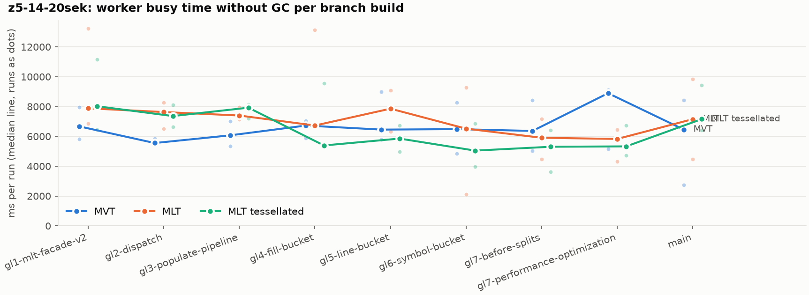
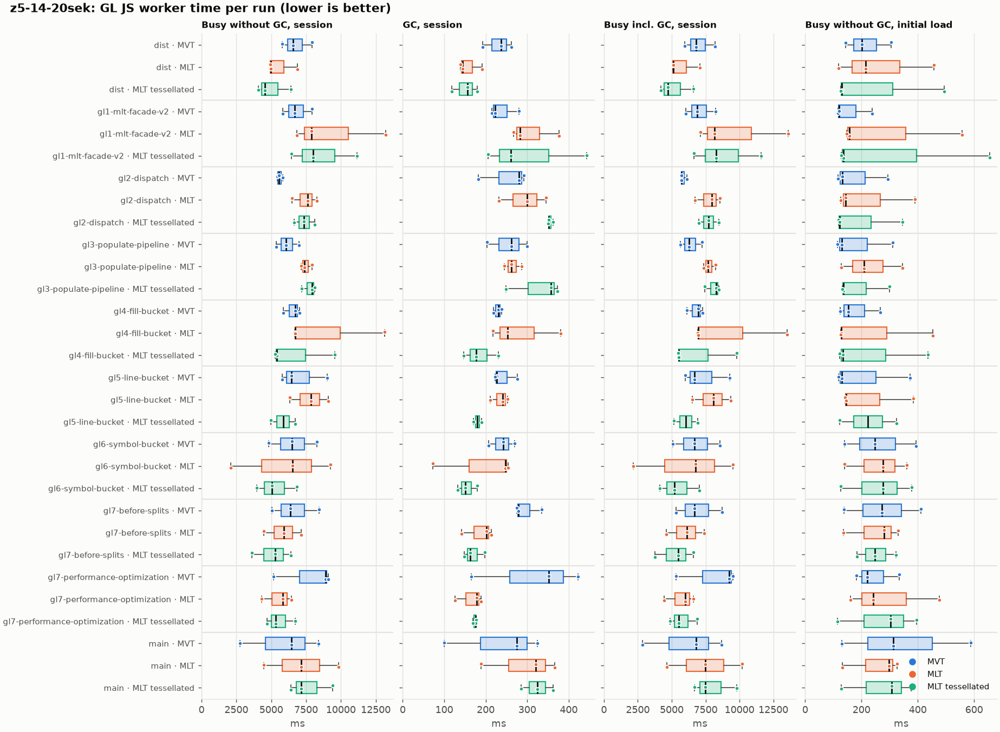
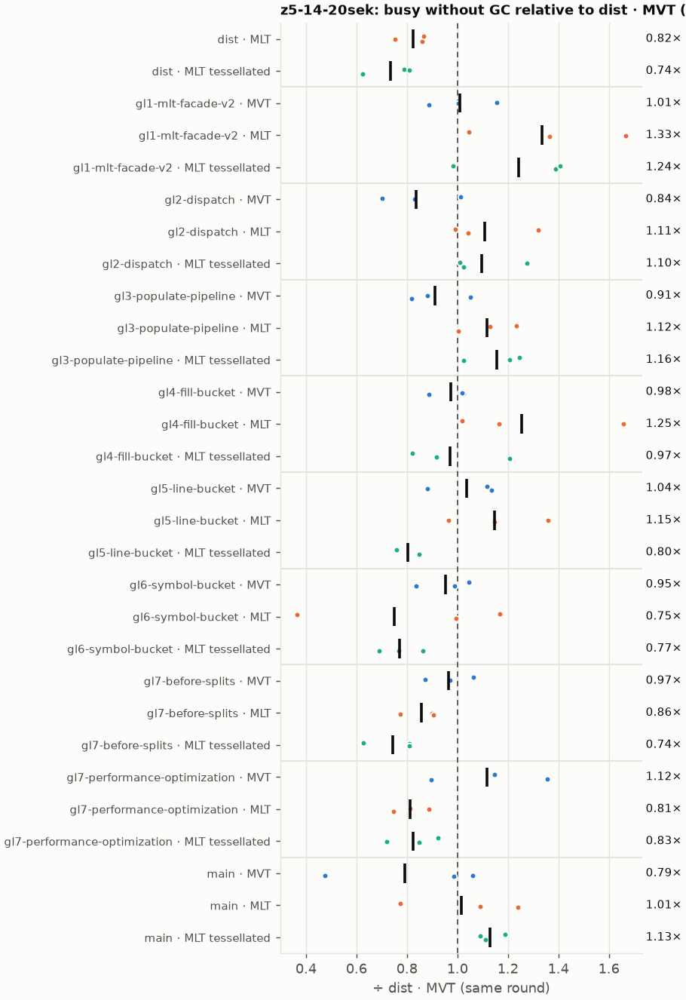
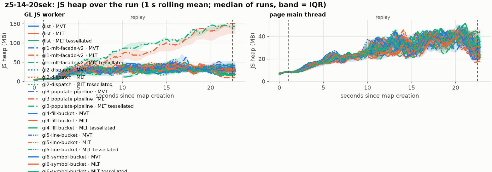
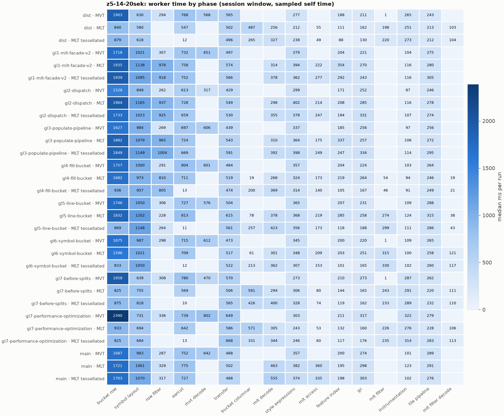
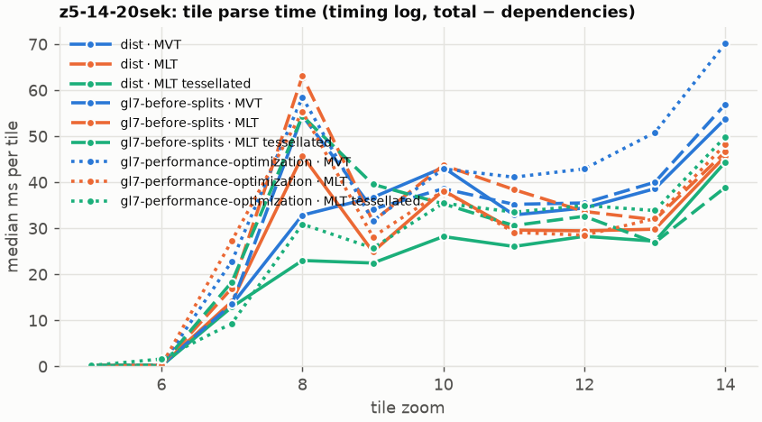
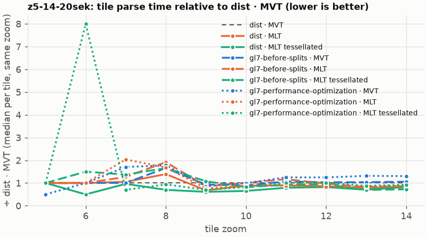

# Session trace benchmark — 20261028-143057

## Setup

- Created 2026-10-28T14:30:57+01:00; 3 repetitions + 1 warm-up round(s) (excluded); variants rotate per round (A B C, B C A, …); one cold browser context per run.
- Machine: 13th Gen Intel(R) Core(TM) i7-1365U, 12 logical cores, 31.3 GB RAM, Windows-11-10.0.26200-SP0; power: GUID des Energieschemas: 381b4222-f694-41f0-9685-ff5bb260df2e  (Ausbalanciert), AC True.
- GL JS gl7-performance-optimization @ 04c383327d (dirty); worker count 1; viewport {'width': 1280, 'height': 1024}.
- Python 3.12.2, packages {'playwright': '1.64.0', 'numpy': '2.5.3', 'matplotlib': '3.11.2'}.

| variant | bundle | format | bundle sha256 | branch build |
|---|---|---|---|---|
| MVT | `dist/maplibre-gl-dev.mjs` | mvt | `9fb2bff45ca6` | – |
| MLT | `dist/maplibre-gl-dev.mjs` | mlt | `9fb2bff45ca6` | – |
| MLT tessellated | `dist/maplibre-gl-dev.mjs` | mlt-pre-tess | `9fb2bff45ca6` | – |
| gl1-mlt-facade-v2 · MVT | `bench-builds/branches/gl1-mlt-facade-v2/maplibre-gl-dev.mjs` | mvt | `ced4373133d3` | gl1-mlt-facade-v2 @ d7b5276422 (2026-10-06), MLT @ 9bf846d053 |
| gl1-mlt-facade-v2 · MLT | `bench-builds/branches/gl1-mlt-facade-v2/maplibre-gl-dev.mjs` | mlt | `ced4373133d3` | gl1-mlt-facade-v2 @ d7b5276422 (2026-10-06), MLT @ 9bf846d053 |
| gl1-mlt-facade-v2 · MLT tessellated | `bench-builds/branches/gl1-mlt-facade-v2/maplibre-gl-dev.mjs` | mlt-pre-tess | `ced4373133d3` | gl1-mlt-facade-v2 @ d7b5276422 (2026-10-06), MLT @ 9bf846d053 |
| gl2-dispatch · MVT | `bench-builds/branches/gl2-dispatch/maplibre-gl-dev.mjs` | mvt | `b73e5cbe0eb6` | gl2-dispatch @ 8b2cf0b4ff (2026-10-07), MLT @ 9bf846d053 |
| gl2-dispatch · MLT | `bench-builds/branches/gl2-dispatch/maplibre-gl-dev.mjs` | mlt | `b73e5cbe0eb6` | gl2-dispatch @ 8b2cf0b4ff (2026-10-07), MLT @ 9bf846d053 |
| gl2-dispatch · MLT tessellated | `bench-builds/branches/gl2-dispatch/maplibre-gl-dev.mjs` | mlt-pre-tess | `b73e5cbe0eb6` | gl2-dispatch @ 8b2cf0b4ff (2026-10-07), MLT @ 9bf846d053 |
| gl3-populate-pipeline · MVT | `bench-builds/branches/gl3-populate-pipeline/maplibre-gl-dev.mjs` | mvt | `b73e5cbe0eb6` | gl3-populate-pipeline @ a9a7824b99 (2026-10-07), MLT @ 9bf846d053 |
| gl3-populate-pipeline · MLT | `bench-builds/branches/gl3-populate-pipeline/maplibre-gl-dev.mjs` | mlt | `b73e5cbe0eb6` | gl3-populate-pipeline @ a9a7824b99 (2026-10-07), MLT @ 9bf846d053 |
| gl3-populate-pipeline · MLT tessellated | `bench-builds/branches/gl3-populate-pipeline/maplibre-gl-dev.mjs` | mlt-pre-tess | `b73e5cbe0eb6` | gl3-populate-pipeline @ a9a7824b99 (2026-10-07), MLT @ 9bf846d053 |
| gl4-fill-bucket · MVT | `bench-builds/branches/gl4-fill-bucket/maplibre-gl-dev.mjs` | mvt | `1e1932eb11bc` | gl4-fill-bucket @ 9d419af4cf (2026-10-14), MLT @ 9bf846d053 |
| gl4-fill-bucket · MLT | `bench-builds/branches/gl4-fill-bucket/maplibre-gl-dev.mjs` | mlt | `1e1932eb11bc` | gl4-fill-bucket @ 9d419af4cf (2026-10-14), MLT @ 9bf846d053 |
| gl4-fill-bucket · MLT tessellated | `bench-builds/branches/gl4-fill-bucket/maplibre-gl-dev.mjs` | mlt-pre-tess | `1e1932eb11bc` | gl4-fill-bucket @ 9d419af4cf (2026-10-14), MLT @ 9bf846d053 |
| gl5-line-bucket · MVT | `bench-builds/branches/gl5-line-bucket/maplibre-gl-dev.mjs` | mvt | `1e1932eb11bc` | gl5-line-bucket @ 77a77065d2 (2026-10-14), MLT @ 9bf846d053 |
| gl5-line-bucket · MLT | `bench-builds/branches/gl5-line-bucket/maplibre-gl-dev.mjs` | mlt | `1e1932eb11bc` | gl5-line-bucket @ 77a77065d2 (2026-10-14), MLT @ 9bf846d053 |
| gl5-line-bucket · MLT tessellated | `bench-builds/branches/gl5-line-bucket/maplibre-gl-dev.mjs` | mlt-pre-tess | `1e1932eb11bc` | gl5-line-bucket @ 77a77065d2 (2026-10-14), MLT @ 9bf846d053 |
| gl6-symbol-bucket · MVT | `bench-builds/branches/gl6-symbol-bucket/maplibre-gl-dev.mjs` | mvt | `1e1932eb11bc` | gl6-symbol-bucket @ ae4e7fbf8c (2026-10-14), MLT @ 9bf846d053 |
| gl6-symbol-bucket · MLT | `bench-builds/branches/gl6-symbol-bucket/maplibre-gl-dev.mjs` | mlt | `1e1932eb11bc` | gl6-symbol-bucket @ ae4e7fbf8c (2026-10-14), MLT @ 9bf846d053 |
| gl6-symbol-bucket · MLT tessellated | `bench-builds/branches/gl6-symbol-bucket/maplibre-gl-dev.mjs` | mlt-pre-tess | `1e1932eb11bc` | gl6-symbol-bucket @ ae4e7fbf8c (2026-10-14), MLT @ 9bf846d053 |
| gl7-before-splits · MVT | `bench-builds/branches/gl7-before-splits/maplibre-gl-dev.mjs` | mvt | `23d9e1c1efa6` | gl7-before-splits @ ef8500dcf4 (2026-10-27), MLT @ 9bf846d053 |
| gl7-before-splits · MLT | `bench-builds/branches/gl7-before-splits/maplibre-gl-dev.mjs` | mlt | `23d9e1c1efa6` | gl7-before-splits @ ef8500dcf4 (2026-10-27), MLT @ 9bf846d053 |
| gl7-before-splits · MLT tessellated | `bench-builds/branches/gl7-before-splits/maplibre-gl-dev.mjs` | mlt-pre-tess | `23d9e1c1efa6` | gl7-before-splits @ ef8500dcf4 (2026-10-27), MLT @ 9bf846d053 |
| gl7-performance-optimization · MVT | `bench-builds/branches/gl7-performance-optimization/maplibre-gl-dev.mjs` | mvt | `c1d3ac49797b` | gl7-performance-optimization @ c539936344 (2026-10-27), MLT @ 9bf846d053 |
| gl7-performance-optimization · MLT | `bench-builds/branches/gl7-performance-optimization/maplibre-gl-dev.mjs` | mlt | `c1d3ac49797b` | gl7-performance-optimization @ c539936344 (2026-10-27), MLT @ 9bf846d053 |
| gl7-performance-optimization · MLT tessellated | `bench-builds/branches/gl7-performance-optimization/maplibre-gl-dev.mjs` | mlt-pre-tess | `c1d3ac49797b` | gl7-performance-optimization @ c539936344 (2026-10-27), MLT @ 9bf846d053 |
| main · MVT | `bench-builds/branches/main/maplibre-gl-dev.mjs` | mvt | `ced4373133d3` | main @ 8470a6193d (2026-09-18), MLT @ 9bf846d053 |
| main · MLT | `bench-builds/branches/main/maplibre-gl-dev.mjs` | mlt | `ced4373133d3` | main @ 8470a6193d (2026-09-18), MLT @ 9bf846d053 |
| main · MLT tessellated | `bench-builds/branches/main/maplibre-gl-dev.mjs` | mlt-pre-tess | `ced4373133d3` | main @ 8470a6193d (2026-09-18), MLT @ 9bf846d053 |

| session | style | duration | frames | sha256 |
|---|---|---:|---:|---|
| z5-14-20sek | osm-bright (recorded: maptiler-basic) | 21.4 s | 829 | `5a376e5ede30` |

CPU sampling interval (median over runs): 584 µs.

## Definitions

- **busy** = wall time in which a GL JS worker thread runs a task (union of top-level task slices and GC slices on `DedicatedWorker thread`s), summed over workers. **GC** = union of `MinorGC`/`MajorGC`/`V8.GC*` slices on those threads. **busy without GC** = busy − GC (headline metric).
- **CPU** = thread time (`tdur`) of the same slices. Phase categories and functions come from the trace's CPU samples (self time), categorised by `config/categories.toml` (nearest matching frame, leaf to root).
- Windows: **load** = map creation → first idle; **session** = camera replay; **tail** = end of replay → idle; **total** = load + session + tail.
- Ratios are against **MVT**: ratio of medians with a bootstrap 95 % CI, the geometric mean of per-round ratios, and a two-sided Mann–Whitney U p-value (normal approximation, not corrected for multiple comparisons; rough below n = 8). Lower than 1× means less worker time.

## Session `z5-14-20sek`

### Worker busy without GC (session window)

| variant | n ok / failed | median ms | IQR | mean | ratio vs MVT | 95 % CI | geo-mean paired | MWU p |
|---|---:|---:|---:|---:|---:|---:|---:|---:|
| MVT | 3 / 0 | 6,561 | 6,169–7,244 | 6,755 | 1.00× | – | – | – |
| MLT | 3 / 0 | 4,969 | 4,954–5,920 | 5,593 | 0.76× | 0.62–1.19× | 0.82× | 0.383 |
| MLT tessellated | 3 / 0 | 4,550 | 4,318–5,485 | 5,019 | 0.69× | 0.52–1.11× | 0.74× | 0.190 |
| gl1-mlt-facade-v2 · MVT | 3 / 0 | 6,671 | 6,248–7,309 | 6,815 | 1.02× | 0.73–1.38× | 1.01× | 0.663 |
| gl1-mlt-facade-v2 · MLT | 3 / 0 | 7,881 | 7,366–10,547 | 9,315 | 1.20× | 0.86–2.29× | 1.33× | 0.383 |
| gl1-mlt-facade-v2 · MLT tessellated | 3 / 0 | 8,017 | 7,229–9,581 | 8,534 | 1.22× | 0.81–1.93× | 1.24× | 0.383 |
| gl2-dispatch · MVT | 3 / 0 | 5,553 | 5,496–5,699 | 5,612 | 0.85× | 0.69–1.01× | 0.84× | 0.190 |
| gl2-dispatch · MLT | 3 / 0 | 7,630 | 7,063–7,948 | 7,464 | 1.16× | 0.82–1.43× | 1.11× | 0.663 |
| gl2-dispatch · MLT tessellated | 3 / 0 | 7,362 | 6,996–7,742 | 7,372 | 1.12× | 0.84–1.41× | 1.10× | 0.383 |
| gl3-populate-pipeline · MVT | 3 / 0 | 6,070 | 5,715–6,533 | 6,142 | 0.93× | 0.68–1.21× | 0.91× | 0.663 |
| gl3-populate-pipeline · MLT | 3 / 0 | 7,398 | 7,266–7,672 | 7,493 | 1.13× | 0.90–1.38× | 1.12× | 0.383 |
| gl3-populate-pipeline · MLT tessellated | 3 / 0 | 7,923 | 7,560–8,028 | 7,751 | 1.21× | 0.91–1.41× | 1.16× | 0.383 |
| gl4-fill-bucket · MVT | 3 / 0 | 6,725 | 6,304–6,882 | 6,549 | 1.03× | 0.74–1.22× | 0.98× | 1.000 |
| gl4-fill-bucket · MLT | 3 / 0 | 6,727 | 6,706–9,937 | 8,853 | 1.03× | 0.84–2.28× | 1.25× | 0.383 |
| gl4-fill-bucket · MLT tessellated | 3 / 0 | 5,391 | 5,348–7,479 | 6,754 | 0.82× | 0.67–1.66× | 0.97× | 0.663 |
| gl5-line-bucket · MVT | 3 / 0 | 6,454 | 6,118–7,726 | 7,078 | 0.98× | 0.73–1.56× | 1.04× | 1.000 |
| gl5-line-bucket · MLT | 3 / 0 | 7,856 | 7,088–8,476 | 7,757 | 1.20× | 0.80–1.57× | 1.15× | 0.663 |
| gl5-line-bucket · MLT tessellated | 2 / 1 | 5,852 | 5,418–6,287 | 5,852 | 0.89× | 0.63–1.16× | 0.80× | 0.773 |
| gl6-symbol-bucket · MVT | 3 / 0 | 6,485 | 5,659–7,382 | 6,533 | 0.99× | 0.61–1.43× | 0.95× | 1.000 |
| gl6-symbol-bucket · MLT | 3 / 0 | 6,517 | 4,309–7,893 | 5,962 | 0.99× | 0.27–1.60× | 0.75× | 1.000 |
| gl6-symbol-bucket · MLT tessellated | 3 / 0 | 5,046 | 4,512–5,944 | 5,288 | 0.77× | 0.50–1.18× | 0.77× | 0.383 |
| gl7-before-splits · MVT | 3 / 0 | 6,365 | 5,700–7,399 | 6,611 | 0.97× | 0.64–1.46× | 0.97× | 1.000 |
| gl7-before-splits · MLT | 3 / 0 | 5,907 | 5,192–6,538 | 5,851 | 0.90× | 0.56–1.24× | 0.86× | 0.663 |
| gl7-before-splits · MLT tessellated | 3 / 0 | 5,304 | 4,460–5,861 | 5,113 | 0.81× | 0.46–1.11× | 0.74× | 0.190 |
| gl7-performance-optimization · MVT | 3 / 0 | 8,894 | 7,033–8,997 | 7,722 | 1.36× | 0.65–1.58× | 1.12× | 0.663 |
| gl7-performance-optimization · MLT | 3 / 0 | 5,826 | 5,070–6,130 | 5,525 | 0.89× | 0.54–1.11× | 0.81× | 0.383 |
| gl7-performance-optimization · MLT tessellated | 3 / 0 | 5,329 | 5,023–6,022 | 5,587 | 0.81× | 0.59–1.16× | 0.83× | 0.383 |
| main · MVT | 3 / 0 | 6,460 | 4,602–7,436 | 5,872 | 0.98× | 0.35–1.46× | 0.79× | 1.000 |
| main · MLT | 3 / 0 | 7,152 | 5,808–8,487 | 7,146 | 1.09× | 0.56–1.70× | 1.01× | 1.000 |
| main · MLT tessellated | 3 / 0 | 7,158 | 6,786–8,292 | 7,666 | 1.09× | 0.81–1.63× | 1.13× | 0.663 |

### All worker metrics (median, ratio vs baseline)

| metric | MVT | MLT | MLT tessellated | gl1-mlt-facade-v2 · MVT | gl1-mlt-facade-v2 · MLT | gl1-mlt-facade-v2 · MLT tessellated | gl2-dispatch · MVT | gl2-dispatch · MLT | gl2-dispatch · MLT tessellated | gl3-populate-pipeline · MVT | gl3-populate-pipeline · MLT | gl3-populate-pipeline · MLT tessellated | gl4-fill-bucket · MVT | gl4-fill-bucket · MLT | gl4-fill-bucket · MLT tessellated | gl5-line-bucket · MVT | gl5-line-bucket · MLT | gl5-line-bucket · MLT tessellated | gl6-symbol-bucket · MVT | gl6-symbol-bucket · MLT | gl6-symbol-bucket · MLT tessellated | gl7-before-splits · MVT | gl7-before-splits · MLT | gl7-before-splits · MLT tessellated | gl7-performance-optimization · MVT | gl7-performance-optimization · MLT | gl7-performance-optimization · MLT tessellated | main · MVT | main · MLT | main · MLT tessellated |
|---|---:|---:|---:|---:|---:|---:|---:|---:|---:|---:|---:|---:|---:|---:|---:|---:|---:|---:|---:|---:|---:|---:|---:|---:|---:|---:|---:|---:|---:|---:|
| busy incl. GC | 6,798 | 5,113 (0.75×) | 4,706 (0.69×) | 6,893 (1.01×) | 8,164 (1.20×) | 8,278 (1.22×) | 5,736 (0.84×) | 7,976 (1.17×) | 7,712 (1.13×) | 6,272 (0.92×) | 7,660 (1.13×) | 8,296 (1.22×) | 6,956 (1.02×) | 6,979 (1.03×) | 5,539 (0.81×) | 6,677 (0.98×) | 8,097 (1.19×) | 6,033 (0.89×) | 6,692 (0.98×) | 6,765 (1.00×) | 5,196 (0.76×) | 6,700 (0.99×) | 6,108 (0.90×) | 5,466 (0.80×) | 9,245 (1.36×) | 6,015 (0.88×) | 5,505 (0.81×) | 6,784 (1.00×) | 7,473 (1.10×) | 7,483 (1.10×) |
| &nbsp;&nbsp;of which GC | 237.2 | 143.9 (0.61×) | 156.2 (0.66×) | 222.3 (0.94×) | 283.4 (1.19×) | 260.7 (1.10×) | 280.4 (1.18×) | 299.9 (1.26×) | 352.0 (1.48×) | 261.3 (1.10×) | 262.3 (1.11×) | 357.0 (1.51×) | 230.6 (0.97×) | 252.4 (1.06×) | 176.8 (0.75×) | 226.5 (0.95×) | 241.5 (1.02×) | 180.2 (0.76×) | 242.0 (1.02×) | 247.6 (1.04×) | 150.9 (0.64×) | 278.9 (1.18×) | 201.2 (0.85×) | 162.3 (0.68×) | 351.4 (1.48×) | 177.9 (0.75×) | 175.8 (0.74×) | 275.2 (1.16×) | 321.2 (1.35×) | 325.1 (1.37×) |
| &nbsp;&nbsp;of which busy without GC | 6,561 | 4,969 (0.76×) | 4,550 (0.69×) | 6,671 (1.02×) | 7,881 (1.20×) | 8,017 (1.22×) | 5,553 (0.85×) | 7,630 (1.16×) | 7,362 (1.12×) | 6,070 (0.93×) | 7,398 (1.13×) | 7,923 (1.21×) | 6,725 (1.03×) | 6,727 (1.03×) | 5,391 (0.82×) | 6,454 (0.98×) | 7,856 (1.20×) | 5,852 (0.89×) | 6,485 (0.99×) | 6,517 (0.99×) | 5,046 (0.77×) | 6,365 (0.97×) | 5,907 (0.90×) | 5,304 (0.81×) | 8,894 (1.36×) | 5,826 (0.89×) | 5,329 (0.81×) | 6,460 (0.98×) | 7,152 (1.09×) | 7,158 (1.09×) |
| &nbsp;&nbsp;&nbsp;&nbsp;of which filtering (sampled, incl. callees) | 294.7 | 198.3 (0.67×) | 220.0 (0.75×) | 306.5 (1.04×) | 977.8 (3.32×) | 918.2 (3.12×) | 262.0 (0.89×) | 937.2 (3.18×) | 925.0 (3.14×) | 268.6 (0.91×) | 964.7 (3.27×) | 1,004 (3.41×) | 290.9 (0.99×) | 864.7 (2.93×) | 848.6 (2.88×) | 305.7 (1.04×) | 502.1 (1.70×) | 563.3 (1.91×) | 298.6 (1.01×) | 315.1 (1.07×) | 330.0 (1.12×) | 309.0 (1.05×) | 243.0 (0.82×) | 232.5 (0.79×) | 335.9 (1.14×) | 225.6 (0.77×) | 235.2 (0.80×) | 286.8 (0.97×) | 329.2 (1.12×) | 316.6 (1.07×) |
| &nbsp;&nbsp;&nbsp;&nbsp;of which column decoding inside the MLT filter (sampled) | 0.0 | 103.0 | 104.0 | 0.0 | 0.0 | 0.0 | 0.0 | 0.0 | 0.0 | 0.0 | 0.0 | 0.0 | 0.0 | 19.5 | 21.1 | 0.0 | 38.5 | 43.5 | 0.0 | 120.6 | 117.1 | 0.0 | 111.5 | 110.4 | 0.0 | 106.2 | 113.1 | 0.0 | 0.0 | 0.0 |
| &nbsp;&nbsp;&nbsp;&nbsp;of which timing instrumentation (sampled) | 265.3 | 250.7 (0.94×) | 273.3 (1.03×) | 104.4 (0.39×) | 116.2 (0.44×) | 115.9 (0.44×) | 86.6 (0.33×) | 115.5 (0.44×) | 106.7 (0.40×) | 97.1 (0.37×) | 106.0 (0.40×) | 113.9 (0.43×) | 102.6 (0.39×) | 94.1 (0.35×) | 91.1 (0.34×) | 108.9 (0.41×) | 123.9 (0.47×) | 111.0 (0.42×) | 108.8 (0.41×) | 100.3 (0.38×) | 102.2 (0.39×) | 286.9 (1.08×) | 290.5 (1.09×) | 288.6 (1.09×) | 321.7 (1.21×) | 275.6 (1.04×) | 314.2 (1.18×) | 100.6 (0.38×) | 123.0 (0.46×) | 102.4 (0.39×) |
| busy without GC and instrumentation | 6,295 | 4,726 (0.75×) | 4,276 (0.68×) | 6,566 (1.04×) | 7,765 (1.23×) | 7,901 (1.26×) | 5,467 (0.87×) | 7,515 (1.19×) | 7,255 (1.15×) | 5,972 (0.95×) | 7,300 (1.16×) | 7,797 (1.24×) | 6,622 (1.05×) | 6,634 (1.05×) | 5,300 (0.84×) | 6,345 (1.01×) | 7,732 (1.23×) | 5,741 (0.91×) | 6,376 (1.01×) | 6,417 (1.02×) | 4,943 (0.79×) | 6,078 (0.97×) | 5,616 (0.89×) | 5,015 (0.80×) | 8,572 (1.36×) | 5,550 (0.88×) | 5,015 (0.80×) | 6,359 (1.01×) | 7,029 (1.12×) | 7,056 (1.12×) |
| CPU time without GC | 6,131 | 4,643 (0.76×) | 4,214 (0.69×) | 6,219 (1.01×) | 7,244 (1.18×) | 7,466 (1.22×) | 5,176 (0.84×) | 7,156 (1.17×) | 6,923 (1.13×) | 5,704 (0.93×) | 6,932 (1.13×) | 7,431 (1.21×) | 6,236 (1.02×) | 6,312 (1.03×) | 5,029 (0.82×) | 5,995 (0.98×) | 7,213 (1.18×) | 5,388 (0.88×) | 6,049 (0.99×) | 6,108 (1.00×) | 4,701 (0.77×) | 5,922 (0.97×) | 5,393 (0.88×) | 4,938 (0.81×) | 8,235 (1.34×) | 5,354 (0.87×) | 4,680 (0.76×) | 6,095 (0.99×) | 6,673 (1.09×) | 6,640 (1.08×) |
| tile: download end → sent to main thread, median per tile | 278.2 | 243.0 (0.87×) | 226.8 (0.82×) | 299.4 (1.08×) | 352.3 (1.27×) | 346.8 (1.25×) | 273.4 (0.98×) | 290.4 (1.04×) | 356.9 (1.28×) | 291.0 (1.05×) | 316.4 (1.14×) | 328.9 (1.18×) | 323.9 (1.16×) | 331.5 (1.19×) | 239.5 (0.86×) | 269.1 (0.97×) | 308.5 (1.11×) | 261.8 (0.94×) | 289.6 (1.04×) | 249.3 (0.90×) | 226.7 (0.81×) | 288.1 (1.04×) | 240.7 (0.87×) | 241.7 (0.87×) | 380.4 (1.37×) | 242.2 (0.87×) | 242.5 (0.87×) | 395.6 (1.42×) | 318.5 (1.14×) | 398.4 (1.43×) |
| tile: download end → sent to main thread, 90th percentile | 633.6 | 476.2 (0.75×) | 408.6 (0.64×) | 586.5 (0.93×) | 711.3 (1.12×) | 712.1 (1.12×) | 563.8 (0.89×) | 642.8 (1.01×) | 705.4 (1.11×) | 597.9 (0.94×) | 674.0 (1.06×) | 711.5 (1.12×) | 588.9 (0.93×) | 623.9 (0.98×) | 511.0 (0.81×) | 536.1 (0.85×) | 637.1 (1.01×) | 483.8 (0.76×) | 631.0 (1.00×) | 583.9 (0.92×) | 422.7 (0.67×) | 568.5 (0.90×) | 483.8 (0.76×) | 419.7 (0.66×) | 837.8 (1.32×) | 480.8 (0.76×) | 437.7 (0.69×) | 718.6 (1.13×) | 606.6 (0.96×) | 724.8 (1.14×) |
| tile: download end → sent to main thread, 95th percentile | 668.9 | 497.6 (0.74×) | 435.0 (0.65×) | 646.1 (0.97×) | 773.9 (1.16×) | 771.2 (1.15×) | 641.8 (0.96×) | 760.5 (1.14×) | 800.9 (1.20×) | 637.4 (0.95×) | 777.7 (1.16×) | 748.4 (1.12×) | 673.1 (1.01×) | 766.2 (1.15×) | 583.2 (0.87×) | 640.2 (0.96×) | 734.5 (1.10×) | 551.8 (0.82×) | 675.2 (1.01×) | 643.6 (0.96×) | 448.7 (0.67×) | 596.8 (0.89×) | 559.0 (0.84×) | 470.8 (0.70×) | 888.9 (1.33×) | 499.6 (0.75×) | 476.4 (0.71×) | 818.0 (1.22×) | 829.9 (1.24×) | 770.6 (1.15×) |
| tile: download end → sent to main thread, 99th percentile | 723.8 | 599.0 (0.83×) | 672.6 (0.93×) | 783.5 (1.08×) | 885.0 (1.22×) | 866.5 (1.20×) | 694.1 (0.96×) | 860.4 (1.19×) | 923.0 (1.28×) | 746.4 (1.03×) | 883.7 (1.22×) | 916.3 (1.27×) | 733.1 (1.01×) | 878.0 (1.21×) | 686.3 (0.95×) | 780.1 (1.08×) | 835.4 (1.15×) | 677.7 (0.94×) | 799.4 (1.10×) | 782.8 (1.08×) | 504.7 (0.70×) | 655.6 (0.91×) | 596.7 (0.82×) | 515.3 (0.71×) | 976.4 (1.35×) | 597.9 (0.83×) | 715.0 (0.99×) | 914.1 (1.26×) | 944.1 (1.30×) | 807.2 (1.12×) |
| &nbsp;&nbsp;parse part (timing log, incl. waiting for glyphs/icons), median per tile | 158.6 | 143.4 (0.90×) | 130.8 (0.82×) | – | – | – | – | – | – | – | – | – | – | – | – | – | – | – | – | – | – | 161.7 (1.02×) | 163.3 (1.03×) | 157.5 (0.99×) | 231.1 (1.46×) | 145.4 (0.92×) | 166.6 (1.05×) | – | – | – |
| &nbsp;&nbsp;queue + hand-off part, median per tile | 91.2 | 73.7 (0.81×) | 65.2 (0.71×) | – | – | – | – | – | – | – | – | – | – | – | – | – | – | – | – | – | – | 88.1 (0.97×) | 59.6 (0.65×) | 70.3 (0.77×) | 116.8 (1.28×) | 74.3 (0.82×) | 63.6 (0.70×) | – | – | – |
| minor GCs | 75.00 | 54.00 (0.72×) | 33.00 (0.44×) | 79.00 (1.05×) | 87.00 (1.16×) | 87.00 (1.16×) | 71.00 (0.95×) | 83.00 (1.11×) | 85.00 (1.13×) | 75.00 (1.00×) | 83.00 (1.11×) | 83.00 (1.11×) | 75.00 (1.00×) | 84.00 (1.12×) | 52.00 (0.69×) | 79.00 (1.05×) | 79.00 (1.05×) | 43.50 (0.58×) | 75.00 (1.00×) | 71.00 (0.95×) | 43.00 (0.57×) | 72.00 (0.96×) | 56.00 (0.75×) | 34.00 (0.45×) | 74.00 (0.99×) | 54.00 (0.72×) | 32.00 (0.43×) | 76.00 (1.01×) | 77.00 (1.03×) | 80.00 (1.07×) |
| major GCs | 5.00 | 5.00 (1.00×) | 7.00 (1.40×) | 6.00 (1.20×) | 7.00 (1.40×) | 7.00 (1.40×) | 8.00 (1.60×) | 7.00 (1.40×) | 8.00 (1.60×) | 7.00 (1.40×) | 6.00 (1.20×) | 9.00 (1.80×) | 6.00 (1.20×) | 7.00 (1.40×) | 5.00 (1.00×) | 6.00 (1.20×) | 6.00 (1.20×) | 7.00 (1.40×) | 6.00 (1.20×) | 5.00 (1.00×) | 6.00 (1.20×) | 7.00 (1.40×) | 6.00 (1.20×) | 9.00 (1.80×) | 9.00 (1.80×) | 4.00 (0.80×) | 9.00 (1.80×) | 6.00 (1.20×) | 4.00 (0.80×) | 4.00 (0.80×) |
| peak worker heap (MB) | 59.9 | 59.2 (0.99×) | 45.6 (0.76×) | 65.9 (1.10×) | 67.5 (1.13×) | 68.8 (1.15×) | 76.2 (1.27×) | 65.4 (1.09×) | 87.4 (1.46×) | 71.5 (1.19×) | 65.8 (1.10×) | 67.9 (1.13×) | 67.3 (1.12×) | 67.4 (1.12×) | 58.8 (0.98×) | 63.9 (1.07×) | 68.0 (1.13×) | 57.9 (0.97×) | 63.8 (1.07×) | 58.2 (0.97×) | 54.5 (0.91×) | 91.0 (1.52×) | 58.7 (0.98×) | 46.3 (0.77×) | 70.7 (1.18×) | 60.7 (1.01×) | 48.1 (0.80×) | 55.3 (0.92×) | 162.4 (2.71×) | 162.9 (2.72×) |
| load: busy without GC | 201.7 | 215.7 (1.07×) | 129.8 (0.64×) | 120.7 (0.60×) | 156.4 (0.78×) | 136.6 (0.68×) | 131.4 (0.65×) | 144.3 (0.72×) | 123.1 (0.61×) | 130.4 (0.65×) | 209.2 (1.04×) | 135.5 (0.67×) | 153.0 (0.76×) | 128.9 (0.64×) | 134.6 (0.67×) | 130.1 (0.65×) | 146.5 (0.73×) | 223.5 (1.11×) | 247.2 (1.23×) | 276.4 (1.37×) | 275.8 (1.37×) | 273.3 (1.36×) | 280.1 (1.39×) | 247.8 (1.23×) | 221.6 (1.10×) | 241.0 (1.19×) | 303.6 (1.51×) | 313.2 (1.55×) | 296.7 (1.47×) | 306.7 (1.52×) |
| load: GC | 7.2 | 7.5 (1.04×) | 5.3 (0.74×) | 6.0 (0.84×) | 5.9 (0.83×) | 5.8 (0.82×) | 6.1 (0.85×) | 6.3 (0.88×) | 4.9 (0.68×) | 5.5 (0.77×) | 7.0 (0.98×) | 6.0 (0.83×) | 8.0 (1.11×) | 5.5 (0.77×) | 4.5 (0.63×) | 5.5 (0.77×) | 5.8 (0.81×) | 7.5 (1.05×) | 7.8 (1.09×) | 8.2 (1.15×) | 8.0 (1.11×) | 9.8 (1.36×) | 8.1 (1.13×) | 8.6 (1.21×) | 10.6 (1.48×) | 8.1 (1.13×) | 9.2 (1.29×) | 10.8 (1.51×) | 8.3 (1.15×) | 8.5 (1.18×) |
| total: busy without GC | 6,705 | 5,185 (0.77×) | 4,676 (0.70×) | 6,791 (1.01×) | 8,028 (1.20×) | 8,145 (1.21×) | 5,847 (0.87×) | 7,774 (1.16×) | 7,485 (1.12×) | 6,200 (0.92×) | 7,607 (1.13×) | 8,059 (1.20×) | 6,878 (1.03×) | 6,853 (1.02×) | 5,526 (0.82×) | 6,572 (0.98×) | 8,002 (1.19×) | 6,076 (0.91×) | 6,624 (0.99×) | 6,657 (0.99×) | 5,172 (0.77×) | 6,502 (0.97×) | 6,043 (0.90×) | 5,487 (0.82×) | 9,076 (1.35×) | 5,987 (0.89×) | 5,633 (0.84×) | 6,590 (0.98×) | 7,284 (1.09×) | 7,287 (1.09×) |

Rows marked *of which* are parts of the row above, not additional time. Tile rows are per-tile latencies (medians over tiles, then over runs), not sums: tiles overlap in time, and the medians of the parse and queue parts do not add up exactly to the median latency.

### Filtering (session window)

Sampled worker time spent in feature filtering, including everything the filter calls (expression evaluation, property access): **row filter** = the style-spec feature filter that MVT runs per feature, **mlt filter** = the columnar MLT filter (incl. the geometry-type selection), without the columns it decodes (see the next table). Medians per run; rules in `config/categories.toml`.

| variant | mlt filter | row filter | filtering | ratio vs MVT | 95 % CI | MWU p | share of sampled busy |
|---|---:|---:|---:|---:|---:|---:|---:|
| MVT | 0.6 | 294.1 | 294.7 | 1.00× | – | – | 4.9% |
| MLT | 198.3 | 0.0 | 198.3 | 0.67× | 0.53–1.02× | 0.190 | 4.2% |
| MLT tessellated | 220.0 | 0.0 | 220.0 | 0.75× | 0.56–1.10× | 0.190 | 5.4% |
| gl1-mlt-facade-v2 · MVT | 0.0 | 306.5 | 306.5 | 1.04× | 0.70–1.46× | 1.000 | 4.9% |
| gl1-mlt-facade-v2 · MLT | 0.0 | 977.8 | 977.8 | 3.32× | 2.36–6.77× | 0.081 | 13.3% |
| gl1-mlt-facade-v2 · MLT tessellated | 0.0 | 918.2 | 918.2 | 3.12× | 2.17–5.43× | 0.081 | 12.8% |
| gl2-dispatch · MVT | 0.0 | 262.0 | 262.0 | 0.89× | 0.69–1.23× | 1.000 | 5.2% |
| gl2-dispatch · MLT | 0.0 | 937.2 | 937.2 | 3.18× | 2.32–4.10× | 0.081 | 12.9% |
| gl2-dispatch · MLT tessellated | 0.0 | 925.0 | 925.0 | 3.14× | 2.20–4.15× | 0.081 | 13.2% |
| gl3-populate-pipeline · MVT | 0.0 | 268.6 | 268.6 | 0.91× | 0.74–1.28× | 1.000 | 4.8% |
| gl3-populate-pipeline · MLT | 0.0 | 964.7 | 964.7 | 3.27× | 2.58–4.13× | 0.081 | 13.3% |
| gl3-populate-pipeline · MLT tessellated | 0.0 | 1,004 | 1,004 | 3.41× | 2.45–4.32× | 0.081 | 13.3% |
| gl4-fill-bucket · MVT | 0.0 | 290.9 | 290.9 | 0.99× | 0.76–1.23× | 1.000 | 4.6% |
| gl4-fill-bucket · MLT | 54.5 | 810.2 | 864.7 | 2.93× | 2.17–6.36× | 0.081 | 12.8% |
| gl4-fill-bucket · MLT tessellated | 45.8 | 804.8 | 848.6 | 2.88× | 2.21–5.90× | 0.081 | 16.5% |
| gl5-line-bucket · MVT | 0.0 | 305.7 | 305.7 | 1.04× | 0.79–1.58× | 0.663 | 5.2% |
| gl5-line-bucket · MLT | 274.2 | 227.9 | 502.1 | 1.70× | 1.23–2.63× | 0.081 | 7.5% |
| gl5-line-bucket · MLT tessellated | 299.1 | 264.3 | 563.3 | 1.91× | 1.37–2.62× | 0.149 | 10.7% |
| gl6-symbol-bucket · MVT | 0.6 | 298.0 | 298.6 | 1.01× | 0.81–1.49× | 1.000 | 5.0% |
| gl6-symbol-bucket · MLT | 315.1 | 0.0 | 315.1 | 1.07× | 0.27–1.88× | 1.000 | 5.3% |
| gl6-symbol-bucket · MLT tessellated | 330.0 | 0.0 | 330.0 | 1.12× | 0.67–1.56× | 1.000 | 6.7% |
| gl7-before-splits · MVT | 0.6 | 308.4 | 309.0 | 1.05× | 0.62–1.40× | 1.000 | 4.8% |
| gl7-before-splits · MLT | 243.0 | 0.0 | 243.0 | 0.82× | 0.46–1.20× | 0.383 | 4.6% |
| gl7-before-splits · MLT tessellated | 232.5 | 0.0 | 232.5 | 0.79× | 0.46–1.25× | 0.383 | 5.1% |
| gl7-performance-optimization · MVT | 0.1 | 335.8 | 335.9 | 1.14× | 0.56–1.62× | 1.000 | 4.3% |
| gl7-performance-optimization · MLT | 225.6 | 0.0 | 225.6 | 0.77× | 0.47–1.09× | 0.190 | 4.3% |
| gl7-performance-optimization · MLT tessellated | 235.2 | 0.0 | 235.2 | 0.80× | 0.55–1.21× | 0.190 | 5.0% |
| main · MVT | 0.0 | 286.8 | 286.8 | 0.97× | 0.37–1.53× | 1.000 | 4.7% |
| main · MLT | 0.0 | 329.2 | 329.2 | 1.12× | 0.65–1.89× | 1.000 | 5.1% |
| main · MLT tessellated | 0.0 | 316.6 | 316.6 | 1.07× | 0.81–1.84× | 0.663 | 4.9% |

**Filtering together with tile decoding.** The MLT decoder leaves columns encoded until something reads them, and the filter is usually the first reader: the columns it decodes (properties, and the geometry for `$type`) are **of which inside the filter** (phase *mlt filter decode*), the rest is *mlt decode* (geometry and columns read later, e.g. by paint properties and symbols). MVT decodes every feature's properties and geometry while it reads the tile (*mvt decode*), whether the filter keeps the feature or not. So **filtering** above compares the filters, and **decoding + filtering** compares all that the formats spend on decoding the tile and selecting features. **tile decoding** = *mvt decode* or *mlt decode* + *mlt filter decode*: work inside a call into a decoder. Reading data that is already decoded is not counted, as for MVT's feature objects: *mlt access* (row views, value getters, looking a column up by name) and the MLT facade (*mlt facade*). MVT decodes geometry only for the features its filter keeps, MLT decodes a layer's whole geometry column.

| variant | tile decoding | of which inside the filter | filtering | decoding + filtering | ratio vs MVT | 95 % CI | MWU p |
|---|---:|---:|---:|---:|---:|---:|---:|
| MVT | 568.4 | 0.0 | 294.7 | 810.2 | 1.00× | – | – |
| MLT | 358.6 | 103.0 | 198.3 | 547.9 | 0.68× | 0.58–0.91× | 0.081 |
| MLT tessellated | 430.6 | 104.0 | 220.0 | 650.7 | 0.80× | 0.64–1.12× | 0.383 |
| gl1-mlt-facade-v2 · MVT | 650.9 | 0.0 | 306.5 | 957.4 | 1.18× | 0.89–1.42× | 0.190 |
| gl1-mlt-facade-v2 · MLT | 314.5 | 0.0 | 977.8 | 1,292 | 1.59× | 1.23–2.78× | 0.081 |
| gl1-mlt-facade-v2 · MLT tessellated | 378.3 | 0.0 | 918.2 | 1,296 | 1.60× | 1.19–2.42× | 0.081 |
| gl2-dispatch · MVT | 317.2 | 0.0 | 262.0 | 613.7 | 0.76× | 0.59–1.03× | 0.190 |
| gl2-dispatch · MLT | 298.5 | 0.0 | 937.2 | 1,236 | 1.53× | 1.21–1.69× | 0.081 |
| gl2-dispatch · MLT tessellated | 354.9 | 0.0 | 925.0 | 1,280 | 1.58× | 1.20–1.85× | 0.081 |
| gl3-populate-pipeline · MVT | 606.0 | 0.0 | 268.6 | 874.5 | 1.08× | 0.61–1.29× | 1.000 |
| gl3-populate-pipeline · MLT | 309.8 | 0.0 | 964.7 | 1,258 | 1.55× | 1.34–1.73× | 0.081 |
| gl3-populate-pipeline · MLT tessellated | 392.0 | 0.0 | 1,004 | 1,396 | 1.72× | 1.36–1.90× | 0.081 |
| gl4-fill-bucket · MVT | 601.2 | 0.0 | 290.9 | 892.1 | 1.10× | 0.75–1.21× | 1.000 |
| gl4-fill-bucket · MLT | 287.8 | 19.5 | 864.7 | 1,152 | 1.42× | 1.14–2.71× | 0.081 |
| gl4-fill-bucket · MLT tessellated | 390.1 | 21.1 | 848.6 | 1,227 | 1.51× | 1.29–2.71× | 0.081 |
| gl5-line-bucket · MVT | 576.2 | 0.0 | 305.7 | 859.4 | 1.06× | 0.71–1.61× | 1.000 |
| gl5-line-bucket · MLT | 416.1 | 38.5 | 502.1 | 918.1 | 1.13× | 0.81–1.40× | 1.000 |
| gl5-line-bucket · MLT tessellated | 466.3 | 43.5 | 563.3 | 1,030 | 1.27× | 0.96–1.53× | 0.386 |
| gl6-symbol-bucket · MVT | 612.5 | 0.0 | 298.6 | 911.1 | 1.12× | 0.58–1.53× | 1.000 |
| gl6-symbol-bucket · MLT | 421.7 | 120.6 | 315.1 | 736.8 | 0.91× | 0.23–1.39× | 0.663 |
| gl6-symbol-bucket · MLT tessellated | 478.8 | 117.1 | 330.0 | 808.8 | 1.00× | 0.69–1.39× | 1.000 |
| gl7-before-splits · MVT | 470.5 | 0.0 | 309.0 | 692.9 | 0.86× | 0.72–1.49× | 0.663 |
| gl7-before-splits · MLT | 405.6 | 111.5 | 243.0 | 648.5 | 0.80× | 0.53–1.04× | 0.190 |
| gl7-before-splits · MLT tessellated | 510.2 | 110.4 | 232.5 | 742.7 | 0.92× | 0.55–1.17× | 0.383 |
| gl7-performance-optimization · MVT | 801.6 | 0.0 | 335.9 | 1,194 | 1.47× | 0.73–2.94× | 0.663 |
| gl7-performance-optimization · MLT | 410.8 | 106.2 | 225.6 | 636.5 | 0.79× | 0.51–0.93× | 0.081 |
| gl7-performance-optimization · MLT tessellated | 453.8 | 113.1 | 235.2 | 689.0 | 0.85× | 0.69–1.15× | 0.383 |
| main · MVT | 641.5 | 0.0 | 286.8 | 928.4 | 1.15× | 0.29–1.54× | 0.663 |
| main · MLT | 463.2 | 0.0 | 329.2 | 792.4 | 0.98× | 0.56–1.49× | 1.000 |
| main · MLT tessellated | 555.5 | 0.0 | 316.6 | 872.1 | 1.08× | 0.85–1.54× | 0.663 |

Top 12 functions inside filtering and its column decoding (self time, mean ms per run):

| phase | function | source | MVT | MLT | MLT tessellated | gl1-mlt-facade-v2 · MVT | gl1-mlt-facade-v2 · MLT | gl1-mlt-facade-v2 · MLT tessellated | gl2-dispatch · MVT | gl2-dispatch · MLT | gl2-dispatch · MLT tessellated | gl3-populate-pipeline · MVT | gl3-populate-pipeline · MLT | gl3-populate-pipeline · MLT tessellated | gl4-fill-bucket · MVT | gl4-fill-bucket · MLT | gl4-fill-bucket · MLT tessellated | gl5-line-bucket · MVT | gl5-line-bucket · MLT | gl5-line-bucket · MLT tessellated | gl6-symbol-bucket · MVT | gl6-symbol-bucket · MLT | gl6-symbol-bucket · MLT tessellated | gl7-before-splits · MVT | gl7-before-splits · MLT | gl7-before-splits · MLT tessellated | gl7-performance-optimization · MVT | gl7-performance-optimization · MLT | gl7-performance-optimization · MLT tessellated | main · MVT | main · MLT | main · MLT tessellated |
|---|---|---|---:|---:|---:|---:|---:|---:|---:|---:|---:|---:|---:|---:|---:|---:|---:|---:|---:|---:|---:|---:|---:|---:|---:|---:|---:|---:|---:|---:|---:|---:|
| row filter | `CompoundExpression.register.filter-==` | node_modules/@maplibre/maplibre-gl-style-spec/dist/expression/compound_expression.mjs | 40.9 | 0.0 | 0.0 | 39.6 | 140.8 | 126.5 | 32.9 | 118.6 | 110.8 | 33.2 | 122.1 | 118.3 | 35.5 | 125.2 | 118.3 | 37.9 | 15.6 | 14.8 | 39.1 | 0.0 | 0.0 | 33.7 | 0.0 | 0.0 | 41.5 | 0.0 | 0.0 | 32.9 | 41.3 | 47.7 |
| row filter | `readProperty` | maplibre-tile-spec/ts/dist/vector/rowView.js | 0.0 | 0.0 | 0.0 | 0.0 | 116.2 | 100.9 | 0.0 | 97.0 | 91.7 | 0.0 | 96.5 | 101.9 | 0.0 | 101.4 | 100.5 | 0.0 | 13.0 | 14.5 | 0.0 | 0.0 | 0.0 | 0.0 | 0.0 | 0.0 | 0.0 | 0.0 | 0.0 | 0.0 | 0.0 | 0.0 |
| row filter | `evaluate` | node_modules/@maplibre/maplibre-gl-style-spec/dist/expression/compound_expression.mjs | 76.9 | 0.0 | 0.0 | 82.4 | 113.4 | 92.7 | 70.0 | 86.7 | 82.6 | 76.9 | 88.4 | 96.6 | 73.3 | 94.3 | 89.7 | 92.9 | 15.8 | 12.9 | 81.8 | 0.0 | 0.0 | 81.3 | 0.0 | 0.0 | 74.8 | 0.0 | 0.0 | 70.5 | 106.0 | 100.7 |
| row filter | `CompoundExpression.register.filter-in-small` | node_modules/@maplibre/maplibre-gl-style-spec/dist/expression/compound_expression.mjs | 39.0 | 0.0 | 0.0 | 41.3 | 102.9 | 95.0 | 37.3 | 79.0 | 80.9 | 38.5 | 91.9 | 95.6 | 37.9 | 105.2 | 100.7 | 38.3 | 5.6 | 7.3 | 49.9 | 0.0 | 0.0 | 42.1 | 0.0 | 0.0 | 40.0 | 0.0 | 0.0 | 32.9 | 43.1 | 43.5 |
| mlt filter | `filterByGeometryType` | maplibre-tile-spec/ts/dist/vector/geometry/geometryVector.js | 0.0 | 19.3 | 28.0 | 0.0 | 0.0 | 0.0 | 0.0 | 0.0 | 0.0 | 0.0 | 0.0 | 0.0 | 0.0 | 10.8 | 6.1 | 0.0 | 72.2 | 82.0 | 0.0 | 66.2 | 74.1 | 0.0 | 22.6 | 23.7 | 0.0 | 18.2 | 24.1 | 0.0 | 0.0 | 0.0 |
| row filter | `evaluate` | node_modules/@maplibre/maplibre-gl-style-spec/dist/expression/index.mjs | 39.3 | 0.0 | 0.0 | 48.1 | 72.9 | 64.8 | 46.9 | 51.4 | 58.1 | 42.9 | 65.2 | 63.1 | 46.5 | 49.5 | 52.1 | 48.6 | 15.7 | 22.7 | 47.1 | 0.0 | 0.0 | 44.6 | 0.0 | 0.0 | 45.5 | 0.0 | 0.0 | 42.5 | 45.6 | 45.2 |
| row filter | `__classPrivateFieldGet` | maplibre-tile-spec/ts/dist/vector/lazyPropertyVectors.js | 0.0 | 0.0 | 0.0 | 0.0 | 68.4 | 54.3 | 0.0 | 48.9 | 53.7 | 0.0 | 42.6 | 51.1 | 0.0 | 53.7 | 56.9 | 0.0 | 7.3 | 12.0 | 0.0 | 0.0 | 0.0 | 0.0 | 0.0 | 0.0 | 0.0 | 0.0 | 0.0 | 0.0 | 0.0 | 0.0 |
| row filter | `getValue` | maplibre-tile-spec/ts/dist/vector/vector.js | 0.0 | 0.0 | 0.0 | 0.0 | 50.8 | 43.5 | 0.0 | 38.7 | 34.6 | 0.0 | 33.9 | 35.2 | 0.0 | 33.9 | 41.3 | 0.0 | 7.3 | 7.1 | 0.0 | 0.0 | 0.0 | 0.0 | 0.0 | 0.0 | 0.0 | 0.0 | 0.0 | 0.0 | 0.0 | 0.0 |
| row filter | `get` | maplibre-tile-spec/ts/dist/vector/lazyPropertyVectors.js | 0.0 | 0.0 | 0.0 | 0.0 | 48.5 | 39.0 | 0.0 | 39.3 | 30.5 | 0.0 | 39.9 | 37.1 | 0.0 | 43.4 | 42.3 | 0.0 | 6.8 | 9.7 | 0.0 | 0.0 | 0.0 | 0.0 | 0.0 | 0.0 | 0.0 | 0.0 | 0.0 | 0.0 | 0.0 | 0.0 |
| row filter | `get` | maplibre-tile-spec/ts/dist/vector/rowView.js | 0.0 | 0.0 | 0.0 | 0.0 | 36.0 | 29.1 | 0.0 | 27.5 | 24.3 | 0.0 | 25.2 | 32.9 | 0.0 | 32.5 | 29.6 | 0.0 | 3.9 | 3.3 | 0.0 | 0.0 | 0.0 | 0.0 | 0.0 | 0.0 | 0.0 | 0.0 | 0.0 | 0.0 | 0.0 | 0.0 |
| mlt filter | `scanDictionaryCodes` | maplibre-tile-spec/ts/dist/processing/filter/execution/filterKernel.js | 0.0 | 28.9 | 27.8 | 0.0 | 0.0 | 0.0 | 0.0 | 0.0 | 0.0 | 0.0 | 0.0 | 0.0 | 0.0 | 6.8 | 7.3 | 0.0 | 31.9 | 35.8 | 0.0 | 30.6 | 32.9 | 0.0 | 30.5 | 33.7 | 0.0 | 33.0 | 30.3 | 0.0 | 0.0 | 0.0 |
| row filter | `unpackNullable` | maplibre-tile-spec/ts/dist/decoding/unpackNullableUtils.js | 0.0 | 0.0 | 0.0 | 0.0 | 35.5 | 25.5 | 0.0 | 27.1 | 25.9 | 0.0 | 28.8 | 31.8 | 0.0 | 27.1 | 28.8 | 0.0 | 20.3 | 21.1 | 0.0 | 0.0 | 0.0 | 0.0 | 0.0 | 0.0 | 0.0 | 0.0 | 0.0 | 0.0 | 0.0 | 0.0 |

### Where the variants differ from MVT (session window, mean ms per run)

Open **[flame.html](flame.html)** to explore the call tree interactively: pick a variant, compare it with MVT (red = more time at the same call path, blue = less), click a frame to zoom in, and read the phase and function breakdown under it. Without a comparison, frames are coloured by phase: filtering is green in both formats, and the columns the MLT filter decodes on first access (*mlt filter decode*) are MLT blue frames under the green filter. `flame/*.txt` open in https://www.speedscope.app.

#### MLT vs MVT

**By phase** (sampled self time; the Δ column sums to the difference in sampled busy time):

| phase | MVT | MLT | Δ |
|---|---:|---:|---:|
| bucket columnar | 0.0 | 515.6 | +515.6 |
| mlt decode | 0.0 | 279.0 | +279.0 |
| mlt filter | 0.4 | 211.6 | +211.2 |
| mlt filter decode | 0.0 | 104.5 | +104.5 |
| mlt facade | 0.4 | 61.9 | +61.5 |
| mlt access | 0.0 | 56.3 | +56.3 |
| other | 11.5 | 9.9 | -1.5 |
| instrumentation | 284.3 | 280.8 | -3.5 |
| runtime | 29.0 | 20.9 | -8.1 |
| symbol layout | 681.8 | 668.8 | -13.1 |
| tile pipeline | 259.5 | 238.5 | -21.0 |
| gc | 204.2 | 165.9 | -38.3 |
| style expressions | 294.1 | 238.7 | -55.4 |
| transfer | 605.1 | 540.4 | -64.7 |
| feature index | 201.2 | 125.7 | -75.5 |
| earcut | 740.7 | 574.1 | -166.6 |
| row filter | 298.5 | 0.0 | -298.5 |
| mvt decode | 534.1 | 0.0 | -534.1 |
| bucket row | 1,935 | 923.9 | -1010.8 |

**By source layer** (timing log: createBucket + populate + addFeatures, summed over the style layers that use it; wall time, includes GC pauses; total Δ -988 ms):

| source layer | type | MVT | MLT | Δ |
|---|---|---:|---:|---:|
| poi | symbol | 247.6 | 293.2 | +45.7 |
| place | symbol | 385.9 | 429.6 | +43.7 |
| transportation_name | symbol | 200.6 | 238.4 | +37.7 |
| park | fill | 5.1 | 38.5 | +33.4 |
| boundary | line | 82.5 | 103.7 | +21.2 |
| waterway | line | 48.0 | 65.3 | +17.3 |
| transportation | fill | 30.6 | 19.5 | -11.1 |
| water | fill | 166.5 | 124.7 | -41.8 |
| transportation | line | 1,550 | 1,339 | -210.9 |
| landuse | fill | 619.4 | 389.4 | -230.0 |
| landcover | fill | 815.4 | 518.6 | -296.8 |
| building | fill | 846.2 | 441.6 | -404.6 |

**Functions with the largest self-time difference** (by function name, summed over source files):

| function | MVT | MLT | Δ |
|---|---:|---:|---:|
| `buildRingBoundingBoxes` | 0.0 | 56.3 | +56.3 |
| `writeEarcutFill` | 0.0 | 53.0 | +53.0 |
| `buildEarcutMesh` | 0.0 | 46.9 | +46.9 |
| `decodeComponentwiseDeltaVec2` | 0.0 | 39.3 | +39.3 |
| `readScaledRings` | 0.0 | 34.8 | +34.8 |
| `get` | 37.0 | 68.9 | +31.9 |
| `scanDictionaryCodes` | 0.0 | 28.9 | +28.9 |
| `unpackNullable` | 0.0 | 28.7 | +28.7 |
| `decodeString$2` | 0.0 | 22.6 | +22.6 |
| `dictionaryRowMatches` | 0.0 | 22.3 | +22.3 |
| `materializeSelectedFeatures` | 0.0 | 19.6 | +19.6 |
| `filterByGeometryType` | 0.0 | 19.3 | +19.3 |
| `_vertexToIndex` | 268.4 | 0.0 | -268.4 |
| `readSVarint` | 222.7 | 0.0 | -222.7 |
| `populate` | 174.4 | 23.4 | -151.1 |
| `loadGeometry` | 147.4 | 21.0 | -126.4 |
| `evaluate` | 138.9 | 22.2 | -116.8 |

#### MLT tessellated vs MVT

**By phase** (sampled self time; the Δ column sums to the difference in sampled busy time):

| phase | MVT | MLT tessellated | Δ |
|---|---:|---:|---:|
| mlt decode | 0.0 | 364.2 | +364.2 |
| bucket columnar | 0.0 | 294.0 | +294.0 |
| mlt filter | 0.4 | 228.8 | +228.4 |
| mlt filter decode | 0.0 | 106.5 | +106.5 |
| mlt facade | 0.4 | 70.3 | +69.9 |
| pre-tess mesh | 0.0 | 56.6 | +56.6 |
| mlt access | 0.0 | 55.8 | +55.8 |
| instrumentation | 284.3 | 313.6 | +29.3 |
| symbol layout | 681.8 | 688.1 | +6.2 |
| other | 11.5 | 10.4 | -1.1 |
| runtime | 29.0 | 25.0 | -4.0 |
| tile pipeline | 259.5 | 241.2 | -18.3 |
| style expressions | 294.1 | 246.9 | -47.2 |
| transfer | 605.1 | 547.1 | -58.0 |
| gc | 204.2 | 135.7 | -68.5 |
| feature index | 201.2 | 114.1 | -87.2 |
| row filter | 298.5 | 0.0 | -298.5 |
| mvt decode | 534.1 | 0.0 | -534.1 |
| earcut | 740.7 | 11.8 | -728.9 |
| bucket row | 1,935 | 920.8 | -1013.9 |

**By source layer** (timing log: createBucket + populate + addFeatures, summed over the style layers that use it; wall time, includes GC pauses; total Δ -1677 ms):

| source layer | type | MVT | MLT tessellated | Δ |
|---|---|---:|---:|---:|
| poi | symbol | 247.6 | 306.2 | +58.6 |
| place | symbol | 385.9 | 435.9 | +49.9 |
| transportation_name | symbol | 200.6 | 245.4 | +44.8 |
| park | fill | 5.1 | 36.8 | +31.7 |
| boundary | line | 82.5 | 106.9 | +24.4 |
| waterway | line | 48.0 | 71.5 | +23.5 |
| transportation | fill | 30.6 | 42.5 | +11.9 |
| water | fill | 166.5 | 75.0 | -91.5 |
| transportation | line | 1,550 | 1,393 | -157.0 |
| landuse | fill | 619.4 | 203.5 | -415.9 |
| landcover | fill | 815.4 | 235.4 | -579.9 |
| building | fill | 846.2 | 153.4 | -692.8 |

**Functions with the largest self-time difference** (by function name, summed over source files):

| function | MVT | MLT tessellated | Δ |
|---|---:|---:|---:|
| `writeTessellatedFill` | 0.0 | 57.1 | +57.1 |
| `buildTessellatedBoundingBox` | 0.0 | 55.8 | +55.8 |
| `decodeComponentwiseDeltaVec2` | 0.0 | 37.7 | +37.7 |
| `decodeUnsignedZigZagDeltaInt32` | 0.0 | 37.1 | +37.1 |
| `filterByGeometryType` | 0.0 | 28.0 | +28.0 |
| `scanDictionaryCodes` | 0.0 | 27.8 | +27.8 |
| `unpackNullable` | 0.0 | 26.6 | +26.6 |
| `decodeFastPforInt32` | 0.0 | 25.2 | +25.2 |
| `materializeSelectedFeatures` | 0.0 | 25.0 | +25.0 |
| `get` | 37.0 | 61.5 | +24.5 |
| `dictionaryRowMatches` | 0.0 | 21.3 | +21.3 |
| `appendScaledVertices` | 0.0 | 20.0 | +20.0 |
| `_vertexToIndex` | 268.4 | 0.0 | -268.4 |
| `isEar` | 245.9 | 1.4 | -244.5 |
| `readSVarint` | 222.7 | 0.0 | -222.7 |
| `populate` | 174.4 | 27.2 | -147.3 |
| `isEarHashed` | 124.8 | 0.4 | -124.4 |

#### gl1-mlt-facade-v2 · MVT vs MVT

**By phase** (sampled self time; the Δ column sums to the difference in sampled busy time):

| phase | MVT | gl1-mlt-facade-v2 · MVT | Δ |
|---|---:|---:|---:|
| symbol layout | 681.8 | 1,071 | +389.1 |
| mvt decode | 534.1 | 651.9 | +117.8 |
| style expressions | 294.1 | 356.4 | +62.2 |
| gc | 204.2 | 232.7 | +28.5 |
| tile pipeline | 259.5 | 285.6 | +26.1 |
| row filter | 298.5 | 304.2 | +5.7 |
| feature index | 201.2 | 200.4 | -0.8 |
| other | 11.5 | 9.5 | -2.0 |
| runtime | 29.0 | 26.8 | -2.2 |
| earcut | 740.7 | 723.0 | -17.6 |
| transfer | 605.1 | 512.2 | -92.8 |
| bucket row | 1,935 | 1,779 | -156.1 |
| instrumentation | 284.3 | 108.0 | -176.2 |

**By source layer** (timing log: createBucket + populate + addFeatures, summed over the style layers that use it; wall time, includes GC pauses; total Δ -5090 ms):

| source layer | type | MVT | gl1-mlt-facade-v2 · MVT | Δ |
|---|---|---:|---:|---:|
| waterway | symbol | 35.2 | 0.0 | -35.2 |
| water_name | symbol | 41.3 | 0.0 | -41.3 |
| waterway | line | 48.0 | 0.0 | -48.0 |
| boundary | line | 82.5 | 0.0 | -82.5 |
| water | fill | 166.5 | 0.0 | -166.5 |
| transportation_name | symbol | 200.6 | 0.0 | -200.6 |
| poi | symbol | 247.6 | 0.0 | -247.6 |
| place | symbol | 385.9 | 0.0 | -385.9 |
| landuse | fill | 619.4 | 0.0 | -619.4 |
| landcover | fill | 815.4 | 0.0 | -815.4 |
| building | fill | 846.2 | 0.0 | -846.2 |
| transportation | line | 1,550 | 0.0 | -1550.0 |

**Functions with the largest self-time difference** (by function name, summed over source files):

| function | MVT | gl1-mlt-facade-v2 · MVT | Δ |
|---|---:|---:|---:|
| `readSVarint` | 222.7 | 348.7 | +126.0 |
| `hasLineDasharray` | 0.7 | 77.7 | +77.0 |
| `getGlyphAdvance` | 23.8 | 60.4 | +36.6 |
| `(garbage collector)` | 204.2 | 232.7 | +28.5 |
| `postMessage` | 127.9 | 155.0 | +27.1 |
| `resolveTokens` | 12.3 | 37.6 | +25.2 |
| `evaluate` | 138.9 | 159.2 | +20.3 |
| `leastBadBreaks` | 6.5 | 26.4 | +19.9 |
| `fetch` | 58.3 | 78.1 | +19.8 |
| `performSymbolLayout` | 26.4 | 46.1 | +19.7 |
| `shapeText` | 9.4 | 28.4 | +18.9 |
| `shapeLines` | 14.6 | 32.4 | +17.8 |
| `setTimeout` | 128.1 | 0.0 | -128.1 |
| `addBucketFeatures` | 73.6 | 0.0 | -73.6 |
| `addPhase` | 65.9 | 0.0 | -65.9 |
| `now` | 53.6 | 0.0 | -53.6 |
| `populate` | 174.4 | 135.9 | -38.5 |

#### gl1-mlt-facade-v2 · MLT vs MVT

**By phase** (sampled self time; the Δ column sums to the difference in sampled busy time):

| phase | MVT | gl1-mlt-facade-v2 · MLT | Δ |
|---|---:|---:|---:|
| row filter | 298.5 | 1,155 | +856.3 |
| symbol layout | 681.8 | 1,311 | +628.9 |
| mlt decode | 0.0 | 365.7 | +365.7 |
| bucket row | 1,935 | 2,272 | +337.3 |
| mlt access | 0.0 | 235.0 | +235.0 |
| feature index | 201.2 | 357.0 | +155.8 |
| earcut | 740.7 | 896.4 | +155.8 |
| style expressions | 294.1 | 425.1 | +131.0 |
| mlt facade | 0.4 | 92.3 | +91.9 |
| tile pipeline | 259.5 | 339.5 | +80.0 |
| gc | 204.2 | 281.2 | +77.0 |
| transfer | 605.1 | 673.0 | +68.0 |
| runtime | 29.0 | 44.1 | +15.1 |
| other | 11.5 | 15.8 | +4.4 |
| instrumentation | 284.3 | 140.5 | -143.8 |
| mvt decode | 534.1 | 0.0 | -534.1 |

**By source layer** (timing log: createBucket + populate + addFeatures, summed over the style layers that use it; wall time, includes GC pauses; total Δ -5090 ms):

| source layer | type | MVT | gl1-mlt-facade-v2 · MLT | Δ |
|---|---|---:|---:|---:|
| waterway | symbol | 35.2 | 0.0 | -35.2 |
| water_name | symbol | 41.3 | 0.0 | -41.3 |
| waterway | line | 48.0 | 0.0 | -48.0 |
| boundary | line | 82.5 | 0.0 | -82.5 |
| water | fill | 166.5 | 0.0 | -166.5 |
| transportation_name | symbol | 200.6 | 0.0 | -200.6 |
| poi | symbol | 247.6 | 0.0 | -247.6 |
| place | symbol | 385.9 | 0.0 | -385.9 |
| landuse | fill | 619.4 | 0.0 | -619.4 |
| landcover | fill | 815.4 | 0.0 | -815.4 |
| building | fill | 846.2 | 0.0 | -846.2 |
| transportation | line | 1,550 | 0.0 | -1550.0 |

**Functions with the largest self-time difference** (by function name, summed over source files):

| function | MVT | gl1-mlt-facade-v2 · MLT | Δ |
|---|---:|---:|---:|
| `get` | 37.0 | 209.0 | +172.0 |
| `readProperty` | 0.0 | 121.6 | +121.6 |
| `add` | 2.6 | 114.7 | +112.1 |
| `hasLineDasharray` | 0.7 | 109.1 | +108.3 |
| `CompoundExpression.register.filter-==` | 42.3 | 142.2 | +100.0 |
| `evaluate` | 138.9 | 218.2 | +79.2 |
| `(anonymous)` | 72.4 | 151.6 | +79.2 |
| `serialize` | 144.7 | 223.0 | +78.2 |
| `(garbage collector)` | 204.2 | 281.2 | +77.0 |
| `__classPrivateFieldGet` | 0.0 | 75.3 | +75.3 |
| `CompoundExpression.register.filter-in-small` | 39.6 | 103.5 | +63.9 |
| `isEar` | 245.9 | 305.9 | +60.0 |
| `readSVarint` | 222.7 | 0.0 | -222.7 |
| `setTimeout` | 128.1 | 0.0 | -128.1 |
| `readVarint` | 97.0 | 4.3 | -92.7 |
| `addBucketFeatures` | 73.6 | 0.0 | -73.6 |
| `addPhase` | 65.9 | 0.0 | -65.9 |

#### gl1-mlt-facade-v2 · MLT tessellated vs MVT

**By phase** (sampled self time; the Δ column sums to the difference in sampled busy time):

| phase | MVT | gl1-mlt-facade-v2 · MLT tessellated | Δ |
|---|---:|---:|---:|
| row filter | 298.5 | 1,004 | +705.7 |
| symbol layout | 681.8 | 1,202 | +520.1 |
| mlt decode | 0.0 | 412.8 | +412.8 |
| mlt access | 0.0 | 289.2 | +289.2 |
| feature index | 201.2 | 314.3 | +113.1 |
| gc | 204.2 | 299.8 | +95.6 |
| style expressions | 294.1 | 386.2 | +92.1 |
| mlt facade | 0.4 | 92.3 | +91.9 |
| bucket row | 1,935 | 2,026 | +91.7 |
| tile pipeline | 259.5 | 323.3 | +63.8 |
| runtime | 29.0 | 43.1 | +14.1 |
| earcut | 740.7 | 753.9 | +13.3 |
| transfer | 605.1 | 613.0 | +8.0 |
| other | 11.5 | 14.4 | +3.0 |
| instrumentation | 284.3 | 116.0 | -168.3 |
| mvt decode | 534.1 | 0.0 | -534.1 |

**By source layer** (timing log: createBucket + populate + addFeatures, summed over the style layers that use it; wall time, includes GC pauses; total Δ -5090 ms):

| source layer | type | MVT | gl1-mlt-facade-v2 · MLT tessellated | Δ |
|---|---|---:|---:|---:|
| waterway | symbol | 35.2 | 0.0 | -35.2 |
| water_name | symbol | 41.3 | 0.0 | -41.3 |
| waterway | line | 48.0 | 0.0 | -48.0 |
| boundary | line | 82.5 | 0.0 | -82.5 |
| water | fill | 166.5 | 0.0 | -166.5 |
| transportation_name | symbol | 200.6 | 0.0 | -200.6 |
| poi | symbol | 247.6 | 0.0 | -247.6 |
| place | symbol | 385.9 | 0.0 | -385.9 |
| landuse | fill | 619.4 | 0.0 | -619.4 |
| landcover | fill | 815.4 | 0.0 | -815.4 |
| building | fill | 846.2 | 0.0 | -846.2 |
| transportation | line | 1,550 | 0.0 | -1550.0 |

**Functions with the largest self-time difference** (by function name, summed over source files):

| function | MVT | gl1-mlt-facade-v2 · MLT tessellated | Δ |
|---|---:|---:|---:|
| `get` | 37.0 | 180.8 | +143.8 |
| `readProperty` | 0.0 | 104.8 | +104.8 |
| `add` | 2.6 | 104.0 | +101.4 |
| `hasLineDasharray` | 0.7 | 96.6 | +95.8 |
| `(garbage collector)` | 204.2 | 299.8 | +95.6 |
| `CompoundExpression.register.filter-==` | 42.3 | 127.6 | +85.4 |
| `readVertices` | 0.0 | 68.3 | +68.3 |
| `(anonymous)` | 72.4 | 137.9 | +65.6 |
| `__classPrivateFieldGet` | 0.0 | 58.2 | +58.2 |
| `serialize` | 144.7 | 202.3 | +57.6 |
| `getVertex` | 0.0 | 56.3 | +56.3 |
| `CompoundExpression.register.filter-in-small` | 39.6 | 95.4 | +55.7 |
| `readSVarint` | 222.7 | 0.0 | -222.7 |
| `setTimeout` | 128.1 | 0.0 | -128.1 |
| `readVarint` | 97.0 | 4.3 | -92.7 |
| `addBucketFeatures` | 73.6 | 0.0 | -73.6 |
| `addPhase` | 65.9 | 0.0 | -65.9 |

#### gl2-dispatch · MVT vs MVT

**By phase** (sampled self time; the Δ column sums to the difference in sampled busy time):

| phase | MVT | gl2-dispatch · MVT | Δ |
|---|---:|---:|---:|
| symbol layout | 681.8 | 888.0 | +206.2 |
| gc | 204.2 | 244.3 | +40.1 |
| style expressions | 294.1 | 299.8 | +5.7 |
| other | 11.5 | 10.7 | -0.8 |
| runtime | 29.0 | 24.0 | -5.0 |
| tile pipeline | 259.5 | 243.2 | -16.3 |
| feature index | 201.2 | 172.4 | -28.9 |
| row filter | 298.5 | 268.6 | -29.9 |
| earcut | 740.7 | 622.7 | -117.9 |
| mvt decode | 534.1 | 382.3 | -151.8 |
| transfer | 605.1 | 438.2 | -166.9 |
| instrumentation | 284.3 | 90.9 | -193.4 |
| bucket row | 1,935 | 1,485 | -449.4 |

**By source layer** (timing log: createBucket + populate + addFeatures, summed over the style layers that use it; wall time, includes GC pauses; total Δ -5090 ms):

| source layer | type | MVT | gl2-dispatch · MVT | Δ |
|---|---|---:|---:|---:|
| waterway | symbol | 35.2 | 0.0 | -35.2 |
| water_name | symbol | 41.3 | 0.0 | -41.3 |
| waterway | line | 48.0 | 0.0 | -48.0 |
| boundary | line | 82.5 | 0.0 | -82.5 |
| water | fill | 166.5 | 0.0 | -166.5 |
| transportation_name | symbol | 200.6 | 0.0 | -200.6 |
| poi | symbol | 247.6 | 0.0 | -247.6 |
| place | symbol | 385.9 | 0.0 | -385.9 |
| landuse | fill | 619.4 | 0.0 | -619.4 |
| landcover | fill | 815.4 | 0.0 | -815.4 |
| building | fill | 846.2 | 0.0 | -846.2 |
| transportation | line | 1,550 | 0.0 | -1550.0 |

**Functions with the largest self-time difference** (by function name, summed over source files):

| function | MVT | gl2-dispatch · MVT | Δ |
|---|---:|---:|---:|
| `hasLineDasharray` | 0.7 | 58.4 | +57.6 |
| `(garbage collector)` | 204.2 | 244.3 | +40.1 |
| `getGlyphAdvance` | 23.8 | 55.0 | +31.2 |
| `shapeText` | 9.4 | 27.7 | +18.2 |
| `fetch` | 58.3 | 75.9 | +17.5 |
| `resolveTokens` | 12.3 | 26.3 | +14.0 |
| `leastBadBreaks` | 6.5 | 20.2 | +13.6 |
| `shapeLines` | 14.6 | 26.3 | +11.7 |
| `determineAverageLineWidth` | 0.0 | 10.5 | +10.5 |
| `performSymbolLayout` | 26.4 | 36.9 | +10.5 |
| `signedArea$1` | 0.0 | 9.6 | +9.6 |
| `postMessage` | 127.9 | 137.4 | +9.5 |
| `setTimeout` | 128.1 | 0.0 | -128.1 |
| `readSVarint` | 222.7 | 131.0 | -91.8 |
| `addBucketFeatures` | 73.6 | 0.0 | -73.6 |
| `reserve` | 349.6 | 280.4 | -69.2 |
| `addPhase` | 65.9 | 0.0 | -65.9 |

#### gl2-dispatch · MLT vs MVT

**By phase** (sampled self time; the Δ column sums to the difference in sampled busy time):

| phase | MVT | gl2-dispatch · MLT | Δ |
|---|---:|---:|---:|
| row filter | 298.5 | 921.6 | +623.1 |
| symbol layout | 681.8 | 1,092 | +410.3 |
| mlt decode | 0.0 | 293.8 | +293.8 |
| mlt access | 0.0 | 200.9 | +200.9 |
| gc | 204.2 | 288.1 | +83.8 |
| style expressions | 294.1 | 375.4 | +81.3 |
| mlt facade | 0.4 | 75.3 | +74.9 |
| feature index | 201.2 | 248.2 | +47.0 |
| runtime | 29.0 | 41.9 | +12.9 |
| tile pipeline | 259.5 | 271.4 | +11.9 |
| other | 11.5 | 13.4 | +2.0 |
| earcut | 740.7 | 719.4 | -21.3 |
| bucket row | 1,935 | 1,892 | -42.6 |
| transfer | 605.1 | 543.6 | -61.5 |
| instrumentation | 284.3 | 113.0 | -171.2 |
| mvt decode | 534.1 | 0.0 | -534.1 |

**By source layer** (timing log: createBucket + populate + addFeatures, summed over the style layers that use it; wall time, includes GC pauses; total Δ -5090 ms):

| source layer | type | MVT | gl2-dispatch · MLT | Δ |
|---|---|---:|---:|---:|
| waterway | symbol | 35.2 | 0.0 | -35.2 |
| water_name | symbol | 41.3 | 0.0 | -41.3 |
| waterway | line | 48.0 | 0.0 | -48.0 |
| boundary | line | 82.5 | 0.0 | -82.5 |
| water | fill | 166.5 | 0.0 | -166.5 |
| transportation_name | symbol | 200.6 | 0.0 | -200.6 |
| poi | symbol | 247.6 | 0.0 | -247.6 |
| place | symbol | 385.9 | 0.0 | -385.9 |
| landuse | fill | 619.4 | 0.0 | -619.4 |
| landcover | fill | 815.4 | 0.0 | -815.4 |
| building | fill | 846.2 | 0.0 | -846.2 |
| transportation | line | 1,550 | 0.0 | -1550.0 |

**Functions with the largest self-time difference** (by function name, summed over source files):

| function | MVT | gl2-dispatch · MLT | Δ |
|---|---:|---:|---:|
| `get` | 37.0 | 160.3 | +123.3 |
| `readProperty` | 0.0 | 102.8 | +102.8 |
| `hasLineDasharray` | 0.7 | 94.7 | +94.0 |
| `(garbage collector)` | 204.2 | 288.1 | +83.8 |
| `CompoundExpression.register.filter-==` | 42.3 | 119.6 | +77.4 |
| `__classPrivateFieldGet` | 0.0 | 53.8 | +53.8 |
| `add` | 2.6 | 54.0 | +51.4 |
| `(anonymous)` | 72.4 | 123.7 | +51.3 |
| `readVertices` | 0.0 | 48.1 | +48.1 |
| `getValue` | 0.0 | 43.4 | +43.4 |
| `getGlyphAdvance` | 23.8 | 66.7 | +42.8 |
| `decodeString$2` | 0.0 | 40.5 | +40.5 |
| `readSVarint` | 222.7 | 0.0 | -222.7 |
| `setTimeout` | 128.1 | 0.0 | -128.1 |
| `readVarint` | 97.0 | 4.7 | -92.3 |
| `addBucketFeatures` | 73.6 | 0.0 | -73.6 |
| `addPhase` | 65.9 | 0.0 | -65.9 |

#### gl2-dispatch · MLT tessellated vs MVT

**By phase** (sampled self time; the Δ column sums to the difference in sampled busy time):

| phase | MVT | gl2-dispatch · MLT tessellated | Δ |
|---|---:|---:|---:|
| row filter | 298.5 | 907.3 | +608.8 |
| mlt decode | 0.0 | 361.9 | +361.9 |
| symbol layout | 681.8 | 1,030 | +347.7 |
| mlt access | 0.0 | 244.0 | +244.0 |
| gc | 204.2 | 327.0 | +122.8 |
| mlt facade | 0.4 | 80.3 | +79.9 |
| style expressions | 294.1 | 366.0 | +71.9 |
| tile pipeline | 259.5 | 279.1 | +19.5 |
| runtime | 29.0 | 39.2 | +10.2 |
| other | 11.5 | 10.4 | -1.1 |
| feature index | 201.2 | 196.7 | -4.5 |
| earcut | 740.7 | 675.3 | -65.3 |
| transfer | 605.1 | 528.7 | -76.4 |
| instrumentation | 284.3 | 105.7 | -178.6 |
| bucket row | 1,935 | 1,756 | -178.7 |
| mvt decode | 534.1 | 0.0 | -534.1 |

**By source layer** (timing log: createBucket + populate + addFeatures, summed over the style layers that use it; wall time, includes GC pauses; total Δ -5090 ms):

| source layer | type | MVT | gl2-dispatch · MLT tessellated | Δ |
|---|---|---:|---:|---:|
| waterway | symbol | 35.2 | 0.0 | -35.2 |
| water_name | symbol | 41.3 | 0.0 | -41.3 |
| waterway | line | 48.0 | 0.0 | -48.0 |
| boundary | line | 82.5 | 0.0 | -82.5 |
| water | fill | 166.5 | 0.0 | -166.5 |
| transportation_name | symbol | 200.6 | 0.0 | -200.6 |
| poi | symbol | 247.6 | 0.0 | -247.6 |
| place | symbol | 385.9 | 0.0 | -385.9 |
| landuse | fill | 619.4 | 0.0 | -619.4 |
| landcover | fill | 815.4 | 0.0 | -815.4 |
| building | fill | 846.2 | 0.0 | -846.2 |
| transportation | line | 1,550 | 0.0 | -1550.0 |

**Functions with the largest self-time difference** (by function name, summed over source files):

| function | MVT | gl2-dispatch · MLT tessellated | Δ |
|---|---:|---:|---:|
| `(garbage collector)` | 204.2 | 327.0 | +122.8 |
| `get` | 37.0 | 151.0 | +114.0 |
| `readProperty` | 0.0 | 95.8 | +95.8 |
| `hasLineDasharray` | 0.7 | 84.4 | +83.7 |
| `CompoundExpression.register.filter-==` | 42.3 | 112.4 | +70.1 |
| `readVertices` | 0.0 | 58.2 | +58.2 |
| `__classPrivateFieldGet` | 0.0 | 58.2 | +58.2 |
| `getVertex` | 0.0 | 47.0 | +47.0 |
| `(anonymous)` | 72.4 | 118.3 | +45.9 |
| `CompoundExpression.register.filter-in-small` | 39.6 | 81.3 | +41.7 |
| `decodeString$2` | 0.0 | 41.2 | +41.2 |
| `getValue` | 0.0 | 38.1 | +38.1 |
| `readSVarint` | 222.7 | 0.0 | -222.7 |
| `setTimeout` | 128.1 | 0.0 | -128.1 |
| `readVarint` | 97.0 | 4.7 | -92.3 |
| `addBucketFeatures` | 73.6 | 0.0 | -73.6 |
| `loadGeometry` | 147.4 | 78.0 | -69.3 |

#### gl3-populate-pipeline · MVT vs MVT

**By phase** (sampled self time; the Δ column sums to the difference in sampled busy time):

| phase | MVT | gl3-populate-pipeline · MVT | Δ |
|---|---:|---:|---:|
| symbol layout | 681.8 | 980.9 | +299.0 |
| gc | 204.2 | 248.1 | +43.8 |
| style expressions | 294.1 | 331.0 | +36.9 |
| tile pipeline | 259.5 | 264.9 | +5.4 |
| other | 11.5 | 9.5 | -1.9 |
| runtime | 29.0 | 25.2 | -3.8 |
| feature index | 201.2 | 196.5 | -4.7 |
| mvt decode | 534.1 | 527.6 | -6.4 |
| row filter | 298.5 | 281.5 | -17.1 |
| earcut | 740.7 | 696.5 | -44.2 |
| transfer | 605.1 | 456.1 | -149.0 |
| instrumentation | 284.3 | 98.9 | -185.4 |
| bucket row | 1,935 | 1,628 | -306.6 |

**By source layer** (timing log: createBucket + populate + addFeatures, summed over the style layers that use it; wall time, includes GC pauses; total Δ -5090 ms):

| source layer | type | MVT | gl3-populate-pipeline · MVT | Δ |
|---|---|---:|---:|---:|
| waterway | symbol | 35.2 | 0.0 | -35.2 |
| water_name | symbol | 41.3 | 0.0 | -41.3 |
| waterway | line | 48.0 | 0.0 | -48.0 |
| boundary | line | 82.5 | 0.0 | -82.5 |
| water | fill | 166.5 | 0.0 | -166.5 |
| transportation_name | symbol | 200.6 | 0.0 | -200.6 |
| poi | symbol | 247.6 | 0.0 | -247.6 |
| place | symbol | 385.9 | 0.0 | -385.9 |
| landuse | fill | 619.4 | 0.0 | -619.4 |
| landcover | fill | 815.4 | 0.0 | -815.4 |
| building | fill | 846.2 | 0.0 | -846.2 |
| transportation | line | 1,550 | 0.0 | -1550.0 |

**Functions with the largest self-time difference** (by function name, summed over source files):

| function | MVT | gl3-populate-pipeline · MVT | Δ |
|---|---:|---:|---:|
| `hasLineDasharray` | 0.7 | 63.1 | +62.4 |
| `(garbage collector)` | 204.2 | 248.1 | +43.8 |
| `getGlyphAdvance` | 23.8 | 55.5 | +31.6 |
| `readSVarint` | 222.7 | 244.5 | +21.8 |
| `resolveTokens` | 12.3 | 31.9 | +19.5 |
| `performSymbolLayout` | 26.4 | 45.9 | +19.5 |
| `shapeText` | 9.4 | 26.3 | +16.8 |
| `shapeLines` | 14.6 | 30.0 | +15.4 |
| `determineLineBreaks` | 8.3 | 23.7 | +15.4 |
| `leastBadBreaks` | 6.5 | 21.6 | +15.1 |
| `subdividePolygon` | 3.9 | 17.6 | +13.7 |
| `determineAverageLineWidth` | 0.0 | 13.4 | +13.4 |
| `setTimeout` | 128.1 | 0.0 | -128.1 |
| `addBucketFeatures` | 73.6 | 0.0 | -73.6 |
| `addPhase` | 65.9 | 0.0 | -65.9 |
| `populate` | 174.4 | 119.9 | -54.5 |
| `now` | 53.6 | 0.0 | -53.6 |

#### gl3-populate-pipeline · MLT vs MVT

**By phase** (sampled self time; the Δ column sums to the difference in sampled busy time):

| phase | MVT | gl3-populate-pipeline · MLT | Δ |
|---|---:|---:|---:|
| row filter | 298.5 | 964.1 | +665.5 |
| symbol layout | 681.8 | 1,099 | +416.7 |
| mlt decode | 0.0 | 310.0 | +310.0 |
| mlt access | 0.0 | 178.0 | +178.0 |
| feature index | 201.2 | 305.3 | +104.1 |
| mlt facade | 0.4 | 78.6 | +78.2 |
| style expressions | 294.1 | 362.2 | +68.1 |
| gc | 204.2 | 267.0 | +62.7 |
| tile pipeline | 259.5 | 276.7 | +17.2 |
| runtime | 29.0 | 40.8 | +11.8 |
| other | 11.5 | 12.7 | +1.3 |
| earcut | 740.7 | 723.4 | -17.2 |
| bucket row | 1,935 | 1,874 | -60.3 |
| transfer | 605.1 | 533.9 | -71.2 |
| instrumentation | 284.3 | 106.6 | -177.6 |
| mvt decode | 534.1 | 0.0 | -534.1 |

**By source layer** (timing log: createBucket + populate + addFeatures, summed over the style layers that use it; wall time, includes GC pauses; total Δ -5090 ms):

| source layer | type | MVT | gl3-populate-pipeline · MLT | Δ |
|---|---|---:|---:|---:|
| waterway | symbol | 35.2 | 0.0 | -35.2 |
| water_name | symbol | 41.3 | 0.0 | -41.3 |
| waterway | line | 48.0 | 0.0 | -48.0 |
| boundary | line | 82.5 | 0.0 | -82.5 |
| water | fill | 166.5 | 0.0 | -166.5 |
| transportation_name | symbol | 200.6 | 0.0 | -200.6 |
| poi | symbol | 247.6 | 0.0 | -247.6 |
| place | symbol | 385.9 | 0.0 | -385.9 |
| landuse | fill | 619.4 | 0.0 | -619.4 |
| landcover | fill | 815.4 | 0.0 | -815.4 |
| building | fill | 846.2 | 0.0 | -846.2 |
| transportation | line | 1,550 | 0.0 | -1550.0 |

**Functions with the largest self-time difference** (by function name, summed over source files):

| function | MVT | gl3-populate-pipeline · MLT | Δ |
|---|---:|---:|---:|
| `get` | 37.0 | 167.7 | +130.7 |
| `add` | 2.6 | 108.2 | +105.6 |
| `readProperty` | 0.0 | 100.8 | +100.8 |
| `hasLineDasharray` | 0.7 | 83.5 | +82.7 |
| `CompoundExpression.register.filter-==` | 42.3 | 122.7 | +80.5 |
| `(garbage collector)` | 204.2 | 267.0 | +62.7 |
| `CompoundExpression.register.filter-in-small` | 39.6 | 92.7 | +53.1 |
| `__classPrivateFieldGet` | 0.0 | 49.9 | +49.9 |
| `(anonymous)` | 72.4 | 121.0 | +48.6 |
| `evaluate` | 138.9 | 180.3 | +41.3 |
| `decodeString$2` | 0.0 | 41.2 | +41.2 |
| `readVertices` | 0.0 | 39.7 | +39.7 |
| `readSVarint` | 222.7 | 0.0 | -222.7 |
| `setTimeout` | 128.1 | 0.0 | -128.1 |
| `readVarint` | 97.0 | 3.6 | -93.4 |
| `addBucketFeatures` | 73.6 | 0.0 | -73.6 |
| `addPhase` | 65.9 | 0.0 | -65.9 |

#### gl3-populate-pipeline · MLT tessellated vs MVT

**By phase** (sampled self time; the Δ column sums to the difference in sampled busy time):

| phase | MVT | gl3-populate-pipeline · MLT tessellated | Δ |
|---|---:|---:|---:|
| row filter | 298.5 | 977.3 | +678.7 |
| symbol layout | 681.8 | 1,127 | +445.1 |
| mlt decode | 0.0 | 392.0 | +392.0 |
| mlt access | 0.0 | 252.9 | +252.9 |
| gc | 204.2 | 311.4 | +107.2 |
| mlt facade | 0.4 | 90.0 | +89.6 |
| style expressions | 294.1 | 378.5 | +84.4 |
| feature index | 201.2 | 258.1 | +56.9 |
| tile pipeline | 259.5 | 289.9 | +30.4 |
| runtime | 29.0 | 40.4 | +11.4 |
| other | 11.5 | 14.4 | +2.9 |
| transfer | 605.1 | 564.7 | -40.4 |
| earcut | 740.7 | 663.1 | -77.5 |
| bucket row | 1,935 | 1,831 | -103.9 |
| instrumentation | 284.3 | 114.0 | -170.3 |
| mvt decode | 534.1 | 0.0 | -534.1 |

**By source layer** (timing log: createBucket + populate + addFeatures, summed over the style layers that use it; wall time, includes GC pauses; total Δ -5090 ms):

| source layer | type | MVT | gl3-populate-pipeline · MLT tessellated | Δ |
|---|---|---:|---:|---:|
| waterway | symbol | 35.2 | 0.0 | -35.2 |
| water_name | symbol | 41.3 | 0.0 | -41.3 |
| waterway | line | 48.0 | 0.0 | -48.0 |
| boundary | line | 82.5 | 0.0 | -82.5 |
| water | fill | 166.5 | 0.0 | -166.5 |
| transportation_name | symbol | 200.6 | 0.0 | -200.6 |
| poi | symbol | 247.6 | 0.0 | -247.6 |
| place | symbol | 385.9 | 0.0 | -385.9 |
| landuse | fill | 619.4 | 0.0 | -619.4 |
| landcover | fill | 815.4 | 0.0 | -815.4 |
| building | fill | 846.2 | 0.0 | -846.2 |
| transportation | line | 1,550 | 0.0 | -1550.0 |

**Functions with the largest self-time difference** (by function name, summed over source files):

| function | MVT | gl3-populate-pipeline · MLT tessellated | Δ |
|---|---:|---:|---:|
| `get` | 37.0 | 176.4 | +139.4 |
| `(garbage collector)` | 204.2 | 311.4 | +107.2 |
| `readProperty` | 0.0 | 106.5 | +106.5 |
| `hasLineDasharray` | 0.7 | 84.1 | +83.4 |
| `CompoundExpression.register.filter-==` | 42.3 | 118.9 | +76.6 |
| `readVertices` | 0.0 | 61.3 | +61.3 |
| `CompoundExpression.register.filter-in-small` | 39.6 | 96.2 | +56.6 |
| `__classPrivateFieldGet` | 0.0 | 56.5 | +56.5 |
| `evaluate` | 138.9 | 192.2 | +53.3 |
| `add` | 2.6 | 53.4 | +50.8 |
| `(anonymous)` | 72.4 | 123.0 | +50.6 |
| `getVertex` | 0.0 | 47.4 | +47.4 |
| `readSVarint` | 222.7 | 0.0 | -222.7 |
| `setTimeout` | 128.1 | 0.0 | -128.1 |
| `readVarint` | 97.0 | 4.5 | -92.5 |
| `addBucketFeatures` | 73.6 | 0.0 | -73.6 |
| `loadGeometry` | 147.4 | 80.3 | -67.1 |

#### gl4-fill-bucket · MVT vs MVT

**By phase** (sampled self time; the Δ column sums to the difference in sampled busy time):

| phase | MVT | gl4-fill-bucket · MVT | Δ |
|---|---:|---:|---:|
| symbol layout | 681.8 | 1,002 | +320.0 |
| style expressions | 294.1 | 348.1 | +54.0 |
| gc | 204.2 | 225.5 | +21.3 |
| earcut | 740.7 | 759.6 | +19.0 |
| mvt decode | 534.1 | 551.0 | +16.9 |
| tile pipeline | 259.5 | 271.7 | +12.2 |
| feature index | 201.2 | 205.8 | +4.5 |
| runtime | 29.0 | 30.4 | +1.4 |
| row filter | 298.5 | 286.9 | -11.6 |
| transfer | 605.1 | 495.1 | -110.0 |
| bucket row | 1,935 | 1,770 | -164.8 |
| instrumentation | 284.3 | 101.7 | -182.5 |

**By source layer** (timing log: createBucket + populate + addFeatures, summed over the style layers that use it; wall time, includes GC pauses; total Δ -5090 ms):

| source layer | type | MVT | gl4-fill-bucket · MVT | Δ |
|---|---|---:|---:|---:|
| waterway | symbol | 35.2 | 0.0 | -35.2 |
| water_name | symbol | 41.3 | 0.0 | -41.3 |
| waterway | line | 48.0 | 0.0 | -48.0 |
| boundary | line | 82.5 | 0.0 | -82.5 |
| water | fill | 166.5 | 0.0 | -166.5 |
| transportation_name | symbol | 200.6 | 0.0 | -200.6 |
| poi | symbol | 247.6 | 0.0 | -247.6 |
| place | symbol | 385.9 | 0.0 | -385.9 |
| landuse | fill | 619.4 | 0.0 | -619.4 |
| landcover | fill | 815.4 | 0.0 | -815.4 |
| building | fill | 846.2 | 0.0 | -846.2 |
| transportation | line | 1,550 | 0.0 | -1550.0 |

**Functions with the largest self-time difference** (by function name, summed over source files):

| function | MVT | gl4-fill-bucket · MVT | Δ |
|---|---:|---:|---:|
| `hasLineDasharray` | 0.7 | 73.2 | +72.4 |
| `getGlyphAdvance` | 23.8 | 63.2 | +39.3 |
| `resolveTokens` | 12.3 | 33.8 | +21.4 |
| `readSVarint` | 222.7 | 244.1 | +21.4 |
| `(garbage collector)` | 204.2 | 225.5 | +21.3 |
| `shapeText` | 9.4 | 27.9 | +18.4 |
| `postMessage` | 127.9 | 145.7 | +17.8 |
| `performSymbolLayout` | 26.4 | 44.1 | +17.7 |
| `fetch` | 58.3 | 75.2 | +16.9 |
| `shapeTextSection` | 12.6 | 28.1 | +15.5 |
| `determineLineBreaks` | 8.3 | 22.5 | +14.2 |
| `leastBadBreaks` | 6.5 | 20.0 | +13.5 |
| `setTimeout` | 128.1 | 0.0 | -128.1 |
| `addPhase` | 65.9 | 0.0 | -65.9 |
| `addBucketFeatures` | 73.6 | 13.6 | -60.1 |
| `now` | 53.6 | 0.0 | -53.6 |
| `populate` | 174.4 | 125.6 | -48.8 |

#### gl4-fill-bucket · MLT vs MVT

**By phase** (sampled self time; the Δ column sums to the difference in sampled busy time):

| phase | MVT | gl4-fill-bucket · MLT | Δ |
|---|---:|---:|---:|
| row filter | 298.5 | 993.8 | +695.3 |
| symbol layout | 681.8 | 1,247 | +565.7 |
| mlt decode | 0.0 | 343.3 | +343.3 |
| mlt access | 0.0 | 216.0 | +216.0 |
| bucket row | 1,935 | 2,135 | +200.3 |
| feature index | 201.2 | 354.0 | +152.8 |
| earcut | 740.7 | 886.6 | +145.9 |
| style expressions | 294.1 | 405.4 | +111.3 |
| mlt facade | 0.4 | 97.1 | +96.7 |
| gc | 204.2 | 286.4 | +82.2 |
| mlt filter | 0.4 | 68.4 | +68.0 |
| tile pipeline | 259.5 | 316.5 | +57.0 |
| transfer | 605.1 | 640.9 | +35.8 |
| bucket columnar | 0.0 | 30.8 | +30.8 |
| mlt filter decode | 0.0 | 22.4 | +22.4 |
| runtime | 29.0 | 44.8 | +15.8 |
| other | 11.5 | 15.8 | +4.3 |
| instrumentation | 284.3 | 127.8 | -156.5 |
| mvt decode | 534.1 | 0.0 | -534.1 |

**By source layer** (timing log: createBucket + populate + addFeatures, summed over the style layers that use it; wall time, includes GC pauses; total Δ -5090 ms):

| source layer | type | MVT | gl4-fill-bucket · MLT | Δ |
|---|---|---:|---:|---:|
| waterway | symbol | 35.2 | 0.0 | -35.2 |
| water_name | symbol | 41.3 | 0.0 | -41.3 |
| waterway | line | 48.0 | 0.0 | -48.0 |
| boundary | line | 82.5 | 0.0 | -82.5 |
| water | fill | 166.5 | 0.0 | -166.5 |
| transportation_name | symbol | 200.6 | 0.0 | -200.6 |
| poi | symbol | 247.6 | 0.0 | -247.6 |
| place | symbol | 385.9 | 0.0 | -385.9 |
| landuse | fill | 619.4 | 0.0 | -619.4 |
| landcover | fill | 815.4 | 0.0 | -815.4 |
| building | fill | 846.2 | 0.0 | -846.2 |
| transportation | line | 1,550 | 0.0 | -1550.0 |

**Functions with the largest self-time difference** (by function name, summed over source files):

| function | MVT | gl4-fill-bucket · MLT | Δ |
|---|---:|---:|---:|
| `get` | 37.0 | 193.4 | +156.4 |
| `add` | 2.6 | 113.8 | +111.2 |
| `readProperty` | 0.0 | 106.3 | +106.3 |
| `hasLineDasharray` | 0.7 | 97.2 | +96.4 |
| `CompoundExpression.register.filter-==` | 42.3 | 126.4 | +84.1 |
| `(garbage collector)` | 204.2 | 286.4 | +82.2 |
| `(anonymous)` | 72.4 | 148.5 | +76.1 |
| `serialize` | 144.7 | 218.5 | +73.7 |
| `reserve` | 349.6 | 416.8 | +67.3 |
| `CompoundExpression.register.filter-in-small` | 39.6 | 105.4 | +65.8 |
| `isEar` | 245.9 | 311.1 | +65.2 |
| `__classPrivateFieldGet` | 0.0 | 63.6 | +63.6 |
| `readSVarint` | 222.7 | 0.0 | -222.7 |
| `setTimeout` | 128.1 | 0.0 | -128.1 |
| `readVarint` | 97.0 | 4.4 | -92.6 |
| `addPhase` | 65.9 | 0.0 | -65.9 |
| `loadGeometry` | 147.4 | 83.9 | -63.5 |

#### gl4-fill-bucket · MLT tessellated vs MVT

**By phase** (sampled self time; the Δ column sums to the difference in sampled busy time):

| phase | MVT | gl4-fill-bucket · MLT tessellated | Δ |
|---|---:|---:|---:|
| row filter | 298.5 | 966.9 | +668.4 |
| symbol layout | 681.8 | 1,228 | +546.3 |
| mlt decode | 0.0 | 448.6 | +448.6 |
| bucket columnar | 0.0 | 229.4 | +229.4 |
| mlt access | 0.0 | 161.6 | +161.6 |
| style expressions | 294.1 | 374.3 | +80.2 |
| pre-tess mesh | 0.0 | 72.1 | +72.1 |
| mlt filter | 0.4 | 56.8 | +56.4 |
| mlt facade | 0.4 | 55.5 | +55.1 |
| tile pipeline | 259.5 | 309.1 | +49.6 |
| mlt filter decode | 0.0 | 26.1 | +26.1 |
| runtime | 29.0 | 33.7 | +4.7 |
| other | 11.5 | 15.8 | +4.4 |
| gc | 204.2 | 186.9 | -17.3 |
| transfer | 605.1 | 577.5 | -27.6 |
| feature index | 201.2 | 128.5 | -72.8 |
| instrumentation | 284.3 | 124.0 | -160.2 |
| mvt decode | 534.1 | 0.0 | -534.1 |
| earcut | 740.7 | 14.9 | -725.8 |
| bucket row | 1,935 | 1,159 | -776.0 |

**By source layer** (timing log: createBucket + populate + addFeatures, summed over the style layers that use it; wall time, includes GC pauses; total Δ -5090 ms):

| source layer | type | MVT | gl4-fill-bucket · MLT tessellated | Δ |
|---|---|---:|---:|---:|
| waterway | symbol | 35.2 | 0.0 | -35.2 |
| water_name | symbol | 41.3 | 0.0 | -41.3 |
| waterway | line | 48.0 | 0.0 | -48.0 |
| boundary | line | 82.5 | 0.0 | -82.5 |
| water | fill | 166.5 | 0.0 | -166.5 |
| transportation_name | symbol | 200.6 | 0.0 | -200.6 |
| poi | symbol | 247.6 | 0.0 | -247.6 |
| place | symbol | 385.9 | 0.0 | -385.9 |
| landuse | fill | 619.4 | 0.0 | -619.4 |
| landcover | fill | 815.4 | 0.0 | -815.4 |
| building | fill | 846.2 | 0.0 | -846.2 |
| transportation | line | 1,550 | 0.0 | -1550.0 |

**Functions with the largest self-time difference** (by function name, summed over source files):

| function | MVT | gl4-fill-bucket · MLT tessellated | Δ |
|---|---:|---:|---:|
| `get` | 37.0 | 176.6 | +139.6 |
| `hasLineDasharray` | 0.7 | 109.7 | +109.0 |
| `readProperty` | 0.0 | 106.6 | +106.6 |
| `CompoundExpression.register.filter-==` | 42.3 | 119.4 | +77.1 |
| `buildTessellatedBoundingBox` | 0.0 | 68.8 | +68.8 |
| `__classPrivateFieldGet` | 0.0 | 65.4 | +65.4 |
| `CompoundExpression.register.filter-in-small` | 39.6 | 100.9 | +61.3 |
| `serialize` | 144.7 | 204.5 | +59.8 |
| `getGlyphAdvance` | 23.8 | 71.9 | +48.0 |
| `getValue` | 0.0 | 47.3 | +47.3 |
| `decodeString$2` | 0.0 | 45.2 | +45.2 |
| `decodeComponentwiseDeltaVec2` | 0.0 | 45.2 | +45.2 |
| `_vertexToIndex` | 268.4 | 1.8 | -266.6 |
| `isEar` | 245.9 | 1.5 | -244.4 |
| `readSVarint` | 222.7 | 0.0 | -222.7 |
| `setTimeout` | 128.1 | 0.0 | -128.1 |
| `isEarHashed` | 124.8 | 0.4 | -124.4 |

#### gl5-line-bucket · MVT vs MVT

**By phase** (sampled self time; the Δ column sums to the difference in sampled busy time):

| phase | MVT | gl5-line-bucket · MVT | Δ |
|---|---:|---:|---:|
| symbol layout | 681.8 | 1,114 | +431.9 |
| style expressions | 294.1 | 371.1 | +77.0 |
| earcut | 740.7 | 799.3 | +58.6 |
| mvt decode | 534.1 | 591.8 | +57.8 |
| tile pipeline | 259.5 | 306.1 | +46.6 |
| gc | 204.2 | 237.8 | +33.6 |
| row filter | 298.5 | 323.6 | +25.1 |
| feature index | 201.2 | 219.7 | +18.4 |
| runtime | 29.0 | 32.5 | +3.5 |
| other | 11.5 | 12.2 | +0.7 |
| transfer | 605.1 | 531.6 | -73.5 |
| bucket row | 1,935 | 1,858 | -76.9 |
| instrumentation | 284.3 | 120.3 | -164.0 |

**By source layer** (timing log: createBucket + populate + addFeatures, summed over the style layers that use it; wall time, includes GC pauses; total Δ -5090 ms):

| source layer | type | MVT | gl5-line-bucket · MVT | Δ |
|---|---|---:|---:|---:|
| waterway | symbol | 35.2 | 0.0 | -35.2 |
| water_name | symbol | 41.3 | 0.0 | -41.3 |
| waterway | line | 48.0 | 0.0 | -48.0 |
| boundary | line | 82.5 | 0.0 | -82.5 |
| water | fill | 166.5 | 0.0 | -166.5 |
| transportation_name | symbol | 200.6 | 0.0 | -200.6 |
| poi | symbol | 247.6 | 0.0 | -247.6 |
| place | symbol | 385.9 | 0.0 | -385.9 |
| landuse | fill | 619.4 | 0.0 | -619.4 |
| landcover | fill | 815.4 | 0.0 | -815.4 |
| building | fill | 846.2 | 0.0 | -846.2 |
| transportation | line | 1,550 | 0.0 | -1550.0 |

**Functions with the largest self-time difference** (by function name, summed over source files):

| function | MVT | gl5-line-bucket · MVT | Δ |
|---|---:|---:|---:|
| `hasLineDasharray` | 0.7 | 79.4 | +78.6 |
| `readSVarint` | 222.7 | 277.5 | +54.8 |
| `getGlyphAdvance` | 23.8 | 73.6 | +49.8 |
| `evaluate` | 138.9 | 172.6 | +33.7 |
| `(garbage collector)` | 204.2 | 237.8 | +33.6 |
| `isEar` | 245.9 | 276.8 | +30.8 |
| `resolveTokens` | 12.3 | 39.9 | +27.5 |
| `shapeLines` | 14.6 | 37.1 | +22.5 |
| `performSymbolLayout` | 26.4 | 48.6 | +22.3 |
| `leastBadBreaks` | 6.5 | 26.6 | +20.0 |
| `shapeText` | 9.4 | 28.9 | +19.5 |
| `fetch` | 58.3 | 77.7 | +19.4 |
| `setTimeout` | 128.1 | 0.0 | -128.1 |
| `addBucketFeatures` | 73.6 | 6.0 | -67.6 |
| `addPhase` | 65.9 | 0.0 | -65.9 |
| `now` | 53.6 | 0.0 | -53.6 |
| `populate` | 174.4 | 129.1 | -45.3 |

#### gl5-line-bucket · MLT vs MVT

**By phase** (sampled self time; the Δ column sums to the difference in sampled busy time):

| phase | MVT | gl5-line-bucket · MLT | Δ |
|---|---:|---:|---:|
| symbol layout | 681.8 | 1,194 | +511.8 |
| mlt decode | 0.0 | 346.3 | +346.3 |
| mlt filter | 0.4 | 280.2 | +279.8 |
| mlt access | 0.0 | 216.4 | +216.4 |
| feature index | 201.2 | 311.7 | +110.5 |
| mlt facade | 0.4 | 101.8 | +101.4 |
| style expressions | 294.1 | 383.5 | +89.4 |
| earcut | 740.7 | 816.4 | +75.7 |
| bucket columnar | 0.0 | 69.5 | +69.5 |
| tile pipeline | 259.5 | 302.1 | +42.6 |
| gc | 204.2 | 246.2 | +42.0 |
| mlt filter decode | 0.0 | 39.9 | +39.9 |
| transfer | 605.1 | 612.9 | +7.8 |
| runtime | 29.0 | 35.4 | +6.4 |
| other | 11.5 | 16.2 | +4.8 |
| row filter | 298.5 | 246.9 | -51.6 |
| bucket row | 1,935 | 1,796 | -139.0 |
| instrumentation | 284.3 | 119.2 | -165.0 |
| mvt decode | 534.1 | 0.0 | -534.1 |

**By source layer** (timing log: createBucket + populate + addFeatures, summed over the style layers that use it; wall time, includes GC pauses; total Δ -5090 ms):

| source layer | type | MVT | gl5-line-bucket · MLT | Δ |
|---|---|---:|---:|---:|
| waterway | symbol | 35.2 | 0.0 | -35.2 |
| water_name | symbol | 41.3 | 0.0 | -41.3 |
| waterway | line | 48.0 | 0.0 | -48.0 |
| boundary | line | 82.5 | 0.0 | -82.5 |
| water | fill | 166.5 | 0.0 | -166.5 |
| transportation_name | symbol | 200.6 | 0.0 | -200.6 |
| poi | symbol | 247.6 | 0.0 | -247.6 |
| place | symbol | 385.9 | 0.0 | -385.9 |
| landuse | fill | 619.4 | 0.0 | -619.4 |
| landcover | fill | 815.4 | 0.0 | -815.4 |
| building | fill | 846.2 | 0.0 | -846.2 |
| transportation | line | 1,550 | 0.0 | -1550.0 |

**Functions with the largest self-time difference** (by function name, summed over source files):

| function | MVT | gl5-line-bucket · MLT | Δ |
|---|---:|---:|---:|
| `add` | 2.6 | 89.7 | +87.1 |
| `get` | 37.0 | 113.0 | +76.0 |
| `filterByGeometryType` | 0.0 | 72.2 | +72.2 |
| `(anonymous)` | 72.4 | 137.7 | +65.4 |
| `serialize` | 144.7 | 206.0 | +61.2 |
| `readVertices` | 0.0 | 44.1 | +44.1 |
| `(garbage collector)` | 204.2 | 246.2 | +42.0 |
| `decodeString$2` | 0.0 | 41.1 | +41.1 |
| `getGlyphAdvance` | 23.8 | 64.2 | +40.4 |
| `decodeComponentwiseDeltaVec2` | 0.0 | 40.2 | +40.2 |
| `isEar` | 245.9 | 284.9 | +39.0 |
| `addFeature` | 61.7 | 95.2 | +33.5 |
| `readSVarint` | 222.7 | 0.0 | -222.7 |
| `setTimeout` | 128.1 | 0.0 | -128.1 |
| `readVarint` | 97.0 | 4.3 | -92.7 |
| `populate` | 174.4 | 92.6 | -81.8 |
| `evaluate` | 138.9 | 66.8 | -72.2 |

#### gl5-line-bucket · MLT tessellated vs MVT

**By phase** (sampled self time; the Δ column sums to the difference in sampled busy time):

| phase | MVT | gl5-line-bucket · MLT tessellated | Δ |
|---|---:|---:|---:|
| symbol layout | 681.8 | 1,148 | +466.4 |
| mlt decode | 0.0 | 422.8 | +422.8 |
| mlt filter | 0.4 | 299.1 | +298.7 |
| bucket columnar | 0.0 | 257.1 | +257.1 |
| mlt access | 0.0 | 173.1 | +173.1 |
| pre-tess mesh | 0.0 | 64.4 | +64.4 |
| style expressions | 294.1 | 355.6 | +61.5 |
| mlt facade | 0.4 | 53.6 | +53.2 |
| mlt filter decode | 0.0 | 43.5 | +43.5 |
| tile pipeline | 259.5 | 285.7 | +26.2 |
| other | 11.5 | 12.2 | +0.8 |
| gc | 204.2 | 188.3 | -16.0 |
| row filter | 298.5 | 264.3 | -34.3 |
| transfer | 605.1 | 561.4 | -43.7 |
| feature index | 201.2 | 118.0 | -83.2 |
| instrumentation | 284.3 | 111.0 | -173.2 |
| mvt decode | 534.1 | 0.0 | -534.1 |
| earcut | 740.7 | 10.7 | -729.9 |
| bucket row | 1,935 | 868.8 | -1065.9 |

**By source layer** (timing log: createBucket + populate + addFeatures, summed over the style layers that use it; wall time, includes GC pauses; total Δ -5090 ms):

| source layer | type | MVT | gl5-line-bucket · MLT tessellated | Δ |
|---|---|---:|---:|---:|
| waterway | symbol | 35.2 | 0.0 | -35.2 |
| water_name | symbol | 41.3 | 0.0 | -41.3 |
| waterway | line | 48.0 | 0.0 | -48.0 |
| boundary | line | 82.5 | 0.0 | -82.5 |
| water | fill | 166.5 | 0.0 | -166.5 |
| transportation_name | symbol | 200.6 | 0.0 | -200.6 |
| poi | symbol | 247.6 | 0.0 | -247.6 |
| place | symbol | 385.9 | 0.0 | -385.9 |
| landuse | fill | 619.4 | 0.0 | -619.4 |
| landcover | fill | 815.4 | 0.0 | -815.4 |
| building | fill | 846.2 | 0.0 | -846.2 |
| transportation | line | 1,550 | 0.0 | -1550.0 |

**Functions with the largest self-time difference** (by function name, summed over source files):

| function | MVT | gl5-line-bucket · MLT tessellated | Δ |
|---|---:|---:|---:|
| `filterByGeometryType` | 0.0 | 82.0 | +82.0 |
| `get` | 37.0 | 117.8 | +80.8 |
| `buildTessellatedBoundingBox` | 0.0 | 60.0 | +60.0 |
| `serialize` | 144.7 | 193.2 | +48.4 |
| `getGlyphAdvance` | 23.8 | 65.5 | +41.7 |
| `decodeComponentwiseDeltaVec2` | 0.0 | 39.4 | +39.4 |
| `decodeString$2` | 0.0 | 39.0 | +39.0 |
| `(anonymous)` | 72.4 | 109.9 | +37.5 |
| `scanDictionaryCodes` | 0.0 | 35.8 | +35.8 |
| `decodeUnsignedZigZagDeltaInt32` | 0.0 | 33.1 | +33.1 |
| `postMessage` | 127.9 | 160.5 | +32.6 |
| `resolveTokens` | 12.3 | 42.8 | +30.4 |
| `_vertexToIndex` | 268.4 | 0.3 | -268.1 |
| `isEar` | 245.9 | 2.2 | -243.7 |
| `readSVarint` | 222.7 | 0.0 | -222.7 |
| `setTimeout` | 128.1 | 0.0 | -128.1 |
| `isEarHashed` | 124.8 | 0.0 | -124.8 |

#### gl6-symbol-bucket · MVT vs MVT

**By phase** (sampled self time; the Δ column sums to the difference in sampled busy time):

| phase | MVT | gl6-symbol-bucket · MVT | Δ |
|---|---:|---:|---:|
| symbol layout | 681.8 | 1,044 | +361.9 |
| style expressions | 294.1 | 353.4 | +59.3 |
| tile pipeline | 259.5 | 287.2 | +27.7 |
| mvt decode | 534.1 | 557.3 | +23.2 |
| gc | 204.2 | 226.5 | +22.3 |
| row filter | 298.5 | 316.2 | +17.7 |
| runtime | 29.0 | 30.5 | +1.5 |
| feature index | 201.2 | 196.3 | -4.9 |
| earcut | 740.7 | 702.6 | -38.1 |
| transfer | 605.1 | 475.3 | -129.8 |
| instrumentation | 284.3 | 110.4 | -173.9 |
| bucket row | 1,935 | 1,664 | -270.4 |

**By source layer** (timing log: createBucket + populate + addFeatures, summed over the style layers that use it; wall time, includes GC pauses; total Δ -5090 ms):

| source layer | type | MVT | gl6-symbol-bucket · MVT | Δ |
|---|---|---:|---:|---:|
| waterway | symbol | 35.2 | 0.0 | -35.2 |
| water_name | symbol | 41.3 | 0.0 | -41.3 |
| waterway | line | 48.0 | 0.0 | -48.0 |
| boundary | line | 82.5 | 0.0 | -82.5 |
| water | fill | 166.5 | 0.0 | -166.5 |
| transportation_name | symbol | 200.6 | 0.0 | -200.6 |
| poi | symbol | 247.6 | 0.0 | -247.6 |
| place | symbol | 385.9 | 0.0 | -385.9 |
| landuse | fill | 619.4 | 0.0 | -619.4 |
| landcover | fill | 815.4 | 0.0 | -815.4 |
| building | fill | 846.2 | 0.0 | -846.2 |
| transportation | line | 1,550 | 0.0 | -1550.0 |

**Functions with the largest self-time difference** (by function name, summed over source files):

| function | MVT | gl6-symbol-bucket · MVT | Δ |
|---|---:|---:|---:|
| `hasLineDasharray` | 0.7 | 67.9 | +67.2 |
| `readSVarint` | 222.7 | 264.7 | +42.0 |
| `getGlyphAdvance` | 23.8 | 61.6 | +37.7 |
| `fetch` | 58.3 | 88.1 | +29.8 |
| `(garbage collector)` | 204.2 | 226.5 | +22.3 |
| `evaluate` | 138.9 | 161.1 | +22.2 |
| `subdividePolygon` | 3.9 | 25.0 | +21.1 |
| `(anonymous)` | 72.4 | 92.8 | +20.4 |
| `resolveTokens` | 12.3 | 32.7 | +20.4 |
| `leastBadBreaks` | 6.5 | 26.6 | +20.0 |
| `postMessage` | 127.9 | 147.8 | +19.9 |
| `shapeText` | 9.4 | 27.9 | +18.4 |
| `setTimeout` | 128.1 | 0.0 | -128.1 |
| `addPhase` | 65.9 | 0.0 | -65.9 |
| `addBucketFeatures` | 73.6 | 9.4 | -64.2 |
| `now` | 53.6 | 0.0 | -53.6 |
| `populate` | 174.4 | 123.2 | -51.2 |

#### gl6-symbol-bucket · MLT vs MVT

**By phase** (sampled self time; the Δ column sums to the difference in sampled busy time):

| phase | MVT | gl6-symbol-bucket · MLT | Δ |
|---|---:|---:|---:|
| mlt filter | 0.4 | 289.5 | +289.1 |
| mlt decode | 0.0 | 268.3 | +268.3 |
| symbol layout | 681.8 | 943.1 | +261.3 |
| mlt access | 0.0 | 187.2 | +187.2 |
| mlt filter decode | 0.0 | 114.0 | +114.0 |
| mlt facade | 0.4 | 74.3 | +73.9 |
| bucket columnar | 0.0 | 54.6 | +54.6 |
| style expressions | 294.1 | 309.5 | +15.4 |
| runtime | 29.0 | 29.8 | +0.8 |
| other | 11.5 | 12.1 | +0.6 |
| tile pipeline | 259.5 | 257.8 | -1.7 |
| gc | 204.2 | 198.4 | -5.9 |
| feature index | 201.2 | 183.3 | -18.0 |
| transfer | 605.1 | 487.4 | -117.7 |
| earcut | 740.7 | 597.4 | -143.2 |
| instrumentation | 284.3 | 102.8 | -181.5 |
| row filter | 298.5 | 0.0 | -298.5 |
| mvt decode | 534.1 | 0.0 | -534.1 |
| bucket row | 1,935 | 1,376 | -558.2 |

**By source layer** (timing log: createBucket + populate + addFeatures, summed over the style layers that use it; wall time, includes GC pauses; total Δ -5090 ms):

| source layer | type | MVT | gl6-symbol-bucket · MLT | Δ |
|---|---|---:|---:|---:|
| waterway | symbol | 35.2 | 0.0 | -35.2 |
| water_name | symbol | 41.3 | 0.0 | -41.3 |
| waterway | line | 48.0 | 0.0 | -48.0 |
| boundary | line | 82.5 | 0.0 | -82.5 |
| water | fill | 166.5 | 0.0 | -166.5 |
| transportation_name | symbol | 200.6 | 0.0 | -200.6 |
| poi | symbol | 247.6 | 0.0 | -247.6 |
| place | symbol | 385.9 | 0.0 | -385.9 |
| landuse | fill | 619.4 | 0.0 | -619.4 |
| landcover | fill | 815.4 | 0.0 | -815.4 |
| building | fill | 846.2 | 0.0 | -846.2 |
| transportation | line | 1,550 | 0.0 | -1550.0 |

**Functions with the largest self-time difference** (by function name, summed over source files):

| function | MVT | gl6-symbol-bucket · MLT | Δ |
|---|---:|---:|---:|
| `filterByGeometryType` | 0.0 | 66.2 | +66.2 |
| `(anonymous)` | 72.4 | 123.5 | +51.2 |
| `get` | 37.0 | 84.2 | +47.2 |
| `readVertices` | 0.0 | 36.8 | +36.8 |
| `getGlyphAdvance` | 23.8 | 60.5 | +36.6 |
| `appendSymbolFeature` | 0.0 | 35.7 | +35.7 |
| `fetch` | 58.3 | 90.8 | +32.5 |
| `scanDictionaryCodes` | 0.0 | 30.6 | +30.6 |
| `decodeComponentwiseDeltaVec2` | 0.0 | 28.0 | +28.0 |
| `registerGlyphs` | 0.0 | 26.5 | +26.5 |
| `unpackNullable` | 0.0 | 25.0 | +25.0 |
| `decodeString$2` | 0.0 | 21.6 | +21.6 |
| `readSVarint` | 222.7 | 0.0 | -222.7 |
| `populate` | 174.4 | 30.9 | -143.5 |
| `setTimeout` | 128.1 | 0.0 | -128.1 |
| `evaluate` | 138.9 | 25.6 | -113.3 |
| `readVarint` | 97.0 | 2.6 | -94.4 |

#### gl6-symbol-bucket · MLT tessellated vs MVT

**By phase** (sampled self time; the Δ column sums to the difference in sampled busy time):

| phase | MVT | gl6-symbol-bucket · MLT tessellated | Δ |
|---|---:|---:|---:|
| symbol layout | 681.8 | 1,089 | +407.3 |
| mlt decode | 0.0 | 395.5 | +395.5 |
| mlt filter | 0.4 | 315.8 | +315.4 |
| bucket columnar | 0.0 | 226.6 | +226.6 |
| mlt access | 0.0 | 169.5 | +169.5 |
| mlt filter decode | 0.0 | 123.7 | +123.7 |
| pre-tess mesh | 0.0 | 60.4 | +60.4 |
| mlt facade | 0.4 | 51.2 | +50.8 |
| style expressions | 294.1 | 332.3 | +38.2 |
| tile pipeline | 259.5 | 264.0 | +4.5 |
| other | 11.5 | 10.1 | -1.4 |
| runtime | 29.0 | 27.0 | -2.0 |
| gc | 204.2 | 163.1 | -41.2 |
| transfer | 605.1 | 514.4 | -90.7 |
| feature index | 201.2 | 107.9 | -93.4 |
| instrumentation | 284.3 | 111.6 | -172.7 |
| row filter | 298.5 | 0.0 | -298.5 |
| mvt decode | 534.1 | 0.0 | -534.1 |
| earcut | 740.7 | 13.1 | -727.6 |
| bucket row | 1,935 | 813.9 | -1120.8 |

**By source layer** (timing log: createBucket + populate + addFeatures, summed over the style layers that use it; wall time, includes GC pauses; total Δ -5090 ms):

| source layer | type | MVT | gl6-symbol-bucket · MLT tessellated | Δ |
|---|---|---:|---:|---:|
| waterway | symbol | 35.2 | 0.0 | -35.2 |
| water_name | symbol | 41.3 | 0.0 | -41.3 |
| waterway | line | 48.0 | 0.0 | -48.0 |
| boundary | line | 82.5 | 0.0 | -82.5 |
| water | fill | 166.5 | 0.0 | -166.5 |
| transportation_name | symbol | 200.6 | 0.0 | -200.6 |
| poi | symbol | 247.6 | 0.0 | -247.6 |
| place | symbol | 385.9 | 0.0 | -385.9 |
| landuse | fill | 619.4 | 0.0 | -619.4 |
| landcover | fill | 815.4 | 0.0 | -815.4 |
| building | fill | 846.2 | 0.0 | -846.2 |
| transportation | line | 1,550 | 0.0 | -1550.0 |

**Functions with the largest self-time difference** (by function name, summed over source files):

| function | MVT | gl6-symbol-bucket · MLT tessellated | Δ |
|---|---:|---:|---:|
| `filterByGeometryType` | 0.0 | 74.1 | +74.1 |
| `get` | 37.0 | 100.6 | +63.6 |
| `buildTessellatedBoundingBox` | 0.0 | 58.6 | +58.6 |
| `getGlyphAdvance` | 23.8 | 72.6 | +48.8 |
| `appendSymbolFeature` | 0.0 | 39.6 | +39.6 |
| `decodeUnsignedZigZagDeltaInt32` | 0.0 | 38.3 | +38.3 |
| `(anonymous)` | 72.4 | 109.8 | +37.4 |
| `decodeComponentwiseDeltaVec2` | 0.0 | 36.6 | +36.6 |
| `scanDictionaryCodes` | 0.0 | 32.9 | +32.9 |
| `registerGlyphs` | 0.0 | 31.8 | +31.8 |
| `unpackNullable` | 0.0 | 30.6 | +30.6 |
| `resolveTokens` | 12.3 | 42.7 | +30.3 |
| `_vertexToIndex` | 268.4 | 2.4 | -266.0 |
| `isEar` | 245.9 | 1.6 | -244.3 |
| `readSVarint` | 222.7 | 0.0 | -222.7 |
| `populate` | 174.4 | 37.8 | -136.6 |
| `setTimeout` | 128.1 | 0.0 | -128.1 |

#### gl7-before-splits · MVT vs MVT

**By phase** (sampled self time; the Δ column sums to the difference in sampled busy time):

| phase | MVT | gl7-before-splits · MVT | Δ |
|---|---:|---:|---:|
| gc | 204.2 | 280.4 | +76.2 |
| mvt decode | 534.1 | 544.3 | +10.2 |
| feature index | 201.2 | 209.7 | +8.5 |
| earcut | 740.7 | 746.8 | +6.1 |
| other | 11.5 | 10.5 | -1.0 |
| runtime | 29.0 | 27.6 | -1.4 |
| style expressions | 294.1 | 291.5 | -2.6 |
| instrumentation | 284.3 | 278.8 | -5.5 |
| row filter | 298.5 | 289.0 | -9.6 |
| symbol layout | 681.8 | 667.2 | -14.6 |
| transfer | 605.1 | 588.2 | -16.9 |
| bucket row | 1,935 | 1,881 | -53.3 |

**By source layer** (timing log: createBucket + populate + addFeatures, summed over the style layers that use it; wall time, includes GC pauses; total Δ -60 ms):

| source layer | type | MVT | gl7-before-splits · MVT | Δ |
|---|---|---:|---:|---:|
| transportation_name | symbol | 200.6 | 207.7 | +7.1 |
| boundary | line | 82.5 | 85.5 | +3.0 |
| landuse | fill | 619.4 | 622.2 | +2.8 |
| waterway | line | 48.0 | 46.3 | -1.7 |
| building | fill | 846.2 | 844.5 | -1.7 |
| aerodrome_label | symbol | 6.6 | 4.4 | -2.1 |
| water_name | symbol | 41.3 | 38.6 | -2.7 |
| waterway | symbol | 35.2 | 32.5 | -2.7 |
| poi | symbol | 247.6 | 241.2 | -6.4 |
| landcover | fill | 815.4 | 803.6 | -11.8 |
| place | symbol | 385.9 | 372.0 | -13.9 |
| transportation | line | 1,550 | 1,522 | -28.0 |

**Functions with the largest self-time difference** (by function name, summed over source files):

| function | MVT | gl7-before-splits · MVT | Δ |
|---|---:|---:|---:|
| `(garbage collector)` | 204.2 | 280.4 | +76.2 |
| `populate` | 174.4 | 216.7 | +42.2 |
| `readSVarint` | 222.7 | 254.0 | +31.3 |
| `reserve` | 349.6 | 362.7 | +13.1 |
| `subdividePolygon` | 3.9 | 15.1 | +11.2 |
| `evaluate` | 138.9 | 148.8 | +9.8 |
| `zOrder` | 14.2 | 22.1 | +7.9 |
| `parse` | 68.5 | 74.9 | +6.5 |
| `_generateOutline` | 21.3 | 26.2 | +4.9 |
| `linkedList` | 16.6 | 21.4 | +4.8 |
| `emplaceBack` | 11.7 | 16.2 | +4.5 |
| `flatten` | 52.1 | 56.2 | +4.2 |
| `addBucketFeatures` | 73.6 | 12.3 | -61.3 |
| `serialize` | 144.7 | 129.8 | -15.0 |
| `_vertexToIndex` | 268.4 | 255.1 | -13.2 |
| `addSymbolFeature` | 12.1 | 0.0 | -12.1 |
| `addCurrentVertex` | 65.9 | 55.8 | -10.1 |

#### gl7-before-splits · MLT vs MVT

**By phase** (sampled self time; the Δ column sums to the difference in sampled busy time):

| phase | MVT | gl7-before-splits · MLT | Δ |
|---|---:|---:|---:|
| bucket columnar | 0.0 | 592.3 | +592.3 |
| mlt decode | 0.0 | 296.8 | +296.8 |
| mlt filter | 0.4 | 233.4 | +233.0 |
| mlt filter decode | 0.0 | 113.5 | +113.5 |
| symbol layout | 681.8 | 766.4 | +84.6 |
| mlt access | 0.0 | 77.5 | +77.5 |
| mlt facade | 0.4 | 65.0 | +64.6 |
| style expressions | 294.1 | 302.9 | +8.8 |
| instrumentation | 284.3 | 283.7 | -0.5 |
| runtime | 29.0 | 27.1 | -1.9 |
| other | 11.5 | 9.1 | -2.4 |
| gc | 204.2 | 168.4 | -35.9 |
| tile pipeline | 259.5 | 209.2 | -50.3 |
| feature index | 201.2 | 135.8 | -65.4 |
| transfer | 605.1 | 527.7 | -77.4 |
| earcut | 740.7 | 574.6 | -166.1 |
| row filter | 298.5 | 0.0 | -298.5 |
| mvt decode | 534.1 | 0.0 | -534.1 |
| bucket row | 1,935 | 842.1 | -1092.6 |

**By source layer** (timing log: createBucket + populate + addFeatures, summed over the style layers that use it; wall time, includes GC pauses; total Δ -658 ms):

| source layer | type | MVT | gl7-before-splits · MLT | Δ |
|---|---|---:|---:|---:|
| place | symbol | 385.9 | 753.5 | +367.5 |
| park | fill | 5.1 | 41.8 | +36.7 |
| poi | symbol | 247.6 | 272.1 | +24.5 |
| boundary | line | 82.5 | 105.4 | +22.9 |
| waterway | line | 48.0 | 68.8 | +20.8 |
| waterway | symbol | 35.2 | 29.3 | -5.9 |
| transportation | fill | 30.6 | 20.2 | -10.4 |
| water | fill | 166.5 | 131.5 | -35.0 |
| transportation | line | 1,550 | 1,343 | -207.0 |
| landuse | fill | 619.4 | 404.3 | -215.1 |
| landcover | fill | 815.4 | 550.8 | -264.5 |
| building | fill | 846.2 | 439.2 | -407.0 |

**Functions with the largest self-time difference** (by function name, summed over source files):

| function | MVT | gl7-before-splits · MLT | Δ |
|---|---:|---:|---:|
| `writeEarcutFill` | 0.0 | 62.9 | +62.9 |
| `get` | 37.0 | 84.2 | +47.2 |
| `buildEarcutMesh` | 0.0 | 45.9 | +45.9 |
| `buildRingBoundingBoxes` | 0.0 | 44.8 | +44.8 |
| `appendSymbolFeature` | 0.0 | 35.7 | +35.7 |
| `decodeString$2` | 0.0 | 34.3 | +34.3 |
| `decodeComponentwiseDeltaVec2` | 0.0 | 33.5 | +33.5 |
| `readScaledRings` | 0.0 | 32.8 | +32.8 |
| `scanDictionaryCodes` | 0.0 | 30.5 | +30.5 |
| `unpackNullable` | 0.0 | 28.5 | +28.5 |
| `resolveTokens` | 12.3 | 35.4 | +23.1 |
| `filterByGeometryType` | 0.0 | 22.6 | +22.6 |
| `_vertexToIndex` | 268.4 | 0.0 | -268.4 |
| `readSVarint` | 222.7 | 0.0 | -222.7 |
| `loadGeometry` | 147.4 | 22.2 | -125.2 |
| `evaluate` | 138.9 | 26.1 | -112.8 |
| `isEar` | 245.9 | 150.3 | -95.6 |

#### gl7-before-splits · MLT tessellated vs MVT

**By phase** (sampled self time; the Δ column sums to the difference in sampled busy time):

| phase | MVT | gl7-before-splits · MLT tessellated | Δ |
|---|---:|---:|---:|
| bucket columnar | 0.0 | 424.7 | +424.7 |
| mlt decode | 0.0 | 374.3 | +374.3 |
| mlt filter | 0.4 | 233.4 | +233.0 |
| mlt filter decode | 0.0 | 108.9 | +108.9 |
| symbol layout | 681.8 | 782.3 | +100.4 |
| pre-tess mesh | 0.0 | 76.3 | +76.3 |
| mlt access | 0.0 | 76.3 | +76.3 |
| mlt facade | 0.4 | 65.3 | +64.9 |
| style expressions | 294.1 | 307.4 | +13.3 |
| instrumentation | 284.3 | 281.1 | -3.2 |
| runtime | 29.0 | 24.2 | -4.8 |
| tile pipeline | 259.5 | 225.6 | -33.9 |
| gc | 204.2 | 168.0 | -36.2 |
| transfer | 605.1 | 532.7 | -72.4 |
| feature index | 201.2 | 102.4 | -98.8 |
| row filter | 298.5 | 0.0 | -298.5 |
| mvt decode | 534.1 | 0.0 | -534.1 |
| earcut | 740.7 | 12.0 | -728.6 |
| bucket row | 1,935 | 823.9 | -1110.8 |

**By source layer** (timing log: createBucket + populate + addFeatures, summed over the style layers that use it; wall time, includes GC pauses; total Δ -1441 ms):

| source layer | type | MVT | gl7-before-splits · MLT tessellated | Δ |
|---|---|---:|---:|---:|
| place | symbol | 385.9 | 743.7 | +357.8 |
| park | fill | 5.1 | 36.9 | +31.8 |
| poi | symbol | 247.6 | 276.2 | +28.6 |
| boundary | line | 82.5 | 102.8 | +20.3 |
| waterway | line | 48.0 | 67.9 | +19.9 |
| transportation | fill | 30.6 | 39.9 | +9.3 |
| waterway | symbol | 35.2 | 28.4 | -6.8 |
| water | fill | 166.5 | 79.3 | -87.2 |
| transportation | line | 1,550 | 1,330 | -220.2 |
| landuse | fill | 619.4 | 218.9 | -400.5 |
| landcover | fill | 815.4 | 276.2 | -539.2 |
| building | fill | 846.2 | 179.1 | -667.1 |

**Functions with the largest self-time difference** (by function name, summed over source files):

| function | MVT | gl7-before-splits · MLT tessellated | Δ |
|---|---:|---:|---:|
| `writeTessellatedFill` | 0.0 | 75.7 | +75.7 |
| `buildTessellatedBoundingBox` | 0.0 | 72.9 | +72.9 |
| `get` | 37.0 | 78.2 | +41.1 |
| `decodeUnsignedZigZagDeltaInt32` | 0.0 | 39.3 | +39.3 |
| `decodeComponentwiseDeltaVec2` | 0.0 | 37.4 | +37.4 |
| `appendSymbolFeature` | 0.0 | 37.2 | +37.2 |
| `scanDictionaryCodes` | 0.0 | 33.7 | +33.7 |
| `scaleCoordinate` | 0.0 | 30.4 | +30.4 |
| `decodeString$2` | 0.0 | 28.2 | +28.2 |
| `registerGlyphs` | 0.0 | 28.0 | +28.0 |
| `decodeFastPforInt32` | 0.0 | 25.9 | +25.9 |
| `unpackNullable` | 0.0 | 24.8 | +24.8 |
| `_vertexToIndex` | 268.4 | 0.0 | -268.4 |
| `isEar` | 245.9 | 1.2 | -244.7 |
| `readSVarint` | 222.7 | 0.0 | -222.7 |
| `loadGeometry` | 147.4 | 21.4 | -126.0 |
| `isEarHashed` | 124.8 | 0.0 | -124.8 |

#### gl7-performance-optimization · MVT vs MVT

**By phase** (sampled self time; the Δ column sums to the difference in sampled busy time):

| phase | MVT | gl7-performance-optimization · MVT | Δ |
|---|---:|---:|---:|
| mvt decode | 534.1 | 1,064 | +530.2 |
| bucket row | 1,935 | 2,081 | +145.9 |
| gc | 204.2 | 282.7 | +78.5 |
| symbol layout | 681.8 | 737.3 | +55.5 |
| transfer | 605.1 | 654.7 | +49.7 |
| instrumentation | 284.3 | 332.2 | +48.0 |
| tile pipeline | 259.5 | 284.0 | +24.5 |
| feature index | 201.2 | 223.8 | +22.6 |
| earcut | 740.7 | 758.7 | +18.0 |
| row filter | 298.5 | 309.7 | +11.2 |
| runtime | 29.0 | 36.6 | +7.6 |
| style expressions | 294.1 | 296.2 | +2.1 |
| other | 11.5 | 12.1 | +0.6 |

**By source layer** (timing log: createBucket + populate + addFeatures, summed over the style layers that use it; wall time, includes GC pauses; total Δ +881 ms):

| source layer | type | MVT | gl7-performance-optimization · MVT | Δ |
|---|---|---:|---:|---:|
| transportation | line | 1,550 | 1,828 | +278.0 |
| building | fill | 846.2 | 1,051 | +204.3 |
| landcover | fill | 815.4 | 945.8 | +130.4 |
| landuse | fill | 619.4 | 742.3 | +122.9 |
| water | fill | 166.5 | 205.2 | +38.7 |
| transportation_name | symbol | 200.6 | 234.2 | +33.5 |
| place | symbol | 385.9 | 412.2 | +26.2 |
| waterway | line | 48.0 | 60.8 | +12.8 |
| poi | symbol | 247.6 | 258.6 | +11.0 |
| boundary | line | 82.5 | 93.3 | +10.8 |
| waterway | symbol | 35.2 | 39.2 | +3.9 |
| transportation | fill | 30.6 | 34.1 | +3.5 |

**Functions with the largest self-time difference** (by function name, summed over source files):

| function | MVT | gl7-performance-optimization · MVT | Δ |
|---|---:|---:|---:|
| `readSVarint` | 222.7 | 546.3 | +323.6 |
| `loadGeometry` | 147.4 | 377.8 | +230.5 |
| `(garbage collector)` | 204.2 | 282.7 | +78.5 |
| `Point$1` | 21.8 | 52.5 | +30.7 |
| `addHalfVertex` | 87.0 | 107.3 | +20.3 |
| `postMessage` | 127.9 | 146.9 | +19.0 |
| `(anonymous)` | 72.4 | 91.4 | +19.0 |
| `addCurrentVertex` | 65.9 | 83.0 | +17.1 |
| `parse` | 68.5 | 85.0 | +16.6 |
| `subdividePolygon` | 3.9 | 20.1 | +16.3 |
| `_subdivideTrianglesScanline` | 22.2 | 37.3 | +15.1 |
| `addPhase` | 65.9 | 80.9 | +15.0 |
| `populate` | 174.4 | 145.3 | -29.2 |
| `resize` | 31.0 | 22.3 | -8.6 |
| `area` | 32.7 | 24.4 | -8.3 |
| `serialize` | 144.7 | 138.3 | -6.5 |
| `flatten` | 52.1 | 46.2 | -5.8 |

#### gl7-performance-optimization · MLT vs MVT

**By phase** (sampled self time; the Δ column sums to the difference in sampled busy time):

| phase | MVT | gl7-performance-optimization · MLT | Δ |
|---|---:|---:|---:|
| bucket columnar | 0.0 | 546.5 | +546.5 |
| mlt decode | 0.0 | 283.5 | +283.5 |
| mlt filter | 0.4 | 219.1 | +218.7 |
| mlt filter decode | 0.0 | 104.7 | +104.7 |
| mlt access | 0.0 | 56.3 | +56.3 |
| mlt facade | 0.4 | 55.1 | +54.7 |
| other | 11.5 | 9.8 | -1.7 |
| runtime | 29.0 | 17.0 | -12.0 |
| instrumentation | 284.3 | 270.5 | -13.8 |
| tile pipeline | 259.5 | 229.2 | -30.3 |
| symbol layout | 681.8 | 642.6 | -39.3 |
| gc | 204.2 | 163.8 | -40.4 |
| transfer | 605.1 | 561.6 | -43.5 |
| style expressions | 294.1 | 226.2 | -67.9 |
| feature index | 201.2 | 132.8 | -68.5 |
| earcut | 740.7 | 571.1 | -169.6 |
| row filter | 298.5 | 0.0 | -298.5 |
| mvt decode | 534.1 | 0.0 | -534.1 |
| bucket row | 1,935 | 879.9 | -1054.8 |

**By source layer** (timing log: createBucket + populate + addFeatures, summed over the style layers that use it; wall time, includes GC pauses; total Δ -1071 ms):

| source layer | type | MVT | gl7-performance-optimization · MLT | Δ |
|---|---|---:|---:|---:|
| place | symbol | 385.9 | 433.2 | +47.3 |
| park | fill | 5.1 | 41.2 | +36.0 |
| poi | symbol | 247.6 | 277.7 | +30.1 |
| transportation_name | symbol | 200.6 | 227.9 | +27.2 |
| boundary | line | 82.5 | 101.1 | +18.6 |
| waterway | line | 48.0 | 61.3 | +13.3 |
| transportation | fill | 30.6 | 20.4 | -10.2 |
| water | fill | 166.5 | 126.9 | -39.6 |
| landuse | fill | 619.4 | 391.1 | -228.3 |
| transportation | line | 1,550 | 1,270 | -279.7 |
| landcover | fill | 815.4 | 532.8 | -282.6 |
| building | fill | 846.2 | 441.2 | -405.0 |

**Functions with the largest self-time difference** (by function name, summed over source files):

| function | MVT | gl7-performance-optimization · MLT | Δ |
|---|---:|---:|---:|
| `writeEarcutFill` | 0.0 | 55.1 | +55.1 |
| `buildRingBoundingBoxes` | 0.0 | 49.7 | +49.7 |
| `buildEarcutMesh` | 0.0 | 49.2 | +49.2 |
| `readScaledRings` | 0.0 | 34.5 | +34.5 |
| `scanDictionaryCodes` | 0.0 | 33.0 | +33.0 |
| `decodeComponentwiseDeltaVec2` | 0.0 | 32.7 | +32.7 |
| `get` | 37.0 | 64.3 | +27.3 |
| `unpackNullable` | 0.0 | 25.7 | +25.7 |
| `dictionaryRowMatches` | 0.0 | 23.1 | +23.1 |
| `decodeFastPforInt32` | 0.0 | 21.0 | +21.0 |
| `decodeString$2` | 0.0 | 19.6 | +19.6 |
| `filterByGeometryType` | 0.0 | 18.2 | +18.2 |
| `_vertexToIndex` | 268.4 | 0.0 | -268.4 |
| `readSVarint` | 222.7 | 0.0 | -222.7 |
| `populate` | 174.4 | 25.4 | -149.0 |
| `loadGeometry` | 147.4 | 18.4 | -129.0 |
| `evaluate` | 138.9 | 20.0 | -119.0 |

#### gl7-performance-optimization · MLT tessellated vs MVT

**By phase** (sampled self time; the Δ column sums to the difference in sampled busy time):

| phase | MVT | gl7-performance-optimization · MLT tessellated | Δ |
|---|---:|---:|---:|
| mlt decode | 0.0 | 379.0 | +379.0 |
| bucket columnar | 0.0 | 376.3 | +376.3 |
| mlt filter | 0.4 | 242.0 | +241.6 |
| mlt filter decode | 0.0 | 116.1 | +116.1 |
| pre-tess mesh | 0.0 | 94.0 | +94.0 |
| mlt facade | 0.4 | 65.6 | +65.2 |
| transfer | 605.1 | 667.2 | +62.1 |
| symbol layout | 681.8 | 743.8 | +61.9 |
| mlt access | 0.0 | 61.2 | +61.2 |
| instrumentation | 284.3 | 332.7 | +48.4 |
| tile pipeline | 259.5 | 262.3 | +2.8 |
| other | 11.5 | 13.7 | +2.3 |
| runtime | 29.0 | 29.8 | +0.8 |
| style expressions | 294.1 | 277.5 | -16.6 |
| gc | 204.2 | 171.7 | -32.5 |
| feature index | 201.2 | 121.3 | -79.9 |
| row filter | 298.5 | 0.0 | -298.5 |
| mvt decode | 534.1 | 0.0 | -534.1 |
| earcut | 740.7 | 13.4 | -727.2 |
| bucket row | 1,935 | 936.7 | -998.0 |

**By source layer** (timing log: createBucket + populate + addFeatures, summed over the style layers that use it; wall time, includes GC pauses; total Δ -1382 ms):

| source layer | type | MVT | gl7-performance-optimization · MLT tessellated | Δ |
|---|---|---:|---:|---:|
| poi | symbol | 247.6 | 361.7 | +114.1 |
| place | symbol | 385.9 | 463.9 | +77.9 |
| transportation_name | symbol | 200.6 | 268.7 | +68.0 |
| park | fill | 5.1 | 39.4 | +34.2 |
| waterway | line | 48.0 | 78.9 | +30.9 |
| boundary | line | 82.5 | 111.7 | +29.2 |
| waterway | symbol | 35.2 | 51.0 | +15.8 |
| water | fill | 166.5 | 86.8 | -79.7 |
| transportation | line | 1,550 | 1,417 | -133.4 |
| landuse | fill | 619.4 | 241.1 | -378.3 |
| landcover | fill | 815.4 | 269.4 | -546.0 |
| building | fill | 846.2 | 203.2 | -643.0 |

**Functions with the largest self-time difference** (by function name, summed over source files):

| function | MVT | gl7-performance-optimization · MLT tessellated | Δ |
|---|---:|---:|---:|
| `buildTessellatedBoundingBox` | 0.0 | 91.0 | +91.0 |
| `writeTessellatedFill` | 0.0 | 86.9 | +86.9 |
| `decodeComponentwiseDeltaVec2` | 0.0 | 44.0 | +44.0 |
| `get` | 37.0 | 75.0 | +38.0 |
| `decodeUnsignedZigZagDeltaInt32` | 0.0 | 37.3 | +37.3 |
| `scanDictionaryCodes` | 0.0 | 30.3 | +30.3 |
| `unpackNullable` | 0.0 | 29.9 | +29.9 |
| `scaleCoordinate` | 0.0 | 29.9 | +29.9 |
| `decodeFastPforInt32` | 0.0 | 28.1 | +28.1 |
| `materializeSelectedFeatures` | 0.0 | 26.7 | +26.7 |
| `filterByGeometryType` | 0.0 | 24.1 | +24.1 |
| `postMessage` | 127.9 | 150.7 | +22.8 |
| `_vertexToIndex` | 268.4 | 0.0 | -268.4 |
| `isEar` | 245.9 | 2.1 | -243.8 |
| `readSVarint` | 222.7 | 0.0 | -222.7 |
| `populate` | 174.4 | 28.7 | -145.8 |
| `loadGeometry` | 147.4 | 20.0 | -127.3 |

#### main · MVT vs MVT

**By phase** (sampled self time; the Δ column sums to the difference in sampled busy time):

| phase | MVT | main · MVT | Δ |
|---|---:|---:|---:|
| symbol layout | 681.8 | 934.2 | +252.4 |
| tile pipeline | 259.5 | 302.0 | +42.5 |
| gc | 204.2 | 224.5 | +20.3 |
| other | 11.5 | 27.9 | +16.4 |
| style expressions | 294.1 | 300.2 | +6.1 |
| runtime | 29.0 | 26.4 | -2.6 |
| mvt decode | 534.1 | 529.5 | -4.6 |
| feature index | 201.2 | 178.1 | -23.1 |
| row filter | 298.5 | 262.8 | -35.7 |
| earcut | 740.7 | 630.0 | -110.6 |
| transfer | 605.1 | 464.8 | -140.3 |
| instrumentation | 284.3 | 93.6 | -190.7 |
| bucket row | 1,935 | 1,444 | -491.1 |

**By source layer** (timing log: createBucket + populate + addFeatures, summed over the style layers that use it; wall time, includes GC pauses; total Δ -5090 ms):

| source layer | type | MVT | main · MVT | Δ |
|---|---|---:|---:|---:|
| waterway | symbol | 35.2 | 0.0 | -35.2 |
| water_name | symbol | 41.3 | 0.0 | -41.3 |
| waterway | line | 48.0 | 0.0 | -48.0 |
| boundary | line | 82.5 | 0.0 | -82.5 |
| water | fill | 166.5 | 0.0 | -166.5 |
| transportation_name | symbol | 200.6 | 0.0 | -200.6 |
| poi | symbol | 247.6 | 0.0 | -247.6 |
| place | symbol | 385.9 | 0.0 | -385.9 |
| landuse | fill | 619.4 | 0.0 | -619.4 |
| landcover | fill | 815.4 | 0.0 | -815.4 |
| building | fill | 846.2 | 0.0 | -846.2 |
| transportation | line | 1,550 | 0.0 | -1550.0 |

**Functions with the largest self-time difference** (by function name, summed over source files):

| function | MVT | main · MVT | Δ |
|---|---:|---:|---:|
| `fetch` | 58.3 | 116.0 | +57.7 |
| `hasLineDasharray` | 0.7 | 58.1 | +57.3 |
| `readSVarint` | 222.7 | 261.5 | +38.7 |
| `postMessage` | 127.9 | 160.4 | +32.4 |
| `getGlyphAdvance` | 23.8 | 51.4 | +27.5 |
| `(garbage collector)` | 204.2 | 224.5 | +20.3 |
| `makeFetchRequest` | 12.3 | 31.8 | +19.5 |
| `resolveTokens` | 12.3 | 28.8 | +16.5 |
| `performSymbolLayout` | 26.4 | 42.2 | +15.9 |
| `shapeText` | 9.4 | 24.1 | +14.6 |
| `shapeLines` | 14.6 | 29.1 | +14.5 |
| `determineLineBreaks` | 8.3 | 21.5 | +13.2 |
| `setTimeout` | 128.1 | 0.0 | -128.1 |
| `addBucketFeatures` | 73.6 | 0.0 | -73.6 |
| `reserve` | 349.6 | 283.6 | -66.0 |
| `addPhase` | 65.9 | 0.0 | -65.9 |
| `_vertexToIndex` | 268.4 | 208.8 | -59.5 |

#### main · MLT vs MVT

**By phase** (sampled self time; the Δ column sums to the difference in sampled busy time):

| phase | MVT | main · MLT | Δ |
|---|---:|---:|---:|
| mlt decode | 0.0 | 476.8 | +476.8 |
| symbol layout | 681.8 | 1,062 | +380.1 |
| mlt access | 0.0 | 361.8 | +361.8 |
| mlt facade | 0.4 | 112.8 | +112.4 |
| gc | 204.2 | 289.9 | +85.7 |
| style expressions | 294.1 | 351.1 | +57.0 |
| tile pipeline | 259.5 | 314.0 | +54.5 |
| row filter | 298.5 | 340.1 | +41.6 |
| runtime | 29.0 | 35.2 | +6.2 |
| other | 11.5 | 13.7 | +2.3 |
| feature index | 201.2 | 203.1 | +1.9 |
| earcut | 740.7 | 731.6 | -9.0 |
| transfer | 605.1 | 507.4 | -97.7 |
| instrumentation | 284.3 | 112.8 | -171.4 |
| bucket row | 1,935 | 1,673 | -262.1 |
| mvt decode | 534.1 | 0.0 | -534.1 |

**By source layer** (timing log: createBucket + populate + addFeatures, summed over the style layers that use it; wall time, includes GC pauses; total Δ -5090 ms):

| source layer | type | MVT | main · MLT | Δ |
|---|---|---:|---:|---:|
| waterway | symbol | 35.2 | 0.0 | -35.2 |
| water_name | symbol | 41.3 | 0.0 | -41.3 |
| waterway | line | 48.0 | 0.0 | -48.0 |
| boundary | line | 82.5 | 0.0 | -82.5 |
| water | fill | 166.5 | 0.0 | -166.5 |
| transportation_name | symbol | 200.6 | 0.0 | -200.6 |
| poi | symbol | 247.6 | 0.0 | -247.6 |
| place | symbol | 385.9 | 0.0 | -385.9 |
| landuse | fill | 619.4 | 0.0 | -619.4 |
| landcover | fill | 815.4 | 0.0 | -815.4 |
| building | fill | 846.2 | 0.0 | -846.2 |
| transportation | line | 1,550 | 0.0 | -1550.0 |

**Functions with the largest self-time difference** (by function name, summed over source files):

| function | MVT | main · MLT | Δ |
|---|---:|---:|---:|
| `getFeatures` | 0.0 | 152.7 | +152.7 |
| `decodeString$2` | 0.0 | 102.1 | +102.1 |
| `(garbage collector)` | 204.2 | 289.9 | +85.7 |
| `hasLineDasharray` | 0.7 | 67.5 | +66.8 |
| `convertGeometryVector` | 0.0 | 56.8 | +56.8 |
| `getGlyphAdvance` | 23.8 | 65.5 | +41.6 |
| `fetch` | 58.3 | 99.8 | +41.4 |
| `evaluate` | 138.9 | 178.6 | +39.7 |
| `decodeComponentwiseDeltaVec2` | 0.0 | 39.6 | +39.6 |
| `getLineStringOrRing` | 0.0 | 37.0 | +37.0 |
| `postMessage` | 127.9 | 156.1 | +28.1 |
| `getValue` | 0.0 | 26.4 | +26.4 |
| `readSVarint` | 222.7 | 0.0 | -222.7 |
| `setTimeout` | 128.1 | 0.0 | -128.1 |
| `readVarint` | 97.0 | 3.6 | -93.4 |
| `addBucketFeatures` | 73.6 | 0.0 | -73.6 |
| `addPhase` | 65.9 | 0.0 | -65.9 |

#### main · MLT tessellated vs MVT

**By phase** (sampled self time; the Δ column sums to the difference in sampled busy time):

| phase | MVT | main · MLT tessellated | Δ |
|---|---:|---:|---:|
| mlt decode | 0.0 | 594.3 | +594.3 |
| symbol layout | 681.8 | 1,143 | +461.6 |
| mlt access | 0.0 | 361.1 | +361.1 |
| mlt facade | 0.4 | 111.6 | +111.2 |
| gc | 204.2 | 307.0 | +102.7 |
| style expressions | 294.1 | 383.0 | +88.9 |
| row filter | 298.5 | 350.9 | +52.3 |
| tile pipeline | 259.5 | 301.8 | +42.3 |
| earcut | 740.7 | 760.6 | +20.0 |
| feature index | 201.2 | 213.6 | +12.4 |
| runtime | 29.0 | 36.3 | +7.3 |
| other | 11.5 | 14.5 | +3.1 |
| transfer | 605.1 | 516.2 | -88.9 |
| bucket row | 1,935 | 1,840 | -94.6 |
| instrumentation | 284.3 | 112.3 | -172.0 |
| mvt decode | 534.1 | 0.0 | -534.1 |

**By source layer** (timing log: createBucket + populate + addFeatures, summed over the style layers that use it; wall time, includes GC pauses; total Δ -5090 ms):

| source layer | type | MVT | main · MLT tessellated | Δ |
|---|---|---:|---:|---:|
| waterway | symbol | 35.2 | 0.0 | -35.2 |
| water_name | symbol | 41.3 | 0.0 | -41.3 |
| waterway | line | 48.0 | 0.0 | -48.0 |
| boundary | line | 82.5 | 0.0 | -82.5 |
| water | fill | 166.5 | 0.0 | -166.5 |
| transportation_name | symbol | 200.6 | 0.0 | -200.6 |
| poi | symbol | 247.6 | 0.0 | -247.6 |
| place | symbol | 385.9 | 0.0 | -385.9 |
| landuse | fill | 619.4 | 0.0 | -619.4 |
| landcover | fill | 815.4 | 0.0 | -815.4 |
| building | fill | 846.2 | 0.0 | -846.2 |
| transportation | line | 1,550 | 0.0 | -1550.0 |

**Functions with the largest self-time difference** (by function name, summed over source files):

| function | MVT | main · MLT tessellated | Δ |
|---|---:|---:|---:|
| `getFeatures` | 0.0 | 150.2 | +150.2 |
| `decodeString$2` | 0.0 | 122.0 | +122.0 |
| `(garbage collector)` | 204.2 | 307.0 | +102.7 |
| `hasLineDasharray` | 0.7 | 65.1 | +64.3 |
| `convertGeometryVector` | 0.0 | 52.3 | +52.3 |
| `getGlyphAdvance` | 23.8 | 61.9 | +38.0 |
| `decodeComponentwiseDeltaVec2` | 0.0 | 38.0 | +38.0 |
| `decodeUnsignedZigZagDeltaInt32` | 0.0 | 36.7 | +36.7 |
| `evaluate` | 138.9 | 175.6 | +36.6 |
| `getLineStringOrRing` | 0.0 | 35.7 | +35.7 |
| `getValue` | 0.0 | 31.0 | +31.0 |
| `fetch` | 58.3 | 87.8 | +29.5 |
| `readSVarint` | 222.7 | 0.0 | -222.7 |
| `setTimeout` | 128.1 | 0.0 | -128.1 |
| `readVarint` | 97.0 | 3.7 | -93.3 |
| `addBucketFeatures` | 73.6 | 0.0 | -73.6 |
| `addPhase` | 65.9 | 0.0 | -65.9 |

### Memory (session window)

**JS heap** = V8's used heap of the thread (`jsHeapSizeUsed` from the trace's `UpdateCounters`, about every 20 ms; the mean is time-weighted). It does not include ArrayBuffer contents, so the tile data itself (vertex, index and feature-index arrays) is not in it: **tile data sent to the main thread** is the size of the ArrayBuffers each tile result transfers (`web/worker_hook.js`), which then live on the main thread and are uploaded to the GPU. **garbage collected** = heap freed by the worker's GCs, a measure of how much it allocates. Medians per run; ratio of medians with a bootstrap 95 % CI.

| metric | MVT | MLT | MLT tessellated | gl1-mlt-facade-v2 · MVT | gl1-mlt-facade-v2 · MLT | gl1-mlt-facade-v2 · MLT tessellated | gl2-dispatch · MVT | gl2-dispatch · MLT | gl2-dispatch · MLT tessellated | gl3-populate-pipeline · MVT | gl3-populate-pipeline · MLT | gl3-populate-pipeline · MLT tessellated | gl4-fill-bucket · MVT | gl4-fill-bucket · MLT | gl4-fill-bucket · MLT tessellated | gl5-line-bucket · MVT | gl5-line-bucket · MLT | gl5-line-bucket · MLT tessellated | gl6-symbol-bucket · MVT | gl6-symbol-bucket · MLT | gl6-symbol-bucket · MLT tessellated | gl7-before-splits · MVT | gl7-before-splits · MLT | gl7-before-splits · MLT tessellated | gl7-performance-optimization · MVT | gl7-performance-optimization · MLT | gl7-performance-optimization · MLT tessellated | main · MVT | main · MLT | main · MLT tessellated |
|---|---:|---:|---:|---:|---:|---:|---:|---:|---:|---:|---:|---:|---:|---:|---:|---:|---:|---:|---:|---:|---:|---:|---:|---:|---:|---:|---:|---:|---:|---:|
| worker JS heap, mean (MB) | 23.8 | 24.9 (1.05×, 0.82–1.33×) | 21.0 (0.88×, 0.72–1.11×) | 25.6 (1.08×, 0.96–1.31×) | 28.4 (1.19×, 1.11–1.44×) | 27.5 (1.16×, 1.06–1.43×) | 28.3 (1.19×, 0.96–1.53×) | 28.4 (1.20×, 0.95–1.49×) | 31.7 (1.33×, 1.21–1.66×) | 28.3 (1.19×, 1.08–1.54×) | 26.1 (1.10×, 1.02–1.40×) | 27.8 (1.17×, 1.04–1.49×) | 27.2 (1.14×, 1.05–1.37×) | 26.4 (1.11×, 0.90–1.54×) | 20.4 (0.86×, 0.78–1.32×) | 25.6 (1.08×, 0.88–1.35×) | 26.1 (1.10×, 1.02–1.38×) | 22.2 (0.93×, 0.82–1.19×) | 23.2 (0.98×, 0.80–1.23×) | 23.0 (0.97×, 0.50–1.65×) | 23.3 (0.98×, 0.70–1.19×) | 34.3 (1.44×, 0.76–1.82×) | 24.5 (1.03×, 0.86–1.37×) | 19.9 (0.84×, 0.74–1.02×) | 26.8 (1.13×, 1.04–1.36×) | 27.4 (1.15×, 0.93–1.74×) | 22.1 (0.93×, 0.52–1.20×) | 23.8 (1.00×, 0.48–1.53×) | 76.5 (3.22×, 1.72–4.33×) | 81.6 (3.43×, 3.22–4.17×) |
| worker JS heap, peak (MB) | 59.9 | 59.2 (0.99×, 0.86–1.28×) | 45.6 (0.76×, 0.70–0.97×) | 65.9 (1.10×, 0.99–1.34×) | 67.5 (1.13×, 1.01–1.28×) | 68.8 (1.15×, 0.97–1.45×) | 76.2 (1.27×, 0.91–1.83×) | 65.4 (1.09×, 0.91–1.31×) | 87.4 (1.46×, 1.27–1.68×) | 71.5 (1.19×, 1.06–1.52×) | 65.8 (1.10×, 0.99–1.42×) | 67.9 (1.13×, 0.98–1.54×) | 67.3 (1.12×, 1.00–1.40×) | 67.4 (1.12×, 0.87–1.48×) | 58.8 (0.98×, 0.85–1.15×) | 63.9 (1.07×, 0.86–1.30×) | 68.0 (1.13×, 1.00–1.34×) | 57.9 (0.97×, 0.88–1.10×) | 63.8 (1.07×, 0.96–1.31×) | 58.2 (0.97×, 0.66–1.24×) | 54.5 (0.91×, 0.71–1.12×) | 91.0 (1.52×, 0.82–2.27×) | 58.7 (0.98×, 0.84–1.23×) | 46.3 (0.77×, 0.71–0.92×) | 70.7 (1.18×, 0.98–1.34×) | 60.7 (1.01×, 0.94–1.37×) | 48.1 (0.80×, 0.64–0.93×) | 55.3 (0.92×, 0.56–1.46×) | 162.4 (2.71×, 1.79–3.06×) | 162.9 (2.72×, 2.32–3.09×) |
| worker JS heap after the last GC (MB) | 19.9 | 19.4 (0.97×, 0.81–1.50×) | 12.4 (0.62×, 0.55–1.18×) | 15.2 (0.76×, 0.60–2.13×) | 14.9 (0.75×, 0.63–1.32×) | 23.7 (1.19×, 1.09–1.92×) | 16.1 (0.81×, 0.47–1.47×) | 26.4 (1.33×, 1.03–1.99×) | 31.1 (1.56×, 1.28–2.32×) | 22.6 (1.14×, 0.49–2.71×) | 19.7 (0.99×, 0.87–1.90×) | 33.4 (1.68×, 0.61–2.48×) | 28.8 (1.45×, 0.65–2.31×) | 23.1 (1.16×, 0.80–1.87×) | 12.3 (0.62×, 0.52–2.14×) | 20.2 (1.02×, 0.92–2.28×) | 21.3 (1.07×, 0.83–1.68×) | 11.0 (0.55×, 0.48–0.85×) | 23.2 (1.17×, 1.04–1.88×) | 11.0 (0.55×, 0.45–1.86×) | 11.5 (0.58×, 0.41–0.92×) | 37.1 (1.86×, 0.54–3.47×) | 9.3 (0.47×, 0.43–0.69×) | 11.9 (0.60×, 0.53–0.87×) | 22.1 (1.11×, 0.95–1.78×) | 27.3 (1.37×, 0.59–3.13×) | 11.8 (0.59×, 0.42–0.99×) | 20.8 (1.04×, 0.58–2.54×) | 136.4 (6.86×, 4.26–10.05×) | 137.5 (6.91×, 5.81–10.33×) |
| garbage collected in the worker (MB) | 1,842 | 1,144 (0.62×, 0.57–0.66×) | 642.8 (0.35×, 0.32–0.36×) | 1,929 (1.05×, 0.95–1.09×) | 2,121 (1.15×, 1.09–1.25×) | 2,210 (1.20×, 1.15–1.24×) | 1,772 (0.96×, 0.75–1.06×) | 2,112 (1.15×, 1.09–1.22×) | 2,128 (1.16×, 1.11–1.21×) | 1,846 (1.00×, 0.96–1.06×) | 2,100 (1.14×, 1.07–1.19×) | 2,117 (1.15×, 1.07–1.22×) | 1,847 (1.00×, 0.96–1.08×) | 2,136 (1.16×, 1.08–1.22×) | 1,060 (0.58×, 0.52–0.62×) | 1,951 (1.06×, 1.01–1.11×) | 1,893 (1.03×, 0.97–1.10×) | 855.8 (0.46×, 0.44–0.49×) | 1,844 (1.00×, 0.58–1.06×) | 1,760 (0.96×, 0.28–1.02×) | 823.0 (0.45×, 0.39–0.46×) | 1,781 (0.97×, 0.89–1.02×) | 1,215 (0.66×, 0.61–0.70×) | 717.3 (0.39×, 0.33–0.41×) | 1,805 (0.98×, 0.92–1.05×) | 1,126 (0.61×, 0.54–0.66×) | 654.7 (0.36×, 0.23–0.37×) | 1,890 (1.03×, 0.13–1.07×) | 1,895 (1.03×, 0.69–1.13×) | 1,958 (1.06×, 0.98–1.10×) |
| main thread JS heap, mean (MB) | 26.8 | 29.0 (1.08×, 0.93–1.19×) | 28.8 (1.07×, 0.94–1.20×) | 27.2 (1.01×, 0.92–1.14×) | 26.5 (0.99×, 0.78–1.17×) | 26.3 (0.98×, 0.75–1.17×) | 27.7 (1.03×, 0.89–1.19×) | 28.0 (1.04×, 0.97–1.17×) | 26.0 (0.97×, 0.92–1.07×) | 28.5 (1.06×, 0.94–1.17×) | 26.3 (0.98×, 0.91–1.15×) | 27.4 (1.02×, 0.95–1.13×) | 27.7 (1.03×, 0.97–1.13×) | 27.0 (1.01×, 0.79–1.14×) | 29.5 (1.10×, 0.88–1.22×) | 28.8 (1.07×, 0.86–1.20×) | 26.7 (1.00×, 0.91–1.24×) | 27.9 (1.04×, 0.97–1.17×) | 27.2 (1.01×, 0.68–1.12×) | 24.8 (0.93×, 0.76–1.19×) | 28.1 (1.05×, 1.00–1.20×) | 27.5 (1.03×, 0.90–1.16×) | 22.8 (0.85×, 0.81–0.99×) | 23.7 (0.88×, 0.84–0.98×) | 24.9 (0.93×, 0.86–1.21×) | 27.9 (1.04×, 0.90–1.16×) | 27.7 (1.03×, 0.75–1.13×) | 25.6 (0.96×, 0.59–1.18×) | 24.4 (0.91×, 0.77–1.07×) | 26.3 (0.98×, 0.88–1.10×) |
| main thread JS heap, peak (MB) | 53.7 | 54.4 (1.01×, 0.91–1.18×) | 55.1 (1.03×, 0.97–1.13×) | 51.8 (0.96×, 0.87–1.11×) | 54.8 (1.02×, 0.84–1.14×) | 49.2 (0.92×, 0.84–1.10×) | 52.3 (0.97×, 0.89–1.09×) | 50.9 (0.95×, 0.88–1.08×) | 50.6 (0.94×, 0.89–1.09×) | 55.3 (1.03×, 0.91–1.18×) | 53.4 (0.99×, 0.89–1.10×) | 52.0 (0.97×, 0.89–1.06×) | 53.9 (1.00×, 0.92–1.11×) | 53.0 (0.99×, 0.82–1.12×) | 56.0 (1.04×, 0.85–1.15×) | 53.2 (0.99×, 0.88–1.08×) | 52.7 (0.98×, 0.90–1.14×) | 54.5 (1.01×, 0.96–1.09×) | 53.5 (1.00×, 0.73–1.10×) | 51.8 (0.96×, 0.66–1.06×) | 55.8 (1.04×, 0.96–1.17×) | 51.1 (0.95×, 0.89–1.15×) | 48.5 (0.90×, 0.82–1.04×) | 49.5 (0.92×, 0.81–1.00×) | 53.0 (0.99×, 0.88–1.20×) | 52.6 (0.98×, 0.89–1.08×) | 55.4 (1.03×, 0.83–1.11×) | 48.4 (0.90×, 0.55–1.14×) | 49.9 (0.93×, 0.87–1.00×) | 50.3 (0.94×, 0.86–1.02×) |
| main thread JS heap at the end of the replay (MB) | 19.1 | 19.1 (1.00×, 0.74–1.33×) | 23.9 (1.25×, 0.74–1.61×) | 26.8 (1.40×, 0.75–1.80×) | 20.8 (1.09×, 0.75–2.46×) | 19.2 (1.01×, 0.71–2.43×) | 19.2 (1.00×, 0.74–1.41×) | 44.2 (2.31×, 0.99–2.53×) | 19.3 (1.01×, 0.75–1.52×) | 19.2 (1.00×, 0.74–1.36×) | 19.2 (1.01×, 0.74–2.10×) | 29.9 (1.56×, 0.75–2.57×) | 30.4 (1.59×, 0.96–1.80×) | 19.3 (1.01×, 0.67–1.27×) | 45.3 (2.37×, 0.74–2.42×) | 25.3 (1.32×, 0.75–1.80×) | 20.4 (1.07×, 0.75–2.47×) | 19.2 (1.00×, 0.75–1.01×) | 19.2 (1.00×, 0.58–1.65×) | 19.2 (1.00×, 0.74–1.97×) | 19.3 (1.01×, 0.75–1.69×) | 25.1 (1.31×, 0.74–2.53×) | 16.7 (0.87×, 0.65–1.30×) | 42.2 (2.21×, 0.64–2.26×) | 19.2 (1.01×, 0.74–1.01×) | 19.3 (1.01×, 0.74–1.35×) | 19.1 (1.00×, 0.70–1.00×) | 32.9 (1.72×, 0.37–2.32×) | 31.2 (1.63×, 0.90–1.97×) | 35.9 (1.88×, 0.74–2.21×) |
| tile data sent to the main thread, total (MB) | 105.8 | 100.6 (0.95×, 0.86–1.01×) | 99.3 (0.94×, 0.88–1.00×) | 103.8 (0.98×, 0.90–1.03×) | 97.9 (0.93×, 0.87–1.03×) | 100.7 (0.95×, 0.91–1.01×) | 95.4 (0.90×, 0.70–1.00×) | 97.5 (0.92×, 0.87–1.00×) | 97.3 (0.92×, 0.88–0.97×) | 101.4 (0.96×, 0.90–1.00×) | 96.2 (0.91×, 0.86–0.97×) | 98.5 (0.93×, 0.84–0.98×) | 101.3 (0.96×, 0.91–1.03×) | 101.5 (0.96×, 0.89–1.01×) | 97.7 (0.92×, 0.82–1.00×) | 105.6 (1.00×, 0.94–1.06×) | 99.3 (0.94×, 0.89–1.02×) | 96.5 (0.91×, 0.87–0.96×) | 100.1 (0.95×, 0.52–1.01×) | 97.2 (0.92×, 0.26–0.98×) | 98.7 (0.93×, 0.80–0.98×) | 101.1 (0.96×, 0.92–1.04×) | 83.4 (0.79×, 0.72–0.85×) | 84.5 (0.80×, 0.68–0.83×) | 105.1 (0.99×, 0.91–1.05×) | 99.4 (0.94×, 0.82–1.01×) | 99.9 (0.94×, 0.59–1.01×) | 103.7 (0.98×, 0.10–1.02×) | 95.3 (0.90×, 0.59–1.00×) | 101.4 (0.96×, 0.89–1.01×) |
| tile data sent to the main thread, median per tile (KB) | 697.3 | 695.6 (1.00×, 0.94–1.03×) | 697.5 (1.00×, 0.96–1.03×) | 656.8 (0.94×, 0.93–0.97×) | 635.4 (0.91×, 0.89–0.99×) | 666.0 (0.96×, 0.93–1.00×) | 657.0 (0.94×, 0.93–1.01×) | 634.2 (0.91×, 0.87–0.94×) | 659.0 (0.94×, 0.93–0.98×) | 657.1 (0.94×, 0.93–1.00×) | 634.2 (0.91×, 0.88–0.94×) | 658.8 (0.94×, 0.90–0.97×) | 666.6 (0.96×, 0.93–0.98×) | 634.2 (0.91×, 0.89–1.01×) | 653.4 (0.94×, 0.92–0.96×) | 657.1 (0.94×, 0.93–0.98×) | 647.1 (0.93×, 0.90–0.96×) | 658.4 (0.94×, 0.92–0.98×) | 658.5 (0.94×, 0.93–1.49×) | 652.7 (0.94×, 0.91–1.58×) | 664.1 (0.95×, 0.92–0.99×) | 697.3 (1.00×, 0.95–1.03×) | 573.9 (0.82×, 0.80–0.87×) | 574.0 (0.82×, 0.80–0.90×) | 671.2 (0.96×, 0.94–1.02×) | 695.6 (1.00×, 0.95–1.03×) | 697.5 (1.00×, 0.95–1.15×) | 666.6 (0.96×, 0.93–1.69×) | 641.9 (0.92×, 0.91–1.18×) | 662.5 (0.95×, 0.93–0.98×) |

### Worker time by phase (session window, median ms of sampled self time)

| phase | MVT | MLT | MLT tessellated | gl1-mlt-facade-v2 · MVT | gl1-mlt-facade-v2 · MLT | gl1-mlt-facade-v2 · MLT tessellated | gl2-dispatch · MVT | gl2-dispatch · MLT | gl2-dispatch · MLT tessellated | gl3-populate-pipeline · MVT | gl3-populate-pipeline · MLT | gl3-populate-pipeline · MLT tessellated | gl4-fill-bucket · MVT | gl4-fill-bucket · MLT | gl4-fill-bucket · MLT tessellated | gl5-line-bucket · MVT | gl5-line-bucket · MLT | gl5-line-bucket · MLT tessellated | gl6-symbol-bucket · MVT | gl6-symbol-bucket · MLT | gl6-symbol-bucket · MLT tessellated | gl7-before-splits · MVT | gl7-before-splits · MLT | gl7-before-splits · MLT tessellated | gl7-performance-optimization · MVT | gl7-performance-optimization · MLT | gl7-performance-optimization · MLT tessellated | main · MVT | main · MLT | main · MLT tessellated |
|---|---:|---:|---:|---:|---:|---:|---:|---:|---:|---:|---:|---:|---:|---:|---:|---:|---:|---:|---:|---:|---:|---:|---:|---:|---:|---:|---:|---:|---:|---:|
| bucket row | 1,903 | 840.4 | 878.6 | 1,718 | 1,935 | 1,939 | 1,528 | 1,964 | 1,733 | 1,627 | 1,882 | 1,849 | 1,757 | 1,682 | 935.5 | 1,746 | 1,832 | 868.8 | 1,675 | 1,596 | 832.9 | 1,958 | 825.0 | 875.3 | 2,390 | 932.7 | 825.2 | 1,687 | 1,721 | 1,703 |
| symbol layout | 629.5 | 580.5 | 617.8 | 1,021 | 1,138 | 1,095 | 849.1 | 1,165 | 1,023 | 983.9 | 1,079 | 1,149 | 999.8 | 972.5 | 957.1 | 1,050 | 1,202 | 1,148 | 986.9 | 1,021 | 1,050 | 638.7 | 754.7 | 818.5 | 731.4 | 694.1 | 683.5 | 982.9 | 1,061 | 1,070 |
| row filter | 294.1 | 0.0 | 0.0 | 306.5 | 977.8 | 918.2 | 262.0 | 937.2 | 925.0 | 268.6 | 964.7 | 1,004 | 290.9 | 810.2 | 804.8 | 305.7 | 227.9 | 264.3 | 298.0 | 0.0 | 0.0 | 308.4 | 0.0 | 0.0 | 335.8 | 0.0 | 0.0 | 286.8 | 329.2 | 316.6 |
| earcut | 768.1 | 547.2 | 11.8 | 731.5 | 757.8 | 752.2 | 613.0 | 727.9 | 659.2 | 697.5 | 724.1 | 669.4 | 803.9 | 711.4 | 12.7 | 727.3 | 812.9 | 10.7 | 715.3 | 709.2 | 11.7 | 779.9 | 569.0 | 9.9 | 738.9 | 641.8 | 13.3 | 752.0 | 775.4 | 726.7 |
| mvt decode | 568.4 | 0.0 | 0.0 | 650.9 | 0.0 | 0.0 | 317.2 | 0.0 | 0.0 | 606.0 | 0.0 | 0.0 | 601.2 | 0.0 | 0.0 | 576.2 | 0.0 | 0.0 | 612.5 | 0.0 | 0.0 | 470.5 | 0.0 | 0.0 | 801.6 | 0.0 | 0.0 | 641.5 | 0.0 | 0.0 |
| transfer | 564.5 | 501.6 | 495.9 | 497.5 | 573.6 | 565.6 | 429.4 | 549.0 | 529.9 | 438.9 | 543.2 | 590.7 | 484.0 | 519.0 | 473.9 | 503.7 | 614.7 | 561.4 | 473.1 | 517.4 | 522.1 | 570.3 | 506.3 | 564.8 | 648.9 | 586.5 | 668.1 | 487.5 | 502.1 | 487.9 |
| bucket columnar | 0.0 | 486.8 | 265.4 | 0.0 | 0.0 | 0.0 | 0.0 | 0.0 | 0.0 | 0.0 | 0.0 | 0.0 | 0.0 | 18.6 | 200.4 | 0.0 | 77.6 | 257.1 | 0.0 | 61.4 | 212.6 | 0.0 | 591.3 | 425.5 | 0.0 | 570.8 | 331.3 | 0.0 | 0.0 | 0.0 |
| mlt decode | 0.0 | 255.6 | 326.6 | 0.0 | 314.5 | 378.3 | 0.0 | 298.5 | 354.9 | 0.0 | 309.8 | 392.0 | 0.0 | 268.3 | 369.1 | 0.0 | 377.6 | 422.8 | 0.0 | 301.0 | 361.7 | 0.0 | 294.1 | 399.8 | 0.0 | 304.7 | 344.2 | 0.0 | 463.2 | 555.5 |
| style expressions | 277.4 | 212.4 | 237.6 | 378.8 | 394.1 | 361.6 | 298.9 | 402.5 | 378.3 | 336.9 | 364.0 | 398.1 | 356.8 | 324.5 | 314.4 | 365.1 | 367.6 | 355.6 | 345.3 | 347.7 | 307.2 | 273.0 | 305.6 | 328.0 | 303.5 | 242.7 | 246.5 | 357.4 | 381.9 | 373.8 |
| mlt access | 0.0 | 54.5 | 48.7 | 0.0 | 221.7 | 276.8 | 0.0 | 213.8 | 246.6 | 0.0 | 175.0 | 248.9 | 0.0 | 172.6 | 140.4 | 0.0 | 219.4 | 173.1 | 0.0 | 208.9 | 152.5 | 0.0 | 79.7 | 74.2 | 0.0 | 53.2 | 60.1 | 0.0 | 360.4 | 335.5 |
| feature index | 187.9 | 110.9 | 87.7 | 204.1 | 353.6 | 291.7 | 170.8 | 207.9 | 194.2 | 185.2 | 337.3 | 247.2 | 203.6 | 218.6 | 105.3 | 207.4 | 285.3 | 118.0 | 199.5 | 203.1 | 101.0 | 209.8 | 144.1 | 118.5 | 210.9 | 132.3 | 116.5 | 199.9 | 195.3 | 198.4 |
| gc | 211.2 | 161.8 | 130.3 | 220.8 | 270.1 | 242.9 | 251.5 | 285.1 | 331.4 | 255.9 | 257.3 | 333.8 | 224.2 | 264.0 | 167.4 | 231.1 | 258.2 | 188.3 | 219.8 | 251.2 | 164.7 | 273.0 | 165.0 | 161.7 | 317.0 | 160.4 | 175.6 | 274.3 | 297.9 | 302.5 |
| mlt filter | 0.6 | 198.3 | 220.0 | 0.0 | 0.0 | 0.0 | 0.0 | 0.0 | 0.0 | 0.0 | 0.0 | 0.0 | 0.0 | 54.5 | 45.8 | 0.0 | 274.2 | 299.1 | 0.6 | 315.1 | 330.0 | 0.6 | 243.0 | 232.5 | 0.1 | 225.6 | 235.2 | 0.0 | 0.0 | 0.0 |
| instrumentation | 265.3 | 250.7 | 273.3 | 104.4 | 116.2 | 115.9 | 86.6 | 115.5 | 106.7 | 97.1 | 106.0 | 113.9 | 102.6 | 94.1 | 91.1 | 108.9 | 123.9 | 111.0 | 108.8 | 100.3 | 102.2 | 286.9 | 290.5 | 288.6 | 321.7 | 275.6 | 314.2 | 100.6 | 123.0 | 102.4 |
| tile pipeline | 242.7 | 212.5 | 212.4 | 275.4 | 279.9 | 305.3 | 245.7 | 278.1 | 273.6 | 255.6 | 271.7 | 295.3 | 264.0 | 245.8 | 249.3 | 288.2 | 315.3 | 285.7 | 265.4 | 257.8 | 260.4 | 261.8 | 220.1 | 231.8 | 278.9 | 228.4 | 282.6 | 289.2 | 291.2 | 275.5 |
| mlt filter decode | 0.0 | 103.0 | 104.0 | 0.0 | 0.0 | 0.0 | 0.0 | 0.0 | 0.0 | 0.0 | 0.0 | 0.0 | 0.0 | 19.5 | 21.1 | 0.0 | 38.5 | 43.5 | 0.0 | 120.6 | 117.1 | 0.0 | 111.5 | 110.4 | 0.0 | 106.2 | 113.1 | 0.0 | 0.0 | 0.0 |
| mlt facade | 0.0 | 52.3 | 66.5 | 0.0 | 79.0 | 91.8 | 0.0 | 70.4 | 79.7 | 0.0 | 75.7 | 93.0 | 0.0 | 82.4 | 47.1 | 0.0 | 113.1 | 53.6 | 0.0 | 90.5 | 47.0 | 0.2 | 67.0 | 69.8 | 0.0 | 54.5 | 64.0 | 0.0 | 111.5 | 96.9 |
| pre-tess mesh | 0.0 | 0.0 | 50.3 | 0.0 | 0.0 | 0.0 | 0.0 | 0.0 | 0.0 | 0.0 | 0.0 | 0.0 | 0.0 | 0.0 | 63.5 | 0.0 | 0.0 | 64.4 | 0.0 | 0.0 | 60.7 | 0.0 | 0.0 | 90.4 | 0.0 | 0.0 | 91.9 | 0.0 | 0.0 | 0.0 |
| runtime | 28.6 | 17.8 | 23.1 | 29.0 | 35.4 | 34.6 | 25.7 | 43.0 | 38.1 | 25.8 | 35.4 | 39.9 | 30.9 | 31.0 | 28.9 | 34.5 | 34.5 | 29.0 | 30.3 | 29.9 | 27.9 | 16.2 | 22.9 | 23.8 | 31.8 | 18.6 | 28.1 | 24.1 | 26.9 | 33.0 |
| other | 10.5 | 9.1 | 9.6 | 9.1 | 14.0 | 14.9 | 9.5 | 13.5 | 11.4 | 9.9 | 12.2 | 13.3 | 12.5 | 11.4 | 11.7 | 11.7 | 13.8 | 12.2 | 11.0 | 9.9 | 8.9 | 10.0 | 8.6 | 12.3 | 14.0 | 8.5 | 14.1 | 16.6 | 15.7 | 14.4 |

### Top 20 worker functions by self time (session window, mean ms per run)

| function | source | phase | MVT | MLT | MLT tessellated | gl1-mlt-facade-v2 · MVT | gl1-mlt-facade-v2 · MLT | gl1-mlt-facade-v2 · MLT tessellated | gl2-dispatch · MVT | gl2-dispatch · MLT | gl2-dispatch · MLT tessellated | gl3-populate-pipeline · MVT | gl3-populate-pipeline · MLT | gl3-populate-pipeline · MLT tessellated | gl4-fill-bucket · MVT | gl4-fill-bucket · MLT | gl4-fill-bucket · MLT tessellated | gl5-line-bucket · MVT | gl5-line-bucket · MLT | gl5-line-bucket · MLT tessellated | gl6-symbol-bucket · MVT | gl6-symbol-bucket · MLT | gl6-symbol-bucket · MLT tessellated | gl7-before-splits · MVT | gl7-before-splits · MLT | gl7-before-splits · MLT tessellated | gl7-performance-optimization · MVT | gl7-performance-optimization · MLT | gl7-performance-optimization · MLT tessellated | main · MVT | main · MLT | main · MLT tessellated |
|---|---|---|---:|---:|---:|---:|---:|---:|---:|---:|---:|---:|---:|---:|---:|---:|---:|---:|---:|---:|---:|---:|---:|---:|---:|---:|---:|---:|---:|---:|---:|---:|
| `readSVarint` | node_modules/pbf/index.js | mvt decode | 222.7 | 0.0 | 0.0 | 348.7 | 0.0 | 0.0 | 131.0 | 0.0 | 0.0 | 244.5 | 0.0 | 0.0 | 244.1 | 0.0 | 0.0 | 277.5 | 0.0 | 0.0 | 264.7 | 0.0 | 0.0 | 254.0 | 0.0 | 0.0 | 546.3 | 0.0 | 0.0 | 261.5 | 0.0 | 0.0 |
| `reserve` | src/util/struct_array.ts | bucket row | 349.6 | 299.0 | 302.5 | 352.3 | 406.5 | 369.5 | 280.4 | 354.1 | 338.7 | 327.6 | 358.3 | 348.1 | 335.5 | 416.8 | 332.5 | 356.5 | 366.4 | 304.0 | 314.0 | 300.9 | 276.3 | 362.7 | 327.3 | 296.2 | 355.1 | 328.0 | 348.7 | 283.6 | 355.2 | 377.8 |
| `(garbage collector)` | (native) | gc | 204.2 | 165.9 | 135.7 | 232.7 | 281.2 | 299.8 | 244.3 | 288.1 | 327.0 | 248.1 | 267.0 | 311.4 | 225.5 | 286.4 | 186.9 | 237.8 | 246.2 | 188.3 | 226.5 | 198.4 | 163.1 | 280.4 | 168.4 | 168.0 | 282.7 | 163.8 | 171.7 | 224.5 | 289.9 | 307.0 |
| `_vertexToIndex` | src/render/subdivision.ts | bucket row | 268.4 | 0.0 | 0.0 | 271.5 | 319.6 | 277.3 | 225.4 | 260.9 | 249.1 | 246.2 | 255.7 | 248.8 | 268.3 | 290.7 | 1.8 | 275.3 | 288.1 | 0.3 | 259.3 | 202.6 | 2.4 | 255.1 | 0.0 | 0.0 | 275.7 | 0.0 | 0.0 | 208.8 | 243.0 | 279.3 |
| `isEar` | node_modules/earcut/src/earcut.js | earcut | 245.9 | 146.4 | 1.4 | 235.4 | 305.9 | 251.8 | 208.0 | 249.0 | 232.2 | 245.4 | 242.9 | 228.0 | 245.0 | 311.1 | 1.5 | 276.8 | 284.9 | 2.2 | 246.8 | 201.8 | 1.6 | 238.3 | 150.3 | 1.2 | 247.8 | 145.8 | 2.1 | 213.0 | 250.9 | 254.0 |
| `loadGeometry` | node_modules/@mapbox/vector-tile/index.js | mvt decode | 81.5 | 0.0 | 0.0 | 86.4 | 0.0 | 0.0 | 67.1 | 0.0 | 0.0 | 77.9 | 0.0 | 0.0 | 91.0 | 0.0 | 0.0 | 91.6 | 0.0 | 0.0 | 87.8 | 0.0 | 0.0 | 75.6 | 0.0 | 0.0 | 262.3 | 0.0 | 0.0 | 80.8 | 0.0 | 0.0 |
| `serialize` | src/util/web_worker_transfer.ts | transfer | 120.0 | 101.9 | 101.9 | 102.0 | 194.2 | 174.2 | 91.3 | 155.6 | 153.9 | 100.3 | 151.5 | 161.4 | 103.9 | 191.1 | 179.3 | 115.4 | 181.6 | 168.9 | 94.0 | 129.6 | 153.2 | 101.9 | 103.7 | 105.9 | 110.4 | 102.4 | 119.3 | 87.6 | 101.5 | 110.8 |
| `postMessage` | (native) | transfer | 127.9 | 125.0 | 122.5 | 155.0 | 170.0 | 159.3 | 137.4 | 140.8 | 142.5 | 136.0 | 135.6 | 144.5 | 145.7 | 155.9 | 158.5 | 144.7 | 159.4 | 160.5 | 147.8 | 136.5 | 156.1 | 131.5 | 123.9 | 122.1 | 146.9 | 128.4 | 150.7 | 160.4 | 156.1 | 151.3 |
| `emplace` | src/data/array_types.g.ts | bucket row | 155.2 | 153.1 | 143.9 | 131.6 | 169.8 | 147.2 | 111.4 | 130.7 | 130.4 | 131.2 | 127.1 | 133.7 | 136.3 | 164.1 | 156.3 | 151.5 | 152.6 | 143.1 | 127.9 | 111.8 | 132.9 | 148.2 | 126.7 | 128.2 | 152.4 | 151.2 | 158.2 | 109.7 | 126.7 | 138.1 |
| `populate` | src/data/bucket/line_bucket.ts | bucket row | 135.3 | 0.0 | 0.0 | 52.2 | 80.2 | 71.6 | 47.8 | 68.7 | 65.9 | 53.8 | 72.8 | 70.4 | 53.1 | 73.1 | 67.2 | 52.3 | 0.0 | 0.0 | 54.8 | 0.0 | 0.0 | 167.2 | 0.0 | 0.0 | 113.2 | 0.0 | 0.0 | 47.1 | 60.4 | 57.9 |
| `getFeatures` | maplibre-tile-spec/ts/dist/vector/featureTable.js | mlt access | 0.0 | 0.0 | 0.0 | 0.0 | 0.0 | 0.0 | 0.0 | 0.0 | 0.0 | 0.0 | 0.0 | 0.0 | 0.0 | 0.0 | 0.0 | 0.0 | 0.0 | 0.0 | 0.0 | 0.0 | 0.0 | 0.0 | 0.0 | 0.0 | 0.0 | 0.0 | 0.0 | 0.0 | 152.7 | 150.2 |
| `isEarHashed` | node_modules/earcut/src/earcut.js | earcut | 124.8 | 85.8 | 0.4 | 120.9 | 147.9 | 125.3 | 103.7 | 108.3 | 106.8 | 106.0 | 118.8 | 101.5 | 132.5 | 145.8 | 0.4 | 120.8 | 139.8 | 0.0 | 114.9 | 94.5 | 0.3 | 121.5 | 91.5 | 0.0 | 129.7 | 86.8 | 0.2 | 94.3 | 110.9 | 124.3 |
| `CompoundExpression.register.filter-==` | node_modules/@maplibre/maplibre-gl-style-spec/dist/expression/compound_expression.mjs | row filter | 42.3 | 0.0 | 0.0 | 40.0 | 142.2 | 127.6 | 33.7 | 119.6 | 112.4 | 33.6 | 122.7 | 118.9 | 36.8 | 126.4 | 119.4 | 38.9 | 15.7 | 14.8 | 40.5 | 0.0 | 0.0 | 35.5 | 0.0 | 0.0 | 41.9 | 0.0 | 0.0 | 33.9 | 42.0 | 49.0 |
| `setTimeout` | (native) | transfer | 128.1 | 122.0 | 124.1 | 0.0 | 0.0 | 0.0 | 0.0 | 0.0 | 0.0 | 0.0 | 0.0 | 0.0 | 0.0 | 0.0 | 0.0 | 0.0 | 0.0 | 0.0 | 0.0 | 0.0 | 0.0 | 124.0 | 115.7 | 109.5 | 141.5 | 124.6 | 138.0 | 0.0 | 0.0 | 0.0 |
| `_trim` | src/util/struct_array.ts | transfer | 122.8 | 81.3 | 85.8 | 123.9 | 139.8 | 120.1 | 96.1 | 110.8 | 100.6 | 105.1 | 115.3 | 107.9 | 113.7 | 129.8 | 81.4 | 128.7 | 124.7 | 88.2 | 110.7 | 90.9 | 79.8 | 114.0 | 86.4 | 86.2 | 124.0 | 103.0 | 118.3 | 93.6 | 111.7 | 111.8 |
| `addLine` | src/data/bucket/line_bucket.ts | bucket row | 101.4 | 102.3 | 101.3 | 91.0 | 132.4 | 111.8 | 77.4 | 92.3 | 87.4 | 78.1 | 90.6 | 95.3 | 94.6 | 106.6 | 108.6 | 91.0 | 103.3 | 104.2 | 88.6 | 79.0 | 100.0 | 100.7 | 102.5 | 96.4 | 102.5 | 98.9 | 96.1 | 80.6 | 82.2 | 90.3 |
| `ProgramConfiguration` | src/data/program_configuration.ts | bucket row | 104.0 | 106.0 | 98.8 | 111.1 | 126.7 | 123.2 | 83.3 | 116.8 | 110.9 | 101.3 | 115.0 | 112.1 | 101.2 | 125.6 | 120.7 | 119.4 | 120.1 | 110.8 | 93.3 | 88.3 | 97.9 | 103.6 | 107.9 | 100.3 | 108.8 | 105.3 | 107.2 | 90.1 | 95.2 | 114.7 |
| `decodeString$2` | maplibre-tile-spec/ts/dist/decoding/decodingUtils.js | mlt decode | 0.0 | 22.6 | 18.7 | 0.0 | 51.3 | 45.6 | 0.0 | 40.5 | 41.2 | 0.0 | 41.2 | 42.3 | 0.0 | 48.3 | 45.2 | 0.0 | 41.1 | 39.0 | 0.0 | 21.6 | 22.2 | 0.0 | 34.3 | 28.2 | 0.0 | 19.6 | 21.4 | 0.0 | 102.1 | 122.0 |
| `readProperty` | maplibre-tile-spec/ts/dist/vector/rowView.js | mlt access | 0.0 | 1.7 | 1.4 | 0.0 | 121.6 | 104.8 | 0.0 | 102.8 | 95.8 | 0.0 | 100.8 | 106.5 | 0.0 | 106.3 | 106.6 | 0.0 | 17.9 | 17.9 | 0.0 | 4.0 | 4.4 | 0.0 | 4.4 | 4.0 | 0.0 | 3.5 | 1.8 | 0.0 | 0.0 | 0.0 |
| `insert` | src/data/feature_index.ts | feature index | 91.7 | 35.7 | 28.1 | 101.5 | 118.1 | 103.6 | 83.0 | 98.0 | 93.0 | 93.9 | 103.6 | 97.4 | 97.5 | 120.2 | 38.6 | 107.1 | 111.8 | 34.3 | 90.6 | 87.7 | 31.3 | 93.9 | 39.8 | 32.5 | 105.8 | 40.3 | 35.7 | 87.2 | 97.0 | 102.7 |

### Top 20 worker functions by total time (incl. callees) (session window, mean ms per run)

| function | source | phase | MVT | MLT | MLT tessellated | gl1-mlt-facade-v2 · MVT | gl1-mlt-facade-v2 · MLT | gl1-mlt-facade-v2 · MLT tessellated | gl2-dispatch · MVT | gl2-dispatch · MLT | gl2-dispatch · MLT tessellated | gl3-populate-pipeline · MVT | gl3-populate-pipeline · MLT | gl3-populate-pipeline · MLT tessellated | gl4-fill-bucket · MVT | gl4-fill-bucket · MLT | gl4-fill-bucket · MLT tessellated | gl5-line-bucket · MVT | gl5-line-bucket · MLT | gl5-line-bucket · MLT tessellated | gl6-symbol-bucket · MVT | gl6-symbol-bucket · MLT | gl6-symbol-bucket · MLT tessellated | gl7-before-splits · MVT | gl7-before-splits · MLT | gl7-before-splits · MLT tessellated | gl7-performance-optimization · MVT | gl7-performance-optimization · MLT | gl7-performance-optimization · MLT tessellated | main · MVT | main · MLT | main · MLT tessellated |
|---|---|---|---:|---:|---:|---:|---:|---:|---:|---:|---:|---:|---:|---:|---:|---:|---:|---:|---:|---:|---:|---:|---:|---:|---:|---:|---:|---:|---:|---:|---:|---:|
| `parse` | src/source/worker_tile.ts | tile pipeline | 4,987 | 4,133 | 3,545 | 5,238 | 7,350 | 6,710 | 4,228 | 6,007 | 5,818 | 4,772 | 6,085 | 6,174 | 5,050 | 7,014 | 5,144 | 5,428 | 6,020 | 4,286 | 4,947 | 4,542 | 3,883 | 4,947 | 4,360 | 3,770 | 5,832 | 4,058 | 3,818 | 4,386 | 4,633 | 4,979 |
| `loadTile` | src/source/vector_tile_worker_source.ts | tile pipeline | 4,348 | 3,472 | 2,874 | 4,267 | 6,105 | 5,573 | 3,440 | 4,979 | 4,840 | 3,880 | 5,052 | 5,096 | 4,150 | 5,844 | 4,045 | 4,413 | 4,890 | 3,254 | 4,022 | 3,678 | 2,911 | 4,302 | 3,698 | 3,115 | 5,141 | 3,403 | 3,096 | 3,608 | 4,505 | 4,880 |
| `_parseWorkerTile` | src/source/vector_tile_worker_source.ts | tile pipeline | 4,227 | 3,410 | 2,816 | 4,135 | 6,011 | 5,489 | 3,313 | 4,903 | 4,758 | 3,765 | 4,975 | 5,021 | 4,017 | 5,750 | 3,960 | 4,277 | 4,795 | 3,167 | 3,873 | 3,579 | 2,833 | 4,193 | 3,628 | 3,059 | 5,015 | 3,342 | 3,022 | 3,435 | 3,533 | 3,814 |
| `populate` | src/data/bucket/fill_bucket.ts | bucket row | 1,995 | 0.0 | 0.0 | 2,068 | 2,395 | 2,095 | 1,641 | 1,912 | 1,797 | 1,894 | 1,950 | 1,861 | 2,054 | 0.0 | 0.0 | 2,175 | 0.0 | 0.0 | 1,931 | 0.0 | 0.0 | 2,001 | 0.0 | 0.0 | 2,473 | 0.0 | 0.0 | 1,736 | 1,706 | 1,826 |
| `populate` | src/data/bucket/columnar/columnar_fill_bucket.ts | bucket columnar | 0.0 | 1,234 | 589.2 | 0.0 | 0.0 | 0.0 | 0.0 | 0.0 | 0.0 | 0.0 | 0.0 | 0.0 | 0.0 | 2,453 | 694.1 | 0.0 | 2,260 | 613.9 | 0.0 | 1,625 | 559.4 | 0.0 | 1,257 | 667.0 | 0.0 | 1,264 | 703.7 | 0.0 | 0.0 | 0.0 |
| `addFeature` | src/data/bucket/fill_bucket.ts | bucket row | 1,556 | 0.0 | 0.0 | 1,542 | 2,012 | 1,708 | 1,312 | 1,581 | 1,434 | 1,454 | 1,629 | 1,496 | 1,596 | 1,929 | 31.1 | 1,676 | 1,795 | 22.6 | 1,473 | 1,260 | 28.0 | 1,549 | 0.0 | 0.0 | 1,635 | 0.0 | 0.0 | 1,289 | 1,496 | 1,603 |
| `addBucketFeatures` | src/data/bucket/fill_bucket.ts | bucket row | 1,614 | 946.0 | 202.0 | 0.0 | 0.0 | 0.0 | 0.0 | 0.0 | 0.0 | 0.0 | 0.0 | 0.0 | 1,656 | 2,004 | 217.8 | 1,742 | 1,860 | 198.9 | 1,528 | 1,317 | 176.2 | 1,613 | 1,001 | 266.5 | 1,707 | 998.0 | 286.1 | 0.0 | 0.0 | 0.0 |
| `addFeature` | src/data/bucket/columnar/columnar_fill_bucket.ts | bucket columnar | 0.0 | 932.0 | 186.8 | 0.0 | 0.0 | 0.0 | 0.0 | 0.0 | 0.0 | 0.0 | 0.0 | 0.0 | 0.0 | 1,941 | 202.2 | 0.0 | 1,805 | 183.1 | 0.0 | 1,265 | 167.8 | 0.0 | 986.6 | 259.6 | 0.0 | 990.7 | 278.4 | 0.0 | 0.0 | 0.0 |
| `populate` | src/data/bucket/line_bucket.ts | bucket row | 1,247 | 0.0 | 0.0 | 1,062 | 1,795 | 1,625 | 868.3 | 1,471 | 1,401 | 961.9 | 1,463 | 1,523 | 1,018 | 1,706 | 1,701 | 1,073 | 0.0 | 0.0 | 1,024 | 0.0 | 0.0 | 1,209 | 0.0 | 0.0 | 1,486 | 0.0 | 0.0 | 867.4 | 941.6 | 998.7 |
| `subdividePolygon` | src/render/subdivision.ts | bucket row | 1,269 | 0.0 | 0.0 | 1,258 | 1,555 | 1,323 | 1,076 | 1,250 | 1,163 | 1,198 | 1,255 | 1,194 | 1,316 | 1,487 | 24.6 | 1,381 | 1,411 | 17.2 | 1,228 | 1,027 | 22.3 | 1,269 | 0.0 | 0.0 | 1,338 | 0.0 | 0.0 | 1,068 | 1,230 | 1,317 |
| `subdividePolygonInternal` | src/render/subdivision.ts | bucket row | 1,255 | 0.0 | 0.0 | 1,245 | 1,521 | 1,298 | 1,064 | 1,235 | 1,141 | 1,170 | 1,231 | 1,152 | 1,290 | 1,456 | 23.8 | 1,351 | 1,389 | 15.6 | 1,191 | 1,013 | 21.7 | 1,241 | 0.0 | 0.0 | 1,301 | 0.0 | 0.0 | 1,040 | 1,213 | 1,302 |
| `evaluate` | node_modules/@maplibre/maplibre-gl-style-spec/dist/expression/index.mjs | style expressions | 322.2 | 41.7 | 45.7 | 326.0 | 1,169 | 1,020 | 289.2 | 944.4 | 922.5 | 304.3 | 977.7 | 992.8 | 315.3 | 1,015 | 991.3 | 350.7 | 294.9 | 301.8 | 343.8 | 37.4 | 40.1 | 310.7 | 42.2 | 38.9 | 337.7 | 40.1 | 48.9 | 280.5 | 366.8 | 368.2 |
| `populate` | src/data/bucket/columnar/columnar_line_bucket.ts | bucket columnar | 0.0 | 1,093 | 1,151 | 0.0 | 0.0 | 0.0 | 0.0 | 0.0 | 0.0 | 0.0 | 0.0 | 0.0 | 0.0 | 0.0 | 0.0 | 0.0 | 1,093 | 1,139 | 0.0 | 913.9 | 1,049 | 0.0 | 1,073 | 1,094 | 0.0 | 1,052 | 1,160 | 0.0 | 0.0 | 0.0 |
| `filter` | node_modules/@maplibre/maplibre-gl-style-spec/dist/feature_filter/index.mjs | row filter | 298.5 | 0.0 | 0.0 | 304.2 | 1,155 | 1,004 | 268.6 | 921.6 | 907.3 | 281.5 | 964.1 | 977.3 | 286.9 | 993.8 | 966.9 | 323.6 | 246.9 | 264.3 | 316.2 | 0.0 | 0.0 | 289.0 | 0.0 | 0.0 | 309.7 | 0.0 | 0.0 | 262.8 | 340.1 | 350.9 |
| `addFeatures` | src/data/bucket/symbol_bucket.ts | symbol layout | 608.2 | 596.2 | 615.9 | 945.7 | 1,139 | 1,040 | 787.6 | 938.5 | 899.9 | 869.1 | 943.3 | 992.3 | 885.8 | 1,089 | 1,066 | 984.5 | 1,035 | 994.8 | 927.9 | 829.0 | 953.1 | 600.7 | 631.6 | 637.1 | 651.2 | 583.3 | 669.8 | 826.4 | 954.8 | 1,020 |
| `performSymbolLayout` | src/symbol/symbol_layout.ts | symbol layout | 596.0 | 584.3 | 602.0 | 931.4 | 1,120 | 1,019 | 776.0 | 925.3 | 885.8 | 854.3 | 925.8 | 975.5 | 874.3 | 1,068 | 1,047 | 970.2 | 1,019 | 973.9 | 913.9 | 812.1 | 936.3 | 589.8 | 621.7 | 623.7 | 640.3 | 569.5 | 655.9 | 814.8 | 936.5 | 999.9 |
| `loadGeometry` | src/data/load_geometry.ts | bucket row | 466.3 | 65.2 | 70.6 | 588.0 | 321.9 | 382.3 | 329.2 | 280.3 | 318.3 | 465.6 | 261.6 | 335.8 | 486.9 | 297.7 | 141.1 | 529.4 | 273.0 | 123.1 | 492.1 | 216.3 | 114.8 | 484.3 | 68.2 | 61.8 | 1,054 | 59.4 | 67.2 | 479.2 | 146.7 | 153.2 |
| `evaluate` | node_modules/@maplibre/maplibre-gl-style-spec/dist/expression/compound_expression.mjs | row filter | 231.1 | 0.0 | 0.0 | 230.8 | 1,037 | 902.5 | 200.4 | 839.2 | 811.8 | 212.8 | 858.1 | 878.1 | 217.6 | 907.2 | 880.3 | 246.7 | 226.5 | 235.3 | 244.8 | 0.0 | 0.0 | 222.3 | 0.0 | 0.0 | 237.6 | 0.0 | 0.0 | 198.5 | 262.2 | 267.9 |
| `loadVectorTile` | src/source/vector_tile_worker_source.ts | tile pipeline | 67.8 | 4.8 | 7.3 | 60.0 | 7.0 | 6.2 | 55.5 | 7.8 | 5.7 | 56.6 | 10.9 | 6.1 | 60.1 | 8.8 | 8.9 | 63.9 | 7.1 | 7.3 | 59.7 | 7.0 | 8.0 | 58.3 | 6.8 | 6.6 | 66.4 | 8.6 | 7.4 | 53.0 | 871.1 | 983.6 |
| `MLTVectorTile` | src/source/vector_tile_mlt.ts | mlt facade | 0.0 | 4.2 | 5.9 | 0.0 | 6.8 | 5.8 | 0.0 | 7.6 | 4.9 | 0.0 | 10.3 | 6.0 | 0.0 | 8.2 | 8.3 | 0.0 | 6.4 | 7.0 | 0.0 | 6.6 | 7.8 | 0.0 | 6.0 | 6.0 | 0.0 | 8.2 | 6.6 | 0.0 | 870.9 | 983.0 |

### Tile parse time by zoom (timing log, median ms per tile, total − dependencies)

| zoom | MVT | MLT | MLT tessellated | gl1-mlt-facade-v2 · MVT | gl1-mlt-facade-v2 · MLT | gl1-mlt-facade-v2 · MLT tessellated | gl2-dispatch · MVT | gl2-dispatch · MLT | gl2-dispatch · MLT tessellated | gl3-populate-pipeline · MVT | gl3-populate-pipeline · MLT | gl3-populate-pipeline · MLT tessellated | gl4-fill-bucket · MVT | gl4-fill-bucket · MLT | gl4-fill-bucket · MLT tessellated | gl5-line-bucket · MVT | gl5-line-bucket · MLT | gl5-line-bucket · MLT tessellated | gl6-symbol-bucket · MVT | gl6-symbol-bucket · MLT | gl6-symbol-bucket · MLT tessellated | gl7-before-splits · MVT | gl7-before-splits · MLT | gl7-before-splits · MLT tessellated | gl7-performance-optimization · MVT | gl7-performance-optimization · MLT | gl7-performance-optimization · MLT tessellated | main · MVT | main · MLT | main · MLT tessellated |
|---:|---:|---:|---:|---:|---:|---:|---:|---:|---:|---:|---:|---:|---:|---:|---:|---:|---:|---:|---:|---:|---:|---:|---:|---:|---:|---:|---:|---:|---:|---:|
| 5 | 0.20 (n=27) | 0.20 (n=27) | 0.20 (n=27) | – | – | – | – | – | – | – | – | – | – | – | – | – | – | – | – | – | – | 0.20 (n=27) | 0.20 (n=27) | 0.20 (n=27) | 0.10 (n=27) | 0.20 (n=27) | 0.20 (n=27) | – | – | – |
| 6 | 0.20 (n=27) | 0.20 (n=27) | 0.10 (n=27) | – | – | – | – | – | – | – | – | – | – | – | – | – | – | – | – | – | – | 0.20 (n=27) | 0.20 (n=27) | 0.30 (n=27) | 0.20 (n=27) | 0.20 (n=27) | 1.60 (n=21) | – | – | – |
| 7 | 13.40 (n=18) | 14.10 (n=18) | 12.90 (n=18) | – | – | – | – | – | – | – | – | – | – | – | – | – | – | – | – | – | – | 13.50 (n=18) | 17.00 (n=18) | 18.35 (n=12) | 22.85 (n=18) | 27.30 (n=17) | 9.35 (n=12) | – | – | – |
| 8 | 32.85 (n=16) | 45.75 (n=12) | 23.00 (n=19) | – | – | – | – | – | – | – | – | – | – | – | – | – | – | – | – | – | – | 54.45 (n=12) | 63.05 (n=12) | 54.40 (n=12) | 58.45 (n=12) | 55.30 (n=12) | 30.90 (n=12) | – | – | – |
| 9 | 36.70 (n=45) | 24.90 (n=44) | 22.45 (n=48) | – | – | – | – | – | – | – | – | – | – | – | – | – | – | – | – | – | – | 34.15 (n=46) | 31.50 (n=45) | 39.55 (n=42) | 31.60 (n=40) | 28.15 (n=44) | 25.70 (n=36) | – | – | – |
| 10 | 43.20 (n=51) | 38.20 (n=54) | 28.20 (n=45) | – | – | – | – | – | – | – | – | – | – | – | – | – | – | – | – | – | – | 38.60 (n=50) | 43.70 (n=55) | 35.30 (n=48) | 42.90 (n=55) | 38.15 (n=48) | 35.45 (n=44) | – | – | – |
| 11 | 32.90 (n=44) | 29.60 (n=43) | 26.05 (n=44) | – | – | – | – | – | – | – | – | – | – | – | – | – | – | – | – | – | – | 35.20 (n=43) | 38.40 (n=42) | 30.60 (n=45) | 41.10 (n=47) | 29.10 (n=44) | 33.50 (n=38) | – | – | – |
| 12 | 34.40 (n=72) | 29.45 (n=70) | 28.25 (n=70) | – | – | – | – | – | – | – | – | – | – | – | – | – | – | – | – | – | – | 35.50 (n=68) | 33.65 (n=64) | 32.60 (n=64) | 42.90 (n=75) | 28.50 (n=69) | 34.95 (n=60) | – | – | – |
| 13 | 38.60 (n=77) | 29.80 (n=63) | 27.20 (n=65) | – | – | – | – | – | – | – | – | – | – | – | – | – | – | – | – | – | – | 40.00 (n=70) | 31.85 (n=66) | 26.90 (n=63) | 50.80 (n=73) | 32.10 (n=61) | 33.85 (n=62) | – | – | – |
| 14 | 53.80 (n=54) | 45.70 (n=54) | 44.40 (n=54) | – | – | – | – | – | – | – | – | – | – | – | – | – | – | – | – | – | – | 56.95 (n=54) | 46.60 (n=53) | 38.90 (n=54) | 70.15 (n=54) | 48.25 (n=54) | 49.90 (n=53) | – | – | – |

### Tile latency by zoom: download end → result sent to the main thread (session window, ms per tile: median / p95 / p99)

Includes waiting in the worker's queue, the parse and posting the result; see `tile_latency.csv` for the per-tile split (`parse_ms`, `wait_ms`). Percentiles over the tiles of all runs; with few tiles (n) p99 is close to the maximum.

| zoom | MVT | MLT | MLT tessellated | gl1-mlt-facade-v2 · MVT | gl1-mlt-facade-v2 · MLT | gl1-mlt-facade-v2 · MLT tessellated | gl2-dispatch · MVT | gl2-dispatch · MLT | gl2-dispatch · MLT tessellated | gl3-populate-pipeline · MVT | gl3-populate-pipeline · MLT | gl3-populate-pipeline · MLT tessellated | gl4-fill-bucket · MVT | gl4-fill-bucket · MLT | gl4-fill-bucket · MLT tessellated | gl5-line-bucket · MVT | gl5-line-bucket · MLT | gl5-line-bucket · MLT tessellated | gl6-symbol-bucket · MVT | gl6-symbol-bucket · MLT | gl6-symbol-bucket · MLT tessellated | gl7-before-splits · MVT | gl7-before-splits · MLT | gl7-before-splits · MLT tessellated | gl7-performance-optimization · MVT | gl7-performance-optimization · MLT | gl7-performance-optimization · MLT tessellated | main · MVT | main · MLT | main · MLT tessellated |
|---:|---:|---:|---:|---:|---:|---:|---:|---:|---:|---:|---:|---:|---:|---:|---:|---:|---:|---:|---:|---:|---:|---:|---:|---:|---:|---:|---:|---:|---:|---:|
| 6 | 50.3 / 73.0 / 101.6 (n=27) | 47.5 / 97.2 / 130.8 (n=27) | 41.1 / 92.2 / 133.3 (n=27) | 58.4 / 115.8 / 126.3 (n=27) | 61.9 / 148.3 / 158.4 (n=27) | 55.2 / 130.9 / 143.4 (n=26) | 36.1 / 72.9 / 81.9 (n=27) | 42.2 / 126.5 / 138.4 (n=27) | 43.0 / 90.0 / 95.6 (n=27) | 42.6 / 98.1 / 101.2 (n=27) | 50.2 / 93.0 / 99.6 (n=27) | 53.4 / 141.1 / 142.2 (n=27) | 56.1 / 94.8 / 95.5 (n=27) | 41.2 / 143.6 / 153.5 (n=27) | 33.6 / 136.7 / 146.8 (n=27) | 72.2 / 138.1 / 141.9 (n=27) | 66.3 / 107.2 / 119.1 (n=27) | 43.4 / 110.9 / 111.9 (n=18) | 43.4 / 118.4 / 120.7 (n=19) | 59.8 / 120.4 / 130.0 (n=18) | 39.0 / 99.9 / 108.9 (n=27) | 48.4 / 95.5 / 124.4 (n=27) | 61.2 / 115.7 / 122.1 (n=27) | 51.4 / 99.2 / 109.1 (n=27) | 62.5 / 89.6 / 106.0 (n=27) | 62.1 / 94.3 / 105.8 (n=27) | 24.3 / 103.3 / 107.1 (n=21) | 62.9 / 112.5 / 112.6 (n=18) | 56.0 / 117.1 / 120.4 (n=18) | 58.7 / 115.2 / 121.7 (n=27) |
| 7 | 139.2 / 265.9 / 266.1 (n=18) | 124.3 / 232.9 / 235.9 (n=18) | 84.2 / 165.5 / 166.5 (n=18) | 133.6 / 288.8 / 477.0 (n=18) | 238.2 / 792.4 / 794.0 (n=18) | 221.6 / 446.5 / 453.1 (n=18) | 134.9 / 310.8 / 488.6 (n=18) | 141.7 / 221.8 / 225.7 (n=18) | 157.1 / 375.9 / 539.1 (n=18) | 129.2 / 250.2 / 251.2 (n=18) | 215.9 / 295.3 / 486.2 (n=18) | 150.5 / 347.1 / 350.8 (n=18) | 212.9 / 283.4 / 460.2 (n=18) | 153.9 / 350.0 / 362.1 (n=18) | 87.6 / 269.2 / 279.8 (n=17) | 130.1 / 330.4 / 543.7 (n=18) | 271.3 / 631.1 / 638.0 (n=18) | 146.5 / 205.0 / 207.2 (n=12) | 192.0 / 447.3 / 557.9 (n=12) | 216.5 / 380.3 / 430.2 (n=12) | 94.4 / 176.0 / 183.8 (n=17) | 184.1 / 295.5 / 320.8 (n=18) | 178.8 / 270.6 / 273.6 (n=18) | 182.9 / 204.4 / 205.6 (n=12) | 214.9 / 313.9 / 320.5 (n=18) | 142.0 / 251.7 / 260.6 (n=17) | 104.6 / 213.6 / 214.2 (n=12) | 202.9 / 578.6 / 579.7 (n=12) | 226.6 / 681.1 / 694.1 (n=14) | 372.9 / 672.8 / 678.1 (n=18) |
| 8 | 225.6 / 416.1 / 427.5 (n=16) | 206.3 / 372.2 / 382.5 (n=12) | 124.9 / 275.1 / 295.6 (n=19) | 198.1 / 349.9 / 370.3 (n=20) | 269.1 / 1,312 / 1,346 (n=16) | 225.9 / 416.7 / 473.0 (n=11) | 193.8 / 324.9 / 347.9 (n=20) | 239.2 / 360.9 / 487.8 (n=18) | 233.9 / 448.6 / 518.7 (n=15) | 213.7 / 331.8 / 367.6 (n=21) | 258.2 / 370.1 / 375.9 (n=16) | 211.5 / 223.3 / 224.7 (n=12) | 200.7 / 345.6 / 715.5 (n=20) | 212.4 / 628.4 / 1,179 (n=19) | 122.9 / 492.9 / 794.5 (n=24) | 198.5 / 421.5 / 607.6 (n=20) | 396.8 / 606.7 / 869.8 (n=15) | 117.9 / 287.9 / 295.1 (n=15) | 220.3 / 419.1 / 436.2 (n=11) | 218.1 / 984.8 / 1,036 (n=7) | 132.8 / 268.4 / 280.7 (n=16) | 275.8 / 441.7 / 443.2 (n=12) | 248.8 / 398.3 / 410.1 (n=12) | 242.7 / 314.4 / 316.9 (n=12) | 385.5 / 445.5 / 451.1 (n=12) | 225.9 / 374.4 / 382.4 (n=12) | 147.5 / 305.3 / 312.6 (n=12) | 218.6 / 425.1 / 443.4 (n=11) | 393.6 / 809.4 / 942.0 (n=8) | 384.0 / 613.0 / 911.9 (n=16) |
| 9 | 268.4 / 716.4 / 728.6 (n=45) | 254.4 / 595.6 / 606.4 (n=44) | 243.1 / 407.6 / 457.2 (n=48) | 329.6 / 620.9 / 628.8 (n=44) | 336.6 / 987.6 / 1,044 (n=43) | 341.6 / 1,055 / 1,091 (n=40) | 288.3 / 564.5 / 577.0 (n=43) | 330.4 / 586.3 / 596.6 (n=40) | 335.7 / 588.5 / 615.0 (n=38) | 307.1 / 589.3 / 604.2 (n=47) | 353.9 / 600.8 / 618.9 (n=38) | 331.4 / 683.8 / 685.9 (n=36) | 325.9 / 598.7 / 612.7 (n=48) | 310.2 / 973.8 / 1,059 (n=47) | 261.2 / 684.4 / 716.3 (n=44) | 280.4 / 736.7 / 770.7 (n=44) | 362.8 / 720.2 / 741.9 (n=47) | 231.9 / 465.7 / 476.0 (n=32) | 285.5 / 700.2 / 718.2 (n=35) | 339.3 / 819.8 / 830.0 (n=31) | 214.6 / 303.9 / 325.3 (n=46) | 413.1 / 738.8 / 753.0 (n=46) | 300.6 / 616.8 / 635.2 (n=45) | 244.5 / 494.2 / 520.5 (n=42) | 409.8 / 763.7 / 770.8 (n=40) | 337.4 / 611.6 / 625.9 (n=44) | 225.6 / 442.1 / 456.5 (n=36) | 317.2 / 728.4 / 747.1 (n=31) | 516.2 / 831.1 / 833.2 (n=29) | 474.2 / 844.3 / 867.3 (n=40) |
| 10 | 421.3 / 741.5 / 754.1 (n=51) | 419.3 / 614.1 / 627.2 (n=54) | 218.7 / 432.8 / 440.7 (n=45) | 394.1 / 661.3 / 696.2 (n=57) | 637.5 / 1,381 / 1,416 (n=52) | 379.3 / 747.4 / 763.5 (n=51) | 300.7 / 601.3 / 630.6 (n=49) | 479.0 / 747.0 / 760.8 (n=48) | 436.7 / 704.3 / 723.2 (n=53) | 335.0 / 629.2 / 631.0 (n=46) | 239.7 / 709.1 / 733.2 (n=50) | 558.2 / 711.5 / 730.5 (n=54) | 402.5 / 602.6 / 624.9 (n=49) | 389.1 / 745.1 / 759.3 (n=55) | 264.4 / 719.7 / 745.3 (n=58) | 313.0 / 815.9 / 858.3 (n=59) | 409.3 / 799.4 / 829.6 (n=57) | 449.6 / 532.8 / 532.9 (n=33) | 531.8 / 708.3 / 738.2 (n=46) | 562.3 / 761.2 / 774.9 (n=37) | 187.1 / 527.8 / 540.7 (n=55) | 378.1 / 558.0 / 562.8 (n=50) | 444.4 / 585.1 / 602.9 (n=55) | 157.2 / 429.5 / 448.0 (n=48) | 405.3 / 781.7 / 809.1 (n=55) | 353.4 / 567.6 / 577.6 (n=48) | 337.1 / 484.4 / 497.3 (n=44) | 600.3 / 718.1 / 731.9 (n=36) | 567.3 / 868.3 / 908.2 (n=45) | 510.2 / 735.7 / 779.8 (n=60) |
| 11 | 233.6 / 339.9 / 362.9 (n=44) | 244.6 / 347.3 / 365.1 (n=43) | 244.4 / 334.1 / 344.5 (n=44) | 263.8 / 533.8 / 626.7 (n=48) | 353.2 / 765.3 / 802.3 (n=42) | 320.4 / 585.6 / 608.1 (n=53) | 267.1 / 556.5 / 573.3 (n=40) | 271.7 / 657.3 / 791.6 (n=48) | 359.9 / 527.3 / 552.7 (n=44) | 262.7 / 468.3 / 492.9 (n=46) | 349.5 / 542.0 / 572.6 (n=48) | 362.8 / 513.1 / 555.5 (n=45) | 304.6 / 515.7 / 531.9 (n=45) | 379.8 / 686.2 / 726.2 (n=43) | 306.4 / 881.6 / 932.6 (n=41) | 276.8 / 637.1 / 735.4 (n=48) | 297.9 / 556.8 / 588.6 (n=48) | 291.0 / 483.2 / 516.1 (n=31) | 291.0 / 797.6 / 812.3 (n=34) | 241.9 / 620.1 / 692.1 (n=34) | 221.4 / 479.8 / 495.4 (n=45) | 212.6 / 326.5 / 348.6 (n=43) | 233.4 / 403.8 / 409.3 (n=42) | 134.9 / 434.3 / 457.2 (n=45) | 309.6 / 445.0 / 456.7 (n=47) | 208.3 / 378.5 / 393.1 (n=44) | 275.4 / 341.6 / 409.1 (n=38) | 316.7 / 660.8 / 677.5 (n=32) | 305.8 / 577.1 / 591.1 (n=38) | 346.8 / 687.3 / 740.5 (n=47) |
| 12 | 233.8 / 568.4 / 586.6 (n=72) | 181.3 / 509.9 / 530.0 (n=70) | 169.1 / 494.3 / 516.6 (n=70) | 221.8 / 475.5 / 493.8 (n=71) | 369.2 / 880.5 / 905.3 (n=72) | 265.6 / 729.7 / 797.1 (n=76) | 200.3 / 399.2 / 408.0 (n=62) | 257.3 / 643.7 / 654.7 (n=77) | 267.2 / 586.5 / 599.6 (n=75) | 184.1 / 399.0 / 424.6 (n=69) | 253.7 / 636.2 / 651.4 (n=75) | 266.1 / 641.1 / 653.8 (n=77) | 217.5 / 421.9 / 437.4 (n=69) | 239.9 / 893.3 / 918.8 (n=64) | 235.6 / 797.8 / 824.6 (n=72) | 253.2 / 478.8 / 505.3 (n=71) | 216.8 / 439.2 / 464.0 (n=66) | 191.0 / 390.6 / 416.5 (n=46) | 217.4 / 433.3 / 472.7 (n=56) | 200.5 / 506.2 / 516.6 (n=54) | 161.1 / 385.5 / 404.2 (n=68) | 212.4 / 533.5 / 576.7 (n=68) | 203.2 / 455.6 / 467.0 (n=64) | 204.7 / 371.0 / 382.9 (n=64) | 230.4 / 636.1 / 654.4 (n=75) | 200.7 / 419.5 / 444.8 (n=69) | 224.6 / 474.6 / 493.0 (n=60) | 237.9 / 535.9 / 555.6 (n=50) | 185.8 / 565.8 / 600.6 (n=60) | 253.5 / 546.0 / 564.8 (n=71) |
| 13 | 287.8 / 786.9 / 807.1 (n=77) | 301.3 / 597.1 / 605.1 (n=63) | 250.2 / 412.2 / 421.6 (n=65) | 420.6 / 641.3 / 662.3 (n=68) | 528.3 / 1,047 / 1,143 (n=79) | 330.9 / 844.4 / 940.3 (n=73) | 311.4 / 574.8 / 586.5 (n=62) | 326.1 / 753.4 / 784.4 (n=78) | 395.3 / 741.4 / 767.3 (n=69) | 318.3 / 598.1 / 614.9 (n=69) | 327.1 / 699.5 / 712.2 (n=75) | 403.1 / 737.4 / 746.9 (n=71) | 317.1 / 564.7 / 583.8 (n=69) | 337.8 / 1,052 / 1,075 (n=78) | 261.2 / 808.3 / 847.4 (n=62) | 304.0 / 717.5 / 745.9 (n=77) | 343.4 / 613.3 / 629.7 (n=73) | 313.6 / 456.8 / 466.6 (n=41) | 307.2 / 766.1 / 797.6 (n=58) | 291.2 / 659.0 / 691.2 (n=56) | 234.9 / 421.5 / 434.5 (n=57) | 304.6 / 759.0 / 786.3 (n=70) | 299.6 / 552.0 / 565.6 (n=66) | 223.2 / 437.4 / 458.8 (n=63) | 405.8 / 879.4 / 889.1 (n=73) | 242.2 / 576.5 / 606.7 (n=61) | 296.0 / 520.4 / 545.6 (n=62) | 346.2 / 669.2 / 691.1 (n=50) | 302.9 / 714.6 / 726.5 (n=69) | 357.7 / 730.9 / 750.0 (n=69) |
| 14 | 536.0 / 775.8 / 836.3 (n=54) | 445.8 / 700.8 / 813.1 (n=54) | 309.5 / 702.1 / 780.9 (n=54) | 625.1 / 815.8 / 872.4 (n=54) | 729.5 / 1,308 / 1,386 (n=54) | 654.9 / 1,004 / 1,069 (n=54) | 529.4 / 759.7 / 778.6 (n=42) | 476.9 / 939.8 / 985.7 (n=54) | 732.9 / 949.2 / 990.6 (n=54) | 584.6 / 758.5 / 809.9 (n=54) | 685.5 / 896.9 / 933.0 (n=54) | 698.2 / 930.0 / 951.4 (n=54) | 580.2 / 757.6 / 774.3 (n=54) | 673.5 / 1,418 / 1,520 (n=53) | 517.7 / 909.2 / 1,080 (n=54) | 480.5 / 779.5 / 820.9 (n=54) | 645.9 / 882.2 / 918.9 (n=54) | 481.2 / 712.5 / 765.2 (n=36) | 511.6 / 817.3 / 883.3 (n=46) | 546.3 / 795.1 / 817.2 (n=42) | 315.0 / 666.3 / 703.8 (n=54) | 460.8 / 834.8 / 882.9 (n=54) | 320.2 / 714.8 / 744.2 (n=53) | 338.0 / 582.9 / 621.9 (n=54) | 543.1 / 1,021 / 1,070 (n=54) | 387.4 / 697.6 / 744.9 (n=54) | 384.4 / 726.8 / 872.5 (n=53) | 713.3 / 949.2 / 1,048 (n=39) | 481.4 / 1,064 / 1,119 (n=54) | 521.8 / 1,133 / 1,181 (n=54) |

## Runs

119 ok, 1 failed/aborted, 0 not run, 89 used in statistics.

| run | status | stage | message |
|---|---|---|---|
| z5-14-20sek/gl5-line-bucket.mlt-pre-tess/rep-02 | failed | trace-stop | timeout waiting for Tracing.tracingComplete |

## Validity checks

- Counted once: all 120 analysed runs pass (windows load + session + tail add up to total; phases add up to the sampled busy time; GC and sampled time lie within busy time; no timing-log line twice).
- z5-14-20sek/main.mvt/rep-02: CPU samples cover only 80% of worker busy time
- runs were headless: the page renders in software on the CPU next to the worker, which inflates worker time and skips frames; do not compare with headed batches
- other programs used 1.40–6.20 logical processors during the replays (median 3.89)
- 89 run(s) with more than 0.5 cores of background load: z5-14-20sek/mlt/rep-01 (2.06), z5-14-20sek/mlt-pre-tess/rep-01 (2.37), z5-14-20sek/gl1-mlt-facade-v2.mvt/rep-01 (2.35), z5-14-20sek/gl1-mlt-facade-v2.mlt/rep-01 (2.27), z5-14-20sek/gl1-mlt-facade-v2.mlt-pre-tess/rep-01 (1.40), z5-14-20sek/gl2-dispatch.mvt/rep-01 (1.93)
- 4 of 4 rounds parsed different tile sets across variants (e.g. z5-14-20sek round 0: mvt 123 tiles, mlt 123 tiles, mlt-pre-tess 132 tiles, gl7-before-splits.mvt 127 tiles, gl7-before-splits.mlt 131 tiles, gl7-before-splits.mlt-pre-tess 126 tiles, gl7-performance-optimization.mvt 125 tiles, gl7-performance-optimization.mlt 131 tiles, gl7-performance-optimization.mlt-pre-tess 130 tiles; z5-14-20sek round 1: mlt 123 tiles, mlt-pre-tess 129 tiles, gl7-before-splits.mvt 123 tiles, gl7-before-splits.mlt 117 tiles, gl7-before-splits.mlt-pre-tess 122 tiles, gl7-performance-optimization.mvt 122 tiles, gl7-performance-optimization.mlt 125 tiles, gl7-performance-optimization.mlt-pre-tess 127 tiles, mvt 130 tiles; z5-14-20sek round 2: mlt-pre-tess 127 tiles, gl7-before-splits.mvt 117 tiles, gl7-before-splits.mlt 120 tiles, gl7-before-splits.mlt-pre-tess 107 tiles, gl7-performance-optimization.mvt 123 tiles, gl7-performance-optimization.mlt 122 tiles, gl7-performance-optimization.mlt-pre-tess 73 tiles, mvt 123 tiles, mlt 126 tiles; z5-14-20sek round 3: gl7-before-splits.mvt 123 tiles, gl7-before-splits.mlt 123 tiles, gl7-before-splits.mlt-pre-tess 123 tiles, gl7-performance-optimization.mvt 126 tiles, gl7-performance-optimization.mlt 118 tiles, gl7-performance-optimization.mlt-pre-tess 122 tiles, mvt 125 tiles, mlt 120 tiles, mlt-pre-tess 120 tiles); no run went past z14, so this is timing: which tiles finish loading before the camera moves on, and which get cancelled; compare per-tile metrics (by zoom) rather than totals when the counts differ a lot

## Files

- `runs.csv`: one row per run (incl. failed and warm-up runs), every scalar metric as `<window>.<metric>`.
- `summary.csv`: session × variant × metric statistics.
- `functions.csv`, `categories.csv`: CPU-sample self/total time per function and phase per run and window.
- `category_functions.csv`: self time per phase × function (e.g. what the filters spend their time on).
- `tiles.csv`, `tile_layers.csv`, `tile_phases.csv`: the per-tile worker timing log, long format.
- `flame.html`: interactive call tree per variant with a diff view; `flame/*.txt`: collapsed stacks for speedscope.
- `analysis/stacks.csv` (per run): sampled self time per full call stack.
- `tile_latency.csv`: per tile request, worker clock: received, download start/end, result sent, latency = sent − download end, parse_ms, wait_ms = latency − parse.
- `runs/<session>/<variant>/rep-NN/trace.json.gz`: the raw trace (opens in the DevTools Performance tab).
