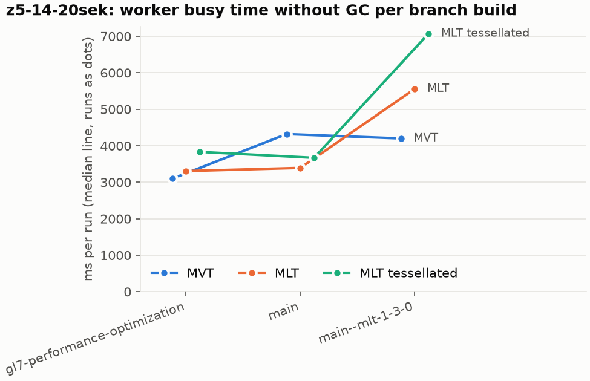
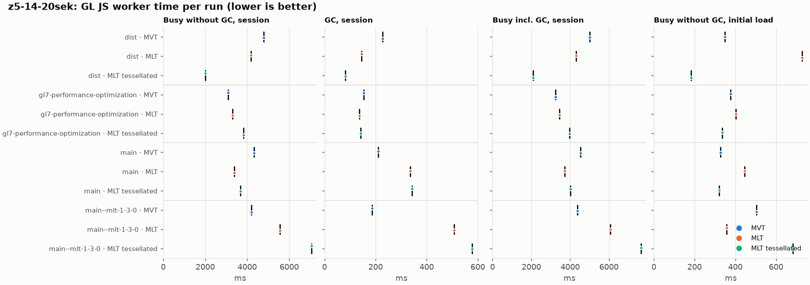
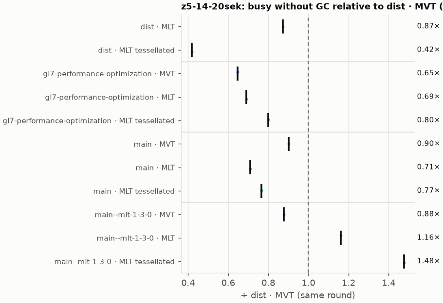
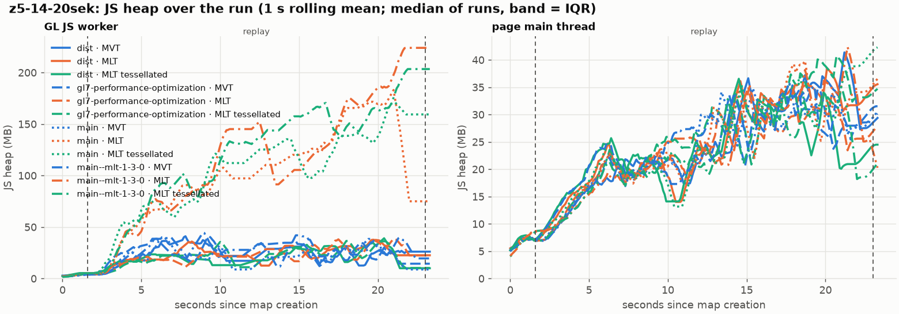
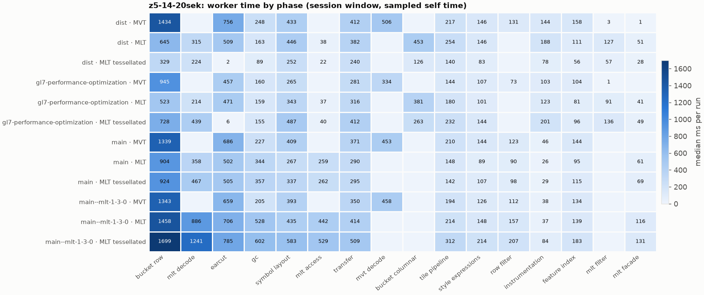
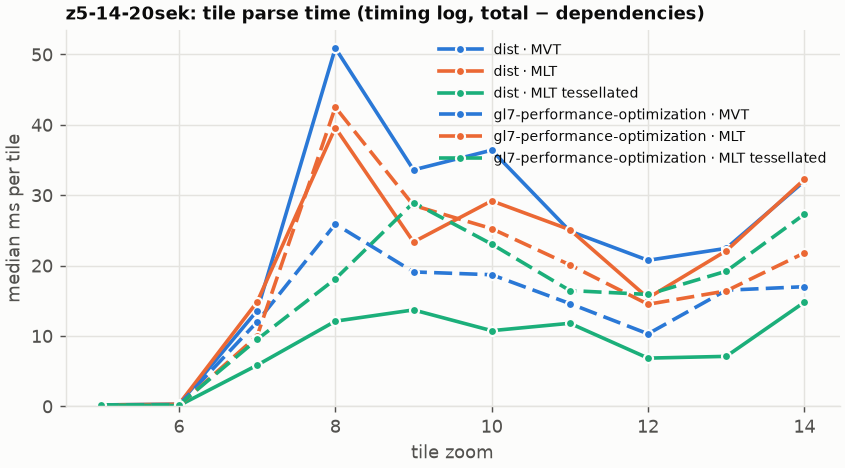
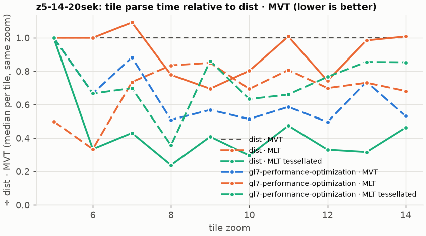

# Session trace benchmark — 20261029-144810

## Setup

- Created 2026-10-29T14:48:10+01:00; 1 repetitions + 0 warm-up round(s) (excluded); variants rotate per round (A B C, B C A, …); one cold browser context per run.
- Machine: 13th Gen Intel(R) Core(TM) i7-1365U, 12 logical cores, 31.3 GB RAM, Windows-11-10.0.26200-SP0; power: GUID des Energieschemas: 381b4222-f694-41f0-9685-ff5bb260df2e  (Ausbalanciert), AC True.
- GL JS gl7-performance-optimization @ 4925e912e4 (dirty); worker count 1; viewport {'width': 1280, 'height': 1024}.
- Python 3.12.2, packages {'playwright': '1.64.0', 'numpy': '2.5.3', 'matplotlib': '3.11.2'}.

| variant | bundle | format | bundle sha256 | branch build |
|---|---|---|---|---|
| MVT | `dist/maplibre-gl-dev.mjs` | mvt | `c1757f233f06` | – |
| MLT | `dist/maplibre-gl-dev.mjs` | mlt | `c1757f233f06` | – |
| MLT tessellated | `dist/maplibre-gl-dev.mjs` | mlt-pre-tess | `c1757f233f06` | – |
| gl7-performance-optimization · MVT | `bench-builds/branches/gl7-performance-optimization/maplibre-gl-dev.mjs` | mvt | `29fa17f4ec99` | gl7-performance-optimization @ 4925e912e4 (2026-10-29), MLT @ 173880bede |
| gl7-performance-optimization · MLT | `bench-builds/branches/gl7-performance-optimization/maplibre-gl-dev.mjs` | mlt | `29fa17f4ec99` | gl7-performance-optimization @ 4925e912e4 (2026-10-29), MLT @ 173880bede |
| gl7-performance-optimization · MLT tessellated | `bench-builds/branches/gl7-performance-optimization/maplibre-gl-dev.mjs` | mlt-pre-tess | `29fa17f4ec99` | gl7-performance-optimization @ 4925e912e4 (2026-10-29), MLT @ 173880bede |
| main · MVT | `bench-builds/branches/main/maplibre-gl-dev.mjs` | mvt | `412ce960831f` | main @ bb38954083 (2026-10-26), MLT @ 173880bede |
| main · MLT | `bench-builds/branches/main/maplibre-gl-dev.mjs` | mlt | `412ce960831f` | main @ bb38954083 (2026-10-26), MLT @ 173880bede |
| main · MLT tessellated | `bench-builds/branches/main/maplibre-gl-dev.mjs` | mlt-pre-tess | `412ce960831f` | main @ bb38954083 (2026-10-26), MLT @ 173880bede |
| main--mlt-1-3-0 · MVT | `bench-builds/branches/main--mlt-1-3-0/maplibre-gl-dev.mjs` | mvt | `8a63f3527a41` | main @ bb38954083 (2026-10-26), MLT @maplibre/mlt@1.3.0 (npm) |
| main--mlt-1-3-0 · MLT | `bench-builds/branches/main--mlt-1-3-0/maplibre-gl-dev.mjs` | mlt | `8a63f3527a41` | main @ bb38954083 (2026-10-26), MLT @maplibre/mlt@1.3.0 (npm) |
| main--mlt-1-3-0 · MLT tessellated | `bench-builds/branches/main--mlt-1-3-0/maplibre-gl-dev.mjs` | mlt-pre-tess | `8a63f3527a41` | main @ bb38954083 (2026-10-26), MLT @maplibre/mlt@1.3.0 (npm) |

| session | style | duration | frames | sha256 |
|---|---|---:|---:|---|
| z5-14-20sek | maptiler-basic | 21.4 s | 829 | `5a376e5ede30` |

CPU sampling interval (median over runs): 610 µs.

## Definitions

- **busy** = wall time in which a GL JS worker thread runs a task (union of top-level task slices and GC slices on `DedicatedWorker thread`s), summed over workers. **GC** = union of `MinorGC`/`MajorGC`/`V8.GC*` slices on those threads. **busy without GC** = busy − GC (headline metric).
- **CPU** = thread time (`tdur`) of the same slices. Phase categories and functions come from the trace's CPU samples (self time), categorised by `config/categories.toml` (nearest matching frame, leaf to root).
- Windows: **load** = map creation → first idle; **session** = camera replay; **tail** = end of replay → idle; **total** = load + session + tail.
- Ratios are against **MVT**: ratio of medians with a bootstrap 95 % CI, the geometric mean of per-round ratios, and a two-sided Mann–Whitney U p-value (normal approximation, not corrected for multiple comparisons; rough below n = 8). Lower than 1× means less worker time.

## Session `z5-14-20sek`

### Worker busy without GC (session window)

| variant | n ok / failed | median ms | IQR | mean | ratio vs MVT | 95 % CI | geo-mean paired | MWU p |
|---|---:|---:|---:|---:|---:|---:|---:|---:|
| MVT | 1 / 0 | 4,787 | 4,787–4,787 | 4,787 | 1.00× | – | – | – |
| MLT | 1 / 0 | 4,173 | 4,173–4,173 | 4,173 | 0.87× | – | 0.87× | 1.000 |
| MLT tessellated | 1 / 0 | 2,001 | 2,001–2,001 | 2,001 | 0.42× | – | 0.42× | 1.000 |
| gl7-performance-optimization · MVT | 1 / 0 | 3,098 | 3,098–3,098 | 3,098 | 0.65× | – | 0.65× | 1.000 |
| gl7-performance-optimization · MLT | 1 / 0 | 3,307 | 3,307–3,307 | 3,307 | 0.69× | – | 0.69× | 1.000 |
| gl7-performance-optimization · MLT tessellated | 1 / 0 | 3,832 | 3,832–3,832 | 3,832 | 0.80× | – | 0.80× | 1.000 |
| main · MVT | 1 / 0 | 4,320 | 4,320–4,320 | 4,320 | 0.90× | – | 0.90× | 1.000 |
| main · MLT | 1 / 0 | 3,393 | 3,393–3,393 | 3,393 | 0.71× | – | 0.71× | 1.000 |
| main · MLT tessellated | 1 / 0 | 3,669 | 3,669–3,669 | 3,669 | 0.77× | – | 0.77× | 1.000 |
| main--mlt-1-3-0 · MVT | 1 / 0 | 4,200 | 4,200–4,200 | 4,200 | 0.88× | – | 0.88× | 1.000 |
| main--mlt-1-3-0 · MLT | 1 / 0 | 5,558 | 5,558–5,558 | 5,558 | 1.16× | – | 1.16× | 1.000 |
| main--mlt-1-3-0 · MLT tessellated | 1 / 0 | 7,070 | 7,070–7,070 | 7,070 | 1.48× | – | 1.48× | 1.000 |

### All worker metrics (median, ratio vs baseline)

| metric | MVT | MLT | MLT tessellated | gl7-performance-optimization · MVT | gl7-performance-optimization · MLT | gl7-performance-optimization · MLT tessellated | main · MVT | main · MLT | main · MLT tessellated | main--mlt-1-3-0 · MVT | main--mlt-1-3-0 · MLT | main--mlt-1-3-0 · MLT tessellated |
|---|---:|---:|---:|---:|---:|---:|---:|---:|---:|---:|---:|---:|
| busy incl. GC | 5,014 | 4,317 (0.86×) | 2,083 (0.42×) | 3,252 (0.65×) | 3,444 (0.69×) | 3,973 (0.79×) | 4,531 (0.90×) | 3,730 (0.74×) | 4,012 (0.80×) | 4,386 (0.87×) | 6,065 (1.21×) | 7,648 (1.53×) |
| &nbsp;&nbsp;of which GC | 226.9 | 144.5 (0.64×) | 81.5 (0.36×) | 153.9 (0.68×) | 137.1 (0.60×) | 141.1 (0.62×) | 210.7 (0.93×) | 336.3 (1.48×) | 342.9 (1.51×) | 186.7 (0.82×) | 507.7 (2.24×) | 577.3 (2.54×) |
| &nbsp;&nbsp;of which busy without GC | 4,787 | 4,173 (0.87×) | 2,001 (0.42×) | 3,098 (0.65×) | 3,307 (0.69×) | 3,832 (0.80×) | 4,320 (0.90×) | 3,393 (0.71×) | 3,669 (0.77×) | 4,200 (0.88×) | 5,558 (1.16×) | 7,070 (1.48×) |
| &nbsp;&nbsp;&nbsp;&nbsp;of which filtering (sampled, incl. callees) | 134.3 | 127.0 (0.95×) | 56.5 (0.42×) | 73.5 (0.55×) | 91.2 (0.68×) | 135.9 (1.01×) | 122.6 (0.91×) | 90.0 (0.67×) | 98.2 (0.73×) | 111.7 (0.83×) | 156.6 (1.17×) | 206.7 (1.54×) |
| &nbsp;&nbsp;&nbsp;&nbsp;of which column decoding inside the MLT filter (sampled) | 0.0 | 96.6 | 48.2 | 0.0 | 68.3 | 86.2 | 0.0 | 0.0 | 0.0 | 0.0 | 0.0 | 0.0 |
| &nbsp;&nbsp;&nbsp;&nbsp;of which timing instrumentation (sampled) | 144.2 | 188.2 (1.31×) | 78.1 (0.54×) | 102.8 (0.71×) | 123.2 (0.85×) | 201.2 (1.40×) | 46.1 (0.32×) | 25.9 (0.18×) | 29.3 (0.20×) | 38.2 (0.27×) | 37.1 (0.26×) | 84.4 (0.59×) |
| busy without GC and instrumentation | 4,643 | 3,985 (0.86×) | 1,923 (0.41×) | 2,996 (0.65×) | 3,184 (0.69×) | 3,631 (0.78×) | 4,274 (0.92×) | 3,367 (0.73×) | 3,640 (0.78×) | 4,161 (0.90×) | 5,521 (1.19×) | 6,986 (1.50×) |
| CPU time without GC | 4,375 | 3,822 (0.87×) | 1,807 (0.41×) | 2,845 (0.65×) | 3,033 (0.69×) | 3,478 (0.79×) | 3,944 (0.90×) | 3,118 (0.71×) | 3,293 (0.75×) | 3,865 (0.88×) | 4,888 (1.12×) | 6,475 (1.48×) |
| tile: download end → sent to main thread, median per tile | 222.5 | 162.6 (0.73×) | 100.2 (0.45×) | 152.0 (0.68×) | 180.9 (0.81×) | 187.8 (0.84×) | 192.5 (0.87×) | 166.5 (0.75×) | 204.0 (0.92×) | 195.9 (0.88×) | 277.6 (1.25×) | 298.2 (1.34×) |
| tile: download end → sent to main thread, 90th percentile | 515.5 | 475.5 (0.92×) | 181.4 (0.35×) | 313.8 (0.61×) | 367.6 (0.71×) | 351.0 (0.68×) | 473.1 (0.92×) | 415.5 (0.81×) | 446.5 (0.87×) | 469.0 (0.91×) | 642.3 (1.25×) | 608.4 (1.18×) |
| tile: download end → sent to main thread, 95th percentile | 530.4 | 511.8 (0.96×) | 192.3 (0.36×) | 328.7 (0.62×) | 413.0 (0.78×) | 397.3 (0.75×) | 539.8 (1.02×) | 435.6 (0.82×) | 505.4 (0.95×) | 494.3 (0.93×) | 661.6 (1.25×) | 947.3 (1.79×) |
| tile: download end → sent to main thread, 99th percentile | 557.0 | 540.2 (0.97×) | 203.5 (0.37×) | 337.8 (0.61×) | 438.2 (0.79×) | 428.8 (0.77×) | 557.9 (1.00×) | 442.2 (0.79×) | 526.4 (0.95×) | 521.3 (0.94×) | 680.9 (1.22×) | 1,032 (1.85×) |
| &nbsp;&nbsp;parse part (timing log, incl. waiting for glyphs/icons), median per tile | 116.2 | 85.8 (0.74×) | 49.2 (0.42×) | 78.9 (0.68×) | 88.4 (0.76×) | 89.9 (0.77×) | – | – | – | – | – | – |
| &nbsp;&nbsp;queue + hand-off part, median per tile | 97.0 | 79.0 (0.81×) | 43.1 (0.44×) | 64.5 (0.66×) | 68.5 (0.71×) | 77.3 (0.80×) | – | – | – | – | – | – |
| minor GCs | 55.00 | 52.00 (0.95×) | 34.00 (0.62×) | 58.00 (1.05×) | 52.00 (0.95×) | 36.00 (0.65×) | 54.00 (0.98×) | 59.00 (1.07×) | 58.00 (1.05×) | 56.00 (1.02×) | 61.00 (1.11×) | 63.00 (1.15×) |
| major GCs | 6.00 | 3.00 (0.50×) | 3.00 (0.50×) | 5.00 (0.83×) | 3.00 (0.50×) | 3.00 (0.50×) | 6.00 (1.00×) | 4.00 (0.67×) | 4.00 (0.67×) | 3.00 (0.50×) | 4.00 (0.67×) | 5.00 (0.83×) |
| peak worker heap (MB) | 46.9 | 49.6 (1.06×) | 48.0 (1.02×) | 48.2 (1.03×) | 51.4 (1.10×) | 46.3 (0.99×) | 46.3 (0.99×) | 208.0 (4.44×) | 177.8 (3.79×) | 51.5 (1.10×) | 228.8 (4.88×) | 208.8 (4.45×) |
| load: busy without GC | 348.5 | 727.9 (2.09×) | 182.4 (0.52×) | 376.8 (1.08×) | 402.5 (1.16×) | 336.7 (0.97×) | 328.1 (0.94×) | 445.8 (1.28×) | 321.0 (0.92×) | 504.9 (1.45×) | 356.8 (1.02×) | 683.6 (1.96×) |
| load: GC | 9.1 | 10.6 (1.16×) | 6.7 (0.74×) | 6.6 (0.72×) | 7.3 (0.80×) | 9.9 (1.09×) | 9.0 (0.98×) | 7.5 (0.83×) | 8.8 (0.97×) | 9.6 (1.06×) | 12.0 (1.32×) | 10.6 (1.17×) |
| total: busy without GC | 5,135 | 4,901 (0.95×) | 2,184 (0.43×) | 3,475 (0.68×) | 3,709 (0.72×) | 4,168 (0.81×) | 4,649 (0.91×) | 3,839 (0.75×) | 3,990 (0.78×) | 4,704 (0.92×) | 5,914 (1.15×) | 7,754 (1.51×) |

Rows marked *of which* are parts of the row above, not additional time. Tile rows are per-tile latencies (medians over tiles, then over runs), not sums: tiles overlap in time, and the medians of the parse and queue parts do not add up exactly to the median latency.

### Filtering (session window)

Sampled worker time spent in feature filtering, including everything the filter calls (expression evaluation, property access): **row filter** = the style-spec feature filter that MVT runs per feature, **mlt filter** = the columnar MLT filter (incl. the geometry-type selection), without the columns it decodes (see the next table). Medians per run; rules in `config/categories.toml`.

| variant | mlt filter | row filter | filtering | ratio vs MVT | 95 % CI | MWU p | share of sampled busy |
|---|---:|---:|---:|---:|---:|---:|---:|
| MVT | 3.3 | 131.0 | 134.3 | 1.00× | – | – | 2.9% |
| MLT | 127.0 | 0.0 | 127.0 | 0.95× | – | 1.000 | 3.2% |
| MLT tessellated | 56.5 | 0.0 | 56.5 | 0.42× | – | 1.000 | 3.1% |
| gl7-performance-optimization · MVT | 0.6 | 72.9 | 73.5 | 0.55× | – | 1.000 | 2.5% |
| gl7-performance-optimization · MLT | 91.2 | 0.0 | 91.2 | 0.68× | – | 1.000 | 2.9% |
| gl7-performance-optimization · MLT tessellated | 135.9 | 0.0 | 135.9 | 1.01× | – | 1.000 | 3.8% |
| main · MVT | 0.0 | 122.6 | 122.6 | 0.91× | – | 1.000 | 2.9% |
| main · MLT | 0.0 | 90.0 | 90.0 | 0.67× | – | 1.000 | 2.6% |
| main · MLT tessellated | 0.0 | 98.2 | 98.2 | 0.73× | – | 1.000 | 2.6% |
| main--mlt-1-3-0 · MVT | 0.0 | 111.7 | 111.7 | 0.83× | – | 1.000 | 2.8% |
| main--mlt-1-3-0 · MLT | 0.0 | 156.6 | 156.6 | 1.17× | – | 1.000 | 2.7% |
| main--mlt-1-3-0 · MLT tessellated | 0.0 | 206.7 | 206.7 | 1.54× | – | 1.000 | 2.9% |

**Filtering together with tile decoding.** The MLT decoder leaves columns encoded until something reads them, and the filter is usually the first reader: the columns it decodes (properties, and the geometry for `$type`) are **of which inside the filter** (phase *mlt filter decode*), the rest is *mlt decode* (geometry and columns read later, e.g. by paint properties and symbols). MVT decodes every feature's properties and geometry while it reads the tile (*mvt decode*), whether the filter keeps the feature or not. So **filtering** above compares the filters, and **decoding + filtering** compares all that the formats spend on decoding the tile and selecting features. **tile decoding** = *mvt decode* or *mlt decode* + *mlt filter decode*: work inside a call into a decoder. Reading data that is already decoded is not counted, as for MVT's feature objects: *mlt access* (row views, value getters, looking a column up by name) and the MLT facade (*mlt facade*). MVT decodes geometry only for the features its filter keeps, MLT decodes a layer's whole geometry column.

| variant | tile decoding | of which inside the filter | filtering | decoding + filtering | ratio vs MVT | 95 % CI | MWU p |
|---|---:|---:|---:|---:|---:|---:|---:|
| MVT | 505.9 | 0.0 | 134.3 | 640.2 | 1.00× | – | – |
| MLT | 411.6 | 96.6 | 127.0 | 538.5 | 0.84× | – | 1.000 |
| MLT tessellated | 272.0 | 48.2 | 56.5 | 328.5 | 0.51× | – | 1.000 |
| gl7-performance-optimization · MVT | 334.3 | 0.0 | 73.5 | 407.7 | 0.64× | – | 1.000 |
| gl7-performance-optimization · MLT | 282.5 | 68.3 | 91.2 | 373.7 | 0.58× | – | 1.000 |
| gl7-performance-optimization · MLT tessellated | 525.2 | 86.2 | 135.9 | 661.1 | 1.03× | – | 1.000 |
| main · MVT | 453.4 | 0.0 | 122.6 | 575.9 | 0.90× | – | 1.000 |
| main · MLT | 358.2 | 0.0 | 90.0 | 448.2 | 0.70× | – | 1.000 |
| main · MLT tessellated | 466.9 | 0.0 | 98.2 | 565.1 | 0.88× | – | 1.000 |
| main--mlt-1-3-0 · MVT | 458.1 | 0.0 | 111.7 | 569.8 | 0.89× | – | 1.000 |
| main--mlt-1-3-0 · MLT | 885.5 | 0.0 | 156.6 | 1,042 | 1.63× | – | 1.000 |
| main--mlt-1-3-0 · MLT tessellated | 1,241 | 0.0 | 206.7 | 1,448 | 2.26× | – | 1.000 |

Top 12 functions inside filtering and its column decoding (self time, mean ms per run):

| phase | function | source | MVT | MLT | MLT tessellated | gl7-performance-optimization · MVT | gl7-performance-optimization · MLT | gl7-performance-optimization · MLT tessellated | main · MVT | main · MLT | main · MLT tessellated | main--mlt-1-3-0 · MVT | main--mlt-1-3-0 · MLT | main--mlt-1-3-0 · MLT tessellated |
|---|---|---|---:|---:|---:|---:|---:|---:|---:|---:|---:|---:|---:|---:|
| row filter | `evaluate` | node_modules/@maplibre/maplibre-gl-style-spec/dist/expression/compound_expression.mjs | 30.7 | 0.0 | 0.0 | 19.2 | 0.0 | 0.0 | 35.0 | 25.7 | 28.4 | 19.9 | 52.8 | 59.8 |
| row filter | `evaluate` | node_modules/@maplibre/maplibre-gl-style-spec/dist/expression/index.mjs | 30.0 | 0.0 | 0.0 | 19.2 | 0.0 | 0.0 | 24.7 | 18.9 | 17.3 | 25.4 | 30.9 | 41.3 |
| row filter | `CompoundExpression.register.filter-in-small` | node_modules/@maplibre/maplibre-gl-style-spec/dist/expression/compound_expression.mjs | 15.2 | 0.0 | 0.0 | 5.1 | 0.0 | 0.0 | 14.1 | 7.1 | 8.5 | 12.2 | 12.8 | 25.6 |
| mlt filter decode | `unpackNullable` | maplibre-tile-spec/ts/dist/decoding/unpackNullableUtils.js | 0.0 | 18.2 | 7.6 | 0.0 | 13.5 | 23.1 | 0.0 | 0.0 | 0.0 | 0.0 | 0.0 | 0.0 |
| row filter | `CompoundExpression.register.filter-==` | node_modules/@maplibre/maplibre-gl-style-spec/dist/expression/compound_expression.mjs | 15.0 | 0.0 | 0.0 | 10.2 | 0.0 | 0.0 | 15.7 | 10.4 | 12.6 | 13.9 | 16.9 | 20.2 |
| mlt filter | `filterByGeometryType` | maplibre-tile-spec/ts/dist/vector/geometry/geometryVector.js | 0.0 | 18.2 | 8.0 | 0.0 | 8.8 | 10.7 | 0.0 | 0.0 | 0.0 | 0.0 | 0.0 | 0.0 |
| row filter | `filter` | node_modules/@maplibre/maplibre-gl-style-spec/dist/feature_filter/index.mjs | 7.0 | 0.0 | 0.0 | 4.5 | 0.0 | 0.0 | 7.6 | 10.4 | 9.8 | 15.7 | 12.9 | 13.3 |
| row filter | `CompoundExpression.register.filter-type-==` | node_modules/@maplibre/maplibre-gl-style-spec/dist/expression/compound_expression.mjs | 8.9 | 0.0 | 0.0 | 1.2 | 0.0 | 0.0 | 6.7 | 5.3 | 7.0 | 6.6 | 4.9 | 15.6 |
| mlt filter | `scanDictionaryCodes` | maplibre-tile-spec/ts/dist/processing/filter/execution/filterKernel.js | 0.0 | 8.2 | 4.7 | 0.0 | 6.5 | 14.0 | 0.0 | 0.0 | 0.0 | 0.0 | 0.0 | 0.0 |
| mlt filter | `dictionaryRowMatches` | maplibre-tile-spec/ts/dist/processing/filter/execution/filterKernel.js | 0.0 | 4.4 | 4.7 | 0.0 | 5.3 | 10.7 | 0.0 | 0.0 | 0.0 | 0.0 | 0.0 | 0.0 |
| mlt filter decode | `decodeFsst` | maplibre-tile-spec/ts/dist/decoding/fsstDecoder.js | 0.0 | 9.8 | 5.9 | 0.0 | 8.7 | 9.1 | 0.0 | 0.0 | 0.0 | 0.0 | 0.0 | 0.0 |
| mlt filter | `executeLeaf` | maplibre-tile-spec/ts/dist/processing/filter/execution/filterExecution.js | 0.0 | 8.9 | 2.4 | 0.0 | 6.3 | 5.7 | 0.0 | 0.0 | 0.0 | 0.0 | 0.0 | 0.0 |

### Where the variants differ from MVT (session window, mean ms per run)

Open **[flame.html](flame.html)** to explore the call tree interactively: pick a variant, compare it with MVT (red = more time at the same call path, blue = less), click a frame to zoom in, and read the phase and function breakdown under it. Without a comparison, frames are coloured by phase: filtering is green in both formats, and the columns the MLT filter decodes on first access (*mlt filter decode*) are MLT blue frames under the green filter. `flame/*.txt` open in https://www.speedscope.app.

#### MLT vs MVT

**By phase** (sampled self time; the Δ column sums to the difference in sampled busy time):

| phase | MVT | MLT | Δ |
|---|---:|---:|---:|
| bucket columnar | 0.0 | 452.8 | +452.8 |
| mlt decode | 0.0 | 314.9 | +314.9 |
| mlt filter | 3.3 | 127.0 | +123.7 |
| mlt filter decode | 0.0 | 96.6 | +96.6 |
| mlt facade | 0.7 | 51.0 | +50.4 |
| instrumentation | 144.2 | 188.2 | +44.0 |
| mlt access | 0.0 | 38.3 | +38.3 |
| tile pipeline | 217.0 | 254.0 | +37.0 |
| symbol layout | 432.8 | 445.9 | +13.2 |
| runtime | 19.1 | 26.1 | +7.0 |
| other | 13.8 | 13.2 | -0.6 |
| transfer | 412.0 | 381.5 | -30.5 |
| feature index | 157.6 | 110.5 | -47.1 |
| gc | 248.0 | 163.2 | -84.8 |
| row filter | 131.0 | 0.0 | -131.0 |
| earcut | 755.9 | 508.6 | -247.3 |
| mvt decode | 505.9 | 0.0 | -505.9 |
| bucket row | 1,434 | 644.6 | -789.7 |

**By source layer** (timing log: createBucket + populate + addFeatures, summed over the style layers that use it; wall time, includes GC pauses; total Δ -534 ms):

| source layer | type | MVT | MLT | Δ |
|---|---|---:|---:|---:|
| place | symbol | 311.5 | 401.9 | +90.4 |
| transportation_name | symbol | 170.2 | 224.5 | +54.3 |
| poi | symbol | 43.3 | 95.1 | +51.8 |
| waterway | line | 63.1 | 89.1 | +26.0 |
| transportation | line | 825.1 | 844.3 | +19.2 |
| boundary | line | 59.7 | 75.2 | +15.5 |
| water | fill | 87.0 | 91.6 | +4.6 |
| aeroway | fill | 1.8 | 5.7 | +3.9 |
| transportation | fill | 24.4 | 20.6 | -3.8 |
| building | fill | 373.2 | 236.1 | -137.1 |
| landuse | fill | 656.5 | 376.1 | -280.4 |
| landcover | fill | 954.6 | 572.4 | -382.2 |

**Functions with the largest self-time difference** (by function name, summed over source files):

| function | MVT | MLT | Δ |
|---|---:|---:|---:|
| `writeEarcutFill` | 0.0 | 60.0 | +60.0 |
| `buildRingBoundingBoxes` | 0.0 | 39.6 | +39.6 |
| `buildEarcutMesh` | 0.0 | 39.4 | +39.4 |
| `decodeComponentwiseDeltaVec2` | 0.0 | 38.7 | +38.7 |
| `unpackNullable` | 0.0 | 27.1 | +27.1 |
| `decodeString$2` | 0.0 | 26.3 | +26.3 |
| `get` | 21.4 | 46.7 | +25.3 |
| `decodeFastPforInt32` | 0.0 | 21.8 | +21.8 |
| `readScaledRings` | 0.0 | 21.7 | +21.7 |
| `filterByGeometryType` | 0.0 | 18.2 | +18.2 |
| `decodeFsst` | 0.0 | 16.2 | +16.2 |
| `takePhases` | 16.3 | 32.0 | +15.7 |
| `_vertexToIndex` | 266.5 | 0.0 | -266.5 |
| `readSVarint` | 209.6 | 0.0 | -209.6 |
| `isEar` | 227.4 | 126.9 | -100.5 |
| `loadGeometry` | 110.4 | 12.6 | -97.8 |
| `readVarint` | 97.6 | 6.3 | -91.2 |

#### MLT tessellated vs MVT

**By phase** (sampled self time; the Δ column sums to the difference in sampled busy time):

| phase | MVT | MLT tessellated | Δ |
|---|---:|---:|---:|
| mlt decode | 0.0 | 223.8 | +223.8 |
| bucket columnar | 0.0 | 126.2 | +126.2 |
| mlt filter | 3.3 | 56.5 | +53.2 |
| mlt filter decode | 0.0 | 48.2 | +48.2 |
| pre-tess mesh | 0.0 | 29.7 | +29.7 |
| mlt facade | 0.7 | 28.4 | +27.7 |
| mlt access | 0.0 | 22.0 | +22.0 |
| other | 13.8 | 12.5 | -1.2 |
| runtime | 19.1 | 14.4 | -4.7 |
| style expressions | 146.2 | 83.1 | -63.1 |
| instrumentation | 144.2 | 78.1 | -66.1 |
| tile pipeline | 217.0 | 140.5 | -76.6 |
| feature index | 157.6 | 56.0 | -101.6 |
| row filter | 131.0 | 0.0 | -131.0 |
| gc | 248.0 | 88.7 | -159.3 |
| transfer | 412.0 | 240.4 | -171.6 |
| symbol layout | 432.8 | 252.3 | -180.5 |
| mvt decode | 505.9 | 0.0 | -505.9 |
| earcut | 755.9 | 2.3 | -753.5 |
| bucket row | 1,434 | 328.6 | -1105.7 |

**By source layer** (timing log: createBucket + populate + addFeatures, summed over the style layers that use it; wall time, includes GC pauses; total Δ -2319 ms):

| source layer | type | MVT | MLT tessellated | Δ |
|---|---|---:|---:|---:|
| aeroway | fill | 1.8 | 3.5 | +1.7 |
| poi | symbol | 43.3 | 36.5 | -6.8 |
| transportation | fill | 24.4 | 15.0 | -9.4 |
| waterway | line | 63.1 | 44.2 | -18.9 |
| boundary | line | 59.7 | 40.1 | -19.6 |
| water | fill | 87.0 | 28.7 | -58.3 |
| transportation_name | symbol | 170.2 | 105.8 | -64.4 |
| place | symbol | 311.5 | 242.9 | -68.6 |
| building | fill | 373.2 | 45.1 | -328.1 |
| transportation | line | 825.1 | 434.9 | -390.2 |
| landuse | fill | 656.5 | 102.5 | -554.0 |
| landcover | fill | 954.6 | 153.7 | -800.9 |

**Functions with the largest self-time difference** (by function name, summed over source files):

| function | MVT | MLT tessellated | Δ |
|---|---:|---:|---:|
| `writeTessellatedFill` | 0.0 | 29.3 | +29.3 |
| `buildTessellatedBoundingBox` | 0.0 | 28.9 | +28.9 |
| `decodeUnsignedZigZagDeltaInt32` | 0.0 | 27.2 | +27.2 |
| `decodeComponentwiseDeltaVec2` | 0.0 | 22.6 | +22.6 |
| `appendScaledVertices` | 0.0 | 14.5 | +14.5 |
| `unpackNullable` | 0.0 | 14.0 | +14.0 |
| `decodeFsst` | 0.0 | 10.8 | +10.8 |
| `decodeFastPforInt32` | 0.0 | 9.8 | +9.8 |
| `decodeLazyColumn` | 0.0 | 9.2 | +9.2 |
| `decodeString$2` | 0.0 | 9.2 | +9.2 |
| `fastUnpack256_4` | 0.0 | 8.8 | +8.8 |
| `decodeUnsignedRleInt32` | 0.0 | 8.1 | +8.1 |
| `_vertexToIndex` | 266.5 | 0.0 | -266.5 |
| `isEar` | 227.4 | 1.2 | -226.2 |
| `readSVarint` | 209.6 | 0.0 | -209.6 |
| `(garbage collector)` | 248.0 | 88.7 | -159.3 |
| `isEarHashed` | 141.2 | 0.0 | -141.2 |

#### gl7-performance-optimization · MVT vs MVT

**By phase** (sampled self time; the Δ column sums to the difference in sampled busy time):

| phase | MVT | gl7-performance-optimization · MVT | Δ |
|---|---:|---:|---:|
| mlt facade | 0.7 | 0.0 | -0.7 |
| mlt filter | 3.3 | 0.6 | -2.7 |
| runtime | 19.1 | 16.3 | -2.8 |
| other | 13.8 | 5.8 | -7.9 |
| style expressions | 146.2 | 106.9 | -39.3 |
| instrumentation | 144.2 | 102.8 | -41.4 |
| feature index | 157.6 | 104.0 | -53.6 |
| row filter | 131.0 | 72.9 | -58.1 |
| tile pipeline | 217.0 | 144.2 | -72.8 |
| gc | 248.0 | 159.6 | -88.4 |
| transfer | 412.0 | 280.7 | -131.4 |
| symbol layout | 432.8 | 264.8 | -168.0 |
| mvt decode | 505.9 | 334.3 | -171.6 |
| earcut | 755.9 | 457.4 | -298.5 |
| bucket row | 1,434 | 945.5 | -488.9 |

**By source layer** (timing log: createBucket + populate + addFeatures, summed over the style layers that use it; wall time, includes GC pauses; total Δ -1307 ms):

| source layer | type | MVT | gl7-performance-optimization · MVT | Δ |
|---|---|---:|---:|---:|
| aerodrome_label | symbol | 8.7 | 4.8 | -3.9 |
| transportation | fill | 24.4 | 15.6 | -8.8 |
| poi | symbol | 43.3 | 28.4 | -14.9 |
| boundary | line | 59.7 | 41.0 | -18.7 |
| waterway | line | 63.1 | 38.7 | -24.4 |
| water | fill | 87.0 | 53.0 | -34.0 |
| transportation_name | symbol | 170.2 | 116.7 | -53.5 |
| building | fill | 373.2 | 263.4 | -109.8 |
| place | symbol | 311.5 | 191.4 | -120.1 |
| landuse | fill | 656.5 | 399.0 | -257.5 |
| transportation | line | 825.1 | 552.9 | -272.2 |
| landcover | fill | 954.6 | 569.1 | -385.5 |

**Functions with the largest self-time difference** (by function name, summed over source files):

| function | MVT | gl7-performance-optimization · MVT | Δ |
|---|---:|---:|---:|
| `isSerializeHandledByBuiltin` | 3.2 | 7.9 | +4.7 |
| `filterProperties` | 0.0 | 3.1 | +3.1 |
| `_mult` | 1.9 | 4.9 | +3.0 |
| `codePointIsInCursiveScript` | 5.7 | 8.6 | +2.9 |
| `graphemes` | 0.2 | 2.6 | +2.5 |
| `isRegistered` | 8.7 | 11.1 | +2.4 |
| `updateDistance` | 3.4 | 5.6 | +2.3 |
| `breakLines` | 2.1 | 4.3 | +2.2 |
| `charIsWhitespace` | 5.8 | 7.7 | +1.9 |
| `recalculateLayers` | 7.6 | 9.5 | +1.9 |
| `isHidden` | 0.1 | 1.7 | +1.6 |
| `allowsLetterSpacing` | 1.9 | 3.5 | +1.6 |
| `_vertexToIndex` | 266.5 | 154.5 | -112.0 |
| `(garbage collector)` | 248.0 | 159.6 | -88.4 |
| `isEar` | 227.4 | 141.1 | -86.3 |
| `reserve` | 198.9 | 116.9 | -82.0 |
| `readSVarint` | 209.6 | 137.9 | -71.6 |

#### gl7-performance-optimization · MLT vs MVT

**By phase** (sampled self time; the Δ column sums to the difference in sampled busy time):

| phase | MVT | gl7-performance-optimization · MLT | Δ |
|---|---:|---:|---:|
| bucket columnar | 0.0 | 380.8 | +380.8 |
| mlt decode | 0.0 | 214.2 | +214.2 |
| mlt filter | 3.3 | 91.2 | +87.9 |
| mlt filter decode | 0.0 | 68.3 | +68.3 |
| mlt facade | 0.7 | 41.3 | +40.6 |
| mlt access | 0.0 | 36.5 | +36.5 |
| runtime | 19.1 | 15.1 | -4.0 |
| other | 13.8 | 8.1 | -5.7 |
| instrumentation | 144.2 | 123.2 | -20.9 |
| tile pipeline | 217.0 | 180.1 | -37.0 |
| style expressions | 146.2 | 101.4 | -44.7 |
| feature index | 157.6 | 80.5 | -77.1 |
| gc | 248.0 | 159.2 | -88.8 |
| symbol layout | 432.8 | 342.6 | -90.2 |
| transfer | 412.0 | 315.6 | -96.4 |
| row filter | 131.0 | 0.0 | -131.0 |
| earcut | 755.9 | 470.8 | -285.1 |
| mvt decode | 505.9 | 0.0 | -505.9 |
| bucket row | 1,434 | 522.9 | -911.5 |

**By source layer** (timing log: createBucket + populate + addFeatures, summed over the style layers that use it; wall time, includes GC pauses; total Δ -1155 ms):

| source layer | type | MVT | gl7-performance-optimization · MLT | Δ |
|---|---|---:|---:|---:|
| place | symbol | 311.5 | 334.8 | +23.3 |
| waterway | line | 63.1 | 72.9 | +9.8 |
| poi | symbol | 43.3 | 50.0 | +6.7 |
| boundary | line | 59.7 | 63.9 | +4.2 |
| aeroway | fill | 1.8 | 5.4 | +3.6 |
| transportation | fill | 24.4 | 18.4 | -6.0 |
| water | fill | 87.0 | 72.3 | -14.7 |
| transportation_name | symbol | 170.2 | 137.1 | -33.1 |
| transportation | line | 825.1 | 638.9 | -186.2 |
| building | fill | 373.2 | 177.6 | -195.6 |
| landuse | fill | 656.5 | 335.3 | -321.2 |
| landcover | fill | 954.6 | 506.4 | -448.2 |

**Functions with the largest self-time difference** (by function name, summed over source files):

| function | MVT | gl7-performance-optimization · MLT | Δ |
|---|---:|---:|---:|
| `writeEarcutFill` | 0.0 | 46.4 | +46.4 |
| `buildRingBoundingBoxes` | 0.0 | 37.1 | +37.1 |
| `decodeComponentwiseDeltaVec2` | 0.0 | 31.1 | +31.1 |
| `buildEarcutMesh` | 0.0 | 28.7 | +28.7 |
| `unpackNullable` | 0.0 | 23.7 | +23.7 |
| `readScaledRings` | 0.0 | 16.7 | +16.7 |
| `decodeBigEndianInt32sInto` | 0.0 | 13.7 | +13.7 |
| `decodeFsst` | 0.0 | 13.1 | +13.1 |
| `get` | 21.4 | 33.8 | +12.5 |
| `decodeFastPforInt32` | 0.0 | 11.6 | +11.6 |
| `classifyRingRanges` | 0.0 | 10.6 | +10.6 |
| `materializeSelectedFeatures` | 0.0 | 10.2 | +10.2 |
| `_vertexToIndex` | 266.5 | 0.0 | -266.5 |
| `readSVarint` | 209.6 | 0.0 | -209.6 |
| `isEar` | 227.4 | 113.0 | -114.4 |
| `loadGeometry` | 110.4 | 9.9 | -100.5 |
| `readVarint` | 97.6 | 3.6 | -94.0 |

#### gl7-performance-optimization · MLT tessellated vs MVT

**By phase** (sampled self time; the Δ column sums to the difference in sampled busy time):

| phase | MVT | gl7-performance-optimization · MLT tessellated | Δ |
|---|---:|---:|---:|
| mlt decode | 0.0 | 438.9 | +438.9 |
| bucket columnar | 0.0 | 263.4 | +263.4 |
| mlt filter | 3.3 | 135.9 | +132.6 |
| mlt filter decode | 0.0 | 86.2 | +86.2 |
| instrumentation | 144.2 | 201.2 | +57.0 |
| symbol layout | 432.8 | 487.4 | +54.6 |
| pre-tess mesh | 0.0 | 49.8 | +49.8 |
| mlt facade | 0.7 | 49.1 | +48.5 |
| mlt access | 0.0 | 39.6 | +39.6 |
| tile pipeline | 217.0 | 231.7 | +14.7 |
| runtime | 19.1 | 22.7 | +3.6 |
| style expressions | 146.2 | 144.3 | -1.8 |
| other | 13.8 | 11.8 | -1.9 |
| feature index | 157.6 | 95.8 | -61.8 |
| gc | 248.0 | 155.3 | -92.7 |
| row filter | 131.0 | 0.0 | -131.0 |
| mvt decode | 505.9 | 0.0 | -505.9 |
| bucket row | 1,434 | 728.1 | -706.3 |
| earcut | 755.9 | 5.8 | -750.1 |

**By source layer** (timing log: createBucket + populate + addFeatures, summed over the style layers that use it; wall time, includes GC pauses; total Δ -1000 ms):

| source layer | type | MVT | gl7-performance-optimization · MLT tessellated | Δ |
|---|---|---:|---:|---:|
| transportation | line | 825.1 | 970.9 | +145.8 |
| place | symbol | 311.5 | 439.8 | +128.3 |
| transportation_name | symbol | 170.2 | 214.1 | +43.9 |
| waterway | line | 63.1 | 103.9 | +40.8 |
| poi | symbol | 43.3 | 77.7 | +34.4 |
| boundary | line | 59.7 | 69.0 | +9.3 |
| transportation | fill | 24.4 | 32.4 | +8.0 |
| aeroway | fill | 1.8 | 5.9 | +4.1 |
| water | fill | 87.0 | 58.7 | -28.3 |
| building | fill | 373.2 | 107.4 | -265.8 |
| landuse | fill | 656.5 | 193.3 | -463.2 |
| landcover | fill | 954.6 | 290.8 | -663.8 |

**Functions with the largest self-time difference** (by function name, summed over source files):

| function | MVT | gl7-performance-optimization · MLT tessellated | Δ |
|---|---:|---:|---:|
| `writeTessellatedFill` | 0.0 | 56.2 | +56.2 |
| `decodeUnsignedZigZagDeltaInt32` | 0.0 | 55.0 | +55.0 |
| `buildTessellatedBoundingBox` | 0.0 | 48.5 | +48.5 |
| `decodeComponentwiseDeltaVec2` | 0.0 | 39.6 | +39.6 |
| `unpackNullable` | 0.0 | 35.5 | +35.5 |
| `decodeFastPforInt32` | 0.0 | 30.2 | +30.2 |
| `addHalfVertex` | 74.2 | 102.7 | +28.5 |
| `get` | 21.4 | 44.2 | +22.8 |
| `addLine` | 71.9 | 93.4 | +21.6 |
| `addPhase` | 47.0 | 66.6 | +19.6 |
| `decodeString$2` | 0.0 | 17.1 | +17.1 |
| `decodeBigEndianInt32sInto` | 0.0 | 16.2 | +16.2 |
| `_vertexToIndex` | 266.5 | 0.0 | -266.5 |
| `isEar` | 227.4 | 0.0 | -227.4 |
| `readSVarint` | 209.6 | 0.0 | -209.6 |
| `isEarHashed` | 141.2 | 0.0 | -141.2 |
| `(garbage collector)` | 248.0 | 155.3 | -92.7 |

#### main · MVT vs MVT

**By phase** (sampled self time; the Δ column sums to the difference in sampled busy time):

| phase | MVT | main · MVT | Δ |
|---|---:|---:|---:|
| other | 13.8 | 15.2 | +1.4 |
| mlt facade | 0.7 | 0.0 | -0.7 |
| style expressions | 146.2 | 144.4 | -1.8 |
| mlt filter | 3.3 | 0.0 | -3.3 |
| runtime | 19.1 | 13.7 | -5.4 |
| tile pipeline | 217.0 | 209.7 | -7.4 |
| row filter | 131.0 | 122.6 | -8.4 |
| feature index | 157.6 | 144.3 | -13.3 |
| gc | 248.0 | 227.3 | -20.7 |
| symbol layout | 432.8 | 409.4 | -23.4 |
| transfer | 412.0 | 370.8 | -41.2 |
| mvt decode | 505.9 | 453.4 | -52.5 |
| earcut | 755.9 | 685.9 | -70.0 |
| bucket row | 1,434 | 1,339 | -95.1 |
| instrumentation | 144.2 | 46.1 | -98.0 |

**By source layer** (timing log: createBucket + populate + addFeatures, summed over the style layers that use it; wall time, includes GC pauses; total Δ -3583 ms):

| source layer | type | MVT | main · MVT | Δ |
|---|---|---:|---:|---:|
| aerodrome_label | symbol | 8.7 | 0.0 | -8.7 |
| transportation | fill | 24.4 | 0.0 | -24.4 |
| poi | symbol | 43.3 | 0.0 | -43.3 |
| boundary | line | 59.7 | 0.0 | -59.7 |
| waterway | line | 63.1 | 0.0 | -63.1 |
| water | fill | 87.0 | 0.0 | -87.0 |
| transportation_name | symbol | 170.2 | 0.0 | -170.2 |
| place | symbol | 311.5 | 0.0 | -311.5 |
| building | fill | 373.2 | 0.0 | -373.2 |
| landuse | fill | 656.5 | 0.0 | -656.5 |
| transportation | line | 825.1 | 0.0 | -825.1 |
| landcover | fill | 954.6 | 0.0 | -954.6 |

**Functions with the largest self-time difference** (by function name, summed over source files):

| function | MVT | main · MVT | Δ |
|---|---:|---:|---:|
| `hasLineDasharray` | 0.6 | 15.8 | +15.2 |
| `earcutLinked` | 53.9 | 64.8 | +10.9 |
| `performSymbolLayout` | 15.2 | 25.1 | +9.9 |
| `populate` | 74.4 | 84.2 | +9.8 |
| `addFeature` | 33.2 | 42.6 | +9.3 |
| `signedArea$1` | 0.0 | 8.5 | +8.5 |
| `addLine` | 71.9 | 80.1 | +8.2 |
| `emplaceBack` | 7.9 | 14.6 | +6.7 |
| `self.postMessage` | 27.4 | 32.6 | +5.2 |
| `equals` | 9.9 | 15.1 | +5.2 |
| `readUtf8$1` | 0.0 | 5.0 | +5.0 |
| `codePointAllowsIdeographicBreaking` | 3.2 | 8.1 | +4.9 |
| `addBucketFeatures` | 62.7 | 0.0 | -62.7 |
| `addPhase` | 47.0 | 0.0 | -47.0 |
| `reserve` | 198.9 | 165.9 | -33.1 |
| `isEarHashed` | 141.2 | 118.4 | -22.9 |
| `readSVarint` | 209.6 | 187.8 | -21.8 |

#### main · MLT vs MVT

**By phase** (sampled self time; the Δ column sums to the difference in sampled busy time):

| phase | MVT | main · MLT | Δ |
|---|---:|---:|---:|
| mlt decode | 0.0 | 358.2 | +358.2 |
| mlt access | 0.0 | 258.8 | +258.8 |
| gc | 248.0 | 344.3 | +96.4 |
| mlt facade | 0.7 | 60.8 | +60.2 |
| runtime | 19.1 | 20.0 | +0.9 |
| mlt filter | 3.3 | 0.0 | -3.3 |
| row filter | 131.0 | 90.0 | -41.0 |
| style expressions | 146.2 | 89.4 | -56.7 |
| feature index | 157.6 | 95.1 | -62.5 |
| tile pipeline | 217.0 | 147.8 | -69.3 |
| instrumentation | 144.2 | 25.9 | -118.3 |
| transfer | 412.0 | 290.1 | -122.0 |
| symbol layout | 432.8 | 267.1 | -165.7 |
| earcut | 755.9 | 502.5 | -253.4 |
| mvt decode | 505.9 | 0.0 | -505.9 |
| bucket row | 1,434 | 903.9 | -530.5 |

**By source layer** (timing log: createBucket + populate + addFeatures, summed over the style layers that use it; wall time, includes GC pauses; total Δ -3583 ms):

| source layer | type | MVT | main · MLT | Δ |
|---|---|---:|---:|---:|
| aerodrome_label | symbol | 8.7 | 0.0 | -8.7 |
| transportation | fill | 24.4 | 0.0 | -24.4 |
| poi | symbol | 43.3 | 0.0 | -43.3 |
| boundary | line | 59.7 | 0.0 | -59.7 |
| waterway | line | 63.1 | 0.0 | -63.1 |
| water | fill | 87.0 | 0.0 | -87.0 |
| transportation_name | symbol | 170.2 | 0.0 | -170.2 |
| place | symbol | 311.5 | 0.0 | -311.5 |
| building | fill | 373.2 | 0.0 | -373.2 |
| landuse | fill | 656.5 | 0.0 | -656.5 |
| transportation | line | 825.1 | 0.0 | -825.1 |
| landcover | fill | 954.6 | 0.0 | -954.6 |

**Functions with the largest self-time difference** (by function name, summed over source files):

| function | MVT | main · MLT | Δ |
|---|---:|---:|---:|
| `getFeatures` | 0.0 | 98.2 | +98.2 |
| `(garbage collector)` | 248.0 | 344.3 | +96.4 |
| `decodeString$2` | 0.0 | 82.1 | +82.1 |
| `convertGeometryVector` | 0.0 | 36.8 | +36.8 |
| `getLineStringOrRing` | 0.0 | 30.3 | +30.3 |
| `unpackNullable` | 0.0 | 28.0 | +28.0 |
| `decodeComponentwiseDeltaVec2` | 0.0 | 24.4 | +24.4 |
| `getValue` | 0.0 | 17.8 | +17.8 |
| `decodeFastPforInt32` | 0.0 | 15.3 | +15.3 |
| `decodeFsst` | 0.0 | 14.7 | +14.7 |
| `MLTVectorTileLayer` | 0.0 | 14.2 | +14.2 |
| `hasLineDasharray` | 0.6 | 12.3 | +11.7 |
| `readSVarint` | 209.6 | 0.0 | -209.6 |
| `_vertexToIndex` | 266.5 | 163.1 | -103.4 |
| `readVarint` | 97.6 | 2.7 | -94.9 |
| `reserve` | 198.9 | 116.2 | -82.7 |
| `isEar` | 227.4 | 159.0 | -68.4 |

#### main · MLT tessellated vs MVT

**By phase** (sampled self time; the Δ column sums to the difference in sampled busy time):

| phase | MVT | main · MLT tessellated | Δ |
|---|---:|---:|---:|
| mlt decode | 0.0 | 466.9 | +466.9 |
| mlt access | 0.0 | 261.9 | +261.9 |
| gc | 248.0 | 357.1 | +109.2 |
| mlt facade | 0.7 | 68.7 | +68.0 |
| runtime | 19.1 | 16.5 | -2.5 |
| mlt filter | 3.3 | 0.0 | -3.3 |
| row filter | 131.0 | 98.2 | -32.8 |
| style expressions | 146.2 | 106.5 | -39.6 |
| feature index | 157.6 | 115.5 | -42.1 |
| tile pipeline | 217.0 | 141.6 | -75.4 |
| symbol layout | 432.8 | 337.0 | -95.7 |
| instrumentation | 144.2 | 29.3 | -114.8 |
| transfer | 412.0 | 295.2 | -116.9 |
| earcut | 755.9 | 505.5 | -250.4 |
| mvt decode | 505.9 | 0.0 | -505.9 |
| bucket row | 1,434 | 923.9 | -510.5 |

**By source layer** (timing log: createBucket + populate + addFeatures, summed over the style layers that use it; wall time, includes GC pauses; total Δ -3583 ms):

| source layer | type | MVT | main · MLT tessellated | Δ |
|---|---|---:|---:|---:|
| aerodrome_label | symbol | 8.7 | 0.0 | -8.7 |
| transportation | fill | 24.4 | 0.0 | -24.4 |
| poi | symbol | 43.3 | 0.0 | -43.3 |
| boundary | line | 59.7 | 0.0 | -59.7 |
| waterway | line | 63.1 | 0.0 | -63.1 |
| water | fill | 87.0 | 0.0 | -87.0 |
| transportation_name | symbol | 170.2 | 0.0 | -170.2 |
| place | symbol | 311.5 | 0.0 | -311.5 |
| building | fill | 373.2 | 0.0 | -373.2 |
| landuse | fill | 656.5 | 0.0 | -656.5 |
| transportation | line | 825.1 | 0.0 | -825.1 |
| landcover | fill | 954.6 | 0.0 | -954.6 |

**Functions with the largest self-time difference** (by function name, summed over source files):

| function | MVT | main · MLT tessellated | Δ |
|---|---:|---:|---:|
| `(garbage collector)` | 248.0 | 357.1 | +109.2 |
| `getFeatures` | 0.0 | 107.5 | +107.5 |
| `decodeString$2` | 0.0 | 96.0 | +96.0 |
| `convertGeometryVector` | 0.0 | 40.7 | +40.7 |
| `decodeUnsignedZigZagDeltaInt32` | 0.0 | 35.6 | +35.6 |
| `decodeComponentwiseDeltaVec2` | 0.0 | 30.5 | +30.5 |
| `decodeFastPforInt32` | 0.0 | 28.9 | +28.9 |
| `unpackNullable` | 0.0 | 23.3 | +23.3 |
| `getLineStringOrRing` | 0.0 | 22.6 | +22.6 |
| `getValue` | 0.0 | 19.7 | +19.7 |
| `decodeFsst` | 0.0 | 17.5 | +17.5 |
| `MLTVectorTileLayer` | 0.0 | 14.1 | +14.1 |
| `readSVarint` | 209.6 | 0.0 | -209.6 |
| `_vertexToIndex` | 266.5 | 165.6 | -100.9 |
| `readVarint` | 97.6 | 1.9 | -95.7 |
| `isEar` | 227.4 | 162.8 | -64.5 |
| `addBucketFeatures` | 62.7 | 0.0 | -62.7 |

#### main--mlt-1-3-0 · MVT vs MVT

**By phase** (sampled self time; the Δ column sums to the difference in sampled busy time):

| phase | MVT | main--mlt-1-3-0 · MVT | Δ |
|---|---:|---:|---:|
| runtime | 19.1 | 24.3 | +5.2 |
| mlt facade | 0.7 | 0.0 | -0.7 |
| mlt filter | 3.3 | 0.0 | -3.3 |
| other | 13.8 | 7.7 | -6.1 |
| row filter | 131.0 | 111.7 | -19.3 |
| style expressions | 146.2 | 126.0 | -20.1 |
| tile pipeline | 217.0 | 193.7 | -23.3 |
| feature index | 157.6 | 133.9 | -23.7 |
| symbol layout | 432.8 | 393.1 | -39.7 |
| gc | 248.0 | 205.5 | -42.5 |
| mvt decode | 505.9 | 458.1 | -47.8 |
| transfer | 412.0 | 350.0 | -62.1 |
| bucket row | 1,434 | 1,343 | -91.2 |
| earcut | 755.9 | 659.0 | -96.9 |
| instrumentation | 144.2 | 38.2 | -105.9 |

**By source layer** (timing log: createBucket + populate + addFeatures, summed over the style layers that use it; wall time, includes GC pauses; total Δ -3583 ms):

| source layer | type | MVT | main--mlt-1-3-0 · MVT | Δ |
|---|---|---:|---:|---:|
| aerodrome_label | symbol | 8.7 | 0.0 | -8.7 |
| transportation | fill | 24.4 | 0.0 | -24.4 |
| poi | symbol | 43.3 | 0.0 | -43.3 |
| boundary | line | 59.7 | 0.0 | -59.7 |
| waterway | line | 63.1 | 0.0 | -63.1 |
| water | fill | 87.0 | 0.0 | -87.0 |
| transportation_name | symbol | 170.2 | 0.0 | -170.2 |
| place | symbol | 311.5 | 0.0 | -311.5 |
| building | fill | 373.2 | 0.0 | -373.2 |
| landuse | fill | 656.5 | 0.0 | -656.5 |
| transportation | line | 825.1 | 0.0 | -825.1 |
| landcover | fill | 954.6 | 0.0 | -954.6 |

**Functions with the largest self-time difference** (by function name, summed over source files):

| function | MVT | main--mlt-1-3-0 · MVT | Δ |
|---|---:|---:|---:|
| `hasLineDasharray` | 0.6 | 18.4 | +17.8 |
| `Point` | 0.0 | 13.9 | +13.9 |
| `addFeature` | 33.2 | 46.4 | +13.1 |
| `signedArea$1` | 0.0 | 12.7 | +12.7 |
| `earcutLinked` | 53.9 | 65.9 | +12.0 |
| `addLine` | 71.9 | 80.9 | +9.0 |
| `codePointIsInCursiveScript` | 5.7 | 14.6 | +8.9 |
| `filter` | 7.0 | 15.7 | +8.7 |
| `copyImage` | 11.8 | 18.3 | +6.4 |
| `readUtf8$1` | 0.0 | 5.6 | +5.6 |
| `(program)` | 19.1 | 24.3 | +5.2 |
| `readValueMessage` | 1.1 | 5.9 | +4.8 |
| `addBucketFeatures` | 62.7 | 0.0 | -62.7 |
| `addPhase` | 47.0 | 0.0 | -47.0 |
| `(garbage collector)` | 248.0 | 205.5 | -42.5 |
| `isEarHashed` | 141.2 | 111.2 | -30.0 |
| `isEar` | 227.4 | 201.6 | -25.8 |

#### main--mlt-1-3-0 · MLT vs MVT

**By phase** (sampled self time; the Δ column sums to the difference in sampled busy time):

| phase | MVT | main--mlt-1-3-0 · MLT | Δ |
|---|---:|---:|---:|
| mlt decode | 0.0 | 885.5 | +885.5 |
| mlt access | 0.0 | 442.0 | +442.0 |
| gc | 248.0 | 528.4 | +280.4 |
| mlt facade | 0.7 | 115.5 | +114.9 |
| row filter | 131.0 | 156.6 | +25.6 |
| bucket row | 1,434 | 1,458 | +23.6 |
| style expressions | 146.2 | 148.3 | +2.2 |
| symbol layout | 432.8 | 434.9 | +2.1 |
| transfer | 412.0 | 413.7 | +1.6 |
| other | 13.8 | 10.9 | -2.8 |
| runtime | 19.1 | 16.3 | -2.8 |
| mlt filter | 3.3 | 0.0 | -3.3 |
| tile pipeline | 217.0 | 213.7 | -3.3 |
| feature index | 157.6 | 138.8 | -18.8 |
| earcut | 755.9 | 706.1 | -49.8 |
| instrumentation | 144.2 | 37.1 | -107.1 |
| mvt decode | 505.9 | 0.0 | -505.9 |

**By source layer** (timing log: createBucket + populate + addFeatures, summed over the style layers that use it; wall time, includes GC pauses; total Δ -3583 ms):

| source layer | type | MVT | main--mlt-1-3-0 · MLT | Δ |
|---|---|---:|---:|---:|
| aerodrome_label | symbol | 8.7 | 0.0 | -8.7 |
| transportation | fill | 24.4 | 0.0 | -24.4 |
| poi | symbol | 43.3 | 0.0 | -43.3 |
| boundary | line | 59.7 | 0.0 | -59.7 |
| waterway | line | 63.1 | 0.0 | -63.1 |
| water | fill | 87.0 | 0.0 | -87.0 |
| transportation_name | symbol | 170.2 | 0.0 | -170.2 |
| place | symbol | 311.5 | 0.0 | -311.5 |
| building | fill | 373.2 | 0.0 | -373.2 |
| landuse | fill | 656.5 | 0.0 | -656.5 |
| transportation | line | 825.1 | 0.0 | -825.1 |
| landcover | fill | 954.6 | 0.0 | -954.6 |

**Functions with the largest self-time difference** (by function name, summed over source files):

| function | MVT | main--mlt-1-3-0 · MLT | Δ |
|---|---:|---:|---:|
| `(garbage collector)` | 248.0 | 528.4 | +280.4 |
| `createDecoderWorkspace` | 0.0 | 207.2 | +207.2 |
| `getFeatures` | 0.0 | 180.9 | +180.9 |
| `decodeString$2` | 0.0 | 153.9 | +153.9 |
| `convertGeometryVector` | 0.0 | 74.2 | +74.2 |
| `getValue` | 0.0 | 59.3 | +59.3 |
| `decodeComponentwiseDeltaVec2` | 0.0 | 46.6 | +46.6 |
| `unpackNullable` | 0.0 | 46.4 | +46.4 |
| `Point` | 0.0 | 33.3 | +33.3 |
| `readUtf8` | 9.1 | 41.9 | +32.8 |
| `addFeature` | 33.2 | 62.6 | +29.4 |
| `getLineStringOrRing` | 0.0 | 28.2 | +28.2 |
| `readSVarint` | 209.6 | 0.0 | -209.6 |
| `readVarint` | 97.6 | 0.0 | -97.6 |
| `addBucketFeatures` | 62.7 | 0.0 | -62.7 |
| `readString` | 48.5 | 0.0 | -48.5 |
| `addPhase` | 47.0 | 0.0 | -47.0 |

#### main--mlt-1-3-0 · MLT tessellated vs MVT

**By phase** (sampled self time; the Δ column sums to the difference in sampled busy time):

| phase | MVT | main--mlt-1-3-0 · MLT tessellated | Δ |
|---|---:|---:|---:|
| mlt decode | 0.0 | 1,241 | +1241.0 |
| mlt access | 0.0 | 528.8 | +528.8 |
| gc | 248.0 | 601.6 | +353.7 |
| bucket row | 1,434 | 1,699 | +265.1 |
| symbol layout | 432.8 | 582.7 | +150.0 |
| mlt facade | 0.7 | 130.6 | +130.0 |
| transfer | 412.0 | 509.2 | +97.1 |
| tile pipeline | 217.0 | 312.4 | +95.3 |
| row filter | 131.0 | 206.7 | +75.7 |
| style expressions | 146.2 | 214.1 | +67.9 |
| earcut | 755.9 | 784.7 | +28.9 |
| feature index | 157.6 | 183.2 | +25.6 |
| runtime | 19.1 | 39.5 | +20.4 |
| other | 13.8 | 16.6 | +2.8 |
| mlt filter | 3.3 | 0.0 | -3.3 |
| instrumentation | 144.2 | 84.4 | -59.8 |
| mvt decode | 505.9 | 0.0 | -505.9 |

**By source layer** (timing log: createBucket + populate + addFeatures, summed over the style layers that use it; wall time, includes GC pauses; total Δ -3583 ms):

| source layer | type | MVT | main--mlt-1-3-0 · MLT tessellated | Δ |
|---|---|---:|---:|---:|
| aerodrome_label | symbol | 8.7 | 0.0 | -8.7 |
| transportation | fill | 24.4 | 0.0 | -24.4 |
| poi | symbol | 43.3 | 0.0 | -43.3 |
| boundary | line | 59.7 | 0.0 | -59.7 |
| waterway | line | 63.1 | 0.0 | -63.1 |
| water | fill | 87.0 | 0.0 | -87.0 |
| transportation_name | symbol | 170.2 | 0.0 | -170.2 |
| place | symbol | 311.5 | 0.0 | -311.5 |
| building | fill | 373.2 | 0.0 | -373.2 |
| landuse | fill | 656.5 | 0.0 | -656.5 |
| transportation | line | 825.1 | 0.0 | -825.1 |
| landcover | fill | 954.6 | 0.0 | -954.6 |

**Functions with the largest self-time difference** (by function name, summed over source files):

| function | MVT | main--mlt-1-3-0 · MLT tessellated | Δ |
|---|---:|---:|---:|
| `(garbage collector)` | 248.0 | 601.6 | +353.7 |
| `createDecoderWorkspace` | 0.0 | 264.6 | +264.6 |
| `decodeString$2` | 0.0 | 214.1 | +214.1 |
| `getFeatures` | 0.0 | 208.2 | +208.2 |
| `convertGeometryVector` | 0.0 | 80.3 | +80.3 |
| `getValue` | 0.0 | 67.2 | +67.2 |
| `decodeUnsignedZigZagDeltaInt32` | 0.0 | 59.2 | +59.2 |
| `decodeComponentwiseDeltaVec2` | 0.0 | 56.0 | +56.0 |
| `evaluate` | 69.0 | 116.8 | +47.8 |
| `getLineStringOrRing` | 0.0 | 46.4 | +46.4 |
| `unpackNullable` | 0.0 | 45.1 | +45.1 |
| `reserve` | 198.9 | 238.4 | +39.4 |
| `readSVarint` | 209.6 | 0.0 | -209.6 |
| `readVarint` | 97.6 | 0.0 | -97.6 |
| `addBucketFeatures` | 62.7 | 0.0 | -62.7 |
| `readString` | 48.5 | 0.0 | -48.5 |
| `addPhase` | 47.0 | 0.0 | -47.0 |

### Memory (session window)

**JS heap** = V8's used heap of the thread (`jsHeapSizeUsed` from the trace's `UpdateCounters`, about every 20 ms; the mean is time-weighted). It does not include ArrayBuffer contents, so the tile data itself (vertex, index and feature-index arrays) is not in it: **tile data sent to the main thread** is the size of the ArrayBuffers each tile result transfers (`web/worker_hook.js`), which then live on the main thread and are uploaded to the GPU. **garbage collected** = heap freed by the worker's GCs, a measure of how much it allocates. Medians per run; ratio of medians with a bootstrap 95 % CI.

| metric | MVT | MLT | MLT tessellated | gl7-performance-optimization · MVT | gl7-performance-optimization · MLT | gl7-performance-optimization · MLT tessellated | main · MVT | main · MLT | main · MLT tessellated | main--mlt-1-3-0 · MVT | main--mlt-1-3-0 · MLT | main--mlt-1-3-0 · MLT tessellated |
|---|---:|---:|---:|---:|---:|---:|---:|---:|---:|---:|---:|---:|
| worker JS heap, mean (MB) | 17.3 | 20.2 (1.16×, –) | 16.2 (0.93×, –) | 18.3 (1.06×, –) | 20.3 (1.17×, –) | 17.5 (1.01×, –) | 15.3 (0.88×, –) | 91.4 (5.27×, –) | 90.5 (5.22×, –) | 21.1 (1.21×, –) | 110.7 (6.38×, –) | 113.8 (6.57×, –) |
| worker JS heap, peak (MB) | 46.9 | 49.6 (1.06×, –) | 48.0 (1.02×, –) | 48.2 (1.03×, –) | 51.4 (1.10×, –) | 46.3 (0.99×, –) | 46.3 (0.99×, –) | 208.0 (4.44×, –) | 177.8 (3.79×, –) | 51.5 (1.10×, –) | 228.8 (4.88×, –) | 208.8 (4.45×, –) |
| worker JS heap after the last GC (MB) | 13.5 | 18.3 (1.35×, –) | 9.2 (0.68×, –) | 14.4 (1.06×, –) | 20.7 (1.53×, –) | 8.7 (0.65×, –) | 8.0 (0.59×, –) | 75.0 (5.54×, –) | 157.6 (11.65×, –) | 19.5 (1.44×, –) | 205.1 (15.16×, –) | 187.0 (13.82×, –) |
| garbage collected in the worker (MB) | 1,185 | 792.6 (0.67×, –) | 426.4 (0.36×, –) | 1,221 (1.03×, –) | 780.8 (0.66×, –) | 426.0 (0.36×, –) | 1,192 (1.01×, –) | 1,283 (1.08×, –) | 1,198 (1.01×, –) | 1,178 (0.99×, –) | 1,277 (1.08×, –) | 1,306 (1.10×, –) |
| main thread JS heap, mean (MB) | 22.6 | 22.4 (0.99×, –) | 20.9 (0.93×, –) | 21.4 (0.95×, –) | 22.2 (0.98×, –) | 24.5 (1.08×, –) | 22.1 (0.98×, –) | 22.8 (1.01×, –) | 22.0 (0.97×, –) | 22.5 (0.99×, –) | 22.2 (0.98×, –) | 20.5 (0.91×, –) |
| main thread JS heap, peak (MB) | 48.8 | 47.8 (0.98×, –) | 41.1 (0.84×, –) | 42.5 (0.87×, –) | 42.9 (0.88×, –) | 49.9 (1.02×, –) | 42.7 (0.87×, –) | 46.3 (0.95×, –) | 42.7 (0.88×, –) | 45.1 (0.92×, –) | 47.6 (0.98×, –) | 43.1 (0.88×, –) |
| main thread JS heap at the end of the replay (MB) | 27.8 | 32.0 (1.15×, –) | 21.2 (0.76×, –) | 28.3 (1.02×, –) | 25.9 (0.93×, –) | 33.5 (1.20×, –) | 28.1 (1.01×, –) | 34.4 (1.24×, –) | 39.1 (1.41×, –) | 28.9 (1.04×, –) | 25.4 (0.91×, –) | 18.8 (0.68×, –) |
| tile data sent to the main thread, total (MB) | 72.9 | 70.5 (0.97×, –) | 71.7 (0.98×, –) | 74.4 (1.02×, –) | 69.0 (0.95×, –) | 71.2 (0.98×, –) | 72.4 (0.99×, –) | 68.9 (0.94×, –) | 72.0 (0.99×, –) | 72.1 (0.99×, –) | 70.5 (0.97×, –) | 74.7 (1.02×, –) |
| tile data sent to the main thread, median per tile (KB) | 521.7 | 482.0 (0.92×, –) | 486.8 (0.93×, –) | 511.8 (0.98×, –) | 503.3 (0.96×, –) | 477.0 (0.91×, –) | 516.7 (0.99×, –) | 486.4 (0.93×, –) | 527.4 (1.01×, –) | 521.7 (1.00×, –) | 492.4 (0.94×, –) | 498.5 (0.96×, –) |

### Worker time by phase (session window, median ms of sampled self time)

| phase | MVT | MLT | MLT tessellated | gl7-performance-optimization · MVT | gl7-performance-optimization · MLT | gl7-performance-optimization · MLT tessellated | main · MVT | main · MLT | main · MLT tessellated | main--mlt-1-3-0 · MVT | main--mlt-1-3-0 · MLT | main--mlt-1-3-0 · MLT tessellated |
|---|---:|---:|---:|---:|---:|---:|---:|---:|---:|---:|---:|---:|
| bucket row | 1,434 | 644.6 | 328.6 | 945.5 | 522.9 | 728.1 | 1,339 | 903.9 | 923.9 | 1,343 | 1,458 | 1,699 |
| mlt decode | 0.0 | 314.9 | 223.8 | 0.0 | 214.2 | 438.9 | 0.0 | 358.2 | 466.9 | 0.0 | 885.5 | 1,241 |
| earcut | 755.9 | 508.6 | 2.3 | 457.4 | 470.8 | 5.8 | 685.9 | 502.5 | 505.5 | 659.0 | 706.1 | 784.7 |
| gc | 248.0 | 163.2 | 88.7 | 159.6 | 159.2 | 155.3 | 227.3 | 344.3 | 357.1 | 205.5 | 528.4 | 601.6 |
| symbol layout | 432.8 | 445.9 | 252.3 | 264.8 | 342.6 | 487.4 | 409.4 | 267.1 | 337.0 | 393.1 | 434.9 | 582.7 |
| mlt access | 0.0 | 38.3 | 22.0 | 0.0 | 36.5 | 39.6 | 0.0 | 258.8 | 261.9 | 0.0 | 442.0 | 528.8 |
| transfer | 412.0 | 381.5 | 240.4 | 280.7 | 315.6 | 412.4 | 370.8 | 290.1 | 295.2 | 350.0 | 413.7 | 509.2 |
| mvt decode | 505.9 | 0.0 | 0.0 | 334.3 | 0.0 | 0.0 | 453.4 | 0.0 | 0.0 | 458.1 | 0.0 | 0.0 |
| bucket columnar | 0.0 | 452.8 | 126.2 | 0.0 | 380.8 | 263.4 | 0.0 | 0.0 | 0.0 | 0.0 | 0.0 | 0.0 |
| tile pipeline | 217.0 | 254.0 | 140.5 | 144.2 | 180.1 | 231.7 | 209.7 | 147.8 | 141.6 | 193.7 | 213.7 | 312.4 |
| style expressions | 146.2 | 145.9 | 83.1 | 106.9 | 101.4 | 144.3 | 144.4 | 89.4 | 106.5 | 126.0 | 148.3 | 214.1 |
| row filter | 131.0 | 0.0 | 0.0 | 72.9 | 0.0 | 0.0 | 122.6 | 90.0 | 98.2 | 111.7 | 156.6 | 206.7 |
| instrumentation | 144.2 | 188.2 | 78.1 | 102.8 | 123.2 | 201.2 | 46.1 | 25.9 | 29.3 | 38.2 | 37.1 | 84.4 |
| feature index | 157.6 | 110.5 | 56.0 | 104.0 | 80.5 | 95.8 | 144.3 | 95.1 | 115.5 | 133.9 | 138.8 | 183.2 |
| mlt filter | 3.3 | 127.0 | 56.5 | 0.6 | 91.2 | 135.9 | 0.0 | 0.0 | 0.0 | 0.0 | 0.0 | 0.0 |
| mlt facade | 0.7 | 51.0 | 28.4 | 0.0 | 41.3 | 49.1 | 0.0 | 60.8 | 68.7 | 0.0 | 115.5 | 130.6 |
| mlt filter decode | 0.0 | 96.6 | 48.2 | 0.0 | 68.3 | 86.2 | 0.0 | 0.0 | 0.0 | 0.0 | 0.0 | 0.0 |
| pre-tess mesh | 0.0 | 0.0 | 29.7 | 0.0 | 0.0 | 49.8 | 0.0 | 0.0 | 0.0 | 0.0 | 0.0 | 0.0 |
| runtime | 19.1 | 26.1 | 14.4 | 16.3 | 15.1 | 22.7 | 13.7 | 20.0 | 16.5 | 24.3 | 16.3 | 39.5 |
| other | 13.8 | 13.2 | 12.5 | 5.8 | 8.1 | 11.8 | 15.2 | 13.3 | 13.5 | 7.7 | 10.9 | 16.6 |

### Top 20 worker functions by self time (session window, mean ms per run)

| function | source | phase | MVT | MLT | MLT tessellated | gl7-performance-optimization · MVT | gl7-performance-optimization · MLT | gl7-performance-optimization · MLT tessellated | main · MVT | main · MLT | main · MLT tessellated | main--mlt-1-3-0 · MVT | main--mlt-1-3-0 · MLT | main--mlt-1-3-0 · MLT tessellated |
|---|---|---|---:|---:|---:|---:|---:|---:|---:|---:|---:|---:|---:|---:|
| `(garbage collector)` | (native) | gc | 248.0 | 163.2 | 88.7 | 159.6 | 159.2 | 155.3 | 227.3 | 344.3 | 357.1 | 205.5 | 528.4 | 601.6 |
| `_vertexToIndex` | src/render/subdivision.ts | bucket row | 266.5 | 0.0 | 0.0 | 154.5 | 0.0 | 0.0 | 247.6 | 163.1 | 165.6 | 255.9 | 249.8 | 293.4 |
| `createDecoderWorkspace` | node_modules/@maplibre/mlt/dist/decoding/fastPforDecoder.js | mlt decode | 0.0 | 0.0 | 0.0 | 0.0 | 0.0 | 0.0 | 0.0 | 0.0 | 0.0 | 0.0 | 207.2 | 264.6 |
| `isEar` | node_modules/earcut/src/earcut.js | earcut | 227.4 | 126.9 | 1.2 | 141.1 | 113.0 | 0.0 | 212.8 | 159.0 | 162.8 | 201.6 | 204.2 | 244.9 |
| `reserve` | src/util/struct_array.ts | tile pipeline | 198.9 | 176.7 | 82.0 | 116.9 | 144.7 | 165.5 | 165.9 | 116.2 | 137.3 | 177.5 | 192.6 | 238.4 |
| `decodeString$2` | node_modules/@maplibre/mlt/dist/decoding/decodingUtils.js | mlt decode | 0.0 | 0.0 | 0.0 | 0.0 | 0.0 | 0.0 | 0.0 | 0.0 | 0.0 | 0.0 | 153.9 | 214.1 |
| `readSVarint` | node_modules/pbf/index.js | mvt decode | 209.6 | 0.0 | 0.0 | 137.9 | 0.0 | 0.0 | 187.8 | 0.0 | 0.0 | 187.5 | 0.0 | 0.0 |
| `getFeatures` | node_modules/@maplibre/mlt/dist/vector/featureTable.js | mlt access | 0.0 | 0.0 | 0.0 | 0.0 | 0.0 | 0.0 | 0.0 | 0.0 | 0.0 | 0.0 | 180.9 | 208.2 |
| `emplace` | src/data/array_types.g.ts | bucket row | 129.3 | 130.2 | 52.9 | 76.5 | 100.0 | 129.9 | 113.0 | 84.9 | 79.1 | 112.6 | 123.6 | 150.5 |
| `isEarHashed` | node_modules/earcut/src/earcut.js | earcut | 141.2 | 90.4 | 0.0 | 82.4 | 80.0 | 0.0 | 118.4 | 97.5 | 86.5 | 111.2 | 122.2 | 143.0 |
| `fetch` | (native) | tile pipeline | 80.2 | 92.3 | 51.1 | 53.8 | 69.6 | 90.5 | 69.2 | 57.0 | 56.6 | 70.3 | 83.3 | 113.8 |
| `getFeatures` | maplibre-tile-spec/ts/dist/vector/featureTable.js | mlt access | 0.0 | 0.0 | 0.0 | 0.0 | 0.0 | 0.0 | 0.0 | 98.2 | 107.5 | 0.0 | 0.0 | 0.0 |
| `_trim` | src/util/struct_array.ts | transfer | 82.4 | 62.2 | 40.1 | 55.8 | 49.8 | 64.6 | 70.5 | 57.1 | 49.4 | 69.4 | 79.3 | 103.6 |
| `addHalfVertex` | src/data/bucket/line_bucket.ts | bucket row | 74.2 | 63.0 | 34.5 | 55.8 | 65.1 | 102.7 | 75.1 | 45.9 | 46.9 | 77.2 | 85.3 | 79.2 |
| `setTimeout` | (native) | transfer | 81.7 | 79.9 | 65.1 | 58.8 | 71.5 | 82.9 | 78.8 | 60.6 | 66.3 | 77.2 | 88.9 | 98.2 |
| `readVarint` | node_modules/pbf/index.js | mvt decode | 97.6 | 0.0 | 0.0 | 50.4 | 0.0 | 0.0 | 76.1 | 0.0 | 0.0 | 84.3 | 0.0 | 0.0 |
| `decodeString$2` | maplibre-tile-spec/ts/dist/decoding/decodingUtils.js | mlt decode | 0.0 | 26.3 | 9.2 | 0.0 | 7.4 | 17.1 | 0.0 | 82.1 | 96.0 | 0.0 | 0.0 | 0.0 |
| `addLine` | src/data/bucket/line_bucket.ts | bucket row | 71.9 | 79.3 | 45.8 | 44.4 | 69.7 | 93.4 | 80.1 | 49.1 | 47.3 | 80.9 | 87.4 | 93.0 |
| `serialize` | src/util/web_worker_transfer.ts | transfer | 68.5 | 64.1 | 29.4 | 44.9 | 47.7 | 68.9 | 71.7 | 41.3 | 49.8 | 57.9 | 63.9 | 89.3 |
| `postMessage` | (native) | transfer | 78.1 | 76.5 | 54.6 | 50.8 | 65.3 | 77.6 | 69.6 | 62.4 | 59.0 | 62.2 | 84.3 | 86.3 |

### Top 20 worker functions by total time (incl. callees) (session window, mean ms per run)

| function | source | phase | MVT | MLT | MLT tessellated | gl7-performance-optimization · MVT | gl7-performance-optimization · MLT | gl7-performance-optimization · MLT tessellated | main · MVT | main · MLT | main · MLT tessellated | main--mlt-1-3-0 · MVT | main--mlt-1-3-0 · MLT | main--mlt-1-3-0 · MLT tessellated |
|---|---|---|---:|---:|---:|---:|---:|---:|---:|---:|---:|---:|---:|---:|
| `loadTile` | src/source/vector_tile_worker_source.ts | tile pipeline | 3,444 | 2,855 | 1,174 | 2,210 | 2,254 | 2,386 | 3,078 | 2,500 | 2,678 | 3,016 | 4,269 | 5,278 |
| `parse` | src/source/worker_tile.ts | tile pipeline | 3,696 | 3,180 | 1,370 | 2,367 | 2,520 | 2,751 | 3,333 | 2,057 | 2,192 | 3,234 | 3,220 | 3,884 |
| `_parseWorkerTile` | src/source/vector_tile_worker_source.ts | tile pipeline | 3,281 | 2,749 | 1,117 | 2,094 | 2,176 | 2,284 | 2,949 | 1,803 | 1,871 | 2,872 | 2,819 | 3,350 |
| `populate` | src/data/bucket/fill_bucket.ts | bucket row | 1,916 | 0.0 | 0.0 | 1,175 | 0.0 | 0.0 | 1,730 | 1,111 | 1,128 | 1,718 | 1,659 | 1,896 |
| `loadVectorTile` | src/source/vector_tile_worker_source.ts | tile pipeline | 83.8 | 7.4 | 7.8 | 63.2 | 6.6 | 9.3 | 70.4 | 641.2 | 749.9 | 69.6 | 1,365 | 1,809 |
| `MLTVectorTile` | src/source/vector_tile_mlt.ts | mlt facade | 0.0 | 7.4 | 7.2 | 0.0 | 6.6 | 9.3 | 0.0 | 641.2 | 749.9 | 0.0 | 1,364 | 1,809 |
| `addFeature` | src/data/bucket/fill_bucket.ts | bucket row | 1,446 | 0.0 | 0.0 | 877.5 | 0.0 | 0.0 | 1,325 | 974.8 | 967.8 | 1,312 | 1,433 | 1,624 |
| `addBucketFeatures` | src/data/bucket/fill_bucket.ts | bucket row | 1,551 | 882.4 | 93.8 | 946.8 | 770.1 | 180.4 | 0.0 | 0.0 | 0.0 | 0.0 | 0.0 | 0.0 |
| `subdividePolygon` | src/render/subdivision.ts | bucket row | 1,236 | 0.0 | 0.0 | 748.6 | 0.0 | 0.0 | 1,144 | 829.1 | 820.4 | 1,110 | 1,201 | 1,346 |
| `subdividePolygonInternal` | src/render/subdivision.ts | bucket row | 1,230 | 0.0 | 0.0 | 744.3 | 0.0 | 0.0 | 1,133 | 817.3 | 811.8 | 1,103 | 1,184 | 1,332 |
| `populate` | src/data/bucket/columnar/columnar_fill_bucket.ts | bucket columnar | 0.0 | 1,155 | 312.7 | 0.0 | 986.0 | 612.1 | 0.0 | 0.0 | 0.0 | 0.0 | 0.0 | 0.0 |
| `decodeTile` | node_modules/@maplibre/mlt/dist/mltDecoder.js | mlt decode | 0.0 | 0.0 | 0.0 | 0.0 | 0.0 | 0.0 | 0.0 | 0.0 | 0.0 | 0.0 | 672.2 | 954.6 |
| `populate` | src/data/bucket/columnar/columnar_line_bucket.ts | bucket columnar | 0.0 | 820.7 | 425.3 | 0.0 | 648.9 | 937.7 | 0.0 | 0.0 | 0.0 | 0.0 | 0.0 | 0.0 |
| `(anonymous)` | src/source/vector_tile_mlt.ts | mlt facade | 0.0 | 0.0 | 0.0 | 0.0 | 0.0 | 0.0 | 0.0 | 618.0 | 725.5 | 0.0 | 686.6 | 847.1 |
| `addFeature` | src/data/bucket/columnar/columnar_fill_bucket.ts | bucket columnar | 0.0 | 845.0 | 83.9 | 0.0 | 745.4 | 166.7 | 0.0 | 0.0 | 0.0 | 0.0 | 0.0 | 0.0 |
| `MLTVectorTileLayer` | src/source/vector_tile_mlt.ts | mlt facade | 0.0 | 2.7 | 1.2 | 0.0 | 3.2 | 7.3 | 0.0 | 611.1 | 721.1 | 0.0 | 679.3 | 839.4 |
| `writeEarcutFill` | src/data/bucket/columnar/columnar_mesh_arrays.ts | bucket columnar | 0.0 | 830.9 | 3.7 | 0.0 | 733.5 | 12.3 | 0.0 | 0.0 | 0.0 | 0.0 | 0.0 | 0.0 |
| `getFeatures` | node_modules/@maplibre/mlt/dist/vector/featureTable.js | mlt access | 0.0 | 0.0 | 0.0 | 0.0 | 0.0 | 0.0 | 0.0 | 0.0 | 0.0 | 0.0 | 652.2 | 812.7 |
| `populate` | src/data/bucket/line_bucket.ts | bucket row | 785.4 | 0.0 | 0.0 | 531.4 | 0.0 | 0.0 | 688.2 | 404.5 | 445.9 | 674.1 | 691.5 | 807.7 |
| `earcut` | node_modules/earcut/src/earcut.js | earcut | 755.9 | 508.0 | 2.3 | 457.4 | 470.1 | 5.8 | 685.9 | 502.5 | 504.7 | 659.0 | 705.4 | 784.7 |

### Tile parse time by zoom (timing log, median ms per tile, total − dependencies)

| zoom | MVT | MLT | MLT tessellated | gl7-performance-optimization · MVT | gl7-performance-optimization · MLT | gl7-performance-optimization · MLT tessellated | main · MVT | main · MLT | main · MLT tessellated | main--mlt-1-3-0 · MVT | main--mlt-1-3-0 · MLT | main--mlt-1-3-0 · MLT tessellated |
|---:|---:|---:|---:|---:|---:|---:|---:|---:|---:|---:|---:|---:|
| 5 | 0.20 (n=9) | 0.20 (n=9) | 0.20 (n=9) | 0.20 (n=9) | 0.10 (n=9) | 0.20 (n=9) | – | – | – | – | – | – |
| 6 | 0.30 (n=9) | 0.30 (n=9) | 0.10 (n=9) | 0.20 (n=9) | 0.10 (n=9) | 0.20 (n=9) | – | – | – | – | – | – |
| 7 | 13.60 (n=6) | 14.85 (n=6) | 5.85 (n=6) | 12.00 (n=6) | 10.00 (n=6) | 9.50 (n=6) | – | – | – | – | – | – |
| 8 | 50.90 (n=4) | 39.60 (n=4) | 12.10 (n=7) | 25.90 (n=6) | 42.50 (n=4) | 18.10 (n=7) | – | – | – | – | – | – |
| 9 | 33.60 (n=16) | 23.35 (n=16) | 13.70 (n=16) | 19.10 (n=16) | 28.55 (n=16) | 28.95 (n=16) | – | – | – | – | – | – |
| 10 | 36.40 (n=20) | 29.20 (n=20) | 10.75 (n=20) | 18.70 (n=20) | 25.25 (n=20) | 23.05 (n=20) | – | – | – | – | – | – |
| 11 | 24.90 (n=16) | 25.10 (n=13) | 11.80 (n=15) | 14.60 (n=15) | 20.10 (n=12) | 16.45 (n=12) | – | – | – | – | – | – |
| 12 | 20.75 (n=20) | 15.40 (n=23) | 6.85 (n=20) | 10.30 (n=20) | 14.50 (n=20) | 15.90 (n=23) | – | – | – | – | – | – |
| 13 | 22.45 (n=18) | 22.10 (n=21) | 7.10 (n=21) | 16.50 (n=21) | 16.40 (n=21) | 19.20 (n=21) | – | – | – | – | – | – |
| 14 | 32.00 (n=18) | 32.25 (n=18) | 14.80 (n=18) | 17.00 (n=18) | 21.80 (n=18) | 27.30 (n=18) | – | – | – | – | – | – |

### Tile latency by zoom: download end → result sent to the main thread (session window, ms per tile: median / p95 / p99)

Includes waiting in the worker's queue, the parse and posting the result; see `tile_latency.csv` for the per-tile split (`parse_ms`, `wait_ms`). Percentiles over the tiles of all runs; with few tiles (n) p99 is close to the maximum.

| zoom | MVT | MLT | MLT tessellated | gl7-performance-optimization · MVT | gl7-performance-optimization · MLT | gl7-performance-optimization · MLT tessellated | main · MVT | main · MLT | main · MLT tessellated | main--mlt-1-3-0 · MVT | main--mlt-1-3-0 · MLT | main--mlt-1-3-0 · MLT tessellated |
|---:|---:|---:|---:|---:|---:|---:|---:|---:|---:|---:|---:|---:|
| 6 | 68.4 / 83.5 / 88.1 (n=9) | 80.7 / 95.9 / 101.0 (n=9) | 39.8 / 51.8 / 53.0 (n=9) | 64.3 / 84.5 / 85.4 (n=9) | 56.3 / 70.5 / 74.4 (n=9) | 47.6 / 64.5 / 67.3 (n=9) | 62.6 / 79.8 / 84.0 (n=9) | 63.9 / 81.0 / 84.6 (n=9) | 58.7 / 69.8 / 72.1 (n=9) | 62.2 / 72.7 / 75.9 (n=9) | 67.4 / 108.2 / 118.0 (n=9) | 78.6 / 102.3 / 105.7 (n=9) |
| 7 | 152.6 / 211.1 / 211.4 (n=6) | 93.3 / 181.1 / 185.9 (n=6) | 55.0 / 68.8 / 69.1 (n=6) | 128.2 / 173.3 / 175.3 (n=6) | 90.5 / 120.2 / 120.3 (n=6) | 92.2 / 110.0 / 110.4 (n=6) | 178.8 / 220.7 / 221.2 (n=6) | 132.8 / 187.8 / 189.7 (n=6) | 163.6 / 211.5 / 211.7 (n=5) | 108.3 / 214.4 / 216.5 (n=6) | 157.7 / 221.5 / 229.3 (n=4) | 204.3 / 259.6 / 259.6 (n=6) |
| 8 | 268.4 / 295.8 / 297.6 (n=4) | 219.9 / 225.7 / 226.5 (n=4) | 142.4 / 149.7 / 150.6 (n=7) | 217.2 / 222.3 / 222.5 (n=6) | 214.6 / 220.6 / 221.3 (n=4) | 176.6 / 208.1 / 209.2 (n=7) | 258.0 / 266.5 / 267.1 (n=4) | 303.5 / 307.1 / 307.7 (n=6) | 277.5 / 282.1 / 282.3 (n=4) | 255.2 / 268.3 / 269.5 (n=4) | 361.4 / 390.1 / 393.8 (n=4) | 320.8 / 356.8 / 361.6 (n=4) |
| 9 | 380.1 / 519.0 / 521.2 (n=16) | 119.8 / 439.0 / 444.6 (n=16) | 141.8 / 195.3 / 196.2 (n=16) | 226.3 / 337.4 / 337.9 (n=16) | 268.6 / 369.3 / 371.5 (n=16) | 224.2 / 317.1 / 318.9 (n=16) | 321.1 / 467.3 / 467.5 (n=16) | 184.9 / 440.3 / 442.6 (n=16) | 355.1 / 529.5 / 532.6 (n=16) | 361.9 / 472.0 / 475.8 (n=16) | 296.4 / 638.2 / 638.9 (n=16) | 492.4 / 553.4 / 557.0 (n=16) |
| 10 | 396.2 / 557.8 / 564.2 (n=20) | 481.8 / 542.6 / 546.4 (n=20) | 134.4 / 181.5 / 183.7 (n=20) | 272.8 / 308.3 / 312.7 (n=20) | 392.5 / 439.8 / 441.6 (n=20) | 229.5 / 408.1 / 416.7 (n=20) | 439.9 / 559.0 / 559.6 (n=20) | 393.9 / 439.2 / 442.6 (n=20) | 389.1 / 426.2 / 431.3 (n=20) | 477.2 / 522.8 / 528.5 (n=20) | 637.5 / 682.3 / 685.6 (n=20) | 558.5 / 625.3 / 631.9 (n=19) |
| 11 | 207.2 / 236.1 / 238.3 (n=16) | 238.3 / 266.7 / 269.0 (n=13) | 96.6 / 115.9 / 117.7 (n=15) | 145.9 / 166.8 / 169.0 (n=15) | 203.9 / 226.8 / 228.6 (n=12) | 189.1 / 210.6 / 212.9 (n=12) | 167.5 / 220.3 / 220.4 (n=12) | 195.2 / 214.8 / 216.9 (n=12) | 207.9 / 242.3 / 242.9 (n=12) | 173.3 / 196.6 / 197.3 (n=12) | 278.7 / 373.0 / 374.4 (n=14) | 262.2 / 294.7 / 297.5 (n=13) |
| 12 | 115.8 / 228.1 / 231.2 (n=20) | 109.0 / 292.7 / 293.4 (n=23) | 38.2 / 111.1 / 111.7 (n=20) | 47.5 / 226.7 / 229.1 (n=20) | 68.5 / 199.1 / 201.3 (n=20) | 112.8 / 277.0 / 280.5 (n=23) | 83.2 / 245.3 / 248.5 (n=20) | 57.0 / 270.8 / 271.0 (n=20) | 77.1 / 226.9 / 227.0 (n=20) | 85.2 / 209.6 / 211.8 (n=20) | 89.8 / 354.1 / 357.6 (n=23) | 217.2 / 454.7 / 457.4 (n=22) |
| 13 | 221.6 / 441.3 / 443.9 (n=18) | 166.8 / 276.2 / 277.6 (n=21) | 75.6 / 134.0 / 136.6 (n=21) | 157.5 / 337.2 / 339.1 (n=21) | 181.1 / 198.0 / 199.8 (n=21) | 182.4 / 287.1 / 288.5 (n=21) | 191.8 / 412.9 / 420.3 (n=21) | 117.6 / 278.3 / 280.5 (n=21) | 185.2 / 269.7 / 272.8 (n=21) | 188.5 / 341.0 / 343.2 (n=20) | 240.4 / 470.7 / 475.3 (n=21) | 285.6 / 596.2 / 600.9 (n=26) |
| 14 | 350.9 / 422.4 / 429.5 (n=18) | 265.2 / 498.9 / 511.2 (n=18) | 136.0 / 206.8 / 210.5 (n=18) | 165.6 / 311.4 / 317.1 (n=18) | 205.8 / 293.2 / 296.2 (n=18) | 257.9 / 434.8 / 443.0 (n=18) | 210.5 / 493.9 / 499.3 (n=18) | 171.3 / 379.9 / 384.5 (n=18) | 306.3 / 497.2 / 502.4 (n=18) | 241.2 / 453.9 / 458.9 (n=18) | 441.9 / 660.1 / 667.8 (n=18) | 683.0 / 1,041 / 1,051 (n=18) |

## Runs

12 ok, 0 failed/aborted, 0 not run, 12 used in statistics.

## Validity checks

- Counted once: all 12 analysed runs pass (windows load + session + tail add up to total; phases add up to the sampled busy time; GC and sampled time lie within busy time; no timing-log line twice).
- outlier runs left out of all statistics: busy without GC (session) more than 1.5 × IQR outside the quartiles of its session and variant (groups of at least 4 runs): none
- other programs used 4.80–9.21 logical processors during the replays (median 8.17)
- 12 run(s) with more than 0.5 cores of background load: z5-14-20sek/mvt/rep-00 (8.17), z5-14-20sek/mlt/rep-00 (8.75), z5-14-20sek/mlt-pre-tess/rep-00 (4.81), z5-14-20sek/gl7-performance-optimization.mvt/rep-00 (5.59), z5-14-20sek/gl7-performance-optimization.mlt/rep-00 (8.34), z5-14-20sek/gl7-performance-optimization.mlt-pre-tess/rep-00 (8.94)
- 1 of 1 rounds parsed different tile sets across variants (e.g. z5-14-20sek round 0: mvt 123 tiles, mlt 124 tiles, mlt-pre-tess 129 tiles, gl7-performance-optimization.mvt 128 tiles, gl7-performance-optimization.mlt 123 tiles, gl7-performance-optimization.mlt-pre-tess 126 tiles); no run went past z14, so this is timing: which tiles finish loading before the camera moves on, and which get cancelled; compare per-tile metrics (by zoom) rather than totals when the counts differ a lot

## Files

- `runs.csv`: one row per run (incl. failed and warm-up runs), every scalar metric as `<window>.<metric>`.
- `summary.csv`: session × variant × metric statistics.
- `functions.csv`, `categories.csv`: CPU-sample self/total time per function and phase per run and window.
- `category_functions.csv`: self time per phase × function (e.g. what the filters spend their time on).
- `tiles.csv`, `tile_layers.csv`, `tile_phases.csv`: the per-tile worker timing log, long format.
- `flame.html`: interactive call tree per variant with a diff view; `flame/*.txt`: collapsed stacks for speedscope.
- `analysis/stacks.csv` (per run): sampled self time per full call stack.
- `tile_latency.csv`: per tile request, worker clock: received, download start/end, result sent, latency = sent − download end, parse_ms, wait_ms = latency − parse.
- `runs/<session>/<variant>/rep-NN/trace.json.gz`: the raw trace (opens in the DevTools Performance tab).
