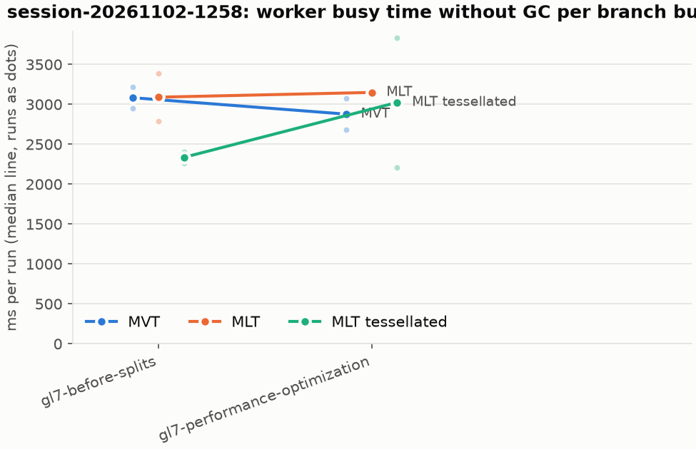
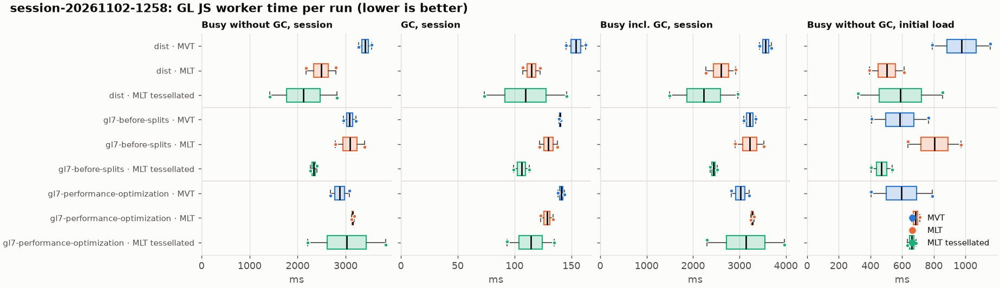
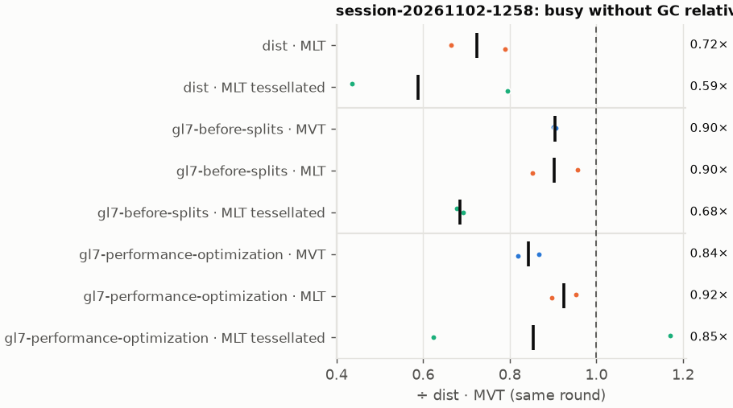
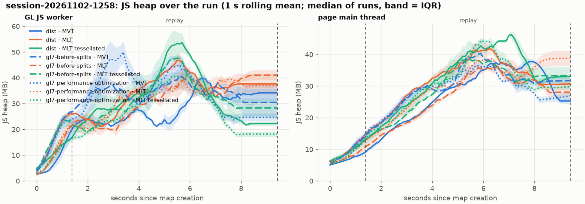
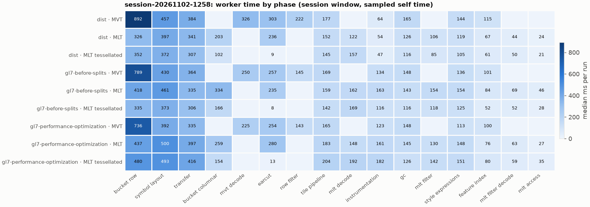
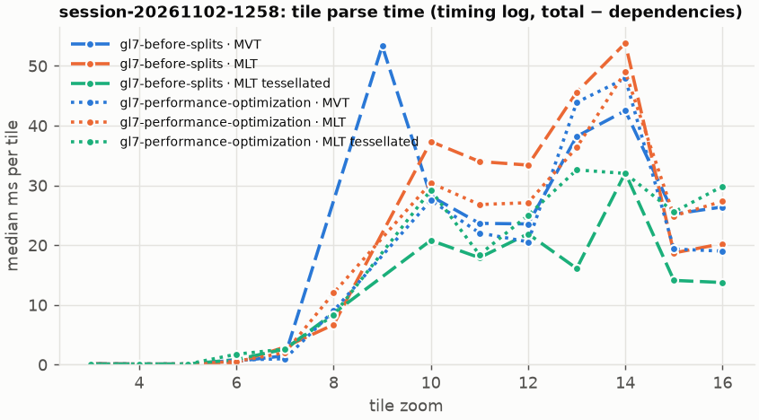

# Session trace benchmark — 20261102-130002

## Setup

- Created 2026-11-02T13:00:02+01:00; 2 repetitions + 1 warm-up round(s) (excluded); variants rotate per round (A B C, B C A, …); one cold browser context per run.
- Machine: 13th Gen Intel(R) Core(TM) i7-1365U, 12 logical cores, 31.3 GB RAM, Windows-11-10.0.26200-SP0; power: GUID des Energieschemas: 381b4222-f694-41f0-9685-ff5bb260df2e  (Ausbalanciert), AC True.
- GL JS gl7-performance-optimization @ 35ff8dd9d2 (dirty); worker count 1; viewport {'width': 1280, 'height': 1024}.
- Python 3.12.2, packages {'playwright': '1.64.0', 'numpy': '2.5.3', 'matplotlib': '3.11.2'}.

| variant | bundle | format | bundle sha256 | branch build |
|---|---|---|---|---|
| MVT | `dist/maplibre-gl-dev.mjs` | mvt | `e56fc02915c2` | – |
| MLT | `dist/maplibre-gl-dev.mjs` | mlt | `e56fc02915c2` | – |
| MLT tessellated | `dist/maplibre-gl-dev.mjs` | mlt-pre-tess | `e56fc02915c2` | – |
| gl7-before-splits · MVT | `bench-builds/branches/gl7-before-splits/maplibre-gl-dev.mjs` | mvt | `23d9e1c1efa6` | gl7-before-splits @ ef8500dcf4 (2026-10-27), MLT @ 9bf846d053 |
| gl7-before-splits · MLT | `bench-builds/branches/gl7-before-splits/maplibre-gl-dev.mjs` | mlt | `23d9e1c1efa6` | gl7-before-splits @ ef8500dcf4 (2026-10-27), MLT @ 9bf846d053 |
| gl7-before-splits · MLT tessellated | `bench-builds/branches/gl7-before-splits/maplibre-gl-dev.mjs` | mlt-pre-tess | `23d9e1c1efa6` | gl7-before-splits @ ef8500dcf4 (2026-10-27), MLT @ 9bf846d053 |
| gl7-performance-optimization · MVT | `bench-builds/branches/gl7-performance-optimization/maplibre-gl-dev.mjs` | mvt | `29fa17f4ec99` | gl7-performance-optimization @ 4925e912e4 (2026-10-29), MLT @ 173880bede |
| gl7-performance-optimization · MLT | `bench-builds/branches/gl7-performance-optimization/maplibre-gl-dev.mjs` | mlt | `29fa17f4ec99` | gl7-performance-optimization @ 4925e912e4 (2026-10-29), MLT @ 173880bede |
| gl7-performance-optimization · MLT tessellated | `bench-builds/branches/gl7-performance-optimization/maplibre-gl-dev.mjs` | mlt-pre-tess | `29fa17f4ec99` | gl7-performance-optimization @ 4925e912e4 (2026-10-29), MLT @ 173880bede |

| session | style | duration | frames | sha256 |
|---|---|---:|---:|---|
| session-20261102-1258 | osm-bright | 8.0 s | 279 | `72ef72d38420` |

CPU sampling interval (median over runs): 570 µs.

## Definitions

- **busy** = wall time in which a GL JS worker thread runs a task (union of top-level task slices and GC slices on `DedicatedWorker thread`s), summed over workers. **GC** = union of `MinorGC`/`MajorGC`/`V8.GC*` slices on those threads. **busy without GC** = busy − GC (headline metric).
- **CPU** = thread time (`tdur`) of the same slices. Phase categories and functions come from the trace's CPU samples (self time), categorised by `config/categories.toml` (nearest matching frame, leaf to root).
- Windows: **load** = map creation → first idle; **session** = camera replay; **tail** = end of replay → idle; **total** = load + session + tail.
- Ratios are against **MVT**: ratio of medians with a bootstrap 95 % CI, the geometric mean of per-round ratios, and a two-sided Mann–Whitney U p-value (normal approximation, not corrected for multiple comparisons; rough below n = 8). Lower than 1× means less worker time.

## Session `session-20261102-1258`

### Worker busy without GC (session window)

| variant | n ok / failed | median ms | IQR | mean | ratio vs MVT | 95 % CI | geo-mean paired | MWU p |
|---|---:|---:|---:|---:|---:|---:|---:|---:|
| MVT | 2 / 0 | 3,411 | 3,343–3,479 | 3,411 | 1.00× | – | – | – |
| MLT | 2 / 0 | 2,487 | 2,330–2,644 | 2,487 | 0.73× | 0.61–0.86× | 0.72× | 0.245 |
| MLT tessellated | 2 / 0 | 2,120 | 1,772–2,467 | 2,120 | 0.62× | 0.40–0.86× | 0.59× | 0.245 |
| gl7-before-splits · MVT | 2 / 0 | 3,083 | 3,017–3,149 | 3,083 | 0.90× | 0.83–0.98× | 0.90× | 0.245 |
| gl7-before-splits · MLT | 2 / 0 | 3,090 | 2,940–3,240 | 3,090 | 0.91× | 0.79–1.03× | 0.90× | 0.699 |
| gl7-before-splits · MLT tessellated | 2 / 0 | 2,336 | 2,300–2,371 | 2,336 | 0.68× | 0.64–0.73× | 0.68× | 0.245 |
| gl7-performance-optimization · MVT | 2 / 0 | 2,878 | 2,779–2,976 | 2,878 | 0.84× | 0.76–0.94× | 0.84× | 0.245 |
| gl7-performance-optimization · MLT | 2 / 0 | 3,149 | 3,135–3,164 | 3,149 | 0.92× | 0.88–0.97× | 0.92× | 0.245 |
| gl7-performance-optimization · MLT tessellated | 2 / 0 | 3,024 | 2,618–3,430 | 3,024 | 0.89× | 0.62–1.17× | 0.85× | 1.000 |

### All worker metrics (median, ratio vs baseline)

| metric | MVT | MLT | MLT tessellated | gl7-before-splits · MVT | gl7-before-splits · MLT | gl7-before-splits · MLT tessellated | gl7-performance-optimization · MVT | gl7-performance-optimization · MLT | gl7-performance-optimization · MLT tessellated |
|---|---:|---:|---:|---:|---:|---:|---:|---:|---:|
| busy incl. GC | 3,565 | 2,602 (0.73×) | 2,229 (0.63×) | 3,223 (0.90×) | 3,220 (0.90×) | 2,442 (0.68×) | 3,019 (0.85×) | 3,278 (0.92×) | 3,138 (0.88×) |
| &nbsp;&nbsp;of which GC | 154.1 | 114.8 (0.75×) | 109.6 (0.71×) | 140.0 (0.91×) | 129.8 (0.84×) | 106.1 (0.69×) | 141.1 (0.92×) | 128.5 (0.83×) | 114.2 (0.74×) |
| &nbsp;&nbsp;of which busy without GC | 3,411 | 2,487 (0.73×) | 2,120 (0.62×) | 3,083 (0.90×) | 3,090 (0.91×) | 2,336 (0.68×) | 2,878 (0.84×) | 3,149 (0.92×) | 3,024 (0.89×) |
| &nbsp;&nbsp;&nbsp;&nbsp;of which filtering (sampled, incl. callees) | 222.4 | 105.6 (0.47×) | 85.0 (0.38×) | 145.2 (0.65×) | 154.5 (0.69×) | 118.1 (0.53×) | 143.1 (0.64×) | 129.8 (0.58×) | 142.1 (0.64×) |
| &nbsp;&nbsp;&nbsp;&nbsp;of which column decoding inside the MLT filter (sampled) | 0.0 | 44.3 | 50.4 | 0.0 | 69.0 | 51.6 | 0.0 | 63.2 | 59.2 |
| &nbsp;&nbsp;&nbsp;&nbsp;of which timing instrumentation (sampled) | 64.2 | 54.0 (0.84×) | 46.9 (0.73×) | 133.7 (2.08×) | 163.3 (2.55×) | 115.8 (1.81×) | 123.0 (1.92×) | 161.1 (2.51×) | 182.1 (2.84×) |
| busy without GC and instrumentation | 3,347 | 2,433 (0.73×) | 2,073 (0.62×) | 2,950 (0.88×) | 2,926 (0.87×) | 2,220 (0.66×) | 2,755 (0.82×) | 2,988 (0.89×) | 2,842 (0.85×) |
| CPU time without GC | 3,009 | 2,250 (0.75×) | 1,892 (0.63×) | 2,763 (0.92×) | 2,811 (0.93×) | 2,071 (0.69×) | 2,605 (0.87×) | 2,799 (0.93×) | 2,665 (0.89×) |
| tile: download end → sent to main thread, median per tile | 128.5 | 112.2 (0.87×) | 137.4 (1.07×) | 198.9 (1.55×) | 143.9 (1.12×) | 109.3 (0.85×) | 135.5 (1.05×) | 161.3 (1.26×) | 159.1 (1.24×) |
| tile: download end → sent to main thread, 90th percentile | 553.0 | 307.6 (0.56×) | 229.6 (0.42×) | 470.7 (0.85×) | 440.6 (0.80×) | 265.6 (0.48×) | 371.0 (0.67×) | 440.7 (0.80×) | 407.0 (0.74×) |
| tile: download end → sent to main thread, 95th percentile | 638.5 | 341.6 (0.54×) | 246.1 (0.39×) | 498.5 (0.78×) | 456.7 (0.72×) | 300.2 (0.47×) | 473.1 (0.74×) | 466.0 (0.73×) | 459.2 (0.72×) |
| tile: download end → sent to main thread, 99th percentile | 668.5 | 375.0 (0.56×) | 272.6 (0.41×) | 522.6 (0.78×) | 477.2 (0.71×) | 338.2 (0.51×) | 503.0 (0.75×) | 513.4 (0.77×) | 519.4 (0.78×) |
| &nbsp;&nbsp;parse part (timing log, incl. waiting for glyphs/icons), median per tile | – | – | – | 114.9 | 83.9 | 56.5 | 75.0 | 72.6 | 91.1 |
| &nbsp;&nbsp;queue + hand-off part, median per tile | – | – | – | 52.2 | 42.3 | 33.5 | 40.6 | 50.8 | 48.9 |
| minor GCs | 33.50 | 28.50 (0.85×) | 18.50 (0.55×) | 41.50 (1.24×) | 26.50 (0.79×) | 19.00 (0.57×) | 40.00 (1.19×) | 26.50 (0.79×) | 18.00 (0.54×) |
| major GCs | 4.50 | 4.50 (1.00×) | 4.50 (1.00×) | 5.00 (1.11×) | 5.00 (1.11×) | 5.50 (1.22×) | 4.50 (1.00×) | 4.00 (0.89×) | 4.00 (0.89×) |
| peak worker heap (MB) | 52.4 | 62.0 (1.18×) | 62.1 (1.19×) | 58.3 (1.11×) | 57.8 (1.10×) | 57.8 (1.10×) | 60.8 (1.16×) | 56.4 (1.08×) | 53.0 (1.01×) |
| load: busy without GC | 974.6 | 503.2 (0.52×) | 588.9 (0.60×) | 586.1 (0.60×) | 804.6 (0.83×) | 470.9 (0.48×) | 596.1 (0.61×) | 686.1 (0.70×) | 659.8 (0.68×) |
| load: GC | 54.2 | 28.5 (0.53×) | 27.5 (0.51×) | 37.6 (0.69×) | 48.7 (0.90×) | 30.2 (0.56×) | 35.7 (0.66×) | 35.2 (0.65×) | 30.4 (0.56×) |
| total: busy without GC | 4,385 | 2,990 (0.68×) | 2,708 (0.62×) | 3,669 (0.84×) | 3,894 (0.89×) | 2,806 (0.64×) | 3,474 (0.79×) | 3,835 (0.87×) | 3,684 (0.84×) |

Rows marked *of which* are parts of the row above, not additional time. Tile rows are per-tile latencies (medians over tiles, then over runs), not sums: tiles overlap in time, and the medians of the parse and queue parts do not add up exactly to the median latency.

### Filtering (session window)

Sampled worker time spent in feature filtering, including everything the filter calls (expression evaluation, property access): **row filter** = the style-spec feature filter that MVT runs per feature, **mlt filter** = the columnar MLT filter (incl. the geometry-type selection), without the columns it decodes (see the next table). Medians per run; rules in `config/categories.toml`.

| variant | mlt filter | row filter | filtering | ratio vs MVT | 95 % CI | MWU p | share of sampled busy |
|---|---:|---:|---:|---:|---:|---:|---:|
| MVT | 0.0 | 222.4 | 222.4 | 1.00× | – | – | 6.8% |
| MLT | 105.6 | 0.0 | 105.6 | 0.47× | 0.38–0.59× | 0.245 | 4.5% |
| MLT tessellated | 85.0 | 0.0 | 85.0 | 0.38× | 0.25–0.53× | 0.245 | 4.3% |
| gl7-before-splits · MVT | 0.3 | 145.0 | 145.2 | 0.65× | 0.55–0.77× | 0.245 | 4.9% |
| gl7-before-splits · MLT | 154.5 | 0.0 | 154.5 | 0.69× | 0.58–0.82× | 0.245 | 5.2% |
| gl7-before-splits · MLT tessellated | 118.1 | 0.0 | 118.1 | 0.53× | 0.47–0.60× | 0.245 | 5.4% |
| gl7-performance-optimization · MVT | 0.0 | 143.1 | 143.1 | 0.64× | 0.60–0.69× | 0.245 | 5.2% |
| gl7-performance-optimization · MLT | 129.8 | 0.0 | 129.8 | 0.58× | 0.50–0.68× | 0.245 | 4.3% |
| gl7-performance-optimization · MLT tessellated | 142.1 | 0.0 | 142.1 | 0.64× | 0.44–0.87× | 0.245 | 5.1% |

**Filtering together with tile decoding.** The MLT decoder leaves columns encoded until something reads them, and the filter is usually the first reader: the columns it decodes (properties, and the geometry for `$type`) are **of which inside the filter** (phase *mlt filter decode*), the rest is *mlt decode* (geometry and columns read later, e.g. by paint properties and symbols). MVT decodes every feature's properties and geometry while it reads the tile (*mvt decode*), whether the filter keeps the feature or not. So **filtering** above compares the filters, and **decoding + filtering** compares all that the formats spend on decoding the tile and selecting features. **tile decoding** = *mvt decode* or *mlt decode* + *mlt filter decode*: work inside a call into a decoder. Reading data that is already decoded is not counted, as for MVT's feature objects: *mlt access* (row views, value getters, looking a column up by name) and the MLT facade (*mlt facade*). MVT decodes geometry only for the features its filter keeps, MLT decodes a layer's whole geometry column.

| variant | tile decoding | of which inside the filter | filtering | decoding + filtering | ratio vs MVT | 95 % CI | MWU p |
|---|---:|---:|---:|---:|---:|---:|---:|
| MVT | 325.6 | 0.0 | 222.4 | 548.0 | 1.00× | – | – |
| MLT | 165.8 | 44.3 | 105.6 | 271.3 | 0.50× | 0.39–0.63× | 0.245 |
| MLT tessellated | 207.8 | 50.4 | 85.0 | 292.8 | 0.53× | 0.31–0.82× | 0.245 |
| gl7-before-splits · MVT | 249.9 | 0.0 | 145.2 | 395.2 | 0.72× | 0.60–0.88× | 0.245 |
| gl7-before-splits · MLT | 231.0 | 69.0 | 154.5 | 385.5 | 0.70× | 0.56–0.89× | 0.245 |
| gl7-before-splits · MLT tessellated | 221.1 | 51.6 | 118.1 | 339.2 | 0.62× | 0.54–0.72× | 0.245 |
| gl7-performance-optimization · MVT | 225.0 | 0.0 | 143.1 | 368.1 | 0.67× | 0.60–0.77× | 0.245 |
| gl7-performance-optimization · MLT | 211.5 | 63.2 | 129.8 | 341.2 | 0.62× | 0.54–0.73× | 0.245 |
| gl7-performance-optimization · MLT tessellated | 251.5 | 59.2 | 142.1 | 393.6 | 0.72× | 0.49–1.01× | 0.699 |

Top 12 functions inside filtering and its column decoding (self time, mean ms per run):

| phase | function | source | MVT | MLT | MLT tessellated | gl7-before-splits · MVT | gl7-before-splits · MLT | gl7-before-splits · MLT tessellated | gl7-performance-optimization · MVT | gl7-performance-optimization · MLT | gl7-performance-optimization · MLT tessellated |
|---|---|---|---:|---:|---:|---:|---:|---:|---:|---:|---:|
| row filter | `evaluate` | node_modules/@maplibre/maplibre-gl-style-spec/dist/expression/compound_expression.mjs | 61.5 | 0.0 | 0.0 | 43.5 | 0.0 | 0.0 | 37.4 | 0.0 | 0.0 |
| row filter | `evaluate` | node_modules/@maplibre/maplibre-gl-style-spec/dist/expression/index.mjs | 32.0 | 0.0 | 0.0 | 19.3 | 0.0 | 0.0 | 19.8 | 0.0 | 0.0 |
| row filter | `CompoundExpression.register.filter-==` | node_modules/@maplibre/maplibre-gl-style-spec/dist/expression/compound_expression.mjs | 29.7 | 0.0 | 0.0 | 12.1 | 0.0 | 0.0 | 22.9 | 0.0 | 0.0 |
| row filter | `CompoundExpression.register.filter-in-small` | node_modules/@maplibre/maplibre-gl-style-spec/dist/expression/compound_expression.mjs | 27.6 | 0.0 | 0.0 | 20.0 | 0.0 | 0.0 | 15.7 | 0.0 | 0.0 |
| row filter | `CompoundExpression.register.all.overloads` | node_modules/@maplibre/maplibre-gl-style-spec/dist/expression/compound_expression.mjs | 21.1 | 0.0 | 0.0 | 12.3 | 0.0 | 0.0 | 14.1 | 0.0 | 0.0 |
| mlt filter | `filterByGeometryType` | maplibre-tile-spec/ts/dist/vector/geometry/geometryVector.js | 0.0 | 9.6 | 10.1 | 0.0 | 20.1 | 12.9 | 0.0 | 13.7 | 15.3 |
| mlt filter | `dictionaryRowMatches` | maplibre-tile-spec/ts/dist/processing/filter/execution/filterKernel.js | 0.0 | 13.6 | 9.2 | 0.0 | 17.9 | 13.3 | 0.0 | 20.0 | 13.6 |
| mlt filter | `scanDictionaryCodes` | maplibre-tile-spec/ts/dist/processing/filter/execution/filterKernel.js | 0.0 | 9.4 | 12.1 | 0.0 | 16.0 | 13.8 | 0.0 | 17.6 | 18.6 |
| mlt filter decode | `unpackNullable` | maplibre-tile-spec/ts/dist/decoding/unpackNullableUtils.js | 0.0 | 7.8 | 13.1 | 0.0 | 16.7 | 9.6 | 0.0 | 13.7 | 12.7 |
| row filter | `CompoundExpression.register.filter-type-==` | node_modules/@maplibre/maplibre-gl-style-spec/dist/expression/compound_expression.mjs | 10.6 | 0.0 | 0.0 | 4.5 | 0.0 | 0.0 | 3.5 | 0.0 | 0.0 |
| row filter | `filter` | node_modules/@maplibre/maplibre-gl-style-spec/dist/feature_filter/index.mjs | 10.5 | 0.0 | 0.0 | 10.3 | 0.0 | 0.0 | 9.1 | 0.0 | 0.0 |
| mlt filter | `resolveDictionaryExecutor` | maplibre-tile-spec/ts/dist/processing/filter/execution/filterKernel.js | 0.0 | 6.8 | 6.0 | 0.0 | 9.8 | 8.4 | 0.0 | 5.4 | 8.8 |

### Where the variants differ from MVT (session window, mean ms per run)

Open **[flame.html](flame.html)** to explore the call tree interactively: pick a variant, compare it with MVT (red = more time at the same call path, blue = less), click a frame to zoom in, and read the phase and function breakdown under it. Without a comparison, frames are coloured by phase: filtering is green in both formats, and the columns the MLT filter decodes on first access (*mlt filter decode*) are MLT blue frames under the green filter. `flame/*.txt` open in https://www.speedscope.app.

#### MLT vs MVT

**By phase** (sampled self time; the Δ column sums to the difference in sampled busy time):

| phase | MVT | MLT | Δ |
|---|---:|---:|---:|
| bucket columnar | 0.0 | 203.4 | +203.4 |
| mlt decode | 0.0 | 121.5 | +121.5 |
| mlt filter | 0.0 | 105.6 | +105.6 |
| mlt filter decode | 0.0 | 44.3 | +44.3 |
| mlt facade | 0.0 | 29.1 | +29.1 |
| mlt access | 0.0 | 23.5 | +23.5 |
| runtime | 12.3 | 9.2 | -3.1 |
| instrumentation | 64.2 | 54.0 | -10.1 |
| tile pipeline | 176.7 | 151.5 | -25.1 |
| style expressions | 144.3 | 119.0 | -25.3 |
| gc | 165.0 | 125.7 | -39.3 |
| transfer | 384.0 | 341.1 | -42.9 |
| feature index | 114.6 | 66.8 | -47.8 |
| symbol layout | 457.3 | 396.8 | -60.5 |
| earcut | 302.6 | 235.7 | -66.9 |
| row filter | 222.4 | 0.0 | -222.4 |
| mvt decode | 325.6 | 0.0 | -325.6 |
| bucket row | 892.2 | 326.5 | -565.8 |

**By source layer** (timing log: createBucket + populate + addFeatures, summed over the style layers that use it; wall time, includes GC pauses; total Δ +0 ms):

| source layer | type | MVT | MLT | Δ |
|---|---|---:|---:|---:|
| landcover | fill | 0.0 | 0.0 | +0.0 |
| landuse | fill | 0.0 | 0.0 | +0.0 |
| park | fill | 0.0 | 0.0 | +0.0 |
| waterway | line | 0.0 | 0.0 | +0.0 |
| water | fill | 0.0 | 0.0 | +0.0 |
| transportation | line | 0.0 | 0.0 | +0.0 |
| transportation | fill | 0.0 | 0.0 | +0.0 |
| aeroway | fill | 0.0 | 0.0 | +0.0 |
| aeroway | line | 0.0 | 0.0 | +0.0 |
| boundary | line | 0.0 | 0.0 | +0.0 |
| water_name | symbol | 0.0 | 0.0 | +0.0 |
| transportation_name | symbol | 0.0 | 0.0 | +0.0 |

**Functions with the largest self-time difference** (by function name, summed over source files):

| function | MVT | MLT | Δ |
|---|---:|---:|---:|
| `buildRingBoundingBoxes` | 0.0 | 21.9 | +21.9 |
| `writeEarcutFill` | 0.0 | 21.4 | +21.4 |
| `buildEarcutMesh` | 0.0 | 18.4 | +18.4 |
| `readScaledRings` | 0.0 | 14.1 | +14.1 |
| `dictionaryRowMatches` | 0.0 | 13.6 | +13.6 |
| `unpackNullable` | 0.0 | 13.0 | +13.0 |
| `materializeSelectedFeatures` | 0.0 | 11.2 | +11.2 |
| `decodeFsst` | 0.0 | 10.8 | +10.8 |
| `decodeString$2` | 0.0 | 10.5 | +10.5 |
| `filterByGeometryType` | 0.0 | 9.6 | +9.6 |
| `decodeComponentwiseDeltaVec2` | 0.0 | 9.5 | +9.5 |
| `scanDictionaryCodes` | 0.0 | 9.4 | +9.4 |
| `readSVarint` | 148.4 | 0.0 | -148.4 |
| `_vertexToIndex` | 125.2 | 0.0 | -125.2 |
| `loadGeometry` | 108.1 | 7.2 | -100.8 |
| `evaluate` | 101.5 | 14.6 | -86.9 |
| `populate` | 89.4 | 7.1 | -82.3 |

#### MLT tessellated vs MVT

**By phase** (sampled self time; the Δ column sums to the difference in sampled busy time):

| phase | MVT | MLT tessellated | Δ |
|---|---:|---:|---:|
| mlt decode | 0.0 | 157.4 | +157.4 |
| bucket columnar | 0.0 | 102.2 | +102.2 |
| mlt filter | 0.0 | 85.0 | +85.0 |
| mlt filter decode | 0.0 | 50.4 | +50.4 |
| mlt facade | 0.0 | 24.4 | +24.4 |
| mlt access | 0.0 | 20.8 | +20.8 |
| pre-tess mesh | 0.0 | 19.3 | +19.3 |
| other | 6.5 | 9.2 | +2.7 |
| runtime | 12.3 | 8.4 | -3.9 |
| instrumentation | 64.2 | 46.9 | -17.2 |
| tile pipeline | 176.7 | 144.8 | -31.9 |
| style expressions | 144.3 | 104.7 | -39.5 |
| gc | 165.0 | 116.1 | -48.8 |
| feature index | 114.6 | 61.2 | -53.4 |
| transfer | 384.0 | 306.9 | -77.2 |
| symbol layout | 457.3 | 371.9 | -85.5 |
| row filter | 222.4 | 0.0 | -222.4 |
| earcut | 302.6 | 8.7 | -293.9 |
| mvt decode | 325.6 | 0.0 | -325.6 |
| bucket row | 892.2 | 351.8 | -540.5 |

**By source layer** (timing log: createBucket + populate + addFeatures, summed over the style layers that use it; wall time, includes GC pauses; total Δ +0 ms):

| source layer | type | MVT | MLT tessellated | Δ |
|---|---|---:|---:|---:|
| landcover | fill | 0.0 | 0.0 | +0.0 |
| landuse | fill | 0.0 | 0.0 | +0.0 |
| park | fill | 0.0 | 0.0 | +0.0 |
| waterway | line | 0.0 | 0.0 | +0.0 |
| water | fill | 0.0 | 0.0 | +0.0 |
| transportation | line | 0.0 | 0.0 | +0.0 |
| transportation | fill | 0.0 | 0.0 | +0.0 |
| aeroway | fill | 0.0 | 0.0 | +0.0 |
| aeroway | line | 0.0 | 0.0 | +0.0 |
| boundary | line | 0.0 | 0.0 | +0.0 |
| water_name | symbol | 0.0 | 0.0 | +0.0 |
| transportation_name | symbol | 0.0 | 0.0 | +0.0 |

**Functions with the largest self-time difference** (by function name, summed over source files):

| function | MVT | MLT tessellated | Δ |
|---|---:|---:|---:|
| `buildTessellatedBoundingBox` | 0.0 | 19.3 | +19.3 |
| `unpackNullable` | 0.0 | 18.1 | +18.1 |
| `writeTessellatedFill` | 0.0 | 17.7 | +17.7 |
| `decodeComponentwiseDeltaVec2` | 0.0 | 15.3 | +15.3 |
| `decodeUnsignedZigZagDeltaInt32` | 0.0 | 12.9 | +12.9 |
| `decodeFastPforInt32` | 0.0 | 12.2 | +12.2 |
| `scanDictionaryCodes` | 0.0 | 12.1 | +12.1 |
| `decodeFsst` | 0.0 | 10.7 | +10.7 |
| `filterByGeometryType` | 0.0 | 10.1 | +10.1 |
| `dictionaryRowMatches` | 0.0 | 9.2 | +9.2 |
| `appendScaledVertices` | 0.0 | 8.6 | +8.6 |
| `decodeString$2` | 0.0 | 8.6 | +8.6 |
| `readSVarint` | 148.4 | 0.0 | -148.4 |
| `_vertexToIndex` | 125.2 | 0.0 | -125.2 |
| `isEar` | 104.9 | 1.4 | -103.5 |
| `loadGeometry` | 108.1 | 8.0 | -100.1 |
| `evaluate` | 101.5 | 11.6 | -89.8 |

#### gl7-before-splits · MVT vs MVT

**By phase** (sampled self time; the Δ column sums to the difference in sampled busy time):

| phase | MVT | gl7-before-splits · MVT | Δ |
|---|---:|---:|---:|
| instrumentation | 64.2 | 133.7 | +69.5 |
| other | 6.5 | 9.0 | +2.5 |
| runtime | 12.3 | 11.7 | -0.6 |
| style expressions | 144.3 | 136.3 | -7.9 |
| tile pipeline | 176.7 | 168.6 | -8.0 |
| feature index | 114.6 | 100.9 | -13.7 |
| gc | 165.0 | 148.4 | -16.6 |
| transfer | 384.0 | 364.3 | -19.7 |
| symbol layout | 457.3 | 430.3 | -27.0 |
| earcut | 302.6 | 257.5 | -45.1 |
| mvt decode | 325.6 | 249.9 | -75.6 |
| row filter | 222.4 | 145.0 | -77.4 |
| bucket row | 892.2 | 788.5 | -103.7 |

**By source layer** (timing log: createBucket + populate + addFeatures, summed over the style layers that use it; wall time, includes GC pauses; total Δ +2126 ms):

| source layer | type | MVT | gl7-before-splits · MVT | Δ |
|---|---|---:|---:|---:|
| transportation | line | 0.0 | 665.3 | +665.3 |
| building | fill | 0.0 | 511.7 | +511.7 |
| poi | symbol | 0.0 | 215.7 | +215.7 |
| landuse | fill | 0.0 | 163.9 | +163.9 |
| landcover | fill | 0.0 | 143.1 | +143.1 |
| transportation_name | symbol | 0.0 | 133.1 | +133.1 |
| place | symbol | 0.0 | 101.6 | +101.6 |
| water | fill | 0.0 | 63.6 | +63.6 |
| transportation | symbol | 0.0 | 52.3 | +52.3 |
| boundary | line | 0.0 | 21.5 | +21.5 |
| transportation | fill | 0.0 | 21.3 | +21.3 |
| water_name | symbol | 0.0 | 9.9 | +9.9 |

**Functions with the largest self-time difference** (by function name, summed over source files):

| function | MVT | gl7-before-splits · MVT | Δ |
|---|---:|---:|---:|
| `addPhase` | 0.0 | 37.3 | +37.3 |
| `populate` | 89.4 | 117.2 | +27.8 |
| `now` | 0.1 | 20.9 | +20.8 |
| `takePhases` | 0.3 | 9.8 | +9.5 |
| `log` | 0.0 | 7.6 | +7.6 |
| `_trim` | 62.2 | 69.6 | +7.4 |
| `earcut` | 12.4 | 18.4 | +6.0 |
| `flatten` | 14.8 | 19.5 | +4.8 |
| `_rotate` | 5.2 | 9.5 | +4.4 |
| `isRegistered` | 6.8 | 11.0 | +4.2 |
| `getGlyphAdvance` | 14.8 | 19.0 | +4.2 |
| `readString` | 23.5 | 27.3 | +3.9 |
| `readSVarint` | 148.4 | 104.2 | -44.2 |
| `loadGeometry` | 108.1 | 64.5 | -43.6 |
| `evaluate` | 101.5 | 74.8 | -26.7 |
| `addHalfVertex` | 45.3 | 27.2 | -18.1 |
| `CompoundExpression.register.filter-==` | 30.0 | 12.1 | -17.9 |

#### gl7-before-splits · MLT vs MVT

**By phase** (sampled self time; the Δ column sums to the difference in sampled busy time):

| phase | MVT | gl7-before-splits · MLT | Δ |
|---|---:|---:|---:|
| bucket columnar | 0.0 | 334.3 | +334.3 |
| mlt decode | 0.0 | 162.0 | +162.0 |
| mlt filter | 0.0 | 154.5 | +154.5 |
| instrumentation | 64.2 | 163.3 | +99.1 |
| mlt filter decode | 0.0 | 69.0 | +69.0 |
| mlt access | 0.0 | 46.1 | +46.1 |
| mlt facade | 0.0 | 39.7 | +39.7 |
| style expressions | 144.3 | 154.4 | +10.1 |
| symbol layout | 457.3 | 461.4 | +4.1 |
| runtime | 12.3 | 10.8 | -1.4 |
| tile pipeline | 176.7 | 158.8 | -17.8 |
| gc | 165.0 | 142.7 | -22.3 |
| feature index | 114.6 | 83.6 | -30.9 |
| transfer | 384.0 | 334.9 | -49.1 |
| earcut | 302.6 | 235.2 | -67.4 |
| row filter | 222.4 | 0.0 | -222.4 |
| mvt decode | 325.6 | 0.0 | -325.6 |
| bucket row | 892.2 | 418.1 | -474.1 |

**By source layer** (timing log: createBucket + populate + addFeatures, summed over the style layers that use it; wall time, includes GC pauses; total Δ +2222 ms):

| source layer | type | MVT | gl7-before-splits · MLT | Δ |
|---|---|---:|---:|---:|
| transportation | line | 0.0 | 738.4 | +738.4 |
| building | fill | 0.0 | 381.1 | +381.1 |
| poi | symbol | 0.0 | 320.4 | +320.4 |
| place | symbol | 0.0 | 212.5 | +212.5 |
| transportation_name | symbol | 0.0 | 139.6 | +139.6 |
| landcover | fill | 0.0 | 116.1 | +116.1 |
| landuse | fill | 0.0 | 109.8 | +109.8 |
| water | fill | 0.0 | 56.4 | +56.4 |
| transportation | symbol | 0.0 | 39.6 | +39.6 |
| boundary | line | 0.0 | 28.4 | +28.4 |
| water_name | symbol | 0.0 | 18.9 | +18.9 |
| transportation | fill | 0.0 | 18.8 | +18.8 |

**Functions with the largest self-time difference** (by function name, summed over source files):

| function | MVT | gl7-before-splits · MLT | Δ |
|---|---:|---:|---:|
| `addPhase` | 0.0 | 53.1 | +53.1 |
| `buildEarcutMesh` | 0.0 | 28.9 | +28.9 |
| `buildRingBoundingBoxes` | 0.0 | 27.2 | +27.2 |
| `writeEarcutFill` | 0.0 | 27.0 | +27.0 |
| `now` | 0.1 | 26.6 | +26.5 |
| `appendSymbolFeature` | 0.0 | 23.3 | +23.3 |
| `unpackNullable` | 0.0 | 22.7 | +22.7 |
| `filterByGeometryType` | 0.0 | 20.1 | +20.1 |
| `decodeString$2` | 0.0 | 19.0 | +19.0 |
| `dictionaryRowMatches` | 0.0 | 17.9 | +17.9 |
| `decodeComponentwiseDeltaVec2` | 0.0 | 16.3 | +16.3 |
| `scanDictionaryCodes` | 0.0 | 16.0 | +16.0 |
| `readSVarint` | 148.4 | 0.0 | -148.4 |
| `_vertexToIndex` | 125.2 | 0.0 | -125.2 |
| `loadGeometry` | 108.1 | 12.3 | -95.8 |
| `evaluate` | 101.5 | 13.6 | -87.9 |
| `readVarint` | 44.5 | 2.1 | -42.4 |

#### gl7-before-splits · MLT tessellated vs MVT

**By phase** (sampled self time; the Δ column sums to the difference in sampled busy time):

| phase | MVT | gl7-before-splits · MLT tessellated | Δ |
|---|---:|---:|---:|
| mlt decode | 0.0 | 169.4 | +169.4 |
| bucket columnar | 0.0 | 166.0 | +166.0 |
| mlt filter | 0.0 | 118.1 | +118.1 |
| instrumentation | 64.2 | 115.8 | +51.7 |
| mlt filter decode | 0.0 | 51.6 | +51.6 |
| mlt facade | 0.0 | 30.7 | +30.7 |
| pre-tess mesh | 0.0 | 30.0 | +30.0 |
| mlt access | 0.0 | 28.4 | +28.4 |
| other | 6.5 | 12.3 | +5.8 |
| runtime | 12.3 | 13.3 | +1.0 |
| style expressions | 144.3 | 124.8 | -19.4 |
| tile pipeline | 176.7 | 142.2 | -34.4 |
| gc | 165.0 | 115.9 | -49.1 |
| feature index | 114.6 | 51.5 | -63.1 |
| transfer | 384.0 | 306.3 | -77.7 |
| symbol layout | 457.3 | 372.6 | -84.8 |
| row filter | 222.4 | 0.0 | -222.4 |
| earcut | 302.6 | 7.9 | -294.7 |
| mvt decode | 325.6 | 0.0 | -325.6 |
| bucket row | 892.2 | 334.7 | -557.6 |

**By source layer** (timing log: createBucket + populate + addFeatures, summed over the style layers that use it; wall time, includes GC pauses; total Δ +1534 ms):

| source layer | type | MVT | gl7-before-splits · MLT tessellated | Δ |
|---|---|---:|---:|---:|
| transportation | line | 0.0 | 601.5 | +601.5 |
| place | symbol | 0.0 | 208.0 | +208.0 |
| poi | symbol | 0.0 | 203.1 | +203.1 |
| transportation_name | symbol | 0.0 | 113.6 | +113.6 |
| building | fill | 0.0 | 88.6 | +88.6 |
| landuse | fill | 0.0 | 69.8 | +69.8 |
| landcover | fill | 0.0 | 66.2 | +66.2 |
| transportation | symbol | 0.0 | 42.1 | +42.1 |
| boundary | line | 0.0 | 31.3 | +31.3 |
| water | fill | 0.0 | 30.8 | +30.8 |
| transportation | fill | 0.0 | 25.3 | +25.3 |
| waterway | line | 0.0 | 16.2 | +16.2 |

**Functions with the largest self-time difference** (by function name, summed over source files):

| function | MVT | gl7-before-splits · MLT tessellated | Δ |
|---|---:|---:|---:|
| `addPhase` | 0.0 | 36.2 | +36.2 |
| `buildTessellatedBoundingBox` | 0.0 | 30.0 | +30.0 |
| `writeTessellatedFill` | 0.0 | 24.5 | +24.5 |
| `now` | 0.1 | 16.3 | +16.2 |
| `decodeString$2` | 0.0 | 14.8 | +14.8 |
| `decodeFastPforInt32` | 0.0 | 14.1 | +14.1 |
| `scanDictionaryCodes` | 0.0 | 13.8 | +13.8 |
| `decodeComponentwiseDeltaVec2` | 0.0 | 13.6 | +13.6 |
| `appendSymbolFeature` | 0.0 | 13.6 | +13.6 |
| `dictionaryRowMatches` | 0.0 | 13.3 | +13.3 |
| `unpackNullable` | 0.0 | 13.3 | +13.3 |
| `filterByGeometryType` | 0.0 | 12.9 | +12.9 |
| `readSVarint` | 148.4 | 0.0 | -148.4 |
| `_vertexToIndex` | 125.2 | 0.0 | -125.2 |
| `isEar` | 104.9 | 2.4 | -102.5 |
| `loadGeometry` | 108.1 | 6.0 | -102.1 |
| `evaluate` | 101.5 | 15.7 | -85.8 |

#### gl7-performance-optimization · MVT vs MVT

**By phase** (sampled self time; the Δ column sums to the difference in sampled busy time):

| phase | MVT | gl7-performance-optimization · MVT | Δ |
|---|---:|---:|---:|
| instrumentation | 64.2 | 123.0 | +58.8 |
| other | 6.5 | 10.6 | +4.1 |
| tile pipeline | 176.7 | 165.0 | -11.7 |
| feature index | 114.6 | 99.5 | -15.1 |
| gc | 165.0 | 148.2 | -16.8 |
| style expressions | 144.3 | 112.9 | -31.3 |
| earcut | 302.6 | 254.5 | -48.1 |
| transfer | 384.0 | 334.6 | -49.4 |
| symbol layout | 457.3 | 392.3 | -65.0 |
| row filter | 222.4 | 143.1 | -79.3 |
| mvt decode | 325.6 | 225.0 | -100.5 |
| bucket row | 892.2 | 736.5 | -155.8 |

**By source layer** (timing log: createBucket + populate + addFeatures, summed over the style layers that use it; wall time, includes GC pauses; total Δ +1983 ms):

| source layer | type | MVT | gl7-performance-optimization · MVT | Δ |
|---|---|---:|---:|---:|
| transportation | line | 0.0 | 614.0 | +614.0 |
| building | fill | 0.0 | 432.8 | +432.8 |
| poi | symbol | 0.0 | 196.7 | +196.7 |
| landuse | fill | 0.0 | 172.4 | +172.4 |
| landcover | fill | 0.0 | 150.4 | +150.4 |
| transportation_name | symbol | 0.0 | 133.6 | +133.6 |
| place | symbol | 0.0 | 105.7 | +105.7 |
| water | fill | 0.0 | 67.6 | +67.6 |
| transportation | symbol | 0.0 | 38.1 | +38.1 |
| boundary | line | 0.0 | 21.3 | +21.3 |
| transportation | fill | 0.0 | 19.6 | +19.6 |
| water_name | symbol | 0.0 | 10.4 | +10.4 |

**Functions with the largest self-time difference** (by function name, summed over source files):

| function | MVT | gl7-performance-optimization · MVT | Δ |
|---|---:|---:|---:|
| `addPhase` | 0.0 | 35.9 | +35.9 |
| `addBucketFeatures` | 12.8 | 32.9 | +20.1 |
| `now` | 0.1 | 16.3 | +16.2 |
| `takePhases` | 0.3 | 11.0 | +10.7 |
| `log` | 0.0 | 4.7 | +4.7 |
| `remapIndices` | 10.0 | 13.9 | +3.9 |
| `calculateGlyphDependencies` | 8.3 | 11.4 | +3.1 |
| `subdividePolygonInternal` | 11.9 | 15.0 | +3.1 |
| `flatten` | 14.8 | 17.8 | +3.0 |
| `CollisionFeature` | 0.8 | 3.4 | +2.6 |
| `clipLine` | 2.1 | 4.7 | +2.6 |
| `copyImage` | 12.9 | 15.1 | +2.2 |
| `readSVarint` | 148.4 | 96.9 | -51.5 |
| `loadGeometry` | 108.1 | 57.0 | -51.0 |
| `evaluate` | 101.5 | 65.4 | -36.1 |
| `addHalfVertex` | 45.3 | 24.1 | -21.2 |
| `addLine` | 46.5 | 27.8 | -18.8 |

#### gl7-performance-optimization · MLT vs MVT

**By phase** (sampled self time; the Δ column sums to the difference in sampled busy time):

| phase | MVT | gl7-performance-optimization · MLT | Δ |
|---|---:|---:|---:|
| bucket columnar | 0.0 | 259.1 | +259.1 |
| mlt decode | 0.0 | 148.2 | +148.2 |
| mlt filter | 0.0 | 129.8 | +129.8 |
| instrumentation | 64.2 | 161.1 | +96.9 |
| mlt filter decode | 0.0 | 63.2 | +63.2 |
| symbol layout | 457.3 | 499.7 | +42.3 |
| mlt facade | 0.0 | 28.5 | +28.5 |
| mlt access | 0.0 | 26.9 | +26.9 |
| transfer | 384.0 | 397.0 | +12.9 |
| tile pipeline | 176.7 | 182.6 | +6.0 |
| style expressions | 144.3 | 147.5 | +3.3 |
| other | 6.5 | 9.1 | +2.6 |
| runtime | 12.3 | 11.5 | -0.7 |
| gc | 165.0 | 145.1 | -19.8 |
| earcut | 302.6 | 280.4 | -22.2 |
| feature index | 114.6 | 76.3 | -38.3 |
| row filter | 222.4 | 0.0 | -222.4 |
| mvt decode | 325.6 | 0.0 | -325.6 |
| bucket row | 892.2 | 437.5 | -454.8 |

**By source layer** (timing log: createBucket + populate + addFeatures, summed over the style layers that use it; wall time, includes GC pauses; total Δ +2160 ms):

| source layer | type | MVT | gl7-performance-optimization · MLT | Δ |
|---|---|---:|---:|---:|
| transportation | line | 0.0 | 647.5 | +647.5 |
| poi | symbol | 0.0 | 309.4 | +309.4 |
| building | fill | 0.0 | 301.6 | +301.6 |
| transportation_name | symbol | 0.0 | 189.1 | +189.1 |
| place | symbol | 0.0 | 175.4 | +175.4 |
| landuse | fill | 0.0 | 161.3 | +161.3 |
| landcover | fill | 0.0 | 153.2 | +153.2 |
| water | fill | 0.0 | 64.6 | +64.6 |
| transportation | symbol | 0.0 | 40.4 | +40.4 |
| boundary | line | 0.0 | 34.5 | +34.5 |
| waterway | line | 0.0 | 19.9 | +19.9 |
| water_name | symbol | 0.0 | 15.0 | +15.0 |

**Functions with the largest self-time difference** (by function name, summed over source files):

| function | MVT | gl7-performance-optimization · MLT | Δ |
|---|---:|---:|---:|
| `addPhase` | 0.0 | 44.0 | +44.0 |
| `buildEarcutMesh` | 0.0 | 29.7 | +29.7 |
| `writeEarcutFill` | 0.0 | 28.3 | +28.3 |
| `addBucketFeatures` | 12.8 | 40.7 | +27.8 |
| `buildRingBoundingBoxes` | 0.0 | 27.6 | +27.6 |
| `now` | 0.1 | 25.9 | +25.8 |
| `unpackNullable` | 0.0 | 21.4 | +21.4 |
| `dictionaryRowMatches` | 0.0 | 20.0 | +20.0 |
| `scanDictionaryCodes` | 0.0 | 17.6 | +17.6 |
| `decodeComponentwiseDeltaVec2` | 0.0 | 15.8 | +15.8 |
| `get` | 24.9 | 40.4 | +15.6 |
| `readScaledRings` | 0.0 | 14.6 | +14.6 |
| `readSVarint` | 148.4 | 0.0 | -148.4 |
| `_vertexToIndex` | 125.2 | 0.0 | -125.2 |
| `loadGeometry` | 108.1 | 9.1 | -98.9 |
| `evaluate` | 101.5 | 14.1 | -87.3 |
| `populate` | 89.4 | 11.9 | -77.5 |

#### gl7-performance-optimization · MLT tessellated vs MVT

**By phase** (sampled self time; the Δ column sums to the difference in sampled busy time):

| phase | MVT | gl7-performance-optimization · MLT tessellated | Δ |
|---|---:|---:|---:|
| mlt decode | 0.0 | 192.4 | +192.4 |
| bucket columnar | 0.0 | 154.0 | +154.0 |
| mlt filter | 0.0 | 142.1 | +142.1 |
| instrumentation | 64.2 | 182.1 | +117.9 |
| mlt filter decode | 0.0 | 59.2 | +59.2 |
| symbol layout | 457.3 | 492.9 | +35.5 |
| mlt facade | 0.0 | 35.2 | +35.2 |
| mlt access | 0.0 | 35.1 | +35.1 |
| transfer | 384.0 | 415.7 | +31.6 |
| tile pipeline | 176.7 | 203.9 | +27.2 |
| pre-tess mesh | 0.0 | 20.3 | +20.3 |
| style expressions | 144.3 | 151.1 | +6.9 |
| runtime | 12.3 | 13.5 | +1.3 |
| other | 6.5 | 7.1 | +0.6 |
| feature index | 114.6 | 80.2 | -34.4 |
| gc | 165.0 | 126.0 | -39.0 |
| row filter | 222.4 | 0.0 | -222.4 |
| earcut | 302.6 | 13.1 | -289.5 |
| mvt decode | 325.6 | 0.0 | -325.6 |
| bucket row | 892.2 | 480.5 | -411.8 |

**By source layer** (timing log: createBucket + populate + addFeatures, summed over the style layers that use it; wall time, includes GC pauses; total Δ +1903 ms):

| source layer | type | MVT | gl7-performance-optimization · MLT tessellated | Δ |
|---|---|---:|---:|---:|
| transportation | line | 0.0 | 753.2 | +753.2 |
| poi | symbol | 0.0 | 258.3 | +258.3 |
| transportation_name | symbol | 0.0 | 207.7 | +207.7 |
| place | symbol | 0.0 | 181.6 | +181.6 |
| building | fill | 0.0 | 98.6 | +98.6 |
| landuse | fill | 0.0 | 84.0 | +84.0 |
| landcover | fill | 0.0 | 71.2 | +71.2 |
| transportation | symbol | 0.0 | 65.2 | +65.2 |
| boundary | line | 0.0 | 43.3 | +43.3 |
| transportation | fill | 0.0 | 41.6 | +41.6 |
| water | fill | 0.0 | 36.9 | +36.9 |
| waterway | line | 0.0 | 20.3 | +20.3 |

**Functions with the largest self-time difference** (by function name, summed over source files):

| function | MVT | gl7-performance-optimization · MLT tessellated | Δ |
|---|---:|---:|---:|
| `addPhase` | 0.0 | 46.8 | +46.8 |
| `addBucketFeatures` | 12.8 | 51.5 | +38.7 |
| `now` | 0.1 | 24.0 | +23.9 |
| `writeTessellatedFill` | 0.0 | 23.9 | +23.9 |
| `reserve` | 161.8 | 182.6 | +20.9 |
| `buildTessellatedBoundingBox` | 0.0 | 20.3 | +20.3 |
| `scanDictionaryCodes` | 0.0 | 18.6 | +18.6 |
| `unpackNullable` | 0.0 | 18.1 | +18.1 |
| `decodeFastPforInt32` | 0.0 | 18.0 | +18.0 |
| `takePhases` | 0.3 | 18.3 | +18.0 |
| `get` | 24.9 | 40.8 | +15.9 |
| `decodeUnsignedZigZagDeltaInt32` | 0.0 | 15.7 | +15.7 |
| `readSVarint` | 148.4 | 0.0 | -148.4 |
| `_vertexToIndex` | 125.2 | 0.0 | -125.2 |
| `isEar` | 104.9 | 0.9 | -104.0 |
| `loadGeometry` | 108.1 | 11.8 | -96.3 |
| `evaluate` | 101.5 | 19.8 | -81.7 |

### Memory (session window)

**JS heap** = V8's used heap of the thread (`jsHeapSizeUsed` from the trace's `UpdateCounters`, about every 20 ms; the mean is time-weighted). It does not include ArrayBuffer contents, so the tile data itself (vertex, index and feature-index arrays) is not in it: **tile data sent to the main thread** is the size of the ArrayBuffers each tile result transfers (`web/worker_hook.js`), which then live on the main thread and are uploaded to the GPU. **garbage collected** = heap freed by the worker's GCs, a measure of how much it allocates. Medians per run; ratio of medians with a bootstrap 95 % CI.

| metric | MVT | MLT | MLT tessellated | gl7-before-splits · MVT | gl7-before-splits · MLT | gl7-before-splits · MLT tessellated | gl7-performance-optimization · MVT | gl7-performance-optimization · MLT | gl7-performance-optimization · MLT tessellated |
|---|---:|---:|---:|---:|---:|---:|---:|---:|---:|
| worker JS heap, mean (MB) | 24.4 | 29.4 (1.20×, 1.03–1.41×) | 26.8 (1.10×, 0.91–1.32×) | 27.3 (1.12×, 0.81–1.49×) | 22.6 (0.93×, 0.75–1.13×) | 20.7 (0.85×, 0.70–1.03×) | 26.0 (1.06×, 0.76–1.43×) | 28.3 (1.16×, 1.01–1.34×) | 22.5 (0.92×, 0.81–1.05×) |
| worker JS heap, peak (MB) | 52.4 | 62.0 (1.18×, 1.01–1.36×) | 62.1 (1.19×, 1.08–1.30×) | 58.3 (1.11×, 0.93–1.30×) | 57.8 (1.10×, 0.97–1.24×) | 57.8 (1.10×, 1.05–1.16×) | 60.8 (1.16×, 0.97–1.36×) | 56.4 (1.08×, 1.03–1.12×) | 53.0 (1.01×, 0.95–1.08×) |
| worker JS heap after the last GC (MB) | 16.5 | 17.8 (1.08×, 0.44–2.08×) | 14.8 (0.90×, 0.65–1.28×) | 18.8 (1.14×, 0.93–1.47×) | 17.3 (1.05×, 0.71–1.58×) | 12.5 (0.76×, 0.55–1.09×) | 14.0 (0.85×, 0.41–1.54×) | 19.9 (1.21×, 0.76–1.92×) | 10.6 (0.64×, 0.42–0.99×) |
| garbage collected in the worker (MB) | 998.4 | 824.3 (0.83×, 0.59–1.19×) | 524.4 (0.53×, 0.41–0.70×) | 1,307 (1.31×, 0.97–1.82×) | 805.6 (0.81×, 0.63–1.08×) | 557.7 (0.56×, 0.44–0.74×) | 1,231 (1.23×, 0.83–1.84×) | 795.5 (0.80×, 0.61–1.09×) | 453.9 (0.45×, 0.31–0.67×) |
| main thread JS heap, mean (MB) | 25.5 | 27.8 (1.09×, 1.03–1.16×) | 29.4 (1.15×, 1.04–1.27×) | 26.8 (1.05×, 0.99–1.12×) | 24.6 (0.97×, 0.91–1.03×) | 26.5 (1.04×, 0.95–1.14×) | 25.4 (1.00×, 0.94–1.05×) | 28.4 (1.11×, 1.02–1.21×) | 27.5 (1.08×, 1.02–1.14×) |
| main thread JS heap, peak (MB) | 46.9 | 50.0 (1.07×, 1.00–1.13×) | 52.6 (1.12×, 1.07–1.17×) | 49.7 (1.06×, 1.01–1.11×) | 49.9 (1.06×, 1.03–1.10×) | 51.6 (1.10×, 1.06–1.14×) | 46.5 (0.99×, 0.95–1.03×) | 48.3 (1.03×, 0.98–1.08×) | 54.2 (1.16×, 1.12–1.20×) |
| main thread JS heap at the end of the replay (MB) | 25.4 | 30.6 (1.20×, 1.04–1.39×) | 33.0 (1.30×, 1.17–1.44×) | 31.7 (1.25×, 1.09–1.42×) | 28.2 (1.11×, 0.91–1.33×) | 33.4 (1.31×, 1.04–1.63×) | 26.0 (1.02×, 0.89–1.17×) | 38.8 (1.53×, 1.26–1.84×) | 29.7 (1.17×, 1.04–1.31×) |
| tile data sent to the main thread, total (MB) | 55.6 | 70.6 (1.27×, 0.89–1.87×) | 72.9 (1.31×, 1.01–1.79×) | 73.2 (1.32×, 0.93–1.92×) | 52.5 (0.94×, 0.70–1.32×) | 59.1 (1.06×, 0.82–1.45×) | 68.4 (1.23×, 0.81–1.90×) | 67.8 (1.22×, 0.90–1.72×) | 57.8 (1.04×, 0.65–1.66×) |
| tile data sent to the main thread, median per tile (KB) | 492.7 | 545.3 (1.11×, 0.97–1.26×) | 560.3 (1.14×, 1.03–1.25×) | 564.2 (1.15×, 1.01–1.30×) | 346.7 (0.70×, 0.65–0.76×) | 369.9 (0.75×, 0.70–0.81×) | 522.0 (1.06×, 0.94–1.19×) | 523.3 (1.06×, 0.97–1.17×) | 538.0 (1.09×, 0.99–1.21×) |

### Worker time by phase (session window, median ms of sampled self time)

| phase | MVT | MLT | MLT tessellated | gl7-before-splits · MVT | gl7-before-splits · MLT | gl7-before-splits · MLT tessellated | gl7-performance-optimization · MVT | gl7-performance-optimization · MLT | gl7-performance-optimization · MLT tessellated |
|---|---:|---:|---:|---:|---:|---:|---:|---:|---:|
| bucket row | 892.2 | 326.5 | 351.8 | 788.5 | 418.1 | 334.7 | 736.5 | 437.5 | 480.5 |
| symbol layout | 457.3 | 396.8 | 371.9 | 430.3 | 461.4 | 372.6 | 392.3 | 499.7 | 492.9 |
| transfer | 384.0 | 341.1 | 306.9 | 364.3 | 334.9 | 306.3 | 334.6 | 397.0 | 415.7 |
| bucket columnar | 0.0 | 203.4 | 102.2 | 0.0 | 334.3 | 166.0 | 0.0 | 259.1 | 154.0 |
| mvt decode | 325.6 | 0.0 | 0.0 | 249.9 | 0.0 | 0.0 | 225.0 | 0.0 | 0.0 |
| earcut | 302.6 | 235.7 | 8.7 | 257.5 | 235.2 | 7.9 | 254.5 | 280.4 | 13.1 |
| row filter | 222.4 | 0.0 | 0.0 | 145.0 | 0.0 | 0.0 | 143.1 | 0.0 | 0.0 |
| tile pipeline | 176.7 | 151.5 | 144.8 | 168.6 | 158.8 | 142.2 | 165.0 | 182.6 | 203.9 |
| mlt decode | 0.0 | 121.5 | 157.4 | 0.0 | 162.0 | 169.4 | 0.0 | 148.2 | 192.4 |
| instrumentation | 64.2 | 54.0 | 46.9 | 133.7 | 163.3 | 115.8 | 123.0 | 161.1 | 182.1 |
| gc | 165.0 | 125.7 | 116.1 | 148.4 | 142.7 | 115.9 | 148.2 | 145.1 | 126.0 |
| mlt filter | 0.0 | 105.6 | 85.0 | 0.3 | 154.5 | 118.1 | 0.0 | 129.8 | 142.1 |
| style expressions | 144.3 | 119.0 | 104.7 | 136.3 | 154.4 | 124.8 | 112.9 | 147.5 | 151.1 |
| feature index | 114.6 | 66.8 | 61.2 | 100.9 | 83.6 | 51.5 | 99.5 | 76.3 | 80.2 |
| mlt filter decode | 0.0 | 44.3 | 50.4 | 0.0 | 69.0 | 51.6 | 0.0 | 63.2 | 59.2 |
| mlt access | 0.0 | 23.5 | 20.8 | 0.0 | 46.1 | 28.4 | 0.0 | 26.9 | 35.1 |
| mlt facade | 0.0 | 29.1 | 24.4 | 0.0 | 39.7 | 30.7 | 0.0 | 28.5 | 35.2 |
| pre-tess mesh | 0.0 | 0.0 | 19.3 | 0.0 | 0.0 | 30.0 | 0.0 | 0.0 | 20.3 |
| runtime | 12.3 | 9.2 | 8.4 | 11.7 | 10.8 | 13.3 | 11.9 | 11.5 | 13.5 |
| other | 6.5 | 6.2 | 9.2 | 9.0 | 6.2 | 12.3 | 10.6 | 9.1 | 7.1 |

### Top 20 worker functions by self time (session window, mean ms per run)

| function | source | phase | MVT | MLT | MLT tessellated | gl7-before-splits · MVT | gl7-before-splits · MLT | gl7-before-splits · MLT tessellated | gl7-performance-optimization · MVT | gl7-performance-optimization · MLT | gl7-performance-optimization · MLT tessellated |
|---|---|---|---:|---:|---:|---:|---:|---:|---:|---:|---:|
| `reserve` | src/util/struct_array.ts | bucket row | 161.8 | 141.8 | 137.3 | 160.1 | 161.4 | 152.4 | 151.2 | 162.4 | 182.6 |
| `(garbage collector)` | (native) | gc | 165.0 | 125.7 | 116.1 | 148.4 | 142.7 | 115.9 | 148.2 | 145.1 | 126.0 |
| `readSVarint` | node_modules/pbf/index.js | mvt decode | 148.4 | 0.0 | 0.0 | 104.2 | 0.0 | 0.0 | 96.9 | 0.0 | 0.0 |
| `_vertexToIndex` | src/render/subdivision.ts | bucket row | 125.2 | 0.0 | 0.0 | 114.7 | 0.0 | 0.0 | 107.9 | 0.0 | 0.0 |
| `isEar` | node_modules/earcut/src/earcut.js | earcut | 104.9 | 63.5 | 1.4 | 94.0 | 63.7 | 2.4 | 95.6 | 83.1 | 0.9 |
| `setTimeout` | (native) | transfer | 89.0 | 80.1 | 71.7 | 82.6 | 76.2 | 75.6 | 84.6 | 94.2 | 104.3 |
| `postMessage` | (native) | transfer | 81.8 | 77.9 | 66.8 | 72.9 | 73.9 | 71.2 | 77.6 | 82.6 | 92.5 |
| `populate` | src/data/bucket/line_bucket.ts | bucket row | 72.1 | 0.0 | 0.0 | 90.0 | 0.0 | 0.0 | 68.5 | 0.0 | 0.0 |
| `emplace` | src/data/array_types.g.ts | bucket columnar | 77.9 | 64.2 | 60.0 | 67.7 | 70.9 | 44.7 | 64.5 | 88.2 | 75.7 |
| `serialize` | src/util/web_worker_transfer.ts | transfer | 73.6 | 63.9 | 62.7 | 67.1 | 78.4 | 65.5 | 61.7 | 74.4 | 81.4 |
| `fetch` | (native) | tile pipeline | 67.5 | 58.4 | 50.9 | 64.3 | 62.4 | 53.8 | 59.5 | 67.9 | 78.1 |
| `_trim` | src/util/struct_array.ts | transfer | 62.2 | 48.2 | 49.9 | 69.6 | 44.7 | 42.5 | 53.7 | 62.9 | 55.1 |
| `evaluate` | node_modules/@maplibre/maplibre-gl-style-spec/dist/expression/compound_expression.mjs | row filter | 61.5 | 0.0 | 0.0 | 43.5 | 0.0 | 0.0 | 37.4 | 0.0 | 0.0 |
| `ProgramConfiguration` | src/data/program_configuration.ts | bucket row | 45.8 | 44.8 | 38.1 | 48.0 | 55.0 | 37.4 | 38.1 | 55.6 | 60.0 |
| `loadGeometry` | node_modules/@mapbox/vector-tile/index.js | mvt decode | 59.3 | 0.0 | 0.0 | 31.3 | 0.0 | 0.0 | 29.0 | 0.0 | 0.0 |
| `self.postMessage` | worker_hook.js | instrumentation | 49.0 | 45.2 | 37.6 | 40.9 | 42.5 | 29.0 | 35.2 | 49.8 | 58.3 |
| `populate` | src/data/bucket/columnar/columnar_line_bucket.ts | bucket columnar | 0.0 | 2.0 | 4.8 | 0.0 | 56.0 | 46.0 | 0.0 | 6.6 | 12.3 |
| `addPhase` | src/source/worker_timing.ts | instrumentation | 0.0 | 0.0 | 0.0 | 37.3 | 53.1 | 36.2 | 35.9 | 44.0 | 46.8 |
| `addBucketFeatures` | src/data/bucket/line_bucket.ts | bucket row | 9.1 | 6.2 | 5.2 | 0.0 | 0.0 | 0.0 | 27.4 | 36.5 | 49.3 |
| `addHalfVertex` | src/data/bucket/line_bucket.ts | bucket row | 45.3 | 32.2 | 37.1 | 27.2 | 44.9 | 36.6 | 24.1 | 42.2 | 49.0 |

### Top 20 worker functions by total time (incl. callees) (session window, mean ms per run)

| function | source | phase | MVT | MLT | MLT tessellated | gl7-before-splits · MVT | gl7-before-splits · MLT | gl7-before-splits · MLT tessellated | gl7-performance-optimization · MVT | gl7-performance-optimization · MLT | gl7-performance-optimization · MLT tessellated |
|---|---|---|---:|---:|---:|---:|---:|---:|---:|---:|---:|
| `parse` | src/source/worker_tile.ts | tile pipeline | 2,507 | 1,754 | 1,447 | 2,237 | 2,355 | 1,652 | 2,081 | 2,289 | 2,057 |
| `loadTile` | src/source/vector_tile_worker_source.ts | tile pipeline | 2,139 | 1,393 | 1,114 | 1,887 | 1,984 | 1,343 | 1,759 | 1,823 | 1,626 |
| `_parseWorkerTile` | src/source/vector_tile_worker_source.ts | tile pipeline | 2,027 | 1,325 | 1,061 | 1,775 | 1,914 | 1,283 | 1,663 | 1,743 | 1,534 |
| `populate` | src/data/bucket/fill_bucket.ts | bucket row | 883.4 | 0.0 | 0.0 | 789.5 | 0.0 | 0.0 | 742.7 | 0.0 | 0.0 |
| `populate` | src/data/bucket/line_bucket.ts | bucket row | 687.1 | 0.0 | 0.0 | 546.4 | 0.0 | 0.0 | 503.6 | 0.0 | 0.0 |
| `addBucketFeatures` | src/data/bucket/fill_bucket.ts | bucket row | 679.7 | 378.6 | 72.5 | 628.3 | 462.8 | 99.3 | 594.2 | 469.8 | 107.6 |
| `addFeature` | src/data/bucket/fill_bucket.ts | bucket row | 647.9 | 0.0 | 0.0 | 595.9 | 0.0 | 0.0 | 564.0 | 0.0 | 0.0 |
| `populate` | src/data/bucket/columnar/columnar_line_bucket.ts | bucket columnar | 0.0 | 403.4 | 420.9 | 0.0 | 624.7 | 502.4 | 0.0 | 553.7 | 623.7 |
| `populate` | src/data/bucket/columnar/columnar_fill_bucket.ts | bucket columnar | 0.0 | 476.4 | 222.9 | 0.0 | 581.6 | 254.9 | 0.0 | 606.7 | 293.5 |
| `subdividePolygon` | src/render/subdivision.ts | bucket row | 532.3 | 0.0 | 0.0 | 482.8 | 0.0 | 0.0 | 463.8 | 0.0 | 0.0 |
| `subdividePolygonInternal` | src/render/subdivision.ts | bucket row | 524.2 | 0.0 | 0.0 | 474.9 | 0.0 | 0.0 | 458.2 | 0.0 | 0.0 |
| `addFeature` | src/data/bucket/columnar/columnar_fill_bucket.ts | bucket columnar | 0.0 | 379.2 | 68.4 | 0.0 | 449.9 | 94.0 | 0.0 | 468.4 | 98.7 |
| `writeEarcutFill` | src/data/bucket/columnar/columnar_mesh_arrays.ts | bucket columnar | 0.0 | 374.3 | 13.5 | 0.0 | 441.6 | 14.3 | 0.0 | 462.3 | 23.3 |
| `addFeatures` | src/data/bucket/symbol_bucket.ts | symbol layout | 416.4 | 362.2 | 341.3 | 388.0 | 386.0 | 320.9 | 348.5 | 459.2 | 448.5 |
| `performSymbolLayout` | src/symbol/symbol_layout.ts | symbol layout | 405.6 | 357.3 | 334.8 | 384.2 | 376.6 | 314.7 | 344.3 | 450.1 | 440.8 |
| `processTask` | src/util/actor.ts | transfer | 406.4 | 356.2 | 307.0 | 379.2 | 351.9 | 296.4 | 346.0 | 415.9 | 443.6 |
| `addBucketFeatures` | src/data/bucket/line_bucket.ts | bucket row | 314.6 | 244.4 | 283.3 | 0.0 | 0.0 | 0.0 | 264.6 | 376.9 | 411.6 |
| `completeTask` | src/util/actor.ts | transfer | 314.5 | 274.6 | 239.4 | 290.4 | 272.4 | 229.4 | 269.3 | 320.4 | 334.3 |
| `buildEarcutMesh` | src/data/bucket/columnar/columnar_mesh_arrays.ts | bucket columnar | 0.0 | 262.2 | 10.0 | 0.0 | 279.6 | 9.9 | 0.0 | 326.9 | 16.1 |
| `earcut` | node_modules/earcut/src/earcut.js | earcut | 302.3 | 234.5 | 8.7 | 256.9 | 235.2 | 7.9 | 253.5 | 280.4 | 13.1 |

### Tile parse time by zoom (timing log, median ms per tile, total − dependencies)

| zoom | MVT | MLT | MLT tessellated | gl7-before-splits · MVT | gl7-before-splits · MLT | gl7-before-splits · MLT tessellated | gl7-performance-optimization · MVT | gl7-performance-optimization · MLT | gl7-performance-optimization · MLT tessellated |
|---:|---:|---:|---:|---:|---:|---:|---:|---:|---:|
| 3 | – | – | – | 0.15 (n=8) | 0.15 (n=8) | 0.10 (n=8) | 0.10 (n=8) | 0.10 (n=8) | 0.10 (n=8) |
| 4 | – | – | – | 0.10 (n=24) | 0.10 (n=24) | 0.10 (n=24) | 0.10 (n=24) | 0.10 (n=24) | 0.10 (n=20) |
| 5 | – | – | – | 0.10 (n=18) | 0.10 (n=18) | 0.10 (n=18) | 0.10 (n=18) | 0.10 (n=18) | 0.10 (n=15) |
| 6 | – | – | – | 0.55 (n=16) | 0.35 (n=16) | 0.85 (n=16) | 0.75 (n=16) | 0.55 (n=16) | 1.75 (n=12) |
| 7 | – | – | – | 1.50 (n=21) | 2.95 (n=24) | 2.60 (n=21) | 1.00 (n=24) | 2.00 (n=21) | 2.60 (n=21) |
| 8 | – | – | – | – | 6.70 (n=9) | 8.60 (n=18) | 9.00 (n=9) | 12.00 (n=18) | 8.30 (n=9) |
| 9 | – | – | – | 53.35 (n=4) | – | – | – | – | – |
| 10 | – | – | – | 28.20 (n=24) | 37.35 (n=26) | 20.80 (n=30) | 27.50 (n=27) | 30.40 (n=29) | 29.20 (n=27) |
| 11 | – | – | – | 23.65 (n=22) | 34.00 (n=14) | 17.90 (n=27) | 22.05 (n=26) | 26.80 (n=22) | 18.40 (n=27) |
| 12 | – | – | – | 23.55 (n=22) | 33.40 (n=22) | 21.90 (n=22) | 20.55 (n=22) | 27.10 (n=22) | 25.00 (n=22) |
| 13 | – | – | – | 38.20 (n=23) | 45.60 (n=18) | 16.10 (n=24) | 43.90 (n=19) | 36.35 (n=22) | 32.60 (n=19) |
| 14 | – | – | – | 42.50 (n=21) | 53.80 (n=26) | 32.10 (n=18) | 47.90 (n=18) | 49.00 (n=18) | 32.00 (n=9) |
| 15 | – | – | – | 25.20 (n=34) | 18.70 (n=25) | 14.10 (n=35) | 19.35 (n=26) | 24.90 (n=21) | 25.55 (n=30) |
| 16 | – | – | – | 26.40 (n=18) | 20.25 (n=18) | 13.75 (n=18) | 19.00 (n=18) | 27.35 (n=18) | 29.85 (n=18) |

### Tile latency by zoom: download end → result sent to the main thread (session window, ms per tile: median / p95 / p99)

Includes waiting in the worker's queue, the parse and posting the result; see `tile_latency.csv` for the per-tile split (`parse_ms`, `wait_ms`). Percentiles over the tiles of all runs; with few tiles (n) p99 is close to the maximum.

| zoom | MVT | MLT | MLT tessellated | gl7-before-splits · MVT | gl7-before-splits · MLT | gl7-before-splits · MLT tessellated | gl7-performance-optimization · MVT | gl7-performance-optimization · MLT | gl7-performance-optimization · MLT tessellated |
|---:|---:|---:|---:|---:|---:|---:|---:|---:|---:|
| 3 | 5.4 / 20.2 / 20.9 (n=8) | 4.8 / 13.0 / 15.3 (n=8) | 4.8 / 11.4 / 13.1 (n=8) | 7.5 / 19.9 / 21.7 (n=8) | 5.5 / 14.4 / 17.2 (n=8) | 4.5 / 11.1 / 11.7 (n=8) | 6.2 / 21.7 / 23.9 (n=8) | 8.4 / 16.9 / 17.7 (n=8) | 6.5 / 24.0 / 25.6 (n=8) |
| 4 | 2.8 / 16.2 / 19.8 (n=21) | 2.6 / 11.5 / 20.5 (n=20) | 2.8 / 11.8 / 15.3 (n=24) | 4.9 / 17.8 / 19.0 (n=24) | 3.4 / 12.8 / 16.8 (n=24) | 3.7 / 15.1 / 19.3 (n=24) | 5.2 / 16.4 / 19.0 (n=24) | 5.9 / 19.1 / 21.1 (n=24) | 3.0 / 20.4 / 27.8 (n=20) |
| 5 | 21.9 / 38.9 / 46.9 (n=18) | 21.1 / 33.9 / 41.1 (n=18) | 16.4 / 26.9 / 32.3 (n=18) | 21.4 / 40.2 / 46.8 (n=18) | 19.9 / 37.2 / 38.5 (n=18) | 16.8 / 32.8 / 38.0 (n=18) | 21.5 / 45.7 / 54.1 (n=18) | 22.1 / 38.6 / 44.4 (n=18) | 16.9 / 41.4 / 66.8 (n=15) |
| 6 | 14.6 / 32.1 / 35.4 (n=16) | 9.3 / 25.2 / 29.3 (n=16) | 8.1 / 27.1 / 31.4 (n=16) | 14.4 / 30.3 / 31.5 (n=16) | 12.8 / 32.9 / 33.1 (n=16) | 14.4 / 28.3 / 28.7 (n=16) | 16.4 / 36.8 / 38.6 (n=16) | 12.2 / 36.2 / 45.5 (n=16) | 21.4 / 72.7 / 86.1 (n=12) |
| 7 | 92.9 / 138.3 / 139.0 (n=21) | 13.8 / 115.7 / 123.6 (n=24) | 42.4 / 107.4 / 108.6 (n=21) | 90.3 / 129.7 / 133.9 (n=21) | 42.4 / 124.7 / 125.1 (n=24) | 36.8 / 135.8 / 136.4 (n=21) | 87.3 / 128.9 / 138.3 (n=24) | 89.1 / 146.5 / 149.5 (n=21) | 63.8 / 183.7 / 198.7 (n=21) |
| 8 | 231.6 / 258.3 / 258.6 (n=9) | – | – | – | 116.4 / 123.8 / 123.8 (n=9) | 119.3 / 169.9 / 172.1 (n=18) | 155.3 / 175.1 / 175.6 (n=9) | 176.5 / 235.8 / 240.6 (n=18) | 124.5 / 144.1 / 145.3 (n=9) |
| 9 | – | 108.2 / 112.6 / 112.8 (n=5) | 235.9 / 270.5 / 270.8 (n=15) | 215.5 / 220.6 / 220.8 (n=4) | – | – | – | – | – |
| 10 | 103.8 / 107.4 / 107.7 (n=2) | 49.9 / 51.5 / 51.7 (n=3) | 26.9 / 32.8 / 33.4 (n=2) | – | 49.3 / 51.5 / 51.7 (n=2) | 57.8 / 75.0 / 77.2 (n=6) | 87.1 / 91.1 / 91.5 (n=3) | 93.1 / 107.4 / 108.0 (n=5) | 60.0 / 61.0 / 61.1 (n=3) |
| 11 | 289.2 / 316.2 / 323.7 (n=15) | 182.4 / 291.1 / 296.9 (n=28) | 148.9 / 285.1 / 294.3 (n=24) | 202.6 / 296.1 / 301.8 (n=22) | 228.6 / 322.4 / 331.0 (n=14) | 194.5 / 234.7 / 239.0 (n=27) | 190.4 / 260.2 / 266.9 (n=26) | 239.9 / 328.9 / 333.2 (n=22) | 182.4 / 324.5 / 332.1 (n=27) |
| 12 | 516.5 / 593.6 / 610.8 (n=22) | 215.8 / 241.2 / 244.3 (n=22) | 159.1 / 293.2 / 295.1 (n=22) | 203.1 / 344.1 / 355.4 (n=22) | 393.2 / 446.3 / 450.8 (n=22) | 254.2 / 353.5 / 357.5 (n=22) | 185.7 / 364.2 / 374.6 (n=22) | 265.4 / 363.4 / 375.4 (n=22) | 241.4 / 468.9 / 481.8 (n=22) |
| 13 | 524.3 / 812.2 / 822.8 (n=19) | 273.0 / 452.4 / 461.4 (n=26) | 226.2 / 324.9 / 329.4 (n=24) | 417.2 / 629.3 / 633.4 (n=23) | 449.4 / 550.1 / 552.7 (n=18) | 245.0 / 287.6 / 291.3 (n=24) | 413.8 / 594.7 / 597.0 (n=19) | 467.9 / 529.4 / 546.5 (n=22) | 219.2 / 698.0 / 698.8 (n=19) |
| 14 | 398.6 / 460.4 / 467.1 (n=12) | 238.1 / 316.7 / 334.1 (n=15) | 147.7 / 296.1 / 296.3 (n=15) | 293.0 / 542.3 / 550.8 (n=21) | 377.4 / 514.6 / 523.1 (n=26) | 181.1 / 248.2 / 257.2 (n=18) | 309.4 / 436.1 / 442.0 (n=18) | 377.7 / 475.4 / 478.3 (n=18) | 178.4 / 238.1 / 241.2 (n=9) |
| 15 | 231.6 / 326.0 / 337.6 (n=18) | 231.2 / 320.4 / 326.7 (n=38) | 157.1 / 368.7 / 377.4 (n=29) | 344.8 / 450.0 / 460.6 (n=34) | 254.0 / 294.7 / 296.3 (n=25) | 198.2 / 320.6 / 328.7 (n=35) | 224.3 / 321.0 / 333.1 (n=26) | 174.9 / 299.5 / 312.4 (n=21) | 284.0 / 468.4 / 476.4 (n=30) |
| 16 | 244.9 / 434.8 / 442.0 (n=18) | 126.0 / 224.4 / 237.4 (n=18) | 127.1 / 235.1 / 237.4 (n=18) | 241.4 / 294.0 / 301.0 (n=18) | 190.4 / 313.5 / 315.7 (n=18) | 133.1 / 162.5 / 168.7 (n=18) | 183.8 / 339.9 / 348.4 (n=18) | 242.4 / 342.8 / 350.2 (n=18) | 266.1 / 546.0 / 563.8 (n=18) |

## Runs

27 ok, 0 failed/aborted, 0 not run, 18 used in statistics.

## Validity checks

- Counted once: all 27 analysed runs pass (windows load + session + tail add up to total; phases add up to the sampled busy time; GC and sampled time lie within busy time; no timing-log line twice).
- other programs used 2.22–8.02 logical processors during the replays (median 4.01)
- 18 run(s) with more than 0.5 cores of background load: session-20261102-1258/mlt/rep-01 (3.04), session-20261102-1258/mlt-pre-tess/rep-01 (2.22), session-20261102-1258/gl7-before-splits.mvt/rep-01 (3.62), session-20261102-1258/gl7-before-splits.mlt/rep-01 (5.41), session-20261102-1258/gl7-before-splits.mlt-pre-tess/rep-01 (3.81), session-20261102-1258/gl7-performance-optimization.mvt/rep-01 (4.01)
- 3 of 3 rounds parsed different tile sets across variants (e.g. session-20261102-1258 round 0: gl7-before-splits.mvt 68 tiles, gl7-before-splits.mlt 122 tiles, gl7-before-splits.mlt-pre-tess 125 tiles, gl7-performance-optimization.mvt 71 tiles, gl7-performance-optimization.mlt 97 tiles, gl7-performance-optimization.mlt-pre-tess 126 tiles; session-20261102-1258 round 1: gl7-before-splits.mvt 117 tiles, gl7-before-splits.mlt 121 tiles, gl7-before-splits.mlt-pre-tess 129 tiles, gl7-performance-optimization.mvt 126 tiles, gl7-performance-optimization.mlt 122 tiles, gl7-performance-optimization.mlt-pre-tess 90 tiles; session-20261102-1258 round 2: gl7-before-splits.mvt 117 tiles, gl7-before-splits.mlt 108 tiles, gl7-before-splits.mlt-pre-tess 125 tiles, gl7-performance-optimization.mvt 110 tiles, gl7-performance-optimization.mlt 125 tiles, gl7-performance-optimization.mlt-pre-tess 129 tiles); expected where a session zooms past the last MVT level (MVT overzooms, MLT loads deeper tiles)

## Files

- `runs.csv`: one row per run (incl. failed and warm-up runs), every scalar metric as `<window>.<metric>`.
- `summary.csv`: session × variant × metric statistics.
- `functions.csv`, `categories.csv`: CPU-sample self/total time per function and phase per run and window.
- `category_functions.csv`: self time per phase × function (e.g. what the filters spend their time on).
- `tiles.csv`, `tile_layers.csv`, `tile_phases.csv`: the per-tile worker timing log, long format.
- `flame.html`: interactive call tree per variant with a diff view; `flame/*.txt`: collapsed stacks for speedscope.
- `analysis/stacks.csv` (per run): sampled self time per full call stack.
- `tile_latency.csv`: per tile request, worker clock: received, download start/end, result sent, latency = sent − download end, parse_ms, wait_ms = latency − parse.
- `runs/<session>/<variant>/rep-NN/trace.json.gz`: the raw trace (opens in the DevTools Performance tab).
