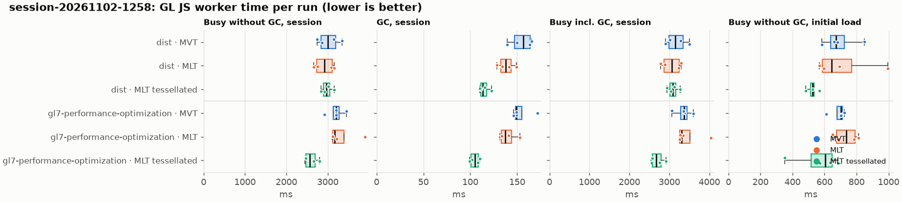
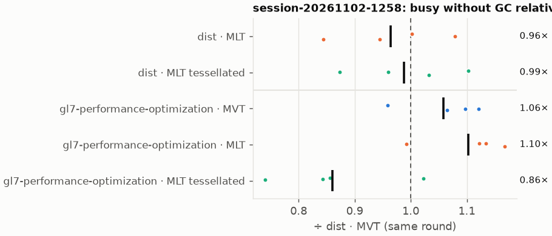
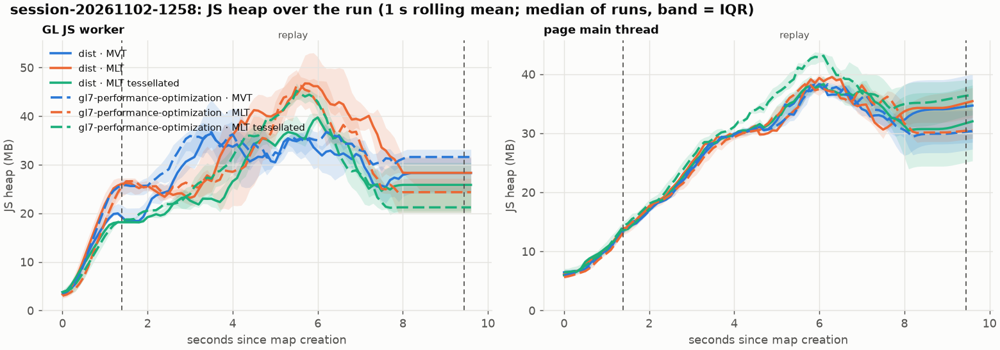
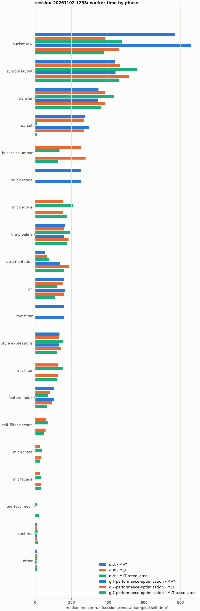
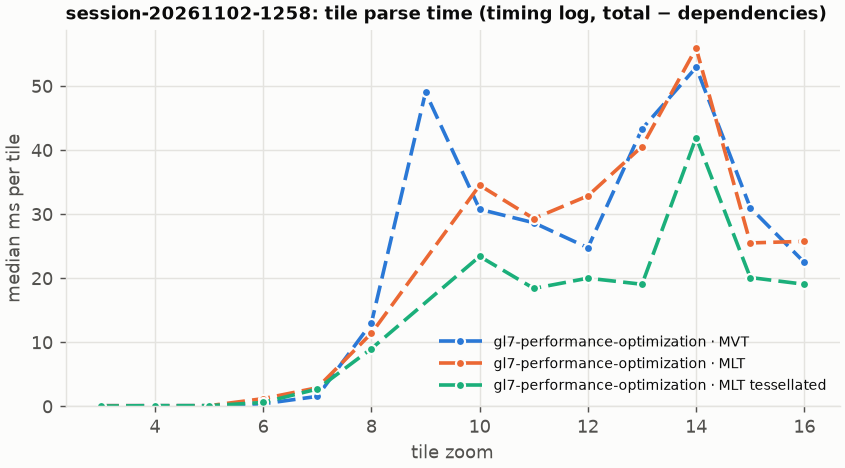

# Session trace benchmark — 20261103-091957

## Setup

- Created 2026-11-03T09:19:57+01:00; 4 repetitions + 1 warm-up round(s) (excluded); variants rotate per round (A B C, B C A, …); one cold browser context per run.
- Machine: 13th Gen Intel(R) Core(TM) i7-1365U, 12 logical cores, 31.3 GB RAM, Windows-11-10.0.26200-SP0; power: GUID des Energieschemas: 381b4222-f694-41f0-9685-ff5bb260df2e  (Ausbalanciert), AC True.
- GL JS gl7-performance-optimization @ d14e96a410 (dirty); worker count 1; viewport {'width': 1280, 'height': 1024}.
- Python 3.12.2, packages {'playwright': '1.64.0', 'numpy': '2.5.3', 'matplotlib': '3.11.2'}.

| variant | bundle | format | bundle sha256 | branch build |
|---|---|---|---|---|
| MVT | `dist/maplibre-gl-dev.mjs` | mvt | `f3c5dea1ed79` | – |
| MLT | `dist/maplibre-gl-dev.mjs` | mlt | `f3c5dea1ed79` | – |
| MLT tessellated | `dist/maplibre-gl-dev.mjs` | mlt-pre-tess | `f3c5dea1ed79` | – |
| gl7-performance-optimization · MVT | `bench-builds/branches/gl7-performance-optimization/maplibre-gl-dev.mjs` | mvt | `29fa17f4ec99` | gl7-performance-optimization @ 4925e912e4 (2026-10-29), MLT @ 173880bede |
| gl7-performance-optimization · MLT | `bench-builds/branches/gl7-performance-optimization/maplibre-gl-dev.mjs` | mlt | `29fa17f4ec99` | gl7-performance-optimization @ 4925e912e4 (2026-10-29), MLT @ 173880bede |
| gl7-performance-optimization · MLT tessellated | `bench-builds/branches/gl7-performance-optimization/maplibre-gl-dev.mjs` | mlt-pre-tess | `29fa17f4ec99` | gl7-performance-optimization @ 4925e912e4 (2026-10-29), MLT @ 173880bede |

| session | style | duration | frames | sha256 |
|---|---|---:|---:|---|
| session-20261102-1258 | osm-bright | 8.0 s | 279 | `72ef72d38420` |

CPU sampling interval (median over runs): 592 µs.

## Definitions

- **busy** = wall time in which a GL JS worker thread runs a task (union of top-level task slices and GC slices on `DedicatedWorker thread`s), summed over workers. **GC** = union of `MinorGC`/`MajorGC`/`V8.GC*` slices on those threads. **busy without GC** = busy − GC (headline metric).
- **CPU** = thread time (`tdur`) of the same slices. Phase categories and functions come from the trace's CPU samples (self time), categorised by `config/categories.toml` (nearest matching frame, leaf to root).
- Windows: **load** = map creation → first idle; **session** = camera replay; **tail** = end of replay → idle; **total** = load + session + tail.
- Ratios are against **MVT**: ratio of medians with a bootstrap 95 % CI, the geometric mean of per-round ratios, and a two-sided Mann–Whitney U p-value (normal approximation, not corrected for multiple comparisons; rough below n = 8). Lower than 1× means less worker time.

## Session `session-20261102-1258`

### Worker busy without GC (session window)

| variant | n ok / failed | median ms | IQR | mean | ratio vs MVT | 95 % CI | geo-mean paired | MWU p |
|---|---:|---:|---:|---:|---:|---:|---:|---:|
| MVT | 4 / 0 | 3,005 | 2,833–3,196 | 3,024 | 1.00× | – | – | – |
| MLT | 4 / 0 | 2,919 | 2,727–3,105 | 2,913 | 0.97× | 0.83–1.11× | 0.96× | 0.665 |
| MLT tessellated | 4 / 0 | 2,969 | 2,897–3,053 | 2,981 | 0.99× | 0.89–1.10× | 0.99× | 1.000 |
| gl7-performance-optimization · MVT | 4 / 0 | 3,206 | 3,133–3,270 | 3,197 | 1.07× | 0.94–1.21× | 1.06× | 0.312 |
| gl7-performance-optimization · MLT | 4 / 0 | 3,168 | 3,120–3,386 | 3,338 | 1.05× | 0.95–1.30× | 1.10× | 0.470 |
| gl7-performance-optimization · MLT tessellated | 4 / 0 | 2,563 | 2,466–2,692 | 2,596 | 0.85× | 0.76–0.97× | 0.86× | 0.061 |

### All worker metrics (median, ratio vs baseline)

| metric | MVT | MLT | MLT tessellated | gl7-performance-optimization · MVT | gl7-performance-optimization · MLT | gl7-performance-optimization · MLT tessellated |
|---|---:|---:|---:|---:|---:|---:|
| busy incl. GC | 3,150 | 3,064 (0.97×) | 3,086 (0.98×) | 3,367 (1.07×) | 3,305 (1.05×) | 2,666 (0.85×) |
| &nbsp;&nbsp;of which GC | 156.6 | 137.7 (0.88×) | 113.5 (0.72×) | 149.2 (0.95×) | 137.2 (0.88×) | 104.9 (0.67×) |
| &nbsp;&nbsp;of which busy without GC | 3,005 | 2,919 (0.97×) | 2,969 (0.99×) | 3,206 (1.07×) | 3,168 (1.05×) | 2,563 (0.85×) |
| &nbsp;&nbsp;&nbsp;&nbsp;of which filtering (sampled, incl. callees) | 159.2 | 126.5 (0.79×) | 150.6 (0.95×) | 158.9 (1.00×) | 124.0 (0.78×) | 120.9 (0.76×) |
| &nbsp;&nbsp;&nbsp;&nbsp;of which column decoding inside the MLT filter (sampled) | 0.0 | 60.1 | 68.5 | 0.0 | 57.5 | 49.3 |
| &nbsp;&nbsp;&nbsp;&nbsp;of which timing instrumentation (sampled) | 54.3 | 67.0 (1.23×) | 76.2 (1.40×) | 137.3 (2.53×) | 185.5 (3.41×) | 158.4 (2.91×) |
| busy without GC and instrumentation | 2,951 | 2,852 (0.97×) | 2,893 (0.98×) | 3,071 (1.04×) | 2,990 (1.01×) | 2,408 (0.82×) |
| CPU time without GC | 2,698 | 2,638 (0.98×) | 2,712 (1.01×) | 2,898 (1.07×) | 2,883 (1.07×) | 2,316 (0.86×) |
| tile: download end → sent to main thread, median per tile | 194.6 | 175.0 (0.90×) | 134.5 (0.69×) | 198.4 (1.02×) | 166.2 (0.85×) | 106.4 (0.55×) |
| tile: download end → sent to main thread, 90th percentile | 500.9 | 341.2 (0.68×) | 335.1 (0.67×) | 495.0 (0.99×) | 418.1 (0.83×) | 284.9 (0.57×) |
| tile: download end → sent to main thread, 95th percentile | 528.2 | 366.3 (0.69×) | 371.2 (0.70×) | 532.0 (1.01×) | 479.6 (0.91×) | 315.1 (0.60×) |
| tile: download end → sent to main thread, 99th percentile | 558.0 | 382.2 (0.69×) | 432.1 (0.77×) | 551.0 (0.99×) | 516.9 (0.93×) | 387.5 (0.69×) |
| &nbsp;&nbsp;parse part (timing log, incl. waiting for glyphs/icons), median per tile | – | – | – | 114.1 | 101.9 | 60.6 |
| &nbsp;&nbsp;queue + hand-off part, median per tile | – | – | – | 68.0 | 59.5 | 42.5 |
| minor GCs | 38.50 | 29.00 (0.75×) | 18.00 (0.47×) | 41.00 (1.06×) | 25.00 (0.65×) | 19.50 (0.51×) |
| major GCs | 5.50 | 4.50 (0.82×) | 4.50 (0.82×) | 4.50 (0.82×) | 4.50 (0.82×) | 4.00 (0.73×) |
| peak worker heap (MB) | 59.4 | 62.7 (1.06×) | 55.2 (0.93×) | 58.4 (0.98×) | 59.0 (0.99×) | 55.8 (0.94×) |
| load: busy without GC | 670.4 | 644.2 (0.96×) | 524.6 (0.78×) | 703.0 (1.05×) | 735.2 (1.10×) | 603.3 (0.90×) |
| load: GC | 41.4 | 34.4 (0.83×) | 25.7 (0.62×) | 40.1 (0.97×) | 37.8 (0.91×) | 28.9 (0.70×) |
| total: busy without GC | 3,758 | 3,563 (0.95×) | 3,473 (0.92×) | 3,921 (1.04×) | 3,881 (1.03×) | 3,166 (0.84×) |

Rows marked *of which* are parts of the row above, not additional time. Tile rows are per-tile latencies (medians over tiles, then over runs), not sums: tiles overlap in time, and the medians of the parse and queue parts do not add up exactly to the median latency.

### Filtering (session window)

Sampled worker time spent in feature filtering, including everything the filter calls (expression evaluation, property access): **row filter** = the style-spec feature filter that MVT runs per feature, **mlt filter** = the columnar MLT filter (incl. the geometry-type selection), without the columns it decodes (see the next table). Medians per run; rules in `config/categories.toml`.

| variant | mlt filter | row filter | filtering | ratio vs MVT | 95 % CI | MWU p | share of sampled busy |
|---|---:|---:|---:|---:|---:|---:|---:|
| MVT | 0.0 | 159.2 | 159.2 | 1.00× | – | – | 5.6% |
| MLT | 126.5 | 0.0 | 126.5 | 0.79× | 0.60–0.92× | 0.030 | 4.6% |
| MLT tessellated | 150.6 | 0.0 | 150.6 | 0.95× | 0.79–1.04× | 0.312 | 5.3% |
| gl7-performance-optimization · MVT | 0.3 | 158.4 | 158.9 | 1.00× | 0.86–1.16× | 0.885 | 5.4% |
| gl7-performance-optimization · MLT | 124.0 | 0.0 | 124.0 | 0.78× | 0.67–0.96× | 0.061 | 4.1% |
| gl7-performance-optimization · MLT tessellated | 120.9 | 0.0 | 120.9 | 0.76× | 0.65–0.83× | 0.030 | 4.9% |

**Filtering together with tile decoding.** The MLT decoder leaves columns encoded until something reads them, and the filter is usually the first reader: the columns it decodes (properties, and the geometry for `$type`) are **of which inside the filter** (phase *mlt filter decode*), the rest is *mlt decode* (geometry and columns read later, e.g. by paint properties and symbols). MVT decodes every feature's properties and geometry while it reads the tile (*mvt decode*), whether the filter keeps the feature or not. So **filtering** above compares the filters, and **decoding + filtering** compares all that the formats spend on decoding the tile and selecting features. **tile decoding** = *mvt decode* or *mlt decode* + *mlt filter decode*: work inside a call into a decoder. Reading data that is already decoded is not counted, as for MVT's feature objects: *mlt access* (row views, value getters, looking a column up by name) and the MLT facade (*mlt facade*). MVT decodes geometry only for the features its filter keeps, MLT decodes a layer's whole geometry column.

| variant | tile decoding | of which inside the filter | filtering | decoding + filtering | ratio vs MVT | 95 % CI | MWU p |
|---|---:|---:|---:|---:|---:|---:|---:|
| MVT | 252.7 | 0.0 | 159.2 | 410.8 | 1.00× | – | – |
| MLT | 215.1 | 60.1 | 126.5 | 334.0 | 0.81× | 0.70–0.90× | 0.030 |
| MLT tessellated | 277.5 | 68.5 | 150.6 | 425.2 | 1.04× | 0.90–1.09× | 0.312 |
| gl7-performance-optimization · MVT | 253.4 | 0.0 | 158.9 | 412.3 | 1.00× | 0.87–1.11× | 1.000 |
| gl7-performance-optimization · MLT | 215.9 | 57.5 | 124.0 | 339.9 | 0.83× | 0.72–0.93× | 0.030 |
| gl7-performance-optimization · MLT tessellated | 224.0 | 49.3 | 120.9 | 344.9 | 0.84× | 0.73–0.91× | 0.030 |

Top 12 functions inside filtering and its column decoding (self time, mean ms per run):

| phase | function | source | MVT | MLT | MLT tessellated | gl7-performance-optimization · MVT | gl7-performance-optimization · MLT | gl7-performance-optimization · MLT tessellated |
|---|---|---|---:|---:|---:|---:|---:|---:|
| row filter | `evaluate` | node_modules/@maplibre/maplibre-gl-style-spec/dist/expression/compound_expression.mjs | 50.2 | 0.0 | 0.0 | 50.2 | 0.0 | 0.0 |
| row filter | `CompoundExpression.register.filter-in-small` | node_modules/@maplibre/maplibre-gl-style-spec/dist/expression/compound_expression.mjs | 25.0 | 0.0 | 0.0 | 22.3 | 0.0 | 0.0 |
| row filter | `CompoundExpression.register.filter-==` | node_modules/@maplibre/maplibre-gl-style-spec/dist/expression/compound_expression.mjs | 19.2 | 0.0 | 0.0 | 24.5 | 0.0 | 0.0 |
| mlt filter | `dictionaryRowMatches` | maplibre-tile-spec/ts/dist/processing/filter/execution/filterKernel.js | 0.0 | 13.7 | 18.6 | 0.0 | 19.7 | 15.2 |
| row filter | `evaluate` | node_modules/@maplibre/maplibre-gl-style-spec/dist/expression/index.mjs | 18.9 | 0.0 | 0.0 | 18.5 | 0.0 | 0.0 |
| mlt filter | `filterByGeometryType` | maplibre-tile-spec/ts/dist/vector/geometry/geometryVector.js | 0.0 | 17.1 | 14.4 | 0.0 | 15.1 | 13.0 |
| mlt filter | `scanDictionaryCodes` | maplibre-tile-spec/ts/dist/processing/filter/execution/filterKernel.js | 0.0 | 13.9 | 15.8 | 0.0 | 17.1 | 13.5 |
| mlt filter decode | `unpackNullable` | maplibre-tile-spec/ts/dist/decoding/unpackNullableUtils.js | 0.0 | 14.4 | 16.4 | 0.0 | 12.6 | 10.9 |
| row filter | `CompoundExpression.register.all.overloads` | node_modules/@maplibre/maplibre-gl-style-spec/dist/expression/compound_expression.mjs | 12.5 | 0.0 | 0.0 | 11.0 | 0.0 | 0.0 |
| mlt filter | `resolveDictionaryExecutor` | maplibre-tile-spec/ts/dist/processing/filter/execution/filterKernel.js | 0.0 | 8.6 | 10.2 | 0.0 | 7.5 | 9.2 |
| row filter | `filter` | node_modules/@maplibre/maplibre-gl-style-spec/dist/feature_filter/index.mjs | 9.8 | 0.0 | 0.0 | 9.2 | 0.0 | 0.0 |
| row filter | `CompoundExpression.register.filter-type-==` | node_modules/@maplibre/maplibre-gl-style-spec/dist/expression/compound_expression.mjs | 5.5 | 0.0 | 0.0 | 8.6 | 0.0 | 0.0 |

### Where the variants differ from MVT (session window, mean ms per run)

Open **[flame.html](flame.html)** to explore the call tree interactively: pick a variant, compare it with MVT (red = more time at the same call path, blue = less), click a frame to zoom in, and read the phase and function breakdown under it. Without a comparison, frames are coloured by phase: filtering is green in both formats, and the columns the MLT filter decodes on first access (*mlt filter decode*) are MLT blue frames under the green filter. `flame/*.txt` open in https://www.speedscope.app.

#### MLT vs MVT

**By phase** (sampled self time; the Δ column sums to the difference in sampled busy time):

| phase | MVT | MLT | Δ |
|---|---:|---:|---:|
| bucket columnar | 0.0 | 257.6 | +257.6 |
| mlt decode | 0.0 | 154.9 | +154.9 |
| mlt filter | 0.2 | 122.7 | +122.5 |
| mlt filter decode | 0.0 | 59.5 | +59.5 |
| transfer | 345.2 | 379.7 | +34.5 |
| mlt facade | 0.2 | 27.8 | +27.7 |
| mlt access | 0.0 | 26.9 | +26.9 |
| symbol layout | 453.6 | 475.0 | +21.4 |
| instrumentation | 53.7 | 66.2 | +12.5 |
| earcut | 273.9 | 275.6 | +1.7 |
| runtime | 11.5 | 12.8 | +1.3 |
| other | 9.7 | 8.8 | -1.0 |
| tile pipeline | 160.7 | 157.8 | -2.8 |
| style expressions | 135.6 | 130.0 | -5.6 |
| gc | 161.0 | 151.0 | -10.0 |
| feature index | 103.7 | 77.8 | -25.9 |
| row filter | 163.5 | 0.0 | -163.5 |
| mvt decode | 259.4 | 0.0 | -259.4 |
| bucket row | 776.3 | 393.3 | -382.9 |

**By source layer** (timing log: createBucket + populate + addFeatures, summed over the style layers that use it; wall time, includes GC pauses; total Δ +0 ms):

| source layer | type | MVT | MLT | Δ |
|---|---|---:|---:|---:|
| landcover | fill | 0.0 | 0.0 | +0.0 |
| landuse | fill | 0.0 | 0.0 | +0.0 |
| park | fill | 0.0 | 0.0 | +0.0 |
| waterway | line | 0.0 | 0.0 | +0.0 |
| water | fill | 0.0 | 0.0 | +0.0 |
| transportation | line | 0.0 | 0.0 | +0.0 |
| transportation | fill | 0.0 | 0.0 | +0.0 |
| aeroway | fill | 0.0 | 0.0 | +0.0 |
| aeroway | line | 0.0 | 0.0 | +0.0 |
| boundary | line | 0.0 | 0.0 | +0.0 |
| water_name | symbol | 0.0 | 0.0 | +0.0 |
| transportation_name | symbol | 0.0 | 0.0 | +0.0 |

**Functions with the largest self-time difference** (by function name, summed over source files):

| function | MVT | MLT | Δ |
|---|---:|---:|---:|
| `buildRingBoundingBoxes` | 0.0 | 29.4 | +29.4 |
| `writeEarcutFill` | 0.0 | 28.3 | +28.3 |
| `buildEarcutMesh` | 0.0 | 28.1 | +28.1 |
| `unpackNullable` | 0.0 | 18.2 | +18.2 |
| `get` | 20.2 | 37.4 | +17.2 |
| `filterByGeometryType` | 0.0 | 17.1 | +17.1 |
| `decodeComponentwiseDeltaVec2` | 0.0 | 16.2 | +16.2 |
| `serialize` | 73.8 | 88.7 | +14.9 |
| `readScaledRings` | 0.0 | 14.4 | +14.4 |
| `emplace` | 68.7 | 82.8 | +14.1 |
| `scanDictionaryCodes` | 0.0 | 13.9 | +13.9 |
| `dictionaryRowMatches` | 0.0 | 13.7 | +13.7 |
| `_vertexToIndex` | 115.1 | 0.0 | -115.1 |
| `readSVarint` | 106.1 | 0.0 | -106.1 |
| `populate` | 84.8 | 7.9 | -76.9 |
| `evaluate` | 84.0 | 14.4 | -69.6 |
| `loadGeometry` | 66.2 | 10.9 | -55.4 |

#### MLT tessellated vs MVT

**By phase** (sampled self time; the Δ column sums to the difference in sampled busy time):

| phase | MVT | MLT tessellated | Δ |
|---|---:|---:|---:|
| mlt decode | 0.0 | 209.6 | +209.6 |
| mlt filter | 0.2 | 148.3 | +148.2 |
| bucket columnar | 0.0 | 134.3 | +134.3 |
| symbol layout | 453.6 | 568.6 | +115.0 |
| transfer | 345.2 | 425.6 | +80.4 |
| mlt filter decode | 0.0 | 69.3 | +69.3 |
| mlt access | 0.0 | 35.9 | +35.9 |
| tile pipeline | 160.7 | 193.5 | +32.8 |
| mlt facade | 0.2 | 32.8 | +32.7 |
| instrumentation | 53.7 | 78.1 | +24.3 |
| style expressions | 135.6 | 151.1 | +15.5 |
| pre-tess mesh | 0.0 | 11.0 | +11.0 |
| runtime | 11.5 | 12.6 | +1.1 |
| feature index | 103.7 | 77.2 | -26.6 |
| gc | 161.0 | 122.4 | -38.6 |
| row filter | 163.5 | 0.0 | -163.5 |
| mvt decode | 259.4 | 0.0 | -259.4 |
| earcut | 273.9 | 12.9 | -261.0 |
| bucket row | 776.3 | 478.0 | -298.3 |

**By source layer** (timing log: createBucket + populate + addFeatures, summed over the style layers that use it; wall time, includes GC pauses; total Δ +0 ms):

| source layer | type | MVT | MLT tessellated | Δ |
|---|---|---:|---:|---:|
| landcover | fill | 0.0 | 0.0 | +0.0 |
| landuse | fill | 0.0 | 0.0 | +0.0 |
| park | fill | 0.0 | 0.0 | +0.0 |
| waterway | line | 0.0 | 0.0 | +0.0 |
| water | fill | 0.0 | 0.0 | +0.0 |
| transportation | line | 0.0 | 0.0 | +0.0 |
| transportation | fill | 0.0 | 0.0 | +0.0 |
| aeroway | fill | 0.0 | 0.0 | +0.0 |
| aeroway | line | 0.0 | 0.0 | +0.0 |
| boundary | line | 0.0 | 0.0 | +0.0 |
| water_name | symbol | 0.0 | 0.0 | +0.0 |
| transportation_name | symbol | 0.0 | 0.0 | +0.0 |

**Functions with the largest self-time difference** (by function name, summed over source files):

| function | MVT | MLT tessellated | Δ |
|---|---:|---:|---:|
| `serialize` | 73.8 | 111.9 | +38.2 |
| `writeTessellatedFill` | 0.0 | 30.6 | +30.6 |
| `get` | 20.2 | 43.7 | +23.5 |
| `emplace` | 68.7 | 92.2 | +23.4 |
| `reserve` | 151.5 | 173.2 | +21.7 |
| `unpackNullable` | 0.0 | 21.1 | +21.1 |
| `ProgramConfiguration` | 46.9 | 67.4 | +20.5 |
| `self.postMessage` | 42.7 | 62.4 | +19.7 |
| `setTimeout` | 78.8 | 98.3 | +19.5 |
| `dictionaryRowMatches` | 0.0 | 18.6 | +18.6 |
| `fetch` | 57.0 | 74.6 | +17.6 |
| `decodeComponentwiseDeltaVec2` | 0.0 | 17.2 | +17.2 |
| `_vertexToIndex` | 115.1 | 0.0 | -115.1 |
| `readSVarint` | 106.1 | 0.0 | -106.1 |
| `isEar` | 94.0 | 1.4 | -92.6 |
| `populate` | 84.8 | 8.6 | -76.2 |
| `evaluate` | 84.0 | 15.9 | -68.1 |

#### gl7-performance-optimization · MVT vs MVT

**By phase** (sampled self time; the Δ column sums to the difference in sampled busy time):

| phase | MVT | gl7-performance-optimization · MVT | Δ |
|---|---:|---:|---:|
| instrumentation | 53.7 | 141.9 | +88.1 |
| bucket row | 776.3 | 834.0 | +57.7 |
| earcut | 273.9 | 287.3 | +13.4 |
| transfer | 345.2 | 353.5 | +8.3 |
| gc | 161.0 | 167.9 | +6.9 |
| symbol layout | 453.6 | 456.0 | +2.3 |
| row filter | 163.5 | 164.8 | +1.2 |
| runtime | 11.5 | 12.0 | +0.6 |
| feature index | 103.7 | 103.2 | -0.5 |
| tile pipeline | 160.7 | 159.5 | -1.2 |
| other | 9.7 | 7.9 | -1.8 |
| mvt decode | 259.4 | 255.3 | -4.0 |
| style expressions | 135.6 | 130.3 | -5.3 |

**By source layer** (timing log: createBucket + populate + addFeatures, summed over the style layers that use it; wall time, includes GC pauses; total Δ +2268 ms):

| source layer | type | MVT | gl7-performance-optimization · MVT | Δ |
|---|---|---:|---:|---:|
| transportation | line | 0.0 | 714.6 | +714.6 |
| building | fill | 0.0 | 527.5 | +527.5 |
| poi | symbol | 0.0 | 237.7 | +237.7 |
| landuse | fill | 0.0 | 175.8 | +175.8 |
| landcover | fill | 0.0 | 156.1 | +156.1 |
| transportation_name | symbol | 0.0 | 152.3 | +152.3 |
| place | symbol | 0.0 | 107.6 | +107.6 |
| water | fill | 0.0 | 69.5 | +69.5 |
| transportation | symbol | 0.0 | 47.8 | +47.8 |
| transportation | fill | 0.0 | 23.4 | +23.4 |
| boundary | line | 0.0 | 20.4 | +20.4 |
| waterway | line | 0.0 | 12.2 | +12.2 |

**Functions with the largest self-time difference** (by function name, summed over source files):

| function | MVT | gl7-performance-optimization · MVT | Δ |
|---|---:|---:|---:|
| `addPhase` | 0.0 | 39.7 | +39.7 |
| `addBucketFeatures` | 10.4 | 42.7 | +32.3 |
| `reserve` | 151.5 | 170.5 | +19.0 |
| `now` | 0.2 | 16.8 | +16.7 |
| `takePhases` | 0.1 | 12.9 | +12.8 |
| `isEar` | 94.0 | 105.9 | +12.0 |
| `populate` | 84.8 | 93.8 | +9.0 |
| `addFeatures` | 5.0 | 12.9 | +7.9 |
| `serialize` | 73.8 | 81.3 | +7.6 |
| `(garbage collector)` | 161.0 | 167.9 | +6.9 |
| `setTimeout` | 78.8 | 85.4 | +6.6 |
| `log` | 0.0 | 6.5 | +6.5 |
| `evaluate` | 84.0 | 78.4 | -5.6 |
| `toEvaluationFeature` | 17.2 | 13.1 | -4.1 |
| `ProgramConfiguration` | 46.9 | 42.9 | -4.0 |
| `getGlyphQuads` | 10.7 | 6.9 | -3.8 |
| `recalculate` | 11.1 | 7.7 | -3.5 |

#### gl7-performance-optimization · MLT vs MVT

**By phase** (sampled self time; the Δ column sums to the difference in sampled busy time):

| phase | MVT | gl7-performance-optimization · MLT | Δ |
|---|---:|---:|---:|
| bucket columnar | 0.0 | 288.6 | +288.6 |
| mlt decode | 0.0 | 159.0 | +159.0 |
| instrumentation | 53.7 | 198.4 | +144.7 |
| mlt filter | 0.2 | 129.3 | +129.2 |
| symbol layout | 453.6 | 519.0 | +65.3 |
| mlt filter decode | 0.0 | 57.0 | +57.0 |
| transfer | 345.2 | 398.6 | +53.4 |
| mlt access | 0.0 | 34.0 | +34.0 |
| mlt facade | 0.2 | 32.0 | +31.9 |
| tile pipeline | 160.7 | 187.6 | +27.0 |
| style expressions | 135.6 | 142.0 | +6.4 |
| other | 9.7 | 11.1 | +1.3 |
| runtime | 11.5 | 10.0 | -1.5 |
| gc | 161.0 | 157.2 | -3.8 |
| earcut | 273.9 | 270.0 | -3.9 |
| feature index | 103.7 | 91.2 | -12.5 |
| row filter | 163.5 | 0.0 | -163.5 |
| mvt decode | 259.4 | 0.0 | -259.4 |
| bucket row | 776.3 | 498.7 | -277.6 |

**By source layer** (timing log: createBucket + populate + addFeatures, summed over the style layers that use it; wall time, includes GC pauses; total Δ +2304 ms):

| source layer | type | MVT | gl7-performance-optimization · MLT | Δ |
|---|---|---:|---:|---:|
| transportation | line | 0.0 | 762.4 | +762.4 |
| building | fill | 0.0 | 397.4 | +397.4 |
| poi | symbol | 0.0 | 305.4 | +305.4 |
| transportation_name | symbol | 0.0 | 205.3 | +205.3 |
| place | symbol | 0.0 | 168.4 | +168.4 |
| landuse | fill | 0.0 | 121.6 | +121.6 |
| landcover | fill | 0.0 | 121.4 | +121.4 |
| water | fill | 0.0 | 59.4 | +59.4 |
| transportation | symbol | 0.0 | 51.8 | +51.8 |
| boundary | line | 0.0 | 33.6 | +33.6 |
| waterway | line | 0.0 | 20.5 | +20.5 |
| transportation | fill | 0.0 | 17.6 | +17.6 |

**Functions with the largest self-time difference** (by function name, summed over source files):

| function | MVT | gl7-performance-optimization · MLT | Δ |
|---|---:|---:|---:|
| `addPhase` | 0.0 | 68.9 | +68.9 |
| `addBucketFeatures` | 10.4 | 57.9 | +47.5 |
| `buildEarcutMesh` | 0.0 | 30.7 | +30.7 |
| `buildRingBoundingBoxes` | 0.0 | 29.0 | +29.0 |
| `writeEarcutFill` | 0.0 | 28.3 | +28.3 |
| `reserve` | 151.5 | 176.1 | +24.6 |
| `serialize` | 73.8 | 97.2 | +23.5 |
| `now` | 0.2 | 23.5 | +23.4 |
| `emplace` | 68.7 | 90.9 | +22.1 |
| `dictionaryRowMatches` | 0.0 | 19.7 | +19.7 |
| `unpackNullable` | 0.0 | 18.7 | +18.7 |
| `get` | 20.2 | 37.9 | +17.8 |
| `_vertexToIndex` | 115.1 | 0.0 | -115.1 |
| `readSVarint` | 106.1 | 0.0 | -106.1 |
| `populate` | 84.8 | 14.7 | -70.1 |
| `evaluate` | 84.0 | 14.6 | -69.4 |
| `loadGeometry` | 66.2 | 12.7 | -53.5 |

#### gl7-performance-optimization · MLT tessellated vs MVT

**By phase** (sampled self time; the Δ column sums to the difference in sampled busy time):

| phase | MVT | gl7-performance-optimization · MLT tessellated | Δ |
|---|---:|---:|---:|
| mlt decode | 0.0 | 176.2 | +176.2 |
| bucket columnar | 0.0 | 123.2 | +123.2 |
| mlt filter | 0.2 | 120.9 | +120.7 |
| instrumentation | 53.7 | 158.7 | +104.9 |
| mlt filter decode | 0.0 | 51.7 | +51.7 |
| mlt facade | 0.2 | 29.6 | +29.4 |
| mlt access | 0.0 | 26.0 | +26.0 |
| transfer | 345.2 | 365.4 | +20.2 |
| pre-tess mesh | 0.0 | 19.7 | +19.7 |
| tile pipeline | 160.7 | 174.4 | +13.8 |
| symbol layout | 453.6 | 464.2 | +10.6 |
| runtime | 11.5 | 12.6 | +1.1 |
| other | 9.7 | 9.0 | -0.7 |
| style expressions | 135.6 | 122.4 | -13.2 |
| feature index | 103.7 | 67.7 | -36.0 |
| gc | 161.0 | 111.1 | -50.0 |
| row filter | 163.5 | 0.0 | -163.5 |
| mvt decode | 259.4 | 0.0 | -259.4 |
| earcut | 273.9 | 9.8 | -264.1 |
| bucket row | 776.3 | 389.0 | -387.2 |

**By source layer** (timing log: createBucket + populate + addFeatures, summed over the style layers that use it; wall time, includes GC pauses; total Δ +1626 ms):

| source layer | type | MVT | gl7-performance-optimization · MLT tessellated | Δ |
|---|---|---:|---:|---:|
| transportation | line | 0.0 | 608.7 | +608.7 |
| poi | symbol | 0.0 | 256.1 | +256.1 |
| transportation_name | symbol | 0.0 | 176.3 | +176.3 |
| place | symbol | 0.0 | 155.0 | +155.0 |
| building | fill | 0.0 | 86.1 | +86.1 |
| landuse | fill | 0.0 | 69.4 | +69.4 |
| landcover | fill | 0.0 | 67.5 | +67.5 |
| transportation | symbol | 0.0 | 56.3 | +56.3 |
| boundary | line | 0.0 | 32.9 | +32.9 |
| transportation | fill | 0.0 | 29.4 | +29.4 |
| water | fill | 0.0 | 29.3 | +29.3 |
| waterway | line | 0.0 | 18.3 | +18.3 |

**Functions with the largest self-time difference** (by function name, summed over source files):

| function | MVT | gl7-performance-optimization · MLT tessellated | Δ |
|---|---:|---:|---:|
| `addPhase` | 0.0 | 42.8 | +42.8 |
| `now` | 0.2 | 23.2 | +23.1 |
| `addBucketFeatures` | 10.4 | 32.0 | +21.7 |
| `writeTessellatedFill` | 0.0 | 21.3 | +21.3 |
| `buildTessellatedBoundingBox` | 0.0 | 19.7 | +19.7 |
| `dictionaryRowMatches` | 0.0 | 15.2 | +15.2 |
| `unpackNullable` | 0.0 | 15.1 | +15.1 |
| `decodeUnsignedZigZagDeltaInt32` | 0.0 | 14.5 | +14.5 |
| `decodeFsst` | 0.0 | 14.3 | +14.3 |
| `serialize` | 73.8 | 87.7 | +14.0 |
| `scanDictionaryCodes` | 0.0 | 13.5 | +13.5 |
| `takePhases` | 0.1 | 13.3 | +13.2 |
| `_vertexToIndex` | 115.1 | 0.0 | -115.1 |
| `readSVarint` | 106.1 | 0.0 | -106.1 |
| `isEar` | 94.0 | 1.6 | -92.3 |
| `populate` | 84.8 | 11.9 | -72.9 |
| `evaluate` | 84.0 | 13.8 | -70.3 |

### Memory (session window)

**JS heap** = V8's used heap of the thread (`jsHeapSizeUsed` from the trace's `UpdateCounters`, about every 20 ms; the mean is time-weighted). It does not include ArrayBuffer contents, so the tile data itself (vertex, index and feature-index arrays) is not in it: **tile data sent to the main thread** is the size of the ArrayBuffers each tile result transfers (`web/worker_hook.js`), which then live on the main thread and are uploaded to the GPU. **garbage collected** = heap freed by the worker's GCs, a measure of how much it allocates. Medians per run; ratio of medians with a bootstrap 95 % CI.

| metric | MVT | MLT | MLT tessellated | gl7-performance-optimization · MVT | gl7-performance-optimization · MLT | gl7-performance-optimization · MLT tessellated |
|---|---:|---:|---:|---:|---:|---:|
| worker JS heap, mean (MB) | 24.4 | 28.4 (1.16×, 0.96–1.51×) | 24.2 (0.99×, 0.80–1.26×) | 26.2 (1.07×, 0.94–1.37×) | 24.5 (1.00×, 0.85–1.28×) | 23.8 (0.98×, 0.82–1.29×) |
| worker JS heap, peak (MB) | 59.4 | 62.7 (1.06×, 0.96–1.43×) | 55.2 (0.93×, 0.87–1.02×) | 58.4 (0.98×, 0.92–1.08×) | 59.0 (0.99×, 0.92–1.18×) | 55.8 (0.94×, 0.89–1.03×) |
| worker JS heap after the last GC (MB) | 13.9 | 13.8 (0.99×, 0.48–1.85×) | 11.8 (0.85×, 0.52–1.47×) | 17.9 (1.29×, 0.65–2.02×) | 9.4 (0.68×, 0.45–1.62×) | 13.8 (0.99×, 0.53–1.60×) |
| garbage collected in the worker (MB) | 1,189 | 889.7 (0.75×, 0.61–0.77×) | 492.1 (0.41×, 0.37–0.43×) | 1,227 (1.03×, 0.91–1.11×) | 780.2 (0.66×, 0.53–0.71×) | 520.3 (0.44×, 0.39–0.46×) |
| main thread JS heap, mean (MB) | 27.3 | 27.5 (1.01×, 0.91–1.13×) | 27.1 (0.99×, 0.87–1.14×) | 26.4 (0.97×, 0.89–1.07×) | 27.1 (0.99×, 0.92–1.12×) | 28.8 (1.05×, 0.96–1.19×) |
| main thread JS heap, peak (MB) | 48.2 | 47.0 (0.97×, 0.89–1.06×) | 48.0 (1.00×, 0.90–1.10×) | 46.2 (0.96×, 0.88–1.07×) | 50.2 (1.04×, 0.94–1.19×) | 50.9 (1.05×, 0.96–1.15×) |
| main thread JS heap at the end of the replay (MB) | 34.2 | 34.4 (1.01×, 0.72–1.46×) | 30.8 (0.90×, 0.60–1.40×) | 30.1 (0.88×, 0.67–1.31×) | 30.3 (0.89×, 0.71–1.41×) | 35.3 (1.03×, 0.77–1.48×) |
| tile data sent to the main thread, total (MB) | 66.6 | 76.3 (1.15×, 0.90–1.19×) | 66.5 (1.00×, 0.90–1.06×) | 68.2 (1.02×, 0.91–1.13×) | 64.7 (0.97×, 0.76–1.07×) | 70.6 (1.06×, 0.86–1.13×) |
| tile data sent to the main thread, median per tile (KB) | 552.3 | 551.3 (1.00×, 0.94–1.05×) | 540.4 (0.98×, 0.90–1.05×) | 542.8 (0.98×, 0.95–1.08×) | 538.6 (0.98×, 0.93–1.01×) | 535.1 (0.97×, 0.94–0.98×) |

### Worker time by phase (session window, median ms of sampled self time)

| phase | MVT | MLT | MLT tessellated | gl7-performance-optimization · MVT | gl7-performance-optimization · MLT | gl7-performance-optimization · MLT tessellated |
|---|---:|---:|---:|---:|---:|---:|
| bucket row | 772.2 | 387.1 | 476.2 | 858.8 | 461.0 | 377.7 |
| symbol layout | 440.8 | 467.0 | 561.1 | 442.7 | 516.9 | 463.5 |
| transfer | 348.9 | 385.7 | 432.2 | 346.1 | 383.4 | 361.2 |
| earcut | 274.3 | 268.6 | 11.6 | 298.0 | 267.0 | 10.1 |
| bucket columnar | 0.0 | 251.7 | 133.9 | 0.0 | 277.3 | 125.3 |
| mvt decode | 252.7 | 0.0 | 0.0 | 253.4 | 0.0 | 0.0 |
| mlt decode | 0.0 | 155.0 | 206.6 | 0.0 | 155.4 | 176.5 |
| tile pipeline | 162.6 | 157.1 | 190.3 | 158.1 | 183.2 | 175.1 |
| instrumentation | 54.3 | 67.0 | 76.2 | 137.3 | 185.5 | 158.4 |
| gc | 160.8 | 151.3 | 122.6 | 163.8 | 158.9 | 110.7 |
| row filter | 159.2 | 0.0 | 0.0 | 158.4 | 0.0 | 0.0 |
| style expressions | 134.5 | 130.7 | 154.1 | 131.6 | 141.4 | 118.9 |
| mlt filter | 0.0 | 126.5 | 150.6 | 0.3 | 124.0 | 120.9 |
| feature index | 103.5 | 79.7 | 73.3 | 104.7 | 95.0 | 67.7 |
| mlt filter decode | 0.0 | 60.1 | 68.5 | 0.0 | 57.5 | 49.3 |
| mlt access | 0.0 | 26.8 | 36.4 | 0.0 | 32.6 | 25.7 |
| mlt facade | 0.0 | 27.3 | 32.7 | 0.3 | 31.5 | 31.3 |
| pre-tess mesh | 0.0 | 0.0 | 11.5 | 0.0 | 0.0 | 20.0 |
| runtime | 10.2 | 12.4 | 12.8 | 11.8 | 9.9 | 13.9 |
| other | 8.9 | 9.2 | 9.4 | 7.2 | 10.7 | 8.5 |

### Top 20 worker functions by self time (session window, mean ms per run)

| function | source | phase | MVT | MLT | MLT tessellated | gl7-performance-optimization · MVT | gl7-performance-optimization · MLT | gl7-performance-optimization · MLT tessellated |
|---|---|---|---:|---:|---:|---:|---:|---:|
| `reserve` | src/util/struct_array.ts | bucket row | 151.5 | 159.9 | 173.2 | 170.5 | 176.1 | 148.5 |
| `(garbage collector)` | (native) | gc | 161.0 | 151.0 | 122.4 | 167.9 | 157.2 | 111.1 |
| `_vertexToIndex` | src/render/subdivision.ts | bucket row | 115.1 | 0.0 | 0.0 | 117.3 | 0.0 | 0.0 |
| `readSVarint` | node_modules/pbf/index.js | mvt decode | 106.1 | 0.0 | 0.0 | 107.2 | 0.0 | 0.0 |
| `isEar` | node_modules/earcut/src/earcut.js | earcut | 94.0 | 75.3 | 1.4 | 105.9 | 81.5 | 1.6 |
| `setTimeout` | (native) | transfer | 78.8 | 87.9 | 98.3 | 85.4 | 93.8 | 84.0 |
| `serialize` | src/util/web_worker_transfer.ts | transfer | 62.3 | 74.1 | 96.7 | 69.1 | 77.9 | 71.8 |
| `emplace` | src/data/array_types.g.ts | bucket row | 68.7 | 82.8 | 92.2 | 72.2 | 90.9 | 69.3 |
| `postMessage` | (native) | transfer | 75.7 | 81.3 | 86.4 | 72.5 | 81.0 | 80.9 |
| `populate` | src/data/bucket/line_bucket.ts | bucket row | 67.2 | 0.0 | 0.0 | 75.2 | 0.0 | 0.0 |
| `fetch` | (native) | tile pipeline | 57.0 | 63.3 | 74.6 | 61.5 | 67.1 | 64.6 |
| `addPhase` | src/source/worker_timing.ts | instrumentation | 0.0 | 0.0 | 0.0 | 39.7 | 68.9 | 42.8 |
| `ProgramConfiguration` | src/data/program_configuration.ts | bucket row | 46.9 | 49.8 | 67.4 | 42.9 | 55.8 | 49.7 |
| `_trim` | src/util/struct_array.ts | transfer | 62.4 | 62.1 | 56.9 | 65.0 | 64.3 | 52.2 |
| `self.postMessage` | worker_hook.js | instrumentation | 42.7 | 51.1 | 62.4 | 45.1 | 56.4 | 47.4 |
| `addBucketFeatures` | src/data/bucket/line_bucket.ts | bucket row | 5.7 | 8.1 | 10.1 | 38.6 | 54.1 | 31.6 |
| `addLine` | src/data/bucket/line_bucket.ts | bucket row | 35.0 | 39.1 | 51.4 | 33.4 | 47.6 | 43.1 |
| `evaluate` | node_modules/@maplibre/maplibre-gl-style-spec/dist/expression/compound_expression.mjs | row filter | 50.2 | 0.0 | 0.0 | 50.2 | 0.0 | 0.0 |
| `insert` | src/data/feature_index.ts | feature index | 41.4 | 19.7 | 20.7 | 47.4 | 20.3 | 20.3 |
| `addHalfVertex` | src/data/bucket/line_bucket.ts | bucket row | 34.6 | 41.7 | 47.2 | 37.5 | 46.3 | 37.4 |

### Top 20 worker functions by total time (incl. callees) (session window, mean ms per run)

| function | source | phase | MVT | MLT | MLT tessellated | gl7-performance-optimization · MVT | gl7-performance-optimization · MLT | gl7-performance-optimization · MLT tessellated |
|---|---|---|---:|---:|---:|---:|---:|---:|
| `parse` | src/source/worker_tile.ts | tile pipeline | 2,206 | 2,083 | 2,026 | 2,357 | 2,435 | 1,790 |
| `loadTile` | src/source/vector_tile_worker_source.ts | tile pipeline | 1,838 | 1,654 | 1,535 | 1,973 | 1,958 | 1,368 |
| `_parseWorkerTile` | src/source/vector_tile_worker_source.ts | tile pipeline | 1,737 | 1,580 | 1,452 | 1,868 | 1,877 | 1,295 |
| `populate` | src/data/bucket/fill_bucket.ts | bucket row | 815.1 | 0.0 | 0.0 | 827.7 | 0.0 | 0.0 |
| `populate` | src/data/bucket/columnar/columnar_line_bucket.ts | bucket columnar | 0.0 | 462.6 | 555.3 | 0.0 | 660.8 | 511.0 |
| `addBucketFeatures` | src/data/bucket/fill_bucket.ts | bucket row | 645.7 | 468.6 | 114.3 | 658.0 | 483.5 | 87.4 |
| `addFeature` | src/data/bucket/fill_bucket.ts | bucket row | 613.1 | 0.0 | 0.0 | 627.7 | 0.0 | 0.0 |
| `populate` | src/data/bucket/columnar/columnar_fill_bucket.ts | bucket columnar | 0.0 | 599.1 | 281.5 | 0.0 | 618.3 | 251.5 |
| `populate` | src/data/bucket/line_bucket.ts | bucket row | 505.2 | 0.0 | 0.0 | 594.5 | 0.0 | 0.0 |
| `addFeatures` | src/data/bucket/symbol_bucket.ts | symbol layout | 410.1 | 431.5 | 518.6 | 413.1 | 473.5 | 423.9 |
| `subdividePolygon` | src/render/subdivision.ts |  | 496.5 | 0.0 | 0.0 | 510.9 | 0.0 | 0.0 |
| `performSymbolLayout` | src/symbol/symbol_layout.ts | symbol layout | 405.1 | 424.5 | 510.1 | 404.8 | 465.6 | 418.0 |
| `subdividePolygonInternal` | src/render/subdivision.ts | bucket row | 490.1 | 0.0 | 0.0 | 505.1 | 0.0 | 0.0 |
| `addFeature` | src/data/bucket/columnar/columnar_fill_bucket.ts | bucket columnar | 0.0 | 466.3 | 103.1 | 0.0 | 475.4 | 80.8 |
| `writeEarcutFill` | src/data/bucket/columnar/columnar_mesh_arrays.ts | bucket columnar | 0.0 | 461.4 | 21.6 | 0.0 | 468.2 | 16.6 |
| `processTask` | src/util/actor.ts | transfer | 363.0 | 399.5 | 458.3 | 369.6 | 429.2 | 388.4 |
| `addBucketFeatures` | src/data/bucket/line_bucket.ts | bucket row | 239.5 | 289.4 | 354.1 | 321.1 | 443.6 | 340.4 |
| `completeTask` | src/util/actor.ts | transfer | 285.9 | 313.9 | 355.1 | 291.8 | 335.3 | 300.8 |
| `buildEarcutMesh` | src/data/bucket/columnar/columnar_mesh_arrays.ts | bucket columnar | 0.0 | 319.7 | 15.5 | 0.0 | 316.2 | 12.3 |
| `addFeature` | src/data/bucket/line_bucket.ts | bucket row | 202.9 | 249.4 | 304.3 | 217.0 | 290.5 | 236.7 |

### Tile parse time by zoom (timing log, median ms per tile, total − dependencies)

| zoom | MVT | MLT | MLT tessellated | gl7-performance-optimization · MVT | gl7-performance-optimization · MLT | gl7-performance-optimization · MLT tessellated |
|---:|---:|---:|---:|---:|---:|---:|
| 3 | – | – | – | 0.10 (n=16) | 0.10 (n=16) | 0.05 (n=16) |
| 4 | – | – | – | 0.10 (n=47) | 0.10 (n=48) | 0.10 (n=44) |
| 5 | – | – | – | 0.10 (n=36) | 0.10 (n=36) | 0.10 (n=36) |
| 6 | – | – | – | 0.40 (n=24) | 1.20 (n=28) | 0.60 (n=32) |
| 7 | – | – | – | 1.55 (n=40) | 2.90 (n=39) | 2.70 (n=45) |
| 8 | – | – | – | 13.00 (n=18) | 11.40 (n=9) | 9.00 (n=27) |
| 9 | – | – | – | 49.00 (n=5) | – | – |
| 10 | – | – | – | 30.75 (n=50) | 34.50 (n=48) | 23.40 (n=55) |
| 11 | – | – | – | 28.65 (n=32) | 29.30 (n=33) | 18.40 (n=50) |
| 12 | – | – | – | 24.75 (n=44) | 32.85 (n=44) | 20.00 (n=44) |
| 13 | – | – | – | 43.30 (n=43) | 40.55 (n=54) | 19.05 (n=48) |
| 14 | – | – | – | 52.90 (n=42) | 55.90 (n=32) | 41.95 (n=30) |
| 15 | – | – | – | 31.00 (n=42) | 25.50 (n=54) | 20.10 (n=74) |
| 16 | – | – | – | 22.45 (n=36) | 25.75 (n=36) | 19.05 (n=36) |

### Tile latency by zoom: download end → result sent to the main thread (session window, ms per tile: median / p95 / p99)

Includes waiting in the worker's queue, the parse and posting the result; see `tile_latency.csv` for the per-tile split (`parse_ms`, `wait_ms`). Percentiles over the tiles of all runs; with few tiles (n) p99 is close to the maximum.

| zoom | MVT | MLT | MLT tessellated | gl7-performance-optimization · MVT | gl7-performance-optimization · MLT | gl7-performance-optimization · MLT tessellated |
|---:|---:|---:|---:|---:|---:|---:|
| 3 | 8.4 / 25.2 / 31.0 (n=16) | 5.2 / 21.1 / 21.2 (n=16) | 6.4 / 13.1 / 16.4 (n=16) | 6.5 / 18.4 / 20.9 (n=16) | 6.3 / 17.6 / 20.7 (n=16) | 6.0 / 13.5 / 14.0 (n=16) |
| 4 | 4.0 / 18.5 / 23.5 (n=45) | 2.7 / 15.9 / 20.5 (n=44) | 6.7 / 19.5 / 22.4 (n=42) | 3.8 / 18.5 / 24.9 (n=47) | 4.8 / 21.0 / 27.7 (n=48) | 4.9 / 16.8 / 19.9 (n=44) |
| 5 | 24.1 / 41.0 / 61.2 (n=36) | 21.1 / 35.5 / 55.8 (n=36) | 22.9 / 44.9 / 56.2 (n=36) | 24.8 / 48.1 / 55.0 (n=36) | 21.2 / 57.2 / 79.1 (n=36) | 18.2 / 34.6 / 38.2 (n=36) |
| 6 | 14.3 / 34.3 / 41.9 (n=32) | 12.1 / 34.9 / 44.6 (n=32) | 15.4 / 33.5 / 35.9 (n=32) | 12.7 / 43.3 / 44.3 (n=24) | 22.1 / 36.7 / 39.8 (n=28) | 9.8 / 24.5 / 27.4 (n=32) |
| 7 | 106.1 / 163.8 / 170.1 (n=39) | 96.1 / 158.7 / 166.8 (n=39) | 79.2 / 132.8 / 156.1 (n=44) | 101.8 / 152.3 / 175.7 (n=40) | 82.1 / 144.1 / 163.4 (n=39) | 59.5 / 110.1 / 113.9 (n=45) |
| 8 | 199.2 / 218.0 / 219.3 (n=9) | 171.4 / 197.2 / 198.7 (n=27) | 153.8 / 213.0 / 218.5 (n=27) | 236.2 / 260.3 / 263.8 (n=18) | 192.4 / 205.9 / 207.3 (n=9) | 119.8 / 177.7 / 183.8 (n=27) |
| 9 | – | – | – | 273.8 / 284.0 / 285.1 (n=5) | – | – |
| 10 | 39.2 / 39.2 / 39.2 (n=1) | 82.7 / 100.1 / 102.3 (n=6) | 79.8 / 92.3 / 94.1 (n=10) | 49.0 / 54.2 / 54.7 (n=2) | – | 67.3 / 84.8 / 85.2 (n=7) |
| 11 | 254.8 / 294.9 / 304.3 (n=36) | 238.0 / 314.3 / 329.8 (n=45) | 190.8 / 271.5 / 281.4 (n=43) | 258.8 / 302.2 / 306.4 (n=32) | 267.5 / 369.4 / 378.2 (n=33) | 162.7 / 261.8 / 279.5 (n=50) |
| 12 | 266.7 / 305.2 / 314.1 (n=44) | 240.8 / 336.1 / 354.2 (n=44) | 222.5 / 322.7 / 336.6 (n=44) | 297.6 / 331.6 / 340.3 (n=44) | 334.6 / 481.1 / 499.7 (n=44) | 237.6 / 303.5 / 310.0 (n=44) |
| 13 | 529.0 / 659.4 / 672.1 (n=42) | 345.9 / 450.0 / 463.1 (n=48) | 315.6 / 384.9 / 406.6 (n=46) | 530.7 / 664.3 / 678.5 (n=43) | 427.2 / 643.5 / 663.3 (n=54) | 246.5 / 277.3 / 281.4 (n=48) |
| 14 | 389.5 / 604.6 / 627.9 (n=47) | 304.7 / 410.4 / 444.3 (n=43) | 335.6 / 460.2 / 494.3 (n=30) | 390.6 / 455.0 / 477.8 (n=42) | 357.1 / 561.9 / 574.6 (n=32) | 244.2 / 324.3 / 334.7 (n=30) |
| 15 | 234.6 / 438.7 / 455.6 (n=45) | 259.3 / 389.3 / 418.8 (n=60) | 240.7 / 422.4 / 437.5 (n=58) | 272.0 / 573.2 / 596.9 (n=42) | 241.6 / 496.0 / 528.2 (n=54) | 284.0 / 411.2 / 443.5 (n=74) |
| 16 | 195.6 / 350.9 / 375.9 (n=36) | 183.4 / 286.6 / 299.9 (n=36) | 248.9 / 334.5 / 344.9 (n=36) | 216.8 / 396.0 / 415.0 (n=36) | 228.6 / 425.3 / 452.1 (n=36) | 184.6 / 258.0 / 270.0 (n=36) |

## Runs

30 ok, 0 failed/aborted, 0 not run, 24 used in statistics.

## Validity checks

- Counted once: all 30 analysed runs pass (windows load + session + tail add up to total; phases add up to the sampled busy time; GC and sampled time lie within busy time; no timing-log line twice).
- other programs used 3.01–8.10 logical processors during the replays (median 4.72)
- 24 run(s) with more than 0.5 cores of background load: session-20261102-1258/mlt/rep-01 (4.10), session-20261102-1258/mlt-pre-tess/rep-01 (6.55), session-20261102-1258/gl7-performance-optimization.mvt/rep-01 (4.30), session-20261102-1258/gl7-performance-optimization.mlt/rep-01 (4.50), session-20261102-1258/gl7-performance-optimization.mlt-pre-tess/rep-01 (3.01), session-20261102-1258/mvt/rep-01 (3.71)
- 5 of 5 rounds parsed different tile sets across variants (e.g. session-20261102-1258 round 0: gl7-performance-optimization.mvt 75 tiles, gl7-performance-optimization.mlt 122 tiles, gl7-performance-optimization.mlt-pre-tess 115 tiles; session-20261102-1258 round 1: gl7-performance-optimization.mvt 114 tiles, gl7-performance-optimization.mlt 116 tiles, gl7-performance-optimization.mlt-pre-tess 129 tiles; session-20261102-1258 round 2: gl7-performance-optimization.mvt 114 tiles, gl7-performance-optimization.mlt 94 tiles, gl7-performance-optimization.mlt-pre-tess 125 tiles; session-20261102-1258 round 3: gl7-performance-optimization.mvt 114 tiles, gl7-performance-optimization.mlt 109 tiles, gl7-performance-optimization.mlt-pre-tess 123 tiles; session-20261102-1258 round 4: gl7-performance-optimization.mlt 116 tiles, gl7-performance-optimization.mlt-pre-tess 109 tiles, gl7-performance-optimization.mvt 112 tiles); expected where a session zooms past the last MVT level (MVT overzooms, MLT loads deeper tiles)

## Files

- `runs.csv`: one row per run (incl. failed and warm-up runs), every scalar metric as `<window>.<metric>`.
- `summary.csv`: session × variant × metric statistics.
- `functions.csv`, `categories.csv`: CPU-sample self/total time per function and phase per run and window.
- `category_functions.csv`: self time per phase × function (e.g. what the filters spend their time on).
- `tiles.csv`, `tile_layers.csv`, `tile_phases.csv`: the per-tile worker timing log, long format.
- `flame.html`: interactive call tree per variant with a diff view; `flame/*.txt`: collapsed stacks for speedscope.
- `analysis/stacks.csv` (per run): sampled self time per full call stack.
- `tile_latency.csv`: per tile request, worker clock: received, download start/end, result sent, latency = sent − download end, parse_ms, wait_ms = latency − parse.
- `runs/<session>/<variant>/rep-NN/trace.json.gz`: the raw trace (opens in the DevTools Performance tab).
