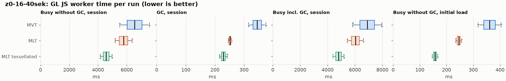
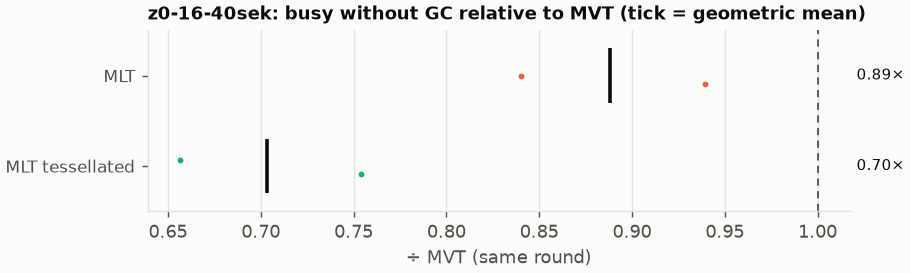
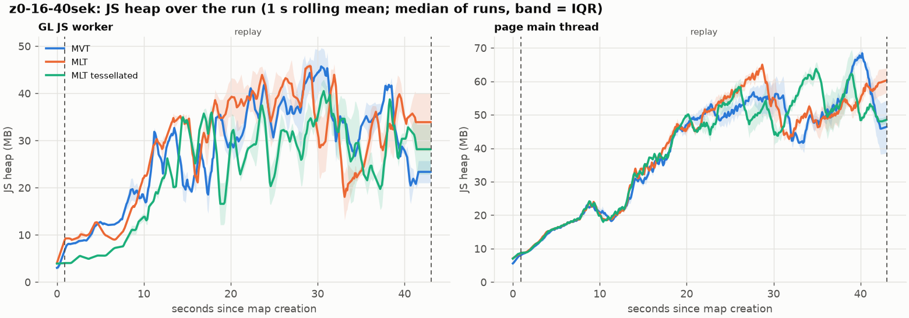
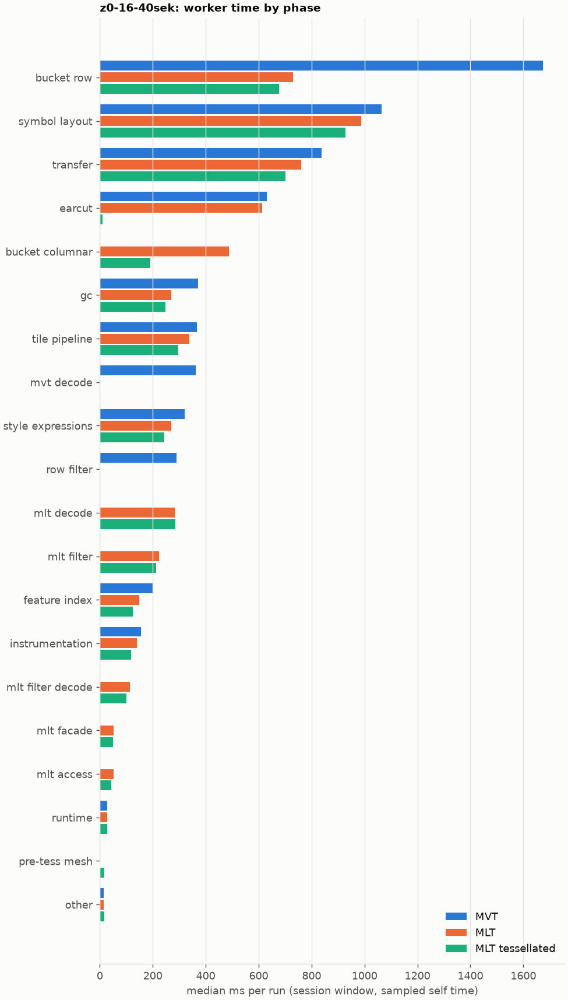

# Session trace benchmark — 20261103-093411

## Setup

- Created 2026-11-03T09:34:11+01:00; 2 repetitions + 0 warm-up round(s) (excluded); variants rotate per round (A B C, B C A, …); one cold browser context per run.
- Machine: 13th Gen Intel(R) Core(TM) i7-1365U, 12 logical cores, 31.3 GB RAM, Windows-11-10.0.26200-SP0; power: GUID des Energieschemas: 381b4222-f694-41f0-9685-ff5bb260df2e  (Ausbalanciert), AC True.
- GL JS gl7-performance-optimization @ d14e96a410 (dirty); worker count 1; viewport {'width': 1280, 'height': 1024}.
- Python 3.12.2, packages {'playwright': '1.64.0', 'numpy': '2.5.3', 'matplotlib': '3.11.2'}.

| variant | bundle | format | bundle sha256 | branch build |
|---|---|---|---|---|
| MVT | `dist/maplibre-gl-dev.mjs` | mvt | `f3c5dea1ed79` | – |
| MLT | `dist/maplibre-gl-dev.mjs` | mlt | `f3c5dea1ed79` | – |
| MLT tessellated | `dist/maplibre-gl-dev.mjs` | mlt-pre-tess | `f3c5dea1ed79` | – |

| session | style | duration | frames | sha256 |
|---|---|---:|---:|---|
| z0-16-40sek | osm-bright | 42.1 s | 1739 | `55a2b8f22fe2` |

CPU sampling interval (median over runs): 602 µs.

## Definitions

- **busy** = wall time in which a GL JS worker thread runs a task (union of top-level task slices and GC slices on `DedicatedWorker thread`s), summed over workers. **GC** = union of `MinorGC`/`MajorGC`/`V8.GC*` slices on those threads. **busy without GC** = busy − GC (headline metric).
- **CPU** = thread time (`tdur`) of the same slices. Phase categories and functions come from the trace's CPU samples (self time), categorised by `config/categories.toml` (nearest matching frame, leaf to root).
- Windows: **load** = map creation → first idle; **session** = camera replay; **tail** = end of replay → idle; **total** = load + session + tail.
- Ratios are against **MVT**: ratio of medians with a bootstrap 95 % CI, the geometric mean of per-round ratios, and a two-sided Mann–Whitney U p-value (normal approximation, not corrected for multiple comparisons; rough below n = 8). Lower than 1× means less worker time.

## Session `z0-16-40sek`

### Worker busy without GC (session window)

| variant | n ok / failed | median ms | IQR | mean | ratio vs MVT | 95 % CI | geo-mean paired | MWU p |
|---|---:|---:|---:|---:|---:|---:|---:|---:|
| MVT | 2 / 0 | 6,555 | 6,040–7,070 | 6,555 | 1.00× | – | – | – |
| MLT | 2 / 0 | 5,781 | 5,485–6,077 | 5,781 | 0.88× | 0.68–1.15× | 0.89× | 0.699 |
| MLT tessellated | 2 / 0 | 4,572 | 4,370–4,775 | 4,572 | 0.70× | 0.55–0.90× | 0.70× | 0.245 |

### All worker metrics (median, ratio vs baseline)

| metric | MVT | MLT | MLT tessellated |
|---|---:|---:|---:|
| busy incl. GC | 6,900 | 6,033 (0.87×) | 4,802 (0.70×) |
| &nbsp;&nbsp;of which GC | 345.3 | 251.8 (0.73×) | 229.3 (0.66×) |
| &nbsp;&nbsp;of which busy without GC | 6,555 | 5,781 (0.88×) | 4,572 (0.70×) |
| &nbsp;&nbsp;&nbsp;&nbsp;of which filtering (sampled, incl. callees) | 289.5 | 223.8 (0.77×) | 212.1 (0.73×) |
| &nbsp;&nbsp;&nbsp;&nbsp;of which column decoding inside the MLT filter (sampled) | 0.0 | 114.5 | 101.5 |
| &nbsp;&nbsp;&nbsp;&nbsp;of which timing instrumentation (sampled) | 155.3 | 140.2 (0.90×) | 118.7 (0.76×) |
| busy without GC and instrumentation | 6,400 | 5,641 (0.88×) | 4,454 (0.70×) |
| CPU time without GC | 5,925 | 5,238 (0.88×) | 4,118 (0.70×) |
| tile: download end → sent to main thread, median per tile | 117.8 | 144.8 (1.23×) | 99.3 (0.84×) |
| tile: download end → sent to main thread, 90th percentile | 424.5 | 311.4 (0.73×) | 263.9 (0.62×) |
| tile: download end → sent to main thread, 95th percentile | 464.5 | 401.8 (0.86×) | 325.9 (0.70×) |
| tile: download end → sent to main thread, 99th percentile | 629.3 | 473.3 (0.75×) | 359.5 (0.57×) |
| minor GCs | 92.50 | 72.50 (0.78×) | 49.50 (0.54×) |
| major GCs | 8.50 | 7.00 (0.82×) | 10.00 (1.18×) |
| peak worker heap (MB) | 66.0 | 64.8 (0.98×) | 55.1 (0.83×) |
| load: busy without GC | 361.2 | 245.8 (0.68×) | 157.1 (0.43×) |
| load: GC | 16.3 | 13.6 (0.83×) | 4.6 (0.28×) |
| total: busy without GC | 6,916 | 6,027 (0.87×) | 4,730 (0.68×) |

Rows marked *of which* are parts of the row above, not additional time. Tile rows are per-tile latencies (medians over tiles, then over runs), not sums: tiles overlap in time, and the medians of the parse and queue parts do not add up exactly to the median latency.

### Filtering (session window)

Sampled worker time spent in feature filtering, including everything the filter calls (expression evaluation, property access): **row filter** = the style-spec feature filter that MVT runs per feature, **mlt filter** = the columnar MLT filter (incl. the geometry-type selection), without the columns it decodes (see the next table). Medians per run; rules in `config/categories.toml`.

| variant | mlt filter | row filter | filtering | ratio vs MVT | 95 % CI | MWU p | share of sampled busy |
|---|---:|---:|---:|---:|---:|---:|---:|
| MVT | 0.3 | 289.3 | 289.5 | 1.00× | – | – | 4.6% |
| MLT | 223.8 | 0.0 | 223.8 | 0.77× | 0.61–1.00× | 0.699 | 4.1% |
| MLT tessellated | 212.1 | 0.0 | 212.1 | 0.73× | 0.59–0.94× | 0.245 | 4.9% |

**Filtering together with tile decoding.** The MLT decoder leaves columns encoded until something reads them, and the filter is usually the first reader: the columns it decodes (properties, and the geometry for `$type`) are **of which inside the filter** (phase *mlt filter decode*), the rest is *mlt decode* (geometry and columns read later, e.g. by paint properties and symbols). MVT decodes every feature's properties and geometry while it reads the tile (*mvt decode*), whether the filter keeps the feature or not. So **filtering** above compares the filters, and **decoding + filtering** compares all that the formats spend on decoding the tile and selecting features. **tile decoding** = *mvt decode* or *mlt decode* + *mlt filter decode*: work inside a call into a decoder. Reading data that is already decoded is not counted, as for MVT's feature objects: *mlt access* (row views, value getters, looking a column up by name) and the MLT facade (*mlt facade*). MVT decodes geometry only for the features its filter keeps, MLT decodes a layer's whole geometry column.

| variant | tile decoding | of which inside the filter | filtering | decoding + filtering | ratio vs MVT | 95 % CI | MWU p |
|---|---:|---:|---:|---:|---:|---:|---:|
| MVT | 361.7 | 0.0 | 289.5 | 651.2 | 1.00× | – | – |
| MLT | 397.8 | 114.5 | 223.8 | 621.6 | 0.95× | 0.76–1.22× | 1.000 |
| MLT tessellated | 387.6 | 101.5 | 212.1 | 599.7 | 0.92× | 0.74–1.18× | 1.000 |

Top 12 functions inside filtering and its column decoding (self time, mean ms per run):

| phase | function | source | MVT | MLT | MLT tessellated |
|---|---|---|---:|---:|---:|
| row filter | `evaluate` | node_modules/@maplibre/maplibre-gl-style-spec/dist/expression/compound_expression.mjs | 83.6 | 0.0 | 0.0 |
| row filter | `CompoundExpression.register.filter-in-small` | node_modules/@maplibre/maplibre-gl-style-spec/dist/expression/compound_expression.mjs | 40.5 | 0.0 | 0.0 |
| row filter | `CompoundExpression.register.filter-==` | node_modules/@maplibre/maplibre-gl-style-spec/dist/expression/compound_expression.mjs | 39.8 | 0.0 | 0.0 |
| row filter | `evaluate` | node_modules/@maplibre/maplibre-gl-style-spec/dist/expression/index.mjs | 34.8 | 0.0 | 0.0 |
| mlt filter | `dictionaryRowMatches` | maplibre-tile-spec/ts/dist/processing/filter/execution/filterKernel.js | 0.0 | 26.0 | 22.0 |
| mlt filter | `scanDictionaryCodes` | maplibre-tile-spec/ts/dist/processing/filter/execution/filterKernel.js | 0.0 | 23.6 | 25.4 |
| row filter | `filter` | node_modules/@maplibre/maplibre-gl-style-spec/dist/feature_filter/index.mjs | 21.3 | 0.0 | 0.0 |
| mlt filter | `filterByGeometryType` | maplibre-tile-spec/ts/dist/vector/geometry/geometryVector.js | 0.0 | 19.7 | 19.0 |
| mlt filter decode | `unpackNullable` | maplibre-tile-spec/ts/dist/decoding/unpackNullableUtils.js | 0.0 | 16.9 | 19.5 |
| row filter | `CompoundExpression.register.all.overloads` | node_modules/@maplibre/maplibre-gl-style-spec/dist/expression/compound_expression.mjs | 19.2 | 0.0 | 0.0 |
| mlt filter | `resolveDictionaryExecutor` | maplibre-tile-spec/ts/dist/processing/filter/execution/filterKernel.js | 0.0 | 15.4 | 16.2 |
| row filter | `CompoundExpression.register.filter-type-==` | node_modules/@maplibre/maplibre-gl-style-spec/dist/expression/compound_expression.mjs | 14.3 | 0.0 | 0.0 |

### Where the variants differ from MVT (session window, mean ms per run)

Open **[flame.html](flame.html)** to explore the call tree interactively: pick a variant, compare it with MVT (red = more time at the same call path, blue = less), click a frame to zoom in, and read the phase and function breakdown under it. Without a comparison, frames are coloured by phase: filtering is green in both formats, and the columns the MLT filter decodes on first access (*mlt filter decode*) are MLT blue frames under the green filter. `flame/*.txt` open in https://www.speedscope.app.

#### MLT vs MVT

**By phase** (sampled self time; the Δ column sums to the difference in sampled busy time):

| phase | MVT | MLT | Δ |
|---|---:|---:|---:|
| bucket columnar | 0.0 | 488.7 | +488.7 |
| mlt decode | 0.0 | 283.4 | +283.4 |
| mlt filter | 0.3 | 223.8 | +223.5 |
| mlt filter decode | 0.0 | 114.5 | +114.5 |
| mlt facade | 0.3 | 51.9 | +51.6 |
| mlt access | 0.0 | 51.6 | +51.6 |
| runtime | 28.1 | 26.9 | -1.3 |
| instrumentation | 155.3 | 140.2 | -15.1 |
| earcut | 631.3 | 613.7 | -17.6 |
| tile pipeline | 366.1 | 338.6 | -27.5 |
| style expressions | 321.6 | 269.3 | -52.3 |
| feature index | 202.7 | 148.1 | -54.6 |
| transfer | 837.7 | 760.8 | -76.9 |
| symbol layout | 1,065 | 986.9 | -77.9 |
| gc | 371.4 | 269.5 | -102.0 |
| row filter | 289.3 | 0.0 | -289.3 |
| mvt decode | 361.7 | 0.0 | -361.7 |
| bucket row | 1,673 | 729.3 | -943.8 |

**Functions with the largest self-time difference** (by function name, summed over source files):

| function | MVT | MLT | Δ |
|---|---:|---:|---:|
| `buildRingBoundingBoxes` | 0.0 | 50.8 | +50.8 |
| `buildEarcutMesh` | 0.0 | 48.8 | +48.8 |
| `writeEarcutFill` | 0.0 | 34.7 | +34.7 |
| `readScaledRings` | 0.0 | 34.4 | +34.4 |
| `signedArea$2` | 10.3 | 44.4 | +34.1 |
| `dictionaryRowMatches` | 0.0 | 26.0 | +26.0 |
| `decodeString$2` | 0.0 | 25.6 | +25.6 |
| `decodeFastPforInt32` | 0.0 | 24.3 | +24.3 |
| `decodeComponentwiseDeltaVec2` | 0.0 | 24.1 | +24.1 |
| `unpackNullable` | 0.0 | 24.0 | +24.0 |
| `scanDictionaryCodes` | 0.0 | 23.6 | +23.6 |
| `decodeFsst` | 0.0 | 23.5 | +23.5 |
| `_vertexToIndex` | 264.7 | 0.8 | -263.9 |
| `evaluate` | 147.9 | 24.9 | -123.0 |
| `populate` | 123.1 | 16.8 | -106.3 |
| `(garbage collector)` | 371.4 | 269.5 | -102.0 |
| `readVarint` | 104.5 | 3.6 | -100.9 |

#### MLT tessellated vs MVT

**By phase** (sampled self time; the Δ column sums to the difference in sampled busy time):

| phase | MVT | MLT tessellated | Δ |
|---|---:|---:|---:|
| mlt decode | 0.0 | 286.0 | +286.0 |
| mlt filter | 0.3 | 212.1 | +211.8 |
| bucket columnar | 0.0 | 190.6 | +190.6 |
| mlt filter decode | 0.0 | 101.5 | +101.5 |
| mlt facade | 0.3 | 50.7 | +50.4 |
| mlt access | 0.0 | 43.1 | +43.1 |
| pre-tess mesh | 0.0 | 17.8 | +17.8 |
| other | 14.5 | 17.2 | +2.6 |
| instrumentation | 155.3 | 118.7 | -36.6 |
| tile pipeline | 366.1 | 295.8 | -70.2 |
| feature index | 202.7 | 125.6 | -77.1 |
| style expressions | 321.6 | 244.5 | -77.1 |
| gc | 371.4 | 247.2 | -124.2 |
| transfer | 837.7 | 702.1 | -135.6 |
| symbol layout | 1,065 | 928.5 | -136.3 |
| row filter | 289.3 | 0.0 | -289.3 |
| mvt decode | 361.7 | 0.0 | -361.7 |
| earcut | 631.3 | 10.7 | -620.6 |
| bucket row | 1,673 | 677.4 | -995.7 |

**Functions with the largest self-time difference** (by function name, summed over source files):

| function | MVT | MLT tessellated | Δ |
|---|---:|---:|---:|
| `writeTessellatedFill` | 0.0 | 45.8 | +45.8 |
| `unpackNullable` | 0.0 | 27.6 | +27.6 |
| `decodeUnsignedZigZagDeltaInt32` | 0.0 | 27.0 | +27.0 |
| `scanDictionaryCodes` | 0.0 | 25.4 | +25.4 |
| `decodeFastPforInt32` | 0.0 | 24.7 | +24.7 |
| `dictionaryRowMatches` | 0.0 | 22.0 | +22.0 |
| `decodeString$2` | 0.0 | 20.7 | +20.7 |
| `decodeComponentwiseDeltaVec2` | 0.0 | 20.4 | +20.4 |
| `get` | 51.3 | 71.4 | +20.0 |
| `filterByGeometryType` | 0.0 | 19.0 | +19.0 |
| `buildTessellatedBoundingBox` | 0.0 | 17.8 | +17.8 |
| `resolveDictionaryExecutor` | 0.0 | 16.2 | +16.2 |
| `_vertexToIndex` | 264.7 | 0.0 | -264.7 |
| `isEar` | 202.0 | 0.9 | -201.0 |
| `(garbage collector)` | 371.4 | 247.2 | -124.2 |
| `evaluate` | 147.9 | 24.5 | -123.3 |
| `populate` | 123.1 | 13.5 | -109.7 |

### Memory (session window)

**JS heap** = V8's used heap of the thread (`jsHeapSizeUsed` from the trace's `UpdateCounters`, about every 20 ms; the mean is time-weighted). It does not include ArrayBuffer contents, so the tile data itself (vertex, index and feature-index arrays) is not in it: **tile data sent to the main thread** is the size of the ArrayBuffers each tile result transfers (`web/worker_hook.js`), which then live on the main thread and are uploaded to the GPU. **garbage collected** = heap freed by the worker's GCs, a measure of how much it allocates. Medians per run; ratio of medians with a bootstrap 95 % CI.

| metric | MVT | MLT | MLT tessellated |
|---|---:|---:|---:|
| worker JS heap, mean (MB) | 24.0 | 26.2 (1.09×, 0.97–1.24×) | 21.0 (0.87×, 0.66–1.11×) |
| worker JS heap, peak (MB) | 66.0 | 64.8 (0.98×, 0.93–1.03×) | 55.1 (0.83×, 0.74–0.93×) |
| worker JS heap after the last GC (MB) | 14.8 | 22.8 (1.54×, 0.87–2.68×) | 14.8 (1.00×, 0.73–1.45×) |
| garbage collected in the worker (MB) | 2,515 | 1,812 (0.72×, 0.70–0.74×) | 1,018 (0.40×, 0.40–0.41×) |
| main thread JS heap, mean (MB) | 35.6 | 36.2 (1.02×, 0.99–1.04×) | 35.8 (1.01×, 0.96–1.05×) |
| main thread JS heap, peak (MB) | 77.4 | 75.8 (0.98×, 0.95–1.01×) | 80.3 (1.04×, 0.97–1.11×) |
| main thread JS heap at the end of the replay (MB) | 46.5 | 60.2 (1.30×, 0.85–2.19×) | 48.6 (1.05×, 0.76–1.63×) |
| tile data sent to the main thread, total (MB) | 148.8 | 142.8 (0.96×, 0.94–0.98×) | 140.2 (0.94×, 0.94–0.95×) |
| tile data sent to the main thread, median per tile (KB) | 417.3 | 402.0 (0.96×, 0.94–0.98×) | 394.0 (0.94×, 0.93–0.96×) |

### Worker time by phase (session window, median ms of sampled self time)

| phase | MVT | MLT | MLT tessellated |
|---|---:|---:|---:|
| bucket row | 1,673 | 729.3 | 677.4 |
| symbol layout | 1,065 | 986.9 | 928.5 |
| transfer | 837.7 | 760.8 | 702.1 |
| earcut | 631.3 | 613.7 | 10.7 |
| bucket columnar | 0.0 | 488.7 | 190.6 |
| gc | 371.4 | 269.5 | 247.2 |
| tile pipeline | 366.1 | 338.6 | 295.8 |
| mvt decode | 361.7 | 0.0 | 0.0 |
| style expressions | 321.6 | 269.3 | 244.5 |
| row filter | 289.3 | 0.0 | 0.0 |
| mlt decode | 0.0 | 283.4 | 286.0 |
| mlt filter | 0.3 | 223.8 | 212.1 |
| feature index | 202.7 | 148.1 | 125.6 |
| instrumentation | 155.3 | 140.2 | 118.7 |
| mlt filter decode | 0.0 | 114.5 | 101.5 |
| mlt facade | 0.3 | 51.9 | 50.7 |
| mlt access | 0.0 | 51.6 | 43.1 |
| runtime | 28.1 | 26.9 | 28.3 |
| pre-tess mesh | 0.0 | 0.0 | 17.8 |
| other | 14.5 | 14.9 | 17.2 |

### Top 20 worker functions by self time (session window, mean ms per run)

| function | source | phase | MVT | MLT | MLT tessellated |
|---|---|---|---:|---:|---:|
| `reserve` | src/util/struct_array.ts | bucket row | 386.1 | 356.6 | 309.6 |
| `(garbage collector)` | (native) | gc | 371.4 | 269.5 | 247.2 |
| `_vertexToIndex` | src/render/subdivision.ts | bucket row | 264.7 | 0.8 | 0.0 |
| `isEar` | node_modules/earcut/src/earcut.js | earcut | 202.0 | 193.8 | 0.9 |
| `setTimeout` | (native) | transfer | 179.3 | 176.7 | 163.6 |
| `postMessage` | (native) | transfer | 174.2 | 172.6 | 164.6 |
| `serialize` | src/util/web_worker_transfer.ts | transfer | 171.4 | 152.1 | 146.9 |
| `emplace` | src/data/array_types.g.ts | bucket row | 167.3 | 142.9 | 128.1 |
| `_trim` | src/util/struct_array.ts | transfer | 151.3 | 104.8 | 96.8 |
| `ProgramConfiguration` | src/data/program_configuration.ts | bucket row | 126.4 | 110.3 | 112.0 |
| `self.postMessage` | worker_hook.js | instrumentation | 117.0 | 99.0 | 87.6 |
| `fetch` | (native) | tile pipeline | 109.7 | 114.4 | 99.5 |
| `readVarint` | node_modules/pbf/index.js | mvt decode | 104.5 | 0.0 | 0.0 |
| `isEarHashed` | node_modules/earcut/src/earcut.js | earcut | 97.0 | 79.5 | 0.3 |
| `populate` | src/data/bucket/line_bucket.ts | bucket row | 89.7 | 0.0 | 0.0 |
| `insert` | src/data/feature_index.ts | feature index | 84.9 | 32.0 | 21.8 |
| `evaluate` | node_modules/@maplibre/maplibre-gl-style-spec/dist/expression/compound_expression.mjs | row filter | 83.6 | 0.0 | 0.0 |
| `parse` | src/source/worker_tile.ts | tile pipeline | 83.5 | 64.0 | 48.8 |
| `earcutLinked` | node_modules/earcut/src/earcut.js | earcut | 81.0 | 67.4 | 1.5 |
| `addLine` | src/data/bucket/line_bucket.ts | bucket row | 74.4 | 78.7 | 76.0 |

### Top 20 worker functions by total time (incl. callees) (session window, mean ms per run)

| function | source | phase | MVT | MLT | MLT tessellated |
|---|---|---|---:|---:|---:|
| `parse` | src/source/worker_tile.ts | tile pipeline | 4,699 | 4,173 | 3,086 |
| `loadTile` | src/source/vector_tile_worker_source.ts | tile pipeline | 3,757 | 3,233 | 2,213 |
| `_parseWorkerTile` | src/source/vector_tile_worker_source.ts | tile pipeline | 3,562 | 3,105 | 2,102 |
| `populate` | src/data/bucket/fill_bucket.ts | bucket row | 1,695 | 0.0 | 0.0 |
| `addBucketFeatures` | src/data/bucket/fill_bucket.ts | bucket row | 1,472 | 992.3 | 158.9 |
| `addFeature` | src/data/bucket/fill_bucket.ts | bucket row | 1,414 | 13.0 | 0.0 |
| `populate` | src/data/bucket/columnar/columnar_fill_bucket.ts | bucket columnar | 0.0 | 1,247 | 405.1 |
| `subdividePolygon` | src/render/subdivision.ts | bucket row | 1,151 | 11.5 | 0.0 |
| `subdividePolygonInternal` | src/render/subdivision.ts | bucket row | 1,135 | 11.2 | 0.0 |
| `addFeature` | src/data/bucket/columnar/columnar_fill_bucket.ts | bucket columnar | 0.0 | 980.4 | 143.0 |
| `addFeatures` | src/data/bucket/symbol_bucket.ts | symbol layout | 969.5 | 907.2 | 857.1 |
| `performSymbolLayout` | src/symbol/symbol_layout.ts | symbol layout | 956.6 | 894.0 | 842.9 |
| `writeEarcutFill` | src/data/bucket/columnar/columnar_mesh_arrays.ts | bucket columnar | 0.0 | 945.3 | 21.1 |
| `populate` | src/data/bucket/line_bucket.ts | bucket row | 887.0 | 0.0 | 0.0 |
| `processTask` | src/util/actor.ts | transfer | 854.5 | 769.3 | 689.8 |
| `populate` | src/data/bucket/columnar/columnar_line_bucket.ts | bucket columnar | 0.0 | 786.9 | 729.3 |
| `completeTask` | src/util/actor.ts | transfer | 703.5 | 615.8 | 555.0 |
| `buildEarcutMesh` | src/data/bucket/columnar/columnar_mesh_arrays.ts | bucket columnar | 0.0 | 679.5 | 13.4 |
| `earcut` | node_modules/earcut/src/earcut.js | earcut | 630.4 | 612.8 | 10.7 |
| `earcutLinked` | node_modules/earcut/src/earcut.js | earcut | 498.1 | 451.6 | 4.2 |

## Runs

6 ok, 0 failed/aborted, 0 not run, 6 used in statistics.

## Validity checks

- Counted once: all 6 analysed runs pass (windows load + session + tail add up to total; phases add up to the sampled busy time; GC and sampled time lie within busy time; no timing-log line twice).
- other programs used 3.56–6.14 logical processors during the replays (median 5.77)
- 6 run(s) with more than 0.5 cores of background load: z0-16-40sek/mvt/rep-00 (6.14), z0-16-40sek/mlt/rep-00 (6.05), z0-16-40sek/mlt-pre-tess/rep-00 (5.77), z0-16-40sek/mlt/rep-01 (4.33), z0-16-40sek/mlt-pre-tess/rep-01 (3.56), z0-16-40sek/mvt/rep-01 (3.97)

## Files

- `runs.csv`: one row per run (incl. failed and warm-up runs), every scalar metric as `<window>.<metric>`.
- `summary.csv`: session × variant × metric statistics.
- `functions.csv`, `categories.csv`: CPU-sample self/total time per function and phase per run and window.
- `category_functions.csv`: self time per phase × function (e.g. what the filters spend their time on).
- `tiles.csv`, `tile_layers.csv`, `tile_phases.csv`: the per-tile worker timing log, long format.
- `flame.html`: interactive call tree per variant with a diff view; `flame/*.txt`: collapsed stacks for speedscope.
- `analysis/stacks.csv` (per run): sampled self time per full call stack.
- `tile_latency.csv`: per tile request, worker clock: received, download start/end, result sent, latency = sent − download end, parse_ms, wait_ms = latency − parse.
- `runs/<session>/<variant>/rep-NN/trace.json.gz`: the raw trace (opens in the DevTools Performance tab).
