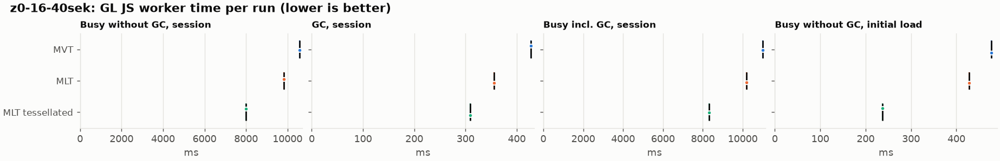
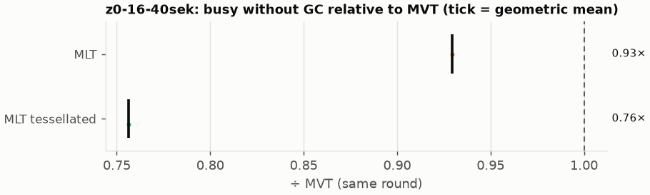
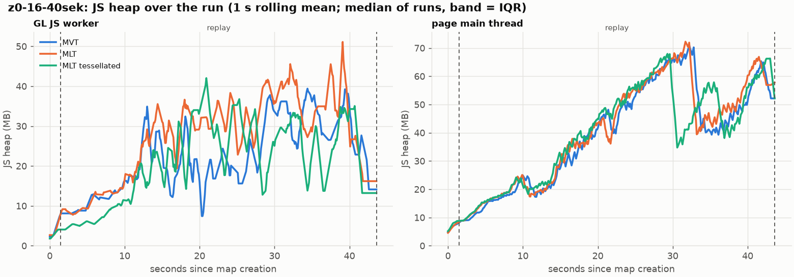
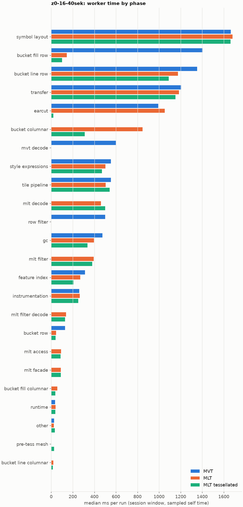

# Session trace benchmark — 20261106-101306

## Setup

- Created 2026-11-06T10:13:06+01:00; 1 repetitions + 0 warm-up round(s) (excluded); variants rotate per round (A B C, B C A, …); one cold browser context per run.
- Machine: 13th Gen Intel(R) Core(TM) i7-1365U, 12 logical cores, 31.3 GB RAM, Windows-11-10.0.26200-SP0; power: GUID des Energieschemas: 381b4222-f694-41f0-9685-ff5bb260df2e  (Ausbalanciert), AC True.
- GL JS gl7-performance-optimization @ d14e96a410 (dirty); worker count 1; viewport {'width': 1280, 'height': 1024}.
- Python 3.12.2, packages {'playwright': '1.64.0', 'numpy': '2.5.3', 'matplotlib': '3.11.2'}.

| variant | bundle | format | bundle sha256 | branch build |
|---|---|---|---|---|
| MVT | `dist/maplibre-gl-dev.mjs` | mvt | `672b3fa084c7` | – |
| MLT | `dist/maplibre-gl-dev.mjs` | mlt | `672b3fa084c7` | – |
| MLT tessellated | `dist/maplibre-gl-dev.mjs` | mlt-pre-tess | `672b3fa084c7` | – |

| session | style | duration | frames | sha256 |
|---|---|---:|---:|---|
| z0-16-40sek | osm-bright | 42.1 s | 1739 | `55a2b8f22fe2` |

CPU sampling interval (median over runs): 641 µs.

## Definitions

- **busy** = wall time in which a GL JS worker thread runs a task (union of top-level task slices and GC slices on `DedicatedWorker thread`s), summed over workers. **GC** = union of `MinorGC`/`MajorGC`/`V8.GC*` slices on those threads. **busy without GC** = busy − GC (headline metric).
- **CPU** = thread time (`tdur`) of the same slices. Phase categories and functions come from the trace's CPU samples (self time), categorised by `config/categories.toml` (nearest matching frame, leaf to root).
- Windows: **load** = map creation → first idle; **session** = camera replay; **tail** = end of replay → idle; **total** = load + session + tail.
- Ratios are against **MVT**: ratio of medians with a bootstrap 95 % CI, the geometric mean of per-round ratios, and a two-sided Mann–Whitney U p-value (normal approximation, not corrected for multiple comparisons; rough below n = 8). Lower than 1× means less worker time.

## Session `z0-16-40sek`

### Worker busy without GC (session window)

| variant | n ok / failed | median ms | IQR | mean | ratio vs MVT | 95 % CI | geo-mean paired | MWU p |
|---|---:|---:|---:|---:|---:|---:|---:|---:|
| MVT | 1 / 0 | 10,582 | 10,582–10,582 | 10,582 | 1.00× | – | – | – |
| MLT | 1 / 0 | 9,834 | 9,834–9,834 | 9,834 | 0.93× | – | 0.93× | 1.000 |
| MLT tessellated | 1 / 0 | 8,002 | 8,002–8,002 | 8,002 | 0.76× | – | 0.76× | 1.000 |

### All worker metrics (median, ratio vs baseline)

| metric | MVT | MLT | MLT tessellated |
|---|---:|---:|---:|
| busy incl. GC | 11,010 | 10,190 (0.93×) | 8,311 (0.75×) |
| &nbsp;&nbsp;of which GC | 427.7 | 356.1 (0.83×) | 309.3 (0.72×) |
| &nbsp;&nbsp;of which busy without GC | 10,582 | 9,834 (0.93×) | 8,002 (0.76×) |
| &nbsp;&nbsp;&nbsp;&nbsp;of which filtering (sampled, incl. callees) | 499.5 | 394.7 (0.79×) | 380.4 (0.76×) |
| &nbsp;&nbsp;&nbsp;&nbsp;of which column decoding inside the MLT filter (sampled) | 0.0 | 138.4 | 127.6 |
| &nbsp;&nbsp;&nbsp;&nbsp;of which timing instrumentation (sampled) | 261.2 | 264.1 (1.01×) | 249.8 (0.96×) |
| busy without GC and instrumentation | 10,321 | 9,570 (0.93×) | 7,752 (0.75×) |
| CPU time without GC | 9,294 | 8,654 (0.93×) | 7,056 (0.76×) |
| tile: download end → sent to main thread, median per tile | 208.3 | 233.8 (1.12×) | 186.3 (0.89×) |
| tile: download end → sent to main thread, 90th percentile | 591.6 | 655.8 (1.11×) | 449.4 (0.76×) |
| tile: download end → sent to main thread, 95th percentile | 735.9 | 801.0 (1.09×) | 558.2 (0.76×) |
| tile: download end → sent to main thread, 99th percentile | 823.9 | 896.6 (1.09×) | 654.0 (0.79×) |
| minor GCs | 84.00 | 74.00 (0.88×) | 52.00 (0.62×) |
| major GCs | 9.00 | 6.00 (0.67×) | 9.00 (1.00×) |
| peak worker heap (MB) | 59.2 | 58.8 (0.99×) | 46.2 (0.78×) |
| load: busy without GC | 477.6 | 428.0 (0.90×) | 236.9 (0.50×) |
| load: GC | 22.2 | 19.1 (0.86×) | 5.7 (0.26×) |
| total: busy without GC | 11,060 | 10,262 (0.93×) | 8,238 (0.74×) |

Rows marked *of which* are parts of the row above, not additional time. Tile rows are per-tile latencies (medians over tiles, then over runs), not sums: tiles overlap in time, and the medians of the parse and queue parts do not add up exactly to the median latency.

### Filtering (session window)

Sampled worker time spent in feature filtering, including everything the filter calls (expression evaluation, property access): **row filter** = the style-spec feature filter that MVT runs per feature, **mlt filter** = the columnar MLT filter (incl. the geometry-type selection), without the columns it decodes (see the next table). Medians per run; rules in `config/categories.toml`.

| variant | mlt filter | row filter | filtering | ratio vs MVT | 95 % CI | MWU p | share of sampled busy |
|---|---:|---:|---:|---:|---:|---:|---:|
| MVT | 0.0 | 499.5 | 499.5 | 1.00× | – | – | 5.0% |
| MLT | 394.7 | 0.0 | 394.7 | 0.79× | – | 1.000 | 4.2% |
| MLT tessellated | 380.4 | 0.0 | 380.4 | 0.76× | – | 1.000 | 5.1% |

**Filtering together with tile decoding.** The MLT decoder leaves columns encoded until something reads them, and the filter is usually the first reader: the columns it decodes (properties, and the geometry for `$type`) are **of which inside the filter** (phase *mlt filter decode*), the rest is *mlt decode* (geometry and columns read later, e.g. by paint properties and symbols). MVT decodes every feature's properties and geometry while it reads the tile (*mvt decode*), whether the filter keeps the feature or not. So **filtering** above compares the filters, and **decoding + filtering** compares all that the formats spend on decoding the tile and selecting features. **tile decoding** = *mvt decode* or *mlt decode* + *mlt filter decode*: work inside a call into a decoder. Reading data that is already decoded is not counted, as for MVT's feature objects: *mlt access* (row views, value getters, looking a column up by name) and the MLT facade (*mlt facade*). MVT decodes geometry only for the features its filter keeps, MLT decodes a layer's whole geometry column.

| variant | tile decoding | of which inside the filter | filtering | decoding + filtering | ratio vs MVT | 95 % CI | MWU p |
|---|---:|---:|---:|---:|---:|---:|---:|
| MVT | 599.3 | 0.0 | 499.5 | 1,099 | 1.00× | – | – |
| MLT | 598.8 | 138.4 | 394.7 | 993.5 | 0.90× | – | 1.000 |
| MLT tessellated | 627.3 | 127.6 | 380.4 | 1,008 | 0.92× | – | 1.000 |

Top 12 functions inside filtering and its column decoding (self time, mean ms per run):

| phase | function | source | MVT | MLT | MLT tessellated |
|---|---|---|---:|---:|---:|
| row filter | `evaluate` | node_modules/@maplibre/maplibre-gl-style-spec/dist/expression/compound_expression.mjs | 154.3 | 0.0 | 0.0 |
| row filter | `evaluate` | node_modules/@maplibre/maplibre-gl-style-spec/dist/expression/index.mjs | 79.6 | 0.0 | 0.0 |
| row filter | `CompoundExpression.register.filter-in-small` | node_modules/@maplibre/maplibre-gl-style-spec/dist/expression/compound_expression.mjs | 69.3 | 0.0 | 0.0 |
| row filter | `CompoundExpression.register.filter-==` | node_modules/@maplibre/maplibre-gl-style-spec/dist/expression/compound_expression.mjs | 61.9 | 0.0 | 0.0 |
| mlt filter | `scanDictionaryCodes` | maplibre-tile-spec/ts/dist/processing/filter/execution/filterKernel.js | 0.0 | 35.1 | 46.9 |
| mlt filter | `dictionaryRowMatches` | maplibre-tile-spec/ts/dist/processing/filter/execution/filterKernel.js | 0.0 | 34.5 | 41.8 |
| row filter | `CompoundExpression.register.all.overloads` | node_modules/@maplibre/maplibre-gl-style-spec/dist/expression/compound_expression.mjs | 36.4 | 0.0 | 0.0 |
| mlt filter | `filterByGeometryType` | maplibre-tile-spec/ts/dist/vector/geometry/geometryVector.js | 0.0 | 34.5 | 27.2 |
| row filter | `filter` | node_modules/@maplibre/maplibre-gl-style-spec/dist/feature_filter/index.mjs | 31.3 | 0.0 | 0.0 |
| mlt filter | `resolveDictionaryExecutor` | maplibre-tile-spec/ts/dist/processing/filter/execution/filterKernel.js | 0.0 | 24.0 | 21.7 |
| mlt filter | `bytesEqual` | maplibre-tile-spec/ts/dist/processing/filter/execution/filterKernel.js | 0.0 | 21.6 | 21.2 |
| mlt filter decode | `unpackNullable` | maplibre-tile-spec/ts/dist/decoding/unpackNullableUtils.js | 0.0 | 20.9 | 14.2 |

### Bucket time by layer type (session window)

Sampled self time of the bucket code per layer type, row and columnar path together (median ms per run). **shared bucket code** is code all layer types use (`src/data/bucket/*` outside the layer files, `columnar_populate.ts`, `columnar_mesh_arrays.ts`, `load_geometry.ts`). **earcut** triangulates for fill and fill-extrusion on the row path; **pre-tess mesh** takes over the stored triangles of a pre-tessellated fill. **symbol** is the whole symbol layout phase. For exact wall time per source layer and type see the timing log tables below (builds with `worker_timing.ts` only).

| variant | fill | fill-extrusion | line | symbol | shared bucket code | earcut | pre-tess mesh | total |
|---|---:|---:|---:|---:|---:|---:|---:|---:|
| MVT | 1,403 | 0.0 | 1,353 | 1,665 | 129.5 | 993.8 | 0.0 | 5,544 |
| MLT | 201.9 | 0.0 | 1,195 | 1,682 | 890.7 | 1,052 | 0.0 | 5,022 |
| MLT tessellated | 138.4 | 0.0 | 1,106 | 1,663 | 352.7 | 19.9 | 27.8 | 3,308 |

### Where the variants differ from MVT (session window, mean ms per run)

Open **[flame.html](flame.html)** to explore the call tree interactively: pick a variant, compare it with MVT (red = more time at the same call path, blue = less), click a frame to zoom in, and read the phase and function breakdown under it. Without a comparison, frames are coloured by phase: filtering is green in both formats, and the columns the MLT filter decodes on first access (*mlt filter decode*) are MLT blue frames under the green filter. `flame/*.txt` open in https://www.speedscope.app.

#### MLT vs MVT

**By phase** (sampled self time; the Δ column sums to the difference in sampled busy time):

| phase | MVT | MLT | Δ |
|---|---:|---:|---:|
| bucket columnar | 0.0 | 846.2 | +846.2 |
| mlt decode | 0.0 | 460.4 | +460.4 |
| mlt filter | 0.0 | 394.7 | +394.7 |
| mlt filter decode | 0.0 | 138.4 | +138.4 |
| mlt access | 0.0 | 92.6 | +92.6 |
| mlt facade | 1.6 | 88.5 | +86.8 |
| earcut | 993.8 | 1,052 | +58.6 |
| bucket fill columnar | 0.0 | 57.7 | +57.7 |
| bucket line columnar | 0.0 | 19.5 | +19.5 |
| symbol layout | 1,665 | 1,682 | +17.0 |
| runtime | 35.7 | 40.7 | +5.0 |
| instrumentation | 261.2 | 264.1 | +3.0 |
| other | 26.2 | 24.6 | -1.6 |
| transfer | 1,206 | 1,185 | -20.6 |
| feature index | 313.5 | 269.3 | -44.2 |
| tile pipeline | 553.4 | 504.9 | -48.5 |
| style expressions | 554.4 | 502.5 | -52.0 |
| gc | 474.0 | 396.7 | -77.2 |
| bucket row | 129.5 | 44.5 | -85.0 |
| bucket line row | 1,353 | 1,176 | -176.8 |
| row filter | 499.5 | 0.0 | -499.5 |
| mvt decode | 599.3 | 0.0 | -599.3 |
| bucket fill row | 1,403 | 144.2 | -1259.2 |

**Functions with the largest self-time difference** (by function name, summed over source files):

| function | MVT | MLT | Δ |
|---|---:|---:|---:|
| `buildEarcutMesh` | 0.0 | 97.4 | +97.4 |
| `buildRingBoundingBoxes` | 0.0 | 93.1 | +93.1 |
| `signedArea$2` | 18.3 | 82.3 | +64.0 |
| `writeEarcutFill` | 0.0 | 63.5 | +63.5 |
| `readScaledRings` | 0.0 | 48.7 | +48.7 |
| `decodeComponentwiseDeltaVec2` | 0.0 | 45.3 | +45.3 |
| `fillLargeMeshArrays` | 89.1 | 133.7 | +44.6 |
| `scanDictionaryCodes` | 0.0 | 35.1 | +35.1 |
| `get` | 100.1 | 135.0 | +34.9 |
| `filterByGeometryType` | 0.0 | 34.5 | +34.5 |
| `dictionaryRowMatches` | 0.0 | 34.5 | +34.5 |
| `decodeString$2` | 0.0 | 33.7 | +33.7 |
| `_vertexToIndex` | 434.5 | 1.0 | -433.5 |
| `populate` | 256.8 | 29.3 | -227.5 |
| `evaluate` | 275.1 | 55.3 | -219.8 |
| `readVarint` | 175.7 | 10.0 | -165.6 |
| `loadGeometry` | 182.5 | 30.8 | -151.7 |

#### MLT tessellated vs MVT

**By phase** (sampled self time; the Δ column sums to the difference in sampled busy time):

| phase | MVT | MLT tessellated | Δ |
|---|---:|---:|---:|
| mlt decode | 0.0 | 499.7 | +499.7 |
| mlt filter | 0.0 | 380.4 | +380.4 |
| bucket columnar | 0.0 | 311.8 | +311.8 |
| mlt filter decode | 0.0 | 127.6 | +127.6 |
| mlt facade | 1.6 | 90.1 | +88.4 |
| mlt access | 0.0 | 85.9 | +85.9 |
| bucket fill columnar | 0.0 | 37.8 | +37.8 |
| pre-tess mesh | 0.0 | 27.8 | +27.8 |
| bucket line columnar | 0.0 | 16.0 | +16.0 |
| other | 26.2 | 33.2 | +7.0 |
| runtime | 35.7 | 39.5 | +3.8 |
| symbol layout | 1,665 | 1,663 | -1.5 |
| tile pipeline | 553.4 | 542.8 | -10.7 |
| instrumentation | 261.2 | 249.8 | -11.3 |
| transfer | 1,206 | 1,152 | -53.6 |
| style expressions | 554.4 | 471.4 | -83.1 |
| bucket row | 129.5 | 40.9 | -88.6 |
| feature index | 313.5 | 206.3 | -107.2 |
| gc | 474.0 | 335.3 | -138.6 |
| bucket line row | 1,353 | 1,089 | -263.3 |
| row filter | 499.5 | 0.0 | -499.5 |
| mvt decode | 599.3 | 0.0 | -599.3 |
| earcut | 993.8 | 19.9 | -973.9 |
| bucket fill row | 1,403 | 100.5 | -1303.0 |

**Functions with the largest self-time difference** (by function name, summed over source files):

| function | MVT | MLT tessellated | Δ |
|---|---:|---:|---:|
| `writeTessellatedFill` | 0.0 | 86.2 | +86.2 |
| `scanDictionaryCodes` | 0.0 | 46.9 | +46.9 |
| `dictionaryRowMatches` | 0.0 | 41.8 | +41.8 |
| `decodeUnsignedZigZagDeltaInt32` | 0.0 | 40.2 | +40.2 |
| `decodeComponentwiseDeltaVec2` | 0.0 | 36.8 | +36.8 |
| `appendScaledVertices` | 0.0 | 29.6 | +29.6 |
| `decodeFastPforInt32` | 0.0 | 29.0 | +29.0 |
| `decodeString$2` | 0.0 | 28.5 | +28.5 |
| `decodeFsst` | 0.0 | 27.5 | +27.5 |
| `filterByGeometryType` | 0.0 | 27.2 | +27.2 |
| `buildTessellatedBoundingBox` | 0.0 | 27.2 | +27.2 |
| `ProgramConfiguration` | 183.7 | 207.6 | +23.8 |
| `_vertexToIndex` | 434.5 | 0.0 | -434.5 |
| `isEar` | 347.9 | 2.5 | -345.3 |
| `populate` | 256.8 | 21.8 | -235.0 |
| `evaluate` | 275.1 | 43.4 | -231.7 |
| `readVarint` | 175.7 | 7.3 | -168.3 |

### Memory (session window)

**JS heap** = V8's used heap of the thread (`jsHeapSizeUsed` from the trace's `UpdateCounters`, about every 20 ms; the mean is time-weighted). It does not include ArrayBuffer contents, so the tile data itself (vertex, index and feature-index arrays) is not in it: **tile data sent to the main thread** is the size of the ArrayBuffers each tile result transfers (`web/worker_hook.js`), which then live on the main thread and are uploaded to the GPU. **garbage collected** = heap freed by the worker's GCs, a measure of how much it allocates. Medians per run; ratio of medians with a bootstrap 95 % CI.

| metric | MVT | MLT | MLT tessellated |
|---|---:|---:|---:|
| worker JS heap, mean (MB) | 19.2 | 23.8 (1.24×, –) | 18.6 (0.97×, –) |
| worker JS heap, peak (MB) | 59.2 | 58.8 (0.99×, –) | 46.2 (0.78×, –) |
| worker JS heap after the last GC (MB) | 14.1 | 10.7 (0.76×, –) | 11.5 (0.82×, –) |
| garbage collected in the worker (MB) | 2,277 | 1,763 (0.77×, –) | 990.3 (0.43×, –) |
| main thread JS heap, mean (MB) | 36.6 | 37.0 (1.01×, –) | 36.1 (0.99×, –) |
| main thread JS heap, peak (MB) | 78.2 | 78.4 (1.00×, –) | 75.9 (0.97×, –) |
| main thread JS heap at the end of the replay (MB) | 52.8 | 57.5 (1.09×, –) | 66.8 (1.27×, –) |
| tile data sent to the main thread, total (MB) | 134.3 | 138.2 (1.03×, –) | 135.6 (1.01×, –) |
| tile data sent to the main thread, median per tile (KB) | 417.3 | 400.1 (0.96×, –) | 386.1 (0.93×, –) |

### Worker time by phase (session window, median ms of sampled self time)

| phase | MVT | MLT | MLT tessellated |
|---|---:|---:|---:|
| symbol layout | 1,665 | 1,682 | 1,663 |
| bucket fill row | 1,403 | 144.2 | 100.5 |
| bucket line row | 1,353 | 1,176 | 1,089 |
| transfer | 1,206 | 1,185 | 1,152 |
| earcut | 993.8 | 1,052 | 19.9 |
| bucket columnar | 0.0 | 846.2 | 311.8 |
| mvt decode | 599.3 | 0.0 | 0.0 |
| style expressions | 554.4 | 502.5 | 471.4 |
| tile pipeline | 553.4 | 504.9 | 542.8 |
| mlt decode | 0.0 | 460.4 | 499.7 |
| row filter | 499.5 | 0.0 | 0.0 |
| gc | 474.0 | 396.7 | 335.3 |
| mlt filter | 0.0 | 394.7 | 380.4 |
| feature index | 313.5 | 269.3 | 206.3 |
| instrumentation | 261.2 | 264.1 | 249.8 |
| mlt filter decode | 0.0 | 138.4 | 127.6 |
| bucket row | 129.5 | 44.5 | 40.9 |
| mlt access | 0.0 | 92.6 | 85.9 |
| mlt facade | 1.6 | 88.5 | 90.1 |
| bucket fill columnar | 0.0 | 57.7 | 37.8 |
| runtime | 35.7 | 40.7 | 39.5 |
| other | 26.2 | 24.6 | 33.2 |
| pre-tess mesh | 0.0 | 0.0 | 27.8 |
| bucket line columnar | 0.0 | 19.5 | 16.0 |
| bucket fill-extrusion row | 0.0 | 0.0 | 0.0 |

### Top 20 worker functions by self time (session window, mean ms per run)

| function | source | phase | MVT | MLT | MLT tessellated |
|---|---|---|---:|---:|---:|
| `reserve` | src/util/struct_array.ts | tile pipeline | 613.4 | 559.4 | 561.9 |
| `(garbage collector)` | (native) | gc | 474.0 | 396.7 | 335.3 |
| `_vertexToIndex` | src/render/subdivision.ts | bucket fill row | 434.5 | 1.0 | 0.0 |
| `isEar` | node_modules/earcut/src/earcut.js | earcut | 347.9 | 301.5 | 2.5 |
| `serialize` | src/util/web_worker_transfer.ts | transfer | 254.3 | 277.6 | 242.4 |
| `emplace` | src/data/array_types.g.ts | bucket columnar | 261.0 | 276.9 | 241.8 |
| `setTimeout` | (native) | transfer | 248.4 | 238.7 | 232.1 |
| `postMessage` | (native) | transfer | 240.0 | 241.4 | 234.4 |
| `_trim` | src/util/struct_array.ts | transfer | 215.1 | 169.4 | 166.4 |
| `ProgramConfiguration` | src/data/program_configuration.ts | bucket fill row | 183.7 | 210.8 | 207.6 |
| `self.postMessage` | worker_hook.js | instrumentation | 196.4 | 191.0 | 185.7 |
| `populate` | src/data/bucket/line_bucket.ts | bucket line row | 182.8 | 0.0 | 0.0 |
| `fetch` | (native) | tile pipeline | 177.2 | 166.4 | 167.8 |
| `readVarint` | node_modules/pbf/index.js | mvt decode | 175.7 | 0.0 | 0.0 |
| `evaluate` | node_modules/@maplibre/maplibre-gl-style-spec/dist/expression/compound_expression.mjs | row filter | 154.3 | 0.0 | 0.0 |
| `addHalfVertex` | src/data/bucket/line_bucket.ts | bucket line row | 151.8 | 135.4 | 125.4 |
| `isEarHashed` | node_modules/earcut/src/earcut.js | earcut | 140.6 | 150.9 | 0.6 |
| `fillLargeMeshArrays` | src/render/fill_large_mesh_arrays.ts | bucket columnar | 89.1 | 133.7 | 1.9 |
| `addLine` | src/data/bucket/line_bucket.ts | bucket line row | 126.0 | 133.1 | 131.1 |
| `earcutLinked` | node_modules/earcut/src/earcut.js | earcut | 99.8 | 119.8 | 3.3 |

### Top 20 worker functions by total time (incl. callees) (session window, mean ms per run)

| function | source | phase | MVT | MLT | MLT tessellated |
|---|---|---|---:|---:|---:|
| `parse` | src/source/worker_tile.ts | tile pipeline | 7,680 | 7,275 | 5,497 |
| `loadTile` | src/source/vector_tile_worker_source.ts | tile pipeline | 6,280 | 5,679 | 3,976 |
| `_parseWorkerTile` | src/source/vector_tile_worker_source.ts | tile pipeline | 5,959 | 5,483 | 3,782 |
| `populate` | src/data/bucket/fill_bucket.ts | bucket fill row | 2,749 | 0.0 | 0.0 |
| `addBucketFeatures` | src/data/bucket/fill_bucket.ts | bucket fill row | 2,368 | 1,820 | 322.9 |
| `addFeature` | src/data/bucket/fill_bucket.ts |  | 2,288 | 23.0 | 0.0 |
| `populate` | src/data/bucket/columnar/columnar_fill_bucket.ts | bucket fill columnar | 0.0 | 2,281 | 759.8 |
| `subdividePolygon` | src/render/subdivision.ts |  | 1,865 | 19.7 | 0.0 |
| `subdividePolygonInternal` | src/render/subdivision.ts | bucket fill row | 1,804 | 19.7 | 0.0 |
| `addFeature` | src/data/bucket/columnar/columnar_fill_bucket.ts | bucket fill columnar | 0.0 | 1,769 | 293.2 |
| `writeEarcutFill` | src/data/bucket/columnar/columnar_mesh_arrays.ts | bucket columnar | 0.0 | 1,714 | 33.2 |
| `populate` | src/data/bucket/line_bucket.ts | bucket line row | 1,566 | 0.0 | 0.0 |
| `addFeatures` | src/data/bucket/symbol_bucket.ts | symbol layout | 1,479 | 1,530 | 1,517 |
| `performSymbolLayout` | src/symbol/symbol_layout.ts | symbol layout | 1,453 | 1,507 | 1,498 |
| `populate` | src/data/bucket/columnar/columnar_line_bucket.ts | bucket line columnar | 0.0 | 1,387 | 1,328 |
| `processTask` | src/util/actor.ts | transfer | 1,318 | 1,280 | 1,248 |
| `buildEarcutMesh` | src/data/bucket/columnar/columnar_mesh_arrays.ts | bucket columnar | 0.0 | 1,198 | 25.1 |
| `completeTask` | src/util/actor.ts | transfer | 1,065 | 1,029 | 996.6 |
| `earcut` | node_modules/earcut/src/earcut.js | earcut | 993.1 | 1,050 | 19.9 |
| `addBucketFeatures` | src/data/bucket/line_bucket.ts | bucket line row | 883.6 | 925.5 | 868.2 |

## Runs

3 ok, 0 failed/aborted, 0 not run, 3 used in statistics.

## Validity checks

- Counted once: all 3 analysed runs pass (windows load + session + tail add up to total; phases add up to the sampled busy time; GC and sampled time lie within busy time; no timing-log line twice).
- other programs used 8.86–9.69 logical processors during the replays (median 9.07)
- 3 run(s) with more than 0.5 cores of background load: z0-16-40sek/mvt/rep-00 (9.69), z0-16-40sek/mlt/rep-00 (9.07), z0-16-40sek/mlt-pre-tess/rep-00 (8.86)

## Files

- `runs.csv`: one row per run (incl. failed and warm-up runs), every scalar metric as `<window>.<metric>`.
- `summary.csv`: session × variant × metric statistics.
- `functions.csv`, `categories.csv`: CPU-sample self/total time per function and phase per run and window.
- `category_functions.csv`: self time per phase × function (e.g. what the filters spend their time on).
- `tiles.csv`, `tile_layers.csv`, `tile_phases.csv`: the per-tile worker timing log, long format.
- `flame.html`: interactive call tree per variant with a diff view; `flame/*.txt`: collapsed stacks for speedscope.
- `analysis/stacks.csv` (per run): sampled self time per full call stack.
- `tile_latency.csv`: per tile request, worker clock: received, download start/end, result sent, latency = sent − download end, parse_ms, wait_ms = latency − parse.
- `runs/<session>/<variant>/rep-NN/trace.json.gz`: the raw trace (opens in the DevTools Performance tab).
