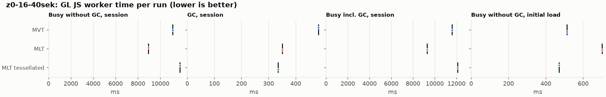
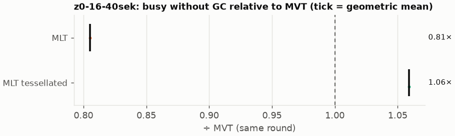
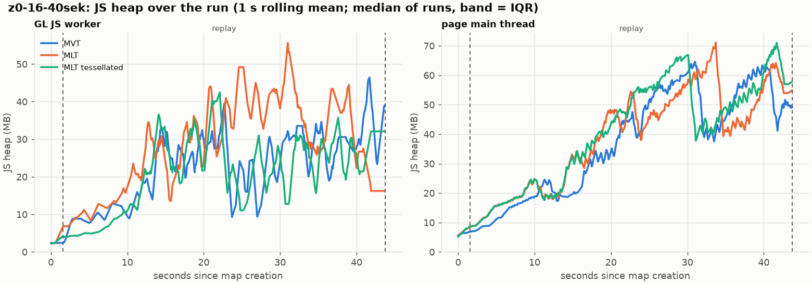
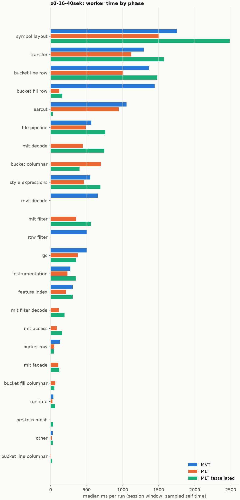

# Session trace benchmark — 20261106-103225

## Setup

- Created 2026-11-06T10:32:25+01:00; 1 repetitions + 0 warm-up round(s) (excluded); variants rotate per round (A B C, B C A, …); one cold browser context per run.
- Machine: 13th Gen Intel(R) Core(TM) i7-1365U, 12 logical cores, 31.3 GB RAM, Windows-11-10.0.26200-SP0; power: GUID des Energieschemas: 381b4222-f694-41f0-9685-ff5bb260df2e  (Ausbalanciert), AC True.
- GL JS gl7-performance-optimization @ d14e96a410 (dirty); worker count 1; viewport {'width': 1280, 'height': 1024}.
- Python 3.12.2, packages {'playwright': '1.64.0', 'numpy': '2.5.3', 'matplotlib': '3.11.2'}.

| variant | bundle | format | bundle sha256 | branch build |
|---|---|---|---|---|
| MVT | `dist/maplibre-gl-dev.mjs` | mvt | `7f8a1202aa31` | – |
| MLT | `dist/maplibre-gl-dev.mjs` | mlt | `7f8a1202aa31` | – |
| MLT tessellated | `dist/maplibre-gl-dev.mjs` | mlt-pre-tess | `7f8a1202aa31` | – |

| session | style | duration | frames | sha256 |
|---|---|---:|---:|---|
| z0-16-40sek | osm-bright | 42.1 s | 1739 | `55a2b8f22fe2` |

CPU sampling interval (median over runs): 651 µs.

## Definitions

- **busy** = wall time in which a GL JS worker thread runs a task (union of top-level task slices and GC slices on `DedicatedWorker thread`s), summed over workers. **GC** = union of `MinorGC`/`MajorGC`/`V8.GC*` slices on those threads. **busy without GC** = busy − GC (headline metric).
- **CPU** = thread time (`tdur`) of the same slices. Phase categories and functions come from the trace's CPU samples (self time), categorised by `config/categories.toml` (nearest matching frame, leaf to root).
- Windows: **load** = map creation → first idle; **session** = camera replay; **tail** = end of replay → idle; **total** = load + session + tail.
- Ratios are against **MVT**: ratio of medians with a bootstrap 95 % CI, the geometric mean of per-round ratios, and a two-sided Mann–Whitney U p-value (normal approximation, not corrected for multiple comparisons; rough below n = 8). Lower than 1× means less worker time.

## Session `z0-16-40sek`

### Worker busy without GC (session window)

| variant | n ok / failed | median ms | IQR | mean | ratio vs MVT | 95 % CI | geo-mean paired | MWU p |
|---|---:|---:|---:|---:|---:|---:|---:|---:|
| MVT | 1 / 0 | 11,109 | 11,109–11,109 | 11,109 | 1.00× | – | – | – |
| MLT | 1 / 0 | 8,944 | 8,944–8,944 | 8,944 | 0.81× | – | 0.81× | 1.000 |
| MLT tessellated | 1 / 0 | 11,763 | 11,763–11,763 | 11,763 | 1.06× | – | 1.06× | 1.000 |

### All worker metrics (median, ratio vs baseline)

| metric | MVT | MLT | MLT tessellated |
|---|---:|---:|---:|
| busy incl. GC | 11,593 | 9,294 (0.80×) | 12,099 (1.04×) |
| &nbsp;&nbsp;of which GC | 483.8 | 350.5 (0.72×) | 335.5 (0.69×) |
| &nbsp;&nbsp;of which busy without GC | 11,109 | 8,944 (0.81×) | 11,763 (1.06×) |
| &nbsp;&nbsp;&nbsp;&nbsp;of which filtering (sampled, incl. callees) | 505.4 | 355.4 (0.70×) | 559.6 (1.11×) |
| &nbsp;&nbsp;&nbsp;&nbsp;of which column decoding inside the MLT filter (sampled) | 0.0 | 115.0 | 191.8 |
| &nbsp;&nbsp;&nbsp;&nbsp;of which timing instrumentation (sampled) | 274.4 | 233.4 (0.85×) | 351.4 (1.28×) |
| busy without GC and instrumentation | 10,835 | 8,710 (0.80×) | 11,412 (1.05×) |
| CPU time without GC | 9,699 | 8,101 (0.84×) | 10,322 (1.06×) |
| tile: download end → sent to main thread, median per tile | 219.5 | 192.4 (0.88×) | 242.4 (1.10×) |
| tile: download end → sent to main thread, 90th percentile | 763.4 | 573.0 (0.75×) | 608.4 (0.80×) |
| tile: download end → sent to main thread, 95th percentile | 1,010 | 751.2 (0.74×) | 790.6 (0.78×) |
| tile: download end → sent to main thread, 99th percentile | 1,097 | 810.4 (0.74×) | 932.0 (0.85×) |
| minor GCs | 92.00 | 75.00 (0.82×) | 51.00 (0.55×) |
| major GCs | 9.00 | 6.00 (0.67×) | 7.00 (0.78×) |
| peak worker heap (MB) | 51.3 | 65.0 (1.27×) | 49.8 (0.97×) |
| load: busy without GC | 513.2 | 701.2 (1.37×) | 471.4 (0.92×) |
| load: GC | 23.3 | 21.2 (0.91×) | 10.4 (0.45×) |
| total: busy without GC | 11,622 | 9,645 (0.83×) | 12,235 (1.05×) |

Rows marked *of which* are parts of the row above, not additional time. Tile rows are per-tile latencies (medians over tiles, then over runs), not sums: tiles overlap in time, and the medians of the parse and queue parts do not add up exactly to the median latency.

### Filtering (session window)

Sampled worker time spent in feature filtering, including everything the filter calls (expression evaluation, property access): **row filter** = the style-spec feature filter that MVT runs per feature, **mlt filter** = the columnar MLT filter (incl. the geometry-type selection), without the columns it decodes (see the next table). Medians per run; rules in `config/categories.toml`.

| variant | mlt filter | row filter | filtering | ratio vs MVT | 95 % CI | MWU p | share of sampled busy |
|---|---:|---:|---:|---:|---:|---:|---:|
| MVT | 0.0 | 505.4 | 505.4 | 1.00× | – | – | 4.8% |
| MLT | 355.4 | 0.0 | 355.4 | 0.70× | – | 1.000 | 4.2% |
| MLT tessellated | 559.6 | 0.0 | 559.6 | 1.11× | – | 1.000 | 5.3% |

**Filtering together with tile decoding.** The MLT decoder leaves columns encoded until something reads them, and the filter is usually the first reader: the columns it decodes (properties, and the geometry for `$type`) are **of which inside the filter** (phase *mlt filter decode*), the rest is *mlt decode* (geometry and columns read later, e.g. by paint properties and symbols). MVT decodes every feature's properties and geometry while it reads the tile (*mvt decode*), whether the filter keeps the feature or not. So **filtering** above compares the filters, and **decoding + filtering** compares all that the formats spend on decoding the tile and selecting features. **tile decoding** = *mvt decode* or *mlt decode* + *mlt filter decode*: work inside a call into a decoder. Reading data that is already decoded is not counted, as for MVT's feature objects: *mlt access* (row views, value getters, looking a column up by name) and the MLT facade (*mlt facade*). MVT decodes geometry only for the features its filter keeps, MLT decodes a layer's whole geometry column.

| variant | tile decoding | of which inside the filter | filtering | decoding + filtering | ratio vs MVT | 95 % CI | MWU p |
|---|---:|---:|---:|---:|---:|---:|---:|
| MVT | 654.8 | 0.0 | 505.4 | 1,160 | 1.00× | – | – |
| MLT | 559.7 | 115.0 | 355.4 | 915.0 | 0.79× | – | 1.000 |
| MLT tessellated | 938.8 | 191.8 | 559.6 | 1,498 | 1.29× | – | 1.000 |

Top 12 functions inside filtering and its column decoding (self time, mean ms per run):

| phase | function | source | MVT | MLT | MLT tessellated |
|---|---|---|---:|---:|---:|
| row filter | `evaluate` | node_modules/@maplibre/maplibre-gl-style-spec/dist/expression/compound_expression.mjs | 165.1 | 0.0 | 0.0 |
| row filter | `CompoundExpression.register.filter-in-small` | node_modules/@maplibre/maplibre-gl-style-spec/dist/expression/compound_expression.mjs | 71.9 | 0.0 | 0.0 |
| mlt filter | `scanDictionaryCodes` | maplibre-tile-spec/ts/dist/processing/filter/execution/filterKernel.js | 0.0 | 37.6 | 62.3 |
| mlt filter | `filterByGeometryType` | maplibre-tile-spec/ts/dist/vector/geometry/geometryVector.js | 0.0 | 26.8 | 61.2 |
| row filter | `evaluate` | node_modules/@maplibre/maplibre-gl-style-spec/dist/expression/index.mjs | 60.9 | 0.0 | 0.0 |
| row filter | `CompoundExpression.register.filter-==` | node_modules/@maplibre/maplibre-gl-style-spec/dist/expression/compound_expression.mjs | 49.4 | 0.0 | 0.0 |
| mlt filter | `resolveDictionaryExecutor` | maplibre-tile-spec/ts/dist/processing/filter/execution/filterKernel.js | 0.0 | 20.0 | 40.7 |
| mlt filter | `dictionaryRowMatches` | maplibre-tile-spec/ts/dist/processing/filter/execution/filterKernel.js | 0.0 | 32.9 | 38.6 |
| row filter | `filter` | node_modules/@maplibre/maplibre-gl-style-spec/dist/feature_filter/index.mjs | 35.9 | 0.0 | 0.0 |
| row filter | `CompoundExpression.register.all.overloads` | node_modules/@maplibre/maplibre-gl-style-spec/dist/expression/compound_expression.mjs | 30.9 | 0.0 | 0.0 |
| mlt filter decode | `unpackNullable` | maplibre-tile-spec/ts/dist/decoding/unpackNullableUtils.js | 0.0 | 11.7 | 28.6 |
| mlt filter | `getNormalizedFilter` | maplibre-tile-spec/ts/dist/processing/filter/filterCache.js | 0.0 | 14.1 | 24.0 |

### Bucket time by layer type (session window)

Sampled self time of the bucket code per layer type, row and columnar path together (median ms per run). **shared bucket code** is code all layer types use (`src/data/bucket/*` outside the layer files, `columnar_populate.ts`, `columnar_mesh_arrays.ts`, `load_geometry.ts`). **earcut** triangulates for fill and fill-extrusion on the row path; **pre-tess mesh** takes over the stored triangles of a pre-tessellated fill. **symbol** is the whole symbol layout phase. For exact wall time per source layer and type see the timing log tables below (builds with `worker_timing.ts` only).

| variant | fill | fill-extrusion | line | symbol | shared bucket code | earcut | pre-tess mesh | total |
|---|---:|---:|---:|---:|---:|---:|---:|---:|
| MVT | 1,446 | 0.0 | 1,366 | 1,756 | 126.9 | 1,055 | 0.0 | 5,749 |
| MLT | 190.2 | 0.0 | 1,021 | 1,508 | 749.3 | 944.3 | 0.0 | 4,413 |
| MLT tessellated | 214.0 | 0.0 | 1,503 | 2,487 | 447.9 | 28.0 | 37.8 | 4,717 |

### Where the variants differ from MVT (session window, mean ms per run)

Open **[flame.html](flame.html)** to explore the call tree interactively: pick a variant, compare it with MVT (red = more time at the same call path, blue = less), click a frame to zoom in, and read the phase and function breakdown under it. Without a comparison, frames are coloured by phase: filtering is green in both formats, and the columns the MLT filter decodes on first access (*mlt filter decode*) are MLT blue frames under the green filter. `flame/*.txt` open in https://www.speedscope.app.

#### MLT vs MVT

**By phase** (sampled self time; the Δ column sums to the difference in sampled busy time):

| phase | MVT | MLT | Δ |
|---|---:|---:|---:|
| bucket columnar | 0.0 | 699.0 | +699.0 |
| mlt decode | 0.0 | 444.7 | +444.7 |
| mlt filter | 0.0 | 355.4 | +355.4 |
| mlt filter decode | 0.0 | 115.0 | +115.0 |
| mlt facade | 0.7 | 106.8 | +106.1 |
| mlt access | 0.0 | 88.9 | +88.9 |
| bucket fill columnar | 0.0 | 68.5 | +68.5 |
| bucket line columnar | 0.0 | 9.7 | +9.7 |
| runtime | 38.7 | 24.6 | -14.0 |
| other | 28.3 | 14.0 | -14.2 |
| instrumentation | 274.4 | 233.4 | -41.0 |
| bucket row | 126.9 | 50.3 | -76.6 |
| tile pipeline | 567.2 | 488.0 | -79.2 |
| style expressions | 550.7 | 462.8 | -87.9 |
| feature index | 306.8 | 213.5 | -93.3 |
| earcut | 1,055 | 944.3 | -110.3 |
| gc | 505.3 | 378.2 | -127.1 |
| transfer | 1,293 | 1,118 | -174.5 |
| symbol layout | 1,756 | 1,508 | -247.1 |
| bucket line row | 1,366 | 1,011 | -354.8 |
| row filter | 505.4 | 0.0 | -505.4 |
| mvt decode | 654.8 | 0.0 | -654.8 |
| bucket fill row | 1,446 | 121.7 | -1323.9 |

**Functions with the largest self-time difference** (by function name, summed over source files):

| function | MVT | MLT | Δ |
|---|---:|---:|---:|
| `buildEarcutMesh` | 0.0 | 87.6 | +87.6 |
| `buildRingBoundingBoxes` | 0.0 | 68.4 | +68.4 |
| `writeEarcutFill` | 0.0 | 53.1 | +53.1 |
| `signedArea$2` | 19.3 | 72.0 | +52.7 |
| `decodeComponentwiseDeltaVec2` | 0.0 | 46.3 | +46.3 |
| `decodeString$2` | 0.0 | 40.6 | +40.6 |
| `readScaledRings` | 0.0 | 40.2 | +40.2 |
| `scanDictionaryCodes` | 0.0 | 37.6 | +37.6 |
| `dictionaryRowMatches` | 0.0 | 32.9 | +32.9 |
| `decodeFsst` | 0.0 | 31.5 | +31.5 |
| `filterByGeometryType` | 0.0 | 26.8 | +26.8 |
| `signedArea$1` | 0.0 | 24.1 | +24.1 |
| `_vertexToIndex` | 407.3 | 2.8 | -404.5 |
| `populate` | 273.5 | 34.5 | -238.9 |
| `evaluate` | 261.8 | 48.2 | -213.5 |
| `readVarint` | 179.6 | 11.0 | -168.6 |
| `loadGeometry` | 196.6 | 50.0 | -146.6 |

#### MLT tessellated vs MVT

**By phase** (sampled self time; the Δ column sums to the difference in sampled busy time):

| phase | MVT | MLT tessellated | Δ |
|---|---:|---:|---:|
| mlt decode | 0.0 | 747.1 | +747.1 |
| symbol layout | 1,756 | 2,487 | +731.4 |
| mlt filter | 0.0 | 559.6 | +559.6 |
| bucket columnar | 0.0 | 401.7 | +401.7 |
| transfer | 1,293 | 1,574 | +280.9 |
| tile pipeline | 567.2 | 759.6 | +192.4 |
| mlt filter decode | 0.0 | 191.8 | +191.8 |
| mlt access | 0.0 | 157.8 | +157.8 |
| style expressions | 550.7 | 693.9 | +143.2 |
| mlt facade | 0.7 | 122.1 | +121.4 |
| bucket line row | 1,366 | 1,480 | +114.2 |
| instrumentation | 274.4 | 351.4 | +77.1 |
| bucket fill columnar | 0.0 | 52.5 | +52.5 |
| pre-tess mesh | 0.0 | 37.8 | +37.8 |
| runtime | 38.7 | 65.0 | +26.3 |
| bucket line columnar | 0.0 | 22.5 | +22.5 |
| other | 28.3 | 32.8 | +4.5 |
| feature index | 306.8 | 307.3 | +0.5 |
| bucket row | 126.9 | 46.2 | -80.7 |
| gc | 505.3 | 354.1 | -151.2 |
| row filter | 505.4 | 0.0 | -505.4 |
| mvt decode | 654.8 | 0.0 | -654.8 |
| earcut | 1,055 | 28.0 | -1026.6 |
| bucket fill row | 1,446 | 161.5 | -1284.0 |

**Functions with the largest self-time difference** (by function name, summed over source files):

| function | MVT | MLT tessellated | Δ |
|---|---:|---:|---:|
| `reserve` | 646.1 | 786.2 | +140.1 |
| `serialize` | 332.3 | 437.9 | +105.6 |
| `get` | 89.4 | 191.8 | +102.3 |
| `fetch` | 179.2 | 271.1 | +91.9 |
| `writeTessellatedFill` | 0.0 | 90.3 | +90.3 |
| `postMessage` | 250.1 | 333.5 | +83.4 |
| `ProgramConfiguration` | 211.6 | 289.8 | +78.2 |
| `decodeString$2` | 0.0 | 77.7 | +77.7 |
| `decodeComponentwiseDeltaVec2` | 0.0 | 62.6 | +62.6 |
| `scanDictionaryCodes` | 0.0 | 62.3 | +62.3 |
| `filterByGeometryType` | 0.0 | 61.2 | +61.2 |
| `decodeUnsignedZigZagDeltaInt32` | 0.0 | 56.7 | +56.7 |
| `_vertexToIndex` | 407.3 | 0.0 | -407.3 |
| `isEar` | 318.9 | 2.7 | -316.2 |
| `populate` | 273.5 | 54.9 | -218.6 |
| `evaluate` | 261.8 | 51.2 | -210.6 |
| `readVarint` | 179.6 | 11.5 | -168.1 |

### Memory (session window)

**JS heap** = V8's used heap of the thread (`jsHeapSizeUsed` from the trace's `UpdateCounters`, about every 20 ms; the mean is time-weighted). It does not include ArrayBuffer contents, so the tile data itself (vertex, index and feature-index arrays) is not in it: **tile data sent to the main thread** is the size of the ArrayBuffers each tile result transfers (`web/worker_hook.js`), which then live on the main thread and are uploaded to the GPU. **garbage collected** = heap freed by the worker's GCs, a measure of how much it allocates. Medians per run; ratio of medians with a bootstrap 95 % CI.

| metric | MVT | MLT | MLT tessellated |
|---|---:|---:|---:|
| worker JS heap, mean (MB) | 19.7 | 24.6 (1.25×, –) | 18.4 (0.94×, –) |
| worker JS heap, peak (MB) | 51.3 | 65.0 (1.27×, –) | 49.8 (0.97×, –) |
| worker JS heap after the last GC (MB) | 21.9 | 10.7 (0.49×, –) | 8.0 (0.36×, –) |
| garbage collected in the worker (MB) | 2,393 | 1,800 (0.75×, –) | 947.6 (0.40×, –) |
| main thread JS heap, mean (MB) | 34.9 | 35.7 (1.02×, –) | 36.9 (1.06×, –) |
| main thread JS heap, peak (MB) | 75.3 | 78.8 (1.05×, –) | 78.3 (1.04×, –) |
| main thread JS heap at the end of the replay (MB) | 39.6 | 54.6 (1.38×, –) | 57.6 (1.46×, –) |
| tile data sent to the main thread, total (MB) | 143.4 | 141.8 (0.99×, –) | 133.7 (0.93×, –) |
| tile data sent to the main thread, median per tile (KB) | 422.7 | 415.2 (0.98×, –) | 391.7 (0.93×, –) |

### Worker time by phase (session window, median ms of sampled self time)

| phase | MVT | MLT | MLT tessellated |
|---|---:|---:|---:|
| symbol layout | 1,756 | 1,508 | 2,487 |
| transfer | 1,293 | 1,118 | 1,574 |
| bucket line row | 1,366 | 1,011 | 1,480 |
| bucket fill row | 1,446 | 121.7 | 161.5 |
| earcut | 1,055 | 944.3 | 28.0 |
| tile pipeline | 567.2 | 488.0 | 759.6 |
| mlt decode | 0.0 | 444.7 | 747.1 |
| bucket columnar | 0.0 | 699.0 | 401.7 |
| style expressions | 550.7 | 462.8 | 693.9 |
| mvt decode | 654.8 | 0.0 | 0.0 |
| mlt filter | 0.0 | 355.4 | 559.6 |
| row filter | 505.4 | 0.0 | 0.0 |
| gc | 505.3 | 378.2 | 354.1 |
| instrumentation | 274.4 | 233.4 | 351.4 |
| feature index | 306.8 | 213.5 | 307.3 |
| mlt filter decode | 0.0 | 115.0 | 191.8 |
| mlt access | 0.0 | 88.9 | 157.8 |
| bucket row | 126.9 | 50.3 | 46.2 |
| mlt facade | 0.7 | 106.8 | 122.1 |
| bucket fill columnar | 0.0 | 68.5 | 52.5 |
| runtime | 38.7 | 24.6 | 65.0 |
| pre-tess mesh | 0.0 | 0.0 | 37.8 |
| other | 28.3 | 14.0 | 32.8 |
| bucket line columnar | 0.0 | 9.7 | 22.5 |
| bucket fill-extrusion row | 0.0 | 0.0 | 0.0 |

### Top 20 worker functions by self time (session window, mean ms per run)

| function | source | phase | MVT | MLT | MLT tessellated |
|---|---|---|---:|---:|---:|
| `reserve` | src/util/struct_array.ts | bucket fill row | 646.1 | 507.7 | 786.2 |
| `(garbage collector)` | (native) | gc | 505.3 | 378.2 | 354.1 |
| `_vertexToIndex` | src/render/subdivision.ts | bucket fill row | 407.3 | 2.8 | 0.0 |
| `serialize` | src/util/web_worker_transfer.ts | transfer | 279.4 | 232.0 | 344.1 |
| `postMessage` | (native) | transfer | 250.1 | 233.1 | 333.5 |
| `isEar` | node_modules/earcut/src/earcut.js | earcut | 318.9 | 268.1 | 2.7 |
| `emplace` | src/data/array_types.g.ts | bucket columnar | 287.3 | 234.8 | 309.3 |
| `setTimeout` | (native) | transfer | 259.7 | 249.1 | 306.1 |
| `ProgramConfiguration` | src/data/program_configuration.ts | bucket fill row | 211.6 | 178.5 | 289.8 |
| `fetch` | (native) | tile pipeline | 179.2 | 156.1 | 271.1 |
| `self.postMessage` | worker_hook.js | instrumentation | 200.1 | 166.0 | 246.6 |
| `_trim` | src/util/struct_array.ts | transfer | 212.2 | 161.2 | 213.4 |
| `populate` | src/data/bucket/line_bucket.ts | bucket line row | 207.2 | 0.0 | 0.0 |
| `readVarint` | node_modules/pbf/index.js | mvt decode | 179.6 | 0.0 | 0.0 |
| `addLine` | src/data/bucket/line_bucket.ts | bucket line row | 139.3 | 121.0 | 178.0 |
| `evaluate` | node_modules/@maplibre/maplibre-gl-style-spec/dist/expression/compound_expression.mjs | row filter | 165.1 | 0.0 | 0.0 |
| `addHalfVertex` | src/data/bucket/line_bucket.ts | bucket line row | 132.9 | 117.2 | 153.8 |
| `isEarHashed` | node_modules/earcut/src/earcut.js | earcut | 140.4 | 126.6 | 1.6 |
| `parse` | src/source/worker_tile.ts | tile pipeline | 105.5 | 81.0 | 133.6 |
| `insert` | src/data/feature_index.ts | feature index | 131.5 | 48.2 | 48.0 |

### Top 20 worker functions by total time (incl. callees) (session window, mean ms per run)

| function | source | phase | MVT | MLT | MLT tessellated |
|---|---|---|---:|---:|---:|
| `parse` | src/source/worker_tile.ts | tile pipeline | 7,987 | 6,516 | 7,903 |
| `loadTile` | src/source/vector_tile_worker_source.ts | tile pipeline | 6,497 | 5,096 | 5,739 |
| `_parseWorkerTile` | src/source/vector_tile_worker_source.ts | tile pipeline | 6,170 | 4,910 | 5,409 |
| `populate` | src/data/bucket/fill_bucket.ts | bucket fill row | 2,869 | 0.0 | 0.0 |
| `addBucketFeatures` | src/data/bucket/fill_bucket.ts | bucket fill row | 2,475 | 1,577 | 427.9 |
| `addFeature` | src/data/bucket/fill_bucket.ts |  | 2,386 | 20.3 | 0.0 |
| `addFeatures` | src/data/bucket/symbol_bucket.ts | symbol layout | 1,582 | 1,377 | 2,254 |
| `performSymbolLayout` | src/symbol/symbol_layout.ts | symbol layout | 1,549 | 1,355 | 2,210 |
| `populate` | src/data/bucket/columnar/columnar_fill_bucket.ts | bucket fill columnar | 0.0 | 1,993 | 1,091 |
| `subdividePolygon` | src/render/subdivision.ts |  | 1,923 | 16.8 | 0.0 |
| `subdividePolygonInternal` | src/render/subdivision.ts |  | 1,898 | 16.8 | 0.0 |
| `populate` | src/data/bucket/columnar/columnar_line_bucket.ts | bucket line columnar | 0.0 | 1,241 | 1,780 |
| `processTask` | src/util/actor.ts | transfer | 1,376 | 1,154 | 1,744 |
| `populate` | src/data/bucket/line_bucket.ts | bucket line row | 1,605 | 0.0 | 0.0 |
| `addFeature` | src/data/bucket/columnar/columnar_fill_bucket.ts | bucket fill columnar | 0.0 | 1,565 | 373.1 |
| `writeEarcutFill` | src/data/bucket/columnar/columnar_mesh_arrays.ts | bucket columnar | 0.0 | 1,505 | 50.0 |
| `completeTask` | src/util/actor.ts | transfer | 1,104 | 920.2 | 1,346 |
| `addBucketFeatures` | src/data/bucket/line_bucket.ts | bucket line row | 897.4 | 794.4 | 1,139 |
| `buildEarcutMesh` | src/data/bucket/columnar/columnar_mesh_arrays.ts | bucket columnar | 0.0 | 1,076 | 33.7 |
| `earcut` | node_modules/earcut/src/earcut.js | earcut | 1,055 | 941.8 | 28.0 |

## Runs

3 ok, 0 failed/aborted, 0 not run, 3 used in statistics.

## Validity checks

- Counted once: all 3 analysed runs pass (windows load + session + tail add up to total; phases add up to the sampled busy time; GC and sampled time lie within busy time; no timing-log line twice).
- other programs used 8.05–9.48 logical processors during the replays (median 8.97)
- 3 run(s) with more than 0.5 cores of background load: z0-16-40sek/mvt/rep-00 (9.48), z0-16-40sek/mlt/rep-00 (8.05), z0-16-40sek/mlt-pre-tess/rep-00 (8.97)

## Files

- `runs.csv`: one row per run (incl. failed and warm-up runs), every scalar metric as `<window>.<metric>`.
- `summary.csv`: session × variant × metric statistics.
- `functions.csv`, `categories.csv`: CPU-sample self/total time per function and phase per run and window.
- `category_functions.csv`: self time per phase × function (e.g. what the filters spend their time on).
- `tiles.csv`, `tile_layers.csv`, `tile_phases.csv`: the per-tile worker timing log, long format.
- `flame.html`: interactive call tree per variant with a diff view; `flame/*.txt`: collapsed stacks for speedscope.
- `analysis/stacks.csv` (per run): sampled self time per full call stack.
- `tile_latency.csv`: per tile request, worker clock: received, download start/end, result sent, latency = sent − download end, parse_ms, wait_ms = latency − parse.
- `runs/<session>/<variant>/rep-NN/trace.json.gz`: the raw trace (opens in the DevTools Performance tab).
