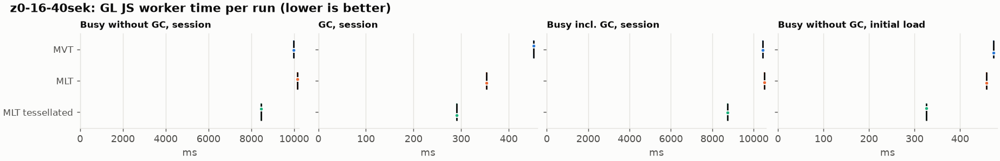
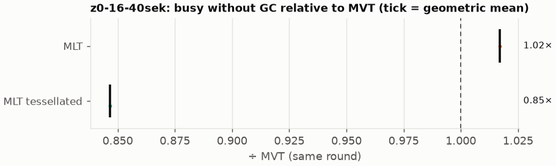
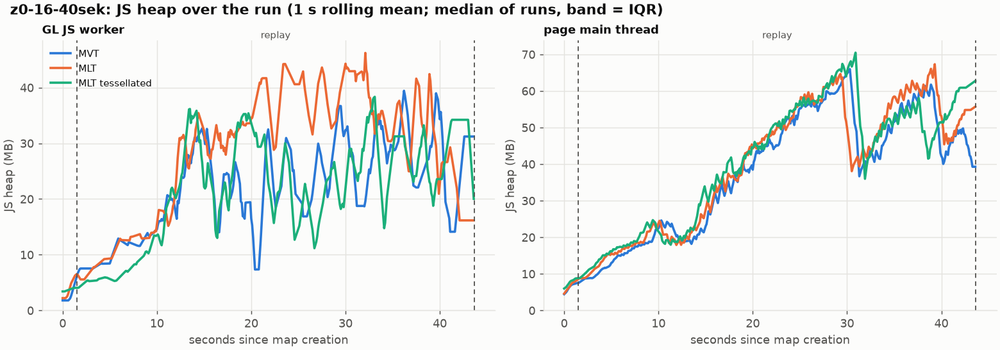
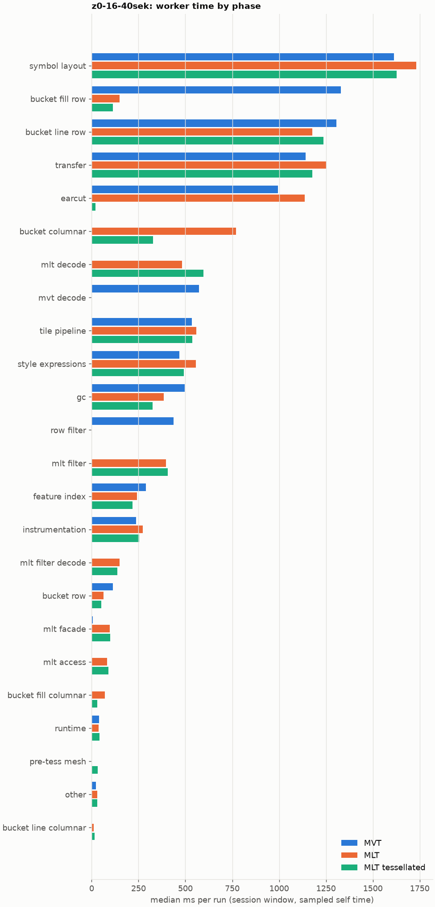

# Session trace benchmark — 20261106-103822

## Setup

- Created 2026-11-06T10:38:22+01:00; 1 repetitions + 0 warm-up round(s) (excluded); variants rotate per round (A B C, B C A, …); one cold browser context per run.
- Machine: 13th Gen Intel(R) Core(TM) i7-1365U, 12 logical cores, 31.3 GB RAM, Windows-11-10.0.26200-SP0; power: GUID des Energieschemas: 381b4222-f694-41f0-9685-ff5bb260df2e  (Ausbalanciert), AC True.
- GL JS gl7-performance-optimization @ d14e96a410 (dirty); worker count 1; viewport {'width': 1280, 'height': 1024}.
- Python 3.12.2, packages {'playwright': '1.64.0', 'numpy': '2.5.3', 'matplotlib': '3.11.2'}.

| variant | bundle | format | bundle sha256 | branch build |
|---|---|---|---|---|
| MVT | `dist/maplibre-gl-dev.mjs` | mvt | `7f8a1202aa31` | – |
| MLT | `dist/maplibre-gl-dev.mjs` | mlt | `7f8a1202aa31` | – |
| MLT tessellated | `dist/maplibre-gl-dev.mjs` | mlt-pre-tess | `7f8a1202aa31` | – |

| session | style | duration | frames | sha256 |
|---|---|---:|---:|---|
| z0-16-40sek | osm-bright | 42.1 s | 1739 | `55a2b8f22fe2` |

CPU sampling interval (median over runs): 629 µs.

## Definitions

- **busy** = wall time in which a GL JS worker thread runs a task (union of top-level task slices and GC slices on `DedicatedWorker thread`s), summed over workers. **GC** = union of `MinorGC`/`MajorGC`/`V8.GC*` slices on those threads. **busy without GC** = busy − GC (headline metric).
- **CPU** = thread time (`tdur`) of the same slices. Phase categories and functions come from the trace's CPU samples (self time), categorised by `config/categories.toml` (nearest matching frame, leaf to root).
- Windows: **load** = map creation → first idle; **session** = camera replay; **tail** = end of replay → idle; **total** = load + session + tail.
- Ratios are against **MVT**: ratio of medians with a bootstrap 95 % CI, the geometric mean of per-round ratios, and a two-sided Mann–Whitney U p-value (normal approximation, not corrected for multiple comparisons; rough below n = 8). Lower than 1× means less worker time.

## Session `z0-16-40sek`

### Worker busy without GC (session window)

| variant | n ok / failed | median ms | IQR | mean | ratio vs MVT | 95 % CI | geo-mean paired | MWU p |
|---|---:|---:|---:|---:|---:|---:|---:|---:|
| MVT | 1 / 0 | 9,984 | 9,984–9,984 | 9,984 | 1.00× | – | – | – |
| MLT | 1 / 0 | 10,153 | 10,153–10,153 | 10,153 | 1.02× | – | 1.02× | 1.000 |
| MLT tessellated | 1 / 0 | 8,452 | 8,452–8,452 | 8,452 | 0.85× | – | 0.85× | 1.000 |

### All worker metrics (median, ratio vs baseline)

| metric | MVT | MLT | MLT tessellated |
|---|---:|---:|---:|
| busy incl. GC | 10,436 | 10,506 (1.01×) | 8,743 (0.84×) |
| &nbsp;&nbsp;of which GC | 452.4 | 352.8 (0.78×) | 291.1 (0.64×) |
| &nbsp;&nbsp;of which busy without GC | 9,984 | 10,153 (1.02×) | 8,452 (0.85×) |
| &nbsp;&nbsp;&nbsp;&nbsp;of which filtering (sampled, incl. callees) | 436.8 | 395.5 (0.91×) | 405.7 (0.93×) |
| &nbsp;&nbsp;&nbsp;&nbsp;of which column decoding inside the MLT filter (sampled) | 0.0 | 149.9 | 136.8 |
| &nbsp;&nbsp;&nbsp;&nbsp;of which timing instrumentation (sampled) | 238.0 | 272.4 (1.14×) | 254.6 (1.07×) |
| busy without GC and instrumentation | 9,746 | 9,881 (1.01×) | 8,197 (0.84×) |
| CPU time without GC | 9,090 | 8,867 (0.98×) | 7,734 (0.85×) |
| tile: download end → sent to main thread, median per tile | 242.0 | 250.3 (1.03×) | 161.6 (0.67×) |
| tile: download end → sent to main thread, 90th percentile | 651.9 | 646.6 (0.99×) | 435.4 (0.67×) |
| tile: download end → sent to main thread, 95th percentile | 793.9 | 731.3 (0.92×) | 509.3 (0.64×) |
| tile: download end → sent to main thread, 99th percentile | 962.3 | 915.1 (0.95×) | 636.3 (0.66×) |
| minor GCs | 88.00 | 73.00 (0.83×) | 48.00 (0.55×) |
| major GCs | 9.00 | 6.00 (0.67×) | 9.00 (1.00×) |
| peak worker heap (MB) | 57.2 | 59.8 (1.04×) | 45.6 (0.80×) |
| load: busy without GC | 473.8 | 457.4 (0.97×) | 325.6 (0.69×) |
| load: GC | 22.0 | 20.5 (0.93×) | 9.6 (0.43×) |
| total: busy without GC | 10,458 | 10,611 (1.01×) | 8,777 (0.84×) |

Rows marked *of which* are parts of the row above, not additional time. Tile rows are per-tile latencies (medians over tiles, then over runs), not sums: tiles overlap in time, and the medians of the parse and queue parts do not add up exactly to the median latency.

### Filtering (session window)

Sampled worker time spent in feature filtering, including everything the filter calls (expression evaluation, property access): **row filter** = the style-spec feature filter that MVT runs per feature, **mlt filter** = the columnar MLT filter (incl. the geometry-type selection), without the columns it decodes (see the next table). Medians per run; rules in `config/categories.toml`.

| variant | mlt filter | row filter | filtering | ratio vs MVT | 95 % CI | MWU p | share of sampled busy |
|---|---:|---:|---:|---:|---:|---:|---:|
| MVT | 0.0 | 436.8 | 436.8 | 1.00× | – | – | 4.5% |
| MLT | 395.5 | 0.0 | 395.5 | 0.91× | – | 1.000 | 4.1% |
| MLT tessellated | 405.7 | 0.0 | 405.7 | 0.93× | – | 1.000 | 5.2% |

**Filtering together with tile decoding.** The MLT decoder leaves columns encoded until something reads them, and the filter is usually the first reader: the columns it decodes (properties, and the geometry for `$type`) are **of which inside the filter** (phase *mlt filter decode*), the rest is *mlt decode* (geometry and columns read later, e.g. by paint properties and symbols). MVT decodes every feature's properties and geometry while it reads the tile (*mvt decode*), whether the filter keeps the feature or not. So **filtering** above compares the filters, and **decoding + filtering** compares all that the formats spend on decoding the tile and selecting features. **tile decoding** = *mvt decode* or *mlt decode* + *mlt filter decode*: work inside a call into a decoder. Reading data that is already decoded is not counted, as for MVT's feature objects: *mlt access* (row views, value getters, looking a column up by name) and the MLT facade (*mlt facade*). MVT decodes geometry only for the features its filter keeps, MLT decodes a layer's whole geometry column.

| variant | tile decoding | of which inside the filter | filtering | decoding + filtering | ratio vs MVT | 95 % CI | MWU p |
|---|---:|---:|---:|---:|---:|---:|---:|
| MVT | 572.1 | 0.0 | 436.8 | 1,009 | 1.00× | – | – |
| MLT | 631.0 | 149.9 | 395.5 | 1,026 | 1.02× | – | 1.000 |
| MLT tessellated | 733.3 | 136.8 | 405.7 | 1,139 | 1.13× | – | 1.000 |

Top 12 functions inside filtering and its column decoding (self time, mean ms per run):

| phase | function | source | MVT | MLT | MLT tessellated |
|---|---|---|---:|---:|---:|
| row filter | `evaluate` | node_modules/@maplibre/maplibre-gl-style-spec/dist/expression/compound_expression.mjs | 155.2 | 0.0 | 0.0 |
| row filter | `CompoundExpression.register.filter-==` | node_modules/@maplibre/maplibre-gl-style-spec/dist/expression/compound_expression.mjs | 50.8 | 0.0 | 0.0 |
| row filter | `evaluate` | node_modules/@maplibre/maplibre-gl-style-spec/dist/expression/index.mjs | 50.6 | 0.0 | 0.0 |
| row filter | `CompoundExpression.register.filter-in-small` | node_modules/@maplibre/maplibre-gl-style-spec/dist/expression/compound_expression.mjs | 48.3 | 0.0 | 0.0 |
| mlt filter | `scanDictionaryCodes` | maplibre-tile-spec/ts/dist/processing/filter/execution/filterKernel.js | 0.0 | 40.5 | 41.5 |
| mlt filter | `dictionaryRowMatches` | maplibre-tile-spec/ts/dist/processing/filter/execution/filterKernel.js | 0.0 | 38.9 | 38.8 |
| mlt filter | `filterByGeometryType` | maplibre-tile-spec/ts/dist/vector/geometry/geometryVector.js | 0.0 | 37.5 | 22.7 |
| row filter | `CompoundExpression.register.all.overloads` | node_modules/@maplibre/maplibre-gl-style-spec/dist/expression/compound_expression.mjs | 33.0 | 0.0 | 0.0 |
| row filter | `filter` | node_modules/@maplibre/maplibre-gl-style-spec/dist/feature_filter/index.mjs | 32.5 | 0.0 | 0.0 |
| mlt filter | `resolveDictionaryExecutor` | maplibre-tile-spec/ts/dist/processing/filter/execution/filterKernel.js | 0.0 | 20.9 | 31.3 |
| mlt filter | `bytesEqual` | maplibre-tile-spec/ts/dist/processing/filter/execution/filterKernel.js | 0.0 | 19.2 | 17.8 |
| mlt filter | `getNormalizedFilter` | maplibre-tile-spec/ts/dist/processing/filter/filterCache.js | 0.0 | 18.7 | 14.3 |

### Bucket time by layer type (session window)

Sampled self time of the bucket code per layer type, row and columnar path together (median ms per run). **shared bucket code** is code all layer types use (`src/data/bucket/*` outside the layer files, `columnar_populate.ts`, `columnar_mesh_arrays.ts`, `load_geometry.ts`). **earcut** triangulates for fill and fill-extrusion on the row path; **pre-tess mesh** takes over the stored triangles of a pre-tessellated fill. **symbol** is the whole symbol layout phase. For exact wall time per source layer and type see the timing log tables below (builds with `worker_timing.ts` only).

| variant | fill | fill-extrusion | line | symbol | shared bucket code | earcut | pre-tess mesh | total |
|---|---:|---:|---:|---:|---:|---:|---:|---:|
| MVT | 1,330 | 0.0 | 1,305 | 1,613 | 112.3 | 993.2 | 0.0 | 5,354 |
| MLT | 220.1 | 0.0 | 1,188 | 1,732 | 831.6 | 1,136 | 0.0 | 5,108 |
| MLT tessellated | 141.7 | 0.0 | 1,251 | 1,626 | 378.9 | 21.3 | 33.5 | 3,453 |

### Where the variants differ from MVT (session window, mean ms per run)

Open **[flame.html](flame.html)** to explore the call tree interactively: pick a variant, compare it with MVT (red = more time at the same call path, blue = less), click a frame to zoom in, and read the phase and function breakdown under it. Without a comparison, frames are coloured by phase: filtering is green in both formats, and the columns the MLT filter decodes on first access (*mlt filter decode*) are MLT blue frames under the green filter. `flame/*.txt` open in https://www.speedscope.app.

#### MLT vs MVT

**By phase** (sampled self time; the Δ column sums to the difference in sampled busy time):

| phase | MVT | MLT | Δ |
|---|---:|---:|---:|
| bucket columnar | 0.0 | 769.0 | +769.0 |
| mlt decode | 0.0 | 481.1 | +481.1 |
| mlt filter | 0.0 | 395.5 | +395.5 |
| mlt filter decode | 0.0 | 149.9 | +149.9 |
| earcut | 993.2 | 1,136 | +142.9 |
| symbol layout | 1,613 | 1,732 | +119.2 |
| transfer | 1,142 | 1,250 | +108.1 |
| mlt facade | 6.9 | 97.1 | +90.2 |
| style expressions | 468.9 | 556.0 | +87.0 |
| mlt access | 0.0 | 82.2 | +82.2 |
| bucket fill columnar | 0.0 | 70.9 | +70.9 |
| instrumentation | 238.0 | 272.4 | +34.5 |
| tile pipeline | 534.0 | 559.3 | +25.3 |
| bucket line columnar | 0.0 | 10.9 | +10.9 |
| other | 21.7 | 29.3 | +7.6 |
| runtime | 40.6 | 36.6 | -4.0 |
| feature index | 290.5 | 242.6 | -47.9 |
| bucket row | 112.3 | 62.6 | -49.6 |
| gc | 495.3 | 384.7 | -110.6 |
| bucket line row | 1,305 | 1,177 | -128.2 |
| row filter | 436.8 | 0.0 | -436.8 |
| mvt decode | 572.1 | 0.0 | -572.1 |
| bucket fill row | 1,330 | 149.2 | -1180.7 |

**Functions with the largest self-time difference** (by function name, summed over source files):

| function | MVT | MLT | Δ |
|---|---:|---:|---:|
| `signedArea$2` | 13.6 | 100.3 | +86.7 |
| `buildRingBoundingBoxes` | 0.0 | 84.7 | +84.7 |
| `buildEarcutMesh` | 0.0 | 78.5 | +78.5 |
| `serialize` | 295.8 | 361.3 | +65.6 |
| `emplace` | 250.5 | 313.6 | +63.1 |
| `writeEarcutFill` | 0.0 | 58.7 | +58.7 |
| `get` | 67.7 | 125.1 | +57.5 |
| `readScaledRings` | 0.0 | 56.2 | +56.2 |
| `decodeString$2` | 0.0 | 46.4 | +46.4 |
| `decodeComponentwiseDeltaVec2` | 0.0 | 45.6 | +45.6 |
| `(anonymous)` | 121.3 | 161.9 | +40.6 |
| `scanDictionaryCodes` | 0.0 | 40.5 | +40.5 |
| `_vertexToIndex` | 402.3 | 2.6 | -399.7 |
| `populate` | 239.3 | 26.2 | -213.1 |
| `evaluate` | 233.9 | 42.2 | -191.7 |
| `readVarint` | 167.6 | 7.1 | -160.5 |
| `loadGeometry` | 182.8 | 53.0 | -129.8 |

#### MLT tessellated vs MVT

**By phase** (sampled self time; the Δ column sums to the difference in sampled busy time):

| phase | MVT | MLT tessellated | Δ |
|---|---:|---:|---:|
| mlt decode | 0.0 | 596.5 | +596.5 |
| mlt filter | 0.0 | 405.7 | +405.7 |
| bucket columnar | 0.0 | 326.4 | +326.4 |
| mlt filter decode | 0.0 | 136.8 | +136.8 |
| mlt facade | 6.9 | 98.1 | +91.1 |
| mlt access | 0.0 | 89.8 | +89.8 |
| transfer | 1,142 | 1,176 | +34.7 |
| pre-tess mesh | 0.0 | 33.5 | +33.5 |
| bucket fill columnar | 0.0 | 29.2 | +29.2 |
| style expressions | 468.9 | 492.0 | +23.1 |
| instrumentation | 238.0 | 254.6 | +16.7 |
| bucket line columnar | 0.0 | 15.1 | +15.1 |
| symbol layout | 1,613 | 1,626 | +13.5 |
| other | 21.7 | 29.8 | +8.1 |
| tile pipeline | 534.0 | 536.2 | +2.3 |
| runtime | 40.6 | 41.5 | +0.8 |
| bucket row | 112.3 | 52.4 | -59.8 |
| bucket line row | 1,305 | 1,236 | -69.2 |
| feature index | 290.5 | 218.3 | -72.2 |
| gc | 495.3 | 324.3 | -171.0 |
| row filter | 436.8 | 0.0 | -436.8 |
| mvt decode | 572.1 | 0.0 | -572.1 |
| earcut | 993.2 | 21.3 | -971.9 |
| bucket fill row | 1,330 | 112.5 | -1217.5 |

**Functions with the largest self-time difference** (by function name, summed over source files):

| function | MVT | MLT tessellated | Δ |
|---|---:|---:|---:|
| `writeTessellatedFill` | 0.0 | 83.3 | +83.3 |
| `decodeUnsignedZigZagDeltaInt32` | 0.0 | 54.5 | +54.5 |
| `get` | 67.7 | 118.9 | +51.2 |
| `decodeComponentwiseDeltaVec2` | 0.0 | 49.0 | +49.0 |
| `decodeString$2` | 0.0 | 46.4 | +46.4 |
| `scanDictionaryCodes` | 0.0 | 41.5 | +41.5 |
| `dictionaryRowMatches` | 0.0 | 38.8 | +38.8 |
| `buildTessellatedBoundingBox` | 0.0 | 33.5 | +33.5 |
| `decodeFastPforInt32` | 0.0 | 33.3 | +33.3 |
| `decodeFsst` | 0.0 | 32.2 | +32.2 |
| `resolveDictionaryExecutor` | 0.0 | 31.3 | +31.3 |
| `postMessage` | 219.8 | 249.9 | +30.0 |
| `_vertexToIndex` | 402.3 | 0.0 | -402.3 |
| `isEar` | 298.6 | 5.1 | -293.5 |
| `populate` | 239.3 | 23.0 | -216.2 |
| `evaluate` | 233.9 | 34.8 | -199.1 |
| `(garbage collector)` | 495.3 | 324.3 | -171.0 |

### Memory (session window)

**JS heap** = V8's used heap of the thread (`jsHeapSizeUsed` from the trace's `UpdateCounters`, about every 20 ms; the mean is time-weighted). It does not include ArrayBuffer contents, so the tile data itself (vertex, index and feature-index arrays) is not in it: **tile data sent to the main thread** is the size of the ArrayBuffers each tile result transfers (`web/worker_hook.js`), which then live on the main thread and are uploaded to the GPU. **garbage collected** = heap freed by the worker's GCs, a measure of how much it allocates. Medians per run; ratio of medians with a bootstrap 95 % CI.

| metric | MVT | MLT | MLT tessellated |
|---|---:|---:|---:|
| worker JS heap, mean (MB) | 19.0 | 25.5 (1.34×, –) | 18.3 (0.96×, –) |
| worker JS heap, peak (MB) | 57.2 | 59.8 (1.04×, –) | 45.6 (0.80×, –) |
| worker JS heap after the last GC (MB) | 11.7 | 10.6 (0.91×, –) | 8.9 (0.76×, –) |
| garbage collected in the worker (MB) | 2,376 | 1,724 (0.73×, –) | 934.7 (0.39×, –) |
| main thread JS heap, mean (MB) | 35.1 | 36.5 (1.04×, –) | 36.7 (1.05×, –) |
| main thread JS heap, peak (MB) | 75.1 | 75.6 (1.01×, –) | 77.1 (1.03×, –) |
| main thread JS heap at the end of the replay (MB) | 39.9 | 55.4 (1.39×, –) | 61.5 (1.54×, –) |
| tile data sent to the main thread, total (MB) | 141.5 | 135.9 (0.96×, –) | 131.0 (0.93×, –) |
| tile data sent to the main thread, median per tile (KB) | 420.0 | 411.9 (0.98×, –) | 391.7 (0.93×, –) |

### Worker time by phase (session window, median ms of sampled self time)

| phase | MVT | MLT | MLT tessellated |
|---|---:|---:|---:|
| symbol layout | 1,613 | 1,732 | 1,626 |
| bucket fill row | 1,330 | 149.2 | 112.5 |
| bucket line row | 1,305 | 1,177 | 1,236 |
| transfer | 1,142 | 1,250 | 1,176 |
| earcut | 993.2 | 1,136 | 21.3 |
| bucket columnar | 0.0 | 769.0 | 326.4 |
| mlt decode | 0.0 | 481.1 | 596.5 |
| mvt decode | 572.1 | 0.0 | 0.0 |
| tile pipeline | 534.0 | 559.3 | 536.2 |
| style expressions | 468.9 | 556.0 | 492.0 |
| gc | 495.3 | 384.7 | 324.3 |
| row filter | 436.8 | 0.0 | 0.0 |
| mlt filter | 0.0 | 395.5 | 405.7 |
| feature index | 290.5 | 242.6 | 218.3 |
| instrumentation | 238.0 | 272.4 | 254.6 |
| mlt filter decode | 0.0 | 149.9 | 136.8 |
| bucket row | 112.3 | 62.6 | 52.4 |
| mlt facade | 6.9 | 97.1 | 98.1 |
| mlt access | 0.0 | 82.2 | 89.8 |
| bucket fill columnar | 0.0 | 70.9 | 29.2 |
| runtime | 40.6 | 36.6 | 41.5 |
| pre-tess mesh | 0.0 | 0.0 | 33.5 |
| other | 21.7 | 29.3 | 29.8 |
| bucket line columnar | 0.0 | 10.9 | 15.1 |
| bucket fill-extrusion row | 0.0 | 0.0 | 0.0 |

### Top 20 worker functions by self time (session window, mean ms per run)

| function | source | phase | MVT | MLT | MLT tessellated |
|---|---|---|---:|---:|---:|
| `reserve` | src/util/struct_array.ts | bucket columnar | 591.0 | 579.1 | 540.1 |
| `(garbage collector)` | (native) | gc | 495.3 | 384.7 | 324.3 |
| `_vertexToIndex` | src/render/subdivision.ts | bucket fill row | 402.3 | 2.6 | 0.0 |
| `isEar` | node_modules/earcut/src/earcut.js | earcut | 298.6 | 316.8 | 5.1 |
| `emplace` | src/data/array_types.g.ts | bucket columnar | 250.5 | 313.6 | 275.9 |
| `serialize` | src/util/web_worker_transfer.ts | transfer | 258.0 | 304.9 | 252.8 |
| `postMessage` | (native) | transfer | 219.8 | 245.4 | 249.9 |
| `setTimeout` | (native) | transfer | 232.5 | 246.0 | 233.1 |
| `ProgramConfiguration` | src/data/program_configuration.ts | bucket fill row | 193.3 | 208.0 | 197.3 |
| `self.postMessage` | worker_hook.js | instrumentation | 173.6 | 189.7 | 181.7 |
| `_trim` | src/util/struct_array.ts | transfer | 188.0 | 170.7 | 164.5 |
| `fetch` | (native) | tile pipeline | 162.3 | 176.8 | 179.3 |
| `populate` | src/data/bucket/line_bucket.ts | bucket line row | 170.6 | 0.0 | 0.0 |
| `readVarint` | node_modules/pbf/index.js | mvt decode | 167.6 | 0.0 | 0.0 |
| `evaluate` | node_modules/@maplibre/maplibre-gl-style-spec/dist/expression/compound_expression.mjs | row filter | 155.2 | 0.0 | 0.0 |
| `addLine` | src/data/bucket/line_bucket.ts | bucket line row | 138.2 | 149.8 | 152.7 |
| `addHalfVertex` | src/data/bucket/line_bucket.ts | bucket line row | 124.0 | 129.5 | 152.2 |
| `earcutLinked` | node_modules/earcut/src/earcut.js | earcut | 121.3 | 152.1 | 3.6 |
| `isEarHashed` | node_modules/earcut/src/earcut.js |  | 130.9 | 145.8 | 0.0 |
| `insert` | src/data/feature_index.ts | feature index | 120.7 | 57.2 | 39.7 |

### Top 20 worker functions by total time (incl. callees) (session window, mean ms per run)

| function | source | phase | MVT | MLT | MLT tessellated |
|---|---|---|---:|---:|---:|
| `parse` | src/source/worker_tile.ts | tile pipeline | 7,334 | 7,465 | 5,810 |
| `loadTile` | src/source/vector_tile_worker_source.ts | tile pipeline | 5,963 | 5,833 | 4,357 |
| `_parseWorkerTile` | src/source/vector_tile_worker_source.ts | tile pipeline | 5,654 | 5,621 | 4,147 |
| `populate` | src/data/bucket/fill_bucket.ts | bucket fill row | 2,666 | 0.0 | 0.0 |
| `populate` | src/data/bucket/columnar/columnar_fill_bucket.ts | bucket fill columnar | 0.0 | 2,336 | 867.0 |
| `addBucketFeatures` | src/data/bucket/fill_bucket.ts | bucket fill row | 2,317 | 1,860 | 337.4 |
| `addFeature` | src/data/bucket/fill_bucket.ts |  | 2,231 | 26.9 | 0.0 |
| `addFeature` | src/data/bucket/columnar/columnar_fill_bucket.ts | bucket fill columnar | 0.0 | 1,825 | 310.0 |
| `subdividePolygon` | src/render/subdivision.ts |  | 1,814 | 21.2 | 0.0 |
| `subdividePolygonInternal` | src/render/subdivision.ts | bucket fill row | 1,789 | 21.2 | 0.0 |
| `writeEarcutFill` | src/data/bucket/columnar/columnar_mesh_arrays.ts | bucket columnar | 0.0 | 1,752 | 40.8 |
| `addFeatures` | src/data/bucket/symbol_bucket.ts | symbol layout | 1,439 | 1,578 | 1,456 |
| `performSymbolLayout` | src/symbol/symbol_layout.ts | symbol layout | 1,416 | 1,559 | 1,436 |
| `populate` | src/data/bucket/columnar/columnar_line_bucket.ts | bucket line columnar | 0.0 | 1,382 | 1,474 |
| `populate` | src/data/bucket/line_bucket.ts | bucket line row | 1,470 | 0.0 | 0.0 |
| `processTask` | src/util/actor.ts | transfer | 1,219 | 1,327 | 1,276 |
| `buildEarcutMesh` | src/data/bucket/columnar/columnar_mesh_arrays.ts | bucket columnar | 0.0 | 1,257 | 24.3 |
| `earcut` | node_modules/earcut/src/earcut.js | earcut | 992.6 | 1,136 | 21.3 |
| `completeTask` | src/util/actor.ts | transfer | 986.3 | 1,062 | 1,004 |
| `addBucketFeatures` | src/data/bucket/line_bucket.ts | bucket line row | 864.9 | 912.2 | 985.8 |

## Runs

3 ok, 0 failed/aborted, 0 not run, 3 used in statistics.

## Validity checks

- Counted once: all 3 analysed runs pass (windows load + session + tail add up to total; phases add up to the sampled busy time; GC and sampled time lie within busy time; no timing-log line twice).
- other programs used 8.71–9.89 logical processors during the replays (median 8.97)
- 3 run(s) with more than 0.5 cores of background load: z0-16-40sek/mvt/rep-00 (8.71), z0-16-40sek/mlt/rep-00 (8.97), z0-16-40sek/mlt-pre-tess/rep-00 (9.89)

## Files

- `runs.csv`: one row per run (incl. failed and warm-up runs), every scalar metric as `<window>.<metric>`.
- `summary.csv`: session × variant × metric statistics.
- `functions.csv`, `categories.csv`: CPU-sample self/total time per function and phase per run and window.
- `category_functions.csv`: self time per phase × function (e.g. what the filters spend their time on).
- `tiles.csv`, `tile_layers.csv`, `tile_phases.csv`: the per-tile worker timing log, long format.
- `flame.html`: interactive call tree per variant with a diff view; `flame/*.txt`: collapsed stacks for speedscope.
- `analysis/stacks.csv` (per run): sampled self time per full call stack.
- `tile_latency.csv`: per tile request, worker clock: received, download start/end, result sent, latency = sent − download end, parse_ms, wait_ms = latency − parse.
- `runs/<session>/<variant>/rep-NN/trace.json.gz`: the raw trace (opens in the DevTools Performance tab).
