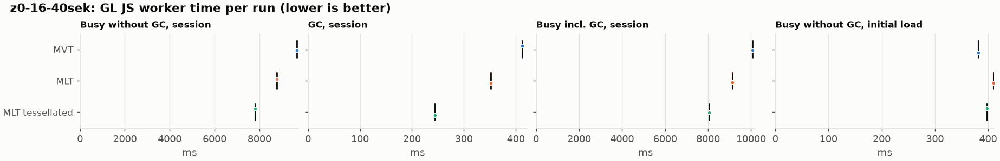
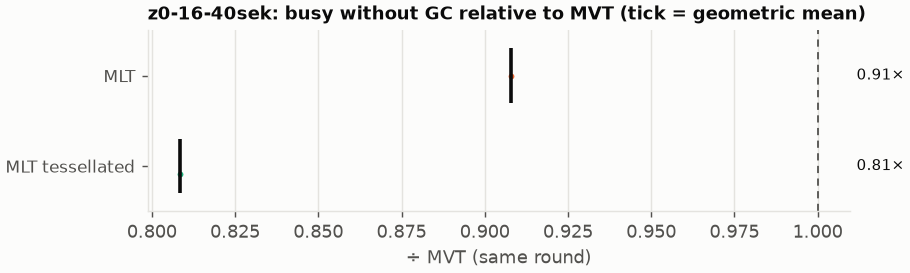
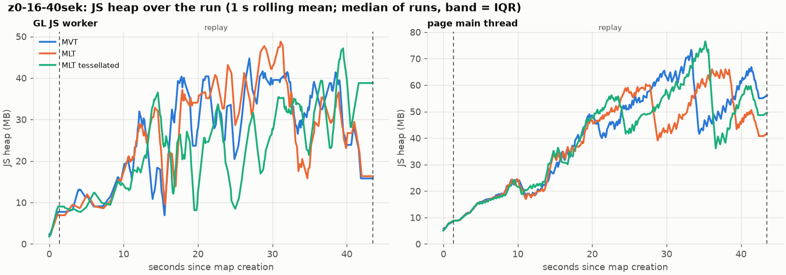
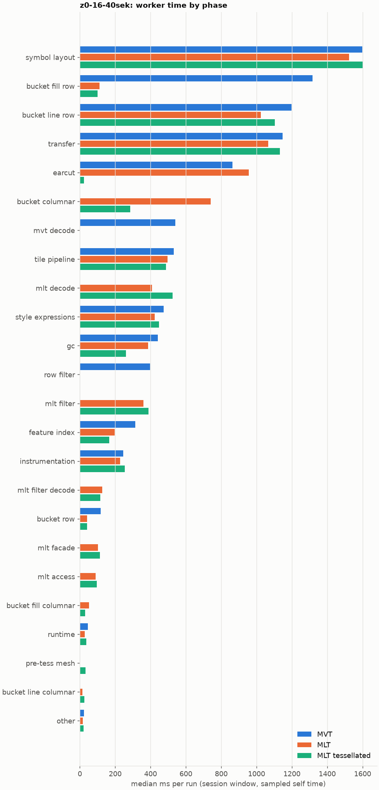

# Session trace benchmark — 20261106-115437

## Setup

- Created 2026-11-06T11:54:37+01:00; 1 repetitions + 0 warm-up round(s) (excluded); variants rotate per round (A B C, B C A, …); one cold browser context per run.
- Machine: 13th Gen Intel(R) Core(TM) i7-1365U, 12 logical cores, 31.3 GB RAM, Windows-11-10.0.26200-SP0; power: GUID des Energieschemas: 381b4222-f694-41f0-9685-ff5bb260df2e  (Ausbalanciert), AC True.
- GL JS gl7-performance-optimization @ 8d9aeba58b (dirty); worker count 1; viewport {'width': 1280, 'height': 1024}.
- Python 3.12.2, packages {'playwright': '1.64.0', 'numpy': '2.5.3', 'matplotlib': '3.11.2'}.

| variant | bundle | format | bundle sha256 | branch build |
|---|---|---|---|---|
| MVT | `dist/maplibre-gl-dev.mjs` | mvt | `4b8e23c84997` | – |
| MLT | `dist/maplibre-gl-dev.mjs` | mlt | `4b8e23c84997` | – |
| MLT tessellated | `dist/maplibre-gl-dev.mjs` | mlt-pre-tess | `4b8e23c84997` | – |

| session | style | duration | frames | sha256 |
|---|---|---:|---:|---|
| z0-16-40sek | osm-bright | 42.1 s | 1739 | `55a2b8f22fe2` |

CPU sampling interval (median over runs): 639 µs.

## Definitions

- **busy** = wall time in which a GL JS worker thread runs a task (union of top-level task slices and GC slices on `DedicatedWorker thread`s), summed over workers. **GC** = union of `MinorGC`/`MajorGC`/`V8.GC*` slices on those threads. **busy without GC** = busy − GC (headline metric).
- **CPU** = thread time (`tdur`) of the same slices. Phase categories and functions come from the trace's CPU samples (self time), categorised by `config/categories.toml` (nearest matching frame, leaf to root).
- Windows: **load** = map creation → first idle; **session** = camera replay; **tail** = end of replay → idle; **total** = load + session + tail.
- Ratios are against **MVT**: ratio of medians with a bootstrap 95 % CI, the geometric mean of per-round ratios, and a two-sided Mann–Whitney U p-value (normal approximation, not corrected for multiple comparisons; rough below n = 8). Lower than 1× means less worker time.

## Session `z0-16-40sek`

### Worker busy without GC (session window)

| variant | n ok / failed | median ms | IQR | mean | ratio vs MVT | 95 % CI | geo-mean paired | MWU p |
|---|---:|---:|---:|---:|---:|---:|---:|---:|
| MVT | 1 / 0 | 9,661 | 9,661–9,661 | 9,661 | 1.00× | – | – | – |
| MLT | 1 / 0 | 8,772 | 8,772–8,772 | 8,772 | 0.91× | – | 0.91× | 1.000 |
| MLT tessellated | 1 / 0 | 7,810 | 7,810–7,810 | 7,810 | 0.81× | – | 0.81× | 1.000 |

### All worker metrics (median, ratio vs baseline)

| metric | MVT | MLT | MLT tessellated |
|---|---:|---:|---:|
| busy incl. GC | 10,074 | 9,124 (0.91×) | 8,054 (0.80×) |
| &nbsp;&nbsp;of which GC | 412.7 | 351.6 (0.85×) | 243.9 (0.59×) |
| &nbsp;&nbsp;of which busy without GC | 9,661 | 8,772 (0.91×) | 7,810 (0.81×) |
| &nbsp;&nbsp;&nbsp;&nbsp;of which filtering (sampled, incl. callees) | 398.0 | 359.6 (0.90×) | 389.3 (0.98×) |
| &nbsp;&nbsp;&nbsp;&nbsp;of which column decoding inside the MLT filter (sampled) | 0.0 | 126.2 | 115.5 |
| &nbsp;&nbsp;&nbsp;&nbsp;of which timing instrumentation (sampled) | 245.3 | 227.2 (0.93×) | 254.8 (1.04×) |
| busy without GC and instrumentation | 9,416 | 8,545 (0.91×) | 7,555 (0.80×) |
| CPU time without GC | 8,563 | 8,149 (0.95×) | 6,911 (0.81×) |
| tile: download end → sent to main thread, median per tile | 201.8 | 224.4 (1.11×) | 180.0 (0.89×) |
| tile: download end → sent to main thread, 90th percentile | 574.0 | 550.5 (0.96×) | 412.5 (0.72×) |
| tile: download end → sent to main thread, 95th percentile | 669.8 | 726.4 (1.08×) | 476.8 (0.71×) |
| tile: download end → sent to main thread, 99th percentile | 899.6 | 812.0 (0.90×) | 586.2 (0.65×) |
| minor GCs | 90.00 | 72.00 (0.80×) | 45.00 (0.50×) |
| major GCs | 8.00 | 8.00 (1.00×) | 6.00 (0.75×) |
| peak worker heap (MB) | 61.3 | 61.9 (1.01×) | 52.9 (0.86×) |
| load: busy without GC | 382.1 | 409.7 (1.07×) | 397.6 (1.04×) |
| load: GC | 18.6 | 20.0 (1.08×) | 19.8 (1.07×) |
| total: busy without GC | 10,044 | 9,182 (0.91×) | 8,207 (0.82×) |

Rows marked *of which* are parts of the row above, not additional time. Tile rows are per-tile latencies (medians over tiles, then over runs), not sums: tiles overlap in time, and the medians of the parse and queue parts do not add up exactly to the median latency.

### Filtering (session window)

Sampled worker time spent in feature filtering, including everything the filter calls (expression evaluation, property access): **row filter** = the style-spec feature filter that MVT runs per feature, **mlt filter** = the columnar MLT filter (incl. the geometry-type selection), without the columns it decodes (see the next table). Medians per run; rules in `config/categories.toml`.

| variant | mlt filter | row filter | filtering | ratio vs MVT | 95 % CI | MWU p | share of sampled busy |
|---|---:|---:|---:|---:|---:|---:|---:|
| MVT | 0.4 | 397.6 | 398.0 | 1.00× | – | – | 4.3% |
| MLT | 359.6 | 0.0 | 359.6 | 0.90× | – | 1.000 | 4.3% |
| MLT tessellated | 389.3 | 0.0 | 389.3 | 0.98× | – | 1.000 | 5.3% |

**Filtering together with tile decoding.** The MLT decoder leaves columns encoded until something reads them, and the filter is usually the first reader: the columns it decodes (properties, and the geometry for `$type`) are **of which inside the filter** (phase *mlt filter decode*), the rest is *mlt decode* (geometry and columns read later, e.g. by paint properties and symbols). MVT decodes every feature's properties and geometry while it reads the tile (*mvt decode*), whether the filter keeps the feature or not. So **filtering** above compares the filters, and **decoding + filtering** compares all that the formats spend on decoding the tile and selecting features. **tile decoding** = *mvt decode* or *mlt decode* + *mlt filter decode*: work inside a call into a decoder. Reading data that is already decoded is not counted, as for MVT's feature objects: *mlt access* (row views, value getters, looking a column up by name) and the MLT facade (*mlt facade*). MVT decodes geometry only for the features its filter keeps, MLT decodes a layer's whole geometry column.

| variant | tile decoding | of which inside the filter | filtering | decoding + filtering | ratio vs MVT | 95 % CI | MWU p |
|---|---:|---:|---:|---:|---:|---:|---:|
| MVT | 540.2 | 0.0 | 398.0 | 938.2 | 1.00× | – | – |
| MLT | 535.4 | 126.2 | 359.6 | 895.0 | 0.95× | – | 1.000 |
| MLT tessellated | 639.3 | 115.5 | 389.3 | 1,029 | 1.10× | – | 1.000 |

Top 12 functions inside filtering and its column decoding (self time, mean ms per run):

| phase | function | source | MVT | MLT | MLT tessellated |
|---|---|---|---:|---:|---:|
| row filter | `evaluate` | node_modules/@maplibre/maplibre-gl-style-spec/dist/expression/compound_expression.mjs | 130.2 | 0.0 | 0.0 |
| row filter | `CompoundExpression.register.filter-in-small` | node_modules/@maplibre/maplibre-gl-style-spec/dist/expression/compound_expression.mjs | 54.8 | 0.0 | 0.0 |
| row filter | `evaluate` | node_modules/@maplibre/maplibre-gl-style-spec/dist/expression/index.mjs | 48.0 | 0.0 | 0.0 |
| mlt filter | `scanDictionaryCodes` | maplibre-tile-spec/ts/dist/processing/filter/execution/filterKernel.js | 0.0 | 34.5 | 45.5 |
| row filter | `CompoundExpression.register.filter-==` | node_modules/@maplibre/maplibre-gl-style-spec/dist/expression/compound_expression.mjs | 44.9 | 0.0 | 0.0 |
| mlt filter | `dictionaryRowMatches` | maplibre-tile-spec/ts/dist/processing/filter/execution/filterKernel.js | 0.0 | 35.5 | 28.1 |
| mlt filter | `filterByGeometryType` | maplibre-tile-spec/ts/dist/vector/geometry/geometryVector.js | 0.0 | 33.1 | 35.2 |
| row filter | `CompoundExpression.register.all.overloads` | node_modules/@maplibre/maplibre-gl-style-spec/dist/expression/compound_expression.mjs | 28.5 | 0.0 | 0.0 |
| mlt filter | `resolveDictionaryExecutor` | maplibre-tile-spec/ts/dist/processing/filter/execution/filterKernel.js | 0.0 | 26.1 | 24.8 |
| row filter | `filter` | node_modules/@maplibre/maplibre-gl-style-spec/dist/feature_filter/index.mjs | 22.6 | 0.0 | 0.0 |
| row filter | `CompoundExpression.register.filter-type-==` | node_modules/@maplibre/maplibre-gl-style-spec/dist/expression/compound_expression.mjs | 21.6 | 0.0 | 0.0 |
| mlt filter | `bytesEqual` | maplibre-tile-spec/ts/dist/processing/filter/execution/filterKernel.js | 0.0 | 14.4 | 21.0 |

### Bucket time by layer type (session window)

Sampled self time of the bucket code per layer type, row and columnar path together (median ms per run). **shared bucket code** is code all layer types use (`src/data/bucket/*` outside the layer files, `columnar_populate.ts`, `columnar_mesh_arrays.ts`, `load_geometry.ts`). **earcut** triangulates for fill and fill-extrusion on the row path; **pre-tess mesh** takes over the stored triangles of a pre-tessellated fill. **symbol** is the whole symbol layout phase. For exact wall time per source layer and type see the timing log tables below (builds with `worker_timing.ts` only).

| variant | fill | fill-extrusion | line | symbol | shared bucket code | earcut | pre-tess mesh | total |
|---|---:|---:|---:|---:|---:|---:|---:|---:|
| MVT | 1,316 | 0.0 | 1,199 | 1,599 | 117.7 | 863.3 | 0.0 | 5,096 |
| MLT | 163.3 | 0.0 | 1,039 | 1,523 | 782.9 | 955.4 | 0.0 | 4,463 |
| MLT tessellated | 130.3 | 0.0 | 1,129 | 1,601 | 326.8 | 23.0 | 31.0 | 3,241 |

### Where the variants differ from MVT (session window, mean ms per run)

Open **[flame.html](flame.html)** to explore the call tree interactively: pick a variant, compare it with MVT (red = more time at the same call path, blue = less), click a frame to zoom in, and read the phase and function breakdown under it. Without a comparison, frames are coloured by phase: filtering is green in both formats, and the columns the MLT filter decodes on first access (*mlt filter decode*) are MLT blue frames under the green filter. `flame/*.txt` open in https://www.speedscope.app.

#### MLT vs MVT

**By phase** (sampled self time; the Δ column sums to the difference in sampled busy time):

| phase | MVT | MLT | Δ |
|---|---:|---:|---:|
| bucket columnar | 0.0 | 741.1 | +741.1 |
| mlt decode | 0.0 | 409.1 | +409.1 |
| mlt filter | 0.4 | 359.6 | +359.2 |
| mlt filter decode | 0.0 | 126.2 | +126.2 |
| mlt facade | 0.0 | 102.5 | +102.5 |
| earcut | 863.3 | 955.4 | +92.0 |
| mlt access | 0.0 | 88.4 | +88.4 |
| bucket fill columnar | 0.0 | 51.2 | +51.2 |
| bucket line columnar | 0.0 | 15.6 | +15.6 |
| other | 23.1 | 16.5 | -6.6 |
| runtime | 44.7 | 27.7 | -17.0 |
| instrumentation | 245.3 | 227.2 | -18.0 |
| tile pipeline | 530.5 | 496.9 | -33.5 |
| style expressions | 473.9 | 424.0 | -49.9 |
| gc | 441.2 | 386.4 | -54.8 |
| bucket row | 117.7 | 41.8 | -75.9 |
| symbol layout | 1,599 | 1,523 | -76.2 |
| transfer | 1,146 | 1,067 | -79.5 |
| feature index | 313.8 | 197.0 | -116.8 |
| bucket line row | 1,199 | 1,023 | -175.8 |
| row filter | 397.6 | 0.0 | -397.6 |
| mvt decode | 540.2 | 0.0 | -540.2 |
| bucket fill row | 1,316 | 112.1 | -1204.3 |

**Functions with the largest self-time difference** (by function name, summed over source files):

| function | MVT | MLT | Δ |
|---|---:|---:|---:|
| `buildRingBoundingBoxes` | 0.0 | 78.0 | +78.0 |
| `buildEarcutMesh` | 0.0 | 77.1 | +77.1 |
| `signedArea$2` | 13.9 | 87.7 | +73.7 |
| `writeEarcutFill` | 0.0 | 49.7 | +49.7 |
| `readScaledRings` | 0.0 | 49.1 | +49.1 |
| `decodeString$2` | 0.0 | 43.2 | +43.2 |
| `get` | 67.2 | 109.9 | +42.8 |
| `decodeComponentwiseDeltaVec2` | 0.0 | 38.6 | +38.6 |
| `isEar` | 240.5 | 276.1 | +35.6 |
| `dictionaryRowMatches` | 0.0 | 35.5 | +35.5 |
| `scanDictionaryCodes` | 0.0 | 34.5 | +34.5 |
| `filterByGeometryType` | 0.0 | 33.1 | +33.1 |
| `_vertexToIndex` | 437.1 | 0.6 | -436.5 |
| `populate` | 231.7 | 28.7 | -202.9 |
| `evaluate` | 223.7 | 40.7 | -183.0 |
| `loadGeometry` | 190.9 | 35.1 | -155.8 |
| `readVarint` | 133.8 | 10.0 | -123.8 |

#### MLT tessellated vs MVT

**By phase** (sampled self time; the Δ column sums to the difference in sampled busy time):

| phase | MVT | MLT tessellated | Δ |
|---|---:|---:|---:|
| mlt decode | 0.0 | 523.9 | +523.9 |
| mlt filter | 0.4 | 389.3 | +388.8 |
| bucket columnar | 0.0 | 285.5 | +285.5 |
| mlt filter decode | 0.0 | 115.5 | +115.5 |
| mlt facade | 0.0 | 112.5 | +112.5 |
| mlt access | 0.0 | 96.1 | +96.1 |
| pre-tess mesh | 0.0 | 31.0 | +31.0 |
| bucket fill columnar | 0.0 | 30.4 | +30.4 |
| bucket line columnar | 0.0 | 25.8 | +25.8 |
| instrumentation | 245.3 | 254.8 | +9.5 |
| symbol layout | 1,599 | 1,601 | +1.7 |
| other | 23.1 | 21.6 | -1.4 |
| runtime | 44.7 | 35.5 | -9.2 |
| transfer | 1,146 | 1,131 | -15.1 |
| style expressions | 473.9 | 447.6 | -26.3 |
| tile pipeline | 530.5 | 487.7 | -42.8 |
| bucket row | 117.7 | 41.3 | -76.4 |
| bucket line row | 1,199 | 1,103 | -96.1 |
| feature index | 313.8 | 165.3 | -148.4 |
| gc | 441.2 | 261.3 | -179.9 |
| row filter | 397.6 | 0.0 | -397.6 |
| mvt decode | 540.2 | 0.0 | -540.2 |
| earcut | 863.3 | 23.0 | -840.3 |
| bucket fill row | 1,316 | 99.9 | -1216.5 |

**Functions with the largest self-time difference** (by function name, summed over source files):

| function | MVT | MLT tessellated | Δ |
|---|---:|---:|---:|
| `writeTessellatedFill` | 0.0 | 79.3 | +79.3 |
| `get` | 67.2 | 133.6 | +66.5 |
| `decodeComponentwiseDeltaVec2` | 0.0 | 58.2 | +58.2 |
| `decodeString$2` | 0.0 | 46.4 | +46.4 |
| `scanDictionaryCodes` | 0.0 | 45.5 | +45.5 |
| `decodeUnsignedZigZagDeltaInt32` | 0.0 | 36.7 | +36.7 |
| `filterByGeometryType` | 0.0 | 35.2 | +35.2 |
| `decodeFsst` | 0.0 | 33.9 | +33.9 |
| `decodeFastPforInt32` | 0.0 | 31.8 | +31.8 |
| `buildTessellatedBoundingBox` | 0.0 | 31.0 | +31.0 |
| `readVertices` | 0.0 | 28.9 | +28.9 |
| `dictionaryRowMatches` | 0.0 | 28.1 | +28.1 |
| `_vertexToIndex` | 437.1 | 1.3 | -435.8 |
| `isEar` | 240.5 | 5.2 | -235.3 |
| `populate` | 231.7 | 32.2 | -199.4 |
| `evaluate` | 223.7 | 38.1 | -185.6 |
| `(garbage collector)` | 441.2 | 261.3 | -179.9 |

### Memory (session window)

**JS heap** = V8's used heap of the thread (`jsHeapSizeUsed` from the trace's `UpdateCounters`, about every 20 ms; the mean is time-weighted). It does not include ArrayBuffer contents, so the tile data itself (vertex, index and feature-index arrays) is not in it: **tile data sent to the main thread** is the size of the ArrayBuffers each tile result transfers (`web/worker_hook.js`), which then live on the main thread and are uploaded to the GPU. **garbage collected** = heap freed by the worker's GCs, a measure of how much it allocates. Medians per run; ratio of medians with a bootstrap 95 % CI.

| metric | MVT | MLT | MLT tessellated |
|---|---:|---:|---:|
| worker JS heap, mean (MB) | 23.2 | 23.8 (1.03×, –) | 21.3 (0.92×, –) |
| worker JS heap, peak (MB) | 61.3 | 61.9 (1.01×, –) | 52.9 (0.86×, –) |
| worker JS heap after the last GC (MB) | 14.2 | 10.7 (0.76×, –) | 25.8 (1.82×, –) |
| garbage collected in the worker (MB) | 2,366 | 1,758 (0.74×, –) | 971.2 (0.41×, –) |
| main thread JS heap, mean (MB) | 37.4 | 35.8 (0.96×, –) | 36.7 (0.98×, –) |
| main thread JS heap, peak (MB) | 82.5 | 75.5 (0.92×, –) | 84.6 (1.03×, –) |
| main thread JS heap at the end of the replay (MB) | 55.6 | 41.3 (0.74×, –) | 49.3 (0.89×, –) |
| tile data sent to the main thread, total (MB) | 140.1 | 137.7 (0.98×, –) | 139.2 (0.99×, –) |
| tile data sent to the main thread, median per tile (KB) | 422.7 | 400.1 (0.95×, –) | 396.3 (0.94×, –) |

### Worker time by phase (session window, median ms of sampled self time)

| phase | MVT | MLT | MLT tessellated |
|---|---:|---:|---:|
| symbol layout | 1,599 | 1,523 | 1,601 |
| bucket fill row | 1,316 | 112.1 | 99.9 |
| bucket line row | 1,199 | 1,023 | 1,103 |
| transfer | 1,146 | 1,067 | 1,131 |
| earcut | 863.3 | 955.4 | 23.0 |
| bucket columnar | 0.0 | 741.1 | 285.5 |
| mvt decode | 540.2 | 0.0 | 0.0 |
| tile pipeline | 530.5 | 496.9 | 487.7 |
| mlt decode | 0.0 | 409.1 | 523.9 |
| style expressions | 473.9 | 424.0 | 447.6 |
| gc | 441.2 | 386.4 | 261.3 |
| row filter | 397.6 | 0.0 | 0.0 |
| mlt filter | 0.4 | 359.6 | 389.3 |
| feature index | 313.8 | 197.0 | 165.3 |
| instrumentation | 245.3 | 227.2 | 254.8 |
| mlt filter decode | 0.0 | 126.2 | 115.5 |
| bucket row | 117.7 | 41.8 | 41.3 |
| mlt facade | 0.0 | 102.5 | 112.5 |
| mlt access | 0.0 | 88.4 | 96.1 |
| bucket fill columnar | 0.0 | 51.2 | 30.4 |
| runtime | 44.7 | 27.7 | 35.5 |
| pre-tess mesh | 0.0 | 0.0 | 31.0 |
| bucket line columnar | 0.0 | 15.6 | 25.8 |
| other | 23.1 | 16.5 | 21.6 |
| bucket fill-extrusion row | 0.0 | 0.0 | 0.0 |

### Top 20 worker functions by self time (session window, mean ms per run)

| function | source | phase | MVT | MLT | MLT tessellated |
|---|---|---|---:|---:|---:|
| `reserve` | src/util/struct_array.ts | feature index | 557.5 | 513.2 | 514.6 |
| `(garbage collector)` | (native) | gc | 441.2 | 386.4 | 261.3 |
| `_vertexToIndex` | src/render/subdivision.ts | bucket fill row | 437.1 | 0.6 | 1.3 |
| `isEar` | node_modules/earcut/src/earcut.js | earcut | 240.5 | 276.1 | 5.2 |
| `emplace` | src/data/array_types.g.ts | bucket columnar | 242.8 | 256.3 | 253.0 |
| `serialize` | src/util/web_worker_transfer.ts | transfer | 234.9 | 222.8 | 247.5 |
| `setTimeout` | (native) | transfer | 230.0 | 212.0 | 241.2 |
| `postMessage` | (native) | transfer | 221.5 | 217.6 | 234.0 |
| `_trim` | src/util/struct_array.ts | transfer | 190.0 | 155.5 | 153.6 |
| `self.postMessage` | worker_hook.js | instrumentation | 183.4 | 168.1 | 186.1 |
| `ProgramConfiguration` | src/data/program_configuration.ts | bucket fill row | 181.5 | 183.5 | 160.0 |
| `fetch` | (native) | tile pipeline | 166.7 | 151.2 | 161.7 |
| `populate` | src/data/bucket/line_bucket.ts | bucket line row | 161.8 | 0.0 | 0.0 |
| `addLine` | src/data/bucket/line_bucket.ts | bucket line row | 122.4 | 127.2 | 140.9 |
| `addHalfVertex` | src/data/bucket/line_bucket.ts | bucket line row | 133.4 | 113.6 | 140.0 |
| `isEarHashed` | node_modules/earcut/src/earcut.js | earcut | 137.0 | 129.7 | 1.8 |
| `readVarint` | node_modules/pbf/index.js | mvt decode | 133.8 | 0.0 | 0.0 |
| `evaluate` | node_modules/@maplibre/maplibre-gl-style-spec/dist/expression/compound_expression.mjs | row filter | 130.2 | 0.0 | 0.0 |
| `parse` | src/source/worker_tile.ts | tile pipeline | 123.6 | 97.0 | 74.3 |
| `insert` | src/data/feature_index.ts | feature index | 123.2 | 47.4 | 38.5 |

### Top 20 worker functions by total time (incl. callees) (session window, mean ms per run)

| function | source | phase | MVT | MLT | MLT tessellated |
|---|---|---|---:|---:|---:|
| `parse` | src/source/worker_tile.ts | tile pipeline | 7,000 | 6,484 | 5,393 |
| `loadTile` | src/source/vector_tile_worker_source.ts | tile pipeline | 5,622 | 5,068 | 3,945 |
| `_parseWorkerTile` | src/source/vector_tile_worker_source.ts | tile pipeline | 5,322 | 4,879 | 3,747 |
| `populate` | src/data/bucket/fill_bucket.ts | bucket fill row | 2,513 | 0.0 | 0.0 |
| `addBucketFeatures` | src/data/bucket/fill_bucket.ts | bucket fill row | 2,171 | 1,594 | 280.5 |
| `addFeature` | src/data/bucket/fill_bucket.ts | bucket fill row | 2,079 | 17.3 | 17.9 |
| `populate` | src/data/bucket/columnar/columnar_fill_bucket.ts | bucket fill columnar | 0.0 | 1,979 | 713.2 |
| `subdividePolygon` | src/render/subdivision.ts |  | 1,687 | 12.7 | 15.5 |
| `subdividePolygonInternal` | src/render/subdivision.ts |  | 1,659 | 12.7 | 15.5 |
| `addFeature` | src/data/bucket/columnar/columnar_fill_bucket.ts | bucket fill columnar | 0.0 | 1,580 | 258.0 |
| `writeEarcutFill` | src/data/bucket/columnar/columnar_mesh_arrays.ts | bucket columnar | 0.0 | 1,524 | 29.2 |
| `addFeatures` | src/data/bucket/symbol_bucket.ts | symbol layout | 1,432 | 1,375 | 1,444 |
| `performSymbolLayout` | src/symbol/symbol_layout.ts | symbol layout | 1,408 | 1,349 | 1,419 |
| `populate` | src/data/bucket/columnar/columnar_line_bucket.ts | bucket line columnar | 0.0 | 1,254 | 1,349 |
| `populate` | src/data/bucket/line_bucket.ts | bucket line row | 1,344 | 0.0 | 0.0 |
| `processTask` | src/util/actor.ts | transfer | 1,268 | 1,152 | 1,198 |
| `buildEarcutMesh` | src/data/bucket/columnar/columnar_mesh_arrays.ts | bucket columnar | 0.0 | 1,066 | 15.6 |
| `completeTask` | src/util/actor.ts | transfer | 1,025 | 923.8 | 967.4 |
| `earcut` | node_modules/earcut/src/earcut.js | earcut | 862.7 | 952.8 | 23.0 |
| `addBucketFeatures` | src/data/bucket/line_bucket.ts | bucket line row | 780.4 | 773.2 | 860.4 |

## Runs

3 ok, 0 failed/aborted, 0 not run, 3 used in statistics.

## Validity checks

- Counted once: all 3 analysed runs pass (windows load + session + tail add up to total; phases add up to the sampled busy time; GC and sampled time lie within busy time; no timing-log line twice).
- other programs used 8.76–9.40 logical processors during the replays (median 8.87)
- 3 run(s) with more than 0.5 cores of background load: z0-16-40sek/mvt/rep-00 (8.76), z0-16-40sek/mlt/rep-00 (9.40), z0-16-40sek/mlt-pre-tess/rep-00 (8.87)

## Files

- `runs.csv`: one row per run (incl. failed and warm-up runs), every scalar metric as `<window>.<metric>`.
- `summary.csv`: session × variant × metric statistics.
- `functions.csv`, `categories.csv`: CPU-sample self/total time per function and phase per run and window.
- `category_functions.csv`: self time per phase × function (e.g. what the filters spend their time on).
- `tiles.csv`, `tile_layers.csv`, `tile_phases.csv`: the per-tile worker timing log, long format.
- `flame.html`: interactive call tree per variant with a diff view; `flame/*.txt`: collapsed stacks for speedscope.
- `analysis/stacks.csv` (per run): sampled self time per full call stack.
- `tile_latency.csv`: per tile request, worker clock: received, download start/end, result sent, latency = sent − download end, parse_ms, wait_ms = latency − parse.
- `runs/<session>/<variant>/rep-NN/trace.json.gz`: the raw trace (opens in the DevTools Performance tab).
