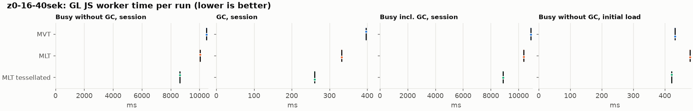
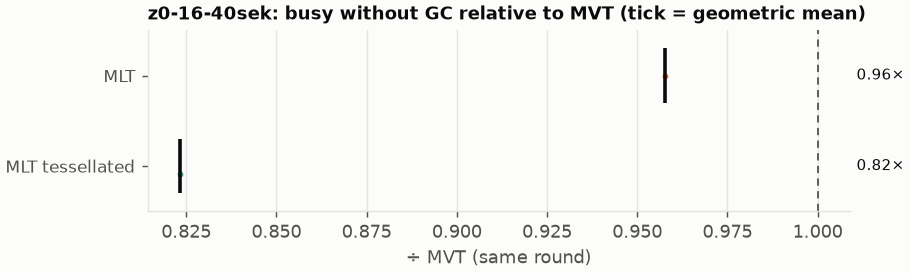
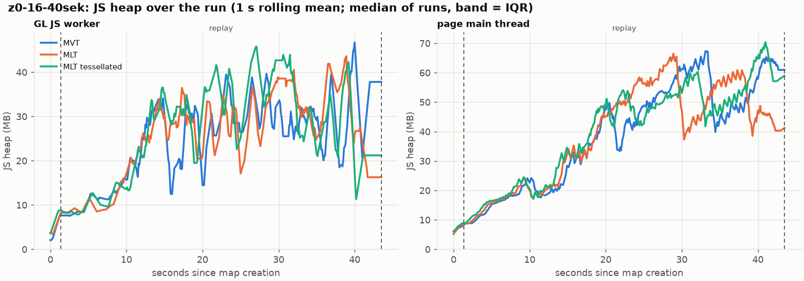
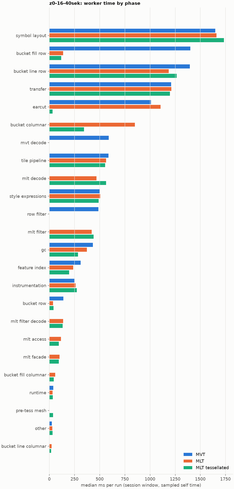

# Session trace benchmark — 20261106-120229

## Setup

- Created 2026-11-06T12:02:29+01:00; 1 repetitions + 0 warm-up round(s) (excluded); variants rotate per round (A B C, B C A, …); one cold browser context per run.
- Machine: 13th Gen Intel(R) Core(TM) i7-1365U, 12 logical cores, 31.3 GB RAM, Windows-11-10.0.26200-SP0; power: GUID des Energieschemas: 381b4222-f694-41f0-9685-ff5bb260df2e  (Ausbalanciert), AC True.
- GL JS gl7-performance-optimization @ 8d9aeba58b (dirty); worker count 1; viewport {'width': 1280, 'height': 1024}.
- Python 3.12.2, packages {'playwright': '1.64.0', 'numpy': '2.5.3', 'matplotlib': '3.11.2'}.

| variant | bundle | format | bundle sha256 | branch build |
|---|---|---|---|---|
| MVT | `dist/maplibre-gl-dev.mjs` | mvt | `4b8e23c84997` | – |
| MLT | `dist/maplibre-gl-dev.mjs` | mlt | `4b8e23c84997` | – |
| MLT tessellated | `dist/maplibre-gl-dev.mjs` | mlt-pre-tess | `4b8e23c84997` | – |

| session | style | duration | frames | sha256 |
|---|---|---:|---:|---|
| z0-16-40sek | osm-bright | 42.1 s | 1739 | `55a2b8f22fe2` |

CPU sampling interval (median over runs): 660 µs.

## Definitions

- **busy** = wall time in which a GL JS worker thread runs a task (union of top-level task slices and GC slices on `DedicatedWorker thread`s), summed over workers. **GC** = union of `MinorGC`/`MajorGC`/`V8.GC*` slices on those threads. **busy without GC** = busy − GC (headline metric).
- **CPU** = thread time (`tdur`) of the same slices. Phase categories and functions come from the trace's CPU samples (self time), categorised by `config/categories.toml` (nearest matching frame, leaf to root).
- Windows: **load** = map creation → first idle; **session** = camera replay; **tail** = end of replay → idle; **total** = load + session + tail.
- Ratios are against **MVT**: ratio of medians with a bootstrap 95 % CI, the geometric mean of per-round ratios, and a two-sided Mann–Whitney U p-value (normal approximation, not corrected for multiple comparisons; rough below n = 8). Lower than 1× means less worker time.

## Session `z0-16-40sek`

### Worker busy without GC (session window)

| variant | n ok / failed | median ms | IQR | mean | ratio vs MVT | 95 % CI | geo-mean paired | MWU p |
|---|---:|---:|---:|---:|---:|---:|---:|---:|
| MVT | 1 / 0 | 10,487 | 10,487–10,487 | 10,487 | 1.00× | – | – | – |
| MLT | 1 / 0 | 10,042 | 10,042–10,042 | 10,042 | 0.96× | – | 0.96× | 1.000 |
| MLT tessellated | 1 / 0 | 8,632 | 8,632–8,632 | 8,632 | 0.82× | – | 0.82× | 1.000 |

### All worker metrics (median, ratio vs baseline)

| metric | MVT | MLT | MLT tessellated |
|---|---:|---:|---:|
| busy incl. GC | 10,884 | 10,374 (0.95×) | 8,893 (0.82×) |
| &nbsp;&nbsp;of which GC | 396.9 | 332.3 (0.84×) | 261.0 (0.66×) |
| &nbsp;&nbsp;of which busy without GC | 10,487 | 10,042 (0.96×) | 8,632 (0.82×) |
| &nbsp;&nbsp;&nbsp;&nbsp;of which filtering (sampled, incl. callees) | 488.2 | 421.7 (0.86×) | 441.3 (0.90×) |
| &nbsp;&nbsp;&nbsp;&nbsp;of which column decoding inside the MLT filter (sampled) | 0.0 | 137.3 | 133.5 |
| &nbsp;&nbsp;&nbsp;&nbsp;of which timing instrumentation (sampled) | 251.4 | 261.6 (1.04×) | 272.2 (1.08×) |
| busy without GC and instrumentation | 10,235 | 9,780 (0.96×) | 8,360 (0.82×) |
| CPU time without GC | 9,320 | 8,825 (0.95×) | 7,574 (0.81×) |
| tile: download end → sent to main thread, median per tile | 203.5 | 229.0 (1.13×) | 171.1 (0.84×) |
| tile: download end → sent to main thread, 90th percentile | 681.7 | 614.6 (0.90×) | 491.1 (0.72×) |
| tile: download end → sent to main thread, 95th percentile | 729.2 | 694.2 (0.95×) | 616.3 (0.85×) |
| tile: download end → sent to main thread, 99th percentile | 1,017 | 902.1 (0.89×) | 667.6 (0.66×) |
| minor GCs | 88.00 | 68.00 (0.77×) | 43.00 (0.49×) |
| major GCs | 8.00 | 6.00 (0.75×) | 6.00 (0.75×) |
| peak worker heap (MB) | 56.1 | 55.9 (1.00×) | 57.5 (1.03×) |
| load: busy without GC | 432.0 | 480.0 (1.11×) | 421.5 (0.98×) |
| load: GC | 20.2 | 23.0 (1.14×) | 19.1 (0.94×) |
| total: busy without GC | 10,919 | 10,522 (0.96×) | 9,054 (0.83×) |

Rows marked *of which* are parts of the row above, not additional time. Tile rows are per-tile latencies (medians over tiles, then over runs), not sums: tiles overlap in time, and the medians of the parse and queue parts do not add up exactly to the median latency.

### Filtering (session window)

Sampled worker time spent in feature filtering, including everything the filter calls (expression evaluation, property access): **row filter** = the style-spec feature filter that MVT runs per feature, **mlt filter** = the columnar MLT filter (incl. the geometry-type selection), without the columns it decodes (see the next table). Medians per run; rules in `config/categories.toml`.

| variant | mlt filter | row filter | filtering | ratio vs MVT | 95 % CI | MWU p | share of sampled busy |
|---|---:|---:|---:|---:|---:|---:|---:|
| MVT | 0.6 | 487.6 | 488.2 | 1.00× | – | – | 4.9% |
| MLT | 421.7 | 0.0 | 421.7 | 0.86× | – | 1.000 | 4.4% |
| MLT tessellated | 441.3 | 0.0 | 441.3 | 0.90× | – | 1.000 | 5.5% |

**Filtering together with tile decoding.** The MLT decoder leaves columns encoded until something reads them, and the filter is usually the first reader: the columns it decodes (properties, and the geometry for `$type`) are **of which inside the filter** (phase *mlt filter decode*), the rest is *mlt decode* (geometry and columns read later, e.g. by paint properties and symbols). MVT decodes every feature's properties and geometry while it reads the tile (*mvt decode*), whether the filter keeps the feature or not. So **filtering** above compares the filters, and **decoding + filtering** compares all that the formats spend on decoding the tile and selecting features. **tile decoding** = *mvt decode* or *mlt decode* + *mlt filter decode*: work inside a call into a decoder. Reading data that is already decoded is not counted, as for MVT's feature objects: *mlt access* (row views, value getters, looking a column up by name) and the MLT facade (*mlt facade*). MVT decodes geometry only for the features its filter keeps, MLT decodes a layer's whole geometry column.

| variant | tile decoding | of which inside the filter | filtering | decoding + filtering | ratio vs MVT | 95 % CI | MWU p |
|---|---:|---:|---:|---:|---:|---:|---:|
| MVT | 589.6 | 0.0 | 488.2 | 1,078 | 1.00× | – | – |
| MLT | 606.9 | 137.3 | 421.7 | 1,029 | 0.95× | – | 1.000 |
| MLT tessellated | 697.8 | 133.5 | 441.3 | 1,139 | 1.06× | – | 1.000 |

Top 12 functions inside filtering and its column decoding (self time, mean ms per run):

| phase | function | source | MVT | MLT | MLT tessellated |
|---|---|---|---:|---:|---:|
| row filter | `evaluate` | node_modules/@maplibre/maplibre-gl-style-spec/dist/expression/compound_expression.mjs | 157.3 | 0.0 | 0.0 |
| row filter | `CompoundExpression.register.filter-in-small` | node_modules/@maplibre/maplibre-gl-style-spec/dist/expression/compound_expression.mjs | 65.8 | 0.0 | 0.0 |
| row filter | `evaluate` | node_modules/@maplibre/maplibre-gl-style-spec/dist/expression/index.mjs | 60.4 | 0.0 | 0.0 |
| row filter | `CompoundExpression.register.filter-==` | node_modules/@maplibre/maplibre-gl-style-spec/dist/expression/compound_expression.mjs | 55.3 | 0.0 | 0.0 |
| mlt filter | `scanDictionaryCodes` | maplibre-tile-spec/ts/dist/processing/filter/execution/filterKernel.js | 0.0 | 41.3 | 43.6 |
| mlt filter | `filterByGeometryType` | maplibre-tile-spec/ts/dist/vector/geometry/geometryVector.js | 0.0 | 38.0 | 33.7 |
| mlt filter | `dictionaryRowMatches` | maplibre-tile-spec/ts/dist/processing/filter/execution/filterKernel.js | 0.0 | 32.6 | 36.3 |
| mlt filter | `resolveDictionaryExecutor` | maplibre-tile-spec/ts/dist/processing/filter/execution/filterKernel.js | 0.0 | 21.5 | 30.3 |
| row filter | `CompoundExpression.register.all.overloads` | node_modules/@maplibre/maplibre-gl-style-spec/dist/expression/compound_expression.mjs | 28.8 | 0.0 | 0.0 |
| row filter | `filter` | node_modules/@maplibre/maplibre-gl-style-spec/dist/feature_filter/index.mjs | 28.4 | 0.0 | 0.0 |
| mlt filter | `bytesEqual` | maplibre-tile-spec/ts/dist/processing/filter/execution/filterKernel.js | 0.0 | 24.6 | 26.9 |
| mlt filter | `scanSelection` | maplibre-tile-spec/ts/dist/vector/filter/selectionVectorUtils.js | 0.0 | 17.2 | 23.4 |

### Bucket time by layer type (session window)

Sampled self time of the bucket code per layer type, row and columnar path together (median ms per run). **shared bucket code** is code all layer types use (`src/data/bucket/*` outside the layer files, `columnar_populate.ts`, `columnar_mesh_arrays.ts`, `load_geometry.ts`). **earcut** triangulates for fill and fill-extrusion on the row path; **pre-tess mesh** takes over the stored triangles of a pre-tessellated fill. **symbol** is the whole symbol layout phase. For exact wall time per source layer and type see the timing log tables below (builds with `worker_timing.ts` only).

| variant | fill | fill-extrusion | line | symbol | shared bucket code | earcut | pre-tess mesh | total |
|---|---:|---:|---:|---:|---:|---:|---:|---:|
| MVT | 1,403 | 0.0 | 1,397 | 1,650 | 140.3 | 1,011 | 0.0 | 5,601 |
| MLT | 196.9 | 0.0 | 1,209 | 1,662 | 887.9 | 1,107 | 0.0 | 5,063 |
| MLT tessellated | 163.7 | 0.0 | 1,283 | 1,736 | 386.3 | 31.7 | 36.7 | 3,637 |

### Where the variants differ from MVT (session window, mean ms per run)

Open **[flame.html](flame.html)** to explore the call tree interactively: pick a variant, compare it with MVT (red = more time at the same call path, blue = less), click a frame to zoom in, and read the phase and function breakdown under it. Without a comparison, frames are coloured by phase: filtering is green in both formats, and the columns the MLT filter decodes on first access (*mlt filter decode*) are MLT blue frames under the green filter. `flame/*.txt` open in https://www.speedscope.app.

#### MLT vs MVT

**By phase** (sampled self time; the Δ column sums to the difference in sampled busy time):

| phase | MVT | MLT | Δ |
|---|---:|---:|---:|
| bucket columnar | 0.0 | 849.6 | +849.6 |
| mlt decode | 0.0 | 469.6 | +469.6 |
| mlt filter | 0.6 | 421.7 | +421.0 |
| mlt filter decode | 0.0 | 137.3 | +137.3 |
| mlt access | 0.0 | 116.1 | +116.1 |
| mlt facade | 1.3 | 101.8 | +100.5 |
| earcut | 1,011 | 1,107 | +95.7 |
| bucket fill columnar | 0.0 | 58.8 | +58.8 |
| bucket line columnar | 0.0 | 21.8 | +21.8 |
| symbol layout | 1,650 | 1,662 | +11.8 |
| instrumentation | 251.4 | 261.6 | +10.2 |
| other | 24.1 | 30.0 | +5.9 |
| style expressions | 501.2 | 506.8 | +5.5 |
| transfer | 1,211 | 1,214 | +3.1 |
| runtime | 39.2 | 33.2 | -6.0 |
| tile pipeline | 587.7 | 563.6 | -24.1 |
| gc | 433.4 | 373.1 | -60.2 |
| feature index | 312.4 | 237.7 | -74.8 |
| bucket row | 140.3 | 38.4 | -102.0 |
| bucket line row | 1,397 | 1,188 | -209.2 |
| row filter | 487.6 | 0.0 | -487.6 |
| mvt decode | 589.6 | 0.0 | -589.6 |
| bucket fill row | 1,403 | 138.1 | -1264.5 |

**Functions with the largest self-time difference** (by function name, summed over source files):

| function | MVT | MLT | Δ |
|---|---:|---:|---:|
| `buildEarcutMesh` | 0.0 | 89.3 | +89.3 |
| `buildRingBoundingBoxes` | 0.0 | 88.9 | +88.9 |
| `get` | 72.6 | 140.5 | +67.9 |
| `signedArea$2` | 18.1 | 85.6 | +67.5 |
| `readScaledRings` | 0.0 | 64.7 | +64.7 |
| `writeEarcutFill` | 0.0 | 57.0 | +57.0 |
| `decodeString$2` | 0.0 | 52.5 | +52.5 |
| `decodeComponentwiseDeltaVec2` | 0.0 | 51.2 | +51.2 |
| `scanDictionaryCodes` | 0.0 | 41.3 | +41.3 |
| `filterByGeometryType` | 0.0 | 38.0 | +38.0 |
| `(anonymous)` | 137.4 | 173.4 | +36.0 |
| `fillLargeMeshArrays` | 83.3 | 116.2 | +32.9 |
| `_vertexToIndex` | 422.7 | 3.5 | -419.2 |
| `populate` | 271.3 | 35.8 | -235.5 |
| `evaluate` | 258.5 | 44.5 | -214.0 |
| `readVarint` | 172.1 | 10.3 | -161.8 |
| `loadGeometry` | 187.2 | 36.1 | -151.2 |

#### MLT tessellated vs MVT

**By phase** (sampled self time; the Δ column sums to the difference in sampled busy time):

| phase | MVT | MLT tessellated | Δ |
|---|---:|---:|---:|
| mlt decode | 0.0 | 564.3 | +564.3 |
| mlt filter | 0.6 | 441.3 | +440.7 |
| bucket columnar | 0.0 | 344.4 | +344.4 |
| mlt filter decode | 0.0 | 133.5 | +133.5 |
| mlt access | 0.0 | 95.1 | +95.1 |
| mlt facade | 1.3 | 95.2 | +93.9 |
| symbol layout | 1,650 | 1,736 | +85.5 |
| bucket fill columnar | 0.0 | 44.4 | +44.4 |
| pre-tess mesh | 0.0 | 36.7 | +36.7 |
| instrumentation | 251.4 | 272.2 | +20.8 |
| bucket line columnar | 0.0 | 17.7 | +17.7 |
| other | 24.1 | 32.6 | +8.4 |
| runtime | 39.2 | 34.7 | -4.5 |
| style expressions | 501.2 | 491.3 | -10.0 |
| transfer | 1,211 | 1,200 | -11.0 |
| tile pipeline | 587.7 | 553.7 | -34.0 |
| bucket row | 140.3 | 41.9 | -98.5 |
| feature index | 312.4 | 197.1 | -115.3 |
| bucket line row | 1,397 | 1,265 | -132.0 |
| gc | 433.4 | 286.2 | -147.2 |
| row filter | 487.6 | 0.0 | -487.6 |
| mvt decode | 589.6 | 0.0 | -589.6 |
| earcut | 1,011 | 31.7 | -979.2 |
| bucket fill row | 1,403 | 119.3 | -1283.3 |

**Functions with the largest self-time difference** (by function name, summed over source files):

| function | MVT | MLT tessellated | Δ |
|---|---:|---:|---:|
| `writeTessellatedFill` | 0.0 | 94.8 | +94.8 |
| `get` | 72.6 | 129.2 | +56.7 |
| `decodeComponentwiseDeltaVec2` | 0.0 | 54.5 | +54.5 |
| `decodeUnsignedZigZagDeltaInt32` | 0.0 | 49.8 | +49.8 |
| `scanDictionaryCodes` | 0.0 | 43.6 | +43.6 |
| `decodeFastPforInt32` | 0.0 | 38.8 | +38.8 |
| `dictionaryRowMatches` | 0.0 | 36.3 | +36.3 |
| `decodeString$2` | 0.0 | 35.4 | +35.4 |
| `buildTessellatedBoundingBox` | 0.0 | 35.2 | +35.2 |
| `materializeSelectedFeatures` | 0.0 | 34.4 | +34.4 |
| `filterByGeometryType` | 0.0 | 33.7 | +33.7 |
| `resolveDictionaryExecutor` | 0.0 | 30.3 | +30.3 |
| `_vertexToIndex` | 422.7 | 2.7 | -420.0 |
| `isEar` | 332.4 | 3.6 | -328.9 |
| `populate` | 271.3 | 37.3 | -234.0 |
| `evaluate` | 258.5 | 39.0 | -219.5 |
| `readVarint` | 172.1 | 8.2 | -164.0 |

### Memory (session window)

**JS heap** = V8's used heap of the thread (`jsHeapSizeUsed` from the trace's `UpdateCounters`, about every 20 ms; the mean is time-weighted). It does not include ArrayBuffer contents, so the tile data itself (vertex, index and feature-index arrays) is not in it: **tile data sent to the main thread** is the size of the ArrayBuffers each tile result transfers (`web/worker_hook.js`), which then live on the main thread and are uploaded to the GPU. **garbage collected** = heap freed by the worker's GCs, a measure of how much it allocates. Medians per run; ratio of medians with a bootstrap 95 % CI.

| metric | MVT | MLT | MLT tessellated |
|---|---:|---:|---:|
| worker JS heap, mean (MB) | 21.3 | 22.6 (1.06×, –) | 23.7 (1.12×, –) |
| worker JS heap, peak (MB) | 56.1 | 55.9 (1.00×, –) | 57.5 (1.03×, –) |
| worker JS heap after the last GC (MB) | 20.7 | 10.7 (0.51×, –) | 10.4 (0.50×, –) |
| garbage collected in the worker (MB) | 2,340 | 1,643 (0.70×, –) | 955.9 (0.41×, –) |
| main thread JS heap, mean (MB) | 36.1 | 35.3 (0.98×, –) | 35.9 (0.99×, –) |
| main thread JS heap, peak (MB) | 75.5 | 75.3 (1.00×, –) | 76.9 (1.02×, –) |
| main thread JS heap at the end of the replay (MB) | 61.6 | 40.9 (0.66×, –) | 57.7 (0.94×, –) |
| tile data sent to the main thread, total (MB) | 140.0 | 128.5 (0.92×, –) | 133.0 (0.95×, –) |
| tile data sent to the main thread, median per tile (KB) | 417.3 | 396.3 (0.95×, –) | 400.9 (0.96×, –) |

### Worker time by phase (session window, median ms of sampled self time)

| phase | MVT | MLT | MLT tessellated |
|---|---:|---:|---:|
| symbol layout | 1,650 | 1,662 | 1,736 |
| bucket fill row | 1,403 | 138.1 | 119.3 |
| bucket line row | 1,397 | 1,188 | 1,265 |
| transfer | 1,211 | 1,214 | 1,200 |
| earcut | 1,011 | 1,107 | 31.7 |
| bucket columnar | 0.0 | 849.6 | 344.4 |
| mvt decode | 589.6 | 0.0 | 0.0 |
| tile pipeline | 587.7 | 563.6 | 553.7 |
| mlt decode | 0.0 | 469.6 | 564.3 |
| style expressions | 501.2 | 506.8 | 491.3 |
| row filter | 487.6 | 0.0 | 0.0 |
| mlt filter | 0.6 | 421.7 | 441.3 |
| gc | 433.4 | 373.1 | 286.2 |
| feature index | 312.4 | 237.7 | 197.1 |
| instrumentation | 251.4 | 261.6 | 272.2 |
| bucket row | 140.3 | 38.4 | 41.9 |
| mlt filter decode | 0.0 | 137.3 | 133.5 |
| mlt access | 0.0 | 116.1 | 95.1 |
| mlt facade | 1.3 | 101.8 | 95.2 |
| bucket fill columnar | 0.0 | 58.8 | 44.4 |
| runtime | 39.2 | 33.2 | 34.7 |
| pre-tess mesh | 0.0 | 0.0 | 36.7 |
| other | 24.1 | 30.0 | 32.6 |
| bucket line columnar | 0.0 | 21.8 | 17.7 |
| bucket fill-extrusion row | 0.0 | 0.0 | 0.0 |

### Top 20 worker functions by self time (session window, mean ms per run)

| function | source | phase | MVT | MLT | MLT tessellated |
|---|---|---|---:|---:|---:|
| `reserve` | src/util/struct_array.ts | tile pipeline | 646.5 | 553.3 | 569.0 |
| `(garbage collector)` | (native) | gc | 433.4 | 373.1 | 286.2 |
| `_vertexToIndex` | src/render/subdivision.ts | bucket fill row | 422.7 | 3.5 | 2.7 |
| `isEar` | node_modules/earcut/src/earcut.js | earcut | 332.4 | 320.3 | 3.6 |
| `emplace` | src/data/array_types.g.ts | bucket fill row | 284.3 | 287.6 | 273.1 |
| `serialize` | src/util/web_worker_transfer.ts | transfer | 258.6 | 276.0 | 269.7 |
| `postMessage` | (native) | transfer | 232.5 | 238.4 | 246.2 |
| `setTimeout` | (native) | transfer | 234.2 | 239.3 | 241.9 |
| `ProgramConfiguration` | src/data/program_configuration.ts | bucket fill row | 185.7 | 215.5 | 213.7 |
| `_trim` | src/util/struct_array.ts | transfer | 202.9 | 178.6 | 145.8 |
| `populate` | src/data/bucket/line_bucket.ts | bucket line row | 200.8 | 0.0 | 0.0 |
| `self.postMessage` | worker_hook.js | instrumentation | 180.6 | 186.2 | 199.1 |
| `fetch` | (native) | tile pipeline | 166.7 | 186.9 | 186.1 |
| `readVarint` | node_modules/pbf/index.js | mvt decode | 172.1 | 0.0 | 0.0 |
| `evaluate` | node_modules/@maplibre/maplibre-gl-style-spec/dist/expression/compound_expression.mjs | row filter | 157.3 | 0.0 | 0.0 |
| `parse` | src/source/worker_tile.ts | tile pipeline | 154.2 | 113.6 | 101.0 |
| `addHalfVertex` | src/data/bucket/line_bucket.ts | bucket line row | 137.8 | 141.5 | 153.5 |
| `addLine` | src/data/bucket/line_bucket.ts | bucket line row | 121.2 | 130.1 | 148.2 |
| `isEarHashed` | node_modules/earcut/src/earcut.js | earcut | 141.5 | 148.1 | 6.1 |
| `insert` | src/data/feature_index.ts | feature index | 136.8 | 59.7 | 39.2 |

### Top 20 worker functions by total time (incl. callees) (session window, mean ms per run)

| function | source | phase | MVT | MLT | MLT tessellated |
|---|---|---|---:|---:|---:|
| `parse` | src/source/worker_tile.ts | tile pipeline | 7,746 | 7,412 | 5,992 |
| `loadTile` | src/source/vector_tile_worker_source.ts | tile pipeline | 6,305 | 5,865 | 4,434 |
| `_parseWorkerTile` | src/source/vector_tile_worker_source.ts | tile pipeline | 5,998 | 5,647 | 4,212 |
| `populate` | src/data/bucket/fill_bucket.ts | bucket fill row | 2,781 | 0.0 | 0.0 |
| `addBucketFeatures` | src/data/bucket/fill_bucket.ts | bucket fill row | 2,405 | 1,828 | 338.1 |
| `addFeature` | src/data/bucket/fill_bucket.ts |  | 2,310 | 25.9 | 23.2 |
| `populate` | src/data/bucket/columnar/columnar_fill_bucket.ts | bucket fill columnar | 0.0 | 2,260 | 813.7 |
| `subdividePolygon` | src/render/subdivision.ts |  | 1,865 | 23.8 | 21.6 |
| `subdividePolygonInternal` | src/render/subdivision.ts |  | 1,844 | 23.8 | 21.6 |
| `addFeature` | src/data/bucket/columnar/columnar_fill_bucket.ts | bucket fill columnar | 0.0 | 1,816 | 322.6 |
| `writeEarcutFill` | src/data/bucket/columnar/columnar_mesh_arrays.ts | bucket columnar | 0.0 | 1,746 | 33.2 |
| `populate` | src/data/bucket/line_bucket.ts | bucket line row | 1,592 | 0.0 | 0.0 |
| `addFeatures` | src/data/bucket/symbol_bucket.ts | symbol layout | 1,493 | 1,501 | 1,564 |
| `performSymbolLayout` | src/symbol/symbol_layout.ts | symbol layout | 1,466 | 1,470 | 1,544 |
| `populate` | src/data/bucket/columnar/columnar_line_bucket.ts | bucket line columnar | 0.0 | 1,462 | 1,507 |
| `processTask` | src/util/actor.ts | transfer | 1,302 | 1,304 | 1,312 |
| `buildEarcutMesh` | src/data/bucket/columnar/columnar_mesh_arrays.ts | bucket columnar | 0.0 | 1,236 | 22.9 |
| `earcut` | node_modules/earcut/src/earcut.js | earcut | 1,009 | 1,104 | 31.1 |
| `completeTask` | src/util/actor.ts | transfer | 1,059 | 1,029 | 1,034 |
| `addBucketFeatures` | src/data/bucket/line_bucket.ts | bucket line row | 901.1 | 930.9 | 980.2 |

## Runs

3 ok, 0 failed/aborted, 0 not run, 3 used in statistics.

## Validity checks

- Counted once: all 3 analysed runs pass (windows load + session + tail add up to total; phases add up to the sampled busy time; GC and sampled time lie within busy time; no timing-log line twice).
- other programs used 9.57–9.96 logical processors during the replays (median 9.83)
- 3 run(s) with more than 0.5 cores of background load: z0-16-40sek/mvt/rep-00 (9.57), z0-16-40sek/mlt/rep-00 (9.83), z0-16-40sek/mlt-pre-tess/rep-00 (9.96)

## Files

- `runs.csv`: one row per run (incl. failed and warm-up runs), every scalar metric as `<window>.<metric>`.
- `summary.csv`: session × variant × metric statistics.
- `functions.csv`, `categories.csv`: CPU-sample self/total time per function and phase per run and window.
- `category_functions.csv`: self time per phase × function (e.g. what the filters spend their time on).
- `tiles.csv`, `tile_layers.csv`, `tile_phases.csv`: the per-tile worker timing log, long format.
- `flame.html`: interactive call tree per variant with a diff view; `flame/*.txt`: collapsed stacks for speedscope.
- `analysis/stacks.csv` (per run): sampled self time per full call stack.
- `tile_latency.csv`: per tile request, worker clock: received, download start/end, result sent, latency = sent − download end, parse_ms, wait_ms = latency − parse.
- `runs/<session>/<variant>/rep-NN/trace.json.gz`: the raw trace (opens in the DevTools Performance tab).
