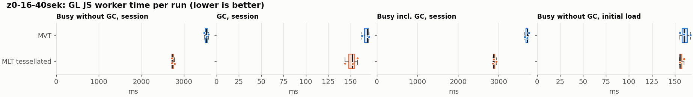
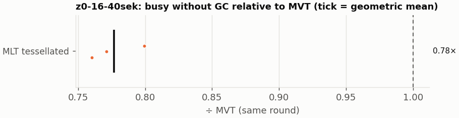
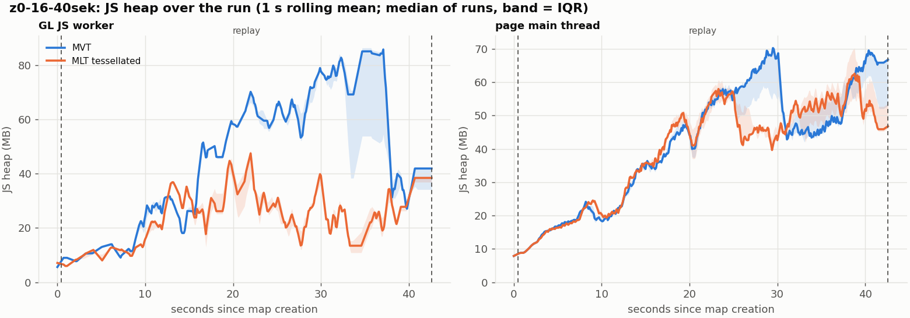
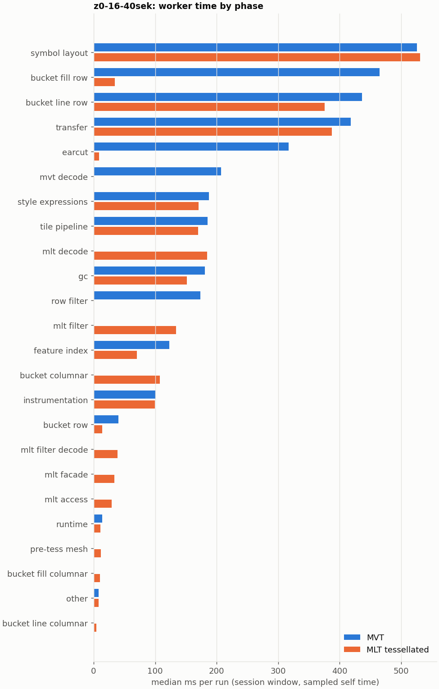

# Session trace benchmark — 20261106-161007

## Setup

- Created 2026-11-06T16:10:07+01:00; 3 repetitions + 1 warm-up round(s) (excluded); variants rotate per round (A B C, B C A, …); one cold browser context per run.
- Machine: , 16 logical cores, None GB RAM, Linux-7.2.9-200.nobara.fc44.x86_64-x86_64-with-glibc2.43; power: ?, AC None.
- GL JS gl7-local-files @ eb3231235c (dirty); worker count 1; viewport {'width': 1280, 'height': 1024}.
- Python 3.14.7, packages {'playwright': '1.64.1', 'numpy': '2.4.6', 'matplotlib': '3.10.8'}.

| variant | bundle | format | bundle sha256 | branch build |
|---|---|---|---|---|
| MVT | `dist/maplibre-gl-dev.mjs` | mvt | `4b8e23c84997` | – |
| MLT tessellated | `dist/maplibre-gl-dev.mjs` | mlt-pre-tess | `4b8e23c84997` | – |

| session | style | duration | frames | sha256 |
|---|---|---:|---:|---|
| z0-16-40sek | osm-bright | 42.1 s | 1739 | `55a2b8f22fe2` |

CPU sampling interval (median over runs): 159 µs.

## Definitions

- **busy** = wall time in which a GL JS worker thread runs a task (union of top-level task slices and GC slices on `DedicatedWorker thread`s), summed over workers. **GC** = union of `MinorGC`/`MajorGC`/`V8.GC*` slices on those threads. **busy without GC** = busy − GC (headline metric).
- **CPU** = thread time (`tdur`) of the same slices. Phase categories and functions come from the trace's CPU samples (self time), categorised by `config/categories.toml` (nearest matching frame, leaf to root).
- Windows: **load** = map creation → first idle; **session** = camera replay; **tail** = end of replay → idle; **total** = load + session + tail.
- Ratios are against **MVT**: ratio of medians with a bootstrap 95 % CI, the geometric mean of per-round ratios, and a two-sided Mann–Whitney U p-value (normal approximation, not corrected for multiple comparisons; rough below n = 8). Lower than 1× means less worker time.

## Session `z0-16-40sek`

### Worker busy without GC (session window)

| variant | n ok / failed | median ms | IQR | mean | ratio vs MVT | 95 % CI | geo-mean paired | MWU p |
|---|---:|---:|---:|---:|---:|---:|---:|---:|
| MVT | 3 / 0 | 3,529 | 3,504–3,551 | 3,527 | 1.00× | – | – | – |
| MLT tessellated | 3 / 0 | 2,721 | 2,719–2,751 | 2,740 | 0.77× | 0.76–0.80× | 0.78× | 0.081 |

### All worker metrics (median, ratio vs baseline)

| metric | MVT | MLT tessellated |
|---|---:|---:|
| busy incl. GC | 3,698 | 2,874 (0.78×) |
| &nbsp;&nbsp;of which GC | 169.0 | 152.3 (0.90×) |
| &nbsp;&nbsp;of which busy without GC | 3,529 | 2,721 (0.77×) |
| &nbsp;&nbsp;&nbsp;&nbsp;of which filtering (sampled, incl. callees) | 174.0 | 133.9 (0.77×) |
| &nbsp;&nbsp;&nbsp;&nbsp;of which column decoding inside the MLT filter (sampled) | 0.0 | 38.8 |
| &nbsp;&nbsp;&nbsp;&nbsp;of which timing instrumentation (sampled) | 100.1 | 99.8 (1.00×) |
| busy without GC and instrumentation | 3,429 | 2,624 (0.77×) |
| CPU time without GC | 3,431 | 2,621 (0.76×) |
| tile: download end → sent to main thread, median per tile | 50.9 | 38.3 (0.75×) |
| tile: download end → sent to main thread, 90th percentile | 201.0 | 136.1 (0.68×) |
| tile: download end → sent to main thread, 95th percentile | 287.8 | 175.8 (0.61×) |
| tile: download end → sent to main thread, 99th percentile | 322.9 | 208.1 (0.64×) |
| minor GCs | 95.00 | 39.00 (0.41×) |
| major GCs | 5.00 | 13.00 (2.60×) |
| peak worker heap (MB) | 99.1 | 51.4 (0.52×) |
| load: busy without GC | 160.0 | 155.5 (0.97×) |
| load: GC | 7.6 | 8.0 (1.06×) |
| total: busy without GC | 3,689 | 2,881 (0.78×) |

Rows marked *of which* are parts of the row above, not additional time. Tile rows are per-tile latencies (medians over tiles, then over runs), not sums: tiles overlap in time, and the medians of the parse and queue parts do not add up exactly to the median latency.

### Filtering (session window)

Sampled worker time spent in feature filtering, including everything the filter calls (expression evaluation, property access): **row filter** = the style-spec feature filter that MVT runs per feature, **mlt filter** = the columnar MLT filter (incl. the geometry-type selection), without the columns it decodes (see the next table). Medians per run; rules in `config/categories.toml`.

| variant | mlt filter | row filter | filtering | ratio vs MVT | 95 % CI | MWU p | share of sampled busy |
|---|---:|---:|---:|---:|---:|---:|---:|
| MVT | 0.2 | 173.7 | 174.0 | 1.00× | – | – | 5.2% |
| MLT tessellated | 133.9 | 0.0 | 133.9 | 0.77× | 0.71–0.87× | 0.081 | 5.2% |

**Filtering together with tile decoding.** The MLT decoder leaves columns encoded until something reads them, and the filter is usually the first reader: the columns it decodes (properties, and the geometry for `$type`) are **of which inside the filter** (phase *mlt filter decode*), the rest is *mlt decode* (geometry and columns read later, e.g. by paint properties and symbols). MVT decodes every feature's properties and geometry while it reads the tile (*mvt decode*), whether the filter keeps the feature or not. So **filtering** above compares the filters, and **decoding + filtering** compares all that the formats spend on decoding the tile and selecting features. **tile decoding** = *mvt decode* or *mlt decode* + *mlt filter decode*: work inside a call into a decoder. Reading data that is already decoded is not counted, as for MVT's feature objects: *mlt access* (row views, value getters, looking a column up by name) and the MLT facade (*mlt facade*). MVT decodes geometry only for the features its filter keeps, MLT decodes a layer's whole geometry column.

| variant | tile decoding | of which inside the filter | filtering | decoding + filtering | ratio vs MVT | 95 % CI | MWU p |
|---|---:|---:|---:|---:|---:|---:|---:|
| MVT | 206.9 | 0.0 | 174.0 | 380.9 | 1.00× | – | – |
| MLT tessellated | 224.2 | 38.8 | 133.9 | 357.1 | 0.94× | 0.93–0.98× | 0.081 |

Top 12 functions inside filtering and its column decoding (self time, mean ms per run):

| phase | function | source | MVT | MLT tessellated |
|---|---|---|---:|---:|
| row filter | `evaluate` | node_modules/@maplibre/maplibre-gl-style-spec/dist/expression/compound_expression.mjs | 49.9 | 0.0 |
| row filter | `CompoundExpression.register.filter-in-small` | node_modules/@maplibre/maplibre-gl-style-spec/dist/expression/compound_expression.mjs | 22.8 | 0.0 |
| row filter | `CompoundExpression.register.filter-==` | node_modules/@maplibre/maplibre-gl-style-spec/dist/expression/compound_expression.mjs | 21.5 | 0.0 |
| row filter | `evaluate` | node_modules/@maplibre/maplibre-gl-style-spec/dist/expression/index.mjs | 19.7 | 0.0 |
| row filter | `filter` | node_modules/@maplibre/maplibre-gl-style-spec/dist/feature_filter/index.mjs | 15.1 | 0.0 |
| mlt filter | `scanDictionaryCodes` | maplibre-tile-spec/ts/dist/processing/filter/execution/filterKernel.js | 0.0 | 13.1 |
| row filter | `CompoundExpression.register.all.overloads` | node_modules/@maplibre/maplibre-gl-style-spec/dist/expression/compound_expression.mjs | 13.0 | 0.0 |
| mlt filter | `filterByGeometryType` | maplibre-tile-spec/ts/dist/vector/geometry/geometryVector.js | 0.0 | 12.8 |
| mlt filter | `dictionaryRowMatches` | maplibre-tile-spec/ts/dist/processing/filter/execution/filterKernel.js | 0.0 | 12.1 |
| mlt filter | `resolveDictionaryExecutor` | maplibre-tile-spec/ts/dist/processing/filter/execution/filterKernel.js | 0.0 | 8.0 |
| mlt filter | `bytesEqual` | maplibre-tile-spec/ts/dist/processing/filter/execution/filterKernel.js | 0.0 | 7.9 |
| row filter | `CompoundExpression.register.filter-type-==` | node_modules/@maplibre/maplibre-gl-style-spec/dist/expression/compound_expression.mjs | 6.9 | 0.0 |

### Bucket time by layer type (session window)

Sampled self time of the bucket code per layer type, row and columnar path together (median ms per run). **shared bucket code** is code all layer types use (`src/data/bucket/*` outside the layer files, `columnar_populate.ts`, `columnar_mesh_arrays.ts`, `load_geometry.ts`). **earcut** triangulates for fill and fill-extrusion on the row path; **pre-tess mesh** takes over the stored triangles of a pre-tessellated fill. **symbol** is the whole symbol layout phase. For exact wall time per source layer and type see the timing log tables below (builds with `worker_timing.ts` only).

| variant | fill | fill-extrusion | line | symbol | shared bucket code | earcut | pre-tess mesh | total |
|---|---:|---:|---:|---:|---:|---:|---:|---:|
| MVT | 464.7 | 0.0 | 436.2 | 525.7 | 40.5 | 316.9 | 0.0 | 1,776 |
| MLT tessellated | 45.0 | 0.0 | 380.8 | 531.1 | 119.1 | 9.1 | 11.9 | 1,095 |

### Where the variants differ from MVT (session window, mean ms per run)

Open **[flame.html](flame.html)** to explore the call tree interactively: pick a variant, compare it with MVT (red = more time at the same call path, blue = less), click a frame to zoom in, and read the phase and function breakdown under it. Without a comparison, frames are coloured by phase: filtering is green in both formats, and the columns the MLT filter decodes on first access (*mlt filter decode*) are MLT blue frames under the green filter. `flame/*.txt` open in https://www.speedscope.app.

#### MLT tessellated vs MVT

**By phase** (sampled self time; the Δ column sums to the difference in sampled busy time):

| phase | MVT | MLT tessellated | Δ |
|---|---:|---:|---:|
| mlt decode | 0.0 | 186.5 | +186.5 |
| mlt filter | 0.2 | 135.3 | +135.1 |
| bucket columnar | 0.0 | 106.3 | +106.3 |
| mlt filter decode | 0.0 | 39.2 | +39.2 |
| mlt facade | 0.2 | 34.1 | +33.9 |
| mlt access | 0.0 | 29.3 | +29.3 |
| pre-tess mesh | 0.0 | 12.0 | +12.0 |
| bucket fill columnar | 0.0 | 10.6 | +10.6 |
| bucket line columnar | 0.0 | 4.5 | +4.5 |
| other | 9.6 | 8.2 | -1.4 |
| symbol layout | 529.3 | 527.5 | -1.8 |
| instrumentation | 101.1 | 99.2 | -1.9 |
| runtime | 15.0 | 10.7 | -4.3 |
| tile pipeline | 184.7 | 170.6 | -14.1 |
| style expressions | 189.4 | 170.5 | -18.8 |
| gc | 179.6 | 155.2 | -24.4 |
| transfer | 417.2 | 389.5 | -27.7 |
| bucket row | 40.7 | 12.7 | -27.9 |
| feature index | 120.6 | 70.2 | -50.4 |
| bucket line row | 435.2 | 375.1 | -60.1 |
| row filter | 172.8 | 0.0 | -172.8 |
| mvt decode | 207.5 | 0.0 | -207.5 |
| earcut | 316.6 | 9.5 | -307.1 |
| bucket fill row | 464.6 | 35.8 | -428.8 |

**Functions with the largest self-time difference** (by function name, summed over source files):

| function | MVT | MLT tessellated | Δ |
|---|---:|---:|---:|
| `writeTessellatedFill` | 0.0 | 26.1 | +26.1 |
| `decodeComponentwiseDeltaVec2` | 0.0 | 20.1 | +20.1 |
| `decodeUnsignedZigZagDeltaInt32` | 0.0 | 18.6 | +18.6 |
| `get` | 28.9 | 42.5 | +13.7 |
| `scanDictionaryCodes` | 0.0 | 13.1 | +13.1 |
| `filterByGeometryType` | 0.0 | 12.8 | +12.8 |
| `dictionaryRowMatches` | 0.0 | 12.1 | +12.1 |
| `decodeString$2` | 0.0 | 12.0 | +12.0 |
| `buildTessellatedBoundingBox` | 0.0 | 11.9 | +11.9 |
| `decodeFastPforInt32` | 0.0 | 11.4 | +11.4 |
| `appendScaledVertices` | 0.0 | 10.4 | +10.4 |
| `decodeFsst` | 0.0 | 10.1 | +10.1 |
| `_vertexToIndex` | 141.0 | 0.7 | -140.3 |
| `isEar` | 99.5 | 1.4 | -98.1 |
| `populate` | 100.0 | 8.5 | -91.5 |
| `evaluate` | 89.8 | 21.0 | -68.8 |
| `loadGeometry` | 65.4 | 10.7 | -54.6 |

### Memory (session window)

**JS heap** = V8's used heap of the thread (`jsHeapSizeUsed` from the trace's `UpdateCounters`, about every 20 ms; the mean is time-weighted). It does not include ArrayBuffer contents, so the tile data itself (vertex, index and feature-index arrays) is not in it: **tile data sent to the main thread** is the size of the ArrayBuffers each tile result transfers (`web/worker_hook.js`), which then live on the main thread and are uploaded to the GPU. **garbage collected** = heap freed by the worker's GCs, a measure of how much it allocates. Medians per run; ratio of medians with a bootstrap 95 % CI.

| metric | MVT | MLT tessellated |
|---|---:|---:|
| worker JS heap, mean (MB) | 40.7 | 19.8 (0.49×, 0.44–0.67×) |
| worker JS heap, peak (MB) | 99.1 | 51.4 (0.52×, 0.50–0.59×) |
| worker JS heap after the last GC (MB) | 22.5 | 14.4 (0.64×, 0.50–1.09×) |
| garbage collected in the worker (MB) | 2,489 | 982.6 (0.39×, 0.39–0.40×) |
| main thread JS heap, mean (MB) | 37.0 | 35.2 (0.95×, 0.94–1.00×) |
| main thread JS heap, peak (MB) | 79.4 | 75.3 (0.95×, 0.88–1.08×) |
| main thread JS heap at the end of the replay (MB) | 66.4 | 46.4 (0.70×, 0.68–1.55×) |
| tile data sent to the main thread, total (MB) | 148.6 | 137.9 (0.93×, 0.92–0.94×) |
| tile data sent to the main thread, median per tile (KB) | 410.8 | 384.3 (0.94×, 0.93–0.94×) |

### Worker time by phase (session window, median ms of sampled self time)

| phase | MVT | MLT tessellated |
|---|---:|---:|
| symbol layout | 525.7 | 531.1 |
| bucket fill row | 464.7 | 34.8 |
| bucket line row | 436.2 | 376.0 |
| transfer | 418.4 | 387.5 |
| earcut | 316.9 | 9.1 |
| mvt decode | 206.9 | 0.0 |
| style expressions | 187.6 | 170.7 |
| tile pipeline | 185.4 | 169.8 |
| mlt decode | 0.0 | 184.3 |
| gc | 181.1 | 151.6 |
| row filter | 173.7 | 0.0 |
| mlt filter | 0.2 | 133.9 |
| feature index | 122.8 | 70.4 |
| bucket columnar | 0.0 | 107.9 |
| instrumentation | 100.1 | 99.8 |
| bucket row | 40.5 | 13.6 |
| mlt filter decode | 0.0 | 38.8 |
| mlt facade | 0.0 | 33.8 |
| mlt access | 0.0 | 29.2 |
| runtime | 14.1 | 11.2 |
| pre-tess mesh | 0.0 | 11.9 |
| bucket fill columnar | 0.0 | 10.3 |
| other | 8.3 | 8.4 |
| bucket line columnar | 0.0 | 4.6 |
| bucket fill-extrusion row | 0.0 | 0.0 |

### Top 20 worker functions by self time (session window, mean ms per run)

| function | source | phase | MVT | MLT tessellated |
|---|---|---|---:|---:|
| `reserve` | src/util/struct_array.ts | tile pipeline | 213.9 | 192.0 |
| `(garbage collector)` | (native) | gc | 179.6 | 155.2 |
| `_vertexToIndex` | src/render/subdivision.ts | bucket fill row | 141.0 | 0.7 |
| `isEar` | node_modules/earcut/src/earcut.js | earcut | 99.5 | 1.4 |
| `_trim` | src/util/struct_array.ts | transfer | 93.1 | 66.7 |
| `serialize` | src/util/web_worker_transfer.ts | transfer | 83.4 | 89.0 |
| `emplace` | src/data/array_types.g.ts | bucket fill row | 85.8 | 88.5 |
| `self.postMessage` | worker_hook.js | instrumentation | 78.7 | 75.2 |
| `postMessage` | (native) | transfer | 75.3 | 71.5 |
| `populate` | src/data/bucket/line_bucket.ts | bucket line row | 70.3 | 0.0 |
| `setTimeout` | (native) | transfer | 65.5 | 63.8 |
| `readVarint` | node_modules/pbf/index.js | mvt decode | 56.6 | 0.0 |
| `ProgramConfiguration` | src/data/program_configuration.ts | bucket fill row | 48.0 | 53.5 |
| `evaluate` | node_modules/@maplibre/maplibre-gl-style-spec/dist/expression/compound_expression.mjs | row filter | 49.9 | 0.0 |
| `fetch` | (native) | tile pipeline | 49.9 | 48.2 |
| `insert` | src/data/feature_index.ts | feature index | 48.3 | 14.6 |
| `addLine` | src/data/bucket/line_bucket.ts | bucket line row | 45.9 | 45.3 |
| `parse` | src/source/worker_tile.ts | tile pipeline | 45.3 | 33.6 |
| `isEarHashed` | node_modules/earcut/src/earcut.js | earcut | 43.5 | 1.5 |
| `addHalfVertex` | src/data/bucket/line_bucket.ts | bucket line row | 36.3 | 39.3 |

### Top 20 worker functions by total time (incl. callees) (session window, mean ms per run)

| function | source | phase | MVT | MLT tessellated |
|---|---|---|---:|---:|
| `parse` | src/source/worker_tile.ts | tile pipeline | 2,534 | 1,859 |
| `loadTile` | src/source/vector_tile_worker_source.ts | tile pipeline | 2,075 | 1,354 |
| `_parseWorkerTile` | src/source/vector_tile_worker_source.ts | tile pipeline | 1,976 | 1,299 |
| `populate` | src/data/bucket/fill_bucket.ts | bucket fill row | 912.6 | 0.0 |
| `addBucketFeatures` | src/data/bucket/fill_bucket.ts | bucket fill row | 782.5 | 104.6 |
| `addFeature` | src/data/bucket/fill_bucket.ts | bucket fill row | 747.8 | 6.8 |
| `subdividePolygon` | src/render/subdivision.ts | bucket fill row | 613.4 | 6.1 |
| `subdividePolygonInternal` | src/render/subdivision.ts | bucket fill row | 605.1 | 6.1 |
| `populate` | src/data/bucket/line_bucket.ts | bucket line row | 527.4 | 0.0 |
| `addFeatures` | src/data/bucket/symbol_bucket.ts | symbol layout | 468.9 | 484.4 |
| `processTask` | src/util/actor.ts | transfer | 483.2 | 446.3 |
| `performSymbolLayout` | src/symbol/symbol_layout.ts | symbol layout | 462.7 | 476.4 |
| `populate` | src/data/bucket/columnar/columnar_line_bucket.ts | bucket line columnar | 0.0 | 463.9 |
| `completeTask` | src/util/actor.ts | transfer | 405.0 | 368.9 |
| `earcut` | node_modules/earcut/src/earcut.js | earcut | 316.6 | 9.4 |
| `addBucketFeatures` | src/data/bucket/line_bucket.ts | bucket line row | 287.9 | 304.4 |
| `serialize` | src/util/web_worker_transfer.ts | transfer | 278.3 | 248.1 |
| `populate` | src/data/bucket/columnar/columnar_fill_bucket.ts | bucket fill columnar | 0.0 | 268.2 |
| `addFeature` | src/data/bucket/line_bucket.ts | bucket line row | 254.2 | 263.9 |
| `resize` | src/util/struct_array.ts | tile pipeline | 244.5 | 213.7 |

## Runs

8 ok, 0 failed/aborted, 0 not run, 6 used in statistics.

## Validity checks

- Counted once: all 8 analysed runs pass (windows load + session + tail add up to total; phases add up to the sampled busy time; GC and sampled time lie within busy time; no timing-log line twice).
- no other check triggered

## Files

- `runs.csv`: one row per run (incl. failed and warm-up runs), every scalar metric as `<window>.<metric>`.
- `summary.csv`: session × variant × metric statistics.
- `functions.csv`, `categories.csv`: CPU-sample self/total time per function and phase per run and window.
- `category_functions.csv`: self time per phase × function (e.g. what the filters spend their time on).
- `tiles.csv`, `tile_layers.csv`, `tile_phases.csv`: the per-tile worker timing log, long format.
- `flame.html`: interactive call tree per variant with a diff view; `flame/*.txt`: collapsed stacks for speedscope.
- `analysis/stacks.csv` (per run): sampled self time per full call stack.
- `tile_latency.csv`: per tile request, worker clock: received, download start/end, result sent, latency = sent − download end, parse_ms, wait_ms = latency − parse.
- `runs/<session>/<variant>/rep-NN/trace.json.gz`: the raw trace (opens in the DevTools Performance tab).
